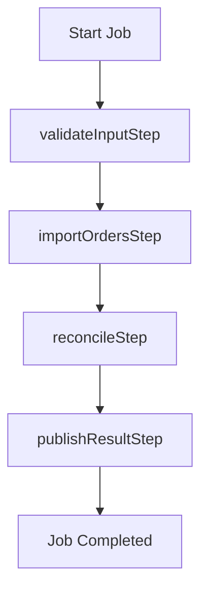

# Job với một step và nhiều step

Trong Spring Batch, `Job` là đơn vị công việc batch ở mức tổng thể, còn `Step` là một giai đoạn thực thi bên trong job. Một job có thể chỉ có một step hoặc kết hợp nhiều step thành một quy trình. Việc chọn cấu trúc nào phụ thuộc vào số giai đoạn nghiệp vụ, ranh giới transaction, yêu cầu restart và cách cần theo dõi kết quả.

Ví dụ, job tạo một file báo cáo từ một truy vấn có thể chỉ cần một step. Một job nhập đơn hàng từ file có thể gồm các giai đoạn kiểm tra file, đọc và ghi đơn hàng, đối soát số liệu, rồi công bố kết quả. Mỗi giai đoạn có thể được mô hình hóa thành một step để có trạng thái, log và chính sách phục hồi riêng.

## 1. Quan hệ giữa Job và Step

Một `Job` mô tả luồng xử lý ở cấp cao. Job được tạo từ một hoặc nhiều step, hoặc từ các flow chứa step. Một step thực hiện một đơn vị công việc có thể quản lý được, thường là xử lý dữ liệu theo chunk hoặc chạy một tasklet.

Các khái niệm thực thi liên quan:

| Khái niệm | Vai trò |
|---|---|
| `Job` | Định nghĩa quy trình batch và thứ tự hoặc điều kiện chuyển giữa các step |
| `Step` | Định nghĩa một giai đoạn xử lý, chẳng hạn kiểm tra đầu vào hoặc nhập dữ liệu |
| `JobInstance` | Đại diện cho một lần xử lý nghiệp vụ được nhận diện bởi tên job và identifying `JobParameters` |
| `JobExecution` | Một lần thực thi cụ thể của một `JobInstance`; cùng instance có thể có nhiều execution khi restart |
| `StepExecution` | Thông tin thực thi của một step trong một `JobExecution`, gồm trạng thái và số liệu xử lý |

Một `JobInstance` có thể có nhiều `JobExecution` theo thời gian, ví dụ lần đầu thất bại và lần sau được restart. Mỗi lần job chạy, Spring Batch tạo các `StepExecution` tương ứng với những step thực sự được thực thi trong lần đó.

`JobRepository` lưu metadata về job và step execution. Nhờ metadata này, Spring Batch có thể xác định trạng thái của lần chạy, hỗ trợ restart và cung cấp số liệu như số item đọc, ghi, filter hoặc skip. Trong ứng dụng cần restart sau khi tiến trình dừng, kho metadata phải có tính bền vững.

## 2. Job chỉ có một step

Job một step phù hợp khi toàn bộ nghiệp vụ có thể được xem là một giai đoạn xử lý thống nhất. Ví dụ:

- Đọc một file và ghi các dòng hợp lệ vào database.
- Tính toán lại một tập dữ liệu đã được xác định.
- Gọi một stored procedure để tạo dữ liệu tổng hợp.
- Xóa các bản ghi hết hạn theo một điều kiện rõ ràng.
- Tạo một báo cáo từ dữ liệu đã có.

Job một step có cấu trúc đơn giản: job khởi chạy step, step thực hiện công việc rồi kết thúc. Ví dụ sau sử dụng Spring Batch 5+ với `JobBuilder` và `StepBuilder` nhận `JobRepository`:

```java
@Bean
Step generateReportStep(
        JobRepository jobRepository,
        PlatformTransactionManager transactionManager) {

    return new StepBuilder("generateReportStep", jobRepository)
            .tasklet((contribution, chunkContext) -> {
                // Thực hiện một tác vụ tạo báo cáo có phạm vi xác định.
                generateReport();
                return RepeatStatus.FINISHED;
            }, transactionManager)
            .build();
}

@Bean
Job generateReportJob(
        JobRepository jobRepository,
        Step generateReportStep) {

    return new JobBuilder("generateReportJob", jobRepository)
            .start(generateReportStep)
            .build();
}
```

`Tasklet` phù hợp với một tác vụ hữu hạn. Khi trả về `RepeatStatus.FINISHED`, tasklet báo rằng công việc đã hoàn tất. Nếu cần yêu cầu framework gọi lại tasklet để tiếp tục một phần công việc, tasklet có thể trả về `RepeatStatus.CONTINUABLE`; khi đó phải có điều kiện dừng rõ ràng để tránh lặp vô hạn.

Một step duy nhất cũng có thể dùng chunk-oriented processing:

```java
@Bean
Step importOrdersStep(
        JobRepository jobRepository,
        PlatformTransactionManager transactionManager,
        ItemReader<OrderInput> reader,
        ItemProcessor<OrderInput, Order> processor,
        ItemWriter<Order> writer) {

    return new StepBuilder("importOrdersStep", jobRepository)
            .<OrderInput, Order>chunk(200, transactionManager)
            .reader(reader)
            .processor(processor)
            .writer(writer)
            .build();
}

@Bean
Job importOrdersJob(JobRepository jobRepository, Step importOrdersStep) {
    return new JobBuilder("importOrdersJob", jobRepository)
            .start(importOrdersStep)
            .build();
}
```

Điểm cần phân biệt: **một step không có nghĩa là chỉ xử lý một item hoặc chỉ có một transaction**. Với chunk size 200, step có thể đọc và xử lý hàng triệu item qua nhiều chunk. Mỗi chunk có ranh giới transaction riêng theo cấu hình transaction manager. Job vẫn chỉ có một step, nhưng step đó có thể tạo ra nhiều checkpoint trong quá trình chạy.

Job một step có ưu điểm là dễ đọc, dễ cấu hình và ít điểm chuyển trạng thái. Nó phù hợp khi không có lý do nghiệp vụ rõ ràng để tách quy trình thành nhiều giai đoạn. Nếu một step phải làm quá nhiều việc khác nhau, khó xác định phần nào đã hoàn thành hoặc khó phục hồi sau lỗi, đó có thể là dấu hiệu nên chia thành nhiều step.

## 3. Job có nhiều step chạy tuần tự

Job nhiều step chia quy trình thành các giai đoạn có thứ tự. Mỗi step có thể có reader, processor, writer hoặc tasklet riêng. Step tiếp theo chỉ bắt đầu sau khi step trước kết thúc theo luồng đã định nghĩa.

Ví dụ một job nhập đơn hàng:

1. `validateInputStep`: kiểm tra file, header, ngày nghiệp vụ và cấu trúc dữ liệu.
2. `importOrdersStep`: đọc file, chuyển đổi từng đơn hàng và ghi vào database theo chunk.
3. `reconcileStep`: đối chiếu số bản ghi và tổng giá trị giữa nguồn với dữ liệu đã nhập.
4. `publishResultStep`: đánh dấu batch hoàn tất hoặc công bố kết quả cho hệ thống tiếp theo.

Sơ đồ luồng tuần tự:



Trong Spring Batch, dùng `start()` để khai báo step đầu tiên và `next()` để nối các step tiếp theo:

```java
@Bean
Job importOrdersJob(
        JobRepository jobRepository,
        Step validateInputStep,
        Step importOrdersStep,
        Step reconcileStep,
        Step publishResultStep) {

    return new JobBuilder("importOrdersJob", jobRepository)
            .start(validateInputStep)
            .next(importOrdersStep)
            .next(reconcileStep)
            .next(publishResultStep)
            .build();
}
```

Các bean step được cấu hình riêng. Nhờ vậy, định nghĩa job tập trung thể hiện trình tự nghiệp vụ, còn chi tiết xử lý nằm trong từng step. Cách tổ chức này giúp thay đổi một giai đoạn mà không phải nhồi toàn bộ logic vào một tasklet lớn.

### 3.1. Tách step theo ranh giới nghiệp vụ

Nên tạo một step mới khi giai đoạn có mục tiêu, điều kiện hoàn thành hoặc cách phục hồi riêng. Ví dụ, kiểm tra file có thể thất bại trước khi ghi bất kỳ đơn hàng nào; nhập dữ liệu có thể cần restart theo checkpoint; đối soát có thể cần chạy lại sau khi dữ liệu nguồn được sửa.

Việc tách step mang lại một số lợi ích:

- Có trạng thái và thời lượng riêng cho từng giai đoạn.
- Có thể xác định chính xác giai đoạn nào gây lỗi.
- Có thể đặt chính sách retry, skip, transaction và giới hạn khởi chạy phù hợp cho từng step.
- Có thể dùng step hoàn thành làm checkpoint nghiệp vụ trước khi đi tiếp.
- Có thể tái sử dụng một flow hoặc step khi nhiều job thực hiện cùng một quy trình con.

Tuy nhiên, không nên tạo step riêng cho từng item hoặc cho mỗi thao tác rất nhỏ mà không có lý do. Quá nhiều step làm metadata và luồng điều khiển phức tạp, tăng chi phí vận hành và khiến job khó hiểu. Ranh giới step nên phản ánh giai đoạn nghiệp vụ có ý nghĩa.

### 3.2. Ranh giới transaction giữa các step

Mỗi chunk trong chunk-oriented step có transaction riêng theo cấu hình. Một tasklet step cũng thường chạy trong transaction do transaction manager quản lý. Khi một step kết thúc và step tiếp theo bắt đầu, transaction của step trước đã được hoàn tất theo cơ chế của step đó.

Vì vậy, job nhiều step không phải một transaction lớn bao trùm tất cả các step. Nếu `importOrdersStep` đã commit dữ liệu nhưng `reconcileStep` thất bại, dữ liệu đã commit của step nhập không tự động bị rollback. Khi restart, Spring Batch có thể bỏ qua step đã hoàn thành và chạy lại step chưa hoàn thành, tùy trạng thái và cấu hình restart.

Thiết kế cần xác định rõ dữ liệu ở trạng thái nào sau mỗi step. Nếu đối soát thất bại, dữ liệu đã nhập có được giữ lại ở trạng thái chờ kiểm tra không? Nếu công bố kết quả thất bại, có thể retry riêng bước công bố không? Những câu hỏi này quyết định việc chia step và cách phục hồi.

## 4. Luồng có điều kiện giữa các step

Không phải job nào cũng chạy tất cả step theo một đường thẳng. Có thể cần rẽ nhánh dựa trên kết quả của step trước. Ví dụ, sau khi kiểm tra file:

- Nếu file hợp lệ, tiếp tục nhập dữ liệu.
- Nếu file không hợp lệ, chuyển sang step ghi nhận lỗi và kết thúc theo trạng thái nghiệp vụ đã quy định.

Spring Batch cho phép định nghĩa transition dựa trên `ExitStatus` của step. Ví dụ dưới đây dùng mã kết thúc tùy chỉnh `VALID` hoặc `INVALID` do step kiểm tra đặt ra:

```java
@Bean
Step validateInputStep(
        JobRepository jobRepository,
        PlatformTransactionManager transactionManager) {

    return new StepBuilder("validateInputStep", jobRepository)
            .tasklet((contribution, chunkContext) -> {
                boolean valid = validateInputFile();

                contribution.setExitStatus(
                        new ExitStatus(valid ? "VALID" : "INVALID"));

                return RepeatStatus.FINISHED;
            }, transactionManager)
            .build();
}

@Bean
Job conditionalImportJob(
        JobRepository jobRepository,
        Step validateInputStep,
        Step importOrdersStep,
        Step recordInvalidInputStep) {

    return new JobBuilder("conditionalImportJob", jobRepository)
            .start(validateInputStep)
                .on("VALID").to(importOrdersStep)
            .from(validateInputStep)
                .on("INVALID").to(recordInvalidInputStep)
            .end()
            .build();
}
```

Trong ví dụ, `.on("VALID")` và `.on("INVALID")` so khớp với exit code của step. `.from(validateInputStep)` khai báo một nhánh khác xuất phát từ cùng step. `.end()` hoàn tất định nghĩa flow của job.

`BatchStatus` và `ExitStatus` có liên quan nhưng không đồng nghĩa:

- `BatchStatus` biểu thị trạng thái thực thi do framework quản lý, chẳng hạn `COMPLETED`, `FAILED`, `STOPPED` hoặc `STARTED`.
- `ExitStatus` biểu thị mã kết thúc được dùng để mô tả kết quả và so khớp transition. Nó có thể là các mã mặc định hoặc mã tùy chỉnh như `VALID`.

Khi dùng nhánh xử lý lỗi, cần quyết định trạng thái cuối của job. Việc chuyển sang một step ghi nhận lỗi rồi step đó hoàn thành có thể khiến flow kết thúc theo trạng thái hoàn thành, dù dữ liệu đầu vào không hợp lệ. Nếu nghiệp vụ yêu cầu job được xem là thất bại, hãy cấu hình transition hoặc exit status cuối phù hợp và kiểm thử trạng thái thực tế của `JobExecution`.

Với điều kiện phức tạp hơn, có thể dùng `JobExecutionDecider`. Decider trả về một `FlowExecutionStatus` để quyết định nhánh tiếp theo, ví dụ dựa trên loại file, tham số job hoặc kết quả kiểm tra đã lưu. Nên giữ logic quyết định tập trung và có thể kiểm thử độc lập.

## 5. Chia sẻ dữ liệu giữa các step

Các step trong cùng job thường cần dùng chung thông tin. Có một số cách truyền dữ liệu, tùy kích thước và vòng đời dữ liệu.

**`JobParameters`** phù hợp với dữ liệu đầu vào của lần chạy, chẳng hạn `businessDate`, `inputFile` hoặc `batchId`. Đây là tham số định danh job instance nếu được đánh dấu identifying. Tham số nên ổn định khi restart cùng một lần xử lý nghiệp vụ.

**`ExecutionContext`** dùng để lưu trạng thái cần khôi phục. Mỗi `StepExecution` có step execution context riêng; `JobExecution` có job execution context dùng chung trong phạm vi lần chạy đó. Dữ liệu được lưu trong context phải có thể serialize theo cơ chế của Spring Batch và nên nhỏ gọn.

Nếu step đầu ghi một giá trị vào step execution context và step sau cần đọc, có thể dùng `ExecutionContextPromotionListener` để đưa khóa được chọn lên job execution context khi step hoàn tất:

```java
@Bean
ExecutionContextPromotionListener promoteImportSummary() {
    ExecutionContextPromotionListener listener =
            new ExecutionContextPromotionListener();
    listener.setKeys(new String[] {"importedCount", "batchReference"});
    return listener;
}
```

Đăng ký listener với step tạo ra các khóa đó. Step sau có thể đọc chúng từ job execution context thông qua `chunkContext.getStepContext().getStepExecution().getJobExecution().getExecutionContext()` hoặc qua một listener/bean phù hợp. Cần bảo đảm khóa đã được ghi trước khi step tiếp theo cần dùng.

Với lượng dữ liệu lớn, nên lưu dữ liệu trung gian trong database hoặc file và truyền khóa tham chiếu qua context. Không nên đưa danh sách hàng nghìn hoặc hàng triệu item vào `ExecutionContext`. Context phù hợp với checkpoint và metadata nhỏ, không phải kho lưu trữ dữ liệu nghiệp vụ.

## 6. Restart job có nhiều step

Restart là một lý do quan trọng để chia job thành các step có ranh giới rõ ràng. Giả sử job có ba step:

1. `validateInputStep` hoàn thành.
2. `importOrdersStep` thất bại giữa quá trình xử lý.
3. `reconcileStep` chưa được chạy.

Khi restart cùng `JobInstance` bằng cùng identifying `JobParameters`, Spring Batch có thể tiếp tục từ step chưa hoàn thành. Step đã hoàn thành thường được bỏ qua khi restart. Step thất bại được thực thi lại theo trạng thái và cấu hình restart của nó. Với chunk step, checkpoint trong execution context có thể giúp reader tiếp tục từ vị trí đã lưu.

Có một số cấu hình ảnh hưởng đến việc chạy lại step:

```java
@Bean
Step prepareReferenceDataStep(
        JobRepository jobRepository,
        PlatformTransactionManager transactionManager) {

    return new StepBuilder("prepareReferenceDataStep", jobRepository)
            .tasklet((contribution, chunkContext) -> {
                prepareReferenceData();
                return RepeatStatus.FINISHED;
            }, transactionManager)
            .allowStartIfComplete(true)
            .startLimit(3)
            .build();
}
```

- `allowStartIfComplete(true)` cho phép step đã hoàn thành được chạy lại khi job được restart và flow đi qua step đó.
- `startLimit(3)` giới hạn số lần step được bắt đầu theo cấu hình. Khi vượt giới hạn, step không thể tiếp tục được khởi chạy theo cách thông thường.

Chỉ bật `allowStartIfComplete(true)` khi thao tác có thể chạy lại an toàn hoặc có cơ chế kiểm soát tác động lặp. Ví dụ, step tạo bảng staging có thể xóa và tạo lại staging theo batch; step gửi thanh toán không nên chạy lại tùy tiện nếu chưa có idempotency key.

Tên job, tên step và identifying parameters cần được quản lý ổn định. Thay đổi tên step giữa các lần phát hành có thể làm metadata cũ không còn khớp với cấu trúc job mới theo cách mong đợi. Khi thay đổi cấu trúc job đang có execution cần restart, phải cân nhắc tương thích và có kế hoạch xử lý các instance đang dang dở.

## 7. Nhiều step không đồng nghĩa với chạy song song

Khai báo `.start(stepA).next(stepB)` tạo luồng tuần tự: step B bắt đầu sau khi step A hoàn tất. Nếu job có nhiều step độc lập và cần chạy đồng thời, Spring Batch hỗ trợ flow song song thông qua `split()` với một `TaskExecutor`.

Ví dụ về ý tưởng tổ chức hai flow độc lập:

```java
@Bean
Job parallelReportJob(
        JobRepository jobRepository,
        Flow customerReportFlow,
        Flow inventoryReportFlow,
        TaskExecutor taskExecutor) {

    return new JobBuilder("parallelReportJob", jobRepository)
            .start(customerReportFlow)
            .split(taskExecutor)
            .add(inventoryReportFlow)
            .end()
            .build();
}
```

Các flow chạy song song phải thực sự độc lập hoặc có cơ chế đồng bộ thích hợp. Cần xem xét tranh chấp dữ liệu, giới hạn kết nối, tải của database, thứ tự công bố kết quả và cách xử lý khi một nhánh thất bại. Nếu các bước phụ thuộc dữ liệu của nhau, hãy giữ chúng tuần tự hoặc thiết kế một ranh giới đồng bộ rõ ràng. Không nên thêm concurrency chỉ để rút ngắn thời gian chạy mà chưa đo và hiểu điểm nghẽn.

## 8. Tổ chức Flow để tái sử dụng quy trình

Khi một nhóm step thường xuyên xuất hiện cùng nhau, có thể gom chúng thành `Flow` có tên. Job có thể kết hợp flow với step khác, giúp cấu trúc lớn dễ đọc hơn.

Ví dụ, nhiều job có thể dùng chung flow kiểm tra và chuẩn hóa file. Flow nên đại diện cho một quy trình con có ý nghĩa, có đầu vào/đầu ra rõ ràng và không phụ thuộc vào trạng thái ẩn trong bộ nhớ. Việc tái sử dụng flow giúp tránh sao chép cấu hình transition ở nhiều job.

Không cần tạo Flow cho mọi job nhỏ. Với job chỉ có một hoặc hai step đơn giản, khai báo trực tiếp bằng `start()` và `next()` thường dễ hiểu hơn.

## 9. Cách chọn job một step hay nhiều step

| Tiêu chí | Một step | Nhiều step |
|---|---|---|
| Quy trình | Một giai đoạn thống nhất | Nhiều giai đoạn có mục tiêu riêng |
| Luồng điều khiển | Đơn giản, ít transition | Có thể tuần tự, rẽ nhánh hoặc song song |
| Theo dõi | Trạng thái ở mức một step | Có trạng thái, thời lượng và số liệu theo từng giai đoạn |
| Restart | Phục hồi bên trong step, ví dụ theo chunk | Có thể bỏ qua step đã hoàn thành và tiếp tục giai đoạn lỗi |
| Transaction | Theo tasklet hoặc từng chunk của step | Mỗi step/chunk có ranh giới transaction riêng |
| Độ phức tạp | Ít thành phần hơn | Cần quản lý thứ tự, transition và dữ liệu giữa các step |

Hãy chọn một step nếu công việc là một giai đoạn hợp lý, có thể theo dõi và phục hồi bên trong step. Chọn nhiều step khi quy trình có các giai đoạn nghiệp vụ tách biệt, cần điều kiện chuyển tiếp riêng, cần quan sát trạng thái theo giai đoạn hoặc có chính sách restart khác nhau.

Không nên tách step chỉ vì một hàm Java dài. Trước hết, hãy xác định ranh giới nghiệp vụ và transaction. Ngược lại, cũng không nên dồn mọi giai đoạn vào một step duy nhất nếu điều đó khiến job khó restart, khó giám sát hoặc khó xác định kết quả một phần sau sự cố.

## 10. Những lỗi thiết kế thường gặp

**Dùng một step quá lớn cho nhiều giai đoạn không liên quan.** Khi một phần cuối thất bại, khó biết phần nào đã hoàn thành và cách tiếp tục. Hãy cân nhắc tách theo ranh giới nghiệp vụ có checkpoint rõ ràng.

**Tách quá nhiều step nhỏ.** Mỗi step tạo thêm metadata, trạng thái và cấu hình. Chỉ tách khi có lợi ích về nghiệp vụ, phục hồi, transaction hoặc vận hành.

**Cho rằng restart job sẽ rollback toàn bộ job.** Transaction thường kết thúc theo chunk hoặc step. Các step đã commit vẫn giữ tác động của chúng. Hãy thiết kế quy trình bù trừ hoặc trạng thái trung gian khi nghiệp vụ yêu cầu.

**Dùng `JobParameters` thay đổi mỗi lần restart.** Tham số identifying mới có thể tạo `JobInstance` mới thay vì restart instance cũ. Hãy giữ nguyên tham số định danh của cùng batch.

**Truyền dữ liệu lớn qua `ExecutionContext`.** Context dành cho trạng thái và metadata nhỏ. Dữ liệu nghiệp vụ lớn nên nằm trong kho lưu trữ phù hợp, còn context giữ khóa tham chiếu.

**Không định nghĩa trạng thái cuối của nhánh lỗi.** Một nhánh có thể ghi log lỗi rồi kết thúc thành công về mặt kỹ thuật. Hãy phân biệt kết quả nghiệp vụ với `BatchStatus` và `ExitStatus`, sau đó cấu hình trạng thái cuối phù hợp.

**Chạy song song các step có phụ thuộc dữ liệu.** Nếu không có đồng bộ, các nhánh có thể đọc dữ liệu chưa sẵn sàng hoặc ghi đè kết quả của nhau. Chỉ chạy song song khi ranh giới dữ liệu và tài nguyên đã được thiết kế rõ.

## 11. Kiểm thử job một step và nhiều step

Kiểm thử nên phản ánh luồng thực tế của job:

1. Với job một step, kiểm tra cả trường hợp không có dữ liệu, dữ liệu hợp lệ, dữ liệu lỗi và lỗi writer.
2. Với job nhiều step tuần tự, xác nhận thứ tự thực thi và step sau không chạy khi step trước thất bại theo flow mặc định.
3. Với flow có điều kiện, kiểm tra mọi nhánh và trạng thái cuối của job.
4. Với restart, làm một step thất bại sau khi step trước đã hoàn thành, sau đó chạy lại cùng identifying parameters và xác nhận step đã hoàn thành được xử lý theo đúng cấu hình.
5. Với `allowStartIfComplete`, xác nhận step chạy lại không tạo dữ liệu hoặc side effect trùng.
6. Với flow song song, kiểm tra tranh chấp dữ liệu, lỗi một nhánh và cách tổng hợp trạng thái.
7. Kiểm tra dữ liệu truyền giữa step được lưu và khôi phục đúng sau restart.

Spring Batch cung cấp `JobLauncherTestUtils` để khởi chạy job trong kiểm thử và các tiện ích test repository trong module test tương ứng. Nên kiểm tra cả `JobExecution` lẫn dữ liệu thực tế đã ghi. Một job có trạng thái `COMPLETED` nhưng thiếu bản ghi, ghi trùng hoặc công bố kết quả sai vẫn là job không đạt yêu cầu nghiệp vụ.

## Kết luận

Job một step phù hợp với một giai đoạn xử lý thống nhất; job nhiều step phù hợp với quy trình có các giai đoạn nghiệp vụ, transaction, trạng thái và cách phục hồi riêng. Spring Batch cung cấp `start()` và `next()` cho luồng tuần tự, transition và decider cho luồng có điều kiện, cùng flow và `split()` cho cách tổ chức phức tạp hơn.

Khi thiết kế, hãy xác định mỗi step bắt đầu với dữ liệu nào, tạo ra kết quả gì, commit ở đâu, trạng thái nào được lưu và điều gì xảy ra nếu step thất bại. Một cấu trúc job tốt giúp người phát triển đọc được quy trình, người vận hành xác định được vị trí lỗi và hệ thống restart hoặc chạy lại với kết quả nhất quán.
