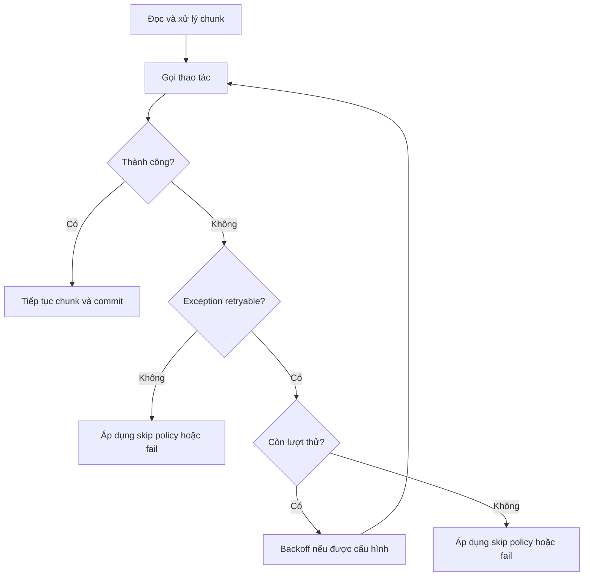

# Retry item bị lỗi tạm thời

Trong batch job, một item đôi khi thất bại vì nguyên nhân chỉ tồn tại trong thời gian ngắn: database đang giữ khóa, kết nối mạng bị ngắt trong chốc lát, dịch vụ ngoài trả HTTP 503 hoặc hệ thống giới hạn tốc độ yêu cầu. Nếu dừng toàn bộ job ngay khi gặp những lỗi này, một sự cố ngắn có thể làm gián đoạn cả lô dữ liệu.

**Retry** cho phép Spring Batch thử lại thao tác bị lỗi theo một chính sách có giới hạn. Khi lỗi có khả năng tự biến mất, lần thử tiếp theo có thể thành công và item tiếp tục đi qua pipeline. Retry phù hợp với lỗi tạm thời có thể phục hồi; nó không sửa được dữ liệu sai, cấu hình sai hoặc lỗi lập trình.

Trong chunk-oriented processing, retry cần được xem cùng transaction, rollback, skip và restart. Một lần thử lại có thể khiến processor hoặc writer được gọi nhiều lần. Vì vậy, các thành phần có tác dụng phụ phải an toàn khi chạy lại, và giới hạn retry cần phù hợp với thời gian chờ cũng như khả năng chịu tải của hệ thống.

## 1. Retry là gì?

Retry là việc gọi lại một thao tác sau khi lần gọi trước ném exception thuộc nhóm được phép thử lại. Thay vì kết thúc step ngay lập tức, framework áp dụng retry policy để quyết định:

- Exception có thuộc nhóm retryable không?
- Còn lượt thử nào không?
- Có cần chờ trước khi thử lại không?
- Nếu đã hết retry mà thao tác vẫn thất bại, step nên skip item hay kết thúc thất bại?

Ví dụ, writer ghi một đơn hàng vào database nhưng gặp deadlock. Database có thể giải phóng khóa sau khi transaction khác hoàn tất. Retry sau một khoảng chờ ngắn có thể ghi thành công mà không cần người vận hành khởi chạy lại toàn bộ job.

Retry không đồng nghĩa với việc bỏ qua lỗi. Khi retry thành công, item vẫn được xử lý bình thường. Chỉ khi không thể xử lý sau các lần thử, ứng dụng mới cần quyết định fail hoặc skip theo chính sách riêng.

## 2. Phân biệt lỗi tạm thời và lỗi không thể phục hồi bằng retry

Retry chỉ có ích khi nguyên nhân lỗi có khả năng biến mất nếu thử lại. Phân loại exception là bước quan trọng nhất khi thiết kế policy.

| Nhóm lỗi | Ví dụ | Retry có phù hợp? |
|---|---|---|
| Database contention | Deadlock, lock timeout, không lấy được khóa tạm thời | Thường có, với số lần thử giới hạn |
| Kết nối tạm thời | Connection reset, network timeout, dịch vụ database tạm mất kết nối | Có thể, sau khi xác nhận thao tác an toàn khi chạy lại |
| Dịch vụ ngoài quá tải | HTTP 503, 429 hoặc lỗi gateway tạm thời | Thường có, cần tôn trọng `Retry-After` nếu có |
| Giới hạn tài nguyên tạm thời | Hết connection trong thời gian ngắn, rate limit | Có thể, kèm backoff để giảm áp lực |
| Dữ liệu sai định dạng | Ngày không hợp lệ, thiếu trường bắt buộc, số không parse được | Không; cần sửa dữ liệu hoặc skip theo nghiệp vụ |
| Vi phạm quy tắc nghiệp vụ | Số dư âm không được phép, trạng thái đơn hàng không hợp lệ | Không; thử lại không làm dữ liệu hợp lệ |
| Cấu hình hoặc schema sai | Thiếu cột, sai quyền truy cập, URL dịch vụ sai | Thường không; cần sửa cấu hình |
| Lỗi lập trình | `NullPointerException`, lỗi mapping, invariant bị vi phạm | Không nên retry một cách mặc định |

Một exception có thể mang nhiều ý nghĩa tùy hệ thống. Ví dụ, lỗi kết nối có thể là tạm thời hoặc do thông tin xác thực sai. Hãy phân loại theo nguyên nhân thực tế, không chỉ theo tên exception chung.

## 3. Retry trong chunk-oriented step

Một chunk-oriented step thực hiện chuỗi read–process–write trong một ranh giới transaction. Khi một thao tác phát sinh exception, Spring Batch áp dụng fault-tolerant policy đã cấu hình.



Retry policy xác định exception nào có thể thử lại và giới hạn số lần thử. Backoff policy điều khiển thời gian chờ giữa các lần thử. Nếu thao tác thành công, chunk có thể tiếp tục đến commit. Nếu hết retry, framework xử lý exception theo skip policy hoặc để step thất bại.

Chi tiết rollback và thao tác được gọi lại phụ thuộc giai đoạn phát sinh lỗi (reader, processor hay writer), loại resource và transaction manager. Không nên giả định mọi trường hợp đều chỉ gọi lại đúng một phương thức với cùng trạng thái bộ nhớ.

## 4. Cấu hình retry bằng Java

Với Spring Batch 5, có thể cấu hình retry trên step bằng `faultTolerant()`, `retry(...)` và `retryLimit(...)`.

```java
@Bean
public Step importOrdersStep(
        JobRepository jobRepository,
        PlatformTransactionManager transactionManager,
        ItemReader<Order> reader,
        ItemProcessor<Order, OrderRecord> processor,
        ItemWriter<OrderRecord> writer) {

    return new StepBuilder("importOrdersStep", jobRepository)
            .<Order, OrderRecord>chunk(500, transactionManager)
            .reader(reader)
            .processor(processor)
            .writer(writer)
            .faultTolerant()
            .retry(TransientDataAccessException.class)
            .retryLimit(3)
            .build();
}
```

Trong ví dụ:

- `faultTolerant()` bật cấu hình xử lý lỗi cho step.
- `retry(TransientDataAccessException.class)` khai báo nhóm lỗi truy cập dữ liệu có tính tạm thời được phép retry.
- `retryLimit(3)` đặt giới hạn số lần thử theo retry policy của phiên bản đang dùng.
- Những exception không được phân loại retryable không tự động được thử lại.

Hãy kiểm tra contract của phiên bản Spring Batch/Spring Retry trong dự án khi diễn giải giới hạn số lần thử. Các retry policy thường biểu diễn số lần thử tối đa và có thể tính cả lần gọi đầu tiên, vì vậy không nên mặc định rằng `retryLimit(3)` luôn có nghĩa là ba lần gọi bổ sung sau lần đầu.

Một số phiên bản Spring Batch cũ dùng `StepBuilderFactory` hoặc cách cấu hình step khác. Ý tưởng retry vẫn giống nhau, nhưng API cụ thể cần theo phiên bản dự án.

## 5. Chỉ retry những exception đã xác định

Không nên retry tất cả exception. Một policy quá rộng có thể khiến job lặp lại lỗi dữ liệu hoặc lỗi lập trình trong thời gian dài, làm tăng thời gian chạy và gây tải không cần thiết.

Ví dụ chỉ retry lỗi truy cập dữ liệu tạm thời:

```java
.faultTolerant()
.retry(TransientDataAccessException.class)
.retryLimit(3)
```

Có thể loại trừ rõ một exception không được retry:

```java
.faultTolerant()
.retry(TransientDataAccessException.class)
.noRetry(InvalidDataAccessResourceUsageException.class)
.retryLimit(3)
```

Trong ví dụ, exception biểu thị câu lệnh hoặc cách sử dụng tài nguyên không hợp lệ được loại khỏi retry. Cần kiểm tra quan hệ kế thừa giữa các exception của Spring và driver thực tế; nếu exception bị loại là subclass của một loại retryable, thứ tự và quy tắc phân loại của policy có thể ảnh hưởng kết quả.

Khi cần phân loại chi tiết hơn, có thể dùng retry policy phù hợp của Spring Retry hoặc một lớp exception nghiệp vụ riêng để chuyển lỗi kỹ thuật thành nhóm retryable rõ ràng. Đừng dựa vào việc bắt một superclass quá rộng như `Exception` hoặc `RuntimeException` rồi retry mọi trường hợp.

## 6. Backoff: chờ giữa các lần retry

Nếu thử lại liên tục ngay lập tức, ứng dụng có thể gửi thêm yêu cầu vào một hệ thống đang quá tải. Backoff tạo khoảng chờ trước lần thử kế tiếp để tài nguyên có thời gian phục hồi.

Các kiểu backoff thường gặp:

- **Fixed backoff:** chờ một khoảng thời gian cố định giữa các lần thử.
- **Exponential backoff:** thời gian chờ tăng theo cấp số nhân.
- **Exponential backoff có giới hạn:** tăng dần nhưng không vượt quá thời gian tối đa.
- **Backoff có jitter:** thêm độ ngẫu nhiên để nhiều worker không cùng retry đúng một thời điểm.

Ví dụ exponential backoff:

```java
ExponentialBackOffPolicy backOffPolicy = new ExponentialBackOffPolicy();
backOffPolicy.setInitialInterval(250L);
backOffPolicy.setMultiplier(2.0);
backOffPolicy.setMaxInterval(5000L);

return new StepBuilder("importOrdersStep", jobRepository)
        .<Order, OrderRecord>chunk(500, transactionManager)
        .reader(reader)
        .processor(processor)
        .writer(writer)
        .faultTolerant()
        .retry(TransientDataAccessException.class)
        .retryLimit(4)
        .backOffPolicy(backOffPolicy)
        .build();
```

Ví dụ dùng `ExponentialBackOffPolicy` của Spring Retry. Với cấu hình trên, khoảng chờ tăng từ 250 ms, nhân đôi sau mỗi lần retry và bị giới hạn ở 5 giây. Cách tính cụ thể và số khoảng chờ phụ thuộc số lần thử thực tế.

### Ước lượng tổng thời gian chờ

Nếu có (N) lần thử tối đa, số khoảng chờ thường tối đa là (N-1), vì không cần chờ sau lần thử cuối. Với exponential backoff chưa chạm giới hạn:

\[
T_{wait}=d_0 + d_0m + d_0m^2 + \cdots + d_0m^{N-2}
\]

Trong đó:

- (d_0) là khoảng chờ ban đầu.
- (m) là hệ số nhân.
- (N) là số lần thử tối đa theo policy.

Tổng thời gian thực tế còn gồm thời gian mỗi lần gọi, thời gian rollback, mở lại tài nguyên và các overhead khác. Hãy bảo đảm tổng retry budget nằm trong thời gian tối đa mà job được phép chạy.

### Jitter và retry storm

Khi hàng trăm worker cùng gặp lỗi, nếu tất cả đều chờ đúng 1, 2 rồi 4 giây, chúng có thể đồng loạt gọi lại dịch vụ tại cùng thời điểm. Jitter thêm một độ lệch ngẫu nhiên để phân tán các lần thử. Với dịch vụ ngoài, hãy cân nhắc backoff có jitter và tôn trọng header `Retry-After` nếu API cung cấp.

## 7. Retry ở giai đoạn đọc (ItemReader)

Reader có thể gặp lỗi tạm thời khi lấy dữ liệu từ database, message broker, object storage hoặc API. Ví dụ, truy vấn database timeout ngắn hoặc dịch vụ cung cấp tệp tạm thời không phản hồi.

Khi retry read, cần chú ý reader có thể đã thay đổi trạng thái nội bộ trước khi ném exception. Ví dụ, reader tiêu thụ một message rồi mới lỗi khi xác nhận offset; lần đọc lại có thể trả về message khác hoặc item trùng.

Các nguyên tắc:

- Dùng reader có cơ chế transaction/acknowledgement phù hợp với nguồn dữ liệu.
- Bảo đảm lần đọc lại không bỏ qua item nếu lần trước thất bại giữa chừng.
- Với cursor hoặc paging reader, dùng thứ tự ổn định và checkpoint rõ ràng.
- Với message broker, hiểu thời điểm acknowledge/commit offset và cách redelivery hoạt động.
- Không retry lỗi parse dữ liệu nếu cùng một record sẽ luôn parse thất bại; phân loại nó thành lỗi dữ liệu để xử lý riêng.

Retry ở reader không thay thế checkpoint. Reader vẫn cần hỗ trợ `ItemStream` nếu job phải restart từ vị trí đã lưu sau khi process dừng.

## 8. Retry ở giai đoạn xử lý (ItemProcessor)

Processor có thể gọi database hoặc dịch vụ ngoài để làm giàu dữ liệu, tính toán hoặc xác thực. Nếu dịch vụ tạm thời không khả dụng, retry có thể giúp xử lý lại cùng input item.

Ví dụ processor gọi một dịch vụ định giá:

```java
public class PriceProcessor
        implements ItemProcessor<Order, PricedOrder> {

    private final PricingClient pricingClient;

    public PriceProcessor(PricingClient pricingClient) {
        this.pricingClient = pricingClient;
    }

    @Override
    public PricedOrder process(Order order) {
        BigDecimal price = pricingClient.getPrice(order.getProductId());
        return new PricedOrder(order.getId(), price);
    }
}
```

Nếu `PricingClient` ném exception retryable như lỗi gateway tạm thời, step có thể thử lại theo policy. Processor nên tránh ghi tác dụng phụ không thể lặp an toàn. Nếu process được gọi lại, cùng một input không nên tạo nhiều giao dịch hoặc gửi nhiều lệnh không mong muốn.

Với processor thuần chuyển đổi dữ liệu trong bộ nhớ, retry thường không mang lại lợi ích vì lỗi parse hoặc validation sẽ tái diễn. Hãy để lỗi dữ liệu đi theo validation/skip policy thay vì retry vô ích.

## 9. Retry ở giai đoạn ghi (ItemWriter)

Writer có thể gặp lỗi tạm thời khi ghi vào database hoặc gọi hệ thống ngoài. Đây là giai đoạn cần đặc biệt chú ý transaction và idempotency vì writer có thể đã thực hiện một phần thao tác trước khi ném exception.

Với writer JDBC tham gia transaction của step, khi lần ghi thất bại, transaction chunk có thể rollback trước khi framework thử lại theo policy. Các thay đổi của lần ghi trước trong cùng transaction được hoàn tác, nên lần thử lại có thể ghi lại chunk mà không để lại bản ghi đã commit một phần.

Với writer gọi API ngoài transaction, đối tác có thể đã xử lý request dù client nhận timeout. Nếu retry gửi lại request, thao tác có thể bị thực hiện hai lần. Hãy dùng idempotency key hoặc cơ chế đối soát trước khi retry.

Ví dụ cấu hình retry cho lỗi truy cập dữ liệu tạm thời ở writer:

```java
return new StepBuilder("writeOrdersStep", jobRepository)
        .<Order, OrderRecord>chunk(200, transactionManager)
        .reader(reader)
        .processor(processor)
        .writer(writer)
        .faultTolerant()
        .retry(CannotAcquireLockException.class)
        .retryLimit(3)
        .build();
```

`CannotAcquireLockException` là ví dụ về lỗi khóa có thể tạm thời. Hãy xác nhận exception mà database driver và Spring exception translation thực tế phát ra.

## 10. Retry item và retry cả chunk

Trong mô hình chunk, reader, processor và writer có cách tương tác khác nhau với retry. Không phải mọi lỗi đều có nghĩa framework chỉ gọi lại đúng một item độc lập.

- Lỗi ở processor thường gắn với item đang được xử lý; framework có thể thử lại processor cho item đó theo retry policy.
- Lỗi ở writer có thể ảnh hưởng cả chunk vì writer nhận một nhóm item; transaction chunk có thể rollback và nhóm dữ liệu có thể được thử lại.
- Lỗi ở reader phụ thuộc reader state và cơ chế retry/transaction của nguồn; cần bảo đảm lần đọc lại không làm mất hoặc bỏ qua item.

Với fault-tolerant step, Spring Batch quản lý việc retry, rollback và khôi phục chunk theo cấu hình. Khi cần xác định item lỗi trong writer và skip nó, framework có thể gọi lại writer với các nhóm nhỏ hơn để cô lập item gây lỗi. Vì vậy, một lần `write()` không nhất thiết tương ứng với một lần thử duy nhất.

Không nên dựa vào giả định rằng writer chỉ nhận item lỗi. Hãy thiết kế writer để chịu được việc được gọi lại với cùng chunk hoặc tập con của chunk theo quy trình retry/skip.

## 11. Kết hợp retry với skip

Retry và skip giải quyết hai tình huống khác nhau:

- **Retry:** lỗi có khả năng tạm thời và item vẫn cần được xử lý.
- **Skip:** item có lỗi được phép bỏ qua theo quy tắc nghiệp vụ.

Có thể cấu hình cả hai:

```java
return new StepBuilder("importOrdersStep", jobRepository)
        .<Order, OrderRecord>chunk(500, transactionManager)
        .reader(reader)
        .processor(processor)
        .writer(writer)
        .faultTolerant()
        .retry(TransientDataAccessException.class)
        .retryLimit(3)
        .skip(InvalidOrderException.class)
        .skipLimit(100)
        .build();
```

Trong ví dụ, lỗi truy cập dữ liệu tạm thời được thử lại; lỗi nghiệp vụ `InvalidOrderException` được phép skip theo giới hạn. Một exception có thể được cấu hình trong cả retry và skip nếu chính sách của ứng dụng yêu cầu thử trước rồi mới bỏ qua sau khi hết lượt. Cần kiểm tra thứ tự phân loại và hành vi cụ thể của phiên bản Spring Batch đang sử dụng.

Không nên skip lỗi hạ tầng như mất kết nối database chỉ để job tiếp tục. Khi database không ghi được, bỏ qua item có thể tạo kết quả thiếu dữ liệu và che giấu sự cố hệ thống.

## 12. Retry hết giới hạn thì điều gì xảy ra?

Khi policy không còn cho phép thử lại, exception tiếp tục được xử lý theo cấu hình fault-tolerant của step:

- Nếu exception được phép skip và skip limit chưa vượt, item có thể bị bỏ qua.
- Nếu exception không được phép skip hoặc skip limit đã vượt, step thường thất bại.
- Nếu exception được phân loại là fatal hoặc không phù hợp với retry/skip, step có thể kết thúc ngay.

Vì vậy, cần định nghĩa rõ kết quả sau retry exhaustion. Không nên để hệ thống mặc định skip mọi lỗi hoặc retry vô hạn.

Ví dụ:

```text
Item 501 gặp lỗi deadlock
  Attempt 1 -> lỗi
  Attempt 2 -> lỗi
  Attempt 3 -> thành công
  Item được xử lý tiếp và không bị skip

Item 502 gặp lỗi kết nối
  Attempt 1 -> lỗi
  Attempt 2 -> lỗi
  Attempt 3 -> lỗi
  Hết retry
  Nếu không skippable -> step FAILED
```

Nếu job thất bại, có thể restart sau khi nguyên nhân được khắc phục. Restart là một execution mới của cùng `JobInstance` và dựa vào checkpoint đã lưu; nó khác retry một thao tác trong lúc step đang chạy.

## 13. Idempotency: điều kiện quan trọng khi retry

Một thao tác idempotent có thể được thực hiện nhiều lần mà trạng thái cuối cùng vẫn tương đương với việc thực hiện một lần. Retry an toàn phụ thuộc rất nhiều vào đặc tính này.

Ví dụ:

- `UPDATE account SET status = 'ACTIVE' WHERE id = ?` có thể idempotent nếu luôn đặt cùng một giá trị.
- `balance = balance + 100` không idempotent nếu chạy hai lần sẽ cộng hai lần.
- `POST /payments` có thể tạo hai khoản thanh toán nếu API không hỗ trợ idempotency key.
- Ghi một bản ghi với unique business key có thể ngăn duplicate, nhưng ứng dụng cần xử lý xung đột theo đúng nghiệp vụ.

Các cách bảo vệ:

- Dùng idempotency key ổn định cho mỗi item hoặc thao tác nghiệp vụ.
- Dùng unique constraint trên khóa nghiệp vụ để ngăn ghi trùng.
- Dùng upsert với quy tắc cập nhật rõ ràng.
- Lưu trạng thái xử lý và kết quả theo item để có thể xác định request đã được thực hiện hay chưa.
- Dùng transactional outbox khi cần phối hợp ghi database và gửi message.

Đặc biệt với lỗi timeout, client có thể không biết server đã thực hiện thao tác hay chưa. Đây là tình huống không thể giải quyết chỉ bằng cách gửi lại request; cần idempotency hoặc truy vấn trạng thái trước khi retry.

## 14. Backoff và giới hạn thời gian tổng thể

Retry policy cần được thiết kế cùng timeout của thao tác và thời gian tối đa mà job được phép chạy.

Giả sử mỗi lần gọi API timeout sau 10 giây, policy cho phép 4 lần thử và backoff tổng cộng 7 giây. Chỉ riêng một item có thể tiêu tốn khoảng 47 giây, chưa tính xử lý và overhead. Nếu có hàng nghìn item lỗi, job có thể kéo dài rất lâu.

Hãy xem:

- Timeout mỗi lần gọi có hợp lý không?
- Số lần thử tối đa có phù hợp với SLA không?
- Backoff có giới hạn trên không?
- Có jitter để tránh retry đồng loạt không?
- Có tổng retry budget hoặc deadline nghiệp vụ không?
- Retry có làm tăng tải lên hệ thống đang gặp sự cố không?

Không nên kết hợp timeout dài với số lần thử lớn và backoff tăng mạnh mà không tính tổng thời gian. Khi vượt SLA, có thể cần fail sớm để scheduler thử lại ở thời điểm khác hoặc chuyển sang quy trình xử lý sự cố.

## 15. Retry và circuit breaker

Retry phù hợp với lỗi ngắn có khả năng phục hồi. Nếu dịch vụ ngoài đang ngừng hoạt động kéo dài, việc mọi worker liên tục retry có thể làm hệ thống quá tải hơn.

Circuit breaker bổ sung một cơ chế khác:

- Khi lỗi vượt ngưỡng, circuit chuyển sang trạng thái mở và tạm thời chặn request.
- Sau thời gian chờ, circuit cho phép một số request thử nghiệm.
- Nếu dịch vụ phục hồi, circuit đóng lại.

Retry và circuit breaker có thể phối hợp nhưng không thay thế nhau. Retry xử lý một thao tác cụ thể; circuit breaker kiểm soát việc tiếp tục gọi một dependency đang lỗi. Với batch job, cần chọn ngưỡng và thời gian mở phù hợp để tránh giữ step trong trạng thái chờ quá lâu.

Nếu dùng resilience library bên ngoài, hãy bảo đảm retry không bị lồng nhiều tầng ngoài ý muốn. Ví dụ, HTTP client retry 3 lần và Spring Batch retry 3 lần có thể tạo tới nhiều lần gọi hơn dự kiến. Hãy xác định một nơi chịu trách nhiệm retry hoặc tính tổng số lần thử qua tất cả tầng.

## 16. RetryListener và quan sát các lần thử

Khi cần theo dõi retry, có thể dùng `RetryListener` của Spring Retry hoặc các listener phù hợp với phiên bản Spring Batch. Listener cho phép quan sát lúc retry bắt đầu, khi một lần thử gặp lỗi và khi retry kết thúc.

Các thông tin nên ghi nhận:

- Job name, JobExecution ID và StepExecution ID.
- Item business key hoặc correlation ID, tránh log toàn bộ payload nhạy cảm.
- Exception class và nguyên nhân gốc.
- Số lần thử hoặc retry context nếu có.
- Thời gian chờ backoff.
- Kết quả cuối: thành công sau retry, bị skip hay step thất bại.

Không nên chỉ ghi log mỗi lần retry mà thiếu thông tin item và execution. Khi job có hàng triệu item, log retry có thể rất lớn. Có thể dùng metric đếm retry theo exception type, step và dependency; chỉ log chi tiết khi cần điều tra.

## 17. Kiểm thử retry

Retry policy cần được kiểm thử để bảo đảm exception đúng được thử lại, exception không phù hợp không bị thử lại, và giới hạn/backoff có tác dụng như mong đợi.

Các trường hợp nên kiểm tra:

1. Thao tác lỗi lần đầu nhưng thành công ở lần tiếp theo: step hoàn tất và item không bị skip.
2. Thao tác lỗi liên tục: số lần thử không vượt giới hạn cấu hình.
3. Exception không retryable: step không lặp thao tác vô ích.
4. Retry hết giới hạn và exception skippable: item được skip đúng policy.
5. Retry hết giới hạn và exception không skippable: step kết thúc thất bại.
6. Writer thất bại sau khi đã ghi một phần trong transaction: rollback không để lại dữ liệu dở dang.
7. Writer gọi dịch vụ ngoài: idempotency key ngăn tác dụng phụ trùng khi request được gửi lại.
8. Backoff không làm test kéo dài: dùng policy test hoặc clock phù hợp nếu framework hỗ trợ.

Ví dụ unit test processor ném lỗi hai lần rồi thành công:

```java
class PricingProcessor implements ItemProcessor<Order, PricedOrder> {

    private final PricingClient client;

    PricingProcessor(PricingClient client) {
        this.client = client;
    }

    @Override
    public PricedOrder process(Order order) {
        BigDecimal price = client.getPrice(order.getProductId());
        return new PricedOrder(order.getId(), price);
    }
}
```

Trong unit test, có thể cấu hình mock `PricingClient` để ném exception retryable ở hai lần gọi đầu và trả giá ở lần thứ ba. Unit test processor trực tiếp chỉ xác nhận hành vi processor; để kiểm tra Spring Batch thực sự retry, cần integration test khởi chạy step có `.faultTolerant().retry(...).retryLimit(...)`.

### Integration test qua JobLauncherTestUtils

Với `@SpringBatchTest`, `JobLauncherTestUtils` có thể chạy job hoặc step trong cấu hình test. Dùng fake service có bộ đếm lần gọi để xác nhận retry policy.

Test nên kiểm tra:

- `JobExecution` và `StepExecution` kết thúc đúng trạng thái.
- Service được gọi số lần phù hợp với policy.
- `writeCount`, `skipCount` và dữ liệu database phản ánh kết quả cuối cùng.
- Dữ liệu của lần ghi thất bại đã rollback trước khi retry.

Không chỉ kiểm tra mock được gọi nhiều lần; cần kiểm tra trạng thái dữ liệu và transaction nếu đó là yêu cầu của job.

## 18. Các lỗi thiết kế retry thường gặp

| Lỗi | Hậu quả | Cách xử lý |
|---|---|---|
| Retry mọi exception | Lặp lỗi dữ liệu/cấu hình và kéo dài job | Chỉ whitelist lỗi tạm thời |
| Không giới hạn retry | Job có thể treo hoặc chạy quá SLA | Đặt retry limit và timeout |
| Không có backoff | Gửi request liên tục vào hệ thống đang lỗi | Dùng fixed/exponential backoff và jitter khi phù hợp |
| Retry thao tác không idempotent | Tạo giao dịch hoặc bản ghi trùng | Dùng idempotency key, unique key hoặc outbox |
| Retry nhiều tầng | Số lần gọi thực tế tăng theo cấp số nhân | Chỉ định rõ tầng chịu trách nhiệm retry |
| Skip lỗi hạ tầng sau khi retry | Job có thể hoàn tất nhưng thiếu dữ liệu | Fail step nếu dependency không thể ghi dữ liệu |
| Backoff quá dài | Job vượt thời gian vận hành cho phép | Tính retry budget và giới hạn thời gian chờ |
| Retry lỗi parse/validation | Cùng item tiếp tục thất bại | Đưa lỗi vào validation/skip policy |
| Không ghi nhận retry | Khó biết dependency nào gây chậm hoặc lỗi | Thêm metric, correlation ID và retry listener phù hợp |
| Dùng reader không an toàn khi đọc lại | Bỏ sót hoặc lặp item | Kiểm tra state, transaction và semantics của nguồn |

## 19. Quy trình thiết kế retry cho một item

1. **Xác định thao tác có thể lỗi:** reader, processor hay writer; dependency nào được gọi.
2. **Phân loại nguyên nhân:** lỗi nào tạm thời, lỗi nào vĩnh viễn hoặc thuộc dữ liệu nghiệp vụ.
3. **Chọn exception retryable:** ưu tiên loại exception cụ thể hoặc nhóm transient đã hiểu rõ.
4. **Đặt giới hạn thử:** tính tổng thời gian có thể tiêu tốn cho một item và toàn job.
5. **Chọn backoff:** dùng fixed hoặc exponential; thêm jitter khi nhiều worker có thể retry đồng thời.
6. **Kiểm tra transaction:** xác nhận rollback và tài nguyên tham gia transaction đúng như dự kiến.
7. **Bảo vệ idempotency:** bảo đảm lần gọi lại không tạo tác dụng phụ trùng.
8. **Quy định sau retry exhaustion:** fail hay skip theo ý nghĩa nghiệp vụ.
9. **Theo dõi:** ghi metric và log đủ để nhận diện dependency, item và số lần thử.
10. **Kiểm thử lỗi có kiểm soát:** mô phỏng transient failure, retry thành công, hết retry và restart.

## 20. Những nguyên tắc cần nhớ

- Retry thử lại thao tác gặp lỗi tạm thời; nó không thay thế validation, skip hoặc restart.
- Chỉ retry exception có khả năng phục hồi; lỗi dữ liệu, cấu hình và lập trình thường không nên retry.
- Dùng `.faultTolerant()`, `.retry(...)` và `.retryLimit(...)` để cấu hình retry trong chunk step theo API của phiên bản Spring Batch.
- Đặt backoff để tránh retry liên tục; exponential backoff có giới hạn và jitter hữu ích khi dependency quá tải.
- Lỗi ở reader, processor và writer có semantics khác nhau; đặc biệt writer có thể được gọi lại với cả chunk.
- Transaction rollback phải được hiểu cùng resource thực tế; thao tác ngoài transaction không tự được hoàn tác.
- Retry thành công không làm item bị skip; sau khi hết retry, skip policy hoặc trạng thái thất bại quyết định kết quả.
- Writer và processor có tác dụng phụ phải idempotent hoặc dùng idempotency key, unique constraint, upsert hay outbox.
- Tính tổng retry budget cùng timeout mỗi lần gọi để không vượt SLA.
- Tránh retry lồng nhiều tầng mà không tính tổng số lần gọi.
- Theo dõi retry count, exception type, thời gian backoff và kết quả cuối cùng.
- Kiểm thử cả số lần gọi, transaction rollback, dữ liệu đích, skip/fail và restart.

Retry giúp batch job vượt qua những lỗi ngắn hạn mà không cần dừng cả quy trình. Khi exception được phân loại đúng, số lần thử và backoff có giới hạn, transaction được quản lý phù hợp và thao tác có thể chạy lại an toàn, Spring Batch có thể xử lý item đáng tin cậy hơn mà vẫn giữ được khả năng quan sát và phục hồi.
# Retry item bị lỗi tạm thời trong Spring Batch

Trong một Job Spring Batch, một item có thể thất bại vì nguyên nhân chỉ tồn tại trong thời gian ngắn: database đang giữ lock, kết nối bị gián đoạn, dịch vụ từ xa tạm thời không phản hồi hoặc request hết thời gian chờ. Nếu lỗi có khả năng tự biến mất, dừng toàn bộ Job ngay ở lần thử đầu tiên có thể gây gián đoạn không cần thiết.

Spring Batch hỗ trợ **retry** để thử lại thao tác xử lý khi gặp những exception đã được xác định là có thể phục hồi. Retry đặc biệt hữu ích trong chunk-oriented Step, nơi reader, processor và writer xử lý item theo nhóm. Khi cấu hình đúng, một item gặp lỗi tạm thời có thể được thử lại trong giới hạn cho phép; nếu vẫn thất bại, Step tiếp tục theo chính sách skip hoặc kết thúc thất bại.

Retry không phải giải pháp cho mọi exception. Dữ liệu sai nghiệp vụ thường không trở nên hợp lệ sau vài lần thử. Gọi API hoặc ghi database nhiều lần cũng có thể tạo side effect trùng nếu thao tác không idempotent. Bài học này trình bày cách phân loại lỗi, cấu hình retry limit và backoff, phối hợp retry với transaction và skip, thiết kế thao tác an toàn khi chạy lại, theo dõi số lần thử và kiểm thử hành vi phục hồi.

## 1. Retry giải quyết vấn đề gì?

Một lỗi tạm thời là lỗi có khả năng biến mất nếu thử lại sau một khoảng thời gian. Ví dụ:

- Database báo deadlock khi hai transaction tranh chấp lock.
- Kết nối database tạm thời bị mất.
- Dịch vụ HTTP trả lỗi 503 do đang quá tải.
- Request tới hệ thống khác bị timeout.
- Message broker tạm thời không sẵn sàng.
- Một tài nguyên dùng chung đang bị khóa và sẽ được giải phóng.

Giả sử một Step xử lý 10.000 đơn hàng. Khi ghi đơn hàng thứ 4.200, database phát sinh deadlock. Nếu không có retry, Step có thể thất bại dù transaction tiếp theo có thể thực hiện thành công ngay sau khi lock được giải phóng.

Với retry, Spring Batch có thể thử lại thao tác gặp lỗi trong giới hạn đã cấu hình. Nếu lần thử sau thành công, luồng xử lý tiếp tục. Nếu lỗi kéo dài hoặc vượt giới hạn, exception được chuyển sang cơ chế lỗi tiếp theo như skip hoặc fail.

~~~mermaid
flowchart TD
    A["Xử lý item"] --> B{"Có exception?"}
    B -- "Không" --> C["Tiếp tục chunk"]
    B -- "Có" --> D{"Exception có retryable?"}
    D -- "Không" --> E["Skip hoặc fail theo policy"]
    D -- "Có" --> F{"Còn lượt thử?"}
    F -- "Có" --> G["Backoff / chờ"]
    G --> A
    F -- "Không" --> H["Retry exhausted"]
    H --> I["Skip nếu được phép, nếu không thì fail"]
~~~

Retry có ích khi lỗi mang tính tạm thời và việc lặp lại thao tác có cơ hội thành công. Nó không sửa dữ liệu sai, không làm một API không khả dụng trở nên ổn định ngay lập tức và không tự hoàn tác side effect đã xảy ra ở lần thử trước.

## 2. Retry trong chunk-oriented Step

Một chunk-oriented Step đọc các item, xử lý từng item và chuyển kết quả cho writer. Khi cấu hình fault tolerance, Spring Batch có thể retry một số exception xảy ra trong quá trình đọc, xử lý hoặc ghi tùy theo chính sách được khai báo.

Ví dụ một Step xử lý đơn hàng:

~~~java
@Bean
Step processOrdersStep(
        JobRepository jobRepository,
        PlatformTransactionManager transactionManager,
        ItemReader<OrderInput> reader,
        ItemProcessor<OrderInput, Order> processor,
        ItemWriter<Order> writer) {

    return new StepBuilder("processOrdersStep", jobRepository)
        .<OrderInput, Order>chunk(100, transactionManager)
        .reader(reader)
        .processor(processor)
        .writer(writer)
        .faultTolerant()
        .retry(TransientDataAccessException.class)
        .retryLimit(3)
        .build();
}
~~~

Các phần quan trọng:

- **faultTolerant():** bật cấu hình xử lý lỗi như retry và skip cho chunk Step.
- **retry(...):** khai báo loại exception được phép thử lại.
- **retryLimit(...):** đặt giới hạn số lần thử theo retry policy.
- **reader, processor, writer:** vẫn thực hiện nhiệm vụ chính; retry được quản lý bởi framework.

Trong cấu hình trên, lỗi thuộc nhóm TransientDataAccessException có thể được thử lại theo giới hạn đã đặt. Những exception không thuộc nhóm retryable không được tự động thử lại chỉ vì Step đã gọi faultTolerant().

### Retry là chính sách theo exception

Không nên bật retry chung cho mọi Exception. Nếu processor ném ValidationException vì số tiền âm, việc gọi lại processor ba lần không làm dữ liệu trở nên hợp lệ. Retry chỉ tăng thời gian chạy và che khuất lỗi dữ liệu.

Hãy chọn exception dựa trên nguyên nhân:

| Nguyên nhân | Ví dụ exception | Hướng xử lý thường phù hợp |
|---|---|---|
| Deadlock database | DeadlockLoserDataAccessException hoặc exception tương ứng driver | Retry có backoff |
| Lock tạm thời không lấy được | CannotAcquireLockException | Retry có giới hạn |
| Lỗi tài nguyên database tạm thời | TransientDataAccessException | Retry có chọn lọc |
| HTTP 503 hoặc 429 | Exception client đã phân loại status | Retry theo chính sách dịch vụ |
| Timeout kết nối | SocketTimeoutException hoặc exception client | Retry nếu thao tác an toàn |
| Dữ liệu sai định dạng | FlatFileParseException | Thường fail hoặc skip, không retry |
| Vi phạm quy tắc nghiệp vụ | ValidationException | Thường không retry |
| Thiếu tham số bắt buộc | JobParametersInvalidException | Không retry |

Tên exception thực tế phụ thuộc thư viện, driver và lớp tích hợp. Hãy phân loại exception ở ranh giới gọi dịch vụ để retry policy nhận đúng loại lỗi.

## 3. Retry limit và số lần thử

Retry cần có giới hạn. Nếu thử vô hạn, một dịch vụ đang hỏng có thể khiến worker giữ tài nguyên và Job không bao giờ kết thúc.

Ví dụ:

~~~java
.faultTolerant()
.retry(TransientDataAccessException.class)
.retryLimit(3)
~~~

Retry limit đặt giới hạn số lần gọi được retry policy cho phép. Với retry policy dựa trên SimpleRetryPolicy, max attempts bao gồm lần gọi ban đầu; do đó cần hiểu cách API và phiên bản đang dùng diễn giải tham số giới hạn. Hãy kiểm thử số lần gọi thực tế thay vì suy luận chỉ từ tên phương thức.

Ví dụ mong muốn tối đa ba lần gọi:

~~~text
Attempt 1 -> exception tạm thời
Attempt 2 -> exception tạm thời
Attempt 3 -> thành công

Kết quả: item được xử lý thành công trong giới hạn policy.
~~~

Nếu cả ba lần đều thất bại:

~~~text
Attempt 1 -> exception
Attempt 2 -> exception
Attempt 3 -> exception

Kết quả: retry exhausted; exception được chuyển sang chính sách skip/fail.
~~~

Điểm quan trọng là retry có điểm dừng xác định. Sau khi hết lượt, ứng dụng cần một quyết định rõ: bỏ qua item nếu được phép, hoặc làm Step thất bại để vận hành can thiệp.

### Chọn retry limit dựa trên đặc tính lỗi

Retry limit quá thấp có thể làm Job thất bại vì một sự cố chỉ kéo dài vài trăm mili giây. Retry limit quá cao có thể kéo dài thời gian chạy, giữ tài nguyên và tạo tải lớn lên dịch vụ vốn đang gặp vấn đề.

Hãy xem xét:

- Thời gian phục hồi thông thường của dịch vụ.
- Timeout của từng request.
- Thời gian backoff giữa các lần thử.
- Tổng thời gian Job được phép chạy.
- Số worker chạy đồng thời.
- Khả năng chịu tải của database hoặc API.
- Hành vi khi hết retry.

Giới hạn retry nên là một phần của hợp đồng vận hành, không phải con số tùy ý được tăng lên mỗi khi Job thất bại.

## 4. Chọn exception nào được retry?

Một Step có thể gặp cả lỗi tạm thời lẫn lỗi cố định. Cần khai báo danh sách retryable và loại trừ những lỗi không nên thử lại.

Ví dụ:

~~~java
return new StepBuilder("importOrdersStep", jobRepository)
    .<OrderInput, Order>chunk(100, transactionManager)
    .reader(reader)
    .processor(processor)
    .writer(writer)
    .faultTolerant()
    .retry(TransientDataAccessException.class)
    .retry(CannotAcquireLockException.class)
    .noRetry(ValidationException.class)
    .retryLimit(3)
    .build();
~~~

Cấu hình này minh họa việc cho phép retry các lỗi database tạm thời, đồng thời loại trừ lỗi validation.

### Dùng exception cụ thể khi có thể

Một exception tổng quát có thể chứa nhiều nguyên nhân khác nhau. Ví dụ, lỗi truy cập database có thể do deadlock tạm thời hoặc do sai tên bảng. Chỉ deadlock mới có khả năng được giải quyết bằng retry.

Nếu chỉ dùng một lớp exception quá rộng, ứng dụng có thể retry cả lỗi cấu hình cố định. Hãy xem exception cause chain và chuyển lỗi thành loại có ý nghĩa tại lớp tích hợp.

### noRetry có vai trò gì?

noRetry giúp loại một exception khỏi retry policy khi nó nằm trong nhóm rộng hơn đã được đánh dấu retryable. Ví dụ, ứng dụng có thể retry một số DataAccessException nhưng không retry lỗi constraint hoặc validation.

Việc phân loại cần nhất quán. Một lỗi nghiệp vụ không nên được chuyển thành transient exception chỉ để tránh Job thất bại.

### Không retry lỗi do dữ liệu không thể sửa bằng thời gian

Các trường hợp thường không nên retry:

- Dữ liệu đầu vào sai định dạng.
- Mã tham chiếu không tồn tại.
- Vi phạm quy tắc nghiệp vụ.
- Thiếu cấu hình bắt buộc.
- SQL sai hoặc tên bảng không tồn tại.
- Người dùng không có quyền truy cập.
- Request bị từ chối do nội dung không hợp lệ.

Với những lỗi này, hãy fail hoặc skip theo chính sách nghiệp vụ và ghi nhận nguyên nhân.

## 5. Retry với backoff

Nếu một dịch vụ đang quá tải và nhiều worker retry ngay lập tức, các request mới có thể tiếp tục làm hệ thống quá tải. **Backoff** thêm khoảng chờ giữa các lần thử để dịch vụ có thời gian phục hồi.

Các chiến lược phổ biến:

| Chiến lược | Cách hoạt động | Khi phù hợp |
|---|---|---|
| Fixed delay | Chờ cùng một khoảng thời gian | Dịch vụ có thời gian phục hồi ổn định |
| Exponential backoff | Tăng thời gian chờ sau mỗi lần lỗi | Lỗi quá tải hoặc lock tạm thời |
| Exponential random backoff | Tăng thời gian chờ và thêm ngẫu nhiên | Nhiều worker retry đồng thời |
| Custom backoff | Tính thời gian chờ theo loại lỗi hoặc phản hồi | Tích hợp dịch vụ có quy tắc riêng |

Ví dụ cấu hình exponential backoff:

~~~java
@Bean
BackOffPolicy orderRetryBackOffPolicy() {
    ExponentialBackOffPolicy policy =
        new ExponentialBackOffPolicy();

    policy.setInitialInterval(500L);
    policy.setMultiplier(2.0);
    policy.setMaxInterval(5000L);

    return policy;
}
~~~

Gắn vào Step:

~~~java
return new StepBuilder("processOrdersStep", jobRepository)
    .<OrderInput, Order>chunk(100, transactionManager)
    .reader(reader)
    .processor(processor)
    .writer(writer)
    .faultTolerant()
    .retry(TransientDataAccessException.class)
    .retryLimit(3)
    .backOffPolicy(orderRetryBackOffPolicy)
    .build();
~~~

Với cấu hình minh họa, khoảng chờ tăng theo cấp số nhân từ 500 ms và không vượt quá 5 giây. Thời gian cụ thể của từng lần chờ phụ thuộc số lần retry và implementation của policy.

### Exponential backoff và jitter

Khi hàng trăm partition cùng gặp lỗi, nếu tất cả chờ đúng 1 giây rồi retry đồng loạt, hệ thống đích có thể nhận một đợt request dồn dập. Đây là hiện tượng retry đồng bộ.

Jitter thêm yếu tố ngẫu nhiên vào thời gian chờ để phân tán các lần thử. Với hệ thống nhiều worker, có thể dùng random/exponential backoff policy phù hợp với phiên bản Spring Retry đang sử dụng.

### Tổng thời gian retry

Tổng thời gian chờ có thể đáng kể. Nếu có nhiều lần thử, mỗi lần request cũng có timeout riêng, thời gian xử lý một item có thể tăng lên nhiều lần.

Khi thiết kế, hãy tính gần đúng:

- Tổng thời gian timeout của các lần gọi.
- Tổng backoff giữa các lần thử.
- Thời gian rollback và bắt đầu lại transaction.
- Thời gian chờ connection pool hoặc lock.
- Thời gian còn lại trong deadline của Job.

Không cấu hình timeout của Job thấp hơn tổng thời gian retry dự kiến nếu muốn retry có cơ hội hoàn tất.

## 6. Retry ở processor và writer

Retry có thể áp dụng khi lỗi xảy ra trong các giai đoạn khác nhau, nhưng tác động đến dữ liệu và side effect không giống nhau.

### Processor retry

Processor thường thực hiện validation, biến đổi hoặc gọi service để bổ sung dữ liệu. Nếu một service từ xa tạm thời không phản hồi, processor có thể ném một exception đã được đánh dấu retryable.

~~~java
@Bean
ItemProcessor<OrderInput, EnrichedOrder> orderProcessor(
        CustomerProfileClient profileClient) {

    return input -> {
        CustomerProfile profile =
            profileClient.fetchProfile(input.customerId());

        return new EnrichedOrder(
            input.orderId(),
            profile,
            input.amount()
        );
    };
}
~~~

Nếu client ném exception tạm thời, Spring Batch có thể thử lại việc xử lý item theo policy.

Processor nên tránh thay đổi input object hoặc ghi side effect không thể hoàn tác. Một item có thể được đưa qua processor nhiều lần. Nếu processor cập nhật trực tiếp một object mutable dùng chung, lần retry có thể bắt đầu từ trạng thái đã bị thay đổi.

### Writer retry

Writer có thể gặp lỗi database tạm thời hoặc lỗi từ hệ thống đích. Ví dụ:

~~~java
@Bean
JdbcBatchItemWriter<Order> orderWriter(DataSource dataSource) {
    return new JdbcBatchItemWriterBuilder<Order>()
        .dataSource(dataSource)
        .sql("""
            INSERT INTO processed_order
                (order_id, customer_id, amount)
            VALUES
                (:orderId, :customerId, :amount)
            """)
        .beanMapped()
        .build();
}
~~~

Nếu transaction database gặp deadlock, Spring Batch có thể rollback transaction chunk rồi retry theo policy.

Writer phải được thiết kế để xử lý việc gọi lại. Với database transaction tham gia đúng transaction manager, lần ghi bị rollback có thể được thực hiện lại. Với API hoặc message broker, side effect đã xảy ra có thể không được hoàn tác.

### Retry không đồng nghĩa chỉ gọi lại một dòng SQL

Trong chunk processing, lỗi writer có thể khiến transaction chunk rollback và framework phải xác định item gây lỗi hoặc thực hiện lại một phần chunk theo cơ chế fault-tolerant. Vì vậy, writer cần an toàn khi được gọi lại với cùng item hoặc cùng nhóm item.

Không nên giả định writer luôn chỉ được gọi đúng một lần cho mỗi item.

## 7. Transaction rollback khi retry

Retry trong chunk Step thường gắn với transaction. Nếu một thao tác ghi database thất bại do deadlock, transaction hiện tại cần rollback trước khi thực hiện lại theo cơ chế retry.

Ví dụ:

~~~mermaid
sequenceDiagram
    participant S as Spring Batch
    participant TM as TransactionManager
    participant W as ItemWriter
    participant DB as Database

    S->>TM: Begin chunk transaction
    S->>W: write(chunk)
    W->>DB: Execute batch
    DB-->>W: Deadlock exception
    W-->>S: Throw exception
    S->>TM: Rollback
    Note over S,TM: Retry policy và backoff
    S->>TM: Begin transaction tiếp theo
    S->>W: Thử ghi lại
    W->>DB: Execute batch
    DB-->>W: Success
    S->>TM: Commit
~~~

Sơ đồ mô tả một tình huống retry database điển hình. Chi tiết việc framework replay chunk hoặc xác định item lỗi phụ thuộc giai đoạn phát sinh exception và cấu hình fault-tolerant.

### Vì sao rollback quan trọng?

Nếu lần thử trước đã ghi một phần dữ liệu trong transaction và transaction không được rollback đúng cách, lần retry có thể ghi trùng hoặc để lại dữ liệu không nhất quán.

Hãy bảo đảm:

- Writer dùng cùng DataSource được transaction manager của Step quản lý.
- Không tự mở connection rồi commit độc lập trong writer.
- Không dùng propagation REQUIRES_NEW cho thao tác ghi nghiệp vụ nếu cần rollback cùng chunk.
- Exception được truyền ra để framework nhận biết thất bại.
- Các tài nguyên ngoài database có cơ chế idempotency hoặc bù trừ.

### Không phải side effect nào cũng rollback

Database transaction chỉ quản lý những tài nguyên tham gia transaction. Nếu processor gửi email, writer gọi API hoặc listener publish message, rollback database không thể thu hồi hành động đó.

Một lần retry có thể gửi lại email hoặc message. Vì vậy, hãy tách side effect bên ngoài khỏi transaction xử lý chính hoặc bảo đảm thao tác có idempotency.

## 8. Kết hợp retry và skip

Retry và skip là hai chính sách khác nhau:

- **Retry:** thử lại thao tác khi lỗi có khả năng tạm thời.
- **Skip:** bỏ qua item lỗi khi nghiệp vụ cho phép tiếp tục mà không xử lý item đó.
- **Fail:** dừng Step khi lỗi không thể phục hồi hoặc không được phép bỏ qua.

Có thể kết hợp retry và skip:

~~~java
return new StepBuilder("importOrdersStep", jobRepository)
    .<OrderInput, Order>chunk(100, transactionManager)
    .reader(reader)
    .processor(processor)
    .writer(writer)
    .faultTolerant()
    .retry(TransientDataAccessException.class)
    .retryLimit(3)
    .skip(ValidationException.class)
    .skipLimit(20)
    .build();
~~~

Trong ví dụ, lỗi truy cập dữ liệu tạm thời được retry. ValidationException không được liệt kê retryable, nhưng có thể bị skip nếu Step cho phép và chưa vượt skip limit.

Có thể cấu hình cùng một exception là retryable và skippable nếu muốn thử lại trước, sau đó bỏ qua khi hết retry. Ví dụ, một lỗi dịch vụ tạm thời có thể được thử ba lần; nếu vẫn thất bại và nghiệp vụ cho phép bỏ item, Step skip item đó. Nếu không được phép skip, Step thất bại.

### Thứ tự quyết định về mặt nghiệp vụ

Một cách suy nghĩ hữu ích:

1. Xác định exception có thể phục hồi không.
2. Nếu có, thử lại trong giới hạn và backoff.
3. Nếu vẫn thất bại, kiểm tra exception có được phép skip không.
4. Nếu không retry được hoặc không được skip, Step thất bại.

Cách phân loại cụ thể được Spring Batch thực hiện dựa trên retry policy, skip policy và rollback rules. Hãy kiểm thử các kết hợp exception thực tế, đặc biệt khi một exception thuộc nhiều nhóm.

### Skip limit không thay thế retry limit

Retry limit kiểm soát số lần thử một thao tác. Skip limit kiểm soát số item lỗi được phép bỏ qua trong Step. Hai giới hạn có phạm vi và ý nghĩa khác nhau.

Ví dụ, một item có thể được thử nhiều lần rồi bị skip. Skip count tăng theo item bị bỏ, còn số lần retry là số lần thử thao tác. Không dùng skip limit để giới hạn số lần gọi một API.

## 9. Retry chỉ cho lỗi tạm thời, không phải mọi lỗi

Một chính sách retry tốt bắt đầu từ việc phân loại exception theo nguyên nhân.

Ví dụ dịch vụ thanh toán trả các mã:

| Phản hồi | Ý nghĩa | Hướng xử lý |
|---|---|---|
| HTTP 429 | Đang bị giới hạn tốc độ | Retry theo Retry-After nếu được hỗ trợ |
| HTTP 503 | Dịch vụ tạm thời không sẵn sàng | Retry có backoff |
| HTTP 504 | Gateway timeout | Retry nếu request idempotent |
| HTTP 400 | Request không hợp lệ | Không retry |
| HTTP 401 | Chưa xác thực hoặc token hết hạn | Refresh credential theo thiết kế; không retry vô hạn |
| HTTP 403 | Không có quyền | Không retry tự động |
| HTTP 404 | Tài nguyên không tồn tại | Thường không retry trừ khi tài nguyên có thể xuất hiện sau |
| HTTP 409 | Xung đột trạng thái | Phân tích ý nghĩa nghiệp vụ trước khi retry |

Không nên chỉ kiểm tra status code ở một lớp chung rồi retry tất cả lỗi 4xx hoặc 5xx. Mỗi dịch vụ có thể có hợp đồng khác nhau. Hãy chuyển response thành exception có ngữ nghĩa rõ ràng trước khi nó đi vào retry policy.

### Tôn trọng Retry-After

Một số API trả header Retry-After khi yêu cầu client chờ trước khi gọi lại. Nếu client hỗ trợ, hãy dùng thông tin này để chọn backoff. Không gửi request liên tục khi server đang yêu cầu giảm tốc độ.

### Giới hạn tổng thời gian

Retry policy cần phối hợp với request timeout và deadline của Job. Nếu mỗi request có timeout 30 giây và policy cho phép nhiều lần thử, một item có thể chiếm worker trong thời gian dài.

Hãy đặt timeout request, số lần thử và backoff dựa trên SLO của hệ thống đích.

## 10. Retry và idempotency

**Idempotency** là khả năng thực hiện lại cùng một thao tác mà trạng thái cuối không thay đổi ngoài ý muốn. Đây là yêu cầu quan trọng khi retry writer hoặc gọi hệ thống bên ngoài.

Giả sử writer gọi API tạo giao dịch:

1. API nhận request và tạo giao dịch.
2. Response bị mất do network timeout.
3. Spring Batch không biết giao dịch đã được tạo hay chưa.
4. Retry gửi lại request.
5. Nếu API không hỗ trợ idempotency, có thể tạo giao dịch thứ hai.

Vấn đề ở đây là timeout không cho biết thao tác phía server đã thất bại hay đã thành công nhưng phản hồi không đến được client.

### Dùng idempotency key ổn định

Một request có thể mang khóa idempotency dựa trên mã nghiệp vụ:

~~~java
public PaymentResult createPayment(Payment payment) {
    String idempotencyKey =
        "payment-" + payment.paymentId();

    return paymentClient.createPayment(
        payment,
        idempotencyKey
    );
}
~~~

Cùng một payment logic phải dùng cùng idempotency key qua mọi lần retry. Nếu mỗi lần thử tạo key mới, hệ thống đích không thể nhận diện request lặp.

### Database unique constraint

Với writer database, có thể dùng khóa duy nhất để ngăn tạo bản ghi trùng:

~~~sql
CREATE UNIQUE INDEX uq_processed_order_id
ON processed_order(order_id);
~~~

Tùy nghiệp vụ, writer có thể dùng insert, upsert hoặc kiểm tra trạng thái đã xử lý. Không nên bắt mọi DuplicateKeyException rồi coi là thành công. Cần xác định bản ghi hiện có có đúng nội dung mong muốn hay là xung đột dữ liệu.

### Không tạo side effect trong processor nếu không cần

Processor có thể được gọi lại khi retry. Nếu processor vừa biến đổi dữ liệu vừa gửi email, cập nhật hệ thống khác hoặc ghi audit độc lập, lần thử lại có thể lặp side effect.

Nên giữ processor càng thuần càng tốt: nhận input, tính output và trả kết quả. Side effect nên đặt ở writer có transaction phù hợp hoặc được điều phối bằng outbox và bước publish riêng.

## 11. Retry với API và message broker

Khi tích hợp dịch vụ ngoài, cần hiểu rõ kết quả của request.

### API timeout

Timeout có thể xảy ra trước khi server nhận request hoặc sau khi server đã xử lý nhưng response bị mất. Không thể suy ra trạng thái nghiệp vụ chỉ từ timeout.

Các biện pháp:

- Dùng idempotency key nếu API hỗ trợ.
- Ghi nhận request ID và mã nghiệp vụ.
- Có API tra cứu trạng thái để đối soát.
- Retry có giới hạn và backoff.
- Phân loại lỗi kết nối, timeout, rate limit và lỗi nghiệp vụ.
- Không retry request không an toàn nếu không có cơ chế deduplication.

### Message broker

Gửi message có thể thành công ở broker nhưng client mất kết nối trước khi nhận xác nhận. Retry có thể gửi message trùng.

Dùng message ID ổn định và consumer deduplication. Nếu cần phối hợp ghi database và phát message, cân nhắc outbox pattern: lưu event cùng transaction với dữ liệu nghiệp vụ, rồi publisher gửi event theo cơ chế retry riêng.

### Retry không phải circuit breaker

Retry thử lại một thao tác sau lỗi. Circuit breaker tạm ngăn gọi dịch vụ khi tỷ lệ lỗi cao để bảo vệ hệ thống. Hai cơ chế giải quyết vấn đề khác nhau và có thể được kết hợp, nhưng không nên cấu hình retry dày đặc khi circuit đang mở.

Với một dịch vụ mất khả năng phục vụ lâu, retry ngắn có giới hạn và circuit breaker hoặc cơ chế tạm dừng Job có thể phù hợp hơn việc tiếp tục thử hàng triệu item.

## 12. Retry và reader

Retry cũng có thể áp dụng cho lỗi đọc, chẳng hạn nguồn từ xa tạm thời không sẵn sàng. Tuy nhiên, reader có đặc tính trạng thái khác processor.

Một reader có thể đã tiêu thụ dữ liệu từ file, cursor hoặc message queue trước khi lỗi xảy ra. Khi retry hoặc rollback, framework cần có cách khôi phục hoặc đọc lại item đúng cách.

Hãy xem xét:

- Reader có hỗ trợ ItemStream và lưu checkpoint không?
- Nguồn có thể đọc lại cùng item không?
- Cursor có còn hợp lệ sau lỗi kết nối không?
- Message đã được acknowledge chưa?
- Reader có trả null nhầm khi gặp lỗi không?
- Việc retry có làm mất hoặc lặp item không?

Không bắt exception đọc rồi trả null. Null có nghĩa EOF, còn lỗi tạm thời cần được biểu diễn bằng exception để policy có thể xử lý.

Với nguồn streaming hoặc queue, cần hiểu cơ chế acknowledgment, visibility timeout và redelivery. Retry ở Spring Batch không tự bảo đảm broker sẽ giao lại message nếu reader đã acknowledge trước khi chunk commit.

## 13. Retry trong xử lý song song và partitioning

Khi Job dùng partitioning, mỗi worker có thể gặp lỗi tạm thời và áp dụng retry policy riêng của worker Step.

Ví dụ manager Step chia dữ liệu thành nhiều partition, mỗi worker xử lý một khoảng ID. Nếu worker partition2 gặp deadlock, retry diễn ra trong StepExecution của partition2 theo cấu hình worker.

Cần lưu ý:

- Retry limit thường áp dụng cho thao tác/item trong từng worker execution theo policy.
- Nhiều worker có thể retry đồng thời, tạo tải lớn lên dịch vụ đích.
- Backoff và jitter giúp giảm retry đồng bộ.
- Connection pool phải đủ cho concurrency và transaction.
- Writer cần an toàn khi cùng một partition hoặc item được xử lý lại.
- Theo dõi lỗi và số lần retry theo partition để xác định vùng dữ liệu có vấn đề.

Không đặt retry limit quá cao cho mọi partition nếu database đang quá tải. Điều đó có thể khiến toàn bộ worker tiếp tục tạo tải trong lúc hệ thống cần thời gian phục hồi.

## 14. Retry khác restart như thế nào?

Retry và restart đều có thể làm một item hoặc Step được xử lý lại, nhưng diễn ra ở phạm vi khác nhau.

| Khái niệm | Thời điểm | Phạm vi |
|---|---|---|
| Retry | Trong lúc Step đang chạy | Thử lại thao tác gặp exception |
| Skip | Trong lúc Step đang chạy | Bỏ item lỗi theo policy |
| Restart | Sau khi JobExecution thất bại hoặc dừng | Tạo JobExecution mới cho cùng JobInstance theo quy tắc restart |
| Rerun với JobInstance mới | Khi dùng identifying JobParameters khác | Bắt đầu một instance logic mới |

Ví dụ:

- Một lần gọi database bị deadlock, retry thành công ngay trong Step: Job tiếp tục, không cần restart.
- Một item lỗi quá retry limit và không được skip: Step thất bại. Người vận hành có thể sửa nguyên nhân rồi restart JobInstance.
- Dữ liệu đầu vào thay đổi và cần xử lý như một lô mới: có thể cần identifying parameters mới để tạo JobInstance mới.

Retry không thay thế checkpoint. Restart không tự làm cho writer idempotent. Cả hai đều cần thiết kế trạng thái và side effect phù hợp.

## 15. Retry policy tùy chỉnh

Với trường hợp đơn giản, các phương thức retry, noRetry và retryLimit thường đủ. Nếu cần phân loại exception phức tạp hoặc giới hạn khác nhau theo từng loại lỗi, có thể dùng RetryPolicy.

Ví dụ minh họa SimpleRetryPolicy:

~~~java
@Bean
RetryPolicy orderRetryPolicy() {
    Map<Class<? extends Throwable>, Boolean> retryable =
        new HashMap<>();

    retryable.put(CannotAcquireLockException.class, true);
    retryable.put(TransientDataAccessException.class, true);
    retryable.put(ValidationException.class, false);

    return new SimpleRetryPolicy(3, retryable, true);
}
~~~

Sau đó cấu hình policy vào Step:

~~~java
return new StepBuilder("processOrdersStep", jobRepository)
    .<OrderInput, Order>chunk(100, transactionManager)
    .reader(reader)
    .processor(processor)
    .writer(writer)
    .faultTolerant()
    .retryPolicy(orderRetryPolicy)
    .build();
~~~

Cấu hình minh họa map exception tới quyết định retry. Cần chú ý constructor và API cụ thể của SimpleRetryPolicy thay đổi theo phiên bản Spring Retry. Hãy kiểm tra phiên bản dependency đang dùng và viết test cho exception subclass, cause chain và số lần thử.

### Phân loại theo nguyên nhân gốc

Một exception wrapper có thể chứa cause là lỗi tạm thời. Nếu policy chỉ xét lớp exception ngoài, lỗi có thể không được retry dù nguyên nhân bên trong retryable.

Có thể:

- Chuyển lỗi ở lớp client thành exception có ngữ nghĩa ổn định.
- Dùng policy hỗ trợ traverse cause chain nếu phù hợp.
- Viết classifier riêng khi cần.
- Tránh phân loại bằng cách so khớp message string vì message có thể thay đổi theo locale hoặc phiên bản thư viện.

## 16. Theo dõi retry và chẩn đoán

Retry có thể làm Job hoàn tất thành công nhưng vẫn che giấu sự cố hạ tầng đang lặp lại. Nếu không theo dõi, hệ thống có thể âm thầm suy giảm hiệu năng.

Nên ghi nhận:

- Số lần retry theo Job, Step và loại exception.
- Item hoặc mã nghiệp vụ liên quan, đã loại bỏ dữ liệu nhạy cảm.
- Số lần retry thành công.
- Số item hết retry limit.
- Thời gian chờ backoff.
- Thời gian xử lý item tổng cộng.
- Partition hoặc worker gặp lỗi.
- Tỷ lệ lỗi theo dịch vụ đích.
- Số item cuối cùng bị skip hoặc làm Step thất bại.

### Phân biệt retry attempt với item bị skip

Một item có thể gặp hai lỗi rồi thành công ở lần thứ ba. Nó có hai lần retry failure nhưng không bị skip.

Một item khác có thể hết retry limit rồi được skip. Cả retry count và skip count đều có thể tăng, nhưng chúng đo hai sự kiện khác nhau.

Không dùng skip count để suy ra số lần retry. Cũng không coi mỗi lần exception là một item lỗi duy nhất.

### Logging có kiểm soát

Ví dụ ghi log cho một lần gọi dịch vụ thất bại:

~~~java
log.warn(
    "Temporary service failure for orderId={}, exceptionType={}",
    orderId,
    exception.getClass().getSimpleName()
);
~~~

Không log toàn bộ request, token, thông tin thanh toán hoặc dữ liệu cá nhân. Dùng correlation ID và mã nghiệp vụ để tra cứu chi tiết ở hệ thống có quyền truy cập phù hợp.

### RetryListener

Spring Retry cung cấp RetryListener để quan sát vòng đời retry. Có thể dùng listener để ghi metric hoặc log lần thử, tùy API tích hợp của phiên bản Spring Batch/Spring Retry đang dùng.

Listener nên chỉ quan sát. Không nên dùng callback retry để tự gọi lại processor hoặc writer, vì retry policy và Step đã chịu trách nhiệm điều khiển lần thử.

## 17. Kiểm thử retry

Retry cần được kiểm thử bằng một thành phần giả lập có thể thất bại một số lần rồi thành công. Không nên phụ thuộc vào lỗi mạng hoặc deadlock ngẫu nhiên trong test.

### Test processor thất bại rồi thành công

Ví dụ processor test dùng bộ đếm lần gọi:

~~~java
AtomicInteger attempts = new AtomicInteger();

ItemProcessor<OrderInput, Order> processor = item -> {
    int current = attempts.incrementAndGet();

    if (current < 3) {
        throw new TransientDataAccessException(
            "Lỗi tạm thời trong test"
        ) {};
    }

    return new Order(
        item.orderId(),
        item.customerId(),
        item.amount()
    );
};
~~~

Kỳ vọng:

- Hai lần đầu ném exception retryable.
- Lần thứ ba trả output.
- Item được ghi một lần nếu writer và transaction được thiết kế đúng.
- Step hoàn tất.

Trong test thực tế, có thể dùng một exception cụ thể hoặc custom transient exception để tránh tạo anonymous class nếu không cần.

### Test hết retry limit

Cấu hình processor luôn ném lỗi retryable. Xác nhận:

- Số lần gọi không vượt giới hạn policy.
- Nếu exception không được skip, Step thất bại.
- Nếu exception được skip, skip count tăng theo số item bị bỏ.
- Các chunk đã commit trước đó vẫn được giữ.
- Không có side effect trùng từ các lần thử.

### Test exception không retryable

Cho processor ném ValidationException đã được khai báo noRetry. Xác nhận processor chỉ được gọi theo policy không retry và Step đi vào skip hoặc fail đúng như cấu hình.

### Test backoff

Không nên bắt test chờ nhiều giây. Có thể dùng backoff policy giả hoặc cấu hình khoảng chờ rất ngắn để xác nhận policy được gọi. Nếu cần test thời gian thực, dùng ngưỡng rộng và tránh phụ thuộc chính xác vào scheduler của hệ điều hành.

### Test writer và transaction rollback

Tạo writer test ghi một số item rồi phát sinh lỗi trong transaction database. Xác nhận:

- Dữ liệu của lần ghi bị rollback nếu writer tham gia transaction.
- Retry thực hiện theo policy.
- Dữ liệu cuối cùng không bị trùng.
- Commit và rollback count phù hợp với luồng thực tế.

### Test API idempotency

Giả lập API đã xử lý request nhưng client nhận timeout. Khi Spring Batch retry, gửi cùng idempotency key và xác nhận hệ thống đích chỉ tạo một giao dịch logic.

### Test restart sau khi retry exhausted

Cho Step thất bại sau khi hết retry. Restart cùng JobInstance sau khi sửa lỗi hạ tầng và xác nhận:

- Step có thể được restart theo cấu hình.
- Reader khôi phục checkpoint đúng.
- Writer không ghi trùng dữ liệu đã commit.
- Các identifying JobParameters giữ nguyên.
- Kết quả cuối được đối soát với nguồn.

## 18. Những lỗi thiết kế thường gặp

### Retry tất cả Exception

Lỗi dữ liệu, lỗi cấu hình và lỗi quyền truy cập thường không tự hết khi thử lại. Chọn exception retryable cụ thể.

### Không đặt retry limit

Retry vô hạn có thể giữ worker và tài nguyên mãi. Đặt giới hạn cùng timeout và backoff.

### Retry quá nhanh

Nhiều worker gọi lại cùng lúc có thể làm dịch vụ quá tải hơn. Dùng backoff và jitter khi phù hợp.

### Retry thao tác không idempotent

Một API có thể đã thực hiện thao tác dù client nhận timeout. Retry không có idempotency key có thể tạo giao dịch trùng.

### Nuốt exception rồi trả kết quả giả

Nếu processor hoặc writer bắt lỗi rồi trả output giả, Spring Batch không biết cần retry. Hãy ném exception có ngữ nghĩa rõ ràng.

### Dùng skip để che giấu lỗi hạ tầng

Skip lỗi kết nối database có thể khiến Job hoàn tất nhưng dữ liệu bị thiếu. Chỉ skip khi nghiệp vụ cho phép bỏ item.

### Coi retry thành công là không có sự cố

Nếu hàng nghìn item đều cần retry trước khi thành công, Job vẫn có thể COMPLETED nhưng hệ thống đích đang không ổn định. Theo dõi retry rate và cảnh báo theo ngưỡng.

### Gửi email hoặc message trong processor

Processor có thể được gọi lại. Side effect bên ngoài có thể lặp hoặc không rollback. Tách publish khỏi xử lý chính hoặc dùng outbox.

### Tăng retry limit thay vì sửa nguyên nhân

Nếu dịch vụ thường xuyên không khả dụng trong nhiều phút, retry limit lớn chỉ kéo dài Job. Cần điều tra capacity, timeout, lock, connection pool hoặc độ ổn định dịch vụ.

### Nhầm retry với restart

Retry xảy ra trong lần chạy Step hiện tại. Restart tạo JobExecution mới cho JobInstance. Hai cơ chế cần được thiết kế và theo dõi riêng.

## 19. Quy trình thiết kế retry cho một Step

Khi thêm retry, có thể thực hiện theo trình tự:

1. **Xác định điểm có thể lỗi:** reader, processor, writer hay client dịch vụ ngoài.
2. **Phân loại exception:** tạm thời, cố định, lỗi dữ liệu hay lỗi hạ tầng.
3. **Chọn exception retryable:** chỉ cho phép những lỗi có khả năng phục hồi.
4. **Loại trừ lỗi cố định:** dùng noRetry hoặc classifier phù hợp.
5. **Đặt giới hạn:** chọn số lần thử dựa trên timeout và thời gian phục hồi.
6. **Cấu hình backoff:** fixed, exponential hoặc random backoff theo tải hệ thống.
7. **Kiểm tra transaction:** bảo đảm rollback đúng với tài nguyên được quản lý.
8. **Thiết kế idempotency:** xử lý an toàn khi cùng item được gọi lại.
9. **Kết hợp skip/fail:** xác định điều gì xảy ra khi hết retry.
10. **Theo dõi:** đo retry attempt, exhausted count, thời gian chờ và tỷ lệ lỗi.
11. **Kiểm thử:** thành công sau retry, hết giới hạn, lỗi không retry, rollback, skip và restart.

Một bảng chính sách retry giúp nhóm phát triển và vận hành thống nhất:

| Exception hoặc nguyên nhân | Retry? | Sau khi hết retry |
|---|---|---|
| Deadlock tạm thời | Có | Fail hoặc retry ở lần Job restart |
| Lock timeout | Có, giới hạn | Fail hoặc skip nếu nghiệp vụ cho phép |
| HTTP 503 | Có, backoff | Fail hoặc đưa vào luồng phục hồi |
| HTTP 429 | Có, tôn trọng Retry-After | Dừng/giãn tải hoặc fail |
| HTTP 400 | Không | Skip hoặc fail theo dữ liệu |
| ValidationException | Không | Reject hoặc fail |
| File sai định dạng | Không | Reject hoặc fail |
| Thiếu quyền truy cập | Không | Fail và sửa cấu hình |

Bảng là ví dụ định hướng. Mỗi dịch vụ cần phân loại exception theo hợp đồng thực tế của nó.

## 20. Những điểm cần nhớ

- Retry dùng để thử lại thao tác khi gặp exception tạm thời có khả năng phục hồi.
- Bật fault tolerance và khai báo rõ exception bằng retry policy.
- Đặt retry limit để bảo đảm số lần thử có điểm dừng.
- Chọn exception cụ thể; không retry mọi Exception.
- Dùng noRetry để loại trừ lỗi cố định khỏi nhóm retry rộng hơn.
- Backoff giúp dịch vụ có thời gian phục hồi; exponential backoff và jitter hữu ích khi nhiều worker cùng retry.
- Retry có thể làm processor hoặc writer được gọi nhiều lần cho cùng item.
- Transaction rollback cần hoạt động đúng để lần thử lại không để lại dữ liệu dở dang.
- Retry không tự hoàn tác email, HTTP request hoặc message đã gửi.
- Thiết kế writer và API call có idempotency, khóa duy nhất hoặc cơ chế deduplication.
- Skip là quyết định bỏ item; retry là quyết định thử lại; restart là một JobExecution mới.
- Khi hết retry, item chỉ được skip nếu exception và skip policy cho phép; nếu không Step thất bại.
- Theo dõi retry attempt riêng với skip count và số item thành công.
- Kiểm thử lỗi tạm thời, lỗi cố định, backoff, rollback, idempotency và restart.

Retry được cấu hình đúng giúp Spring Batch phục hồi trước những gián đoạn ngắn mà không buộc toàn bộ Job phải dừng ngay. Khi giới hạn retry, backoff, transaction và idempotency được thiết kế cùng nhau, ứng dụng có thể thử lại an toàn, báo lỗi rõ ràng khi không thể phục hồi và tránh tạo side effect trùng.

