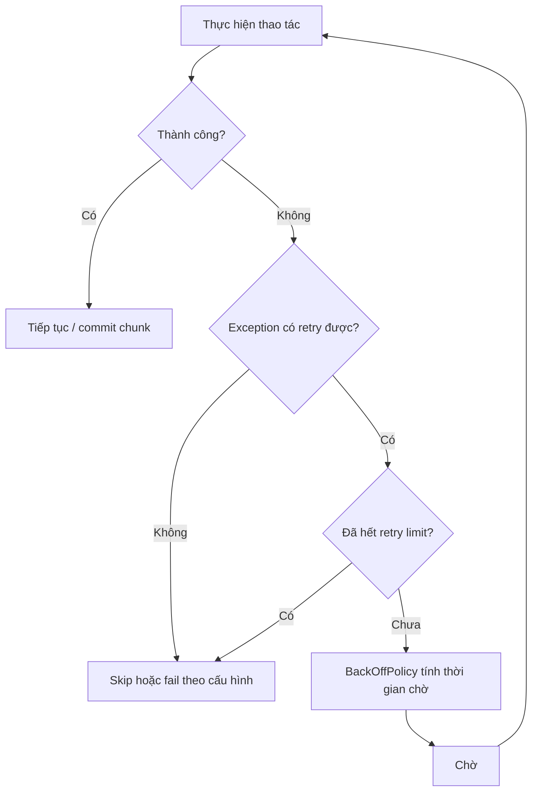

# BackoffPolicy

Trong Spring Batch, retry cho phép thử lại một thao tác khi gặp lỗi có khả năng phục hồi, chẳng hạn deadlock database hoặc lỗi kết nối tạm thời. Nếu retry ngay lập tức và liên tục, hệ thống phụ thuộc có thể vẫn đang quá tải hoặc giữ lock, khiến lần thử tiếp theo thất bại ngay. `BackOffPolicy` giải quyết vấn đề này bằng cách chờ một khoảng thời gian giữa các lần thử.

Backoff là khoảng nghỉ sau một lần thử thất bại và trước lần retry tiếp theo. Nó giúp giảm áp lực lên database, API hoặc message broker, tạo thời gian cho dịch vụ phục hồi và tránh nhiều worker cùng retry đồng loạt. Backoff không quyết định exception nào được retry; chính sách retry/classifier và giới hạn retry vẫn quyết định điều đó.

Trong Spring Batch 5.x, cấu hình fault-tolerant chunk step có thể nhận một `org.springframework.retry.backoff.BackOffPolicy`. Các policy phổ biến gồm `FixedBackOffPolicy`, `ExponentialBackOffPolicy`, `UniformRandomBackOffPolicy` và `ExponentialRandomBackOffPolicy`. Chọn policy theo loại lỗi, thời gian phục hồi dự kiến và tải đồng thời của hệ thống.

## 1. Backoff nằm ở đâu trong chu trình retry?

Một chunk step có thể đọc và xử lý item rồi gọi writer. Nếu một thao tác ném exception được cấu hình là retryable, Spring Batch thực hiện retry theo chính sách của step. Khi một lần thử thất bại, backoff policy quyết định khoảng chờ trước lần thử tiếp theo.



Backoff chỉ được áp dụng khi framework quyết định có lần retry tiếp theo. Nó không trì hoãn lần chạy đầu tiên và cũng không tạo thêm lần thử sau khi retry limit đã hết.

Ví dụ, nếu một lần ghi gặp deadlock, retry policy xác định deadlock có thể retry và còn lượt thử. `BackOffPolicy` có thể yêu cầu chờ 500 ms trước khi thử lại. Nếu lần thử tiếp theo lại thất bại, policy có thể tăng khoảng chờ lên 1 giây, 2 giây rồi tối đa 8 giây.

## 2. Vì sao cần backoff?

Không có backoff, nhiều worker có thể gặp cùng một lỗi rồi lập tức thử lại. Khi dịch vụ đang quá tải, các lần retry đồng thời tạo thêm request, connection và transaction, khiến tình trạng ban đầu nghiêm trọng hơn. Hiện tượng này thường được gọi là retry storm hoặc thundering herd.

Backoff hữu ích trong các trường hợp:

- **Deadlock hoặc lock contention:** transaction có thể cần một khoảng thời gian để transaction khác hoàn tất và giải phóng lock.
- **Database tạm thời quá tải:** chờ trước khi lấy connection hoặc chạy lại câu lệnh có thể giảm áp lực tức thời.
- **HTTP 429 / rate limit:** dịch vụ ngoài yêu cầu client giảm tốc độ gọi.
- **HTTP 5xx hoặc timeout tạm thời:** dịch vụ có thể đang khởi động lại, failover hoặc xử lý quá tải.
- **Message broker tạm thời không sẵn sàng:** retry có khoảng nghỉ giúp tránh vòng lặp gửi liên tục.

Backoff không sửa được lỗi dữ liệu, lỗi lập trình hoặc cấu hình sai. Nếu một item luôn vi phạm validation, chờ lâu hơn cũng không làm dữ liệu trở nên hợp lệ. Những lỗi như vậy thường nên được từ chối, skip theo quy tắc nghiệp vụ hoặc làm step thất bại.

## 3. FixedBackOffPolicy

`FixedBackOffPolicy` chờ cùng một khoảng thời gian giữa các lần retry. Đây là lựa chọn dễ hiểu và phù hợp khi thời gian phục hồi dự kiến khá ổn định hoặc số lần retry nhỏ.

Ví dụ cấu hình policy chờ 1 giây:

```java
@Bean
BackOffPolicy fixedRetryBackOffPolicy() {
    FixedBackOffPolicy policy = new FixedBackOffPolicy();
    policy.setBackOffPeriod(1_000L);
    return policy;
}
```

Gắn policy vào chunk step:

```java
@Bean
Step importOrdersStep(
        JobRepository jobRepository,
        PlatformTransactionManager transactionManager,
        ItemReader<Order> reader,
        ItemWriter<Order> writer,
        BackOffPolicy fixedRetryBackOffPolicy) {

    return new StepBuilder("importOrdersStep", jobRepository)
            .<Order, Order>chunk(100, transactionManager)
            .reader(reader)
            .writer(writer)
            .faultTolerant()
            .retry(TransientDataAccessException.class)
            .retryLimit(3)
            .backOffPolicy(fixedRetryBackOffPolicy)
            .build();
}
```

Trong ví dụ, lỗi thuộc `TransientDataAccessException` được cấu hình để retry tối đa theo `retryLimit`; khoảng nghỉ giữa các lần retry là cố định 1 giây. `retryLimit` giới hạn số lần thử lại theo API của Spring Batch, không phải thời gian chờ. Cần phân biệt số lần retry với tổng số lần thực thi ban đầu cộng các lần retry.

Fixed backoff dễ dự đoán nhưng nhiều worker có thể retry cùng nhịp. Nếu 50 partition cùng gặp lỗi database, chúng có thể đồng loạt thức dậy sau đúng một giây và tạo đợt tải mới.

## 4. ExponentialBackOffPolicy

`ExponentialBackOffPolicy` tăng dần thời gian chờ sau mỗi lần thất bại. Thay vì chờ một khoảng cố định, khoảng chờ tăng theo hệ số nhân cho đến giới hạn tối đa.

Công thức khái quát:

\[
d_n = \min(d_0 \times m^{n-1}, d_{max})
\]

Trong đó:

- `d_n`: thời gian chờ trước lần retry thứ `n`.
- `d_0`: khoảng chờ ban đầu (`initialInterval`).
- `m`: hệ số nhân (`multiplier`), thường lớn hơn 1.
- `d_max`: khoảng chờ tối đa (`maxInterval`).

Ví dụ đặt thời gian ban đầu 500 ms, nhân đôi sau mỗi lần thất bại và giới hạn tối đa 8 giây:

```java
@Bean
BackOffPolicy exponentialRetryBackOffPolicy() {
    ExponentialBackOffPolicy policy = new ExponentialBackOffPolicy();
    policy.setInitialInterval(500L);
    policy.setMultiplier(2.0);
    policy.setMaxInterval(8_000L);
    return policy;
}
```

Chuỗi thời gian chờ minh họa:

| Lần retry | Khoảng chờ |
|---:|---:|
| 1 | 500 ms |
| 2 | 1.000 ms |
| 3 | 2.000 ms |
| 4 | 4.000 ms |
| 5 | 8.000 ms |
| 6 trở đi | 8.000 ms |

Exponential backoff phù hợp khi dịch vụ có thể cần thời gian phục hồi tăng dần, hoặc khi muốn hạn chế số lần gọi dồn dập. `maxInterval` rất quan trọng: nếu không có giới hạn phù hợp, một lần retry có thể chờ lâu hơn thời gian mà job được phép chạy.

## 5. Randomized backoff và jitter

Khi nhiều worker cùng gặp sự cố, exponential backoff thuần túy vẫn có thể khiến chúng retry gần như cùng thời điểm. Jitter thêm yếu tố ngẫu nhiên vào thời gian chờ để phân tán các lần retry.

Spring Retry cung cấp các policy có yếu tố ngẫu nhiên, chẳng hạn:

- `UniformRandomBackOffPolicy`: chọn thời gian chờ ngẫu nhiên trong khoảng min/max được cấu hình.
- `ExponentialRandomBackOffPolicy`: kết hợp tăng trưởng exponential với randomization.

Ví dụ dùng khoảng chờ ngẫu nhiên từ 500 ms đến 2 giây:

```java
@Bean
BackOffPolicy randomRetryBackOffPolicy() {
    UniformRandomBackOffPolicy policy = new UniformRandomBackOffPolicy();
    policy.setMinBackOffPeriod(500L);
    policy.setMaxBackOffPeriod(2_000L);
    return policy;
}
```

Với nhiều partition hoặc nhiều instance ứng dụng, randomization giúp giảm khả năng tất cả worker cùng gửi lại request trong một thời điểm. Khi chọn policy, hãy hiểu rõ cách implementation tính khoảng ngẫu nhiên và giới hạn của nó; không nên giả định mọi random policy đều là cùng một thuật toán jitter.

## 6. So sánh các BackOffPolicy thường dùng

| Policy | Cách chờ | Khi phù hợp |
|---|---|---|
| `NoBackOffPolicy` | Không chờ có chủ đích giữa các lần retry | Thử nghiệm hoặc thao tác rất nhanh; cần cân nhắc tải retry |
| `FixedBackOffPolicy` | Chờ cùng một khoảng thời gian | Dịch vụ phục hồi nhanh và tương đối ổn định |
| `ExponentialBackOffPolicy` | Tăng khoảng chờ theo hệ số nhân, có giới hạn | Lỗi tạm thời có thể cần thời gian phục hồi dài hơn |
| `UniformRandomBackOffPolicy` | Chọn ngẫu nhiên trong khoảng min/max | Phân tán retry khi nhiều worker cùng gặp lỗi |
| `ExponentialRandomBackOffPolicy` | Exponential kết hợp randomization | Nhiều worker hoặc nhiều instance cần giảm retry đồng loạt |

Không có policy tốt nhất cho mọi job. Hãy căn cứ vào đặc điểm dịch vụ phụ thuộc, số worker, SLA của job và thời gian chạy tối đa.

## 7. Kết hợp retry classification, retry limit và backoff

Một cấu hình retry cần ít nhất ba quyết định độc lập:

1. **Exception nào được retry?** Dùng `.retry(...)` và các quy tắc phân loại exception.
2. **Thử lại tối đa bao nhiêu lần?** Dùng `.retryLimit(...)`.
3. **Chờ bao lâu giữa các lần retry?** Dùng `.backOffPolicy(...)`.

Ví dụ cấu hình chỉ retry lỗi truy cập dữ liệu tạm thời, không retry lỗi validation:

```java
@Bean
Step writePaymentsStep(
        JobRepository jobRepository,
        PlatformTransactionManager transactionManager,
        ItemReader<Payment> reader,
        ItemWriter<Payment> writer,
        BackOffPolicy exponentialRetryBackOffPolicy) {

    return new StepBuilder("writePaymentsStep", jobRepository)
            .<Payment, Payment>chunk(50, transactionManager)
            .reader(reader)
            .writer(writer)
            .faultTolerant()
            .retry(TransientDataAccessException.class)
            .noRetry(InvalidPaymentException.class)
            .retryLimit(4)
            .backOffPolicy(exponentialRetryBackOffPolicy)
            .build();
}
```

Trong cấu hình này:

- Lỗi truy cập dữ liệu tạm thời được xem xét retry.
- Lỗi validation `InvalidPaymentException` bị loại khỏi retry.
- Số lần thử lại bị giới hạn.
- Khoảng nghỉ tăng dần theo policy được inject.

Nếu không cấu hình `.backOffPolicy(...)`, retry có thể diễn ra với policy mặc định không chờ đáng kể. Không nên nhầm backoff với retry limit: tăng thời gian chờ không làm tăng số lần retry, và tăng retry limit không tự tạo khoảng nghỉ.

## 8. Backoff và skip là hai chính sách khác nhau

Retry và skip giải quyết các trường hợp khác nhau:

- **Retry:** thử lại vì lỗi có thể tạm thời biến mất.
- **Skip:** bỏ qua item không thể hoặc không nên xử lý trong lần chạy hiện tại, theo quy tắc nghiệp vụ và skip limit.
- **Backoff:** quyết định khoảng chờ trước lần retry tiếp theo.

Ví dụ:

| Lỗi | Hành vi thường phù hợp |
|---|---|
| Database deadlock | Retry với backoff ngắn hoặc exponential |
| API trả HTTP 429 | Retry theo chính sách rate limit, tôn trọng `Retry-After` nếu ứng dụng tích hợp hỗ trợ |
| API timeout tạm thời | Retry có giới hạn và idempotency key |
| Mã khách hàng không tồn tại | Thường không retry; reject/skip theo nghiệp vụ |
| Số tiền sai định dạng | Không retry; ghi nhận lỗi dữ liệu |
| Lỗi lập trình như `NullPointerException` | Thường fail và sửa code, không retry mù quáng |

Một exception hết retry có thể tiếp tục được xử lý theo chính sách skip nếu exception đó cũng được khai báo là skippable và các quy tắc của step cho phép. Hãy kiểm tra thứ tự và semantics retry/skip của phiên bản Spring Batch đang dùng; không coi backoff là một cách biến lỗi thành skip.

## 9. Backoff ảnh hưởng đến thời gian chạy job

Thời gian chạy thực tế không chỉ gồm thời gian xử lý item. Với mỗi lần retry, job còn phải chờ backoff. Tổng thời gian chờ là tổng các khoảng chờ của những lần retry thực sự xảy ra.

Ví dụ với exponential backoff 500 ms, multiplier 2 và max 8 giây, bốn lần retry đầu có tổng thời gian chờ khoảng:

\[
0.5 + 1 + 2 + 4 = 7.5\text{ giây}
\]

Đây chưa bao gồm thời gian của các lần thử thất bại, thời gian xử lý transaction, thời gian lấy connection và thời gian gọi dịch vụ ngoài.

Khi đặt policy, cần xem xét:

- SLA hoặc deadline của job.
- Thời gian timeout của database/API.
- Số lần retry tối đa.
- Thời gian chờ tối đa mỗi lần.
- Số item có thể cùng gặp lỗi trong một chunk hoặc nhiều partition.
- Thời gian chờ shutdown và giới hạn runtime của container/orchestrator.

Nếu một job có hàng nghìn item đều gặp lỗi và mỗi item retry nhiều lần, tổng thời gian chờ có thể lớn hơn dự kiến. Cần tính kịch bản xấu nhất, đo bằng metric và điều chỉnh retry limit/backoff cho phù hợp.

## 10. Backoff không phải cơ chế scheduling hay queue

Trong cách dùng phổ biến của Spring Retry, backoff chờ trên thread đang thực hiện retry. Nó không chuyển item sang một hàng đợi bền vững để xử lý sau, cũng không giải phóng thread worker trong lúc chờ.

Điều này có ý nghĩa khi nhiều partition chạy song song:

- Nếu nhiều worker đều retry và ngủ trong backoff, các thread đó vẫn bị chiếm dụng.
- Nếu thread pool nhỏ, các công việc khác có thể phải chờ.
- Nếu backoff dài, số worker đang active nhưng không làm việc có thể tăng.
- Nếu ứng dụng dừng, trạng thái retry đang chờ trong bộ nhớ không phải một lịch retry bền vững độc lập.

Với số lượng retry nhỏ và thời gian chờ vừa phải, backoff trong thread thường đủ đơn giản. Nếu cần trì hoãn lâu, retry qua nhiều phút/giờ, giải phóng worker hoặc bảo đảm lịch retry tồn tại qua restart, hãy cân nhắc queue có hỗ trợ delayed delivery, scheduler hoặc lưu trạng thái retry bền vững. Không nên dùng `Thread.sleep()` tự viết trong processor/writer để thay thế một cơ chế điều phối có quản lý.

## 11. Backoff, transaction và side effect

Trong chunk step, retry có thể khiến một thao tác được thực hiện lại trong quá trình xử lý transaction. Việc transaction được rollback và mở lại như thế nào phụ thuộc loại lỗi, vị trí lỗi và cơ chế retry của step. Không nên giả định mọi lần retry đều là một transaction hoàn toàn giống nhau hoặc mọi side effect đều được hoàn tác.

Nếu writer chỉ ghi vào database và sử dụng cùng transaction manager với step, rollback có thể hoàn tác các thay đổi chưa commit trong resource đó. Nhưng nếu writer gọi HTTP API, gửi email, publish message hoặc ghi file, transaction database không tự hoàn tác những tác động đó.

Trước khi bật retry, cần kiểm tra:

- Writer có idempotent khi cùng item/chunk được gọi lại không?
- API ngoài có hỗ trợ idempotency key ổn định không?
- Message có thể được gửi lặp không và consumer có deduplicate không?
- Database có unique constraint hoặc ledger để ngăn ghi trùng không?
- Lỗi timeout có thể xảy ra sau khi hệ thống ngoài đã thực hiện tác động không?

Với side effect ngoài database, transactional outbox và consumer inbox là những lựa chọn phổ biến. Backoff giảm tốc độ retry, còn idempotency bảo vệ kết quả khi retry thực sự xảy ra; hai cơ chế bổ sung cho nhau.

## 12. Tôn trọng Retry-After và chính sách của dịch vụ ngoài

Một số API trả HTTP 429 hoặc 503 kèm header `Retry-After` để đề xuất thời điểm thử lại. `BackOffPolicy` chuẩn không tự động hiểu mọi header HTTP này. Nếu tích hợp cần tuân thủ thời gian do server đề xuất, adapter của ứng dụng phải đọc header, phân loại response và áp dụng delay tương ứng bằng cơ chế phù hợp.

Không nên retry ngay khi API đã yêu cầu giảm tốc độ. Cũng không nên chờ lâu hơn giới hạn cho phép mà không có quyết định nghiệp vụ rõ ràng. Cần kết hợp:

- Retry chỉ với status code có thể phục hồi.
- Backoff có giới hạn và có thể thêm jitter.
- Idempotency key cho thao tác tạo/cập nhật có side effect.
- Circuit breaker để tạm ngừng gọi khi lỗi liên tục vượt ngưỡng.
- Metric về số lần retry, thời gian chờ và tỷ lệ lỗi.

Backoff và circuit breaker có vai trò khác nhau. Backoff điều chỉnh thời gian giữa các lần thử của một request/operation; circuit breaker ngăn gửi thêm request trong một khoảng thời gian khi dependency được xem là đang lỗi. Hai cơ chế có thể được dùng cùng nhau nhưng cần tránh retry ở nhiều tầng cùng lúc gây nhân số lần gọi.

## 13. Tránh retry lồng nhau ở nhiều tầng

Một ứng dụng có thể có retry trong HTTP client, service layer và Spring Batch step. Nếu mỗi tầng đều retry nhiều lần, số request thực tế có thể tăng theo tích số lần thử của các tầng.

Ví dụ, HTTP client thử tối đa 3 lần và batch step cũng retry operation tối đa 3 lần. Một item có thể tạo tới 9 lần gọi HTTP trong trường hợp xấu, chưa kể lần gọi ban đầu tùy cách mỗi thư viện tính limit.

Hãy quyết định tầng nào sở hữu retry chính:

- Retry ngắn cho lỗi transport rất cục bộ có thể nằm trong HTTP client.
- Retry ở step phù hợp khi cần gắn lỗi với transaction/chunk và metadata Spring Batch.
- Retry dài hoặc chờ qua thời gian cần được điều phối bằng queue/scheduler.

Đặt timeout tổng thể để tổng thời gian retry không vượt quá deadline của job. Ghi log/metric ở các tầng để biết một item đã được thử bao nhiêu lần thực tế.

## 14. Kiểm thử BackOffPolicy

Không nên kiểm thử backoff bằng cách bắt test chờ nhiều giây thật nếu mục tiêu chỉ là xác nhận cấu hình. Có thể kiểm thử riêng policy và kiểm thử tích hợp retry với thời gian chờ ngắn hoặc sleeper giả lập khi implementation cho phép.

Các trường hợp nên kiểm tra:

1. **Không retry:** exception không thuộc loại retryable; backoff không được áp dụng.
2. **Retry thành công:** lần đầu thất bại, lần tiếp theo thành công; xác nhận số lần gọi và job hoàn tất.
3. **Retry hết giới hạn:** mọi lần thử đều thất bại; xác nhận số lần retry không vượt cấu hình và step kết thúc đúng trạng thái.
4. **Fixed delay:** xác nhận mỗi lần retry dùng cùng khoảng chờ.
5. **Exponential delay:** xác nhận thời gian tăng theo multiplier và không vượt max interval.
6. **Random delay:** xác nhận giá trị nằm trong miền min/max; không kiểm tra một giá trị ngẫu nhiên cố định.
7. **Exception không retry:** validation exception không làm phát sinh delay hoặc lần thử mới.
8. **Side effect idempotent:** retry writer không tạo bản ghi hoặc giao dịch trùng.
9. **Nhiều worker:** xác nhận jitter giúp phân tán retry và pool không bị chiếm dụng quá mức.
10. **Deadline:** tổng thời gian chạy trong kịch bản lỗi nằm trong giới hạn vận hành đã định.

Ví dụ kiểm thử logic retry ở mức step có thể dùng một writer đếm số lần gọi:

```java
class FailTwiceThenSucceedWriter implements ItemWriter<String> {

    private final AtomicInteger attempts = new AtomicInteger();

    @Override
    public void write(Chunk<? extends String> chunk) {
        int attempt = attempts.incrementAndGet();
        if (attempt <= 2) {
            throw new TransientDataAccessException("Temporary failure") {};
        }
    }

    int attempts() {
        return attempts.get();
    }
}
```

Test cấu hình writer này với retry limit đủ lớn và một backoff rất ngắn. Sau khi job hoàn tất, xác nhận writer được gọi lại và kết quả cuối đúng. Nếu cần kiểm tra thời gian chính xác, hãy inject sleeper/clock test được hỗ trợ bởi phiên bản Spring Retry thay vì dựa vào `Thread.sleep()` dài và timing của máy CI.

## 15. Quan sát và vận hành backoff

Trong production, cần theo dõi backoff để biết job chậm vì xử lý dữ liệu hay vì retry chờ dependency phục hồi.

Các metric/log hữu ích:

- Số lần retry theo job, step và loại exception.
- Tổng thời gian chờ backoff.
- Số worker đang retry hoặc chờ.
- Tỷ lệ retry thành công so với retry hết giới hạn.
- Thời gian từ lần lỗi đầu tiên đến khi operation thành công.
- Số item bị skip sau khi retry không thành công.
- Số lỗi theo dependency như database, API hoặc broker.

Log nên có `jobExecutionId`, `stepExecutionId`, batch ID và mã item nghiệp vụ để liên kết các lần thử. Không ghi payload nhạy cảm hoặc secret. Nếu có nhiều tầng retry, ghi nhận attempt ở từng tầng để tránh nhầm số lần gọi.

Khi thấy retry tăng đột biến, cần điều tra nguyên nhân gốc như database lock, connection pool cạn, API rate limit hoặc lỗi mạng. Tăng retry limit hoặc kéo dài backoff không thay thế việc khắc phục dependency đang lỗi.

## 16. Những lỗi thường gặp

**Cho rằng BackOffPolicy quyết định exception có được retry hay không.** Policy chỉ quyết định thời gian chờ. Dùng `.retry(...)`, classifier và retry limit để xác định lỗi được thử lại.

**Dùng backoff cho lỗi dữ liệu không thể phục hồi.** Validation lỗi sẽ vẫn lỗi sau khi chờ. Phân loại lỗi đúng và dùng skip/fail theo nghiệp vụ.

**Không giới hạn retry.** Retry quá nhiều lần có thể làm job kéo dài và tăng tải dependency. Đặt retry limit và deadline.

**Dùng exponential nhưng không đặt max interval.** Thời gian chờ có thể vượt SLA. Chọn giới hạn tối đa phù hợp.

**Dùng fixed backoff cho nhiều worker cùng lỗi.** Các worker có thể retry đồng loạt. Cân nhắc jitter/randomized policy.

**Cho rằng backoff giải phóng worker thread.** Trong cách dùng thông thường, thread thực thi vẫn chờ. Với delay dài, cân nhắc queue hoặc scheduler.

**Bật retry mà không kiểm tra idempotency.** Writer hoặc API có thể thực hiện side effect trùng khi lần thử trước đã thành công một phần.

**Retry ở nhiều tầng mà không tính tổng số lần gọi.** Client, service và step có thể nhân số lần retry. Chọn một tầng retry chính và đặt deadline tổng thể.

**Dùng thời gian chờ dài trong unit test.** Test chậm và dễ flaky. Dùng policy test nhanh, sleeper giả lập hoặc kiểm tra cấu hình thay vì chờ thật.

## 17. Quy trình chọn BackOffPolicy

Khi cấu hình retry cho một step, có thể đi theo trình tự:

1. Xác định dependency có thể phát sinh lỗi tạm thời và exception/status code đại diện.
2. Xác định lỗi nào không được retry, ví dụ lỗi validation hoặc lỗi cấu hình.
3. Chọn retry limit dựa trên khả năng phục hồi và deadline của job.
4. Chọn fixed backoff nếu thời gian phục hồi ổn định; chọn exponential nếu cần tăng dần khoảng chờ.
5. Thêm randomization/jitter nếu nhiều worker có thể retry cùng lúc.
6. Đặt max interval và tính tổng thời gian chờ trong kịch bản xấu nhất.
7. Kiểm tra writer idempotent và transaction boundary.
8. Kiểm thử thành công sau retry, hết retry, skip/fail và tải đồng thời.
9. Theo dõi retry count, wait duration và lỗi dependency trong production.

Ví dụ một quyết định thiết kế:

| Dependency / lỗi | Retry | Backoff gợi ý | Lưu ý |
|---|---|---|---|
| Database deadlock ngắn | Có giới hạn | Exponential với max nhỏ | Transaction phải được rollback đúng; writer an toàn khi thử lại |
| API 429 | Có điều kiện | Randomized hoặc delay theo `Retry-After` | Tôn trọng rate limit và idempotency key |
| API 503 tạm thời | Có giới hạn | Exponential + jitter | Theo dõi circuit breaker và timeout |
| Dữ liệu sai định dạng | Không | Không áp dụng | Ghi lỗi/skip theo quy tắc nghiệp vụ |
| Thiếu cấu hình bắt buộc | Không | Không áp dụng | Fail sớm và sửa cấu hình |

## Kết luận

`BackOffPolicy` quyết định khoảng thời gian chờ giữa một lần thực thi thất bại và lần retry tiếp theo trong cơ chế retry của Spring Batch/Spring Retry. `FixedBackOffPolicy` dùng khoảng chờ cố định; `ExponentialBackOffPolicy` tăng dần và giới hạn ở `maxInterval`; các random policy thêm yếu tố phân tán để giảm việc nhiều worker retry cùng lúc.

Backoff phải đi cùng phân loại exception, retry limit và deadline. Nó không làm lỗi dữ liệu trở nên phục hồi được, không tự giải phóng worker thread và không bảo đảm side effect chỉ xảy ra một lần. Hãy chọn policy theo dependency, giới hạn thời gian chờ, kiểm tra transaction và idempotency của writer, rồi kiểm thử retry thành công, retry hết giới hạn và tình huống nhiều worker cùng gặp lỗi.
