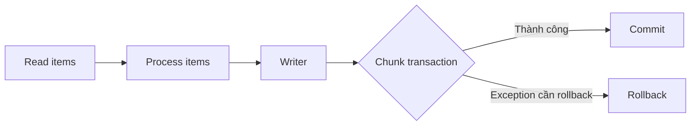
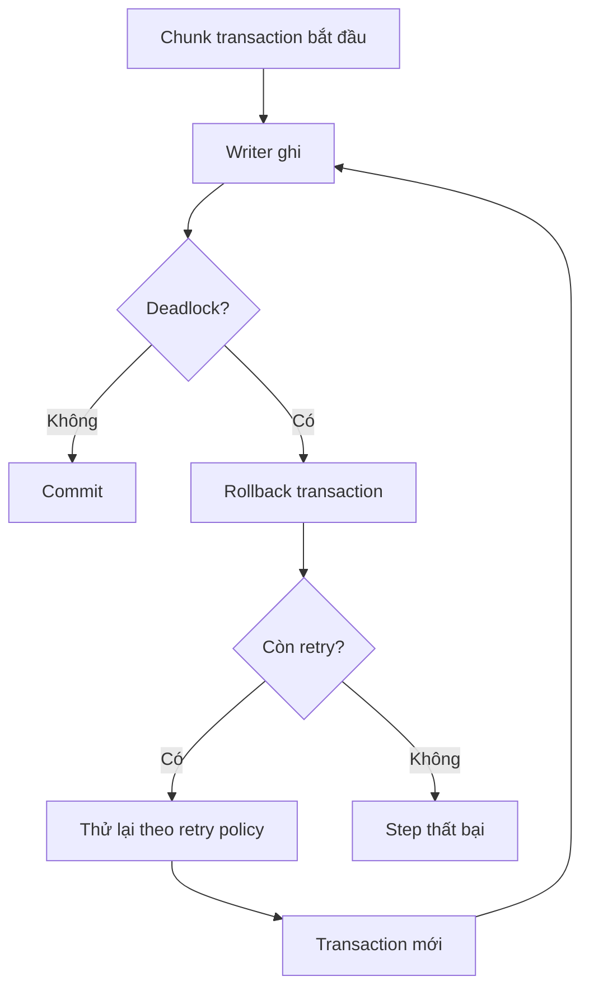

# Phân loại rollback cho fault-tolerant step

Trong Spring Batch, một fault-tolerant step có thể retry thao tác tạm thời, skip item không hợp lệ và tiếp tục xử lý các item còn lại. Khi cấu hình những chính sách này, cần quyết định thêm một điều: **exception nào phải làm rollback transaction của chunk và exception nào có thể được xử lý mà không rollback?**

Đây là trách nhiệm của rollback classification. Nó liên quan đến nhưng không đồng nghĩa với skip classification hay retry classification:

- **Rollback** quyết định transaction hiện tại có bị rollback khi exception xảy ra hay không.
- **Retry** quyết định có thử lại thao tác gây lỗi hay không.
- **Skip** quyết định có bỏ qua item gây lỗi và tiếp tục hay không.

Spring Batch mặc định rollback khi exception từ writer làm chunk thất bại. Với fault-tolerant step, có thể cấu hình **noRollback(...)** cho những exception đã được xác định là không cần rollback. Cấu hình này phải rất thận trọng: không rollback không có nghĩa exception biến mất, cũng không làm cho side effect một phần trở nên an toàn.

## 1. Transaction trong chunk step

Chunk-oriented step đọc, xử lý và ghi item theo nhóm. Với chunk size là 100, một chunk thường được xử lý trong một transaction:



Một chu kỳ đơn giản:

1. Reader cung cấp item.
2. Processor biến đổi hoặc lọc item.
3. Writer ghi các output item.
4. Nếu chunk hoàn tất, transaction manager commit.
5. Nếu exception làm transaction phải rollback, các thay đổi transactional trong chunk được hoàn tác theo khả năng của resource.

Rollback rất quan trọng vì writer có thể đã thực hiện một số câu lệnh trước khi gặp lỗi ở item tiếp theo. Nếu tất cả thao tác ghi tham gia cùng transaction, rollback giúp tránh trạng thái chỉ ghi được một phần của chunk.

Tuy nhiên, transaction chỉ rollback những resource thực sự tham gia transaction đó. Gửi HTTP request, ghi file ngoài cơ chế transaction, gửi email hoặc publish message không tự động được hoàn tác chỉ vì database transaction rollback.

## 2. Rollback classification là gì?

Rollback classification là quy tắc xác định một exception có làm transaction hiện tại rollback hay không. Trong fault-tolerant step, builder cung cấp phương thức **noRollback(...)** để khai báo những loại exception không yêu cầu rollback theo policy của step.

Ví dụ:

```java
return new StepBuilder("importOrdersStep", jobRepository)
        .<Order, Order>chunk(100, transactionManager)
        .reader(orderReader)
        .processor(orderProcessor)
        .writer(orderWriter)
        .faultTolerant()
        .noRollback(NonCriticalRecordException.class)
        .build();
```

Trong ví dụ, NonCriticalRecordException được phân loại là exception không làm rollback theo cấu hình fault-tolerant. Đây chỉ là quyết định về transaction; nó không tự biến exception thành skip, không retry và không đánh dấu step thành công.

### Mặc định và ngoại lệ

Trong chunk processing, exception từ ItemWriter mặc định làm transaction của chunk rollback. Điều này bảo vệ tính toàn vẹn khi writer đã ghi một phần rồi thất bại. Khi thêm noRollback(...), ứng dụng đang chủ động thay đổi hành vi rollback cho loại exception cụ thể.

Các đường xử lý lỗi của reader, processor và writer có khác biệt vì framework có thể bắt exception để áp dụng skip/retry policy ở từng giai đoạn. Không nên suy ra mọi exception ở mọi thành phần đều có cùng một kết quả chỉ từ một ví dụ cấu hình. Hãy xác định exception phát sinh ở đâu và kiểm tra hành vi của phiên bản Spring Batch đang dùng.

## 3. Phân biệt rollback, retry và skip

Ba chính sách trả lời ba câu hỏi khác nhau:

| Chính sách | Câu hỏi | Ví dụ |
|---|---|---|
| Rollback | Transaction hiện tại có phải hoàn tác không? | Writer gặp lỗi sau khi đã ghi một số item |
| Retry | Có nên thử lại thao tác bị lỗi không? | Database deadlock hoặc lỗi tạm thời |
| Skip | Có thể bỏ qua item lỗi và tiếp tục không? | Một record không đạt validation |

Một exception có thể:

- Là retryable và cần rollback trước khi thử lại.
- Là skippable và cần rollback để loại bỏ tác động ghi dở của item lỗi.
- Là skippable nhưng được cấu hình no-rollback nếu đã chứng minh không cần hoàn tác transaction.
- Không retry được và không skip được, do đó làm step thất bại.

Không có quy tắc rằng “skip thì luôn không rollback” hoặc “retry thì luôn chỉ cần gọi lại method”. Transaction, retry và skip phải được cấu hình cùng nhau theo đặc tính của thao tác.

## 4. Cấu hình skip và retry

Ví dụ fault-tolerant step với hai nhóm lỗi:

```java
return new StepBuilder("importOrdersStep", jobRepository)
        .<OrderInput, Order>chunk(100, transactionManager)
        .reader(orderReader)
        .processor(orderProcessor)
        .writer(orderWriter)
        .faultTolerant()
        .skip(InvalidOrderException.class)
        .skipLimit(50)
        .retry(DeadlockLoserDataAccessException.class)
        .retryLimit(3)
        .build();
```

Ý nghĩa:

- InvalidOrderException được phép skip, tối đa theo skip limit đã cấu hình.
- DeadlockLoserDataAccessException được retry trong giới hạn.
- Exception không thuộc nhóm được phép xử lý theo các policy sẽ làm step thất bại.

Retry thường phù hợp với lỗi tạm thời có khả năng biến mất sau một khoảng thời gian, chẳng hạn deadlock hoặc lỗi kết nối thoáng qua. Skip phù hợp với lỗi của một item mà nghiệp vụ cho phép bỏ qua, chẳng hạn dữ liệu đầu vào không hợp lệ và được ghi nhận vào quy trình reject.

Không dùng retry cho lỗi dữ liệu chắc chắn không thể tự sửa. Cũng không dùng skip để che giấu lỗi hạ tầng, lỗi cấu hình hoặc lỗi lập trình.

## 5. noRollback(...) thay đổi điều gì?

noRollback(ExceptionType.class) khai báo rằng exception thuộc loại đó không yêu cầu rollback transaction theo policy của fault-tolerant step.

Ví dụ:

```java
return new StepBuilder("processOrdersStep", jobRepository)
        .<OrderInput, Order>chunk(100, transactionManager)
        .reader(orderReader)
        .processor(orderProcessor)
        .writer(orderWriter)
        .faultTolerant()
        .skip(NonCriticalRecordException.class)
        .skipLimit(100)
        .noRollback(NonCriticalRecordException.class)
        .build();
```

Đoạn cấu hình này cho biết:

- Exception được phép skip theo skip policy.
- Exception đó được đánh dấu không yêu cầu rollback theo rollback policy.
- Skip limit vẫn có hiệu lực.
- Nếu exception không được xử lý như một trường hợp skip hợp lệ hoặc vượt giới hạn, step vẫn có thể thất bại.

noRollback không phải là lệnh bỏ qua exception. Nó không tự tăng skip count, không tự retry, không ghi reject record và không quyết định exit status cuối cùng.

### Cần thận trọng với writer

Giả sử writer đã ghi 30 item vào một transaction rồi ném NonCriticalRecordException khi xử lý item thứ 31. Nếu exception này được phân loại no-rollback, các thay đổi đã thực hiện trong transaction có thể không được hoàn tác theo policy của step. Điều đó có thể để lại một phần chunk đã ghi.

Chỉ dùng no-rollback nếu biết chính xác writer đã làm gì trước khi ném exception và trạng thái sau đó vẫn hợp lệ. Nếu writer có thể ghi dở, rollback thường là lựa chọn an toàn hơn.

## 6. Ví dụ: exception nào nên rollback?

Hãy xem ba loại lỗi giả định:

| Exception | Tính chất | Chính sách thường cân nhắc |
|---|---|---|
| Deadlock khi ghi DB | Tạm thời; transaction có thể cần được làm mới | Retry và rollback |
| Record sai định dạng | Lỗi dữ liệu của một item | Skip hoặc reject theo nghiệp vụ |
| Lỗi lập trình như NullPointerException | Lỗi không mong đợi | Fail; không che bằng skip/noRollback |

### Deadlock

Khi database báo deadlock, transaction hiện tại thường không còn thích hợp để tiếp tục. Rollback giải phóng tài nguyên transaction; retry có thể thực hiện lại chunk trong transaction mới.

```java
.faultTolerant()
.retry(DeadlockLoserDataAccessException.class)
.retryLimit(3)
```

Không thêm deadlock vào noRollback chỉ để tránh rollback. Retry một thao tác database trong transaction đã gặp deadlock không phải chiến lược phục hồi đáng tin cậy.

### Record không hợp lệ

Nếu lỗi được phát hiện trong processor trước khi writer ghi item, có thể skip record và ghi nhận lý do reject. Nếu lỗi phát sinh trong writer sau khi một số câu lệnh đã chạy, cần rollback để loại bỏ phần ghi dở trước khi framework cô lập item lỗi, trừ khi đã có một thiết kế chứng minh không cần rollback.

### Lỗi lập trình

Không nên khai báo noRollback(Exception.class) hoặc skip mọi exception chỉ để job luôn hoàn tất. Một lỗi null, mapping sai hoặc vi phạm invariant có thể làm dữ liệu không nhất quán. Hãy để lỗi không mong đợi làm step thất bại, thu thập thông tin chẩn đoán và sửa nguyên nhân.

## 7. Phân loại theo nơi exception phát sinh

Vị trí exception ảnh hưởng cách Spring Batch xử lý:

| Nơi phát sinh | Điều cần xem xét |
|---|---|
| Reader | Có thể lỗi khi mở nguồn, đọc record hoặc khôi phục checkpoint; cần xác định retry/skip và trạng thái reader |
| Processor | Lỗi thường gắn với một item; cần xác định có thể skip hay phải fail và processor có side effect hay không |
| Writer | Có thể đã ghi một phần chunk; rollback thường rất quan trọng để tránh partial write |
| Listener hoặc callback | Có thể xảy ra trước/sau thao tác chunk; phải xác định transaction lifecycle tại thời điểm callback |
| External service được gọi từ writer | Database rollback không thu hồi side effect đã xảy ra ở dịch vụ ngoài |

Ví dụ, lỗi parse trong reader và lỗi deadlock trong writer không nên được gom vào cùng một nhóm chỉ vì cả hai đều là exception. Lỗi parse có thể là lỗi dữ liệu; deadlock là lỗi tạm thời của hạ tầng.

Khi thiết kế policy, ghi rõ exception type, nơi phát sinh, có thể retry không, có thể skip không và transaction có cần rollback không.

## 8. Thứ tự quyết định: exception có được retry, skip hay phải fail?

Có thể dùng bảng quyết định sau khi phân loại một lỗi:

| Tình huống | Retry? | Skip? | Rollback? | Kết quả mong muốn |
|---|---|---|---|---|
| Deadlock DB | Có giới hạn | Thường không | Có | Thử lại trong transaction mới |
| Lỗi kết nối tạm thời | Có giới hạn nếu thao tác an toàn | Thường không | Có nếu transaction bị lỗi | Thử lại hoặc fail khi hết giới hạn |
| Dữ liệu sai định dạng | Thường không | Có nếu nghiệp vụ cho phép | Tùy phase; writer ghi dở thì cần rollback | Reject item và tiếp tục |
| Vi phạm quy tắc nghiệp vụ nghiêm trọng | Không | Không | Thường có nếu transaction đang mở | Fail step/job |
| Lỗi lập trình không mong đợi | Không | Không | Có | Fail và điều tra |
| Exception đã chứng minh không làm hỏng transaction | Theo bản chất lỗi | Có thể | Có thể no-rollback | Tiếp tục theo policy rõ ràng |

Đây là ma trận thiết kế, không phải bảng ánh xạ cố định của framework. Kết quả thực tế còn phụ thuộc exception cause chain, skip/retry policy, transaction manager và thành phần ném exception.

## 9. Exception hierarchy và phân loại quá rộng

Các policy thường được cấu hình bằng class exception. Nếu dùng một superclass quá rộng, nhiều lỗi không liên quan có thể bị áp dụng cùng chính sách.

Ví dụ nguy hiểm:

```java
.faultTolerant()
.noRollback(Exception.class)
```

Cấu hình này có thể làm rất nhiều exception không rollback, kể cả exception không dự kiến. Tương tự, skip mọi Exception có thể che giấu lỗi hệ thống hoặc lỗi lập trình.

Nên chọn exception cụ thể:

```java
.faultTolerant()
.retry(DeadlockLoserDataAccessException.class)
.retryLimit(3)
.skip(InvalidOrderRecordException.class)
.skipLimit(100)
```

Nếu một exception cụ thể kế thừa từ một superclass đã được cấu hình, hãy kiểm tra quy tắc classifier của phiên bản đang dùng và test cả exception trực tiếp lẫn exception được wrap trong cause. Không giả định tên class ở ngoài cùng luôn là loại exception mà policy nhìn thấy.

## 10. noRollback không thay thế rollback rules của transaction manager

Có nhiều nơi cấu hình rollback trong Spring:

- Fault-tolerant step builder có noRollback(...) để điều chỉnh rollback classification trong cơ chế chunk processing.
- Spring transaction có rollback rules, ví dụ @Transactional(rollbackFor = ...) hoặc noRollbackFor = ....
- Transaction manager và resource có thể có quy tắc riêng về trạng thái transaction sau lỗi.

Các lớp này có liên quan nhưng không phải một cấu hình duy nhất. Nếu một service được gọi từ writer có annotation transaction riêng, cần hiểu propagation và rollback-only marker của transaction đang tham gia.

Ví dụ, một inner service có thể đánh dấu transaction rollback-only dù lớp ngoài không mong muốn rollback. Ngược lại, exception bị bắt và không truyền ra ngoài có thể làm transaction tiếp tục nhưng side effect đã thực hiện vẫn còn.

Không dùng noRollback(...) ở step để cố ghi đè mọi rollback rule ở các transaction lồng nhau. Hãy xác định transaction manager, propagation và nơi exception được bắt/ném.

## 11. Vì sao retry thường cần rollback?

Retry nhằm thử lại một thao tác có khả năng thành công sau khi điều kiện tạm thời thay đổi. Với lỗi database như deadlock, transaction có thể đã bị đánh dấu rollback-only hoặc không còn trạng thái hợp lệ để tiếp tục.

Quy trình điển hình:



Retry không nên được dùng để chạy lại một thao tác không idempotent nếu lần đầu có thể đã tạo side effect bên ngoài. Nếu gọi API và không biết request đã được xử lý hay chưa, retry có thể tạo giao dịch trùng. Dùng idempotency key hoặc outbox để làm thao tác có thể thử lại an toàn.

## 12. Vì sao skip đôi khi cần rollback?

Skip có nghĩa là bỏ qua item lỗi và tiếp tục. Nhưng nếu writer đã ghi một phần chunk, cần khôi phục transaction trước khi framework có thể cô lập item lỗi và tiếp tục theo chính sách skip.

Ví dụ chunk có A, B, C:

1. Writer ghi A thành công trong transaction.
2. Writer xử lý B và gặp exception.
3. Writer chưa xử lý C.
4. Transaction rollback để loại bỏ phần ghi A của lần thử đó.
5. Framework có thể thực hiện cơ chế cô lập/scan để xác định item gây lỗi và áp dụng skip policy.
6. Các item hợp lệ được ghi lại theo cơ chế fault-tolerant.

Chi tiết số lần gọi reader, processor và writer phụ thuộc reader buffering, retry configuration và processor transactional behavior. Nhưng nguyên tắc quan trọng là không được để phần ghi dở của một lần thử trở thành kết quả đã commit ngoài ý muốn.

Nếu dùng no-rollback trong tình huống writer có thể ghi một phần, framework có thể không còn khả năng dựa vào rollback để cô lập item lỗi một cách an toàn. Chỉ cấu hình như vậy khi thao tác writer được thiết kế phù hợp.

## 13. Ví dụ đầy đủ: retry lỗi tạm thời, skip record lỗi

Một step import đơn hàng có thể phân loại hai loại exception riêng:

```java
@Bean
Step importOrdersStep(
        JobRepository jobRepository,
        PlatformTransactionManager transactionManager,
        ItemReader<OrderInput> orderReader,
        ItemProcessor<OrderInput, Order> orderProcessor,
        ItemWriter<Order> orderWriter) {

    return new StepBuilder("importOrdersStep", jobRepository)
            .<OrderInput, Order>chunk(100, transactionManager)
            .reader(orderReader)
            .processor(orderProcessor)
            .writer(orderWriter)
            .faultTolerant()
            .skip(InvalidOrderException.class)
            .skipLimit(100)
            .retry(DeadlockLoserDataAccessException.class)
            .retryLimit(3)
            .build();
}
```

Trong ví dụ:

- InvalidOrderException biểu diễn lỗi dữ liệu có thể reject.
- DeadlockLoserDataAccessException biểu diễn lỗi tạm thời ở database.
- Skip limit giới hạn tổng số item lỗi được phép bỏ qua theo policy của step.
- Retry limit giới hạn số lần thử lại theo retry policy.
- Không cấu hình noRollback vì chưa có bằng chứng hai loại exception đều an toàn khi không rollback.

Nếu cần ghi reject record, hãy thiết kế thao tác đó an toàn với transaction và tránh để việc ghi reject làm thay đổi item gốc. Có thể dùng listener/skip listener phù hợp hoặc một luồng reject riêng có khóa định danh ổn định.

## 14. Ví dụ noRollback có chủ đích

Giả sử một step có một loại exception nghiệp vụ được ném ra từ một thao tác không làm thay đổi dữ liệu transactional của chunk. Ứng dụng đã chứng minh exception đó chỉ báo một item bị từ chối trước khi writer thực hiện bất kỳ ghi nào. Nếu nghiệp vụ cho phép bỏ qua item này, có thể cấu hình:

```java
return new StepBuilder("validateAndImportStep", jobRepository)
        .<OrderInput, Order>chunk(100, transactionManager)
        .reader(orderReader)
        .processor(orderProcessor)
        .writer(orderWriter)
        .faultTolerant()
        .skip(RejectedOrderException.class)
        .skipLimit(100)
        .noRollback(RejectedOrderException.class)
        .build();
```

Điều kiện quan trọng của ví dụ là exception được ném trước khi có side effect ghi cần hoàn tác. Nếu exception được ném sau khi writer đã cập nhật database, ghi file hoặc gọi API, cần đánh giá lại. Đặc biệt, việc database không rollback có thể để lại trạng thái một phần của chunk.

Nếu exception chỉ có thể xuất hiện trong processor và không có side effect, có thể không cần thay đổi rollback policy; hãy dựa vào hành vi mặc định của phiên bản và test thực tế trước khi thêm noRollback.

## 15. Writer không transactional và external side effect

Một số writer ghi ra resource không tham gia transaction database:

- Flat file hoặc filesystem tùy cơ chế buffering.
- HTTP API.
- Email.
- Message broker không tham gia cùng transaction.
- Object storage.

Nếu writer gửi một request rồi ném exception, database rollback không thu hồi request đã được hệ thống ngoài xử lý. Cấu hình noRollback cũng không giải quyết vấn đề đó; nó chỉ thay đổi quyết định rollback của transaction step.

Ví dụ:

```java
public class PartnerWriter implements ItemWriter<Order> {

    private final PartnerClient client;

    @Override
    public void write(Chunk<? extends Order> chunk) {
        for (Order order : chunk) {
            client.publish(
                    order,
                    "order-" + order.id());
        }
    }
}
```

Idempotency key dựa trên order ID giúp partner nhận diện request lặp. Với database và message cần nhất quán, cân nhắc transactional outbox: ghi business data và outbox record trong cùng transaction, rồi publisher riêng gửi message.

Với file, ghi vào staging, đóng và xác minh file rồi mới publish manifest/commit marker. Không dùng noRollback để che lỗi ghi file hoặc để tránh xử lý partial file.

## 16. SkipListener, RetryListener và ghi nhận kết quả

Các listener có thể giúp ghi nhận exception và kết quả xử lý:

- SkipListener ghi nhận item bị skip và nguyên nhân.
- RetryListener quan sát các lần retry.
- ChunkListener theo dõi lifecycle chunk.
- StepExecutionListener ghi nhận kết quả cuối step.

Listener không thay thế rollback classification. Ví dụ, SkipListener được gọi để thông báo item bị skip; việc transaction có rollback hay không vẫn phụ thuộc rollback policy và transaction lifecycle.

Nếu listener ghi reject record vào database, hãy xác định nó tham gia transaction nào. Không giả định listener side effect luôn được commit hoặc rollback cùng writer. Với reject log cần bảo đảm bền vững, dùng một thiết kế có transaction/idempotency rõ ràng.

## 17. Theo dõi số liệu để biết policy đang hoạt động

Khi fault-tolerant step chạy, nên quan sát:

- Read count.
- Write count.
- Filter count.
- Read skip count.
- Process skip count.
- Write skip count.
- Retry count hoặc metric tương ứng.
- Rollback count.
- Commit count.
- Exit status và exception cuối cùng.

Ví dụ log vận hành:

```text
step=importOrdersStep
readCount=1000
writeCount=985
processSkipCount=10
writeSkipCount=5
rollbackCount=3
retryAttempts=4
exitStatus=COMPLETED
```

Đây là số liệu minh họa. Ý nghĩa và cách cập nhật từng counter phụ thuộc đường xử lý và phiên bản framework. Hãy đọc cả skip count theo phase và rollback count; một step có write count thấp không tự cho biết nó đã rollback bao nhiêu lần.

Nếu rollback tăng bất thường, kiểm tra deadlock, lỗi writer, transaction timeout, lock contention và exception classification. Nếu skip tăng đột ngột, kiểm tra nguồn dữ liệu hoặc thay đổi quy tắc validation.

## 18. Kiểm thử rollback classification

Không nên chỉ kiểm tra job có kết thúc COMPLETED hay FAILED. Cần kiểm tra dữ liệu sau transaction:

| Kịch bản | Điều cần xác nhận |
|---|---|
| Writer ném exception mặc định | Transaction rollback và không để lại ghi dở |
| Exception thuộc noRollback và skippable | Skip policy xử lý item; dữ liệu còn lại đúng thiết kế |
| Exception retryable | Transaction lỗi được xử lý phù hợp trước retry |
| Retry hết giới hạn | Step thất bại và trạng thái dữ liệu được xác định |
| Skip limit bị vượt | Step thất bại theo skip policy |
| Exception không được phân loại | Step không âm thầm bỏ qua |
| Writer ghi một phần rồi ném noRollback exception | Test phát hiện partial write nếu cấu hình không an toàn |
| External API thành công rồi DB lỗi | Retry không tạo side effect trùng nhờ idempotency |

Một integration test hữu ích:

1. Tạo database test với bảng order và bảng audit.
2. Cấu hình writer ghi order rồi cố ý ném exception ở một item.
3. Chạy step với policy rollback mặc định.
4. Kiểm tra các thay đổi transactional của chunk lỗi không còn trong database.
5. Chạy lại với một exception được cấu hình noRollback trong tình huống test riêng.
6. Kiểm tra chính xác dữ liệu nào được commit và item nào bị skip.

Không chỉ mock transaction manager nếu mục tiêu là kiểm tra rollback thật. Dùng transaction manager và resource test phù hợp để xác nhận kết quả dữ liệu.

## 19. Những lỗi thường gặp

**Dùng noRollback để job không bị rollback.** Cấu hình này không làm exception biến mất và có thể để lại partial write. Chỉ dùng cho loại exception đã được đánh giá.

**Nhầm noRollback với skip.** NoRollback điều khiển transaction; skip policy mới quyết định item có được bỏ qua hay không.

**Nhầm noRollback với retry.** Retry quyết định thử lại; rollback policy quyết định transaction xử lý ra sao. Lỗi deadlock thường cần rollback trước khi thử lại.

**Khai báo noRollback(Exception.class).** Phạm vi quá rộng có thể bao gồm lỗi hệ thống và lỗi lập trình. Chọn exception cụ thể.

**Coi mọi lỗi processor/reader/writer giống nhau.** Các phase có cơ chế xử lý riêng. Xác định nơi ném exception và test đường xử lý đó.

**Skip lỗi database tạm thời.** Có thể bỏ qua một item chỉ vì lock hoặc kết nối thoáng qua. Dùng retry cho lỗi tạm thời phù hợp.

**Retry lỗi dữ liệu không thể tự sửa.** Retry không làm record sai định dạng trở nên hợp lệ. Dùng validation/reject/skip theo nghiệp vụ.

**Dùng noRollback với writer gọi API hoặc ghi file.** Nó không tạo atomicity với external resource. Dùng idempotency, outbox hoặc staging.

**Không kiểm tra dữ liệu sau rollback.** Job status không đủ chứng minh transaction đã bảo vệ dữ liệu như mong đợi. Kiểm tra database và side effect thật.

## 20. Quy trình chọn rollback policy

Với mỗi exception có thể xảy ra, hãy ghi rõ:

1. Exception phát sinh ở reader, processor, writer hay listener?
2. Nó biểu thị lỗi dữ liệu, lỗi tạm thời hay lỗi lập trình?
3. Có thể retry một cách an toàn không?
4. Có thể skip item theo quy tắc nghiệp vụ không?
5. Writer đã tạo side effect nào trước khi exception xảy ra?
6. Các side effect đó có tham gia transaction hiện tại không?
7. Có cần rollback để loại bỏ ghi dở hoặc khôi phục checkpoint không?
8. Nếu dùng noRollback, dữ liệu sau exception có còn nhất quán không?
9. Exception có bị wrap trong một loại khác không?
10. Integration test đã xác nhận kết quả với transaction manager thực tế chưa?

Sau đó mới cấu hình skip, retry và noRollback. Không bắt đầu bằng một policy rộng rồi cố điều chỉnh khi production phát sinh dữ liệu sai.

## 21. Kết luận thực hành

Rollback classification quyết định transaction của chunk có cần rollback khi exception xảy ra. Trong fault-tolerant step, noRollback(...) cho phép chỉ định một số exception không yêu cầu rollback theo policy của step. Nó không tự skip, retry hoặc làm exception biến mất.

Hãy giữ ba quyết định riêng biệt: retry cho lỗi tạm thời có thể thử lại; skip cho item lỗi mà nghiệp vụ cho phép bỏ qua; rollback để bảo vệ transaction khỏi trạng thái ghi dở. Exception từ writer mặc định thường làm chunk rollback, vì writer có thể đã thực hiện một phần thao tác. Chỉ dùng noRollback khi đã chứng minh exception không làm dữ liệu transactional mất nhất quán.

Đặc biệt, rollback database không hoàn tác file, HTTP request hay message đã gửi. Với side effect bên ngoài, hãy dùng idempotency key, outbox, staging và reconciliation. Một fault-tolerant step an toàn cần policy rõ ràng cho từng loại exception và integration test xác nhận dữ liệu thực tế sau retry, skip và rollback.
