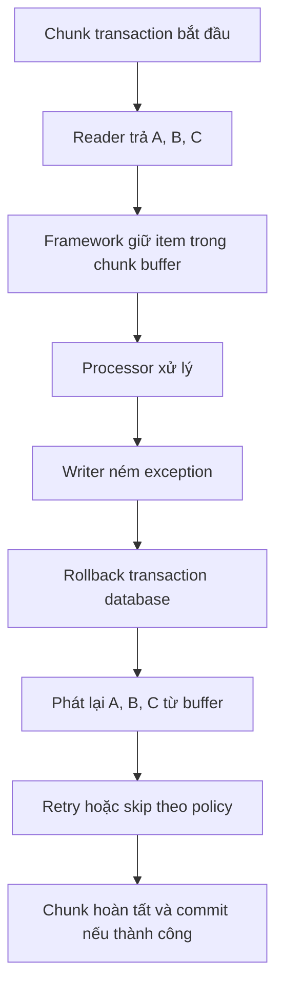

# Non-transactional reader

Trong Spring Batch, một chunk thường được xử lý bên trong transaction của step. Tuy nhiên, việc `ItemReader.read()` được gọi khi transaction đang mở không có nghĩa nguồn dữ liệu mà reader truy cập cũng có thể rollback. Reader đọc file, gọi REST API, lấy trang dữ liệu từ một nguồn bên ngoài hoặc tiến một cursor không tham gia transaction database thường là **non-transactional reader**.

Điều này tạo ra một vấn đề khi chunk rollback: transaction database có thể hoàn tác các thay đổi chưa commit, nhưng vị trí đọc của nguồn bên ngoài đã tiến lên. Nếu reader bị gọi lại từ vị trí mới, item vừa đọc có thể bị bỏ sót. Spring Batch giải quyết tình huống phổ biến này bằng cách giữ các item đã đọc trong chunk để có thể xử lý lại sau rollback. Với nguồn đọc thực sự transactional như message queue được enlist vào transaction của step, cách xử lý khác: rollback của nguồn sẽ trả item về queue, nên framework có thể đọc lại từ nguồn thay vì giữ bản sao trong bộ nhớ.

Hiểu đúng sự khác biệt giữa non-transactional reader và transactional queue reader giúp tránh mất hoặc xử lý trùng item khi retry, skip, rollback và restart.

## 1. Reader có thể được gọi trong transaction nhưng vẫn non-transactional

Trong chunk-oriented processing, Spring Batch thường mở transaction cho chunk trước khi đọc và xử lý nhóm item. Reader được gọi trong khoảng thời gian đó, nhưng transaction chỉ kiểm soát những resource thực sự tham gia nó.

Ví dụ, một step đọc CSV rồi ghi vào database:

1. Transaction của chunk bắt đầu.
2. `FlatFileItemReader` đọc các dòng 1 đến 100.
3. Processor chuyển đổi các dòng.
4. Writer insert dữ liệu vào database.
5. Nếu mọi thao tác thành công, chunk commit.

Nếu writer ném exception, database có thể rollback các insert. Nhưng filesystem không có thao tác rollback tương ứng cho việc reader đã đọc 100 dòng. File stream đã tiến tới vị trí tiếp theo. Vì thế, chỉ rollback transaction database không đưa file reader về đầu chunk.

Đây là ý nghĩa của non-transactional reader: thao tác đọc hoặc trạng thái nguồn không được hoàn tác tự động bởi transaction của chunk. Nó không có nghĩa reader luôn chạy ngoài transaction thread hoặc được gọi sau khi transaction đã đóng.

## 2. Những nguồn thường được đọc theo cách non-transactional

Các nguồn sau thường không tự quay lại vị trí trước đó khi transaction database rollback:

| Nguồn | Vì sao thường non-transactional? | Cách khôi phục vị trí thường dùng |
|---|---|---|
| File CSV/text | Đọc dòng làm file pointer tiến lên; filesystem không tham gia JDBC transaction | Lưu line/item count hoặc offset trong `ExecutionContext` |
| REST API | Request lấy trang không nằm trong transaction database của step | Lưu page token, offset hoặc khóa cuối đã xử lý |
| Object storage | Đọc object/stream không được rollback cùng database | Đọc lại object bất biến theo offset hoặc key |
| Database paging query | Mỗi trang là một truy vấn; transaction rollback không tự đảo ngược logic phân trang của reader | Lưu sort key/page state và dùng thứ tự ổn định |
| Database cursor | Cursor/ResultSet có trạng thái đọc riêng; việc rollback không mặc nhiên đưa cursor về vị trí trước đó theo logic reader | Dùng reader hỗ trợ checkpoint và kiểm tra hành vi driver/cursor |
| Custom iterator/stream | Iterator đã tiến lên khi trả item | Lưu vị trí hoặc cung cấp khả năng đọc lại |
| Một số nguồn message không enlist transaction | Message đã được ack/commit ở broker độc lập | Dùng acknowledgement sau xử lý hoặc cơ chế redelivery có phối hợp |

Không phải mọi reader của cùng một loại nguồn đều có semantics giống nhau. Ví dụ, một JMS reader có thể transactional nếu nhận message trong session transaction được phối hợp với chunk; một reader khác đọc message qua API rồi acknowledge ngay có thể không transactional. Cần xem cách reader thực hiện I/O và resource transaction cụ thể.

## 3. Điều gì xảy ra khi chunk rollback?

Giả sử chunk size là 3 và reader trả lần lượt A, B, C. Writer thất bại trước khi commit.

Với non-transactional reader, nguồn đã tiến qua C. Nếu framework gọi reader ngay để lấy ba item tiếp theo, các item A, B, C có thể bị bỏ qua. Vì vậy, trong fault-tolerant chunk processing, Spring Batch mặc định buffer các item đã đọc để chúng có thể được xử lý lại sau rollback.



Buffer cho phép framework đưa lại chính các item đã đọc cho phần xử lý tiếp theo mà không yêu cầu reader quay lại nguồn. Reader không nhất thiết được gọi lại để đọc A, B, C trong cùng quá trình xử lý chunk bị rollback.

Điểm cần nhớ: buffer này là cơ chế giữ item đang xử lý trong bộ nhớ của tiến trình. Nó không phải kho lưu trữ bền vững và không thay thế `ExecutionContext` checkpoint cho restart sau khi JVM hoặc máy chủ dừng.

## 4. Vì sao Spring Batch buffer item của non-transactional reader?

Buffering giữ cho dữ liệu đầu vào của chunk không thay đổi trong quá trình retry/rollback. Điều này giúp framework thử lại processor hoặc writer trên cùng tập item, thay vì lấy một tập item khác từ nguồn đã tiến lên.

Các lợi ích:

- Không bỏ sót item chỉ vì nguồn đọc không thể rollback.
- Retry writer có thể nhận lại cùng chunk sau transaction rollback.
- Skip logic có thể xác định item gây lỗi mà không cần reader quay lại nguồn.
- Kết quả xử lý ít phụ thuộc vào việc reader có hỗ trợ seek ngược hay không.

Buffer không làm cho nguồn dữ liệu trở thành transactional. Nó chỉ giữ bản sao các item đã được reader trả về trong phạm vi xử lý hiện tại.

Với chunk lớn hoặc item có object graph lớn, buffer có thể sử dụng đáng kể heap. Do đó, chunk size cần được chọn dựa trên kích thước item và giới hạn bộ nhớ, đặc biệt khi step có retry/skip.

## 5. Non-transactional reader và transactional queue reader

Spring Batch phân biệt reader thông thường với reader lấy dữ liệu từ một queue transactional. Ví dụ điển hình là message được nhận trong một transaction mà rollback sẽ trả message về queue để có thể nhận lại.

| Đặc điểm | Non-transactional reader | Transactional queue reader |
|---|---|---|
| Đọc item làm nguồn tiến lên | Thường có | Có, nhưng thao tác receive thuộc transaction |
| Chunk rollback có đưa nguồn về trước không? | Không tự động | Có thể redeliver item nếu queue transaction được rollback |
| Cách xử lý item sau rollback | Framework buffer và phát lại item đã đọc | Nguồn queue trả item; reader được gọi lại để nhận |
| Ví dụ | File, API paging, iterator, nhiều cursor reader | JMS/message queue có receive transaction được phối hợp |
| Cấu hình buffering | Hành vi mặc định phù hợp | Có thể tắt buffering bằng `readerIsTransactionalQueue()` |

Không phải cứ đọc từ một queue là reader transactional. Nếu code nhận message rồi acknowledge ngay trong một transaction độc lập với transaction của step, rollback database không nhất thiết trả message về queue.

## 6. Cấu hình readerIsTransactionalQueue()

Với reader thực sự transactional, `FaultTolerantStepBuilder` cung cấp `readerIsTransactionalQueue()` để báo cho Spring Batch rằng item sẽ được trả lại nguồn khi transaction rollback. Khi đó framework không cần buffer item theo cách dành cho reader non-transactional.

Ví dụ cấu hình khái quát với một JMS-backed reader:

```java
@Bean
public Step consumeMessagesStep(
        JobRepository jobRepository,
        PlatformTransactionManager transactionManager,
        ItemReader<OrderMessage> messageReader,
        ItemProcessor<OrderMessage, OrderRecord> processor,
        ItemWriter<OrderRecord> writer) {

    return new StepBuilder("consumeMessagesStep", jobRepository)
            .<OrderMessage, OrderRecord>chunk(100, transactionManager)
            .reader(messageReader)
            .processor(processor)
            .writer(writer)
            .faultTolerant()
            .readerIsTransactionalQueue()
            .retry(TransientDataAccessException.class)
            .retryLimit(3)
            .build();
}
```

Đây là cấu hình minh họa. Chỉ bật `readerIsTransactionalQueue()` khi thao tác receive thực sự được quản lý trong transaction có thể rollback cùng vòng đời chunk. Tên phương thức phản ánh trường hợp queue transactional; không dùng nó cho file reader, REST reader hoặc database reader chỉ vì nguồn dữ liệu có thể đọc lại.

Nếu bật cờ này cho một reader non-transactional, Spring Batch có thể không giữ item đã đọc trong buffer. Khi chunk rollback, nguồn không redeliver item và dữ liệu có thể bị mất khỏi luồng xử lý.

## 7. Điều kiện để transactional queue thực sự redeliver

Để queue reader hoạt động đúng với rollback của chunk, cần bảo đảm transaction của việc nhận message được phối hợp với transaction của step.

Ví dụ với JMS, cần xem xét:

- Session nhận message có được cấu hình transacted không?
- Transaction manager của step có quản lý JMS resource không?
- Nếu writer ghi database và reader nhận JMS, hai resource có được phối hợp bằng transaction manager phù hợp (ví dụ JTA/XA khi cần) không?
- Message chỉ được acknowledge/commit sau khi chunk thành công hay bị acknowledge quá sớm?
- Khi transaction rollback, broker có redeliver message theo semantics đã cấu hình không?

Một JMS local transaction riêng và một JDBC transaction riêng không tự động trở thành một transaction nguyên tử. Nếu JMS commit nhưng JDBC rollback, message có thể đã bị tiêu thụ mà dữ liệu database chưa được ghi. Ngược lại, nếu database commit nhưng JMS rollback, message có thể được gửi lại và xử lý trùng.

Hãy xác nhận cấu hình transaction thực tế thay vì chỉ dựa vào tên broker hoặc loại reader. Nếu không thể phối hợp hai resource, cần idempotency, deduplication hoặc một kiến trúc outbox/inbox phù hợp.

## 8. Retry với non-transactional reader

Giả sử reader đọc item từ file, processor xử lý và writer gặp deadlock. Chunk rollback. Vì file reader không thể quay lại vị trí trước đó chỉ bằng rollback database, framework dùng các item đã buffer để thử lại phần xử lý.

Luồng khái quát:

1. Reader trả item A, B, C.
2. Spring Batch giữ các item trong chunk buffer.
3. Processor tạo output.
4. Writer gặp lỗi tạm thời.
5. Transaction rollback.
6. Retry policy quyết định thử lại.
7. Các item đã đọc được đưa lại vào quá trình xử lý mà không cần đọc lại nguồn.
8. Khi writer thành công, chunk commit.

Đối với non-transactional reader, điều này tránh việc retry writer làm reader tiến thêm sang item D, E, F. Tập input của lần thử lại vẫn là A, B, C.

Retry không bảo đảm reader có thể phục hồi nếu chính `read()` đã tiêu thụ dữ liệu rồi ném exception trước khi trả item. Trong trường hợp đó, framework chưa có item để buffer. Reader phải có cách xử lý lỗi đọc nguyên tử, lưu checkpoint hoặc truy vấn lại nguồn theo khóa ổn định.

## 9. Skip với non-transactional reader

Skip cho phép bỏ qua item khi exception được phân loại là skippable và skip limit chưa bị vượt. Với non-transactional reader, buffering giúp framework giữ các item của chunk khi rollback và cô lập item lỗi, đặc biệt khi lỗi xảy ra trong writer.

Ví dụ, writer nhận 100 output item nhưng một bản ghi vi phạm unique constraint. Trong fault-tolerant step, Spring Batch có thể rollback chunk rồi thử ghi lại các phần nhỏ hơn để xác định item lỗi. Các item đã đọc vẫn có thể được lấy từ buffer, không yêu cầu reader đọc lại nguồn.

Khi item thực sự bị skip:

- `SkipListener` tương ứng được gọi.
- Item không được ghi thành công như các item còn lại.
- Skip count được cập nhật theo metadata của step.
- Chunk có thể tiếp tục và commit nếu phần còn lại thành công.

Không nên dùng skip cho lỗi hạ tầng kéo dài hoặc lỗi nguồn khiến không thể bảo đảm dữ liệu đầu vào. Bỏ qua một item chỉ vì API hoặc database tạm thời không hoạt động có thể làm mất dữ liệu nghiệp vụ.

## 10. Checkpoint và restart khác với chunk buffer

Đây là điểm rất quan trọng:

- **Chunk buffer** giữ các item đã đọc trong bộ nhớ để xử lý lại sau rollback trong cùng tiến trình.
- **ExecutionContext checkpoint** lưu trạng thái reader tại ranh giới cập nhật để có thể khôi phục sau khi step/job dừng và được restart.

Chunk buffer không sống sót qua JVM crash. Nếu process dừng khi đang xử lý chunk chưa commit, các item trong buffer bị mất khỏi heap. Khi restart, Spring Batch dựa vào checkpoint đã lưu từ chunk commit trước đó để reader đọc lại phần chưa hoàn tất.

Ví dụ reader đã đọc 1.000 dòng, nhưng mới commit 800 dòng. Nếu process dừng trước khi chunk tiếp theo commit, checkpoint bền vững vẫn có thể ở dòng 800. Khi restart, reader cần có khả năng mở lại nguồn và tiếp tục từ vị trí tương ứng, tức là đọc lại phần từ checkpoint đó.

Nếu nguồn không thể đọc lại, buffer trong bộ nhớ không đủ để bảo đảm restart. Ứng dụng cần một chiến lược lưu input hoặc cursor bền vững khác.

## 11. ItemStream và lưu checkpoint

Reader cần hỗ trợ restart thường triển khai `ItemStreamReader<T>` hoặc được bọc bởi một thành phần quản lý `ItemStream`. Lifecycle chính:

| Phương thức | Vai trò |
|---|---|
| `open(ExecutionContext)` | Khôi phục state đã lưu và mở tài nguyên |
| `read()` | Trả item tiếp theo |
| `update(ExecutionContext)` | Ghi state hiện tại vào context để framework lưu checkpoint |
| `close()` | Giải phóng tài nguyên |

Ví dụ custom reader đọc từ một nguồn ổn định và lưu index:

```java
public class NonTransactionalOrderReader
        implements ItemStreamReader<Order> {

    private static final String INDEX_KEY =
            "nonTransactionalOrderReader.currentIndex";

    private final List<Order> source;
    private int currentIndex;

    public NonTransactionalOrderReader(List<Order> source) {
        this.source = List.copyOf(source);
    }

    @Override
    public void open(ExecutionContext context) {
        currentIndex = context.containsKey(INDEX_KEY)
                ? context.getInt(INDEX_KEY)
                : 0;
    }

    @Override
    public Order read() {
        if (currentIndex >= source.size()) {
            return null;
        }
        return source.get(currentIndex++);
    }

    @Override
    public void update(ExecutionContext context) {
        context.putInt(INDEX_KEY, currentIndex);
    }

    @Override
    public void close() {
        // Đóng file handle, cursor hoặc resource nếu reader đang giữ.
    }
}
```

Ví dụ giữ một danh sách bất biến để minh họa checkpoint; không nên nạp toàn bộ nguồn lớn vào heap chỉ để triển khai reader production. Với nguồn thực, có thể lưu line number, byte offset, page token hoặc khóa cuối cùng đã đọc.

Spring Batch gọi lifecycle của `ItemStream` trong vòng đời step. Với chunk-oriented step, state được cập nhật và lưu tại các điểm checkpoint tương ứng với chunk commit. Nếu reader được bọc trong delegate, cần bảo đảm stream delegate cũng được đăng ký để `open`, `update` và `close` được gọi.

## 12. Ví dụ FlatFileItemReader

`FlatFileItemReader` là ví dụ quen thuộc của non-transactional reader. Việc đọc một dòng làm file pointer tiến lên; database rollback không đưa file pointer về vị trí trước chunk. Reader dựng sẵn hỗ trợ lưu state để restart.

```java
@Bean
@StepScope
public FlatFileItemReader<OrderInput> orderReader(
        @Value("#{jobParameters['inputFile']}") String inputFile) {

    FlatFileItemReader<OrderInput> reader = new FlatFileItemReader<>();
    reader.setName("orderFileReader");
    reader.setResource(new FileSystemResource(inputFile));
    reader.setLinesToSkip(1);
    reader.setSaveState(true);
    reader.setLineMapper(orderLineMapper());
    return reader;
}
```

Các điểm cần chú ý:

- Tên reader cần ổn định để key checkpoint không thay đổi giữa các lần chạy.
- `saveState=true` cho phép reader lưu vị trí để restart.
- File đầu vào cần giữ nguyên nội dung và thứ tự giữa lần chạy đầu và restart.
- Nếu file bị thay đổi hoặc chèn dòng ở đầu, vị trí đã lưu có thể trỏ tới record khác.
- Nếu file lớn, reader nên stream thay vì nạp toàn bộ nội dung vào bộ nhớ.

Với file có thể thay đổi, có thể sao chép vào vùng input bất biến cho mỗi `JobInstance`, hoặc lưu checksum/version để xác nhận nguồn trước restart.

## 13. REST API reader và page token

Một REST reader thường lấy dữ liệu theo trang:

```text
GET /orders?pageToken=token-001
Response:
  items: [...]
  nextPageToken: token-002
```

Việc gọi API không nằm trong transaction database của step. Nếu reader nhận trang và chuyển sang token tiếp theo, rollback database không tự đưa API về token trước.

Một thiết kế có thể lưu token hiện tại trong reader state và chỉ cập nhật checkpoint khi chunk được commit. Tuy nhiên, cần xác nhận token có thể dùng lại hay không. Nếu API token chỉ dùng một lần hoặc server duy trì cursor session không bền vững, reader có thể không khôi phục được sau crash.

Các nguyên tắc:

- Ưu tiên API pagination có token có thể replay hoặc truy vấn theo khóa ổn định.
- Lưu token/last key trong `ExecutionContext` qua `ItemStream.update()`.
- Chỉ coi checkpoint là bền vững sau khi chunk và metadata được commit.
- Nếu API trả dữ liệu thay đổi theo thời gian, xác định snapshot hoặc upper bound cho lần chạy.
- Nếu token đã bị tiêu thụ trước khi checkpoint commit, cần khả năng truy vấn lại hoặc lưu trang vào staging bền vững.
- Dùng business key để chống trùng khi một trang được đọc lại sau restart.

Offset pagination có thể bỏ sót hoặc lặp item nếu dữ liệu nguồn được insert/delete trong lúc job chạy. Keyset pagination theo một sort key ổn định thường dễ kiểm soát hơn, nhưng vẫn cần snapshot/upper bound nếu nguồn thay đổi.

## 14. Database cursor và paging reader

Reader database không mặc nhiên transactional theo nghĩa vị trí đọc có thể rollback cùng writer. Một cursor có thể giữ trạng thái `ResultSet`/driver riêng; rollback transaction của chunk không nhất thiết đặt cursor về record trước đó theo semantics mà ứng dụng mong đợi.

Spring Batch có các reader như `JdbcCursorItemReader` và `JdbcPagingItemReader`, mỗi loại có cách quản lý tài nguyên và checkpoint riêng. Khi chọn reader, cần hiểu:

- Cursor được mở trong transaction nào và connection có được giữ xuyên chunk không?
- Reader có lưu state vào `ExecutionContext` không?
- Query có thứ tự ổn định và khóa sắp xếp duy nhất không?
- Dữ liệu có thể thay đổi trong lúc job chạy không?
- Driver/database có giới hạn cursor hoặc isolation nào?
- Khi restart, reader mở lại query từ vị trí đã lưu bằng cách nào?

Với paging reader, luôn dùng sort key ổn định. Nếu chỉ sort theo cột không duy nhất, các bản ghi có cùng giá trị có thể đổi thứ tự giữa các trang. Hãy thêm primary key làm tie-breaker.

Không nên suy luận rằng database read luôn rollback được chỉ vì reader dùng JDBC. Việc đọc dữ liệu và việc ghi dữ liệu có thể tham gia transaction theo những cách khác nhau; hãy xem tài liệu reader, transaction manager và driver đang dùng.

## 15. Trường hợp read() tiêu thụ dữ liệu rồi ném exception

Buffering chỉ có thể giữ item mà reader đã trả về thành công. Một tình huống nguy hiểm là reader tiêu thụ record từ nguồn, sau đó gặp lỗi trước khi trả item cho Spring Batch.

Ví dụ:

1. Reader lấy message từ một API.
2. API đánh dấu message đã được consume.
3. Reader parse payload và gặp lỗi trước khi trả object.
4. `read()` ném exception.
5. Spring Batch không có item hoàn chỉnh để buffer.

Nếu nguồn đã loại message khỏi hàng đợi và không thể redeliver, item có thể bị mất. Cách thiết kế tốt hơn là tách thao tác lấy và acknowledge, hoặc dùng một nguồn có transaction/lease/visibility timeout để chỉ xác nhận sau khi chunk thành công.

Với custom reader, tránh thực hiện side effect không thể đảo ngược trước khi có thể trả item. Nếu điều đó không tránh được, cần lưu record vào staging bền vững trước khi đánh dấu nguồn đã consume.

## 16. Non-transactional reader với retry/skip ở writer

Một trường hợp phổ biến là reader non-transactional đọc file, còn writer ghi database. Nếu writer thất bại, chunk rollback nhưng file pointer đã tiến.

Trong fault-tolerant step, buffering giúp framework sử dụng lại input của chunk. Khi writer retry, cùng nhóm item có thể được ghi lại. Khi skip logic cần xác định record lỗi, framework có thể thử các nhóm nhỏ hơn từ buffer để cô lập item.

Điều này giúp reader không phải seek ngược file cho mỗi lần writer thất bại. Tuy nhiên, writer vẫn phải an toàn khi được gọi nhiều lần và database transaction phải rollback đúng các lần ghi chưa commit.

Ví dụ cấu hình:

```java
return new StepBuilder("importOrdersStep", jobRepository)
        .<OrderInput, OrderRecord>chunk(200, transactionManager)
        .reader(orderReader)
        .processor(orderProcessor)
        .writer(orderWriter)
        .faultTolerant()
        .retry(TransientDataAccessException.class)
        .retryLimit(3)
        .skip(InvalidOrderException.class)
        .skipLimit(50)
        .build();
```

Đây là ví dụ về retry/skip cho step dùng reader thông thường. Không gọi `readerIsTransactionalQueue()` trong trường hợp file reader này vì file không redeliver dòng khi transaction rollback.

## 17. Buffering có chi phí bộ nhớ

Với non-transactional reader, các item của chunk được giữ trong bộ nhớ để có thể xử lý lại. Bộ nhớ cần thiết phụ thuộc:

- Chunk size.
- Kích thước object input.
- Số lượng field và object lồng nhau.
- Dữ liệu tạm processor tạo ra.
- Cách writer buffer batch statement hoặc payload.
- Số step/flow chạy đồng thời.

Nếu một item giữ trung bình 20 KB dữ liệu object và chunk có 2.000 item, riêng input đã có thể chiếm khoảng 40 MB trước khi tính overhead object, output và buffer khác. Nếu nhiều flow cùng chạy, mức sử dụng heap có thể tăng đáng kể.

Các cách kiểm soát:

- Chọn chunk size theo footprint thực tế, không chỉ theo số lượng item.
- Tránh giữ payload lớn hoặc object graph không cần thiết trong item.
- Dùng paging/streaming thay vì nạp toàn bộ nguồn.
- Giới hạn số flow chạy đồng thời.
- Đo heap, allocation rate và GC pause trong workload đại diện.
- Nếu item rất lớn, cân nhắc lưu payload vào staging và chỉ đưa ID/reference qua chunk.

Giảm chunk size có thể giảm bộ nhớ và phạm vi rollback nhưng làm tăng số transaction/commit. Cần cân bằng giữa heap, throughput và thời gian phục hồi.

## 18. Concurrency và thread safety của reader

Non-transactional reader thường giữ state như current line, page token, cursor hoặc file pointer. Nếu nhiều thread cùng gọi `read()` trên một instance reader, state có thể bị cập nhật không đúng thứ tự hoặc item bị đọc trùng/bỏ sót.

Trong parallel flow, mỗi flow/step nên có reader instance và nguồn riêng nếu chúng xử lý dữ liệu độc lập. Nếu nhiều step cố ý chia sẻ cùng một nguồn, cần partition dữ liệu hoặc cơ chế đồng bộ phù hợp.

Một số điểm cần lưu ý:

- `@StepScope` giúp tạo bean theo step execution, phù hợp với reader có state riêng.
- `SynchronizedItemStreamReader` có thể đồng bộ lời gọi `read()` cho delegate reader không thread-safe trong một số mô hình multi-threaded step.
- Đồng bộ `read()` không tự giải quyết mọi vấn đề về checkpoint, transaction hoặc thứ tự output.
- Partitioning thường phù hợp hơn khi có thể chia nguồn thành các phạm vi độc lập, ví dụ ID range hoặc tenant.
- Không dùng chung file handle hoặc mutable page token giữa các worker nếu không có thiết kế rõ ràng.

## 19. Khi reader không hỗ trợ restart

Một reader có thể đọc đúng trong một lần chạy nhưng không thể tiếp tục sau process crash. Nếu reader không triển khai `ItemStream` hoặc không lưu state, Spring Batch không có checkpoint reader để khôi phục vị trí.

Tùy reader, khi restart có thể:

- Bắt đầu đọc lại từ đầu.
- Đọc từ một vị trí mặc định.
- Không thể khôi phục nguồn đã tiêu thụ.
- Tiếp tục sai vị trí nếu nguồn ngoài giữ cursor/session đã hết hạn.

Nếu nguồn nhỏ và writer idempotent, đọc lại từ đầu có thể chấp nhận được. Với nguồn lớn hoặc one-shot stream, cần bổ sung khả năng checkpoint hoặc staging.

Các lựa chọn:

- Dùng reader dựng sẵn hỗ trợ `ItemStream` và `saveState`.
- Tự triển khai `open/update/close` để lưu offset/page token/last key.
- Sao chép input vào file hoặc bảng staging bất biến trước khi xử lý.
- Dùng nguồn có thể replay từ business key hoặc sequence.
- Lưu trạng thái consume bền vững và chỉ advance sau khi chunk commit.

Không nên đánh dấu job restartable nếu nguồn dữ liệu không thể được khôi phục theo cách an toàn mà không có chiến lược bổ sung.

## 20. Nguồn dữ liệu cần ổn định qua restart

Checkpoint chỉ có ý nghĩa nếu cùng một vị trí tiếp tục đại diện cho cùng dữ liệu.

Ví dụ, file có 10.000 dòng và reader lưu line count 5.000. Nếu ai đó chèn 100 dòng vào đầu file trước khi restart, line 5.001 không còn là record kế tiếp của lần chạy cũ.

Với database, nếu dùng offset pagination và có record mới được insert trước vị trí hiện tại, offset có thể trỏ sang record khác. Với API, page token có thể hết hạn hoặc snapshot dữ liệu có thể thay đổi.

Để giảm rủi ro:

- Dùng input file bất biến cho mỗi job instance.
- Lưu checksum, version hoặc metadata nguồn để xác minh khi restart.
- Chọn upper bound/snapshot cho query database.
- Dùng keyset pagination theo khóa duy nhất và ổn định.
- Với API, dùng token có khả năng replay hoặc snapshot/version được provider bảo đảm.
- Ghi lại source identifier cùng checkpoint để tránh restart trên nhầm nguồn.

## 21. Non-transactional reader và exactly-once

Buffering giúp tránh đọc mất item trong một chunk rollback khi process còn sống. Checkpoint giúp reader tiếp tục từ ranh giới đã commit sau restart. Nhưng hai cơ chế này không tự bảo đảm exactly-once end-to-end.

Ví dụ, database commit thành công nhưng nguồn bên ngoài không có acknowledgement phối hợp; hoặc API đã thực hiện side effect rồi process crash trước khi checkpoint được lưu. Khi restart, cùng item có thể được đọc lại và side effect có thể được thực hiện lần nữa.

Trong thực tế, nhiều batch pipeline vận hành theo mô hình at-least-once ở ranh giới nguồn/đích. Để đạt kết quả nghiệp vụ không trùng, cần:

- Business key duy nhất hoặc unique constraint ở đích.
- Writer idempotent hoặc upsert.
- Idempotency key cho API ngoài.
- Outbox/inbox khi phối hợp message và database.
- Reconciliation để xử lý trạng thái không xác định.

Exactly-once chỉ có thể được tuyên bố trong một phạm vi cụ thể khi transaction và resource phối hợp bảo đảm được điều đó. Không nên suy ra exactly-once chỉ từ việc step dùng chunk transaction.

## 22. Các lỗi thường gặp

| Tình huống | Nguyên nhân | Cách xử lý |
|---|---|---|
| Item bị bỏ qua sau writer rollback | Reader đã tiến nhưng item không được giữ lại hoặc buffering bị tắt sai | Dùng buffering mặc định cho non-transactional reader |
| Queue message bị xử lý trùng | Reader transactional nhưng framework vẫn buffer trong khi broker redeliver | Chỉ bật `readerIsTransactionalQueue()` khi receive thực sự rollback được |
| Queue message bị mất sau rollback | Queue receive đã commit/ack riêng trước chunk commit | Phối hợp transaction hoặc acknowledge sau xử lý |
| Restart đọc lại từ đầu | Reader không lưu state hoặc `saveState=false` | Dùng `ItemStream` và checkpoint ổn định |
| Restart bỏ sót item | Nguồn thay đổi hoặc cursor không thể seek về checkpoint | Dùng snapshot, source version và reader có thể replay |
| Retry read vẫn mất item | Reader tiêu thụ record rồi ném exception trước khi trả item | Thiết kế read/ack nguyên tử hoặc staging bền vững |
| Heap tăng cao | Chunk lớn và item nặng được buffer | Giảm chunk size, giảm payload và đo memory |
| Item trùng ở đích | Chunk được xử lý lại nhưng writer không idempotent | Dùng unique key, upsert hoặc idempotency key |
| Reader lỗi khi chạy nhiều thread | Instance stateful bị chia sẻ | Dùng reader riêng, step scope hoặc partitioning |
| Context không cập nhật | Delegate `ItemStream` không được đăng ký | Đảm bảo lifecycle `open/update/close` được gọi |

## 23. Quy trình điều tra khi rollback làm reader có nguy cơ mất item

1. **Xác định loại nguồn:** file, database cursor/paging, API, message queue hay custom stream.
2. **Xác định transaction semantics:** thao tác đọc có thực sự tham gia transaction của chunk hay chỉ được gọi khi transaction đang mở?
3. **Kiểm tra buffering:** reader có phải transactional queue không; có cấu hình `readerIsTransactionalQueue()` nhầm không?
4. **Xác định item đã được trả về chưa:** nếu `read()` ném exception sau khi consume nhưng trước khi return, framework chưa thể buffer item đó.
5. **Kiểm tra checkpoint:** reader có triển khai `ItemStream`, state có được cập nhật tại chunk commit và key có ổn định không?
6. **Xác minh nguồn:** file/API/query có giữ nguyên thứ tự và dữ liệu giữa restart không?
7. **Đối chiếu dữ liệu đích:** xác định chunk nào đã commit, chunk nào rollback và có bản ghi trùng không.
8. **Kiểm tra khả năng chạy lại:** writer có idempotent; queue có redelivery; API có token replay hoặc idempotency không?
9. **Chọn phương án phục hồi:** retry, restart cùng job instance, replay nguồn, staging hoặc reconciliation.

Không nên sửa trực tiếp checkpoint trong metadata production để ép reader nhảy vị trí nếu chưa xác định chính xác item nào đã commit. Một offset sai có thể làm mất hoặc xử lý trùng dữ liệu.

## 24. Những nguyên tắc cần nhớ

- Reader được gọi trong transaction chunk vẫn có thể non-transactional nếu nguồn đọc không tham gia transaction đó.
- Với non-transactional reader, Spring Batch mặc định buffer item của chunk để xử lý lại sau rollback.
- Buffer chỉ tồn tại trong bộ nhớ của tiến trình; nó không thay thế checkpoint bền vững khi restart.
- `readerIsTransactionalQueue()` dành cho reader mà rollback thực sự trả item về queue; không bật cho file, API hoặc reader không redeliver.
- Transaction của message queue và database phải được phối hợp nếu muốn rollback đồng bộ; hai local transaction riêng không tự tạo atomicity.
- `ItemStream.open/update/close` là lifecycle quan trọng để lưu và khôi phục reader state.
- Checkpoint được lưu ở ranh giới cập nhật/commit; nguồn cần replay hoặc seek lại được từ checkpoint.
- Nếu `read()` tiêu thụ item rồi ném exception trước khi trả item, framework không có item để buffer.
- Nguồn đầu vào phải ổn định qua restart; dùng snapshot, checksum, page token hoặc khóa sắp xếp ổn định.
- Chunk lớn có thể tăng memory do buffer; chọn chunk size theo footprint item và số flow chạy đồng thời.
- Reader stateful cần instance riêng hoặc cơ chế thread-safe khi xử lý song song.
- Buffering và checkpoint không tự bảo đảm exactly-once; writer và side effect cần idempotency/deduplication phù hợp.

Non-transactional reader là trường hợp phổ biến khi batch job đọc file, API hoặc nguồn dữ liệu không thể rollback cùng database. Buffering giúp xử lý lại item trong chunk bị rollback, còn `ExecutionContext` và `ItemStream` hỗ trợ khôi phục sau restart. Khi chọn đúng semantics của reader, giữ nguồn ổn định và thiết kế writer có thể chạy lại an toàn, job sẽ tránh được việc mất hoặc nhân đôi item khi gặp lỗi tạm thời.
