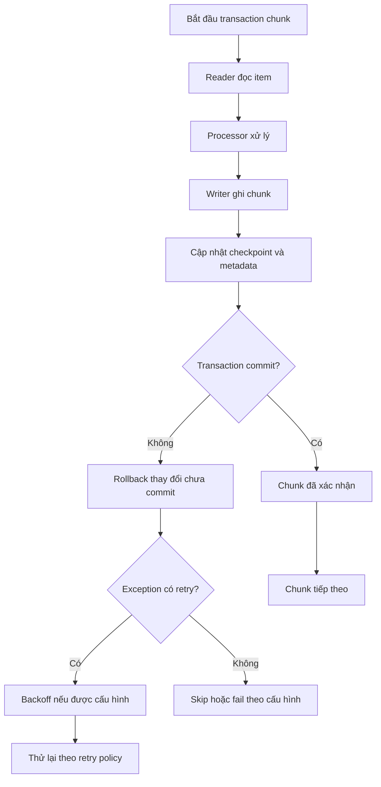

# Rollback và retry

Trong Spring Batch, rollback và retry thường xuất hiện cùng nhau khi một chunk gặp lỗi, nhưng chúng là hai cơ chế khác nhau. **Rollback** hoàn tác các thay đổi chưa commit trong transaction hiện tại. **Retry** yêu cầu thử lại một thao tác hoặc phần công việc sau khi gặp exception được xác định là có thể phục hồi. Trong một chunk step, Spring Batch thường rollback transaction bị lỗi trước khi tiếp tục xử lý theo retry policy.

Ví dụ, writer ghi một nhóm đơn hàng vào database nhưng gặp deadlock. Transaction của chunk có thể rollback để giải phóng các thay đổi chưa commit. Nếu deadlock thuộc nhóm exception retryable và còn lượt thử, Spring Batch thử lại theo cấu hình. Nếu lần thử sau thành công, chunk có thể commit. Nếu hết retry limit, step có thể thất bại hoặc xử lý exception theo skip policy nếu exception đó được phép skip.

Hiểu rõ mối quan hệ giữa rollback, retry, skip và restart giúp tránh ghi trùng, mất dữ liệu hoặc retry vô ích. Đặc biệt, rollback của database không tự hoàn tác HTTP request, message hoặc file đã được ghi ra ngoài transaction.

## 1. Rollback và retry giải quyết hai vấn đề khác nhau

Rollback là hành vi của transaction manager. Nó đưa resource tham gia transaction về trạng thái trước transaction chưa commit. Retry là chính sách xử lý lỗi ở cấp thao tác: có nên thử lại không, thử lại bao nhiêu lần và chờ bao lâu.

| Cơ chế | Câu hỏi được trả lời | Ví dụ |
|---|---|---|
| Commit | Khi nào thay đổi trở thành dữ liệu đã xác nhận? | Ghi xong chunk và commit transaction |
| Rollback | Nếu transaction thất bại trước commit thì thay đổi nào bị hủy? | Insert trong chunk lỗi bị hoàn tác |
| Retry | Exception nào có thể được thử lại? | Deadlock database được thử lại tối đa theo cấu hình |
| Backoff | Chờ bao lâu trước lần thử tiếp theo? | Chờ 500 ms rồi mới retry |
| Skip | Item lỗi nào được bỏ qua để tiếp tục? | Bỏ qua một dòng có định dạng không hợp lệ |
| Restart | Nếu job execution đã thất bại/dừng, làm sao chạy tiếp? | Tạo execution mới cho cùng JobInstance và dùng checkpoint đã lưu |

Rollback không có nghĩa job sẽ tự retry. Nếu exception không được retry và không được skip, step có thể thất bại sau rollback. Tương tự, retry không bảo đảm rollback mọi side effect: chỉ các thay đổi thuộc transaction được rollback mới được hoàn tác.

## 2. Transaction boundary trong chunk step

Chunk-oriented processing chia dữ liệu thành các nhóm item. Với commit interval là 100, Spring Batch thường xử lý một chunk gồm tối đa 100 item trong một transaction. Reader đọc item, processor chuyển đổi hoặc filter, writer ghi chunk, stream cập nhật checkpoint và transaction commit.



Khi writer ghi dữ liệu bằng `JdbcTemplate` dùng cùng `DataSource` và transaction manager của step, các câu lệnh ghi thường tham gia transaction chunk. Nếu writer ném exception trước commit, các thay đổi đó được rollback.

Các chunk trước đã commit vẫn được giữ. Ví dụ chunk 1 và 2 đã commit, chunk 3 gặp lỗi rồi rollback: dữ liệu của chunk 1 và 2 vẫn tồn tại. Spring Batch không rollback ngược toàn bộ job như một transaction duy nhất.

## 3. Điều gì xảy ra khi chunk gặp lỗi?

Giả sử step có commit interval 2 và input gồm item 1 đến 6:

| Chunk | Item | Kết quả |
|---|---|---|
| 1 | 1, 2 | Writer thành công; transaction commit |
| 2 | 3, 4 | Writer ném exception; transaction rollback |
| 3 | 5, 6 | Chưa chạy nếu step thất bại ở chunk 2 |

Sau rollback, database vẫn chứa item 1 và 2. Những thay đổi của item 3 và 4 thuộc transaction bị rollback không còn tồn tại trong database đó. Tùy retry/skip policy, Spring Batch có thể thử lại chunk hoặc kết thúc step.

Nếu chunk 2 được retry và lần thử sau thành công, dữ liệu item 3 và 4 được ghi rồi commit. Nếu retry hết giới hạn và exception không được skip, step thất bại; khi đó item 1 và 2 vẫn đã commit, còn item 3 và 4 chưa được xác nhận.

Điểm cần nhớ: rollback chỉ áp dụng cho transaction hiện tại. Các transaction đã commit trước đó và các side effect ngoài transaction không bị hoàn tác chỉ vì một chunk sau thất bại.

## 4. Cấu hình retry cho chunk step

Trong Spring Batch 5, fault-tolerant chunk step có thể cấu hình exception retryable, retry limit và backoff policy bằng builder:

```java
@Bean
Step importOrdersStep(
        JobRepository jobRepository,
        PlatformTransactionManager transactionManager,
        ItemReader<Order> reader,
        ItemProcessor<Order, ImportedOrder> processor,
        ItemWriter<ImportedOrder> writer,
        BackOffPolicy retryBackOffPolicy) {

    return new StepBuilder("importOrdersStep", jobRepository)
            .<Order, ImportedOrder>chunk(100, transactionManager)
            .reader(reader)
            .processor(processor)
            .writer(writer)
            .faultTolerant()
            .retry(TransientDataAccessException.class)
            .retryLimit(3)
            .backOffPolicy(retryBackOffPolicy)
            .build();
}
```

Trong ví dụ:

- `.faultTolerant()` bật cấu hình fault tolerance cho chunk step.
- `.retry(TransientDataAccessException.class)` đánh dấu exception này là có thể retry.
- `.retryLimit(3)` giới hạn số lần thử theo semantics của phiên bản Spring Batch/Spring Retry đang dùng.
- `.backOffPolicy(...)` xác định khoảng chờ giữa các lần retry.

Khi thiết kế vận hành, hãy phân biệt lần thử ban đầu với các lần thử lại và kiểm tra semantics retry limit của dependency version trong dự án. Khi tính thời gian chạy tối đa, phải tính cả thời gian xử lý các lần thử và tổng backoff.

Chỉ retry exception có khả năng tự hết. Deadlock, lỗi kết nối tạm thời hoặc một số lỗi HTTP 429/5xx có thể phù hợp. Lỗi dữ liệu như số tiền sai định dạng hoặc mã khách hàng không tồn tại thường không tự biến mất khi thử lại.

## 5. Phân loại exception: retry, noRetry, skip và noSkip

Không nên retry mọi exception. Step cần quy định lỗi nào được thử lại và lỗi nào được xử lý theo skip hoặc fail.

Ví dụ:

```java
@Bean
Step importPaymentsStep(
        JobRepository jobRepository,
        PlatformTransactionManager transactionManager,
        ItemReader<Payment> reader,
        ItemWriter<Payment> writer,
        BackOffPolicy retryBackOffPolicy) {

    return new StepBuilder("importPaymentsStep", jobRepository)
            .<Payment, Payment>chunk(50, transactionManager)
            .reader(reader)
            .writer(writer)
            .faultTolerant()
            .retry(TransientDataAccessException.class)
            .noRetry(InvalidPaymentException.class)
            .retryLimit(3)
            .backOffPolicy(retryBackOffPolicy)
            .skip(InvalidPaymentException.class)
            .skipLimit(100)
            .noSkip(FatalConfigurationException.class)
            .build();
}
```

Ý nghĩa:

- Lỗi truy cập dữ liệu tạm thời có thể được retry.
- Lỗi `InvalidPaymentException` không được retry vì dữ liệu không tự sửa; nếu nằm trong phạm vi skip và còn skip limit, item có thể được bỏ qua theo chính sách.
- Lỗi cấu hình nghiêm trọng không được skip; step cần thất bại để người vận hành sửa cấu hình.

Retry và skip có thể được kết hợp, nhưng cần xác định rõ thứ tự mong muốn cho từng loại exception. Một exception có thể được retry trước; nếu vẫn thất bại sau giới hạn, recovery/skip policy có thể quyết định có bỏ item hay không. Không dùng skip để che giấu lỗi hạ tầng hoặc lỗi lập trình.

## 6. Retry ở reader, processor và writer

Vị trí phát sinh exception ảnh hưởng đến phần công việc có thể phải thực hiện lại. Reader, processor và writer có trách nhiệm khác nhau:

| Thành phần | Ví dụ lỗi | Điều cần lưu ý khi retry |
|---|---|---|
| Reader | Lỗi truy vấn tạm thời, lỗi đọc nguồn | Nguồn có thể đã tiến vị trí; cần reader có khả năng khôi phục hoặc cơ chế buffering phù hợp |
| Processor | Lỗi tra cứu dịch vụ hoặc validation | Processor có thể được gọi lại; nên stateless và tránh side effect |
| Writer | Deadlock, timeout hoặc lỗi ghi | Writer/chunk có thể được thực hiện lại; cần transaction đúng và idempotency |

Với reader không có transaction như file reader, Spring Batch có cơ chế buffering item trong một số đường xử lý fault-tolerant để tránh đọc lại nguồn không thể rollback. Với reader dựa trên transactional queue, ví dụ message được trả về queue khi transaction rollback, có thể cấu hình `readerIsTransactionalQueue()` để framework xử lý theo semantics của queue. Chỉ bật tùy chọn này khi reader thực sự dùng nguồn có khả năng rollback việc nhận message.

Nếu processor tốn kém nhưng không có side effect và không cần chạy lại sau rollback, `processorNonTransactional()` có thể yêu cầu Spring Batch cache output processor qua rollback trong trường hợp phù hợp. Chỉ dùng khi output vẫn hợp lệ khi retry; nếu kết quả phụ thuộc dữ liệu ngoài thay đổi theo thời gian, cần cân nhắc tính nhất quán.

Không nên dựa vào việc một thành phần “thường chỉ được gọi một lần”. Khi chunk retry hoặc restart, cùng item có thể đi qua processor hoặc writer nhiều lần tùy vị trí lỗi và cấu hình. Hãy thiết kế thành phần có thể chịu được việc gọi lại.

## 7. noRollback: khi nào không rollback?

`noRollback(...)` cho phép chỉ định exception không làm transaction của chunk rollback theo chính sách step. Đây là tùy chọn đặc biệt; không nên dùng để làm cho job có vẻ tiếp tục khi writer đã ghi dữ liệu dở dang.

Ví dụ khai báo:

```java
.faultTolerant()
.skip(InvalidOrderException.class)
.skipLimit(100)
.noRollback(InvalidOrderException.class)
```

Chỉ cân nhắc `noRollback` khi exception đại diện cho một tình huống mà các thay đổi đã thực hiện trong transaction vẫn hợp lệ và có thể commit an toàn. Ví dụ, một processor phát hiện item không hợp lệ trước khi writer ghi dữ liệu cho item đó; nếu không có thay đổi nghiệp vụ dở dang cần hoàn tác, có thể xem xét cách xử lý không rollback để giảm chi phí transaction.

Không dùng `noRollback` cho exception của writer sau khi writer đã ghi một phần chunk. Nếu transaction được commit trong khi chỉ một phần thao tác nghiệp vụ đã diễn ra, dữ liệu có thể ở trạng thái không nhất quán. Với lỗi writer, rollback thường là hành vi cần thiết để giữ tính nguyên tử của chunk.

Nếu chưa chứng minh được rằng transaction có thể tiếp tục an toàn, giữ hành vi rollback mặc định và xử lý exception bằng retry, skip hoặc fail theo đúng yêu cầu nghiệp vụ.

## 8. Retry và backoff

Retry policy quyết định có thử lại hay không; backoff policy quyết định chờ bao lâu. Ví dụ dùng exponential backoff:

```java
@Bean
BackOffPolicy retryBackOffPolicy() {
    ExponentialBackOffPolicy policy = new ExponentialBackOffPolicy();
    policy.setInitialInterval(500L);
    policy.setMultiplier(2.0);
    policy.setMaxInterval(5_000L);
    return policy;
}
```

Khoảng chờ tăng từ 500 ms, 1 giây, 2 giây đến tối đa 5 giây. Với nhiều worker hoặc partition, có thể dùng randomization/jitter để tránh tất cả worker retry cùng lúc.

Backoff không giải phóng worker thread trong cách sử dụng thông thường; thread đang retry sẽ chờ. Nếu cần retry sau nhiều phút hoặc nhiều giờ mà không chiếm worker, hãy cân nhắc queue hoặc scheduler có trạng thái bền vững.

Đặt retry limit và max interval theo SLA. Một retry policy quá rộng có thể làm job kéo dài, chiếm connection và tăng tải cho dependency đang lỗi.

## 9. Transaction manager quyết định phạm vi rollback

Rollback chỉ hoàn tác resource tham gia transaction hiện tại. Vì vậy, cần kiểm tra writer dùng đúng transaction manager.

Ví dụ, nếu step dùng `DataSourceTransactionManager` cho datasource A nhưng writer mở connection độc lập tới datasource B và tự commit, rollback của step không hoàn tác dữ liệu trong B.

Các điểm cần xác nhận:

- `JdbcTemplate` dùng cùng `DataSource` được quản lý bởi transaction manager của step.
- JPA repository và `EntityManager` tham gia transaction phù hợp.
- Không giữ hoặc chia sẻ JDBC `Connection` giữa thread.
- Không dùng `REQUIRES_NEW` vô tình commit một phần nghiệp vụ độc lập nếu yêu cầu là rollback cả chunk.
- Không thực hiện ghi bất đồng bộ rồi giả định transaction của step sẽ chờ hoặc rollback tác vụ đó.

Nếu một service dùng `@Transactional(propagation = REQUIRES_NEW)`, transaction con có thể commit độc lập. Khi transaction chunk bên ngoài rollback, dữ liệu đã commit trong transaction mới vẫn tồn tại. Điều đó có thể phù hợp cho audit hoặc log độc lập, nhưng không phù hợp nếu dữ liệu phải rollback cùng chunk.

## 10. Rollback không hoàn tác side effect bên ngoài

Database transaction thường không bao gồm HTTP API, email, file system hoặc message broker. Hãy xem writer thực hiện hai thao tác:

1. Gửi yêu cầu tạo thanh toán tới API đối tác.
2. Ghi trạng thái thanh toán vào database.

Nếu API đã xử lý yêu cầu nhưng ứng dụng timeout trước khi nhận response, transaction database có thể rollback. Khi retry, cùng item được gửi lại và đối tác có thể tạo khoản thanh toán thứ hai nếu không có cơ chế chống lặp.

Các giải pháp phổ biến:

- **Idempotency key:** tạo key ổn định từ mã giao dịch nghiệp vụ và gửi lại cùng key qua các lần retry.
- **Unique constraint/ledger:** ghi một giao dịch với business key duy nhất để không áp dụng cùng tác động hai lần.
- **Transactional outbox:** ghi dữ liệu nghiệp vụ và outbox event trong cùng transaction; publisher gửi event sau khi commit.
- **Inbox/deduplication:** consumer lưu event ID đã xử lý để message redelivery không áp dụng lại side effect.
- **Reconciliation:** khi timeout không rõ kết quả, truy vấn trạng thái từ hệ thống ngoài trước khi quyết định gửi lại.

Retry làm tăng khả năng phục hồi; idempotency bảo vệ tính đúng đắn khi thao tác bị gọi lại. Hai cơ chế cần được thiết kế cùng nhau.

## 11. Ví dụ writer ghi database rồi thất bại

Ví dụ sau minh họa writer ghi các dòng bằng `JdbcTemplate`, sau đó ném exception mô phỏng lỗi tạm thời. Khi `JdbcTemplate` tham gia transaction của step, các insert của lần thử bị rollback nếu exception làm transaction rollback.

```java
@Bean
ItemWriter<ImportedOrder> importedOrderWriter(
        JdbcTemplate jdbcTemplate,
        FailureSwitch failureSwitch) {

    return chunk -> {
        for (ImportedOrder order : chunk.getItems()) {
            jdbcTemplate.update(
                    "insert into imported_order(order_id, amount) values (?, ?)",
                    order.orderId(),
                    order.amount());
        }

        if (failureSwitch.shouldFail()) {
            throw new TransientDataAccessException("Temporary write failure") {};
        }
    };
}
```

`FailureSwitch` là thành phần phục vụ ví dụ/test, cho phép gây lỗi có kiểm soát. Khi exception xảy ra:

- Transaction chunk rollback nếu exception được cấu hình làm rollback.
- Các insert trong cùng transaction không còn được commit.
- Nếu exception retryable và còn lượt, Spring Batch thử lại theo retry policy.
- Khi lần thử thành công, writer ghi lại và chunk commit.
- Nếu retry hết giới hạn, step có thể thất bại hoặc đi theo skip policy.

Để ví dụ này đúng trong ứng dụng, `JdbcTemplate` phải dùng datasource tham gia cùng transaction manager được truyền cho `.chunk(...)`. Nếu dùng transaction manager khác hoặc connection tự commit, kết quả rollback sẽ khác.

## 12. Retry và restart là hai thời điểm khác nhau

Retry thường xảy ra trong cùng `JobExecution` khi một thao tác gặp lỗi và policy cho phép thử lại. Restart xảy ra sau khi job execution đã thất bại hoặc dừng; Spring Batch tạo execution mới cho cùng `JobInstance` nếu các identifying `JobParameters` giống nhau và trạng thái cho phép restart.

| Tiêu chí | Retry | Restart |
|---|---|---|
| Thời điểm | Trong quá trình xử lý step hiện tại | Sau khi execution trước thất bại/dừng |
| Execution | Thường vẫn cùng JobExecution/StepExecution | JobExecution mới cho cùng JobInstance |
| Mục tiêu | Phục hồi lỗi tạm thời của thao tác | Tiếp tục job từ trạng thái đã lưu |
| Trạng thái dùng | Retry context/policy và trạng thái chunk hiện tại | JobRepository, ExecutionContext và checkpoint đã commit |
| Ví dụ | Thử lại writer sau deadlock | Chạy lại job sau khi ứng dụng bị dừng |

Nếu retry hết giới hạn và step thất bại, người vận hành có thể restart job. Khi restart, reader có khả năng lưu state sẽ mở lại từ checkpoint đã commit gần nhất. Chunk chưa commit có thể được xử lý lại.

Restart cần cùng identifying `JobParameters` để tiếp tục đúng JobInstance. Thêm timestamp hoặc UUID mới có thể tạo instance mới và chạy lại từ đầu theo phạm vi mới.

## 13. Checkpoint và rollback

Trong chunk step, `ItemStream.update(ExecutionContext)` thường được gọi tại ranh giới checkpoint trước khi transaction chunk hoàn tất. Spring Batch lưu execution context và metadata thông qua `JobRepository` theo cơ chế transaction được cấu hình.

Nếu chunk commit thành công, checkpoint mới trở thành trạng thái bền vững. Nếu chunk rollback, checkpoint mới không được xác nhận trong transaction đó; restart sử dụng checkpoint đã commit trước đó.

Ví dụ reader lưu khóa cuối cùng:

```java
@Override
public void update(ExecutionContext context) {
    context.putLong("orderReader.lastId", lastCommittedId);
}
```

Reader phải bảo đảm `lastCommittedId` phản ánh tiến độ được xác nhận, không chỉ là item cuối cùng đã được đọc trong bộ nhớ. Nếu con trỏ tiến qua item chưa commit rồi được lưu sai thời điểm, restart có thể bỏ sót item.

Với reader chuẩn như `FlatFileItemReader` hoặc JDBC paging reader, hãy bật state saving và giữ nguồn dữ liệu ổn định. Với reader tùy chỉnh, cần kiểm thử rollback trong cùng execution và restart sau khi JVM khởi động lại.

## 14. Reader có transaction và buffering

Không phải mọi nguồn đọc đều rollback được. File reader không thể yêu cầu filesystem “trả lại” một dòng đã đọc như một queue có transaction. Vì vậy, fault-tolerant chunk processing cần xử lý việc đọc lại item sau rollback.

Với reader không transactional, Spring Batch có thể buffer item đã đọc để dùng lại khi chunk rollback thay vì đọc nguồn lần nữa. Với transactional queue reader, chẳng hạn reader nhận message trong transaction và message sẽ được trả lại queue khi rollback, có thể cấu hình `readerIsTransactionalQueue()` để framework không dùng buffering theo cách không phù hợp với nguồn đó.

Chỉ dùng tùy chọn transactional queue khi nguồn thực sự hỗ trợ rollback việc nhận message. Nếu cấu hình sai, item có thể bị đọc lại hoặc mất theo semantics không mong muốn.

## 15. Retry trong processor và processorNonTransactional

Processor thường nên stateless và không tạo side effect. Khi chunk rollback, processor có thể được gọi lại cho item trong chunk tùy vị trí lỗi và cấu hình retry.

Nếu processor chỉ là phép chuyển đổi deterministic và việc gọi lại không có chi phí lớn, để framework xử lý mặc định thường là lựa chọn dễ hiểu. Nếu processor không transactional, không có side effect và output có thể được giữ ổn định qua rollback, `.processorNonTransactional()` có thể yêu cầu framework cache kết quả processor thay vì gọi lại trong một số đường retry.

```java
return new StepBuilder("processOrdersStep", jobRepository)
        .<OrderInput, Order>chunk(100, transactionManager)
        .reader(reader)
        .processor(processor)
        .writer(writer)
        .faultTolerant()
        .processorNonTransactional()
        .retry(TransientDataAccessException.class)
        .retryLimit(3)
        .build();
```

Chỉ dùng tùy chọn này sau khi xác nhận output processor vẫn hợp lệ qua lần retry. Nếu processor tra cứu dữ liệu có thể thay đổi hoặc thực hiện side effect, cache output có thể khiến kết quả không còn phản ánh trạng thái hiện tại hoặc làm phát sinh sai lệch nghiệp vụ.

## 16. Retry, skip và recovery callback

Khi exception retryable tiếp tục xảy ra đến khi hết giới hạn, framework cần quyết định kết quả tiếp theo. Nếu exception cũng được khai báo là skippable và skip limit chưa vượt, item có thể được skip theo chính sách. Nếu không, step thất bại.

Một `SkipListener` có thể ghi nhận item bị bỏ qua và nguyên nhân:

```java
public class ImportSkipListener implements SkipListener<OrderInput, Order> {

    @Override
    public void onSkipInRead(Throwable throwable) {
        log.warn("Skipped item while reading", throwable);
    }

    @Override
    public void onSkipInProcess(OrderInput item, Throwable throwable) {
        log.warn("Skipped order {} during processing: {}",
                item.orderId(), throwable.toString());
    }

    @Override
    public void onSkipInWrite(Order item, Throwable throwable) {
        log.warn("Skipped order {} during writing: {}",
                item.orderId(), throwable.toString());
    }
}
```

Trong ứng dụng thực tế, nên lưu thông tin skip vào bảng lỗi hoặc kho dữ liệu có thể truy vấn thay vì chỉ log. Cần bảo đảm việc ghi nhận lỗi cũng phù hợp với transaction và không tạo thêm side effect trùng khi retry.

Skip không phải cách xử lý mặc định cho lỗi hạ tầng. Nếu database mất kết nối hoặc API thanh toán không sẵn sàng, bỏ qua item có thể làm mất nghiệp vụ. Chỉ skip khi yêu cầu nghiệp vụ cho phép item đó không được xử lý trong batch hiện tại và có quy trình xử lý lại rõ ràng.

## 17. Retry policy và retry state

Một số lỗi chỉ có thể thử lại an toàn khi framework ghi nhớ trạng thái của item hoặc thao tác giữa các lần thử. Ví dụ, lỗi ghi database có thể làm transaction rollback; lần retry sau cần biết cùng item/chunk đang được xử lý để áp dụng đúng chính sách.

Spring Batch tích hợp cơ chế retry của Spring Retry trong fault-tolerant step. Retry policy phân loại exception, giới hạn số lần thử và có thể dùng `BackOffPolicy`. Khi thiết kế, cần kiểm tra:

- Exception có thực sự tạm thời không?
- Retry áp dụng ở reader, processor hay writer?
- Lỗi làm transaction rollback hay được khai báo `noRollback`?
- Thao tác có side effect trước khi ném exception không?
- Item có thể được xác định ổn định qua các lần thử không?
- Retry context có cần giữ trạng thái qua ranh giới transaction không?

Không nên tự lưu bộ đếm retry vào một field singleton. Field đó không bền vững qua restart và có thể bị chia sẻ sai giữa các thread. Dùng retry policy/context của framework; nếu cần theo dõi lịch sử nghiệp vụ, lưu dữ liệu riêng với khóa ổn định.

## 18. Idempotency là điều kiện quan trọng khi retry

Một writer idempotent có thể được gọi lại mà không tạo thêm tác động nghiệp vụ. Đây là yêu cầu đặc biệt quan trọng khi writer có thể đã thực hiện một side effect trước khi gặp lỗi.

Các kỹ thuật phổ biến:

- Dùng unique constraint theo business key.
- Dùng upsert có quy tắc xác định, không cộng dồn mù quáng.
- Ghi ledger entry với transaction ID duy nhất thay vì cộng số dư nhiều lần.
- Gửi idempotency key ổn định tới API ngoài.
- Dùng outbox để phát message sau commit và inbox để deduplicate ở consumer.
- Đối soát trạng thái khi timeout khiến kết quả thao tác ngoài không rõ ràng.

Ví dụ, nếu writer tăng số dư bằng `balance = balance + amount`, retry cùng item có thể cộng tiền hai lần. Thay vào đó, ghi một giao dịch có `transaction_id` duy nhất và chỉ áp dụng giao dịch đó một lần.

## 19. Kiểm thử rollback và retry

Kiểm thử cần chứng minh cả transaction behavior và retry policy. Mock writer chỉ xác nhận exception được ném; nó không chứng minh database đã rollback. Với kiểm thử transaction, nên dùng database test có transaction manager thật và kiểm tra dữ liệu sau khi job chạy.

Các tình huống quan trọng:

1. **Commit bình thường:** writer ghi thành công; dữ liệu tồn tại sau khi chunk commit.
2. **Rollback:** writer ghi một phần rồi ném exception; dữ liệu thuộc transaction chunk không còn sau rollback.
3. **Giữ chunk trước:** chunk đã commit trước đó vẫn còn khi chunk sau thất bại.
4. **Retry thành công:** writer thất bại tạm thời một hoặc vài lần rồi thành công; kết quả cuối không trùng.
5. **Retry hết giới hạn:** mọi lần thử thất bại; step kết thúc đúng trạng thái và dữ liệu chỉ gồm các chunk đã commit.
6. **Skip sau retry:** exception thuộc skip policy; item bị bỏ qua và được ghi nhận đúng.
7. **NoRollback:** chỉ kiểm thử khi có tình huống nghiệp vụ cụ thể chứng minh transaction có thể tiếp tục an toàn.
8. **Restart:** sau khi step thất bại, chạy lại cùng identifying `JobParameters`; reader tiếp tục từ checkpoint đã commit.
9. **Side effect ngoài database:** mô phỏng API đã xử lý nhưng client timeout; retry cùng idempotency key không tạo giao dịch thứ hai.
10. **Nhiều worker:** xác nhận retry/backoff không tạo retry storm hoặc race condition.

Ví dụ writer test có thể dùng một công tắc gây lỗi sau lần ghi đầu tiên:

```java
class FailOnceWriter implements ItemWriter<ImportedOrder> {

    private final JdbcTemplate jdbcTemplate;
    private final AtomicBoolean failNext = new AtomicBoolean(true);

    FailOnceWriter(JdbcTemplate jdbcTemplate) {
        this.jdbcTemplate = jdbcTemplate;
    }

    @Override
    public void write(Chunk<? extends ImportedOrder> chunk) {
        for (ImportedOrder order : chunk.getItems()) {
            jdbcTemplate.update(
                    "insert into imported_order(order_id, amount) values (?, ?)",
                    order.orderId(), order.amount());
        }

        if (failNext.compareAndSet(true, false)) {
            throw new TransientDataAccessException("Fail once for test") {};
        }
    }
}
```

Khi gắn writer vào fault-tolerant step có retry cho `TransientDataAccessException`, lần đầu sẽ ném lỗi sau các insert; transaction rollback. Lần retry tiếp theo insert lại và hoàn tất. Test phải xác nhận số dòng cuối cùng đúng và không có bản ghi trùng.

Để kiểm tra restart thay vì retry trong cùng execution, cần làm step thất bại sau khi retry hết giới hạn, sau đó chạy lại cùng identifying parameters với `JobRepository` bền vững. Không xóa metadata giữa hai lần chạy. Dùng reader hỗ trợ `ItemStream` để xác nhận checkpoint được khôi phục.

## 20. Đọc metadata để hiểu rollback/retry

`StepExecution` có các bộ đếm hữu ích:

| Thuộc tính | Ý nghĩa |
|---|---|
| `readCount` | Số item reader đã đọc theo metadata step |
| `writeCount` | Số item được writer ghi theo metadata step |
| `filterCount` | Số item bị processor filter |
| `readSkipCount` | Số item bị skip khi đọc |
| `processSkipCount` | Số item bị skip khi xử lý |
| `writeSkipCount` | Số item bị skip khi ghi |
| `commitCount` | Số lần commit được ghi nhận |
| `rollbackCount` | Số lần rollback được ghi nhận |
| `BatchStatus` | Trạng thái thực thi của step |
| `ExitStatus` | Mã kết thúc và mô tả kết quả |

Các bộ đếm giúp điều tra, nhưng không thay thế việc kiểm tra dữ liệu nghiệp vụ. Ví dụ `writeCount` không chứng minh API bên ngoài đã xử lý thành công hoặc không có side effect trùng. Khi có retry, skip và rollback, hãy đọc log/metric cùng dữ liệu thực tế để giải thích chính xác kết quả.

## 21. Những lỗi thường gặp

**Cho rằng rollback tự động dẫn đến retry.** Rollback chỉ hoàn tác transaction. Muốn thử lại cần exception được phân loại retryable và còn lượt thử.

**Retry mọi exception.** Lỗi validation hoặc lỗi lập trình thường không tự phục hồi. Chỉ retry lỗi tạm thời có căn cứ.

**Cho rằng retry không cần rollback.** Với lỗi ghi database, transaction thường phải rollback trước khi thực hiện lại để không giữ thay đổi dở dang.

**Dùng `noRollback` cho lỗi writer sau khi ghi một phần.** Điều này có thể giữ lại dữ liệu không hoàn chỉnh. Chỉ dùng noRollback khi transaction vẫn an toàn để tiếp tục.

**Bật retry mà writer không idempotent.** Cùng item có thể tạo giao dịch hoặc message trùng. Dùng business key, idempotency key hoặc outbox/inbox.

**Nhầm retry với restart.** Retry xảy ra trong lần thực thi step; restart tạo JobExecution mới cho cùng JobInstance và dùng checkpoint đã lưu.

**Cho rằng rollback database hoàn tác file hoặc API.** Side effect ngoài transaction cần cơ chế phục hồi riêng.

**Không kiểm tra transaction manager.** Writer dùng datasource hoặc transaction manager khác có thể commit độc lập và không rollback cùng chunk.

**Không kiểm thử chunk trước đó đã commit.** Khi chunk sau thất bại, dữ liệu đã commit trước đó vẫn phải tồn tại.

**Chỉ kiểm tra BatchStatus.** Cần kiểm tra dữ liệu, checkpoint, retry/skip counters và side effect thực tế.

## 22. Quy trình thiết kế rollback và retry

Khi một step cần retry, hãy xác định lần lượt:

1. Xác định transaction boundary: chunk hay một lần gọi tasklet.
2. Xác định resource nào thực sự tham gia transaction manager.
3. Liệt kê exception có thể phát sinh và phân loại lỗi tạm thời, lỗi dữ liệu, lỗi cấu hình.
4. Chọn exception retryable và đặt retry limit có giới hạn.
5. Chọn backoff phù hợp, có max interval và jitter nếu nhiều worker cùng retry.
6. Quyết định exception nào được skip và giới hạn skip.
7. Chỉ dùng `noRollback` khi có bằng chứng transaction vẫn an toàn để commit.
8. Kiểm tra reader có thể phát lại item hoặc khôi phục checkpoint sau rollback không.
9. Kiểm tra processor/writer có side effect và có idempotent không.
10. Kiểm thử rollback, retry thành công, retry hết giới hạn, skip và restart bằng database thật.
11. Theo dõi commit/rollback/retry count, thời gian backoff và lỗi dependency trong production.

## Kết luận

Rollback và retry phối hợp để giúp chunk step phục hồi khi gặp lỗi tạm thời. Rollback hoàn tác thay đổi chưa commit trong transaction hiện tại; retry quyết định có thử lại thao tác hay không, với giới hạn và khoảng chờ cụ thể. Nếu retry thành công, chunk có thể commit; nếu hết giới hạn, step sẽ fail hoặc xử lý exception theo skip policy đã cấu hình.

Hãy phân loại exception đúng, dùng transaction manager bao phủ các thao tác database cần nguyên tử, giữ reader có khả năng khôi phục, và bảo đảm writer idempotent khi item được gọi lại. `noRollback` chỉ phù hợp với trường hợp transaction vẫn an toàn để tiếp tục. Với API, file và message bên ngoài transaction, cần idempotency key, outbox/inbox hoặc đối soát. Kiểm thử riêng commit, rollback, retry, skip và restart sẽ giúp xác nhận batch job giữ được dữ liệu nhất quán khi có sự cố.
