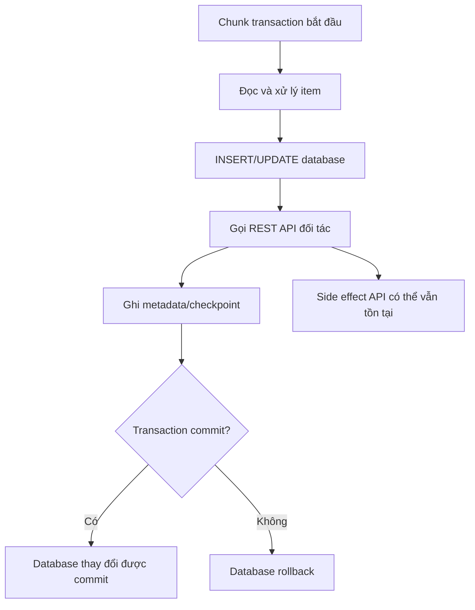
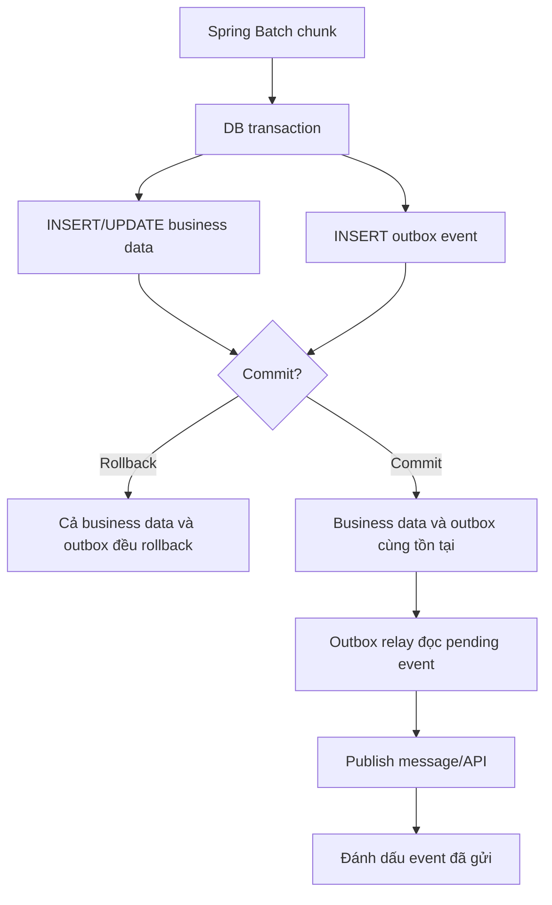
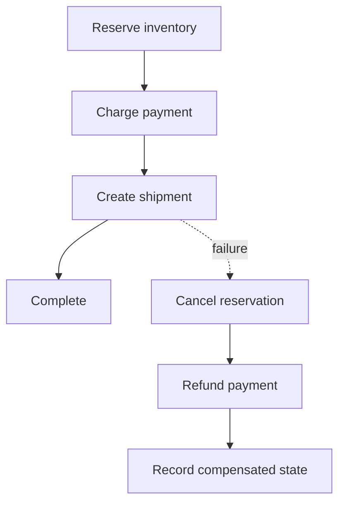

# Rollback side effect ngoài database

Trong Spring Batch, transaction của một chunk thường bảo vệ các thao tác trên database và metadata tham gia cùng transaction manager. Tuy nhiên, một step có thể đồng thời gọi REST API, gửi message, gửi email, ghi tệp hoặc cập nhật một hệ thống khác. Những thao tác này thường không nằm trong transaction database của chunk.

Vì vậy, khi chunk rollback, database có thể quay lại trạng thái trước transaction nhưng side effect bên ngoài vẫn tồn tại. Ví dụ, writer gửi yêu cầu tạo hóa đơn tới đối tác, đối tác đã tạo hóa đơn, sau đó lệnh ghi database trong chunk thất bại. Rollback chỉ hoàn tác dữ liệu database thuộc transaction; nó không tự thu hồi hóa đơn mà đối tác đã tạo.

Đây là một trong những giới hạn quan trọng của transaction trong batch processing. Muốn xử lý an toàn, cần thiết kế side effect có thể chạy lại, có thể đối soát hoặc có hành động bù trừ. Với các sự kiện cần được phát ra cùng thay đổi database, transactional outbox thường là một lựa chọn phù hợp.

## 1. Vì sao rollback database không hoàn tác mọi side effect?

Một transaction database được quản lý bởi `PlatformTransactionManager` chỉ điều khiển các resource tham gia transaction đó. Với JDBC, các câu lệnh SQL dùng connection được transaction manager quản lý có thể commit hoặc rollback cùng nhau.

Nhưng các thao tác sau thường nằm ngoài transaction database:

- Gọi HTTP API của đối tác.
- Gửi email hoặc SMS.
- Gửi message tới broker.
- Ghi tệp vào filesystem hoặc object storage.
- Gọi dịch vụ thanh toán, vận chuyển hoặc cấp phát tài nguyên.
- Ghi dữ liệu vào một database khác với transaction manager độc lập.

Một request HTTP đã được server xử lý không thể bị database rollback thu hồi. Một email đã được mail server nhận cũng không thể được xóa khỏi hộp thư người nhận bằng cách rollback SQL. Một tệp đã được ghi xuống filesystem không tự biến mất khi transaction database thất bại.

Có thể hình dung ranh giới như sau:



Nếu API đã thực hiện thao tác trước khi chunk rollback, database và hệ thống ngoài có thể không còn đồng bộ. Ứng dụng phải có cách khôi phục sự khác biệt đó.

## 2. Transaction boundary trong Spring Batch

Trong chunk-oriented step, Spring Batch thường quản lý transaction cho từng chunk. Reader đọc item, processor xử lý item, writer ghi chunk; khi phần xử lý thành công, framework cập nhật state/metadata cần thiết và commit transaction theo cấu hình.

Nếu writer ném exception trước commit, transaction của chunk có thể rollback. Các thay đổi database tham gia transaction đó được hoàn tác. Những chunk đã commit trước đó vẫn được giữ.

Điều này không tạo ra một transaction bao trùm mọi hệ thống mà job gọi tới. Nếu writer thực hiện cả SQL lẫn HTTP, SQL có thể rollback trong khi HTTP đã có hiệu lực.

Ví dụ:

1. Chunk chứa 100 đơn hàng bắt đầu transaction.
2. Writer ghi 100 bản ghi vào bảng `orders`.
3. Writer gửi yêu cầu tạo shipment cho hệ thống vận chuyển.
4. Hệ thống vận chuyển tạo shipment cho 100 đơn.
5. Một câu lệnh SQL hoặc cập nhật metadata sau đó phát sinh lỗi.
6. Transaction database rollback.
7. Shipment ở hệ thống vận chuyển vẫn tồn tại, trong khi bản ghi `orders` của chunk có thể không còn.

Khi chunk được retry hoặc job restart, các request tạo shipment có thể được gửi lại. Nếu hệ thống vận chuyển không hỗ trợ idempotency, một đơn hàng có thể có nhiều shipment.

## 3. Những side effect ngoài database thường gặp

| Side effect | Vì sao không rollback cùng DB? | Rủi ro khi retry |
|---|---|---|
| REST API tạo thanh toán | Server đối tác quản lý transaction riêng | Thu tiền hai lần hoặc tạo hai giao dịch |
| API tạo shipment | Dữ liệu đã được ghi ở hệ thống vận chuyển | Tạo nhiều vận đơn |
| Gửi email/SMS | Message đã được mail/SMS provider nhận | Người dùng nhận thông báo trùng hoặc thông báo sai trạng thái |
| Publish message | Broker đã nhận message trong transaction riêng | Consumer nhận message lặp |
| Ghi file | Filesystem không tham gia JDBC transaction | Tệp mồ côi, tệp trùng hoặc nội dung chưa hoàn chỉnh |
| Ghi object storage | Object đã được upload độc lập | Object không được tham chiếu hoặc được upload lặp |
| Gọi dịch vụ khác | Dịch vụ đích commit độc lập | Hai hệ thống có trạng thái không khớp |

Không phải mọi side effect đều cần cùng một chiến lược. Gửi email có thể chấp nhận at-least-once với thông báo có mã tham chiếu; thanh toán thường cần idempotency và đối soát chặt chẽ hơn. Tệp báo cáo có thể được ghi vào vùng staging rồi publish sau.

## 4. Tình huống nguy hiểm: request thành công nhưng client nhận timeout

Một trường hợp khó xử lý là client không biết chắc thao tác ngoài đã xảy ra hay chưa.

Ví dụ:

1. Writer gửi `POST /payments`.
2. Payment service nhận request và tạo giao dịch thành công.
3. Response bị mất do network timeout.
4. Writer nhận exception và Spring Batch rollback chunk.
5. Retry gửi lại `POST /payments`.
6. Nếu payment service không nhận diện request trùng, khách hàng có thể bị thu tiền hai lần.

Timeout không chứng minh server chưa thực hiện thao tác. Nó chỉ cho biết client không nhận được kết quả trong thời gian cho phép.

Trong trường hợp này, trước khi retry cần một cơ chế để xác định request có thể được gửi lại an toàn hay không. Các cách phổ biến là idempotency key, truy vấn trạng thái theo business reference hoặc đối soát với hệ thống đích.

## 5. Không gọi dịch vụ ngoài một cách tùy tiện bên trong transaction

Gọi API chậm bên trong transaction database làm transaction mở lâu hơn. Trong thời gian chờ network, connection và khóa database có thể vẫn bị giữ. Điều này làm tăng lock wait, deadlock, connection pool pressure và thời gian rollback.

Ví dụ một writer thực hiện theo trình tự:

```java
@Override
public void write(Chunk<? extends OrderRecord> items) {
    for (OrderRecord item : items) {
        jdbcTemplate.update(
                "insert into orders(order_id, amount) values (?, ?)",
                item.id(), item.amount());

        shippingClient.createShipment(item.id());
    }
}
```

Đoạn mã này có rủi ro: database insert và HTTP call không cùng transaction. Nếu API thành công nhưng một insert sau đó thất bại, database rollback không hủy shipment. Nếu retry writer, API có thể bị gọi lại.

Ngoài ra, nếu API chậm, transaction chunk có thể giữ connection trong suốt thời gian chờ. Với số lượng item lớn, job có thể chiếm hết connection pool.

Nên tách việc ghi dữ liệu và việc phát side effect thành các bước có thể phục hồi, hoặc dùng outbox để ghi ý định phát sự kiện trong cùng transaction database rồi xử lý gửi riêng.

## 6. TransactionSynchronization.afterCommit

Spring transaction synchronization cho phép đăng ký callback chạy sau khi transaction commit thành công. Đây là cách hữu ích khi cần thực hiện một hành động nhẹ sau commit, ví dụ đánh thức một tiến trình hoặc ghi metric.

Ví dụ:

```java
if (TransactionSynchronizationManager.isSynchronizationActive()) {
    TransactionSynchronizationManager.registerSynchronization(
            new TransactionSynchronization() {
                @Override
                public void afterCommit() {
                    notificationPublisher.publish(orderId);
                }
            });
}
```

Callback `afterCommit()` chỉ chạy sau khi transaction đã commit thành công. Nếu transaction rollback, callback này không được gọi.

Tuy nhiên, đây không phải cơ chế bảo đảm phát sự kiện bền vững:

- Tiến trình có thể dừng sau khi database commit nhưng trước khi callback chạy.
- Callback có thể chạy nhưng request tới hệ thống ngoài thất bại.
- Nếu callback thất bại, transaction đã commit không thể rollback ngược lại.
- Nếu ứng dụng tự retry callback, side effect có thể được thực hiện nhiều lần.

Vì vậy, `afterCommit` phù hợp với hành động best-effort hoặc đánh thức một relay đã có dữ liệu bền vững. Với yêu cầu không được mất sự kiện khi process crash, hãy lưu ý định phát sự kiện trong cùng transaction bằng outbox.

## 7. Transactional outbox giải quyết khoảng trống giữa DB và message

Transactional outbox là mẫu thiết kế ghi dữ liệu nghiệp vụ và một bản ghi sự kiện vào cùng transaction database. Một tiến trình relay riêng đọc các bản ghi outbox chưa gửi rồi publish chúng tới broker hoặc dịch vụ đích.

Vì bản ghi nghiệp vụ và outbox được commit trong cùng transaction, chúng cùng thành công hoặc cùng rollback trong database đó.



Outbox không làm cho database và broker thành một transaction phân tán. Nó tạo một nguồn sự thật bền vững trong database để relay có thể thử gửi lại nếu gặp lỗi.

### Ví dụ bảng outbox

```sql
create table outbox_event (
    event_id       varchar(100) primary key,
    aggregate_id   varchar(100) not null,
    event_type     varchar(100) not null,
    payload        text not null,
    created_at     timestamp not null,
    published_at   timestamp null,
    attempt_count  integer not null default 0
);
```

Tên kiểu dữ liệu và cú pháp có thể cần điều chỉnh theo database. `event_id` là định danh ổn định của sự kiện; `published_at` cho biết relay đã ghi nhận việc gửi; `attempt_count` hỗ trợ theo dõi retry.

### Ghi outbox trong writer

```java
public class OrderWriter implements ItemWriter<OrderRecord> {

    private final JdbcTemplate jdbcTemplate;

    public OrderWriter(JdbcTemplate jdbcTemplate) {
        this.jdbcTemplate = jdbcTemplate;
    }

    @Override
    public void write(Chunk<? extends OrderRecord> chunk) {
        for (OrderRecord order : chunk) {
            jdbcTemplate.update(
                    "insert into orders(order_id, amount) values (?, ?)",
                    order.id(), order.amount());

            jdbcTemplate.update(
                    "insert into outbox_event(event_id, aggregate_id, event_type, payload, created_at) " +
                    "values (?, ?, ?, ?, current_timestamp)",
                    "order-created:" + order.id(),
                    order.id(),
                    "ORDER_CREATED",
                    serialize(order));
        }
    }

    private String serialize(OrderRecord order) {
        // Chuyển event thành JSON bằng serializer của ứng dụng.
        return "{\"orderId\":\"" + order.id() + "\"}";
    }
}
```

Ví dụ giả định `JdbcTemplate` dùng cùng datasource và transaction manager của chunk. Nếu insert business row hoặc outbox row thất bại, cả hai có thể rollback cùng transaction.

Trong code production, hãy dùng JSON serializer đúng chuẩn thay vì nối chuỗi thủ công, kiểm tra kích thước payload và bảo đảm `event_id` ổn định, duy nhất.

### Relay gửi outbox

Một tiến trình riêng có thể lấy các event chưa publish, gửi chúng tới broker rồi cập nhật `published_at`. Relay cần xử lý trường hợp publish thành công nhưng process dừng trước khi cập nhật trạng thái.

Khi đó, event có thể được gửi lại. Vì vậy, consumer cần idempotent hoặc lưu `event_id` đã xử lý để loại bỏ message trùng. Outbox thường cung cấp bảo đảm at-least-once; consumer deduplication giúp đạt hiệu quả xử lý một lần ở tầng nghiệp vụ.

## 8. Idempotency key cho API bên ngoài

Idempotency key là một mã ổn định đại diện cho một thao tác nghiệp vụ. Client gửi cùng key cho mọi lần thử của cùng thao tác. Server lưu kết quả gắn với key và không thực hiện lại side effect nếu nhận request trùng.

Ví dụ:

```http
POST /payments
Idempotency-Key: payment-order-84721
Content-Type: application/json
```

Nếu lần đầu server đã tạo payment nhưng response bị mất, lần retry gửi cùng `Idempotency-Key`. Server có thể trả lại kết quả của payment đã tạo thay vì tạo payment mới.

Key cần:

- Ổn định qua retry và restart.
- Đại diện cho một hành động nghiệp vụ cụ thể, ví dụ thanh toán cho một order version.
- Không được tạo ngẫu nhiên mới ở mỗi lần thử.
- Có phạm vi duy nhất phù hợp với API đích.
- Được lưu hoặc tái tạo từ dữ liệu bền vững để lần restart dùng đúng key.

Không nên dùng một key chung cho toàn bộ chunk nếu API xử lý từng item độc lập, vì các thao tác khác nhau có thể bị coi là cùng một request. Ngược lại, không nên dùng random UUID mới mỗi lần retry vì server sẽ xem mỗi lần là một thao tác mới.

## 9. Consumer idempotent và chống message trùng

Ngay cả khi publisher dùng outbox, relay vẫn có thể gửi cùng event nhiều lần. Consumer cần có cách nhận diện message đã xử lý.

Một mẫu phổ biến là bảng inbox/dedup:

```sql
create table processed_message (
    consumer_name varchar(100) not null,
    event_id      varchar(100) not null,
    processed_at  timestamp not null,
    primary key (consumer_name, event_id)
);
```

Consumer xử lý trong một transaction:

1. Thử insert `(consumer_name, event_id)` vào bảng processed message.
2. Nếu insert thành công, thực hiện thay đổi nghiệp vụ.
3. Commit marker và thay đổi nghiệp vụ cùng transaction.
4. Nếu unique constraint cho biết event đã xử lý, bỏ qua phần thay đổi nghiệp vụ và xác nhận message theo cơ chế broker.

Nếu marker và thay đổi nghiệp vụ không cùng transaction, consumer vẫn có thể mất hoặc lặp tác dụng phụ. Cần bảo đảm chúng được commit nguyên tử trong database của consumer.

## 10. Ghi file ngoài transaction database

Ghi tệp là side effect phổ biến trong batch job. Một transaction JDBC không thể rollback nội dung đã ghi vào filesystem. Nếu step ghi một phần file rồi thất bại, tệp có thể tồn tại nhưng chưa hoàn chỉnh.

Một cách tiếp cận an toàn hơn là dùng staging file:

1. Ghi output vào một file tạm có tên riêng cho job instance hoặc execution.
2. Đóng stream và xác nhận file đã ghi xong.
3. Kiểm tra kích thước, checksum hoặc cấu trúc file.
4. Sau khi dữ liệu database liên quan đã commit và quy trình được xác nhận, publish file bằng thao tác rename/move phù hợp.
5. Ghi trạng thái publish để tiến trình phục hồi biết file nào đã công bố.

Ví dụ tên file:

```text
reports/
  staging/
    daily-orders-2026-11-15-run-501.tmp
  published/
    daily-orders-2026-11-15.csv
```

Nếu filesystem hỗ trợ atomic rename trong cùng filesystem, việc chuyển file tạm sang tên cuối có thể làm cho người đọc nhìn thấy file hoàn chỉnh thay vì nội dung đang ghi. Atomic rename không phải transaction chung với database; crash có thể xảy ra giữa rename và cập nhật metadata.

Để phục hồi:

- Dùng tên staging duy nhất và có thể xác định lại từ job parameters.
- Ghi checksum/kích thước để xác minh file đã tạo.
- Nếu file đích đã tồn tại, so sánh metadata trước khi quyết định ghi lại.
- Có bước cleanup file tạm mồ côi.
- Có trạng thái publish bền vững để retry thao tác move một cách idempotent.

Không nên ghi trực tiếp vào file đích cuối cùng trong khi chunk vẫn có thể rollback. Người đọc bên ngoài có thể nhìn thấy file một phần hoặc dữ liệu thuộc một lần chạy thất bại.

## 11. Gửi email và SMS

Email và SMS thường không thể thu hồi sau khi provider đã nhận. Nếu gửi trực tiếp trong `ItemProcessor`, `ItemWriter` hoặc listener trước commit, job có thể gửi thông báo về một thay đổi database sau đó bị rollback.

Ví dụ không an toàn:

```java
public OrderRecord process(Order order) {
    OrderRecord record = map(order);
    emailClient.sendConfirmation(record.customerEmail());
    return record;
}
```

Nếu processor được retry, email có thể được gửi nhiều lần. Nếu chunk rollback, email vẫn có thể đã đến người nhận dù đơn hàng chưa được commit.

Nên ghi yêu cầu gửi thông báo vào outbox cùng transaction với thay đổi nghiệp vụ. Một notification worker riêng đọc outbox, gửi email/SMS và cập nhật trạng thái. Nội dung thông báo nên có business reference hoặc idempotency key nếu provider hỗ trợ.

Nếu chấp nhận gửi best-effort sau commit, có thể dùng callback `afterCommit` để đánh thức worker hoặc gửi một thông báo không quan trọng. Với thông báo bắt buộc phải được gửi cuối cùng, cần một bản ghi bền vững để có thể gửi lại sau crash.

## 12. Compensation: hành động bù trừ thay cho rollback

Khi side effect ngoài database đã xảy ra, đôi khi không thể xóa lịch sử thao tác. Hệ thống cần thực hiện một hành động nghiệp vụ ngược lại, gọi là **compensation**.

Ví dụ:

| Side effect đã xảy ra | Hành động bù trừ có thể dùng |
|---|---|
| Đã giữ hàng | Hủy reservation |
| Đã thu tiền | Tạo giao dịch refund |
| Đã tạo shipment | Hủy vận đơn nếu chưa bàn giao |
| Đã cấp quyền truy cập | Thu hồi quyền |
| Đã gửi thông báo sai | Gửi thông báo đính chính nếu phù hợp |

Compensation không phải rollback kỹ thuật. Nó là một hành động nghiệp vụ mới, có thể thất bại và cần retry riêng. Ví dụ refund có thể bị từ chối hoặc dịch vụ thanh toán tạm thời không khả dụng.

Trong quy trình nhiều bước, có thể mô hình hóa thành saga:



Spring Batch có thể điều phối các step thực hiện hành động chính và compensation. Ứng dụng cần lưu trạng thái của từng hành động để compensation có thể tiếp tục sau restart và không bị thực hiện trùng.

Không phải mọi side effect đều có hành động bù trừ hoàn hảo. Một email đã gửi không thể xóa khỏi hộp thư; một shipment đã giao có thể không hủy được. Hãy xác định chính sách nghiệp vụ cho những trường hợp không thể đảo ngược.

## 13. Chọn chiến lược theo loại side effect

| Loại thao tác | Chiến lược thường phù hợp | Lưu ý |
|---|---|---|
| Cập nhật cùng database của step | Cùng transaction manager | Rollback có thể hoàn tác thay đổi |
| Gửi message cần bền vững | Transactional outbox | Relay và consumer cần idempotent |
| Gọi API có hỗ trợ idempotency | Idempotency key ổn định | Dùng lại key qua retry/restart |
| Gọi API không hỗ trợ idempotency | Business reference, query trạng thái, reconciliation hoặc compensation | Timeout tạo kết quả không xác định |
| Ghi file lớn | Staging file, checksum, publish/rename và cleanup | Filesystem không cùng transaction DB |
| Gửi email/SMS | Notification outbox và worker riêng | Không gửi trực tiếp trước commit |
| Nhiều hệ thống nghiệp vụ | Saga/compensation và trạng thái bền vững | Không có rollback nguyên tử toàn cục |

Chọn chiến lược theo mức độ quan trọng của side effect. Một metric hoặc log có thể chấp nhận mất một sự kiện; thanh toán, đặt hàng hoặc thông báo pháp lý thường cần cơ chế bền vững và đối soát mạnh hơn.

## 14. Listener không tự bảo đảm side effect chỉ xảy ra sau commit

Spring Batch cung cấp nhiều listener như `ItemWriteListener`, `ChunkListener` và `StepExecutionListener`. Cần hiểu thời điểm callback trước khi đặt side effect vào đó.

- `ItemWriteListener.afterWrite` được gọi sau khi phương thức writer trả về, nhưng transaction chunk vẫn có thể rollback ở bước sau.
- `ChunkListener.afterChunk` gắn với chunk hoàn tất thành công sau commit theo lifecycle chunk thông thường.
- `afterStep` chạy khi step kết thúc; nó không phải một transaction callback bảo đảm mọi side effect ngoài database được commit cùng dữ liệu.
- `JobExecutionListener.afterJob` chạy khi job kết thúc, nhưng process vẫn có thể dừng trước hoặc trong callback.

Ngay cả callback sau commit cũng có cửa sổ crash: database có thể đã commit nhưng tiến trình dừng trước khi side effect được phát. Vì vậy, listener phù hợp để ghi metric, log hoặc đánh thức relay; outbox phù hợp hơn khi không được phép mất sự kiện.

Không nên gửi email hoặc gọi API thanh toán trong `afterWrite` với giả định rằng transaction đã chắc chắn commit. Nếu commit sau đó thất bại, side effect vẫn tồn tại.

## 15. Có thể dùng XA hoặc distributed transaction không?

Một số hệ thống hỗ trợ XA/JTA để phối hợp transaction giữa nhiều resource có khả năng tham gia distributed transaction. Tuy nhiên, không phải REST API, email provider, filesystem hoặc mọi message broker đều hỗ trợ XA. Distributed transaction cũng tăng độ phức tạp vận hành, có thể giữ resource lâu và tạo thêm điểm nghẽn.

Không nên giả định chỉ cần cấu hình thêm một transaction manager là mọi side effect đều rollback cùng database. Cần xác nhận từng resource có hỗ trợ enlistment, protocol và recovery của transaction coordinator hay không.

Trong nhiều hệ thống, outbox, idempotency và compensation dễ vận hành hơn việc cố gắng tạo một transaction nguyên tử xuyên database, broker và HTTP service.

## 16. Thiết kế writer để side effect có thể phục hồi

Một writer tốt nên tập trung ghi dữ liệu vào resource được transaction quản lý. Nếu cần tạo side effect bên ngoài, hãy lưu ý định thực hiện vào một cấu trúc bền vững trong cùng transaction.

Ví dụ một writer có thể:

1. Ghi đơn hàng vào bảng `orders`.
2. Ghi event `ORDER_CREATED` vào `outbox_event`.
3. Trả về để Spring Batch commit chunk.
4. Một relay độc lập gửi event tới hệ thống vận chuyển.

Như vậy, nếu chunk rollback, cả đơn hàng và event outbox đều rollback. Nếu chunk commit nhưng relay bị dừng, event vẫn nằm trong outbox và có thể được gửi sau khi relay hoạt động lại.

Nếu writer phải gọi trực tiếp API ngoài vì giới hạn kiến trúc, cần:

- Tạo idempotency key ổn định cho mỗi item.
- Ghi nhận trạng thái request và response ở nơi bền vững.
- Xử lý timeout như trạng thái chưa xác định, không mặc định request thất bại.
- Có thao tác tra cứu trạng thái hoặc reconciliation.
- Bảo đảm retry không tạo side effect trùng.

## 17. Kiểm thử rollback và side effect ngoài database

Unit test chỉ mock một service ném exception không đủ chứng minh rollback. Cần kiểm tra cả dữ liệu database lẫn hệ thống ngoài hoặc fake server.

### Test database rollback nhưng API side effect vẫn tồn tại

Một integration test có thể mô phỏng:

1. Tasklet/writer insert một bản ghi vào database test.
2. Gọi fake HTTP server và fake server ghi nhận request.
3. Ném exception trước khi chunk commit.
4. Xác nhận database không có bản ghi do transaction rollback.
5. Xác nhận fake server vẫn ghi nhận request đã nhận.

Test này minh họa ranh giới transaction: database rollback không thu hồi request HTTP.

### Test outbox

Nên kiểm tra các trường hợp:

- Business row và outbox row cùng được commit.
- Khi writer ném exception, cả hai cùng rollback.
- Relay publish event thành công rồi dừng trước khi đánh dấu published; lần chạy lại có thể gửi trùng.
- Consumer nhận event trùng nhưng chỉ áp dụng thay đổi nghiệp vụ một lần nhờ deduplication.
- Event lỗi nhiều lần được ghi nhận và có chính sách retry/dead-letter phù hợp.

### Test file staging

- Writer tạo file tạm và step thất bại trước publish.
- File đích cuối chưa xuất hiện.
- Restart có thể nhận diện file tạm hoặc tạo lại an toàn.
- Nếu move đã xảy ra trước crash, lần chạy lại nhận diện file đích qua checksum và không tạo bản sao sai.

### Test compensation

- Side effect chính thành công.
- Bước sau thất bại.
- Compensation được thực hiện và trạng thái bù trừ được lưu.
- Nếu compensation thất bại, job có thể restart và thử lại mà không bù trừ trùng.

Hãy chạy các test này bằng transaction manager và resource phù hợp với môi trường thực tế. Mock không mô phỏng đầy đủ semantics commit/rollback của database hoặc broker.

## 18. Theo dõi và đối soát khi có rollback

Khi một chunk rollback nhưng có side effect ngoài transaction, cần đủ dữ liệu để xác định thao tác nào đã xảy ra.

Nên lưu hoặc log:

- Job name, `JobExecution` ID và `StepExecution` ID.
- Chunk/business key và item ID.
- Idempotency key hoặc event ID.
- Tên hệ thống đích và loại thao tác.
- Thời điểm gửi request, kết quả nhận được và exception.
- Trạng thái outbox hoặc compensation.
- Trạng thái database sau rollback/restart.

Không log token, password hoặc payload nhạy cảm. Dùng correlation ID để tra cứu chi tiết trong hệ thống đích.

Một quy trình reconciliation có thể so sánh:

- Bản ghi nghiệp vụ đã commit trong database.
- Request hoặc event đã được hệ thống ngoài chấp nhận.
- Outbox event chưa gửi hoặc chưa đánh dấu hoàn tất.
- Compensation đang chờ hoặc thất bại.

Đối soát đặc biệt quan trọng khi API timeout vì client không biết request đã được thực hiện hay chưa.

## 19. Các lỗi thiết kế thường gặp

| Lỗi | Hậu quả | Cách xử lý |
|---|---|---|
| Gọi API trước khi DB commit | API đã có hiệu lực dù DB rollback | Dùng outbox hoặc idempotency và reconciliation |
| Gửi email trong processor | Retry có thể gửi email lặp; rollback không thu hồi email | Ghi notification intent vào outbox |
| Ghi trực tiếp file đích | File một phần có thể bị người khác đọc | Ghi staging file rồi publish sau khi xác nhận |
| Dùng `afterCommit` như cơ chế bền vững | Crash sau commit có thể làm mất sự kiện | Lưu event trong outbox cùng transaction |
| Tạo idempotency key mới ở mỗi retry | Hệ thống đích coi mỗi request là thao tác mới | Dùng key ổn định theo business operation |
| Giả định timeout nghĩa là request chưa chạy | Retry có thể tạo giao dịch trùng | Tra cứu trạng thái hoặc gửi lại cùng idempotency key |
| Dùng rollback để bù trừ hệ thống ngoài | Side effect ngoài DB vẫn tồn tại | Thiết kế compensation nghiệp vụ |
| Retry side effect không idempotent | Gửi trùng payment, shipment hoặc message | Dùng dedupe, unique key, outbox và consumer idempotent |
| Coi XA là giải pháp phổ quát | Resource không hỗ trợ XA vẫn không được rollback | Xác nhận khả năng resource; ưu tiên mẫu phù hợp như outbox |
| Không có reconciliation | Không phát hiện DB và hệ thống ngoài lệch trạng thái | Xây dựng đối soát và cảnh báo |

## 20. Quy trình xử lý khi chunk rollback sau side effect

Khi phát hiện chunk rollback nhưng một side effect có thể đã xảy ra, hãy xử lý theo trình tự:

1. **Xác định chunk và item:** lấy job/step execution, business key và thời điểm lỗi.
2. **Xác định transaction:** kiểm tra thao tác database nào thuộc transaction đã rollback và thao tác nào đã commit trước đó.
3. **Tra cứu hệ thống ngoài:** dùng correlation ID hoặc idempotency key để biết request đã được thực hiện chưa.
4. **Không gửi lại mù quáng:** nếu kết quả request chưa xác định, truy vấn trạng thái hoặc dùng cùng idempotency key.
5. **Đối chiếu trạng thái:** xác định cần retry, đánh dấu đã hoàn tất, xóa staging artifact hay thực hiện compensation.
6. **Khôi phục job:** restart cùng `JobInstance` và bảo đảm reader/writer có thể chạy lại an toàn.
7. **Theo dõi kết quả:** xác nhận dữ liệu database và side effect ngoài cuối cùng nhất quán.

Nếu side effect không thể đảo ngược, cần ghi nhận sự cố và áp dụng chính sách nghiệp vụ tương ứng thay vì cố giả lập rollback.

## 21. Những nguyên tắc cần nhớ

- Rollback của Spring Batch chỉ hoàn tác resource tham gia transaction; HTTP API, email, filesystem và broker thường nằm ngoài transaction database.
- Side effect ngoài có thể tồn tại dù chunk database rollback.
- Timeout không chứng minh request chưa được xử lý; kết quả có thể chưa xác định.
- Tránh gọi dịch vụ chậm bên trong transaction dài nếu có thể tách thành bước hoặc worker riêng.
- `afterCommit` chạy sau commit nhưng không bền vững trước crash; dùng nó để đánh thức relay hoặc thực hiện best-effort.
- Transactional outbox ghi business data và event trong cùng transaction, sau đó relay publish theo cơ chế có thể retry.
- Outbox thường là at-least-once; consumer cần idempotency/deduplication.
- Idempotency key phải ổn định qua retry và restart, gắn với một thao tác nghiệp vụ cụ thể.
- File nên được ghi vào staging, xác minh rồi publish bằng thao tác move/rename có thể phục hồi.
- Email/SMS nên được gửi từ notification outbox hoặc worker riêng nếu không được phép mất thông báo.
- Compensation là hành động nghiệp vụ ngược lại, không phải rollback kỹ thuật; nó cũng cần retry và state bền vững.
- Kiểm thử cả database rollback và side effect bên ngoài; mock đơn thuần không chứng minh transaction semantics.
- Dùng correlation ID, event ID và reconciliation để phát hiện, xử lý trạng thái không đồng bộ.

Rollback side effect ngoài database đòi hỏi nhìn transaction theo ranh giới thực tế của từng hệ thống. Khi dữ liệu nghiệp vụ và ý định phát sự kiện được lưu cùng transaction, side effect được thực hiện qua relay có thể retry, và các thao tác ngoài có idempotency hoặc compensation phù hợp, batch job có thể phục hồi sau lỗi mà không tạo trạng thái trùng lặp hoặc mất đồng bộ khó kiểm soát.
