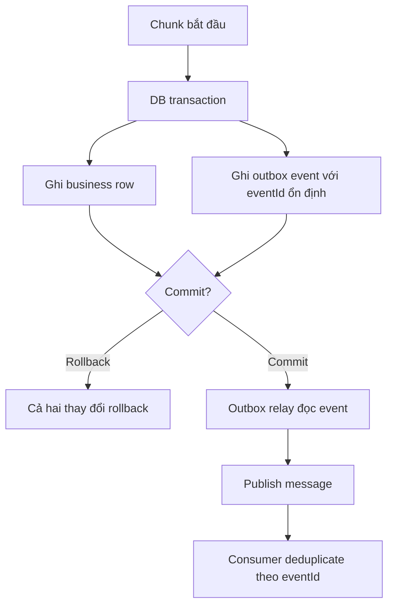

# Thiết kế restart không tạo duplicate output

Một batch job có thể xử lý hàng triệu bản ghi và mất nhiều phút hoặc nhiều giờ để hoàn thành. Nếu job thất bại giữa chừng, Spring Batch cho phép restart cùng một `JobInstance` dựa trên metadata và checkpoint đã lưu. Tuy nhiên, restart chỉ an toàn khi reader và writer khôi phục đúng trạng thái. Nếu writer ghi lại dữ liệu đã commit, mở file ở chế độ append sai vị trí hoặc tạo output mới cho mỗi lần thử, job có thể sinh duplicate output.

Thiết kế restart không tạo dữ liệu trùng cần phối hợp ba phần: **định danh job ổn định, checkpoint đúng tại ranh giới commit và output có thể chạy lại an toàn**. Với database, thường dùng unique key và upsert hoặc staging theo job instance. Với file, dùng writer có hỗ trợ restart và giữ nguyên tên/resource giữa các lần chạy. Với API, message hoặc side effect ngoài transaction, cần idempotency key, outbox hoặc cơ chế đối soát.

## 1. Duplicate output xuất hiện như thế nào?

Duplicate output xảy ra khi một item hoặc một tác dụng phụ đã được tạo trước đó lại được tạo thêm trong lần retry/restart. Một số tình huống phổ biến:

- Reader restart từ đầu nhưng writer tiếp tục append vào file đã có dữ liệu.
- Writer không lưu state, nên khi step restart nó không biết đã ghi tới đâu.
- Job được khởi chạy với identifying parameters mới, tạo `JobInstance` mới nhưng vẫn ghi vào cùng output path hoặc cùng bảng đích.
- Step đã hoàn tất được cấu hình chạy lại khi restart và ghi lại toàn bộ dữ liệu.
- Chunk đã commit ở database nhưng request API hoặc message đã được gửi; process crash khiến cùng thao tác được gửi lại.
- Output file đã publish, nhưng metadata của step chưa ghi nhận trạng thái hoàn tất; lần chạy lại publish thêm một bản hoặc ghi đè sai cách.

Duplicate không chỉ là hai dòng giống hệt trong file. Nó còn có thể là hai payment, hai shipment, hai message, hai email hoặc hai bản ghi lịch sử cho cùng một nghiệp vụ.

## 2. Phân biệt JobInstance và JobExecution

Spring Batch dùng hai khái niệm này để quản lý restart:

- `JobInstance` đại diện cho một công việc nghiệp vụ được xác định bởi job name và các identifying `JobParameters`.
- `JobExecution` đại diện cho một lần chạy cụ thể của instance đó.

Khi một job thất bại và được restart với cùng identifying parameters, Spring Batch tạo một `JobExecution` mới thuộc cùng `JobInstance`. Metadata và checkpoint từ execution trước được dùng để tiếp tục.

Ví dụ:

```text
Job: dailyOrderExport
Identifying parameter: businessDate=2026-11-15

JobInstance: dailyOrderExport / businessDate=2026-11-15
  JobExecution 1001 -> FAILED
  JobExecution 1008 -> COMPLETED (restart)
```

ID của `JobExecution` thay đổi, nhưng `JobInstance` vẫn là cùng một công việc. Vì vậy, khóa output nên gắn với định danh nghiệp vụ của instance hoặc một output version ổn định, không nên mặc định dùng `JobExecution` ID làm tên output mới cho mỗi lần restart.

Nếu thay đổi identifying parameter, ví dụ thêm timestamp hoặc tăng `run.id`, launcher có thể tạo một `JobInstance` mới. Khi đó Spring Batch xem đây là công việc khác, không phải restart của instance trước. Nếu instance mới vẫn ghi vào cùng file hoặc cùng bảng đích, dữ liệu có thể bị trùng dù framework đang chạy đúng semantics.

## 3. Restart khác với chạy lại một job mới

| Hành động | JobInstance | Checkpoint cũ | Rủi ro output |
|---|---|---|---|
| Restart execution `FAILED` với cùng identifying parameters | Giữ nguyên | Có thể khôi phục | Phải khôi phục reader/writer đúng vị trí |
| Restart execution `STOPPED` với cùng parameters | Giữ nguyên | Có thể khôi phục | Tương tự restart sau failure |
| Launch với identifying parameters khác | Mới | Không dùng checkpoint của instance cũ | Có thể ghi trùng nếu dùng chung đích |
| Re-run step đã hoàn tất bằng `allowStartIfComplete(true)` | Cùng instance khi restart | Step có thể chạy lại | Cần output idempotent hoặc tái tạo hoàn toàn |
| Chạy lại instance đã `COMPLETED` với cùng parameters | Thường bị từ chối | Không phải restart hợp lệ | Cần quy trình reprocess có định danh riêng |

Hãy quyết định rõ người vận hành đang muốn tiếp tục một công việc chưa hoàn tất hay tạo một lần xử lý nghiệp vụ mới. Hai hành động này cần chính sách output khác nhau.

## 4. Checkpoint được lưu ở đâu và khi nào?

Reader và writer có thể triển khai `ItemStream` để lưu state trong `ExecutionContext`. Lifecycle chính gồm:

| Phương thức | Vai trò |
|---|---|
| `open(ExecutionContext)` | Khôi phục state trước khi step tiếp tục |
| `read()` / `write()` | Đọc và ghi dữ liệu |
| `update(ExecutionContext)` | Ghi state hiện tại để framework lưu checkpoint |
| `close()` | Giải phóng tài nguyên |

Trong chunk-oriented step, checkpoint được cập nhật theo vòng đời chunk và lưu cùng metadata tại các ranh giới commit. Nếu chunk hiện tại rollback, checkpoint bền vững thường vẫn là checkpoint của chunk commit trước đó. Khi restart, reader có thể đọc lại chunk chưa commit.

Điều này có nghĩa writer phải có khả năng tiếp tục từ output tương ứng với checkpoint. Chỉ lưu state của reader mà không lưu state của writer có thể khiến input tiếp tục đúng nhưng output bị ghi lại hoặc bị lệch.

Với custom reader/writer, cần triển khai `ItemStream` đầy đủ hoặc bảo đảm delegate stream được đăng ký với step để framework gọi `open`, `update` và `close`. Nếu delegate không được đăng ký, state có thể không được lưu dù class bên trong có triển khai `ItemStream`.

## 5. Reader và writer phải khôi phục cùng một ranh giới

Giả sử chunk size là 100 và job đã commit 10 chunk. Reader đã xử lý 1.000 item, writer cũng đã ghi output cho 1.000 item. Sau đó chunk thứ 11 thất bại.

Khi restart, trạng thái mong muốn là:

- Reader tiếp tục từ item 1.001 hoặc vị trí tương đương theo checkpoint.
- Writer tiếp tục sau output của item 1.000.
- Các item 1 đến 1.000 không bị ghi lại.
- Chunk chưa commit được xử lý lại an toàn.

Nếu reader tiếp tục từ 1.001 nhưng writer lại append từ đầu, output có thể bị ghi sai hoặc trùng. Nếu writer tiếp tục sau item 1.000 nhưng reader bắt đầu từ đầu, output cũng có thể thiếu hoặc trùng tùy cách writer xử lý.

Do đó, checkpoint của reader và writer phải cùng phản ánh tiến độ đã commit. Không nên tự lưu một biến `lastProcessedId` trong singleton bean rồi coi đó là checkpoint bền vững.

## 6. Dùng ItemStream và saveState cho reader

Các reader dựng sẵn như `FlatFileItemReader`, `JdbcPagingItemReader` và một số reader khác hỗ trợ lưu state. Cần giữ tên reader ổn định và bật lưu state nếu reader cho phép cấu hình.

Ví dụ:

```java
@Bean
@StepScope
public FlatFileItemReader<OrderInput> orderReader(
        @Value("#{jobParameters['inputFile']}") String inputFile) {

    FlatFileItemReader<OrderInput> reader = new FlatFileItemReader<>();
    reader.setName("dailyOrderReader");
    reader.setResource(new FileSystemResource(inputFile));
    reader.setLinesToSkip(1);
    reader.setSaveState(true);
    reader.setLineMapper(orderLineMapper());
    return reader;
}
```

Các điểm quan trọng:

- `setName("dailyOrderReader")` tạo namespace ổn định cho state của reader.
- `setSaveState(true)` cho phép lưu vị trí đọc vào execution context.
- `inputFile` phải trỏ tới đúng cùng một nguồn khi restart.
- Nội dung và thứ tự file cần bất biến giữa lần chạy đầu và lần restart.

Nếu file bị thay đổi hoặc sắp xếp lại, line count đã lưu có thể trỏ tới record khác. Có thể sao chép input vào vùng bất biến theo `JobInstance`, lưu checksum/version và xác minh nguồn trước khi restart.

## 7. Dùng FlatFileItemWriter để tiếp tục output file

`FlatFileItemWriter` hỗ trợ lưu state để restart. Khi được cấu hình đúng, writer có thể khôi phục vị trí output đã ghi tại checkpoint và tiếp tục ghi phần còn lại.

Ví dụ với builder:

```java
@Bean
@StepScope
public FlatFileItemWriter<OrderRecord> orderWriter(
        @Value("#{jobParameters['outputFile']}") String outputFile) {

    return new FlatFileItemWriterBuilder<OrderRecord>()
            .name("dailyOrderWriter")
            .resource(new FileSystemResource(outputFile))
            .delimited()
            .delimiter(",")
            .names("orderId", "customerId", "amount")
            .saveState(true)
            .build();
}
```

Để restart an toàn:

- Giữ tên writer ổn định và duy nhất trong step.
- Giữ cùng output resource cho cùng `JobInstance`.
- Cho writer lưu state và để Spring Batch khôi phục vị trí.
- Không tự xóa file hoặc tự đặt lại vị trí writer trong lúc restart.
- Không chỉ bật append mode rồi giả định writer biết đã ghi tới đâu.

`FlatFileItemWriter` có cơ chế quản lý state và hành vi ghi theo transaction của Spring Batch. Hãy dùng đúng restart lifecycle thay vì tự mở một `FileWriter` append độc lập. Nếu `saveState` bị tắt, writer không có checkpoint để khôi phục vị trí và step restart có thể tạo duplicate output.

## 8. Không dùng append một cách mù quáng

Append có thể cần trong một số thiết kế output, nhưng tự bật append không phải cách tổng quát để hỗ trợ restart.

Ví dụ nguy hiểm:

1. Lần chạy đầu đã ghi 10.000 dòng.
2. Job thất bại sau khi output đã được tạo.
3. Restart bắt đầu reader từ đầu vì reader không lưu state.
4. Writer mở file ở chế độ append.
5. 10.000 dòng cũ được giữ lại và 10.000 dòng được ghi thêm.

Kết quả là output có duplicate. Ngược lại, nếu writer truncate file nhưng reader chỉ tiếp tục từ checkpoint, phần output của các item đã commit trước đó bị mất.

Hãy chọn một trong hai chiến lược rõ ràng:

- **Tiếp tục tại checkpoint:** reader và writer đều khôi phục state từ cùng execution context; output đã commit được giữ và chỉ phần chưa hoàn tất được ghi tiếp.
- **Tái tạo toàn bộ output:** xóa/tạo lại một staging artifact có định danh riêng và chạy lại toàn bộ dữ liệu từ đầu theo một quy trình được kiểm soát.

Không trộn hai chiến lược bằng cách để reader tiếp tục nhưng writer truncate, hoặc reader bắt đầu lại nhưng writer append.

## 9. Output file ổn định theo JobInstance

Đường dẫn output nên được xác định theo công việc nghiệp vụ, ví dụ ngày dữ liệu và tenant. Khi restart cùng instance, đường dẫn phải trỏ tới cùng artifact để writer có thể khôi phục.

Ví dụ:

```text
staging/orders/
  business-date=2026-11-15/
    tenant=42/
      orders-export.csv
```

Không nên tạo tên output chứa `JobExecution` ID mới ở mỗi lần restart nếu mục tiêu là tiếp tục cùng file. `JobExecution` ID thay đổi giữa các lần chạy; nếu dùng nó trong output path, writer có thể tạo một file mới và bỏ lại file cũ, hoặc hệ thống downstream có thể nhận nhiều bản export cho cùng kỳ nghiệp vụ.

Nếu cần lưu artifact riêng cho từng attempt để điều tra, có thể tạo file attempt riêng nhưng phải có một manifest hoặc trạng thái publish xác định attempt nào là kết quả chính thức. Việc tạo file attempt mới không tự giải quyết duplicate ở hệ thống downstream.

## 10. Database output: unique key và upsert

Với database writer, cách phổ biến để tránh duplicate là dùng một khóa nghiệp vụ ổn định và ràng buộc unique ở database.

Ví dụ bảng output:

```sql
create table order_export (
    business_date date not null,
    tenant_id     bigint not null,
    order_id      bigint not null,
    amount        decimal(18, 2) not null,
    primary key (business_date, tenant_id, order_id)
);
```

Khóa chính ngăn hai bản ghi cho cùng một đơn hàng trong cùng ngày và tenant. Writer có thể dùng upsert hoặc câu lệnh database tương đương để cùng item được ghi lại mà không tạo hàng trùng.

Ví dụ SQL dạng khái quát:

```sql
insert into order_export(business_date, tenant_id, order_id, amount)
values (:businessDate, :tenantId, :orderId, :amount)
on conflict (business_date, tenant_id, order_id)
do update set amount = excluded.amount;
```

Cú pháp `ON CONFLICT` là ví dụ của PostgreSQL; database khác có thể dùng `MERGE`, `ON DUPLICATE KEY UPDATE` hoặc cơ chế tương đương.

Unique constraint là hàng rào cuối cùng chống duplicate. Chỉ kiểm tra bằng `SELECT` trước khi `INSERT` không đủ an toàn khi nhiều thread hoặc job cùng chạy, vì hai transaction có thể cùng thấy chưa có bản ghi rồi cùng insert.

## 11. Upsert cần đúng semantics nghiệp vụ

Upsert giúp cùng business key không tạo thêm hàng mới, nhưng không phải lúc nào cũng là lựa chọn đúng.

Hãy xác định:

- Nếu item được xử lý lại, có nên cập nhật giá trị cũ không?
- Có cần giữ lịch sử nhiều phiên bản output không?
- Nếu dữ liệu nguồn thay đổi sau lần chạy đầu, restart có được phép dùng giá trị mới không?
- Có cần phát event khi giá trị thay đổi hay chỉ khi bản ghi được tạo lần đầu?
- Có trường nào chỉ được ghi một lần và không được ghi đè?

Ví dụ, bảng trạng thái hiện tại có thể dùng upsert. Nhưng bảng ledger thanh toán cần lưu mỗi giao dịch một lần theo transaction ID duy nhất; upsert cập nhật giao dịch cũ có thể làm mất lịch sử. Với ledger, nên dùng unique key và xử lý duplicate theo quy tắc rõ ràng.

## 12. Staging table và publish sau khi job hoàn tất

Với output lớn hoặc cần đảm bảo người tiêu thụ chỉ thấy kết quả hoàn chỉnh, có thể ghi vào staging table theo `JobInstance` rồi publish sau khi mọi chunk và step cần thiết hoàn tất.

Ví dụ schema:

```sql
create table order_export_stage (
    job_key       varchar(150) not null,
    order_id      bigint not null,
    amount        decimal(18, 2) not null,
    primary key (job_key, order_id)
);

create table order_export_manifest (
    job_key       varchar(150) primary key,
    status        varchar(30) not null,
    published_at  timestamp null
);
```

Mỗi item được ghi vào staging với `job_key` ổn định. Sau khi job hoàn tất và kiểm tra dữ liệu thành công, bước publish cập nhật manifest hoặc chuyển dữ liệu sang bảng chính.

Lợi ích:

- Restart có thể tiếp tục staging theo cùng `job_key`.
- Unique key ngăn ghi trùng cùng item.
- Dữ liệu chưa hoàn tất không xuất hiện trong vùng output chính thức.
- Có thể kiểm tra count, checksum hoặc invariant trước khi publish.

Publish cũng cần idempotent. Nếu transaction publish thành công nhưng job bị gián đoạn trước khi metadata ghi nhận step hoàn tất, lần restart cần nhận diện manifest đã `PUBLISHED` và không publish thêm lần nữa.

## 13. File staging và publish idempotent

Với output file, có thể dùng hai pha:

1. Ghi file vào staging path ổn định cho `JobInstance`.
2. Đóng file và kiểm tra kích thước/checksum.
3. Khi mọi step cần thiết hoàn tất, đổi tên hoặc move file sang path publish.
4. Ghi manifest xác nhận output chính thức.

Ví dụ:

```text
exports/
  staging/
    orders-2026-11-15-tenant-42.csv
  published/
    orders-2026-11-15-tenant-42.csv
```

Move/rename trong cùng filesystem thường có thể atomic đối với người đọc file, nhưng nó không tạo transaction chung với `JobRepository`. Có thể xảy ra crash sau move nhưng trước khi step metadata được lưu. Vì vậy, bước publish cần kiểm tra file đích và checksum/manifest trước khi thực hiện lại.

Nếu file đích đã tồn tại và có checksum đúng với artifact cần publish, có thể coi publish đã hoàn tất. Nếu checksum khác, cần xử lý như xung đột hoặc dữ liệu sai, không ghi đè âm thầm.

## 14. Tạo output key ổn định

Một output key cần đại diện cho đúng một phiên bản kết quả nghiệp vụ. Có thể tạo từ:

- Job name.
- Các identifying parameters như `businessDate`, `tenantId`.
- Một `outputVersion` hoặc `reprocessId` được người vận hành chủ động chỉ định khi thật sự muốn tạo bản mới.

Không dùng:

- Timestamp mới tạo ở mỗi lần restart.
- UUID mới mỗi lần gọi writer.
- `JobExecution` ID nếu mục tiêu là cùng một artifact qua restart.
- Thread ID hoặc số thứ tự chunk cục bộ.

Ví dụ key:

```java
String outputKey = jobName + ":" + businessDate + ":" + tenantId
        + ":" + outputVersion;
```

`outputVersion` chỉ nên tăng khi tạo một kết quả nghiệp vụ mới hoặc reprocess có chủ đích. Khi restart cùng instance, giữ nguyên các thành phần identifying để key không thay đổi.

## 15. Không bật allowStartIfComplete tùy tiện

Mặc định, khi restart một job, step đã hoàn tất thường không chạy lại. Điều này giúp tránh thực hiện lại các side effect của step đã commit thành công.

`allowStartIfComplete(true)` cho phép step đã hoàn tất được chạy lại khi job restart theo cấu hình. Đây là lựa chọn hữu ích với một số step kiểm tra hoặc step cần chạy lại theo thiết kế, nhưng có thể tạo duplicate output nếu step không idempotent.

Ví dụ:

```java
return new StepBuilder("publishReportStep", jobRepository)
        .tasklet(publishReportTasklet, transactionManager)
        .allowStartIfComplete(true)
        .build();
```

Trước khi bật cờ này, cần trả lời:

- Step có ghi thêm bản ghi mới mỗi lần chạy không?
- Step có gửi email/message/API không?
- Output có được thay thế một cách xác định hay append?
- Step có thể kiểm tra kết quả đã publish trước đó không?
- Nếu step chạy lại, có tạo cùng kết quả hay một phiên bản mới?

Nếu step publish output, hãy làm cho thao tác publish idempotent, ví dụ kiểm tra manifest và checksum. Không bật `allowStartIfComplete` chỉ để ép step chạy lại khi chưa hiểu tác động dữ liệu.

## 16. Phân biệt restart với startLimit

`startLimit` giới hạn số lần một step có thể được khởi chạy. Nó không phải cơ chế chống duplicate output. Một step có thể chạy trong giới hạn nhưng vẫn ghi trùng nếu writer không idempotent; ngược lại, step có thể bị từ chối chạy tiếp do đã vượt giới hạn dù output chưa hoàn chỉnh.

Chống duplicate cần dựa vào checkpoint, output key, unique constraint, idempotency và quy tắc publish. Giới hạn số lần chạy chỉ là một kiểm soát vận hành bổ sung.

## 17. Crash window giữa output và checkpoint

Một rủi ro cần xem xét là process dừng ở thời điểm output đã được ghi nhưng metadata checkpoint chưa phản ánh chính xác trạng thái đó, hoặc ngược lại. Với file và hệ thống ngoài database, output và `JobRepository` thường không nằm trong cùng một transaction nguyên tử.

Ví dụ:

1. Writer ghi output cho chunk.
2. Process dừng ở thời điểm chuyển tiếp commit/ghi metadata.
3. Khi restart, checkpoint cho biết chunk cần được xử lý lại.
4. Writer ghi lại cùng output.

Nếu writer không idempotent, output có thể bị trùng. Một crash window khác là metadata đã được cập nhật nhưng side effect ngoài chưa hoàn tất; khi restart, step có thể được xem là đã commit trong khi file/API chưa có kết quả tương ứng.

Các cách giảm rủi ro:

- Dùng writer transaction-aware khi framework cung cấp, đồng thời hiểu giới hạn giữa file và repository.
- Ghi output theo khóa ổn định để cùng item không tạo thêm kết quả.
- Dùng staging và manifest để xác định output đã hoàn tất hay chưa.
- Với API/message, dùng outbox và idempotency key.
- Xây dựng reconciliation để so sánh metadata với dữ liệu đích sau crash.

Không nên tuyên bố exactly-once chỉ vì writer nằm trong một chunk transaction. Cần xác định chính xác resource nào tham gia transaction và crash window còn lại ở đâu.

## 18. Side effect ngoài transaction cần idempotency

Nếu writer gọi API, gửi message hoặc email, retry/restart có thể gửi lại thao tác. Một request timeout không chứng minh hệ thống đích chưa xử lý.

Ví dụ API thanh toán nên nhận idempotency key ổn định:

```http
POST /payments
Idempotency-Key: payment-order-84721
Content-Type: application/json
```

Mọi lần thử của cùng một payment dùng lại key đó. Server lưu kết quả gắn với key và trả lại kết quả cũ khi nhận request trùng.

Nếu hệ thống ngoài không hỗ trợ idempotency:

- Dùng business reference duy nhất để tra cứu trạng thái.
- Đối soát trước khi gửi lại request có kết quả chưa xác định.
- Lưu request intent và response vào bảng bền vững.
- Dùng transactional outbox cho sự kiện cần phát sau commit.
- Dùng compensation nếu side effect đã xảy ra nhưng workflow sau đó thất bại.

Không tạo idempotency key mới mỗi lần retry; key mới sẽ khiến hệ thống đích coi đó là thao tác khác.

## 19. Transactional outbox để tránh phát sự kiện trùng/mất

Khi cần ghi database và phát message, transactional outbox giúp ghi business data và event intent trong cùng transaction. Một relay riêng publish event sau đó.

Luồng:



Outbox thường cung cấp delivery at-least-once. Relay có thể gửi message rồi crash trước khi đánh dấu event đã publish; khi chạy lại, message có thể được gửi lại. Consumer cần lưu `eventId` đã xử lý và áp dụng thay đổi nghiệp vụ trong cùng transaction với marker deduplication.

Outbox không tự loại bỏ mọi duplicate; nó tạo nguồn sự thật bền vững và giúp việc retry có thể kiểm soát.

## 20. Reader không restartable có thể làm output trùng

Nếu reader không lưu state hoặc không thể replay nguồn, restart có thể bắt đầu từ đầu hoặc tiếp tục sai vị trí. Nếu writer tiếp tục append vào output cũ, các item đã xử lý có thể được ghi lại.

Để reader restart an toàn:

- Triển khai `ItemStream` hoặc dùng reader dựng sẵn hỗ trợ checkpoint.
- Lưu offset, line count, page token hoặc last key trong `ExecutionContext`.
- Dùng tên reader ổn định và `saveState=true` khi phù hợp.
- Giữ nguồn đầu vào bất biến hoặc dùng snapshot/upper bound.
- Với API, dùng token có thể replay hoặc keyset pagination ổn định.
- Nếu không thể replay, lưu input vào staging bền vững trước khi xử lý.

Reader checkpoint và writer checkpoint cần cùng đại diện cho tiến độ đã commit. Không chỉ kiểm tra reader đã khôi phục đúng mà bỏ qua vị trí output.

## 21. Thiết kế output theo từng JobInstance

Một mô hình thực tế là tách output staging theo một `jobKey` ổn định. Mọi chunk của cùng instance ghi vào đúng vùng đó; restart tiếp tục cùng vùng; job khác không ghi đè.

Ví dụ:

```text
jobKey = dailyOrderExport:2026-11-15:tenant-42:v1

staging/order-export/{jobKey}/part-0001.csv
staging/order-export/{jobKey}/part-0002.csv
manifest/{jobKey}.json
```

Nếu dùng partitioning, mỗi partition có thể có file riêng với tên xác định từ partition key. Sau khi tất cả partition hoàn tất, bước merge tạo một output cuối.

Không nên dùng tên file chỉ dựa trên ngày nếu có thể chạy đồng thời nhiều tenant hoặc nhiều phiên bản export. Cũng không nên thêm execution ID mới mỗi lần restart nếu mục tiêu là tiếp tục artifact cũ.

## 22. Reprocess có chủ đích cần output version mới

Đôi khi nghiệp vụ yêu cầu chạy lại toàn bộ dữ liệu sau khi sửa logic hoặc dữ liệu nguồn. Đây là reprocess, không phải restart.

Hãy tạo định danh reprocess rõ ràng, ví dụ:

```text
businessDate=2026-11-15
tenantId=42
outputVersion=2
```

Version mới tạo output riêng, cho phép so sánh với bản cũ và chỉ publish phiên bản mới khi xác nhận thành công. Không ghi đè output đang được downstream sử dụng trước khi bản mới hoàn tất.

Khi reprocess, cần xác định có phải xóa staging cũ, giữ audit history hay tạo bảng versioned output. Cần có quy trình publish/activate một version để downstream biết bản nào là chính thức.

## 23. Kiểm thử restart không tạo duplicate output

Một unit test gọi writer một lần không đủ chứng minh restart an toàn. Cần integration test mô phỏng một execution thất bại sau khi một số chunk đã commit, sau đó restart cùng `JobInstance`.

Kịch bản test cơ bản:

1. Khởi chạy job với identifying parameters cố định.
2. Cho writer ghi thành công một số chunk đầu.
3. Cố ý làm writer thất bại ở chunk tiếp theo.
4. Xác nhận job `FAILED` và output đã commit của các chunk trước tồn tại.
5. Khởi chạy lại cùng job với cùng identifying parameters.
6. Cho step tiếp tục và hoàn tất.
7. Đọc output cuối và xác nhận mỗi business key xuất hiện đúng một lần.

Ví dụ assertion với database:

```java
List<OrderExport> rows = exportRepository.findByJobKey(jobKey);

assertEquals(expectedOrderCount, rows.size());
assertEquals(
        expectedOrderCount,
        rows.stream().map(OrderExport::orderId).distinct().count());
```

Assertion nên kiểm tra cả số lượng và tính duy nhất theo business key. Nếu chỉ kiểm tra job `COMPLETED`, test có thể bỏ sót duplicate output.

### Kiểm thử file writer

Với file output, sau restart:

- Xác nhận file không chứa header lặp nếu header chỉ được ghi một lần.
- Xác nhận mỗi business key xuất hiện đúng một lần.
- Xác nhận thứ tự và số dòng đúng.
- Xác nhận file không có phần đuôi dở dang từ chunk rollback.
- Xác nhận writer mở lại đúng resource và checkpoint.

### Kiểm thử step hoàn tất bị chạy lại

Nếu có `allowStartIfComplete(true)`, test riêng trường hợp step đã complete nhưng job bị lỗi ở step sau. Khi restart, xác nhận step chạy lại theo cấu hình nhưng output vẫn idempotent hoặc được tái tạo theo chiến lược đã chọn.

### Kiểm thử crash window

Với output ngoài database, cần mô phỏng trường hợp artifact đã được ghi/publish nhưng metadata chưa phản ánh trạng thái cuối. Lần restart phải nhận diện artifact hiện có bằng manifest/checksum hoặc idempotency key và không tạo bản thứ hai.

## 24. Theo dõi và đối soát duplicate

Trong production, cần đủ thông tin để nhận diện output thuộc job instance nào và item nào.

Nên ghi nhận:

- Job name, `JobInstance` identifying parameters và `JobExecution` ID.
- Step name và `StepExecution` ID.
- Reader/writer name và checkpoint key liên quan.
- Output key, business key hoặc event ID.
- Số item đọc/ghi/skip và commit/rollback count.
- File path, checksum, số dòng hoặc manifest status.
- API idempotency key và response reference nếu có.

Khi điều tra duplicate:

1. Xác định output key và job instance tạo output.
2. Đối chiếu các job executions của cùng instance.
3. Xác định chunk cuối đã commit và checkpoint tương ứng.
4. Kiểm tra writer có khôi phục state hay append từ đầu.
5. Tìm các business key xuất hiện nhiều lần.
6. Đối chiếu event/API reference ở hệ thống ngoài.
7. Xác định duplicate do restart, instance mới, step rerun hay retry side effect.

Không nên xóa duplicate thủ công trước khi xác định bản ghi nào là chính xác và liệu downstream đã tiêu thụ chúng hay chưa. Với payment hoặc shipment, cần reconciliation theo business reference và có thể cần compensation.

## 25. Các lỗi thiết kế thường gặp

| Lỗi | Hậu quả | Cách xử lý |
|---|---|---|
| Thêm timestamp identifying khi restart | Tạo JobInstance mới và xử lý lại từ đầu | Giữ nguyên identifying parameters khi restart |
| Reader bắt đầu lại từ đầu | Item đã xử lý bị đọc lại | Dùng `ItemStream`, `saveState` và checkpoint ổn định |
| Writer không lưu state | Output tiếp tục sai vị trí hoặc bị ghi lại | Bật state và dùng writer restartable |
| Bật append nhưng reader/writer không đồng bộ | Duplicate hoặc thiếu output | Khôi phục cả hai từ cùng checkpoint |
| Truncate file khi restart từ giữa | Mất output của chunk đã commit | Dùng writer restart-aware hoặc tái tạo toàn bộ staging có chủ đích |
| Dùng JobExecution ID làm output identity | Mỗi restart tạo artifact khác | Dùng key ổn định theo JobInstance/business version |
| `allowStartIfComplete(true)` không cần thiết | Step hoàn tất chạy lại và tạo duplicate | Chỉ bật khi output idempotent hoặc có thể tái tạo |
| Insert database không có unique key | Retry/restart tạo hàng trùng | Unique constraint và upsert theo nghiệp vụ |
| API không có idempotency | Request timeout rồi retry có thể thực hiện hai lần | Idempotency key và reconciliation |
| Publish file không có manifest | Crash sau publish khiến restart publish lại | Manifest/checksum và publish idempotent |
| Side effect trực tiếp trong listener | Callback lặp hoặc crash window tạo tác dụng phụ trùng | Outbox hoặc cơ chế sau commit có lưu bền vững |

## 26. Quy trình thiết kế restart an toàn

1. **Xác định JobInstance:** chọn identifying parameters đại diện cho một lần xử lý nghiệp vụ.
2. **Giữ parameters ổn định khi restart:** không thêm timestamp/run ID mới nếu đang tiếp tục instance cũ.
3. **Làm nguồn đọc restartable:** dùng reader hỗ trợ `ItemStream`, checkpoint và nguồn dữ liệu ổn định.
4. **Làm writer restartable:** lưu state, dùng tên writer ổn định và khôi phục đúng output resource.
5. **Chọn chiến lược output:** tiếp tục tại checkpoint hoặc tái tạo staging toàn bộ; không trộn hai cách.
6. **Chống duplicate ở đích:** unique key/upsert cho database, idempotency key cho API/message.
7. **Tách staging và publish:** chỉ công bố output sau khi dữ liệu hoàn chỉnh và đã xác minh.
8. **Xử lý step đã hoàn tất:** tránh `allowStartIfComplete` trừ khi step chạy lại an toàn.
9. **Bảo vệ crash window:** dùng manifest, checksum, outbox và reconciliation cho resource ngoài transaction.
10. **Kiểm thử restart:** cố ý fail giữa job, restart cùng instance và xác nhận business key/output chỉ xuất hiện đúng số lần.

## 27. Những nguyên tắc cần nhớ

- Restart dùng cùng `JobInstance` và identifying parameters; `JobExecution` mới được tạo cho lần chạy tiếp theo.
- Thay identifying parameters có thể tạo instance mới và khiến toàn bộ dữ liệu được xử lý lại.
- Reader và writer cần khôi phục state tương ứng với cùng ranh giới commit.
- `ItemStream.open/update/close` và `ExecutionContext` là cơ chế chính để lưu/khôi phục checkpoint.
- `FlatFileItemWriter` có thể restart khi state được lưu, tên writer và resource ổn định.
- Không dùng append hoặc truncate một cách mù quáng; phải chọn rõ tiếp tục tại checkpoint hay tái tạo toàn bộ staging.
- Database output cần unique business key và upsert/insert semantics đúng nghiệp vụ.
- Output key nên ổn định theo JobInstance và output version, không thay đổi theo JobExecution attempt.
- `allowStartIfComplete(true)` có thể làm step đã hoàn tất chạy lại; chỉ bật khi output idempotent hoặc có thể tái tạo.
- File, API và message không cùng transaction database; cần staging, manifest, idempotency, outbox hoặc reconciliation.
- Test restart phải kiểm tra số lượng và tính duy nhất của output, không chỉ trạng thái job `COMPLETED`.
- Reprocess có chủ đích nên dùng output version mới và quy trình publish rõ ràng.

Thiết kế restart không tạo duplicate output không phụ thuộc một cờ cấu hình duy nhất. Nó cần định danh job ổn định, checkpoint reader/writer nhất quán, output idempotent và quy trình publish có thể phục hồi. Khi các thành phần này cùng phản ánh một ranh giới tiến độ đã commit, Spring Batch có thể tiếp tục job sau lỗi mà không ghi lặp kết quả đã hoàn thành.
