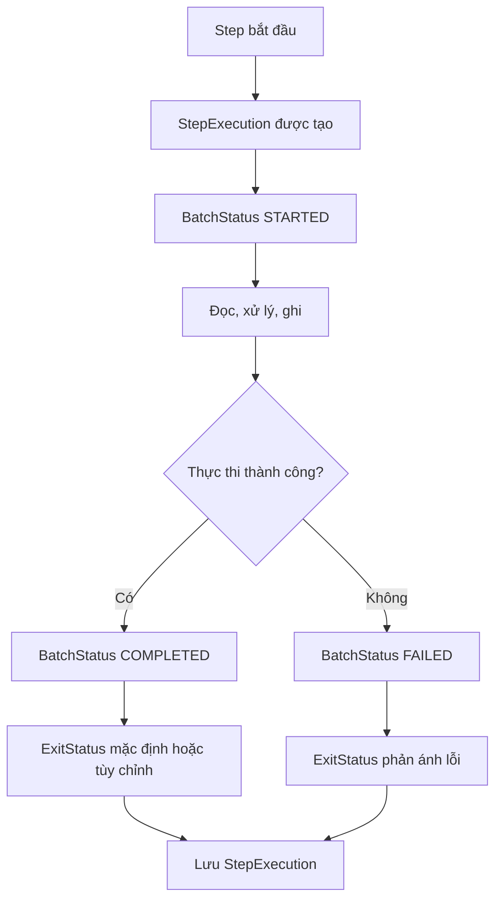
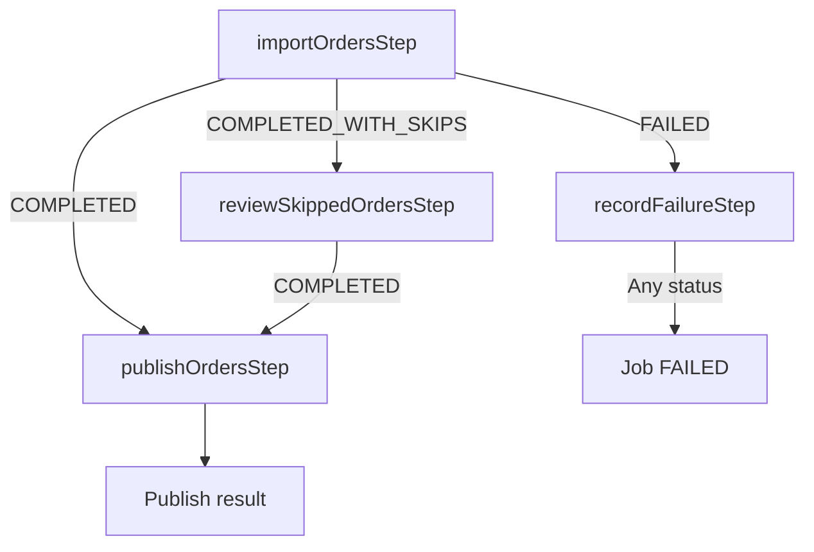

# ExitStatus của StepExecution

Trong Spring Batch, mỗi lần một step được thực thi sẽ có một StepExecution ghi nhận trạng thái, thời điểm bắt đầu/kết thúc, số lượng item đã đọc/ghi và kết quả cuối cùng. Một trong những thông tin quan trọng của StepExecution là **ExitStatus**.

ExitStatus mô tả kết quả mà step trả về cho workflow. Nó có một mã kết thúc (exit code) và phần mô tả (exit description). Mã này có thể là giá trị mặc định như COMPLETED hoặc FAILED, cũng có thể là mã nghiệp vụ do ứng dụng định nghĩa như COMPLETED_WITH_SKIPS, NO_INPUT hoặc NEEDS_REVIEW.

Điểm dễ nhầm là ExitStatus khác BatchStatus. BatchStatus mô tả vòng đời thực thi của step; ExitStatus mô tả kết quả dùng cho điều phối và báo cáo. Một step có thể có BatchStatus.COMPLETED nhưng ExitStatus là COMPLETED_WITH_WARNINGS. Sự khác biệt này cho phép job phân nhánh theo kết quả nghiệp vụ mà vẫn giữ đúng trạng thái thực thi kỹ thuật.

## 1. StepExecution là gì?

StepExecution đại diện cho một lần thực thi cụ thể của một step trong một JobExecution. Nó giữ metadata về lần chạy, chẳng hạn:

- Tên step và ID của execution.
- Thời điểm bắt đầu và kết thúc.
- BatchStatus hiện tại.
- ExitStatus của step.
- Số item đã đọc, ghi, filter và skip.
- Số lần commit và rollback.
- ExecutionContext phục vụ checkpoint/restart.
- Thông tin lỗi hoặc exit description.

Một JobInstance có thể có nhiều JobExecution qua các lần restart. Mỗi lần một step được thực thi trong một JobExecution sẽ có StepExecution tương ứng. Vì vậy, ExitStatus gắn với một lần thực thi step cụ thể, không phải một thuộc tính cố định của bean Step.

Ví dụ một step import có thể hoàn tất lần đầu với mã COMPLETED_WITH_SKIPS, sau đó được chạy trong một JobInstance khác với input khác và có mã COMPLETED. Hai lần thực thi có hai StepExecution riêng.

## 2. ExitStatus gồm những thành phần nào?

ExitStatus là một đối tượng trong Spring Batch dùng để mô tả kết quả của step hoặc job. Hai thành phần chính:

| Thành phần | Ý nghĩa | Ví dụ |
|---|---|---|
| exitCode | Mã kết quả ngắn, được flow transition sử dụng | COMPLETED, FAILED, COMPLETED_WITH_SKIPS |
| exitDescription | Phần mô tả bổ sung cho kết quả | Skipped 12 invalid records |

Có thể đọc chúng từ StepExecution:

```java
ExitStatus exitStatus = stepExecution.getExitStatus();

String exitCode = exitStatus.getExitCode();
String description = exitStatus.getExitDescription();
```

Exit code nên ngắn, ổn định và có quy ước đặt tên. Exit description có thể cung cấp ngữ cảnh cho vận hành, nhưng không nên chứa credential, dữ liệu cá nhân hoặc toàn bộ payload.

### ExitStatus là immutable

ExitStatus được thiết kế theo kiểu immutable. Các phương thức như addExitDescription(...) hoặc replaceExitCode(...) trả về một ExitStatus mới. Hãy giữ giá trị trả về:

```java
ExitStatus status = ExitStatus.COMPLETED
        .addExitDescription("Imported 1250 records");

ExitStatus customStatus =
        status.replaceExitCode("COMPLETED_WITH_SUMMARY");
```

Nếu gọi addExitDescription(...) mà bỏ qua giá trị trả về, biến status ban đầu không được thay đổi.

## 3. Phân biệt ExitStatus và BatchStatus

Đây là khác biệt quan trọng nhất khi đọc trạng thái step.

| Tiêu chí | BatchStatus | ExitStatus |
|---|---|---|
| Mục đích | Mô tả vòng đời thực thi | Mô tả kết quả của step/job |
| Kiểu dữ liệu | Enum | Đối tượng có exit code và exit description |
| Giá trị | COMPLETED, FAILED, STOPPED, STARTED... | COMPLETED, FAILED hoặc mã tùy chỉnh |
| Ai sử dụng | Framework và logic vòng đời | Flow transition, vận hành, báo cáo |
| Có thể tùy chỉnh mã? | Không tùy ý thêm enum mới | Có thể tạo exit code nghiệp vụ |

Ví dụ:

```java
BatchStatus batchStatus = stepExecution.getStatus();
ExitStatus exitStatus = stepExecution.getExitStatus();

System.out.println(batchStatus);              // COMPLETED
System.out.println(exitStatus.getExitCode()); // COMPLETED_WITH_SKIPS
```

Trong trường hợp này, step đã chạy xong về mặt kỹ thuật. Một số record bị skip nên ứng dụng trả mã nghiệp vụ riêng để job có thể đưa dữ liệu sang nhánh review.

### BatchStatus không phải nơi để đặt mã nghiệp vụ

Không thể thêm enum BatchStatus mới như COMPLETED_WITH_SKIPS. BatchStatus biểu diễn trạng thái vòng đời mà Spring Batch quản lý. Nếu cần phân biệt hoàn tất bình thường, hoàn tất có cảnh báo hoặc không có dữ liệu, hãy dùng ExitStatus.

Ngược lại, không dùng ExitStatus tùy chỉnh để giả vờ step đã hoàn tất khi BatchStatus thực tế là FAILED. Một exit code đẹp không làm cho transaction đã lỗi trở thành thành công.

## 4. Các ExitStatus thường gặp

Spring Batch định nghĩa một số ExitStatus tiêu chuẩn:

| ExitStatus | Ý nghĩa thường gặp |
|---|---|
| EXECUTING | Step/job đang thực thi |
| COMPLETED | Hoàn tất |
| FAILED | Thực thi thất bại |
| STOPPED | Thực thi bị dừng |
| NOOP | Không có thao tác thực sự được thực hiện trong một số trường hợp |
| UNKNOWN | Không xác định được kết quả |

Các mã này là giá trị mặc định hoặc giá trị framework sử dụng trong những tình huống cụ thể. Ứng dụng có thể tạo mã khác bằng constructor ExitStatus.

Ví dụ:

```java
ExitStatus warningStatus =
        new ExitStatus("COMPLETED_WITH_WARNINGS");

ExitStatus noInputStatus =
        new ExitStatus("NO_INPUT");
```

Không dùng mã tùy chỉnh trùng tên với mã chuẩn nếu ý nghĩa khác nhau. Hãy đặt tên thể hiện rõ kết quả và thống nhất giữa listener, flow, dashboard và vận hành.

## 5. ExitStatus được tạo và cập nhật khi nào?

Trong lifecycle thông thường, Spring Batch khởi tạo trạng thái step khi bắt đầu, thực thi tasklet hoặc chunk, sau đó xác định trạng thái kết thúc.

Luồng đơn giản:



Khi step hoàn tất bình thường, ExitStatus thường là COMPLETED. Khi exception làm step thất bại, framework thường đặt BatchStatus và ExitStatus tương ứng với FAILED, đồng thời thêm thông tin lỗi vào exit description.

Step listener có thể bổ sung hoặc thay đổi ExitStatus sau khi step chạy. Đây là cách phổ biến để biểu diễn kết quả nghiệp vụ như hoàn tất có skip hoặc không có dữ liệu.

## 6. Đọc ExitStatus từ StepExecution

Trong listener hoặc service quan sát job, có thể đọc ExitStatus bằng getExitStatus():

```java
public void logStepResult(StepExecution stepExecution) {
    ExitStatus exitStatus = stepExecution.getExitStatus();

    log.info(
            "step={}, batchStatus={}, exitCode={}, description={}",
            stepExecution.getStepName(),
            stepExecution.getStatus(),
            exitStatus.getExitCode(),
            exitStatus.getExitDescription());
}
```

Khi log, chỉ ghi mô tả đã được kiểm soát. Không dump toàn bộ ExecutionContext hoặc thêm access token, password, dữ liệu khách hàng vào exit description.

Nếu đọc metadata sau khi job chạy, có thể lấy StepExecution từ JobExecution:

```java
for (StepExecution stepExecution : jobExecution.getStepExecutions()) {
    String stepName = stepExecution.getStepName();
    String exitCode = stepExecution.getExitStatus().getExitCode();
    log.info("Step {} ended with {}", stepName, exitCode);
}
```

Với flow phức tạp hoặc step được thực thi nhiều lần, cần chọn đúng StepExecution theo ID hoặc lần thực thi thay vì giả định chỉ có một StepExecution cho mỗi tên step.

## 7. Tạo custom ExitStatus bằng StepExecutionListener

Một step có thể hoàn tất về mặt kỹ thuật nhưng cần báo một kết quả nghiệp vụ riêng. StepExecutionListener.afterStep(...) là điểm thích hợp để bổ sung kết quả này.

Ví dụ: nếu step có item bị skip, trả mã COMPLETED_WITH_SKIPS:

```java
public class SkipStatusListener implements StepExecutionListener {

    @Override
    public ExitStatus afterStep(StepExecution stepExecution) {
        if (stepExecution.getStatus() != BatchStatus.COMPLETED) {
            return null;
        }

        if (stepExecution.getSkipCount() > 0) {
            return new ExitStatus("COMPLETED_WITH_SKIPS")
                    .addExitDescription(
                            "Skipped " + stepExecution.getSkipCount()
                                    + " records");
        }

        return null;
    }
}
```

Listener chỉ trả custom status khi step đã COMPLETED. Nếu step đã FAILED hoặc STOPPED, listener không thay kết quả lỗi bằng mã hoàn tất có cảnh báo.

Gắn listener vào step:

```java
@Bean
Step importOrdersStep(
        JobRepository jobRepository,
        PlatformTransactionManager transactionManager,
        ItemReader<OrderInput> orderReader,
        ItemProcessor<OrderInput, Order> orderProcessor,
        ItemWriter<Order> orderWriter,
        SkipStatusListener skipStatusListener) {

    return new StepBuilder("importOrdersStep", jobRepository)
            .<OrderInput, Order>chunk(100, transactionManager)
            .reader(orderReader)
            .processor(orderProcessor)
            .writer(orderWriter)
            .faultTolerant()
            .skip(InvalidOrderException.class)
            .skipLimit(100)
            .listener(skipStatusListener)
            .build();
}
```

Khi step có skip, StepExecution có thể giữ BatchStatus.COMPLETED và ExitStatus.COMPLETED_WITH_SKIPS. Skip count vẫn được lưu riêng trong StepExecution.

### Listener trả null có ý nghĩa gì?

Nếu afterStep(...) trả null, listener không đề xuất ExitStatus mới. ExitStatus hiện có của step được giữ nguyên. Đây là lựa chọn phù hợp khi không có kết quả bổ sung.

Không cần trả ExitStatus.COMPLETED ở mọi trường hợp. Trả null giúp không vô tình ghi đè hoặc làm thay đổi kết quả mà framework đã xác định.

## 8. ExitStatus được kết hợp với listener như thế nào?

Step có thể có nhiều listener. Spring Batch kết hợp ExitStatus do listener trả về với ExitStatus hiện tại của step thông qua quy tắc kết hợp của ExitStatus.

Điều này có nghĩa không nên giả định giá trị listener trả về luôn ghi đè hoàn toàn kết quả trước đó. Framework sử dụng phép kết hợp để giữ kết quả có mức ưu tiên phù hợp và ghép thông tin mô tả.

Ví dụ, listener trả một mã cảnh báo sau khi step hoàn tất; nếu step đã thất bại, logic listener cần tránh đề xuất mã thành công. Hãy kiểm tra BatchStatus trước khi tạo custom status.

Nếu có nhiều listener cùng thay đổi ExitStatus, thứ tự đăng ký và quy tắc kết hợp có thể ảnh hưởng mô tả hoặc mã cuối cùng. Tốt nhất, chỉ có một thành phần chịu trách nhiệm đặt mã nghiệp vụ chính cho step; các listener khác chỉ bổ sung thông tin cần thiết.

## 9. Tạo ExitStatus trong Tasklet hoặc logic step

Ngoài listener, một số loại step có thể điều chỉnh ExitStatus thông qua StepContribution hoặc StepExecution trong lifecycle phù hợp. Cách này hữu ích khi kết quả được biết ngay trong lúc thực thi.

Ví dụ minh họa trong tasklet:

```java
@Bean
Step checkInputStep(
        JobRepository jobRepository,
        PlatformTransactionManager transactionManager,
        InputRepository inputRepository) {

    return new StepBuilder("checkInputStep", jobRepository)
            .tasklet((contribution, chunkContext) -> {
                long count = inputRepository.countPending();

                if (count == 0) {
                    contribution.setExitStatus(
                            new ExitStatus("NO_INPUT"));
                }

                return RepeatStatus.FINISHED;
            }, transactionManager)
            .build();
}
```

Ở đây, tasklet đặt exit status tùy chỉnh khi không có dữ liệu. BatchStatus vẫn được framework quản lý theo lifecycle thực thi. Nếu tasklet chạy bình thường, step có thể COMPLETED với ExitStatus.NO_INPUT.

Không đặt trạng thái hoàn tất trước khi công việc thực sự kết thúc. Nếu có lỗi trong tasklet, exception vẫn phải được xử lý theo transaction và step lifecycle; custom ExitStatus không được dùng để che lỗi.

## 10. Dùng ExitStatus để điều hướng flow

Một lý do quan trọng để tạo custom ExitStatus là điều hướng flow. Trong DSL của Spring Batch, transition on(...) khớp với exit code của ExitStatus.

Ví dụ:

```java
@Bean
Job orderImportJob(
        JobRepository jobRepository,
        Step importOrdersStep,
        Step reviewSkippedOrdersStep,
        Step publishOrdersStep,
        Step recordFailureStep) {

    return new JobBuilder("orderImportJob", jobRepository)
            .start(importOrdersStep)
                .on("COMPLETED_WITH_SKIPS")
                .to(reviewSkippedOrdersStep)
            .from(importOrdersStep)
                .on("COMPLETED")
                .to(publishOrdersStep)
            .from(importOrdersStep)
                .on("FAILED")
                .to(recordFailureStep)
            .from(reviewSkippedOrdersStep)
                .on("COMPLETED")
                .to(publishOrdersStep)
            .from(recordFailureStep)
                .on("*")
                .fail()
            .end()
            .build();
}
```

Flow có thể biểu diễn:



Khi import có skip, flow chuyển qua bước review. Khi import hoàn tất bình thường, flow đi thẳng đến publish. Nếu import thất bại, flow ghi nhận lỗi.

### on() so khớp exit code

Transition on("COMPLETED_WITH_SKIPS") so khớp exit code. Nó không đọc exit description và cũng không trực tiếp kiểm tra BatchStatus.

Nếu step có BatchStatus.COMPLETED nhưng ExitStatus là COMPLETED_WITH_SKIPS, transition on("COMPLETED") không khớp chính xác với mã tùy chỉnh đó. Hãy khai báo nhánh cho custom code.

Có thể dùng wildcard khi phù hợp:

```java
.from(importOrdersStep)
    .on("COMPLETED*")
    .to(publishOrdersStep)
```

Pattern cụ thể giúp flow dễ đọc và tránh vô tình đưa mã lỗi vào nhánh thành công. Chỉ dùng wildcard rộng khi mọi exit code được khớp thực sự có cùng hành động nghiệp vụ.

## 11. ExitStatus và JobExecution

StepExecution có ExitStatus riêng; JobExecution cũng có ExitStatus riêng. Không nên coi hai giá trị này là một.

Ví dụ:

- Step import trả COMPLETED_WITH_SKIPS.
- Step review xử lý các record bị skip.
- Step publish hoàn tất.
- JobExecution có thể kết thúc COMPLETED theo flow đã xử lý thành công cảnh báo.

Nếu flow dừng hoặc thất bại ở một nhánh khác, JobExecution có thể có kết quả khác. Job-level ExitStatus phản ánh kết quả của job flow, còn StepExecution.ExitStatus giúp hiểu từng step đã kết thúc ra sao.

Khi điều tra, hãy xem cả:

```java
jobExecution.getStatus();
jobExecution.getExitStatus().getExitCode();

stepExecution.getStatus();
stepExecution.getExitStatus().getExitCode();
```

Không suy ra job thành công chỉ vì một step có ExitStatus.COMPLETED. Một job có thể có nhiều step và một step sau có thể thất bại.

## 12. ExitStatus được lưu trong JobRepository

Với JDBC JobRepository, metadata step thường được lưu trong bảng BATCH_STEP_EXECUTION. Schema chuẩn có các cột:

- EXIT_CODE: mã ExitStatus của StepExecution.
- EXIT_MESSAGE: phần mô tả ExitStatus.
- STATUS: trạng thái BatchStatus.

Job execution cũng có thông tin trạng thái và exit status tương ứng trong metadata job execution.

Việc lưu riêng STATUS và EXIT_CODE thể hiện rõ hai khái niệm:

| Metadata | Nội dung |
|---|---|
| STATUS | BatchStatus của step |
| EXIT_CODE | ExitStatus.getExitCode() |
| EXIT_MESSAGE | ExitStatus.getExitDescription() |

Tên cột và kiểu dữ liệu cụ thể có thể khác giữa các schema/phiên bản hoặc cấu hình repository. Không ghi trực tiếp vào các cột metadata bằng SQL để ép flow đi tiếp; hãy để Spring Batch quản lý lifecycle và trạng thái.

Exit description có thể được lưu cùng metadata và xuất hiện trong dashboard hoặc công cụ quản trị. Vì vậy, không ghi secret, token, raw request hoặc dữ liệu cá nhân vào mô tả.

## 13. Quy ước đặt tên custom exit code

Custom exit code là một phần hợp đồng giữa step, flow và vận hành. Nên thiết kế chúng như mã trạng thái ổn định.

Một số ví dụ:

| Exit code | Ý nghĩa | Hành động gợi ý |
|---|---|---|
| COMPLETED | Hoàn tất bình thường | Đi tiếp |
| COMPLETED_WITH_SKIPS | Hoàn tất nhưng có item bị skip | Review/reconcile |
| COMPLETED_WITH_WARNINGS | Hoàn tất với cảnh báo | Ghi cảnh báo hoặc kiểm tra |
| NO_INPUT | Không có dữ liệu đầu vào | Kết thúc theo chính sách nghiệp vụ |
| NEEDS_REVIEW | Cần kiểm tra thủ công | Chuyển sang step review |
| VALIDATION_FAILED | Dữ liệu không đạt validation | Reject hoặc fail |

Quy ước nên tuân theo:

- Dùng chữ hoa và dấu gạch dưới để dễ đọc.
- Một mã chỉ đại diện cho một ý nghĩa nghiệp vụ rõ ràng.
- Không nhúng ID khách hàng, token hoặc dữ liệu động vào exit code.
- Dùng exit description cho thông tin bổ sung đã được kiểm soát.
- Định nghĩa hằng số hoặc enum trong code để tránh sai chính tả.
- Cập nhật flow transition và test khi thêm mã mới.

Ví dụ:

```java
public final class StepExitCodes {

    public static final String COMPLETED_WITH_SKIPS =
            "COMPLETED_WITH_SKIPS";
    public static final String NO_INPUT = "NO_INPUT";
    public static final String NEEDS_REVIEW = "NEEDS_REVIEW";

    private StepExitCodes() {
    }
}
```

Không tạo quá nhiều mã nhỏ cho những tình huống có cùng hành động tiếp theo. Mã trạng thái cần giúp workflow và vận hành ra quyết định, không phải thay thế log chi tiết.

## 14. ExitDescription dùng để làm gì?

ExitDescription bổ sung ngữ cảnh cho exit code. Ví dụ, exit code có thể là COMPLETED_WITH_SKIPS và description cho biết số lượng item bị skip.

Ví dụ:

```java
ExitStatus status = new ExitStatus("COMPLETED_WITH_SKIPS")
        .addExitDescription(
                "Skipped 12 records; 988 records written");
```

Exit description hữu ích cho:

- Giải thích ngắn gọn kết quả của step.
- Hiển thị lý do thất bại hoặc cảnh báo.
- Ghi thông tin tổng hợp để vận hành điều tra.
- Hỗ trợ dashboard và job monitoring.

Không dùng description làm điều kiện điều hướng. Description có thể dài, thay đổi hoặc chứa văn bản tự do; flow nên dựa vào exit code ổn định.

Không đưa stack trace đầy đủ, request body, password, API token hoặc dữ liệu khách hàng vào exit description. Với lỗi kỹ thuật, hãy log stack trace ở nơi được kiểm soát và lưu correlation ID hoặc mã lỗi trong description.

## 15. Không ghi đè FAILED bằng mã thành công

Một lỗi phổ biến là listener luôn trả COMPLETED hoặc custom completed status, bất kể step thực tế thành công hay thất bại.

Ví dụ không an toàn:

```java
public ExitStatus afterStep(StepExecution stepExecution) {
    return new ExitStatus("COMPLETED_WITH_WARNINGS");
}
```

Nếu step đã FAILED, listener không nên đề xuất một mã thành công có thể làm người vận hành hiểu nhầm. Cách an toàn hơn:

```java
public ExitStatus afterStep(StepExecution stepExecution) {
    if (stepExecution.getStatus() != BatchStatus.COMPLETED) {
        return null;
    }

    if (stepExecution.getSkipCount() > 0) {
        return new ExitStatus("COMPLETED_WITH_WARNINGS");
    }

    return null;
}
```

Giữ BatchStatus và ExitStatus phản ánh đúng sự kiện. Nếu một step có trạng thái STOPPED hoặc FAILED, hãy để framework giữ kết quả tương ứng và chỉ bổ sung description khi cần.

## 16. ExitStatus trong restart

ExitStatus thuộc về một StepExecution cụ thể. Khi restart một JobInstance, Spring Batch tạo JobExecution mới và các StepExecution mới cho những step được thực thi lại. StepExecution cũ vẫn là lịch sử của lần chạy trước.

Điều này có một số hệ quả:

- Không dùng ExitStatus cũ như một cờ toàn cục cho mọi lần chạy.
- Khi điều tra restart, đọc StepExecution của JobExecution hiện tại và đối chiếu lịch sử nếu cần.
- Flow transition trong lần restart dựa trên kết quả thực thi hiện tại theo flow/restart semantics.
- Nếu step đã hoàn tất và được bỏ qua khi restart, metadata cũ vẫn cho biết kết quả của lần chạy trước.

Nếu nghiệp vụ cần giữ kết quả của một lần chạy trước để step khác sử dụng, hãy lưu một trạng thái bền vững có batch ID hoặc execution reference. Không dựa vào việc đọc nhầm StepExecution cũ theo tên step.

Custom exit code cũng cần ổn định qua các lần deploy. Nếu đổi COMPLETED_WITH_SKIPS thành SKIPPED_SUCCESS, hãy cập nhật transition, dashboard, alert và test liên quan.

## 17. ExitStatus và skip/retry

Skip count và retry count là các metric riêng của StepExecution. Chúng không tự động quyết định custom ExitStatus theo mọi ứng dụng.

Ví dụ:

- Step có 10 item bị skip nhưng vẫn hoàn tất: mặc định ExitStatus có thể là COMPLETED nếu không có listener thay đổi.
- Ứng dụng có thể dùng listener để trả COMPLETED_WITH_SKIPS.
- Step retry thành công sau deadlock vẫn có thể kết thúc COMPLETED.
- Step hết retry limit và thất bại thường kết thúc với ExitStatus.FAILED.

Không suy ra ExitStatus từ riêng read count hoặc write count. Nếu cần mã nghiệp vụ dựa trên skip/retry, hãy định nghĩa quy tắc rõ ràng trong listener và test từng trường hợp.

## 18. Kiểm thử ExitStatus của StepExecution

Test nên kiểm tra cả BatchStatus, exit code và exit description:

```java
@Test
void stepReturnsCompletedWithSkips() throws Exception {
    JobExecution execution =
            jobLauncherTestUtils.launchJob(testParameters());

    StepExecution stepExecution = execution.getStepExecutions().stream()
            .filter(step -> step.getStepName().equals("importOrdersStep"))
            .findFirst()
            .orElseThrow();

    assertEquals(BatchStatus.COMPLETED, stepExecution.getStatus());
    assertEquals(
            "COMPLETED_WITH_SKIPS",
            stepExecution.getExitStatus().getExitCode());
    assertEquals(2, stepExecution.getSkipCount());
    assertTrue(
            stepExecution.getExitStatus()
                    .getExitDescription()
                    .contains("Skipped 2 records"));
}
```

Ví dụ giả định fixture có đúng hai item bị skip và listener đặt description tương ứng. Test thật cần dùng JobRepository test và job configuration thực tế.

### Kiểm thử flow transition

Ngoài kiểm tra StepExecution, cần xác nhận custom exit code dẫn đến đúng step tiếp theo:

```java
assertTrue(execution.getStepExecutions().stream()
        .anyMatch(step ->
                step.getStepName().equals("reviewSkippedOrdersStep")));

assertFalse(execution.getStepExecutions().stream()
        .anyMatch(step ->
                step.getStepName().equals("publishOrdersStep")
                        && wasExecutedBeforeReview(step, execution)));
```

Đoạn assertion minh họa ý tưởng. Trong test thật, cách xác định thứ tự step cần dựa vào execution metadata hoặc marker bền vững, không dựa vào thứ tự iteration của một collection không đảm bảo thứ tự.

Các tình huống nên có:

| Kịch bản | BatchStatus | ExitStatus mong đợi |
|---|---|---|
| Không có skip | COMPLETED | COMPLETED |
| Có item bị skip | COMPLETED | COMPLETED_WITH_SKIPS |
| Step thất bại | FAILED | FAILED hoặc mã lỗi phù hợp |
| Step không có input | COMPLETED | NO_INPUT nếu ứng dụng định nghĩa |
| Step bị dừng | STOPPED | STOPPED hoặc mã kết thúc được cấu hình |

## 19. Debug khi flow đi sai nhánh

Nếu step sau không chạy như mong đợi, hãy kiểm tra theo thứ tự:

1. Tìm JobExecution đúng theo job name và identifying parameters.
2. Tìm StepExecution của step vừa chạy.
3. Đọc BatchStatus và ExitStatus.
4. Xem exit code thực tế, không chỉ exit description.
5. Đối chiếu exit code với pattern trong on(...).
6. Kiểm tra listener nào đã trả hoặc thay đổi ExitStatus.
7. Kiểm tra custom exit code có bị viết sai chính tả hoặc khác chữ hoa/thường không.
8. Xem transition có trỏ đúng step/flow không.
9. Đọc trạng thái của step tiếp theo và JobExecution.

Ví dụ, nếu BatchStatus là COMPLETED nhưng ExitStatus là NO_INPUT, transition on("COMPLETED") sẽ không khớp. Nếu flow chỉ khai báo COMPLETED và FAILED, cần bổ sung nhánh NO_INPUT.

Khi có nhiều listener, log exit code sau khi step hoàn tất thay vì chỉ log giá trị listener vừa tạo. Giá trị cuối cùng có thể là kết quả kết hợp từ nhiều listener.

## 20. Những lỗi thường gặp

**Nhầm ExitStatus với BatchStatus.** BatchStatus là lifecycle state; ExitStatus là kết quả dùng cho flow và báo cáo. Có thể có BatchStatus.COMPLETED cùng ExitStatus tùy chỉnh.

**Nghĩ rằng custom ExitStatus tự đổi BatchStatus.** Trả mã COMPLETED_WITH_SKIPS không làm thay đổi BatchStatus thành một enum mới.

**Dùng exit description để điều hướng.** Flow transition khớp exit code. Description chỉ bổ sung thông tin.

**Tạo custom exit code nhưng quên transition.** Step có thể hoàn tất nhưng flow không tìm được nhánh phù hợp. Thêm transition và test.

**Listener luôn trả mã thành công.** Có thể che giấu step FAILED. Kiểm tra BatchStatus trước khi trả custom completed code.

**Bỏ qua giá trị trả về từ addExitDescription.** ExitStatus immutable; phải gán hoặc return object mới.

**Nhiều listener cùng thay đổi mã trạng thái.** Kết quả cuối có thể khó dự đoán. Giao trách nhiệm mã nghiệp vụ chính cho một listener.

**Dùng exit code chứa dữ liệu động.** Mã khó quản lý và flow không ổn định. Dùng mã cố định, description đã kiểm soát và log correlation ID.

**Coi ExitStatus của step là ExitStatus của job.** Job có thể có nhiều step và flow riêng. Kiểm tra cả job-level status lẫn step-level status.

**Sửa trực tiếp metadata database.** Có thể làm sai lifecycle/restart. Dùng API và flow configuration của Spring Batch.

## 21. Quy trình thiết kế ExitStatus

Với mỗi step, hãy trả lời:

1. Kết quả mặc định là COMPLETED hay FAILED?
2. Có kết quả nghiệp vụ nào cần phân biệt như NO_INPUT hoặc COMPLETED_WITH_SKIPS không?
3. Mã nào cần flow transition sử dụng?
4. BatchStatus có giữ đúng trạng thái lifecycle không?
5. Listener nào chịu trách nhiệm tạo custom code?
6. Nếu step FAILED hoặc STOPPED, listener có giữ nguyên kết quả không?
7. Exit description có hữu ích nhưng không chứa dữ liệu nhạy cảm không?
8. Flow đã khai báo transition cho mọi mã có thể phát ra chưa?
9. Dashboard và vận hành có hiểu mã mới không?
10. Test có kiểm tra cả StepExecution và đường đi của flow không?

Giữ số lượng exit code vừa đủ. Nếu hai tình huống dẫn đến cùng hành động tiếp theo và không cần phân biệt trong vận hành, có thể dùng cùng một mã và ghi chi tiết ở log/metric.

## 22. Kết luận thực hành

ExitStatus của StepExecution mô tả kết quả cuối cùng của một lần thực thi step. Nó gồm exit code và exit description. BatchStatus cho biết step đang chạy, đã hoàn tất, thất bại hay bị dừng; ExitStatus cho phép ứng dụng bổ sung kết quả nghiệp vụ và điều hướng flow.

Hãy dùng mã chuẩn khi kết quả thông thường là đủ. Khi cần phân biệt hoàn tất có skip, không có input hoặc cần review, tạo custom ExitStatus qua listener hoặc logic step phù hợp. Transition on(...) khớp exit code, vì vậy mọi mã tùy chỉnh có ý nghĩa điều hướng phải được khai báo trong flow.

Giữ listener không ghi đè kết quả FAILED/STOPPED, dùng exit description cho thông tin vận hành đã kiểm soát và kiểm tra cả BatchStatus lẫn ExitStatus trong integration test. Khi mỗi step có mã kết quả ổn định và flow xử lý đầy đủ các mã đó, trạng thái job trở nên dễ quan sát, điều phối và phục hồi hơn.
