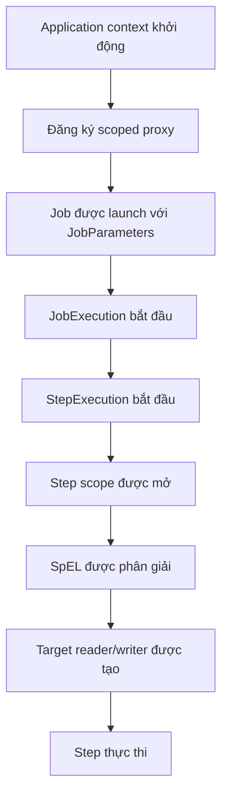

# Late binding expression

Trong Spring Batch, nhiều giá trị chỉ có khi job thực sự được launch: tên file đầu vào, ngày nghiệp vụ, tenant, partition key hoặc đường dẫn output được một step trước tạo ra. Nếu đọc các giá trị này ngay lúc Spring khởi tạo application context, chúng chưa tồn tại. **Late binding** cho phép một bean nhận các giá trị đó vào đúng thời điểm phạm vi thực thi của nó đã được mở.

Late binding thường dùng Spring Expression Language (SpEL) cùng các scope của Spring Batch:

- **JobParameters**: tham số được truyền khi launch job.
- **JobExecutionContext**: dữ liệu ở phạm vi một JobExecution.
- **StepExecutionContext**: dữ liệu ở phạm vi một StepExecution.

Các expression thường gặp:

| Nguồn dữ liệu | Expression |
|---|---|
| Job parameter | #{jobParameters['input.file']} |
| Job execution context | #{jobExecutionContext['output.directory']} |
| Step execution context | #{stepExecutionContext['fileName']} |

Để các expression này được đánh giá đúng thời điểm, component cần late binding thường được khai báo với **@StepScope** hoặc **@JobScope**. Một bean singleton thông thường được tạo lúc application context khởi động không có StepExecution/JobExecution hiện hành để phân giải các giá trị runtime.

## 1. Vì sao cần late binding?

Spring tạo các bean ứng dụng khi khởi động context. Nhưng Spring Batch chỉ biết JobParameters khi một JobExecution được launch; StepExecution và các ExecutionContext tương ứng cũng chỉ có trong lifecycle thực thi.

Giả sử một job đọc file do scheduler truyền vào:

```java
JobParameters parameters = new JobParametersBuilder()
        .addString("input.file", "data/orders-2026-11-15.csv", true)
        .toJobParameters();
```

Nếu một reader singleton cần nhận tên file ngay lúc bean được tạo, application context chưa có JobParameters của lần launch này. Giá trị còn phụ thuộc từng lần chạy, nên không thể cố định trong cấu hình singleton.

Late binding trì hoãn việc tạo target bean đến khi scope phù hợp đã có execution context. Khi step bắt đầu, Spring Batch có StepExecution hiện hành và có thể phân giải job parameters, job context hoặc step context thành constructor/method arguments của bean.



Điểm quan trọng: expression không nhất thiết được phân giải khi class cấu hình được đọc. Scoped proxy được tạo sớm, còn target bean được tạo khi Spring Batch kích hoạt scope tương ứng.

## 2. Ba nguồn dữ liệu thường dùng trong expression

### JobParameters

JobParameters là input của một lần launch. Chúng thường được dùng để xác định tập dữ liệu cần xử lý hoặc tham số nghiệp vụ.

Ví dụ:

```java
@Bean
@StepScope
FlatFileItemReader<OrderInput> orderReader(
        @Value("#{jobParameters['input.file']}") String inputFile) {

    return new FlatFileItemReaderBuilder<OrderInput>()
            .name("orderReader")
            .resource(new FileSystemResource(inputFile))
            .delimited()
            .names("orderId", "customerId", "amount")
            .targetType(OrderInput.class)
            .build();
}
```

Khi job được launch với parameter input.file, reader nhận đúng đường dẫn của lần chạy đó. Một lần launch khác có thể truyền đường dẫn khác mà không cần tạo lại application context.

### JobExecutionContext

JobExecutionContext chứa dữ liệu ở phạm vi một lần thực thi job. Nó thường được dùng để chia sẻ một giá trị nhỏ giữa các step trong cùng job execution.

Ví dụ, một step chuẩn bị output directory và ghi key vào job context. Step sau đọc giá trị:

```java
@Bean
@StepScope
FlatFileItemWriter<Order> orderWriter(
        @Value("#{jobExecutionContext['output.file']}") String outputFile) {

    return new FlatFileItemWriterBuilder<Order>()
            .name("orderWriter")
            .resource(new FileSystemResource(outputFile))
            .delimited()
            .names("orderId", "customerId", "amount")
            .build();
}
```

Expression chỉ có thể phân giải giá trị nếu key output.file đã được ghi vào JobExecutionContext trước khi writer target được tạo và sử dụng.

### StepExecutionContext

StepExecutionContext thuộc về một lần thực thi step. Đây là nguồn phù hợp cho dữ liệu riêng của step, đặc biệt trong partitioning.

Ví dụ mỗi partition được gán một file riêng:

```java
@Bean
@StepScope
FlatFileItemReader<OrderInput> partitionReader(
        @Value("#{stepExecutionContext['fileName']}") String fileName) {

    return new FlatFileItemReaderBuilder<OrderInput>()
            .name("partitionReader")
            .resource(new FileSystemResource(fileName))
            .delimited()
            .names("orderId", "amount")
            .targetType(OrderInput.class)
            .build();
}
```

Mỗi worker StepExecution có StepExecutionContext riêng, nên mỗi instance reader nhận fileName tương ứng với partition của nó.

## 3. @StepScope là gì?

@StepScope là annotation của Spring Batch để khai báo bean có lifecycle gắn với StepExecution. Nó tương đương việc dùng scope step cùng scoped proxy theo cấu hình mặc định.

Ví dụ:

```java
@Bean
@StepScope
ItemReader<OrderInput> orderReader(
        @Value("#{jobParameters['input.file']}") String inputFile) {
    return createReader(inputFile);
}
```

Bean target được tạo khi step scope đã hoạt động. Khi đó Spring có thể phân giải:

- jobParameters.
- jobExecutionContext.
- stepExecutionContext.
- stepExecution.
- jobExecution.

Một scoped proxy được inject vào các bean singleton như Step definition. Khi step thực thi, proxy định tuyến lời gọi đến target bean thuộc StepExecution hiện tại.

### Một target instance cho mỗi StepExecution

Step scope gắn với StepExecution, không phải chỉ với tên Step bean. Khi step được chạy trong một JobExecution mới, target scoped bean được tạo theo execution đó. Với partitioning, mỗi worker StepExecution có scope riêng, nhờ vậy state của reader từng partition không bị trộn.

Đây là lý do @StepScope phù hợp với reader, writer hoặc processor có cấu hình phụ thuộc JobParameters hay ExecutionContext. Nó cũng giúp state mutable của từng component gắn với đúng lần thực thi step.

## 4. @JobScope là gì?

@JobScope khai báo bean có lifecycle gắn với JobExecution. Bean target được tạo khi job scope đã hoạt động và được giữ trong phạm vi lần thực thi job đó.

Ví dụ một component cấu hình theo ngày nghiệp vụ:

```java
public record ReportContext(LocalDate businessDate, String tenantId) {
}

@Bean
@JobScope
ReportContext reportContext(
        @Value("#{jobParameters['businessDate']}") LocalDate businessDate,
        @Value("#{jobParameters['tenantId']}") String tenantId) {

    return new ReportContext(businessDate, tenantId);
}
```

Các step trong cùng JobExecution có thể inject proxy của ReportContext và dùng cùng target instance trong phạm vi job. Đây là cách phù hợp khi một object nhỏ có cấu hình chung cho toàn job.

### So sánh @JobScope và @StepScope

| Đặc điểm | @JobScope | @StepScope |
|---|---|---|
| Lifecycle | Một JobExecution | Một StepExecution |
| Có thể late-bind JobParameters | Có | Có |
| Có thể đọc JobExecutionContext | Có | Có |
| Có thể đọc StepExecutionContext hiện hành | Không phù hợp ở scope job | Có |
| Dùng cho | Cấu hình/state chung của một job | Reader, writer, processor hoặc component riêng của step |
| Partition workers | Không nên dùng làm state riêng cho worker | Mỗi worker StepExecution có scope riêng |

Nếu dữ liệu thuộc riêng một partition hoặc step, dùng StepScope. JobScope không có một StepExecution cụ thể để phân giải stepExecutionContext.

## 5. Khai báo late binding trong Java configuration

Ví dụ đầy đủ với Spring Batch 5:

```java
@Configuration
public class OrderJobConfiguration {

    @Bean
    @StepScope
    FlatFileItemReader<OrderInput> orderReader(
            @Value("#{jobParameters['input.file']}") String inputFile) {

        return new FlatFileItemReaderBuilder<OrderInput>()
                .name("orderReader")
                .resource(new FileSystemResource(inputFile))
                .delimited()
                .names("orderId", "customerId", "amount")
                .targetType(OrderInput.class)
                .build();
    }

    @Bean
    Step importOrdersStep(
            JobRepository jobRepository,
            PlatformTransactionManager transactionManager,
            ItemReader<OrderInput> orderReader,
            ItemWriter<Order> orderWriter) {

        return new StepBuilder("importOrdersStep", jobRepository)
                .<OrderInput, Order>chunk(100, transactionManager)
                .reader(orderReader)
                .processor(orderProcessor())
                .writer(orderWriter)
                .build();
    }
}
```

Step bean thường có thể là singleton. Nó nhận proxy của orderReader; target reader thật chỉ được tạo khi step scope có execution context.

Ví dụ trên giả định các bean writer và processor khác đã được cấu hình. Trong dự án thật, hãy khai báo type return của bean reader là interface hoặc class phù hợp với cách inject và proxy được sử dụng.

### Không gọi trực tiếp method @Bean để lấy target

Trong cấu hình Spring với proxy bean methods, lời gọi method @Bean thường được container intercept. Tuy nhiên, không nên tự gọi một factory method hoặc dùng new để tạo reader trong code runtime rồi kỳ vọng late binding hoạt động. Hãy inject bean từ Spring container và để scope quản lý lifecycle.

## 6. Cú pháp SpEL cho JobParameters

Expression truy cập JobParameters dùng tên biến jobParameters và cú pháp truy cập key:

```java
@Value("#{jobParameters['input.file']}")
String inputFile

@Value("#{jobParameters['businessDate']}")
LocalDate businessDate

@Value("#{jobParameters['tenantId']}")
String tenantId
```

Dùng dấu ngoặc vuông hữu ích khi key có dấu chấm, dấu gạch hoặc ký tự không phù hợp với cú pháp property đơn giản. Hãy dùng đúng tên key đã tạo khi launch job.

Ví dụ tạo parameters:

```java
JobParameters parameters = new JobParametersBuilder()
        .addString("input.file", "/data/orders.csv", true)
        .addString("businessDate", "2026-11-15", true)
        .addString("tenantId", "tenant-42", true)
        .toJobParameters();
```

Giá trị được chuyển đổi sang kiểu tham số bean thông qua cơ chế conversion của Spring. Với kiểu phức tạp hoặc format ngày riêng, hãy cấu hình converter rõ ràng hoặc nhận String rồi parse và validate trong factory method.

### Giá trị bắt buộc và giá trị tùy chọn

Nếu parameter bắt buộc bị thiếu, bean có thể không được tạo hoặc validation sẽ thất bại khi step bắt đầu. Đây thường là lỗi cấu hình job cần được phát hiện sớm.

Có thể cung cấp default trong SpEL bằng toán tử Elvis:

```java
@Value("#{jobParameters['delimiter'] ?: ','}")
String delimiter
```

Chỉ dùng default khi nghiệp vụ thực sự có giá trị mặc định hợp lệ. Với input file, tenant hoặc business date bắt buộc, nên fail rõ ràng nếu thiếu thay vì âm thầm chọn một giá trị mặc định có thể xử lý nhầm dữ liệu.

## 7. Cú pháp SpEL cho JobExecutionContext

JobExecutionContext chứa các key được chia sẻ trong phạm vi một JobExecution. Expression:

```java
@Value("#{jobExecutionContext['output.file']}")
String outputFile
```

Một step trước có thể tạo đường dẫn và lưu vào job context:

```java
public class PrepareOutputTasklet implements Tasklet {

    @Override
    public RepeatStatus execute(
            StepContribution contribution,
            ChunkContext chunkContext) {

        JobExecution jobExecution = chunkContext.getStepContext()
                .getStepExecution()
                .getJobExecution();

        String outputFile = "/data/output/report.csv";
        jobExecution.getExecutionContext()
                .putString("output.file", outputFile);

        return RepeatStatus.FINISHED;
    }
}
```

Step sau đó inject giá trị bằng @StepScope:

```java
@Bean
@StepScope
FlatFileItemWriter<ReportRow> reportWriter(
        @Value("#{jobExecutionContext['output.file']}") String outputFile) {

    return new FlatFileItemWriterBuilder<ReportRow>()
            .name("reportWriter")
            .resource(new FileSystemResource(outputFile))
            .delimited()
            .names("id", "total")
            .build();
}
```

Điều kiện quan trọng là step chuẩn bị output phải chạy trước và giá trị phải được lưu trong JobExecutionContext trước khi target writer được tạo.

Không nhầm JobExecutionContext với StepExecutionContext. Giá trị được đặt trong step context của step chuẩn bị không tự động xuất hiện trong job context của step sau. Nếu cần chia sẻ, hãy promote key hoặc ghi trực tiếp vào job context theo lifecycle phù hợp.

## 8. Cú pháp SpEL cho StepExecutionContext

StepExecutionContext chứa dữ liệu riêng của một step. Expression:

```java
@Value("#{stepExecutionContext['partition.file']}")
String partitionFile
```

Đây là mẫu phổ biến khi partitioner tạo context cho từng worker:

```java
public class OrderFilePartitioner implements Partitioner {

    @Override
    public Map<String, ExecutionContext> partition(int gridSize) {
        Map<String, ExecutionContext> partitions = new HashMap<>();

        partitions.put("partition0", contextFor("/data/orders-0.csv"));
        partitions.put("partition1", contextFor("/data/orders-1.csv"));

        return partitions;
    }

    private ExecutionContext contextFor(String fileName) {
        ExecutionContext context = new ExecutionContext();
        context.putString("partition.file", fileName);
        return context;
    }
}
```

Worker reader nhận file của partition hiện tại:

```java
@Bean
@StepScope
FlatFileItemReader<OrderInput> partitionReader(
        @Value("#{stepExecutionContext['partition.file']}") String partitionFile) {

    return new FlatFileItemReaderBuilder<OrderInput>()
            .name("partitionReader")
            .resource(new FileSystemResource(partitionFile))
            .delimited()
            .names("orderId", "amount")
            .targetType(OrderInput.class)
            .build();
}
```

Mỗi worker có StepExecutionContext được tạo từ partition context tương ứng. Vì reader là step-scoped, mỗi worker nhận target bean với file riêng.

## 9. Truy cập thông tin execution bằng SpEL

Ngoài ba map thường dùng, scope còn cung cấp các object execution để đọc thuộc tính cần thiết:

| Variable | Ví dụ | Phạm vi |
|---|---|---|
| jobParameters | #{jobParameters['batchId']} | JobExecution hiện tại |
| jobExecutionContext | #{jobExecutionContext['snapshotId']} | JobExecution hiện tại |
| stepExecutionContext | #{stepExecutionContext['partitionId']} | StepExecution hiện tại |
| jobExecution | #{jobExecution.id} | JobExecution hiện tại |
| stepExecution | #{stepExecution.stepName} | StepExecution hiện tại |

Ví dụ:

```java
@Bean
@StepScope
BranchAudit branchAudit(
        @Value("#{jobExecution.id}") Long jobExecutionId,
        @Value("#{stepExecution.stepName}") String stepName,
        @Value("#{jobParameters['batchId']}") String batchId) {

    return new BranchAudit(jobExecutionId, stepName, batchId);
}
```

Chỉ inject các giá trị mà component thực sự cần. Việc một expression có thể truy cập nhiều metadata không có nghĩa nên truyền toàn bộ JobExecution hoặc StepExecution vào mọi component.

## 10. Khi nào dùng @StepScope, khi nào dùng @JobScope?

Hãy chọn scope theo vòng đời và chủ sở hữu dữ liệu:

| Nhu cầu | Scope phù hợp |
|---|---|
| Reader nhận file path từ JobParameters | @StepScope |
| Writer nhận output path từ JobExecutionContext | @StepScope |
| Reader nhận fileName riêng từ partition StepExecutionContext | @StepScope |
| Component dùng cấu hình chung cho một JobExecution | @JobScope |
| Component chứa cursor hoặc buffer của một step | @StepScope |
| Component chỉ phụ thuộc cấu hình cố định khi app khởi động | Singleton thông thường |

Không dùng @JobScope chỉ vì giá trị đến từ JobParameters. StepScope cũng có thể truy cập jobParameters và thường phù hợp hơn cho reader/writer của step.

### JobScope trong parallel và partitioned processing

JobScope có một lưu ý quan trọng: Spring Batch không khuyến nghị dùng job-scoped bean trong multi-threaded hoặc partitioned step. Các thread do framework hoặc executor tạo ra có thể không có job scope context theo cách ứng dụng kỳ vọng trong mọi cấu hình.

Với component được gọi đồng thời từ nhiều worker, ưu tiên StepScope và dữ liệu riêng theo StepExecution. Nếu cần state chung ở cấp job, dùng một service thread-safe hoặc một resource bền vững có khóa/transaction rõ ràng.

## 11. Late binding và ExecutionContextPromotionListener

Một step có thể ghi checkpoint hoặc kết quả vào StepExecutionContext. Nếu step sau cần một giá trị đó ở cấp job, có thể dùng ExecutionContextPromotionListener để promote key khi step kết thúc với status được phép.

Ví dụ:

```java
@Bean
ExecutionContextPromotionListener promoteOutputListener() {
    ExecutionContextPromotionListener listener =
            new ExecutionContextPromotionListener();
    listener.setKeys(new String[] { "output.file" });
    listener.setStatuses(new String[] { "COMPLETED" });
    return listener;
}
```

Gắn listener vào step tạo output:

```java
@Bean
Step prepareOutputStep(
        JobRepository jobRepository,
        PlatformTransactionManager transactionManager,
        ExecutionContextPromotionListener promoteOutputListener) {

    return new StepBuilder("prepareOutputStep", jobRepository)
            .tasklet((contribution, chunkContext) -> {
                chunkContext.getStepContext()
                        .getStepExecution()
                        .getExecutionContext()
                        .putString("output.file", "/data/report.csv");
                return RepeatStatus.FINISHED;
            }, transactionManager)
            .listener(promoteOutputListener)
            .build();
}
```

Step sau có thể dùng:

```java
@Bean
@StepScope
ReportWriter reportWriter(
        @Value("#{jobExecutionContext['output.file']}") String outputFile) {
    return new ReportWriter(outputFile);
}
```

Promotion làm rõ ranh giới: step tạo giá trị sở hữu key trong step context; listener đưa key sang job context khi step hoàn tất đúng status; step sau mới late-bind từ job context.

Không đọc key từ jobExecutionContext nếu nó chỉ tồn tại trong stepExecutionContext mà chưa được promote hoặc copy.

## 12. Thời điểm expression được phân giải

Late binding không có nghĩa expression được đánh giá liên tục mỗi lần gọi method. Với scoped bean, expression thường được phân giải khi target bean được tạo trong scope tương ứng.

Ví dụ reader:

1. Application context tạo scoped proxy cho reader.
2. Job được launch với input.file.
3. Step bắt đầu và StepScope được mở.
4. Lần đầu proxy cần target, Spring tạo reader.
5. SpEL lấy input.file từ JobParameters.
6. Reader giữ giá trị đã inject trong target instance của StepExecution đó.

Nếu job context thay đổi sau khi target bean đã được tạo, field đã inject không tự cập nhật thành giá trị mới. Vì vậy, hãy ghi các key cần thiết trước khi step sử dụng bean và không dùng late binding như một cơ chế cập nhật cấu hình động liên tục.

## 13. Late binding trong restart

Khi restart một JobInstance, Spring Batch tạo JobExecution mới. JobParameters identifying của cùng JobInstance được giữ theo định nghĩa instance, còn JobExecutionContext và StepExecutionContext được khôi phục theo metadata/restart lifecycle.

Late binding trong lần restart sẽ đọc dữ liệu thuộc execution đang chạy hoặc context được khôi phục cho step đó:

- JobParameters cung cấp input định danh của JobInstance.
- JobExecutionContext cung cấp trạng thái job đã lưu cho execution hiện tại.
- StepExecutionContext cung cấp checkpoint của step đang restart.

Không giả định một field trong bean singleton sẽ tự nhận giá trị mới ở lần restart. Bean singleton có thể giữ giá trị từ lúc application context tạo và không phù hợp với tham số phụ thuộc từng execution.

Với reader restartable, bảo đảm resource đầu vào ổn định. Nếu đường dẫn giống nhau nhưng nội dung file đã thay đổi, checkpoint có thể trỏ đến vị trí không còn tương ứng. Có thể lưu source version, immutable object ID hoặc checksum để xác nhận input.

## 14. Late binding và identifying JobParameters

Late binding chỉ đọc parameter; nó không quyết định parameter có identifying hay không. Identifying flag được thiết lập khi tạo JobParameters và ảnh hưởng cách Spring Batch xác định JobInstance.

Ví dụ:

```java
JobParameters parameters = new JobParametersBuilder()
        .addString("businessDate", "2026-11-15", true)
        .addString("input.file", "/data/orders.csv", true)
        .addString("requestedBy", "scheduler", false)
        .toJobParameters();
```

Reader có thể inject input.file, còn service khác inject businessDate. Việc requestedBy là non-identifying không ngăn expression đọc nó; identifying flag và late binding là hai vấn đề khác nhau.

Không đưa password, access token, private key hoặc signed URL vào JobParameters chỉ vì late binding giúp truy cập thuận tiện. JobParameters được lưu trong metadata và có thể xuất hiện trong công cụ vận hành. Dùng secret manager và chỉ lưu secret reference khi cần.

## 15. Kiểu dữ liệu và conversion

Spring có thể chuyển đổi giá trị expression sang kiểu tham số của bean nếu conversion service có converter phù hợp.

Ví dụ:

```java
@Bean
@StepScope
ImportOptions importOptions(
        @Value("#{jobParameters['businessDate']}") LocalDate businessDate,
        @Value("#{jobParameters['maxErrors']}") Integer maxErrors,
        @Value("#{jobParameters['dryRun']}") Boolean dryRun) {

    return new ImportOptions(businessDate, maxErrors, dryRun);
}
```

Nếu conversion thất bại, lỗi có thể xuất hiện lúc target scoped bean được tạo, tức khi step bắt đầu thay vì lúc application context khởi động. Điều này đôi khi làm lỗi cấu hình khó nhận ra nếu chỉ kiểm tra startup.

Với format ngày không chuẩn, enum hoặc object phức tạp:

- Dùng kiểu JobParameter phù hợp nếu phiên bản hỗ trợ.
- Đăng ký converter rõ ràng.
- Hoặc nhận String rồi parse/validate trong factory method.
- Trả thông báo lỗi chỉ rõ key và format mong đợi, không log dữ liệu nhạy cảm.

## 16. Kiểm tra parameter bắt buộc trước khi tạo component

Một reader có thể không được tạo cho đến khi step bắt đầu. Nếu thiếu input.file, lỗi sẽ xảy ra muộn. Có thể thêm bước validate parameters ở đầu job để phát hiện sớm:

```java
@Bean
Step validateParametersStep(
        JobRepository jobRepository,
        PlatformTransactionManager transactionManager) {

    return new StepBuilder("validateParametersStep", jobRepository)
            .tasklet((contribution, chunkContext) -> {
                JobParameters parameters = chunkContext.getStepContext()
                        .getStepExecution()
                        .getJobParameters();

                String inputFile = parameters.getString("input.file");
                if (inputFile == null || inputFile.isBlank()) {
                    throw new IllegalArgumentException(
                            "Required job parameter input.file is missing");
                }

                return RepeatStatus.FINISHED;
            }, transactionManager)
            .build();
}
```

Validation step giúp fail sớm với thông báo rõ ràng. Factory method của scoped bean vẫn nên kiểm tra invariant quan trọng vì component có thể được dùng từ một job configuration khác hoặc parameter có thể sai kiểu.

## 17. Lỗi thường gặp khi dùng late binding

**Inject jobParameters vào singleton bean.** Singleton được tạo trước khi job chạy, nên không có execution context để phân giải. Dùng @StepScope hoặc @JobScope.

**Quên khai báo scope.** Expression có thể thất bại vì stepExecutionContext hoặc jobParameters không tồn tại trong bean creation context. Đánh dấu bean với scope phù hợp và bảo đảm Spring Batch scopes được đăng ký.

**Dùng stepExecutionContext ở JobScope.** JobScope không đại diện cho một StepExecution cụ thể. Chuyển component sang StepScope nếu cần dữ liệu riêng của step.

**Đọc step context của step trước ở step sau.** Mỗi step có StepExecutionContext riêng. Promote key sang JobExecutionContext hoặc lưu dữ liệu ở resource chung.

**Đọc job context trước khi key được ghi.** Đảm bảo step tạo key chạy trước và ghi vào đúng JobExecutionContext.

**Nghĩ rằng expression được đánh giá liên tục.** Giá trị thường được inject khi target scoped bean được tạo. Thay đổi context sau đó không tự cập nhật field đã inject.

**Dùng JobScope cho state của partition worker.** Nhiều worker cần state riêng. Dùng StepScope và StepExecutionContext.

**Dùng key sai tên hoặc sai chữ hoa/thường.** SpEL tra cứu theo key; kiểm tra tên chính xác giữa producer và consumer.

**Không kiểm tra kiểu dữ liệu.** Conversion lỗi có thể chỉ xuất hiện khi step bắt đầu. Validate parameter và converter.

**Tạo bean scoped bằng new.** Bean ngoài Spring container không có scoped proxy và late binding.

**Lưu secret trong parameter/context.** Late binding không mã hóa dữ liệu. Dùng secret manager và reference an toàn.

## 18. Kiểm thử late binding

Test nên launch job với các bộ JobParameters khác nhau và xác nhận mỗi execution nhận đúng giá trị:

```java
@SpringBatchTest
@SpringJUnitConfig(OrderJobTestConfiguration.class)
class OrderJobLateBindingTest {

    @Autowired
    private JobLauncherTestUtils jobLauncherTestUtils;

    @Test
    void readerUsesInputFileFromJobParameters() throws Exception {
        JobParameters parameters = new JobParametersBuilder()
                .addString("input.file", testFileOne.toString(), true)
                .toJobParameters();

        JobExecution execution =
                jobLauncherTestUtils.launchJob(parameters);

        assertEquals(BatchStatus.COMPLETED, execution.getStatus());
        assertEquals(
                expectedRowsFromFileOne,
                countImportedRows(execution));
    }
}
```

Test thứ hai có thể launch với file khác và xác nhận reader nhận đúng file mới. Dùng identifying parameters riêng để tạo JobInstance mới; khi test restart, giữ nguyên identifying parameters.

### Kiểm thử StepExecutionContext

Với partitioned step, tạo hai partition có fileName khác nhau. Xác nhận mỗi worker đọc đúng file và không dùng nhầm giá trị của worker còn lại. Kiểm tra output theo partition ID hoặc source record ID.

### Kiểm thử JobExecutionContext promotion

Cho step đầu ghi key trong StepExecutionContext và dùng promotion listener. Step sau inject key từ jobExecutionContext. Xác nhận:

- Key được promote khi step đầu kết thúc với status được cấu hình.
- Nếu step đầu thất bại, key không được promote theo policy.
- Step sau không đọc một giá trị cũ còn sót từ JobExecution khác.
- Restart khôi phục giá trị cần thiết theo metadata.

### Kiểm thử thiếu parameter

Launch job mà không truyền parameter bắt buộc. Xác nhận job/validation step thất bại với thông báo rõ ràng, không tạo output sai hoặc dùng default ngoài ý muốn.

## 19. Cấu hình scope và test context

Late binding phụ thuộc scope được đăng ký trong Spring container. Khi dùng Spring Batch annotation configuration, @EnableBatchProcessing đăng ký các scope cần thiết. Spring Boot auto-configuration thường cấu hình hạ tầng tương ứng nếu ứng dụng dùng starter và không tự thay thế cấu hình batch.

Nếu tự cấu hình batch infrastructure hoặc test chỉ import một phần configuration, hãy kiểm tra StepScope và JobScope có được đăng ký. Một bean dùng expression đúng cú pháp vẫn thất bại nếu scope không tồn tại.

Không tự tạo một scope giả trong production để làm expression chạy. Dùng scope do Spring Batch cung cấp để framework gắn target bean với đúng JobExecution/StepExecution.

## 20. Chọn scope và expression theo tình huống

| Tình huống | Scope | Expression gợi ý |
|---|---|---|
| File input được truyền khi launch | @StepScope | #{jobParameters['input.file']} |
| Ngày nghiệp vụ của job | @JobScope hoặc @StepScope | #{jobParameters['businessDate']} |
| Output path do step trước tạo và promote | @StepScope | #{jobExecutionContext['output.file']} |
| File riêng của partition worker | @StepScope | #{stepExecutionContext['partition.file']} |
| Checkpoint cursor của reader | @StepScope component | Framework lưu trong StepExecutionContext |
| State riêng của từng worker | @StepScope | #{stepExecutionContext['partitionId']} |
| Cấu hình cố định lúc app startup | Singleton | Không cần late binding |

Nếu một giá trị chỉ dùng bởi một step, ưu tiên step scope. Nếu một object thực sự đại diện cấu hình chung của một JobExecution, cân nhắc job scope nhưng tránh dùng nó làm nơi chứa state mutable được nhiều thread cập nhật.

## 21. Quy trình triển khai late binding

Khi cần inject một giá trị runtime, hãy làm theo các bước:

1. Xác định nguồn của giá trị: JobParameters, JobExecutionContext hay StepExecutionContext.
2. Xác định lifecycle của component: một job execution hay một step execution.
3. Chọn @JobScope hoặc @StepScope tương ứng.
4. Khai báo bean qua Spring container và inject expression bằng @Value.
5. Đảm bảo key đã tồn tại trước thời điểm target bean được tạo.
6. Kiểm tra kiểu dữ liệu và validate giá trị bắt buộc.
7. Với dữ liệu từ step trước, promote hoặc ghi vào resource chung đúng cách.
8. Với partition, lưu giá trị riêng trong context của từng worker.
9. Kiểm thử bằng JobLauncher với nhiều bộ parameters và restart.
10. Không đưa secret hoặc payload lớn vào metadata chỉ vì expression có thể đọc chúng.

## 22. Kết luận thực hành

Late binding expression cho phép component nhận giá trị chỉ có khi job hoặc step thực sự chạy. SpEL truy cập JobParameters, JobExecutionContext và StepExecutionContext; @StepScope và @JobScope trì hoãn việc tạo target bean đến đúng lifecycle để expression được phân giải.

Dùng @StepScope cho reader, writer và processor cần cấu hình riêng theo StepExecution, đặc biệt trong partitioning. Dùng @JobScope cho object có cấu hình chung trong một JobExecution và không phụ thuộc một step cụ thể. Nếu step trước tạo dữ liệu cần cho step sau, hãy promote key từ step context sang job context hoặc lưu dữ liệu ở resource bền vững.

Late binding không phải cơ chế cập nhật giá trị liên tục, không thay thế join/đồng bộ giữa các flow và không mã hóa dữ liệu. Khi scope, nguồn context, thời điểm tạo bean và lifecycle restart được xác định rõ, expression giúp tái sử dụng một job cho nhiều input mà vẫn giữ cấu hình của từng execution độc lập.
