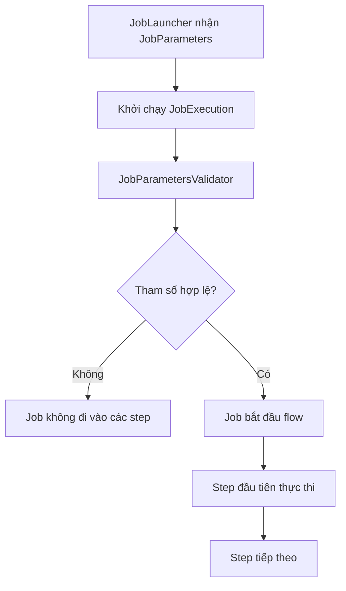

# Validation trước khi tạo step

Trong Spring Batch, một job thường nhận các tham số đầu vào như ngày nghiệp vụ, tenant, đường dẫn file, mã kỳ xử lý hoặc chế độ chạy. Nếu tham số thiếu, sai định dạng hoặc không phù hợp với nhau, job có thể thất bại muộn trong reader, processor hay writer. Khi đó, step có thể đã mở tài nguyên, tạo file tạm hoặc thực hiện một phần công việc trước khi phát hiện lỗi cấu hình.

Để phát hiện lỗi đầu vào sớm, Spring Batch cung cấp `JobParametersValidator`. Validator được gắn ở cấp job và kiểm tra `JobParameters` trước khi job đi vào thực thi các step. Cách này giúp job fail-fast với thông báo rõ ràng, tránh khởi chạy pipeline khi đầu vào không hợp lệ.

Có một điểm cần phân biệt về từ “trước khi tạo step”: trong cấu hình Java thông thường, các bean `Step` được Spring xây dựng khi application context khởi tạo. `JobParametersValidator` chạy ở thời điểm job được launch, trước khi các step của job bắt đầu thực thi; nó không trì hoãn việc khởi tạo các bean `Step` cho đến sau validation. Nếu cần kiểm tra tham số runtime trước khi thực thi step đầu tiên, hãy dùng validator ở cấp job.

## 1. Vì sao cần validate trước khi step chạy?

Giả sử một job nhập đơn hàng nhận các tham số:

- `businessDate`: ngày dữ liệu cần nhập.
- `tenantId`: tenant sở hữu dữ liệu.
- `inputFile`: đường dẫn file đầu vào.
- `mode`: chế độ xử lý như `FULL` hoặc `DELTA`.

Nếu `businessDate` không parse được, `tenantId` âm hoặc file không tồn tại, step không nên bắt đầu đọc dữ liệu. Nếu để reader tự phát hiện lỗi, job có thể đã tạo metadata, mở stream hoặc chuẩn bị output trước khi thất bại.

Validation sớm giúp:

- Phát hiện thiếu tham số bắt buộc ngay khi launch job.
- Kiểm tra kiểu và định dạng dữ liệu trước khi inject vào reader/writer.
- Kiểm tra các tham số có mâu thuẫn hay không.
- Trả thông báo lỗi dễ hiểu cho scheduler hoặc người vận hành.
- Tránh thực thi step và side effect khi đầu vào đã sai.
- Tách lỗi cấu hình/đầu vào khỏi lỗi phát sinh trong quá trình xử lý dữ liệu.

Validation không thay thế kiểm tra dữ liệu từng record. `JobParametersValidator` kiểm tra đầu vào ở cấp job; processor hoặc validator nghiệp vụ vẫn cần kiểm tra nội dung của từng item.

## 2. JobParametersValidator nằm ở đâu trong lifecycle?

`JobParametersValidator` được cấu hình trên job. Khi launcher khởi chạy job, Spring Batch kiểm tra bộ `JobParameters` theo validator trước khi thực thi flow và step của job.

Luồng khái quát:



Validator chạy trước phần xử lý của step đầu tiên. Job repository vẫn có vai trò quản lý metadata và execution; không nên giả định rằng không có bất kỳ metadata nào được tạo khi validation thất bại. Điểm bảo đảm cần quan tâm là các step nghiệp vụ không được chạy với bộ tham số đã bị validator từ chối.

### Validation không diễn ra trước khi Spring tạo bean Step

Trong cấu hình phổ biến:

```java
@Bean
public Step importStep(...) {
    return new StepBuilder("importStep", jobRepository)
            // reader, processor, writer...
            .build();
}
```

Spring tạo bean `importStep` trong lúc xây dựng application context. `JobParametersValidator` chỉ nhận được tham số của một lần launch tại runtime. Vì vậy, validator không phải công cụ để ngăn bean `Step` được khởi tạo ở startup.

Nếu việc tạo một bean phụ thuộc vào tham số runtime, hãy dùng late binding với `@StepScope` hoặc `@JobScope` và bảo đảm giá trị đã được validate trước khi step sử dụng bean đó. Không nên tạo lại toàn bộ graph `Step` cho mỗi lần launch chỉ để kiểm tra tham số.

## 3. Interface JobParametersValidator

Interface chính có một phương thức:

```java
public interface JobParametersValidator {
    void validate(JobParameters parameters)
            throws JobParametersInvalidException;
}
```

Validator nhận bộ tham số của job. Nếu hợp lệ, phương thức kết thúc bình thường. Nếu không hợp lệ, nó ném `JobParametersInvalidException` với thông báo giải thích vấn đề.

Ví dụ đơn giản:

```java
public class RequiredDateValidator implements JobParametersValidator {

    @Override
    public void validate(JobParameters parameters)
            throws JobParametersInvalidException {

        String businessDate = parameters.getString("businessDate");

        if (businessDate == null || businessDate.isBlank()) {
            throw new JobParametersInvalidException(
                    "Required parameter 'businessDate' is missing");
        }
    }
}
```

Validator nên kiểm tra đầu vào theo cách xác định và trả lỗi cụ thể. Tránh ném `NullPointerException`, `DateTimeParseException` hoặc exception hạ tầng trực tiếp mà không chuyển thành thông báo validation phù hợp.

## 4. Cấu hình validator trên JobBuilder

Trong Java configuration của Spring Batch 5, có thể gắn validator bằng `.validator(...)`:

```java
@Bean
public Job importOrdersJob(
        JobRepository jobRepository,
        Step importOrdersStep,
        JobParametersValidator importJobParametersValidator) {

    return new JobBuilder("importOrdersJob", jobRepository)
            .validator(importJobParametersValidator)
            .start(importOrdersStep)
            .build();
}
```

Khi `JobLauncher` chạy `importOrdersJob`, validator được gọi cho bộ tham số của execution đó trước khi `importOrdersStep` thực thi.

Một job chỉ có một điểm cấu hình validator chính. Nếu cần nhiều nhóm quy tắc, có thể gom chúng trong một custom validator hoặc dùng `CompositeJobParametersValidator` nếu phiên bản Spring Batch đang sử dụng cung cấp class này.

Không gắn validator vào từng reader hoặc writer nếu quy tắc thực chất áp dụng cho toàn job. Kiểm tra ở cấp job giúp mọi step được bảo vệ bởi cùng một hợp đồng đầu vào.

## 5. Dùng DefaultJobParametersValidator

Với yêu cầu đơn giản là kiểm tra tên tham số bắt buộc và danh sách tham số được phép, Spring Batch cung cấp `DefaultJobParametersValidator`.

Ví dụ:

```java
@Bean
public JobParametersValidator importJobParametersValidator() {
    return new DefaultJobParametersValidator(
            new String[] {"businessDate", "tenantId"},
            new String[] {"inputFile", "mode"});
}
```

Trong cấu hình này:

- `businessDate` và `tenantId` là các key bắt buộc.
- `inputFile` và `mode` là các key tùy chọn được chấp nhận.
- Các key không nằm trong danh sách hợp lệ có thể bị từ chối theo quy tắc của validator mặc định.

`DefaultJobParametersValidator` phù hợp với kiểm tra cấu trúc cơ bản. Nó không kiểm tra ngày có parse được không, tenant có tồn tại không, file có đọc được không hoặc hai tham số có tương thích về nghiệp vụ không. Với những yêu cầu đó, hãy dùng custom validator.

Nếu ứng dụng muốn chấp nhận nhiều tham số phụ do scheduler truyền vào, hãy khai báo rõ chúng trong danh sách optional hoặc xây dựng validator theo hợp đồng tham số của ứng dụng. Không nên để các tham số ngoài dự kiến đi vào job mà không được kiểm soát.

## 6. Viết custom validator cho kiểu và định dạng

Một validator thực tế thường kiểm tra cả sự hiện diện và định dạng của giá trị.

Ví dụ kiểm tra ngày ISO và tenant ID dương:

```java
public class ImportJobParametersValidator
        implements JobParametersValidator {

    @Override
    public void validate(JobParameters parameters)
            throws JobParametersInvalidException {

        String businessDate = parameters.getString("businessDate");
        Long tenantId = parameters.getLong("tenantId");

        if (businessDate == null || businessDate.isBlank()) {
            throw new JobParametersInvalidException(
                    "Parameter 'businessDate' is required");
        }

        try {
            LocalDate.parse(businessDate);
        } catch (DateTimeParseException ex) {
            throw new JobParametersInvalidException(
                    "Parameter 'businessDate' must use ISO format yyyy-MM-dd");
        }

        if (tenantId == null || tenantId <= 0) {
            throw new JobParametersInvalidException(
                    "Parameter 'tenantId' must be a positive number");
        }
    }
}
```

Ở đây, `businessDate` được truyền dưới dạng chuỗi và parse bằng `LocalDate`. Nếu parse thất bại, validator trả thông báo định dạng rõ ràng. `tenantId` được lấy theo kiểu `Long`, nên launcher nên tạo typed job parameter tương ứng.

Không nên parse cùng một giá trị ở nhiều step theo các quy tắc khác nhau. Hãy định nghĩa format chuẩn ở validator và để các component phía sau dùng giá trị đã được xác nhận.

## 7. Kiểm tra các tham số có quan hệ với nhau

Nhiều lỗi không nằm ở một tham số riêng lẻ mà nằm ở sự kết hợp giữa các tham số.

Ví dụ:

- `mode=FULL` yêu cầu `inputFile`.
- `mode=DELTA` yêu cầu `fromDate` và `toDate`.
- `toDate` phải lớn hơn hoặc bằng `fromDate`.
- `tenantId` phải được cung cấp nếu job chạy trong chế độ multi-tenant.
- `outputFile` không được trùng với `inputFile`.
- Không cho phép đồng thời `reprocess=true` và `dryRun=true` nếu nghiệp vụ không hỗ trợ.

Ví dụ validator kiểm tra mode:

```java
String mode = parameters.getString("mode", "FULL");
String inputFile = parameters.getString("inputFile");
String fromDate = parameters.getString("fromDate");
String toDate = parameters.getString("toDate");

if ("FULL".equals(mode)) {
    if (inputFile == null || inputFile.isBlank()) {
        throw new JobParametersInvalidException(
                "inputFile is required when mode is FULL");
    }
} else if ("DELTA".equals(mode)) {
    if (fromDate == null || toDate == null) {
        throw new JobParametersInvalidException(
                "fromDate and toDate are required when mode is DELTA");
    }
} else {
    throw new JobParametersInvalidException(
            "Unsupported mode: " + mode);
}
```

Khi validate khoảng ngày, hãy parse cả hai thành `LocalDate` rồi so sánh. Không so sánh chuỗi tùy ý nếu format không bảo đảm thứ tự từ điển tương ứng thứ tự thời gian.

## 8. Kiểm tra file và resource trước khi step chạy

Một số điều kiện có thể kiểm tra ngay trong validator, ví dụ đường dẫn file đầu vào có tồn tại và có thể đọc hay không.

```java
String inputFile = parameters.getString("inputFile");

if (inputFile == null || inputFile.isBlank()) {
    throw new JobParametersInvalidException(
            "Parameter 'inputFile' is required");
}

Path path = Path.of(inputFile);

if (!Files.isRegularFile(path)) {
    throw new JobParametersInvalidException(
            "Input file does not exist or is not a regular file: " + inputFile);
}

if (!Files.isReadable(path)) {
    throw new JobParametersInvalidException(
            "Input file is not readable: " + inputFile);
}
```

Việc kiểm tra file trong validator có ích khi file là điều kiện bắt buộc để job bắt đầu. Tuy nhiên, validator chỉ kiểm tra tại một thời điểm. File có thể bị xóa hoặc thay đổi sau validation và trước khi reader mở nó. Step vẫn cần xử lý lỗi I/O thực tế.

Với resource từ S3, HTTP hoặc hệ thống ngoài, hãy cân nhắc chi phí và độ ổn định của preflight check. Một request kiểm tra có thể timeout hoặc tạo tải trước khi job bắt đầu. Nếu kiểm tra phụ thuộc vào thao tác nghiệp vụ hoặc cần retry riêng, có thể đặt nó trong một validation/preparation step thay vì `JobParametersValidator`.

## 9. Validation cấu trúc khác với preflight nghiệp vụ

Không phải mọi kiểm tra đều nên đặt trong `JobParametersValidator`.

| Loại kiểm tra | Nơi phù hợp | Ví dụ |
|---|---|---|
| Tham số bắt buộc | `JobParametersValidator` | Có `businessDate`, `tenantId` |
| Định dạng và miền giá trị | `JobParametersValidator` | Ngày parse được, ID dương, mode hợp lệ |
| Quan hệ giữa tham số | `JobParametersValidator` | `fromDate <= toDate`, mode cần input file |
| Kiểm tra nhanh local resource | Validator hoặc preflight step | File tồn tại, path hợp lệ |
| Kiểm tra trạng thái nghiệp vụ từ database | Thường là preflight/validation step | Kỳ dữ liệu đã khóa chưa, tenant có đang active không |
| Kiểm tra nội dung từng record | Reader/processor/item validator | Mã đơn hàng hợp lệ, số tiền dương |
| Kiểm tra dependency có thể phục hồi | Step có retry/timeout/metric riêng | API đối tác có thể xử lý request không |

Validator nên nhanh, xác định và ít side effect. Nếu nó gọi nhiều hệ thống ngoài, job launch có thể kéo dài hoặc thất bại vì một dependency tạm thời trước khi có execution step để retry và theo dõi.

## 10. Tách JobParametersValidator và validation step

`JobParametersValidator` phù hợp với kiểm tra đầu vào đơn giản, không cần xử lý dữ liệu lớn. Nếu cần thực hiện preflight nghiệp vụ phức tạp, hãy tạo một step đầu tiên.

Ví dụ:

```text
JobLauncher
   |
   v
JobParametersValidator
   | hợp lệ
   v
validateBusinessStateStep
   | hợp lệ
   v
importDataStep
```

Validator có thể kiểm tra `businessDate` đúng format và `tenantId` có mặt. `validateBusinessStateStep` có thể truy vấn database để xác nhận kỳ dữ liệu chưa bị đóng, quyền xử lý còn hiệu lực hoặc nguồn đầu vào đã được đăng ký.

Ưu điểm của validation step:

- Có `StepExecution` riêng để theo dõi trạng thái, thời gian và exception.
- Có thể dùng transaction, retry và skip policy phù hợp.
- Có thể lưu kết quả preflight vào `ExecutionContext`.
- Có thể tạo audit record hoặc báo cáo validation.
- Có thể restart theo metadata nếu step được thiết kế phù hợp.

Nhược điểm là job đã đi vào flow và step đã bắt đầu. Nếu yêu cầu chỉ là từ chối bộ tham số sai, `JobParametersValidator` đơn giản và phù hợp hơn.

## 11. Không dùng `@StepScope` thay cho validator

Late binding giúp inject job parameters vào bean scoped theo step:

```java
@Bean
@StepScope
public FlatFileItemReader<OrderInput> orderReader(
        @Value("#{jobParameters['inputFile']}") String inputFile) {
    FlatFileItemReader<OrderInput> reader = new FlatFileItemReader<>();
    reader.setName("orderReader");
    reader.setResource(new FileSystemResource(inputFile));
    reader.setSaveState(true);
    reader.setLineMapper(orderLineMapper());
    return reader;
}
```

Nếu `inputFile` thiếu, reader có thể lỗi khi target step-scoped được tạo hoặc khi tài nguyên được mở. Đây là lỗi xảy ra muộn hơn so với validation cấp job.

Nên kết hợp:

1. `JobParametersValidator` kiểm tra tham số bắt buộc và định dạng trước khi step chạy.
2. `@StepScope` late-bind giá trị đã được xác nhận vào reader/writer.
3. Reader vẫn kiểm tra lỗi I/O thực tế khi mở nguồn vì resource có thể thay đổi sau preflight.

Không nên đặt toàn bộ logic validation trong constructor của reader hoặc writer. Constructor nên thiết lập component; validator cấp job chịu trách nhiệm hợp đồng đầu vào.

## 12. Tạo JobParameters có kiểu rõ ràng

Job launcher nên tạo tham số đúng kiểu dữ liệu để validator và component downstream đọc nhất quán.

Ví dụ:

```java
JobParameters parameters = new JobParametersBuilder()
        .addString("businessDate", "2026-11-15", true)
        .addLong("tenantId", 42L, true)
        .addString("inputFile", "data/orders.csv", false)
        .addString("mode", "FULL", false)
        .toJobParameters();
```

Tham số thứ ba của các phương thức builder xác định identifying hay non-identifying:

- `businessDate=true`: ngày nghiệp vụ góp phần xác định `JobInstance`.
- `tenantId=true`: tenant góp phần xác định `JobInstance`.
- `inputFile=false`: file path là thông tin đầu vào nhưng không tham gia định danh trong ví dụ.
- `mode=false`: chế độ được truyền nhưng không tham gia định danh.

Quyết định identifying cần dựa trên ý nghĩa nghiệp vụ. Nếu thay đổi `inputFile` thực chất là một công việc nghiệp vụ khác, có thể nó nên là identifying. Nếu không, cùng ngày và tenant có thể bị coi là cùng instance dù file thay đổi.

Validator kiểm tra giá trị tham số, còn identifying flag quyết định định danh instance. Hai trách nhiệm này khác nhau.

## 13. Một custom validator hoàn chỉnh

Ví dụ sau kết hợp kiểm tra tham số bắt buộc, ngày, tenant, mode và file đầu vào:

```java
public class ImportJobParametersValidator
        implements JobParametersValidator {

    @Override
    public void validate(JobParameters parameters)
            throws JobParametersInvalidException {

        String businessDate = parameters.getString("businessDate");
        Long tenantId = parameters.getLong("tenantId");
        String mode = parameters.getString("mode", "FULL");
        String inputFile = parameters.getString("inputFile");

        if (businessDate == null || businessDate.isBlank()) {
            throw invalid("businessDate is required");
        }

        try {
            LocalDate.parse(businessDate);
        } catch (DateTimeParseException ex) {
            throw invalid("businessDate must use yyyy-MM-dd format");
        }

        if (tenantId == null || tenantId <= 0) {
            throw invalid("tenantId must be a positive number");
        }

        if (!"FULL".equals(mode) && !"DELTA".equals(mode)) {
            throw invalid("mode must be FULL or DELTA");
        }

        if ("FULL".equals(mode)) {
            validateInputFile(inputFile);
        }
    }

    private void validateInputFile(String inputFile)
            throws JobParametersInvalidException {
        if (inputFile == null || inputFile.isBlank()) {
            throw invalid("inputFile is required in FULL mode");
        }

        Path path = Path.of(inputFile);
        if (!Files.isRegularFile(path) || !Files.isReadable(path)) {
            throw invalid("inputFile must be an existing readable file");
        }
    }

    private JobParametersInvalidException invalid(String message) {
        return new JobParametersInvalidException(message);
    }
}
```

Đoạn mã giả định ứng dụng dùng Java time và file local. Cần thêm import tương ứng như `java.time.LocalDate`, `java.time.format.DateTimeParseException`, `java.nio.file.Files` và `java.nio.file.Path`.

Trong production, có thể gom nhiều lỗi thành một danh sách để người gọi sửa cùng lúc thay vì ném lỗi đầu tiên. Nếu làm vậy, thông báo nên nêu tên key và điều kiện vi phạm, nhưng không đưa bí mật hoặc toàn bộ payload nhạy cảm vào exception.

## 14. Đăng ký validator như một Spring bean

Có thể khai báo validator thành bean rồi inject vào job:

```java
@Bean
public JobParametersValidator importJobParametersValidator() {
    return new ImportJobParametersValidator();
}

@Bean
public Job importOrdersJob(
        JobRepository jobRepository,
        Step importOrdersStep,
        JobParametersValidator importJobParametersValidator) {

    return new JobBuilder("importOrdersJob", jobRepository)
            .validator(importJobParametersValidator)
            .start(importOrdersStep)
            .build();
}
```

Nếu ứng dụng có nhiều job, nên dùng tên bean cụ thể hoặc qualifier để tránh inject nhầm validator. Mỗi job có thể có hợp đồng tham số khác nhau.

Không dùng một validator chung chứa các điều kiện cứng cho mọi job nếu các job nhận bộ tham số khác nhau. Có thể tái sử dụng các hàm kiểm tra nhỏ, nhưng hợp đồng đầu vào nên được cấu hình theo từng job.

## 15. Validation và identifying parameters

Validator không quyết định một parameter có tham gia định danh `JobInstance` hay không. Điều đó do identifying flag trong `JobParameters` quyết định.

Ví dụ hai lần launch:

```text
Run A:
  businessDate=2026-11-15 (identifying)
  tenantId=42 (identifying)
  inputFile=orders-a.csv (non-identifying)

Run B:
  businessDate=2026-11-15 (identifying)
  tenantId=42 (identifying)
  inputFile=orders-b.csv (non-identifying)
```

Hai lần chạy có thể được xem là cùng `JobInstance` vì các identifying parameters giống nhau. Nếu execution trước đã hoàn tất, lần launch tiếp theo có thể bị từ chối; nếu execution trước thất bại, nó có thể được xem là restart cùng instance. Dù validator chấp nhận `orders-b.csv`, việc thay input trong cùng instance có thể làm checkpoint cũ không còn đúng.

Vì vậy, nếu input file xác định tập dữ liệu nghiệp vụ, nên cân nhắc đưa file identity, checksum hoặc input version vào identifying parameters. Không chỉ kiểm tra file tồn tại; cần bảo đảm restart dùng đúng nguồn đã tạo checkpoint.

## 16. Validator nên thuần và không có side effect

`JobParametersValidator` được gọi ở thời điểm launch. Nếu validator gửi email, tạo file, ghi dữ liệu nghiệp vụ hoặc gọi API tạo tài nguyên, một lần validation thất bại có thể để lại side effect dù job chưa vào step.

Nên giữ validator:

- Nhanh và có thời gian thực thi dự đoán được.
- Không ghi dữ liệu nghiệp vụ.
- Không tạo file output hoặc message.
- Không thay đổi `JobParameters`.
- Không lưu trạng thái mutable dùng chung giữa executions.
- Chỉ thực hiện các kiểm tra đầu vào cần thiết để quyết định có cho job chạy hay không.

Nếu cần tạo snapshot input hoặc đăng ký một batch với hệ thống ngoài, hãy cân nhắc thực hiện trong một step có metadata, transaction/retry và khả năng phục hồi rõ ràng.

## 17. Không dựa vào validator để kiểm tra từng record

Job parameters là thông tin ở cấp job. Một file có thể tồn tại và đọc được nhưng vẫn chứa hàng nghìn record sai định dạng. `JobParametersValidator` không nên mở toàn bộ file để validate từng dòng vì điều đó có thể đọc nguồn hai lần, tăng thời gian launch và tạo sự khác biệt giữa preflight với lần đọc thực tế.

Phân chia trách nhiệm:

- Validator cấp job: kiểm tra file path, định dạng tham số, chế độ và phạm vi dữ liệu.
- Reader: phát hiện lỗi I/O, parse hoặc encoding khi đọc.
- Processor: kiểm tra quy tắc nghiệp vụ theo item.
- SkipListener/error writer: ghi nhận item được phép bỏ qua.
- Step cuối: tổng hợp số liệu lỗi và quyết định publish.

Nếu cần scan file trước khi import, hãy tạo một validation step chuyên biệt có thể lưu báo cáo và được theo dõi như một phần của job.

## 18. Xử lý lỗi validation ở JobLauncher

Khi validator ném `JobParametersInvalidException`, launcher không nên để job đi vào step nghiệp vụ. Tùy cách gọi launcher và phiên bản framework, lỗi validation có thể được truyền về caller hoặc được phản ánh trong trạng thái execution theo lifecycle thực tế.

Ở tầng gọi job, nên xử lý riêng lỗi tham số không hợp lệ với các lỗi khác:

- `JobParametersInvalidException`: người gọi cần sửa đầu vào hoặc cấu hình scheduler.
- `JobExecutionAlreadyRunningException`: instance đang có execution hoạt động.
- `JobInstanceAlreadyCompleteException`: instance đã hoàn tất và không phải một lần restart hợp lệ.
- `JobRestartException`: instance không thể restart theo trạng thái/cấu hình hiện tại.
- Lỗi kỹ thuật khi tạo execution hoặc truy cập repository: cần điều tra hạ tầng.

Không nên bắt mọi exception rồi chỉ log “job failed”. Thông báo validation cần đủ cụ thể để scheduler hoặc người vận hành biết tham số nào sai.

## 19. Kiểm thử validator trực tiếp

Custom validator nên có unit test độc lập. Đây là cách nhanh để kiểm tra hợp đồng đầu vào mà không cần chạy database hoặc toàn bộ job.

Ví dụ:

```java
class ImportJobParametersValidatorTest {

    private final ImportJobParametersValidator validator =
            new ImportJobParametersValidator();

    @Test
    void acceptsValidParameters() {
        JobParameters parameters = new JobParametersBuilder()
                .addString("businessDate", "2026-11-15", true)
                .addLong("tenantId", 42L, true)
                .addString("mode", "DELTA", false)
                .addString("fromDate", "2026-11-01", false)
                .addString("toDate", "2026-11-15", false)
                .toJobParameters();

        assertDoesNotThrow(() -> validator.validate(parameters));
    }

    @Test
    void rejectsMissingBusinessDate() {
        JobParameters parameters = new JobParametersBuilder()
                .addLong("tenantId", 42L, true)
                .toJobParameters();

        assertThrows(
                JobParametersInvalidException.class,
                () -> validator.validate(parameters));
    }
}
```

Đoạn test đầu giả định validator có nhánh `DELTA` tương ứng với quy tắc date range. Hãy tạo dữ liệu đúng với hợp đồng thực tế của validator trong ứng dụng.

Nên có test cho:

- Thiếu từng tham số bắt buộc.
- Ngày sai định dạng hoặc không hợp lệ.
- ID bằng 0 hoặc âm.
- Giá trị enum/mode không được hỗ trợ.
- Tham số phụ thuộc bị thiếu.
- Khoảng ngày đảo ngược.
- File không tồn tại hoặc không đọc được.
- Tham số không được phép nếu dùng strict key validation.
- Tổ hợp hợp lệ của từng chế độ chạy.

## 20. Kiểm thử validator qua JobLauncherTestUtils

Unit test chứng minh logic validator, nhưng integration test cần xác nhận validator được gắn đúng vào job và step không chạy khi tham số không hợp lệ.

Có thể dùng `@SpringBatchTest` và `JobLauncherTestUtils` để launch job với bộ tham số sai. Tùy phiên bản và launcher, test có thể bắt `JobParametersInvalidException` từ lời gọi launch hoặc kiểm tra execution/metadata tương ứng. Điểm cần xác nhận là step nghiệp vụ không được thực thi.

Ví dụ khung:

```java
@SpringBatchTest
@SpringJUnitConfig(ImportJobTestConfiguration.class)
class ImportJobValidationIntegrationTest {

    @Autowired
    private JobLauncherTestUtils jobLauncherTestUtils;

    @Test
    void doesNotRunImportStepWhenParametersAreInvalid() {
        JobParameters invalidParameters = new JobParametersBuilder()
                .addLong("tenantId", -1L, true)
                .toJobParameters();

        assertThrows(
                JobParametersInvalidException.class,
                () -> jobLauncherTestUtils.launchJob(invalidParameters));

        // Có thể dùng test probe để xác nhận reader/writer không được gọi.
        // Không có business output nào được tạo.
    }
}
```

Đây là khung minh họa; cấu hình test cần cung cấp job, validator, repository và probe. Nếu phiên bản framework hoặc test utility biểu diễn lỗi theo cách khác, hãy assert theo contract thực tế của launcher nhưng vẫn xác nhận không có step nghiệp vụ nào chạy.

## 21. Các lỗi cấu hình thường gặp

| Tình huống | Nguyên nhân | Cách xử lý |
|---|---|---|
| Validator không chạy | Chưa gắn `.validator(...)` vào job hoặc inject nhầm bean | Kiểm tra JobBuilder và bean wiring |
| Lỗi chỉ xuất hiện khi reader mở | Chỉ validate trong reader/late binding | Thêm `JobParametersValidator` cấp job |
| Bean Step vẫn được khởi tạo dù tham số sai | Nhầm validator runtime với bean creation tại startup | Phân biệt tạo bean và thực thi step |
| Tham số hợp lệ nhưng restart sai nguồn | Input không nằm trong identifying parameters hoặc không được version hóa | Xác định input identity và giữ nguồn ổn định |
| Default validator từ chối key scheduler gửi | Key không nằm trong required/optional list | Cập nhật hợp đồng tham số hoặc custom validator |
| Validator không kiểm tra được kiểu | Job parameter được tạo dưới kiểu khác | Dùng typed JobParametersBuilder và đọc đúng kiểu |
| Preflight làm launch chậm | Validator gọi nhiều API/database | Chuyển kiểm tra phức tạp sang validation step |
| Validation lỗi nhưng có side effect | Validator ghi file/gọi API/tạo dữ liệu | Giữ validator thuần; chuyển side effect vào step |
| Lỗi validation khó hiểu | Exception chỉ chứa lỗi parse/null chung | Ném `JobParametersInvalidException` với key và điều kiện cụ thể |
| Dữ liệu record sai vẫn vào job | Chỉ validate job parameters | Validate nội dung ở reader/processor hoặc validation step |

## 22. Quy trình thiết kế validation trước step

1. **Liệt kê hợp đồng đầu vào:** xác định tất cả job parameters, kiểu dữ liệu và identifying flag.
2. **Đánh dấu tham số bắt buộc/tùy chọn:** không để scheduler truyền giá trị không được định nghĩa.
3. **Xác định quy tắc từng key:** format, miền giá trị, enum, đường dẫn và giới hạn.
4. **Xác định quan hệ giữa các key:** mode nào cần input file, khoảng ngày nào hợp lệ, tenant nào được phép.
5. **Chọn validator:** dùng `DefaultJobParametersValidator` cho kiểm tra key đơn giản; custom validator cho quy tắc kiểu và nghiệp vụ đầu vào.
6. **Gắn validator vào JobBuilder:** bảo đảm tất cả lần launch đều đi qua cùng hợp đồng.
7. **Giữ validation nhẹ:** kiểm tra cấu trúc và precondition nhanh; chuyển kiểm tra dữ liệu/hệ thống phức tạp vào step.
8. **Late-bind sau validation:** dùng `@StepScope` hoặc `@JobScope` để inject giá trị runtime vào component phù hợp.
9. **Kiểm thử fail-fast:** tham số sai phải ngăn step nghiệp vụ chạy và trả thông báo rõ ràng.
10. **Kiểm tra restart identity:** cùng công việc dùng cùng identifying parameters và cùng nguồn dữ liệu.

## 23. Những nguyên tắc cần nhớ

- `JobParametersValidator` kiểm tra đầu vào ở cấp job trước khi các step nghiệp vụ bắt đầu thực thi.
- Validator chạy tại runtime khi launch job; các bean `Step` thông thường đã được xây dựng lúc application context khởi tạo.
- Dùng `DefaultJobParametersValidator` cho required/optional parameter keys.
- Dùng custom validator để kiểm tra kiểu, định dạng, miền giá trị và quan hệ giữa các tham số.
- Ném `JobParametersInvalidException` với thông báo cụ thể khi đầu vào không hợp lệ.
- Gắn validator vào `JobBuilder` bằng `.validator(...)`.
- Phân biệt validation tham số với preflight nghiệp vụ và validation từng record.
- Giữ validator nhanh, xác định và không có side effect.
- Dùng `@StepScope`/`@JobScope` để late-bind tham số sau khi đã được xác nhận; scope không thay thế validator.
- Identifying parameters xác định `JobInstance`; validator không quyết định identifying flag.
- Nếu input xác định tập dữ liệu, hãy bảo đảm identity/version của input ổn định qua restart.
- Kiểm thử validator trực tiếp và kiểm thử tích hợp để xác nhận step không chạy khi tham số sai.

Validation trước khi step chạy giúp Spring Batch từ chối đầu vào không hợp lệ ngay ở ranh giới job. Khi hợp đồng `JobParameters` được định nghĩa rõ, validator được gắn ở cấp job và các kiểm tra phức tạp được đặt vào step phù hợp, pipeline tránh được những lỗi cấu hình phát hiện quá muộn và dễ vận hành, kiểm thử, restart hơn.
