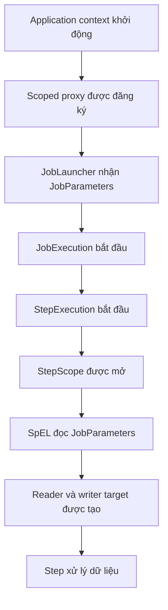

# Truyền parameter vào reader và writer

Trong Spring Batch, reader và writer thường cần những giá trị chỉ biết khi job được launch: đường dẫn file đầu vào, ngày nghiệp vụ, mã tenant, batch ID, đường dẫn output hoặc giới hạn truy vấn. Không nên cố định các giá trị này trong bean singleton vì một application context có thể phục vụ nhiều lần chạy với input khác nhau.

Spring Batch hỗ trợ truyền giá trị runtime vào reader và writer bằng **JobParameters**, Spring Expression Language (SpEL) và **@StepScope**. Khi step bắt đầu, scoped bean được tạo trong execution context hiện tại và expression được phân giải. Nhờ đó cùng một cấu hình job có thể đọc file khác, truy vấn tập dữ liệu khác hoặc ghi output vào vị trí khác tùy theo parameters của từng lần launch.

Mẫu thường dùng:

```java
@Bean
@StepScope
FlatFileItemReader<OrderInput> orderReader(
        @Value("#{jobParameters['input.file']}") String inputFile) {
    // Tạo reader từ inputFile của lần chạy hiện tại.
}

@Bean
@StepScope
FlatFileItemWriter<Order> orderWriter(
        @Value("#{jobParameters['output.file']}") String outputFile) {
    // Tạo writer từ outputFile của lần chạy hiện tại.
}
```

Reader và writer thường là stateful component gắn với một step, vì vậy StepScope là lựa chọn phù hợp. Bài này trình bày cách truyền parameters, validate giá trị, dùng chúng trong file/database reader và writer, xử lý restart và kiểm thử từng lần chạy.

## 1. JobParameters được truyền vào job như thế nào?

JobParameters là tập tham số đầu vào của một lần launch job. Chúng được tạo trước khi gọi JobLauncher:

```java
JobParameters parameters = new JobParametersBuilder()
        .addString("input.file", "/data/in/orders.csv", true)
        .addString("output.file", "/data/out/orders-result.csv", true)
        .addString("businessDate", "2026-11-15", true)
        .addString("tenantId", "tenant-42", true)
        .toJobParameters();

JobExecution execution = jobLauncher.run(orderImportJob, parameters);
```

Mỗi parameter có tên, giá trị, kiểu dữ liệu và cờ identifying. Trong ví dụ, các giá trị được đánh dấu identifying để tham gia xác định JobInstance. Khi restart, cần dùng lại cùng identifying parameters để tiếp tục đúng JobInstance.

JobParameters phù hợp với dữ liệu đầu vào của job:

- Tập dữ liệu hoặc file cần xử lý.
- Ngày nghiệp vụ hoặc khoảng thời gian.
- Tenant, business unit hoặc mã batch.
- Chế độ xử lý như dry-run nếu nó là một phần của định nghĩa lần chạy.
- Tham số truy vấn như giới hạn hoặc watermark.

Không dùng JobParameters để truyền object lớn, toàn bộ danh sách item hoặc secret. JobParameters được lưu trong metadata để Spring Batch nhận diện và phục hồi execution.

## 2. Vì sao reader và writer cần @StepScope?

Spring tạo application context trước khi job được launch. Tại thời điểm đó, chưa có JobExecution hoặc StepExecution cụ thể để phân giải JobParameters của lần chạy sắp tới.

Nếu reader được tạo như singleton thông thường:

```java
@Bean
FlatFileItemReader<OrderInput> orderReader(
        @Value("#{jobParameters['input.file']}") String inputFile) {
    // Không có JobExecution hiện hành lúc singleton được tạo.
}
```

Spring có thể báo lỗi vì không có job scope context để đọc jobParameters. Ngay cả khi cấu hình được tạo theo cách khác, singleton cũng không phù hợp để giữ đường dẫn riêng cho từng lần chạy.

Thêm @StepScope:

```java
@Bean
@StepScope
FlatFileItemReader<OrderInput> orderReader(
        @Value("#{jobParameters['input.file']}") String inputFile) {
    return createOrderReader(inputFile);
}
```

Spring đăng ký một scoped proxy trong application context. Target reader thật chỉ được tạo khi StepScope đang hoạt động, lúc đó Spring Batch đã cung cấp StepExecution hiện tại và các context liên quan.



Một bean step-scoped có target instance riêng cho mỗi StepExecution. Khi cùng job được launch với parameters khác, reader/writer target được tạo với giá trị tương ứng của execution đó.

## 3. Truyền parameter vào FlatFileItemReader

Ví dụ reader nhận đường dẫn file từ JobParameters:

```java
@Bean
@StepScope
FlatFileItemReader<OrderInput> orderReader(
        @Value("#{jobParameters['input.file']}") String inputFile) {

    return new FlatFileItemReaderBuilder<OrderInput>()
            .name("orderReader")
            .resource(new FileSystemResource(inputFile))
            .encoding("UTF-8")
            .linesToSkip(1)
            .delimited()
            .names("orderId", "customerId", "amount")
            .targetType(OrderInput.class)
            .saveState(true)
            .build();
}
```

Giải thích:

- @StepScope trì hoãn việc tạo target reader.
- @Value lấy key input.file từ JobParameters.
- FileSystemResource đại diện cho file được truyền vào.
- name là tên ổn định để reader lưu/khôi phục state.
- saveState(true) cho phép reader lưu checkpoint phục vụ restart.

Job có thể dùng reader này cho nhiều file:

```java
JobParameters firstRun = new JobParametersBuilder()
        .addString("input.file", "/data/in/orders-a.csv", true)
        .toJobParameters();

JobParameters secondRun = new JobParametersBuilder()
        .addString("input.file", "/data/in/orders-b.csv", true)
        .toJobParameters();
```

Hai lần chạy có thể tạo hai JobInstance khác nhau vì input.file là identifying parameter. Mỗi StepExecution nhận reader với resource tương ứng.

### Không ghép chuỗi đường dẫn tùy tiện

Nếu đường dẫn được tạo từ nhiều parameter, hãy kiểm tra và chuẩn hóa giá trị trước khi dùng. Ví dụ, nếu scheduler truyền một file name, ứng dụng nên giới hạn file trong thư mục input được phép và tránh cho phép path traversal.

Không nối trực tiếp một giá trị do bên ngoài cung cấp vào đường dẫn tùy ý mà không kiểm tra. Với dữ liệu nhạy cảm, chỉ truyền một ID hoặc reference được kiểm soát và để ứng dụng phân giải thành resource hợp lệ.

## 4. Truyền parameter vào FlatFileItemWriter

Writer cũng có thể nhận đường dẫn output từ JobParameters:

```java
@Bean
@StepScope
FlatFileItemWriter<Order> orderWriter(
        @Value("#{jobParameters['output.file']}") String outputFile) {

    return new FlatFileItemWriterBuilder<Order>()
            .name("orderWriter")
            .resource(new FileSystemResource(outputFile))
            .encoding("UTF-8")
            .delimited()
            .delimiter(",")
            .names("orderId", "customerId", "amount")
            .saveState(true)
            .build();
}
```

Các điểm cần chú ý:

- output.file xác định resource đích của lần chạy.
- name phải ổn định để writer nhận diện state khi restart.
- saveState(true) cho phép lưu thông tin cần thiết để tiếp tục ghi.
- Thư mục cha phải tồn tại hoặc được tạo bởi bước chuẩn bị trước đó.
- Output path phải ổn định cho cùng một JobInstance nếu muốn restart an toàn.

Không tạo output path ngẫu nhiên mỗi lần parent restart. Nếu đường dẫn thay đổi giữa các lần chạy lại cùng JobInstance, writer có thể tiếp tục ở resource khác với resource đã dùng trước đó.

### Tránh ghi đè output của lần chạy khác

Nếu hai JobInstance cùng ghi một file, dữ liệu có thể bị ghi đè hoặc xen kẽ. Hãy tạo output path theo batch ID, business date hoặc một định danh nghiệp vụ ổn định:

```java
String outputFile = outputDirectory
        + "/orders-" + batchId + ".csv";
```

Đảm bảo mỗi batch có resource riêng hoặc có cơ chế lock/publish phù hợp. Không dùng cùng một output path cho hai execution đồng thời trừ khi writer được thiết kế cho việc chia sẻ đó.

## 5. Truyền cùng parameter vào reader và writer

Một job import/export thường dùng cùng batch ID hoặc ngày nghiệp vụ ở cả reader và writer. Có thể inject cùng JobParameter vào hai scoped bean:

```java
@Bean
@StepScope
FlatFileItemReader<OrderInput> orderReader(
        @Value("#{jobParameters['input.file']}") String inputFile,
        @Value("#{jobParameters['businessDate']}") String businessDate) {

    return new FlatFileItemReaderBuilder<OrderInput>()
            .name("orderReader")
            .resource(new FileSystemResource(inputFile))
            .delimited()
            .names("orderId", "customerId", "amount")
            .targetType(OrderInput.class)
            .saveState(true)
            .build();
}

@Bean
@StepScope
FlatFileItemWriter<Order> orderWriter(
        @Value("#{jobParameters['output.file']}") String outputFile,
        @Value("#{jobParameters['batchId']}") String batchId) {

    return new FlatFileItemWriterBuilder<Order>()
            .name("orderWriter")
            .resource(new FileSystemResource(outputFile))
            .delimited()
            .names("orderId", "customerId", "amount")
            .saveState(true)
            .build();
}
```

Trong ví dụ, businessDate và batchId có thể được dùng để lọc dữ liệu, ghi header, thêm metadata hoặc gắn correlation vào log. Nếu writer cần batchId để ghi database, có thể truyền nó vào một writer tùy chỉnh hoặc câu SQL có parameter binding.

Không inject parameter chỉ để giữ một field không được dùng. Mỗi dependency nên có mục đích cụ thể và được validate.

## 6. Cấu hình Step sử dụng reader và writer

Reader và writer được inject vào step như các bean thông thường. Scoped proxy giúp chúng nhận target đúng thời điểm:

```java
@Bean
Step importOrdersStep(
        JobRepository jobRepository,
        PlatformTransactionManager transactionManager,
        ItemReader<OrderInput> orderReader,
        ItemProcessor<OrderInput, Order> orderProcessor,
        ItemWriter<Order> orderWriter) {

    return new StepBuilder("importOrdersStep", jobRepository)
            .<OrderInput, Order>chunk(100, transactionManager)
            .reader(orderReader)
            .processor(orderProcessor)
            .writer(orderWriter)
            .build();
}
```

Step bean có thể là singleton vì nó chứa định nghĩa workflow và các proxy. Reader/writer target mới được tạo khi step execution bắt đầu.

Job:

```java
@Bean
Job orderImportJob(
        JobRepository jobRepository,
        Step importOrdersStep) {

    return new JobBuilder("orderImportJob", jobRepository)
            .start(importOrdersStep)
            .build();
}
```

Khi JobLauncher chạy job với input.file và output.file, hai scoped bean được tạo với giá trị từ cùng JobExecution/StepExecution tương ứng.

## 7. Truyền parameter vào JdbcCursorItemReader

Với database reader, JobParameters có thể cung cấp tenant, business date hoặc watermark để giới hạn dữ liệu. Dùng prepared statement parameter binding thay vì nối chuỗi vào SQL.

Ví dụ:

```java
@Bean
@StepScope
JdbcCursorItemReader<OrderInput> orderDatabaseReader(
        DataSource dataSource,
        @Value("#{jobParameters['tenantId']}") String tenantId,
        @Value("#{jobParameters['businessDate']}") String businessDateText) {

    LocalDate businessDate =
            LocalDate.parse(businessDateText, DateTimeFormatter.ISO_LOCAL_DATE);

    return new JdbcCursorItemReaderBuilder<OrderInput>()
            .name("orderDatabaseReader")
            .dataSource(dataSource)
            .sql("""
                    select id, customer_id, amount
                    from orders
                    where tenant_id = ?
                      and business_date = ?
                    order by id
                    """)
            .preparedStatementSetter(statement -> {
                statement.setString(1, tenantId);
                statement.setDate(2, Date.valueOf(businessDate));
            })
            .rowMapper((resultSet, rowNum) ->
                    new OrderInput(
                            resultSet.getLong("id"),
                            resultSet.getString("customer_id"),
                            resultSet.getBigDecimal("amount")))
            .fetchSize(500)
            .saveState(true)
            .build();
}
```

Parameter tenantId và businessDate được bind vào placeholder. Cách này tránh SQL injection do nối chuỗi và cho phép JDBC driver xử lý kiểu dữ liệu.

Nếu dùng paging reader, có thể inject parameter vào parameterValues của JdbcPagingItemReaderBuilder cùng whereClause và sort key ổn định. Chọn thứ tự sắp xếp duy nhất hoặc có tie-breaker để checkpoint không bỏ sót hay đọc trùng record khi restart.

### Không dùng parameter làm tên bảng tùy ý

Prepared statement parameter dùng cho giá trị, không dùng để thay thế tên bảng hoặc tên cột. Nếu cần chọn table theo tenant hoặc loại dữ liệu, hãy ánh xạ parameter qua danh sách identifier được phép trong code; không nối input tùy ý vào SQL.

## 8. Truyền parameter vào JdbcBatchItemWriter

Writer database có thể cần một batch ID chung ngoài các field của item. Có thể tạo writer step-scoped và bind batch ID vào mỗi câu insert:

```java
@Bean
@StepScope
JdbcBatchItemWriter<Order> orderDatabaseWriter(
        DataSource dataSource,
        @Value("#{jobParameters['batchId']}") String batchId) {

    return new JdbcBatchItemWriterBuilder<Order>()
            .dataSource(dataSource)
            .sql("""
                    insert into processed_order
                        (batch_id, order_id, customer_id, amount)
                    values (?, ?, ?, ?)
                    """)
            .itemPreparedStatementSetter((order, statement) -> {
                statement.setString(1, batchId);
                statement.setLong(2, order.id());
                statement.setString(3, order.customerId());
                statement.setBigDecimal(4, order.amount());
            })
            .assertUpdates(true)
            .build();
}
```

Mỗi item được ghi cùng batchId của JobExecution hiện tại. Database có thể dùng batch_id để truy vấn, đối soát và cleanup theo batch.

Hãy cấu hình unique constraint phù hợp, ví dụ batch_id và order_id, nếu một record không được ghi hai lần trong cùng batch. Điều này hỗ trợ idempotency khi job restart hoặc writer được gọi lại sau lỗi.

Không đưa batchId vào SQL bằng cách nối chuỗi. Dùng placeholder và PreparedStatement để bind giá trị.

## 9. Truyền parameter vào custom reader

Nếu reader do ứng dụng tự viết, có thể nhận giá trị qua constructor:

```java
public class TenantOrderReader implements ItemReader<OrderInput> {

    private final OrderRepository repository;
    private final String tenantId;
    private final LocalDate businessDate;

    private Iterator<OrderInput> iterator;

    public TenantOrderReader(
            OrderRepository repository,
            String tenantId,
            LocalDate businessDate) {
        this.repository = repository;
        this.tenantId = tenantId;
        this.businessDate = businessDate;
    }

    @Override
    public OrderInput read() {
        if (iterator == null) {
            iterator = repository
                    .findOrders(tenantId, businessDate)
                    .iterator();
        }

        return iterator.hasNext() ? iterator.next() : null;
    }
}
```

Tạo reader qua step-scoped factory:

```java
@Bean
@StepScope
TenantOrderReader tenantOrderReader(
        OrderRepository repository,
        @Value("#{jobParameters['tenantId']}") String tenantId,
        @Value("#{jobParameters['businessDate']}") String businessDateText) {

    LocalDate businessDate = LocalDate.parse(businessDateText);
    return new TenantOrderReader(repository, tenantId, businessDate);
}
```

Ví dụ này minh họa constructor injection. Reader production cần triển khai ItemStream nếu phải lưu checkpoint và khôi phục iterator khi restart; không nên tải toàn bộ tập dữ liệu vào bộ nhớ nếu dữ liệu lớn.

Với reader tự viết, hãy tách rõ:

- Tham số cấu hình bất biến được inject khi target bean tạo.
- Runtime state như cursor/offset được lưu trong ExecutionContext.
- Resource cần mở/đóng trong lifecycle open/read/close nếu triển khai ItemStream.

## 10. Truyền parameter vào custom writer

Custom writer cũng có thể nhận batch ID, tenant hoặc output destination qua constructor:

```java
public class BatchAuditWriter implements ItemWriter<Order> {

    private final AuditRepository auditRepository;
    private final String batchId;

    public BatchAuditWriter(
            AuditRepository auditRepository,
            String batchId) {
        this.auditRepository = auditRepository;
        this.batchId = batchId;
    }

    @Override
    public void write(Chunk<? extends Order> chunk) {
        for (Order order : chunk) {
            auditRepository.insert(
                    batchId,
                    order.id(),
                    order.amount());
        }
    }
}
```

Factory method step-scoped:

```java
@Bean
@StepScope
BatchAuditWriter batchAuditWriter(
        AuditRepository auditRepository,
        @Value("#{jobParameters['batchId']}") String batchId) {
    return new BatchAuditWriter(auditRepository, batchId);
}
```

Mỗi StepExecution nhận writer target với batchId của lần chạy hiện tại. Nếu writer được dùng trong chunk step, thao tác repository nên tham gia transaction phù hợp để chunk rollback có tác dụng.

Không dùng một singleton writer có field batchId thay đổi mỗi lần launch. Hai job chạy đồng thời có thể ghi nhầm batch ID nếu dùng chung mutable state.

## 11. Truyền parameter kiểu số, ngày và boolean

JobParameters hỗ trợ giá trị có kiểu. Trong cấu hình, SpEL và Spring ConversionService có thể chuyển giá trị sang kiểu tham số của factory method nếu converter phù hợp.

Ví dụ:

```java
@Bean
@StepScope
ImportOptions importOptions(
        @Value("#{jobParameters['maxRows']}") Long maxRows,
        @Value("#{jobParameters['dryRun']}") Boolean dryRun) {

    return new ImportOptions(maxRows, dryRun);
}
```

Với ngày nghiệp vụ, có thể nhận String rồi parse rõ ràng:

```java
@Bean
@StepScope
BusinessWindow businessWindow(
        @Value("#{jobParameters['businessDate']}") String dateText) {

    LocalDate businessDate =
            LocalDate.parse(dateText, DateTimeFormatter.ISO_LOCAL_DATE);

    return new BusinessWindow(businessDate);
}
```

Cách parse tường minh giúp thông báo lỗi rõ ràng nếu parameter không đúng format. Định nghĩa format thống nhất ở phía scheduler/API gọi job.

Nếu muốn inject trực tiếp LocalDate hoặc kiểu khác, hãy bảo đảm conversion service của ứng dụng có converter tương ứng và kiểm thử trên phiên bản Spring Batch/Spring Framework đang dùng.

## 12. Parameter tùy chọn và giá trị mặc định

Một số parameter có thể tùy chọn, ví dụ delimiter hoặc số dòng tối đa. SpEL hỗ trợ toán tử Elvis để chọn default:

```java
@Bean
@StepScope
FlatFileItemReader<OrderInput> orderReader(
        @Value("#{jobParameters['input.file']}") String inputFile,
        @Value("#{jobParameters['delimiter'] ?: ','}") String delimiter) {

    return new FlatFileItemReaderBuilder<OrderInput>()
            .name("orderReader")
            .resource(new FileSystemResource(inputFile))
            .delimited()
            .delimiter(delimiter)
            .names("orderId", "customerId", "amount")
            .targetType(OrderInput.class)
            .build();
}
```

Chỉ đặt default nếu giá trị mặc định có ý nghĩa nghiệp vụ. Với input file, tenant hoặc business date bắt buộc, nên fail sớm khi thiếu thay vì tự chọn giá trị mặc định.

Có thể kiểm tra null/rỗng trong factory method:

```java
private static String requireText(String value, String parameterName) {
    if (value == null || value.isBlank()) {
        throw new IllegalArgumentException(
                "Required job parameter is missing: " + parameterName);
    }
    return value;
}
```

Sau đó gọi requireText(inputFile, "input.file") trước khi tạo resource.

## 13. Validate parameter trước khi reader/writer mở resource

Không nên đợi đến khi reader bắt đầu đọc mới phát hiện parameter sai. Một step validate ở đầu job có thể kiểm tra:

- Parameter bắt buộc có tồn tại không.
- File input có tồn tại và đọc được không.
- Thư mục output có thể ghi không.
- Business date có đúng format và khoảng cho phép không.
- Tenant ID có hợp lệ và caller có quyền xử lý tenant đó không.
- Batch ID có phù hợp với định dạng quy ước không.

Ví dụ:

```java
@Bean
Step validateJobParametersStep(
        JobRepository jobRepository,
        PlatformTransactionManager transactionManager) {

    return new StepBuilder("validateJobParametersStep", jobRepository)
            .tasklet((contribution, chunkContext) -> {
                JobParameters parameters = chunkContext.getStepContext()
                        .getStepExecution()
                        .getJobParameters();

                String inputFile = parameters.getString("input.file");
                String outputFile = parameters.getString("output.file");

                if (inputFile == null || inputFile.isBlank()) {
                    throw new IllegalArgumentException(
                            "Required parameter input.file is missing");
                }
                if (outputFile == null || outputFile.isBlank()) {
                    throw new IllegalArgumentException(
                            "Required parameter output.file is missing");
                }

                Path inputPath = Path.of(inputFile);
                if (!Files.isRegularFile(inputPath)
                        || !Files.isReadable(inputPath)) {
                    throw new IllegalArgumentException(
                            "Input file is not readable");
                }

                return RepeatStatus.FINISHED;
            }, transactionManager)
            .build();
}
```

Ví dụ tập trung vào validate input. Trong production, kiểm tra output directory và quyền truy cập theo filesystem/environment, đồng thời không đưa path nhạy cảm vào thông báo lỗi nếu log được chia sẻ rộng.

## 14. Phân biệt JobParameters với ExecutionContext

Reader và writer có thể nhận giá trị từ nhiều nguồn. Chọn nguồn theo ý nghĩa và lifecycle:

| Nguồn | Dùng khi | Ví dụ |
|---|---|---|
| JobParameters | Giá trị đầu vào do caller truyền khi launch | input.file, businessDate, tenantId |
| JobExecutionContext | Giá trị được một step tạo ra và cần chia sẻ trong cùng job execution | output.file, snapshotId |
| StepExecutionContext | Trạng thái riêng của step/partition | partition.file, lastReadId |

Ví dụ reader nhận file trực tiếp từ caller:

```java
@Value("#{jobParameters['input.file']}")
String inputFile
```

Nếu step trước tạo tên output file rồi ghi vào JobExecutionContext, writer sau có thể nhận:

```java
@Value("#{jobExecutionContext['output.file']}")
String outputFile
```

Nếu partitioner gán mỗi worker một file riêng:

```java
@Value("#{stepExecutionContext['partition.file']}")
String partitionFile
```

Các giá trị từ step context không tự động xuất hiện trong job context. Nếu step sau cần một key của step trước, hãy dùng ExecutionContextPromotionListener hoặc lưu reference vào một resource chung theo lifecycle rõ ràng.

## 15. Truyền parameter vào reader/writer trong partitioning

Trong partitioned step, mỗi worker có StepExecutionContext riêng. Partitioner có thể đặt file name, khoảng ID hoặc tenant partition vào context; worker reader/writer nhận giá trị bằng StepScope.

Ví dụ partitioner:

```java
public class OrderPartitioner implements Partitioner {

    @Override
    public Map<String, ExecutionContext> partition(int gridSize) {
        Map<String, ExecutionContext> partitions = new HashMap<>();

        ExecutionContext first = new ExecutionContext();
        first.putLong("minId", 1L);
        first.putLong("maxId", 1000L);
        partitions.put("partition0", first);

        ExecutionContext second = new ExecutionContext();
        second.putLong("minId", 1001L);
        second.putLong("maxId", 2000L);
        partitions.put("partition1", second);

        return partitions;
    }
}
```

Worker reader:

```java
@Bean
@StepScope
JdbcCursorItemReader<OrderInput> partitionOrderReader(
        DataSource dataSource,
        @Value("#{stepExecutionContext['minId']}") Long minId,
        @Value("#{stepExecutionContext['maxId']}") Long maxId) {

    return new JdbcCursorItemReaderBuilder<OrderInput>()
            .name("partitionOrderReader")
            .dataSource(dataSource)
            .sql("""
                    select id, customer_id, amount
                    from orders
                    where id between ? and ?
                    order by id
                    """)
            .preparedStatementSetter(statement -> {
                statement.setLong(1, minId);
                statement.setLong(2, maxId);
            })
            .rowMapper((rs, rowNum) ->
                    new OrderInput(
                            rs.getLong("id"),
                            rs.getString("customer_id"),
                            rs.getBigDecimal("amount")))
            .saveState(true)
            .build();
}
```

Mỗi worker nhận minId/maxId của partition riêng. Không dùng JobExecutionContext cho các giá trị khác nhau giữa worker vì chúng cần state độc lập.

JobParameters vẫn có thể cung cấp giá trị chung như businessDate hoặc tenantId; StepExecutionContext bổ sung phạm vi partition. Một reader có thể nhận cả hai:

```java
@Bean
@StepScope
PartitionReader partitionReader(
        @Value("#{jobParameters['businessDate']}") String businessDate,
        @Value("#{stepExecutionContext['minId']}") Long minId,
        @Value("#{stepExecutionContext['maxId']}") Long maxId) {
    return new PartitionReader(businessDate, minId, maxId);
}
```

## 16. Parameter của writer và restart

Writer thường giữ state như vị trí ghi, số dòng hoặc thông tin resource. Với FlatFileItemWriter, restart phụ thuộc vào tên writer ổn định, saveState và resource đích tương ứng.

Nguyên tắc:

- Cùng JobInstance phải dùng cùng output resource nếu đang restart writer.
- Không tạo output path ngẫu nhiên mỗi lần restart.
- Đặt writer name ổn định và duy nhất trong step.
- Bật saveState nếu cần restart state của writer.
- Xác định rõ khi nào tạo file mới, khi nào append/continue và khi nào publish file hoàn chỉnh.
- Không cho hai execution đồng thời ghi cùng file.

Ví dụ output path có thể được tạo từ identifying batch ID:

```java
@Bean
@StepScope
FlatFileItemWriter<Order> orderWriter(
        @Value("#{jobParameters['batchId']}") String batchId) {

    String outputFile = "/data/out/orders-" + batchId + ".csv";

    return new FlatFileItemWriterBuilder<Order>()
            .name("orderWriter")
            .resource(new FileSystemResource(outputFile))
            .delimited()
            .names("orderId", "amount")
            .saveState(true)
            .build();
}
```

Đây là ví dụ minh họa. Trong production, batchId phải được validate trước khi dùng để tạo path và output directory phải được kiểm soát. Nếu một batch cần ghi lại từ đầu sau khi đã hoàn tất, hãy tạo một yêu cầu reprocess có định danh/version riêng và quy trình publish rõ ràng.

Không bật tùy chọn xóa file hiện có một cách máy móc. Hãy hiểu hành vi của writer ở lần chạy mới và lần restart; xóa file cũ trong lúc restart có thể phá hỏng output đã ghi ở các chunk trước.

## 17. Parameter identifying và non-identifying

Late binding chỉ đọc giá trị. Cờ identifying quyết định parameter có tham gia tạo JobInstance hay không.

Ví dụ:

```java
JobParameters parameters = new JobParametersBuilder()
        .addString("businessDate", "2026-11-15", true)
        .addString("input.file", "/data/in/orders.csv", true)
        .addString("requestedBy", "scheduler", false)
        .toJobParameters();
```

Reader có thể inject cả ba giá trị. Tuy nhiên:

- businessDate và input.file xác định tập dữ liệu và danh tính batch.
- requestedBy chỉ là metadata bổ sung, không tạo JobInstance mới.
- Khi restart, phải giữ nguyên identifying parameters.
- Thay đổi identifying parameter sẽ tạo JobInstance khác.

Nếu writer output path phụ thuộc một non-identifying parameter có thể thay đổi giữa restart, cùng JobInstance có thể ghi vào resource khác. Vì vậy, mọi giá trị quyết định input/output cần ổn định nên được thiết kế nhất quán với identifying parameters hoặc được lưu trong metadata theo cách ổn định.

## 18. Không truyền secret qua reader/writer parameters

JobParameters và ExecutionContext được lưu trong JobRepository. Chúng có thể xuất hiện trong metadata database, backup, dashboard hoặc log vận hành.

Không truyền trực tiếp:

- Database password.
- API key hoặc bearer token.
- OAuth refresh token.
- Private key hoặc signing secret.
- Session cookie hoặc signed URL có quyền truy cập.

Nếu reader/writer cần credential để truy cập resource, inject một secret provider/service và lấy credential từ secret manager tại runtime. Chỉ lưu một reference không nhạy cảm nếu cần nhận diện secret.

Tương tự, tránh đưa toàn bộ payload hoặc dữ liệu cá nhân vào JobParameters chỉ để reader/writer truy cập. Lưu payload trong hệ thống phù hợp và truyền ID/version/reference.

## 19. Những lỗi thường gặp

**Quên @StepScope.** SpEL không có execution context khi singleton được tạo. Đánh dấu reader/writer cần late binding bằng @StepScope.

**Dùng singleton reader/writer có field thay đổi theo job.** Hai execution đồng thời có thể dùng nhầm file path, tenant hoặc batch ID. Dùng scoped target riêng cho mỗi StepExecution.

**Dùng sai tên parameter.** Key trong JobParameters và expression phải khớp chính xác. Chuẩn hóa tên và kiểm tra ở bước validate.

**Đọc key từ sai context.** JobParameters, JobExecutionContext và StepExecutionContext có lifecycle khác nhau. Chọn đúng nguồn.

**Step sau đọc step context của step trước.** Step context không tự chia sẻ. Promote key hoặc lưu dữ liệu trong resource chung.

**Nối parameter trực tiếp vào SQL.** Dễ tạo SQL injection và lỗi escaping. Dùng PreparedStatement placeholder.

**Dùng parameter để tạo tên bảng tùy ý.** Bind parameter không áp dụng cho identifier SQL. Dùng whitelist nếu phải chọn identifier.

**Không validate file path.** Có thể đọc nhầm file, truy cập ngoài thư mục cho phép hoặc ghi đè output.

**Dùng output path thay đổi giữa restart.** Writer có thể tiếp tục vào resource khác. Giữ resource ổn định cho cùng JobInstance.

**Không bật hoặc không hiểu saveState.** Reader/writer không thể khôi phục đúng vị trí nếu checkpoint không được lưu theo yêu cầu.

**Dùng timestamp mới làm identifying parameter khi restart.** Job có thể tạo instance mới và xử lý lại dữ liệu.

**Truyền credential qua JobParameters.** Metadata có thể lưu giá trị nhạy cảm. Dùng secret manager.

## 20. Kiểm thử parameter injection

Kiểm thử nên launch job với các bộ JobParameters khác nhau và xác nhận reader/writer nhận đúng giá trị.

Ví dụ với Spring Batch test support:

```java
@SpringBatchTest
@SpringJUnitConfig(OrderJobTestConfiguration.class)
class OrderJobParameterTest {

    @Autowired
    private JobLauncherTestUtils jobLauncherTestUtils;

    @Test
    void readerAndWriterUsePathsFromJobParameters() throws Exception {
        Path input = createInputFile();
        Path output = temporaryDirectory.resolve("result.csv");

        JobParameters parameters = new JobParametersBuilder()
                .addString("input.file", input.toString(), true)
                .addString("output.file", output.toString(), true)
                .addString("batchId", "test-batch-01", true)
                .toJobParameters();

        JobExecution execution =
                jobLauncherTestUtils.launchJob(parameters);

        assertEquals(BatchStatus.COMPLETED, execution.getStatus());
        assertTrue(Files.exists(output));
        assertEquals(expectedRows, countDataRows(output));
    }
}
```

Ví dụ giả định test context đã cấu hình job và temporaryDirectory. Khi context có nhiều Job bean, cấu hình JobLauncherTestUtils trỏ đúng job cần test theo phiên bản đang dùng.

Các kịch bản nên có:

| Kịch bản | Điều cần xác nhận |
|---|---|
| Hai lần launch với input file khác nhau | Reader nhận đúng resource của từng execution |
| Hai lần launch với output path khác nhau | Writer không ghi chéo file |
| Thiếu input.file | Validation fail rõ ràng trước khi xử lý |
| businessDate sai format | Factory method/validation báo lỗi |
| Tenant không hợp lệ | Job không truy vấn dữ liệu tenant khác |
| Restart cùng identifying parameters | Reader/writer khôi phục đúng state và resource |
| Restart với output path thay đổi | Test phát hiện cấu hình không ổn định |
| Hai job chạy đồng thời | Scoped bean không chia sẻ mutable state |
| Partition có min/max khác nhau | Mỗi worker nhận đúng StepExecutionContext |

### Kiểm thử restart

Để test restart:

1. Launch job với cùng identifying parameters.
2. Làm step thất bại sau một số chunk đã commit.
3. Kiểm tra dữ liệu và checkpoint đã lưu.
4. Sửa điều kiện lỗi trong fixture.
5. Launch lại cùng JobInstance với cùng identifying parameters.
6. Xác nhận reader tiếp tục từ checkpoint và writer ghi đúng output resource.
7. Kiểm tra không có record trùng hoặc output bị xóa ngoài ý muốn.

Không tạo JobParameters mới với timestamp khác cho lần restart. Nếu làm vậy, test đang tạo JobInstance mới thay vì kiểm tra restart.

## 21. Quy trình truyền parameter vào reader/writer

Khi thiết kế một step, hãy đi theo trình tự:

1. Xác định giá trị runtime reader cần: input path, filter, tenant, date, watermark.
2. Xác định giá trị runtime writer cần: output path, batch ID, format hoặc metadata ghi.
3. Quyết định giá trị nào là JobParameters, giá trị nào được tạo trong JobExecutionContext hoặc StepExecutionContext.
4. Khai báo reader/writer bằng @StepScope.
5. Inject expression qua @Value với key rõ ràng.
6. Parse và validate kiểu dữ liệu trước khi mở resource.
7. Dùng parameter binding cho SQL; không nối chuỗi.
8. Bảo đảm output resource và identifying parameters ổn định qua restart.
9. Bật saveState và đặt tên reader/writer ổn định khi cần checkpoint.
10. Kiểm thử nhiều lần launch, chạy đồng thời và restart.

Mỗi parameter nên có một chủ sở hữu, kiểu dữ liệu, quy tắc identifying và validation rõ ràng. Điều này giúp reader/writer không phụ thuộc vào giá trị ngầm hoặc trạng thái mutable của singleton.

## 22. Kết luận thực hành

Để truyền parameter vào reader và writer, hãy tạo JobParameters khi launch job, khai báo component bằng @StepScope và inject giá trị qua SpEL, thường là #{jobParameters['key']}. Reader có thể nhận input file, tenant hoặc điều kiện truy vấn; writer có thể nhận output path, batch ID hoặc thông tin cần để ghi kết quả.

Với giá trị do step trước tạo, dùng JobExecutionContext hoặc StepExecutionContext đúng phạm vi và promote key khi cần. Với SQL, bind giá trị bằng PreparedStatement. Với file writer, giữ resource và tên writer ổn định để restart khôi phục đúng output. Validate parameter trước khi xử lý, không truyền secret qua metadata và không chia sẻ reader/writer singleton có state mutable giữa các execution.

Khi reader/writer được tạo theo StepExecution và mọi input/output được xác định rõ bằng parameters, một job có thể tái sử dụng cho nhiều file, tenant và ngày nghiệp vụ mà vẫn giữ được isolation, khả năng restart và tính nhất quán dữ liệu.
