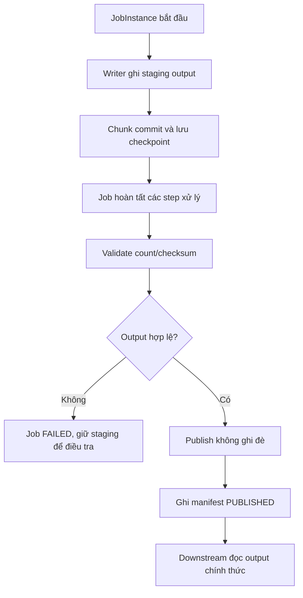

# Không ghi đè output của lần chạy trước

Trong Spring Batch, một job có thể chạy lại sau khi thất bại, được restart từ checkpoint hoặc được khởi chạy cho một kỳ nghiệp vụ mới. Các lần chạy này có thể sử dụng cùng một reader và writer, nhưng không phải lúc nào cũng được phép ghi vào cùng một output resource. Nếu writer mở file đích ở chế độ xóa nội dung cũ, append không kiểm soát hoặc tạo tên file không ổn định, lần chạy mới có thể ghi đè kết quả trước đó hoặc tạo dữ liệu trùng.

Quản lý output an toàn cần phân biệt rõ **restart cùng một công việc** và **tạo một kết quả nghiệp vụ mới**. Restart phải tiếp tục đúng artifact đã ghi ở checkpoint; một lần chạy nghiệp vụ mới phải có output riêng và không làm mất output đã công bố trước đó. Với file, database, object storage và hệ thống ngoài, cần có quy tắc định danh, staging, publish và xử lý xung đột rõ ràng.

## 1. Vì sao output của lần chạy trước có thể bị ghi đè?

Một số lỗi thường gặp:

- Hai lần chạy khác nhau cùng dùng `reports/daily.csv`.
- `FlatFileItemWriter` được cấu hình xóa file tồn tại khi mở, trong khi file đó là output đã công bố của lần trước.
- Writer dùng append nhưng reader bắt đầu lại từ đầu, làm dữ liệu cũ và dữ liệu mới bị nối trùng.
- Job restart dùng output path mới theo `JobExecution` ID, khiến checkpoint cũ không còn khớp với resource.
- Job mới dùng cùng output path nhưng không có version hoặc khóa nghiệp vụ phân biệt.
- Step publish chạy lại sau crash và ghi đè file đã được publish trước khi metadata được cập nhật.
- Hai job chạy đồng thời ghi vào cùng một resource.

“Không ghi đè” không chỉ có nghĩa là không xóa file. Nó còn có nghĩa là không làm thay đổi một kết quả đã được công bố và không để hai lần chạy khác nhau ghi vào cùng một vùng output mà không có quy tắc phối hợp.

## 2. Phân biệt restart và lần chạy nghiệp vụ mới

Spring Batch định danh một công việc bằng `JobInstance`, được xác định bởi job name và các identifying `JobParameters`. Mỗi lần launch hoặc restart tạo một `JobExecution` riêng.

| Trường hợp | JobInstance | Output mong muốn |
|---|---|---|
| Restart job đã `FAILED` với cùng identifying parameters | Giữ nguyên | Tiếp tục cùng output staging từ checkpoint đã commit |
| Restart job đã `STOPPED` với cùng identifying parameters | Giữ nguyên | Tiếp tục cùng output staging theo trạng thái đã lưu |
| Chạy kỳ nghiệp vụ mới | Mới, do identifying parameters khác | Tạo output mới, giữ nguyên output kỳ trước |
| Reprocess có chủ đích cùng kỳ dữ liệu | Nên có version/reprocess identity riêng | Tạo artifact version mới, không âm thầm thay thế bản đã publish |
| Cố chạy lại một instance đã `COMPLETED` | Không phải restart thông thường hợp lệ | Dùng quy trình reprocess/version mới |

Ví dụ:

```text
Job: dailyExportJob
Identifying parameters: businessDate=2026-11-15, tenantId=42

JobInstance A
  JobExecution 501 -> FAILED
  JobExecution 509 -> COMPLETED (restart)
  Output staging: dailyExport/2026-11-15/tenant-42/

JobInstance B
  businessDate=2026-11-16, tenantId=42
  Output staging: dailyExport/2026-11-16/tenant-42/
```

Execution ID thay đổi khi restart, còn `JobInstance` vẫn giữ nguyên. Vì vậy, không nên dùng `JobExecution` ID làm thành phần duy nhất của output path nếu muốn restart tiếp tục cùng resource. Ngược lại, không nên dùng một path cố định chung cho tất cả các instance nếu mỗi lần chạy cần giữ lại kết quả riêng.

## 3. Đặt output key ổn định theo công việc nghiệp vụ

Output key cần trả lời được hai câu hỏi:

1. Đây là kết quả của công việc nghiệp vụ nào?
2. Đây là phiên bản output nào của công việc đó?

Các thành phần thường dùng:

- Job name hoặc loại báo cáo.
- Ngày nghiệp vụ/kỳ xử lý.
- Tenant hoặc phạm vi dữ liệu.
- Source version, input checksum hoặc batch identifier nếu nguồn quyết định nội dung.
- `outputVersion` hoặc `reprocessId` khi cần tạo một phiên bản mới có chủ đích.

Ví dụ:

```text
daily-orders/
  business-date=2026-11-15/
    tenant=42/
      version=1/
        orders.csv
```

Restart cùng `JobInstance` phải tạo lại đúng key này. Một lần reprocess có chủ đích có thể dùng `version=2`, giữ lại `version=1` để audit hoặc rollback nghiệp vụ.

Không nên tạo output key mới bằng timestamp ngẫu nhiên ở mỗi lần restart. Điều đó làm restart tạo artifact mới thay vì tiếp tục output cũ. Cũng không nên tái sử dụng key cũ khi nội dung đầu vào hoặc quy tắc nghiệp vụ đã thay đổi mà không tăng version.

## 4. Output identity phải nhất quán với identifying JobParameters

Nếu `businessDate` và `tenantId` xác định một công việc nghiệp vụ, chúng thường nên là identifying parameters. Nếu `outputVersion` tạo ra một bản kết quả nghiệp vụ mới, nó cũng có thể cần tham gia định danh instance.

Ví dụ:

```java
JobParameters parameters = new JobParametersBuilder()
        .addString("businessDate", "2026-11-15", true)
        .addLong("tenantId", 42L, true)
        .addString("outputVersion", "v1", true)
        .addString("outputDirectory", "exports/staging", false)
        .toJobParameters();
```

Trong ví dụ, ngày, tenant và version xác định `JobInstance`; output directory chỉ là cấu hình resource. Nếu đổi `outputDirectory` nhưng giữ identifying parameters, Spring Batch vẫn có thể xem đó là cùng instance. Điều này nguy hiểm nếu checkpoint trước đang trỏ tới resource cũ.

Hãy bảo đảm các tham số quyết định nguồn và output identity được thiết kế nhất quán. Nếu thay đổi input file hoặc output version có nghĩa là một công việc khác, hãy đưa input identity/version đó vào identifying parameters hoặc kiểm soát bằng một manifest nghiệp vụ tương đương.

## 5. Tách staging output và published output

Một cách an toàn là không để writer ghi trực tiếp vào file mà hệ thống downstream đang sử dụng. Thay vào đó, job ghi vào staging resource riêng, xác minh kết quả rồi publish thành output chính thức.



Ví dụ cấu trúc thư mục:

```text
exports/
  staging/
    daily-orders-2026-11-15-tenant-42-v1.csv
  published/
    daily-orders-2026-11-15-tenant-42-v1.csv
  manifest/
    daily-orders-2026-11-15-tenant-42-v1.json
```

Staging path phải ổn định qua restart cùng instance. Published path nên được xem là immutable: khi đã tồn tại, job khác không được âm thầm thay nội dung. Nếu cần tạo kết quả mới, hãy dùng version mới.

## 6. Cấu hình FlatFileItemWriter có ý thức về file tồn tại

`FlatFileItemWriter` hỗ trợ lưu state để restart. Các tùy chọn liên quan đến file tồn tại cần được hiểu đúng:

- `saveState(true)` cho phép writer lưu thông tin cần thiết để khôi phục vị trí khi restart.
- `name(...)` cung cấp tên ổn định để lưu state trong execution context.
- `shouldDeleteIfExists(...)` điều khiển cách xử lý file đã tồn tại khi mở writer cho một lần thực thi mới.
- `append(...)` cho phép chế độ append trong các tình huống được cấu hình; append không tự biết dữ liệu nào đã được xử lý nghiệp vụ.

Ví dụ cấu hình writer cho một staging path riêng:

```java
@Bean
@StepScope
public FlatFileItemWriter<OrderRecord> orderWriter(
        @Value("#{jobParameters['stagingFile']}") String stagingFile) {

    return new FlatFileItemWriterBuilder<OrderRecord>()
            .name("dailyOrderStagingWriter")
            .resource(new FileSystemResource(stagingFile))
            .delimited()
            .delimiter(",")
            .names("orderId", "customerId", "amount")
            .saveState(true)
            .shouldDeleteIfExists(false)
            .build();
}
```

Ở đây, writer được cấp một staging path riêng theo job parameters. `shouldDeleteIfExists(false)` tránh cấu hình xóa file có sẵn một cách tự động khi mở một lần chạy mới. Tuy nhiên, cần kiểm tra chính xác hành vi open/restart của phiên bản Spring Batch đang dùng: nếu file đã tồn tại mà không có checkpoint tương ứng, writer có thể từ chối mở thay vì tiếp tục. Đây là hành vi fail-fast hữu ích khi path bị đụng, nhưng không thay thế việc thiết kế path duy nhất.

Không đặt `shouldDeleteIfExists(true)` cho một resource dùng chung nếu file đó chứa output đã publish của lần chạy trước. Cũng không bật append chỉ để tránh lỗi file tồn tại: nếu reader bắt đầu lại từ đầu, output sẽ bị nối trùng.

## 7. `saveState` và restart không giống với bảo vệ output của lần chạy khác

`saveState(true)` giúp writer khôi phục vị trí của chính nó trong cùng một execution/restart. Nó không tự ngăn một `JobInstance` khác ghi vào cùng file.

Ví dụ:

- Instance A ghi `exports/daily.csv` và commit 10 chunk.
- Instance B được launch với identifying parameters khác nhưng cũng nhận `exports/daily.csv`.
- Writer của B không có checkpoint của A.
- Nếu B được cấu hình xóa file, output A bị mất; nếu B append, hai kết quả có thể bị trộn.

Do đó, cần cả hai lớp bảo vệ:

1. Checkpoint writer để restart cùng instance đúng vị trí.
2. Output identity riêng để instance khác không ghi vào resource của instance trước.

Không dùng `saveState` như một cơ chế khóa file hoặc chống ghi đè giữa các job.

## 8. Không dùng append để thay thế checkpoint

Append chỉ nói rằng dữ liệu mới được ghi vào cuối resource. Nó không biết item nào đã commit, chunk nào rollback hoặc reader đang tiếp tục từ đâu.

Một tình huống lỗi:

1. Lần đầu writer đã ghi 5.000 dòng.
2. Job thất bại; reader không lưu checkpoint nên restart đọc lại từ đầu.
3. Writer mở file ở chế độ append.
4. 5.000 dòng cũ vẫn còn và được ghi lại.

Kết quả có thể có 10.000 dòng với mỗi item xuất hiện hai lần.

Một tình huống ngược lại cũng nguy hiểm: writer truncate file khi restart từ giữa. Reader tiếp tục từ item 5.001, nhưng output 5.000 item đầu đã bị xóa. Kết quả cuối bị thiếu dữ liệu.

Hãy chọn một chiến lược thống nhất:

- Tiếp tục cùng staging output từ checkpoint của cả reader và writer.
- Hoặc xóa staging của một lần chạy mới và tái tạo toàn bộ output từ đầu trong một quy trình reprocess có chủ đích.

Không trộn reader restart-from-checkpoint với writer truncate, hoặc reader restart-from-beginning với writer append.

## 9. Tạo file mới bằng CREATE_NEW khi cần fail-fast

Với custom writer hoặc bước tạo resource, Java NIO hỗ trợ `StandardOpenOption.CREATE_NEW`. Tùy chọn này tạo file mới và thất bại nếu path đã tồn tại.

Ví dụ minh họa cho bước tạo artifact mới:

```java
try (OutputStream output = Files.newOutputStream(
        stagingPath,
        StandardOpenOption.CREATE_NEW,
        StandardOpenOption.WRITE)) {
    // Ghi nội dung mới vào file vừa tạo.
}
```

Điều này hữu ích khi bắt đầu một output version mới: nếu path đã tồn tại, job nhận lỗi xung đột thay vì âm thầm xóa hoặc ghi đè file cũ.

Không dùng `CREATE_NEW` một cách máy móc cho lần restart cần mở lại file hiện có. Restart phải xác nhận file thuộc đúng `JobInstance` và có checkpoint phù hợp rồi mới tiếp tục. Có thể tách rõ hai đường đi:

- Lần chạy mới: tạo staging file bằng `CREATE_NEW`.
- Restart: mở lại staging file đã được manifest/checkpoint xác nhận, khôi phục vị trí đã lưu.

Nếu custom writer triển khai `ItemStream`, state về resource path và vị trí ghi cần được lưu trong `ExecutionContext`. Không chỉ lưu path; cần bảo đảm nội dung file vẫn tương ứng với checkpoint đó.

## 10. Publish output mà không ghi đè

Sau khi staging output hoàn tất, job có thể publish file bằng cách move sang một path chính thức. Khi không cho phép thay thế file đích, không dùng tùy chọn `REPLACE_EXISTING`.

Ví dụ đơn giản:

```java
Files.move(stagingPath, publishedPath);
```

Nếu `publishedPath` đã tồn tại, thao tác move thông thường sẽ báo lỗi thay vì chủ động thay thế. Cần xử lý lỗi này như một xung đột cần kiểm tra: có thể output đã được publish trong lần chạy trước, hoặc một job khác đang dùng cùng output identity.

Có thể dùng `ATOMIC_MOVE` nếu filesystem hỗ trợ atomic move và yêu cầu publish nguyên tử. Tuy nhiên, quy tắc khi target đã tồn tại với `ATOMIC_MOVE` có thể phụ thuộc provider/filesystem; không nên dựa vào nó như một cơ chế no-overwrite phổ quát. Nếu yêu cầu nghiêm ngặt là không thay thế file đích, cần reservation/manifest/lock hoặc primitive conditional-create phù hợp với storage.

Với object storage, hãy dùng conditional PUT hoặc điều kiện tương đương như “chỉ tạo nếu object chưa tồn tại” nếu provider hỗ trợ. Không giả định thao tác rename của object storage giống filesystem local; nhiều dịch vụ thực hiện copy rồi delete.

## 11. Manifest xác nhận output đã publish

Manifest là bản ghi bền vững mô tả output và trạng thái công bố. Nó giúp restart phân biệt file staging, file đã publish và xung đột.

Ví dụ nội dung manifest:

```json
{
  "jobKey": "dailyExport:2026-11-15:tenant-42:v1",
  "stagingPath": "exports/staging/daily-orders-v1.csv",
  "publishedPath": "exports/published/daily-orders-v1.csv",
  "status": "PUBLISHED",
  "recordCount": 125000,
  "checksum": "sha256:..."
}
```

Manifest có thể lưu trong database hoặc object storage có khả năng ghi có điều kiện. Các trạng thái thường dùng:

| Trạng thái | Ý nghĩa |
|---|---|
| `WRITING` | Job đang tạo staging output |
| `READY` | Staging đã đóng và vượt qua kiểm tra |
| `PUBLISHING` | Đang thực hiện publish |
| `PUBLISHED` | Output chính thức đã được xác nhận |
| `FAILED` | Quá trình tạo/publish gặp lỗi cần xử lý |

Nếu process crash sau khi move file nhưng trước khi manifest được cập nhật `PUBLISHED`, lần restart có thể kiểm tra file đích, checksum và output key. Nếu nội dung khớp, nó có thể ghi nhận publish đã hoàn tất mà không tạo file thứ hai. Nếu file đích khác checksum, phải dừng và báo xung đột thay vì ghi đè.

## 12. Đưa publish thành một step riêng

Không nên phụ thuộc hoàn toàn vào `JobExecutionListener.afterJob` để publish output bắt buộc. Callback listener có thể không chạy nếu process dừng đột ngột, và thao tác publish có thể cần retry, metadata và trạng thái riêng.

Một thiết kế rõ ràng hơn:

```text
prepareStep
   |
   v
writeStagingStep
   |
   v
validateOutputStep
   |
   v
publishOutputStep
   |
   v
Job hoàn tất
```

`publishOutputStep` có thể:

1. Kiểm tra manifest và staging artifact.
2. Tính hoặc xác minh record count/checksum.
3. Kiểm tra published target chưa bị chiếm bởi một output khác.
4. Thực hiện move/conditional create.
5. Ghi trạng thái `PUBLISHED`.

Step publish cần idempotent vì có thể được restart sau crash. Nếu file đích đã tồn tại và checksum khớp với staging/output key hiện tại, có thể coi thao tác publish đã hoàn tất. Nếu không khớp, coi đó là xung đột cần xử lý.

## 13. Xử lý crash window trong bước publish

Có một khoảng thời gian giữa thao tác filesystem/object storage và việc Spring Batch commit metadata của step. Hai hệ thống này thường không nằm trong cùng một transaction.

Ví dụ:

1. `publishOutputStep` move staging file sang published path.
2. File đích đã tồn tại.
3. Process dừng trước khi transaction metadata của step commit.
4. Khi restart, step publish được chạy lại.

Nếu code chỉ gọi `Files.move` lần nữa, nó có thể nhận `FileAlreadyExistsException`. Đây không nhất thiết là lỗi nghiệp vụ mới; có thể publish đã thành công ở lần trước.

Hãy kiểm tra:

- Published path có tồn tại không?
- Manifest có cùng `jobKey` không?
- Checksum và record count có khớp không?
- File có hoàn chỉnh và đã đóng đúng cách không?

Nếu mọi thông tin khớp, bước publish có thể hoàn tất idempotently bằng cách cập nhật/đối chiếu manifest. Nếu khác, dừng để tránh thay thế output của lần chạy khác.

## 14. Database output cũng cần chống ghi đè

Không ghi file không có nghĩa chỉ cần quan tâm tới filesystem. Writer ghi database có thể ghi đè dữ liệu của kỳ trước nếu câu `UPDATE` hoặc `MERGE` không phân biệt output version.

Ví dụ schema output versioned:

```sql
create table daily_export_result (
    business_date date not null,
    tenant_id     bigint not null,
    output_version varchar(30) not null,
    order_id      bigint not null,
    amount        decimal(18, 2) not null,
    primary key (business_date, tenant_id, output_version, order_id)
);
```

Khóa chính bao gồm `output_version`, nên reprocess có chủ đích có thể tạo bản mới mà vẫn giữ bản cũ. Nếu nghiệp vụ chỉ cho phép một output duy nhất cho một ngày và tenant, bỏ version khỏi khóa và để unique constraint từ chối lần ghi trùng.

Không dùng `DELETE FROM daily_export_result WHERE business_date = ?` như một bước mặc định trước mỗi lần chạy nếu dữ liệu đó là output đã công bố. Nếu cần thay thế, hãy dùng quy trình versioned publish hoặc một transaction có chính sách thay thế được phê duyệt rõ ràng.

## 15. Staging table và publish dữ liệu database

Một mô hình phổ biến là ghi vào staging theo `jobKey`, sau đó publish bằng một transaction riêng khi dữ liệu đã được xác minh.

```sql
create table export_stage (
    job_key      varchar(160) not null,
    order_id     bigint not null,
    amount       decimal(18, 2) not null,
    primary key (job_key, order_id)
);

create table export_manifest (
    job_key       varchar(160) primary key,
    status        varchar(30) not null,
    record_count  bigint,
    published_at  timestamp null
);
```

Các chunk ghi vào `export_stage`. Unique key `(job_key, order_id)` bảo vệ khỏi insert trùng trong cùng output. Khi tất cả step hoàn tất, bước publish kiểm tra count/checksum và cập nhật manifest hoặc chuyển dữ liệu sang bảng phục vụ downstream.

Nếu downstream đọc trực tiếp staging, cần bảo đảm nó chỉ chọn các `job_key` có manifest `PUBLISHED`. Không để người tiêu thụ đọc dữ liệu `WRITING` hoặc `FAILED`.

## 16. Không ghi đè output khi chạy song song

Hai job có thể chạy đồng thời cho hai tenant, hai kỳ dữ liệu hoặc hai loại export. Nếu path chỉ dựa vào tên báo cáo, cả hai có thể cùng ghi một resource.

Ví dụ path không đủ phân biệt:

```text
exports/daily.csv
```

Path có định danh rõ hơn:

```text
exports/staging/daily/2026-11-15/tenant-42/v1.csv
exports/staging/daily/2026-11-15/tenant-84/v1.csv
```

Ngoài naming, cần kiểm soát concurrency:

- Dùng `JobRepository` để ngăn cùng một `JobInstance` có nhiều execution đồng thời theo quy tắc Spring Batch.
- Dùng unique constraint/manifest reservation cho output key.
- Nếu hai job khác nhau có thể nhắm tới cùng output, dùng lock hoặc conditional create ở storage.
- Không dùng một singleton writer hoặc một file handle mutable chung cho nhiều job execution.

Tên file duy nhất giảm collision nhưng không thay thế kiểm soát truy cập đồng thời. Hai process có thể cùng kiểm tra “file chưa tồn tại” rồi cùng cố tạo; cần thao tác tạo nguyên tử hoặc reservation ở nơi bền vững.

## 17. Không dùng JobExecution ID làm version nghiệp vụ

`JobExecution` ID thay đổi khi restart. Nếu output path chứa execution ID:

```text
exports/daily-orders/execution-501.csv
exports/daily-orders/execution-509.csv
```

thì restart có thể tạo file mới thay vì tiếp tục file staging cũ. Điều này làm output bị chia thành nhiều artifact và khó xác định file nào là kết quả cuối.

Có thể lưu execution ID trong metadata hoặc manifest để audit từng attempt, nhưng output identity nên dựa trên `JobInstance` hoặc business version ổn định. Nếu cần giữ riêng log/artifact debug của từng attempt, hãy tách chúng khỏi output chính thức và không để downstream tự động tiêu thụ.

## 18. Reprocess có chủ đích phải tạo version mới

Đôi khi cần chạy lại toàn bộ dữ liệu vì logic được sửa, input thay đổi hoặc yêu cầu nghiệp vụ mới. Đây là reprocess, không phải restart.

Một quy trình reprocess an toàn:

1. Giữ nguyên output đã publish của version hiện tại.
2. Tạo `outputVersion` mới hoặc `reprocessId` có ý nghĩa.
3. Dùng identifying parameters mới để tạo `JobInstance` mới.
4. Ghi output vào staging path riêng.
5. Kiểm tra count, checksum và quy tắc nghiệp vụ.
6. Publish version mới bằng manifest/active pointer có kiểm soát.
7. Chỉ chuyển downstream sang version mới sau khi xác nhận hoàn tất.

Ví dụ:

```text
published/
  daily-orders/2026-11-15/tenant-42/v1.csv
  daily-orders/2026-11-15/tenant-42/v2.csv
```

Version 1 vẫn tồn tại để audit hoặc quay lại khi version 2 có vấn đề. Việc version nào là bản hiện hành nên được xác định bằng manifest hoặc một bản ghi active version, không bằng cách ghi đè cùng một file.

## 19. Kiểm tra input và output path trước khi chạy

Validation trước step nên bảo đảm output resource được xác định rõ:

- Output path không trùng input path.
- Path nằm trong thư mục được phép.
- Parent directory có thể được tạo hoặc ghi.
- Output key có đủ business date/tenant/version cần thiết.
- Resource không thuộc một output đã publish của job khác.
- Nếu resource tồn tại, xác định đó là staging của cùng instance hay artifact cũ.

Kiểm tra tồn tại trong validator chỉ là preflight tại một thời điểm. Một process khác vẫn có thể tạo file sau đó. Khi tạo resource, dùng thao tác no-overwrite nguyên tử như `CREATE_NEW`, unique constraint hoặc conditional create để giải quyết race condition.

Không tự xóa resource cũ trong validator để “dọn đường”. Việc xóa có thể làm mất output đã publish và không nằm trong transaction của job.

## 20. Retention và cleanup output cũ

Không ghi đè output không có nghĩa phải giữ mọi staging artifact vô thời hạn. Có thể có chính sách retention riêng cho file tạm, output đã publish và manifest.

Ví dụ:

| Loại artifact | Chính sách thường dùng |
|---|---|
| Staging của job đang chạy | Giữ cho restart; không cleanup khi execution còn hoạt động |
| Staging của job thất bại | Giữ trong thời hạn điều tra/restart; xóa theo chính sách sau đó |
| Published output | Giữ theo yêu cầu audit/downstream; không xóa như file tạm |
| Manifest | Giữ ít nhất bằng thời gian tồn tại output và lịch sử vận hành |
| Temporary file của attempt | Có thể cleanup khi chắc chắn không còn được dùng |

Cleanup nên là quy trình riêng có điều kiện, không chạy mù quáng ở đầu mỗi job. Trước khi xóa, kiểm tra job instance tương ứng đã kết thúc, không còn restart cần thiết và artifact không phải output chính thức.

## 21. Kiểm thử không ghi đè output của lần chạy trước

Kiểm thử cần xác nhận cả hành vi restart và hành vi tạo output mới.

### Test hai JobInstance khác nhau

1. Chạy job cho `businessDate=2026-11-15`, `tenantId=42`, `outputVersion=v1`.
2. Xác nhận output v1 được publish.
3. Chạy job cho ngày hoặc version khác.
4. Xác nhận output mới được tạo ở path khác.
5. Đọc lại output v1 và xác nhận checksum/nội dung không thay đổi.

### Test restart cùng JobInstance

1. Khởi chạy job với identifying parameters cố định.
2. Cho một số chunk commit rồi cố ý làm step thất bại.
3. Ghi nhận file staging và checkpoint.
4. Restart với cùng identifying parameters.
5. Xác nhận writer tiếp tục từ checkpoint và không xóa/append lặp dữ liệu.
6. Xác nhận mỗi business key xuất hiện đúng một lần.

### Test path đã tồn tại

- Lần chạy mới cố tạo path đã có output: phải báo collision hoặc chọn version mới.
- Restart cùng instance mở lại đúng staging resource: phải khôi phục state.
- Published path đã tồn tại với checksum giống: publish có thể nhận diện đã hoàn tất.
- Published path tồn tại với checksum khác: job phải dừng và báo xung đột, không ghi đè.

### Test hai job chạy đồng thời

Khởi chạy hai instance với tenant/version khác nhau và xác nhận chúng không ghi cùng path. Nếu hai instance cố dùng cùng output key, một instance phải bị từ chối bởi reservation/unique constraint hoặc cơ chế lock.

## 22. Ví dụ kiểm tra output cũ không thay đổi

Trong integration test, có thể lưu checksum trước khi chạy instance mới:

```java
byte[] previousOutput = Files.readAllBytes(previousPublishedPath);
String previousChecksum = sha256(previousOutput);

JobExecution newExecution = jobLauncherTestUtils.launchJob(newParameters);

assertEquals(BatchStatus.COMPLETED, newExecution.getStatus());
assertTrue(Files.exists(previousPublishedPath));
assertEquals(
        previousChecksum,
        sha256(Files.readAllBytes(previousPublishedPath)));
```

Đây là khung test; hàm `sha256` có thể dùng `MessageDigest`. Test nên kiểm tra thêm output path mới và manifest tương ứng. Chỉ kiểm tra file cũ còn tồn tại chưa đủ vì nội dung có thể đã bị thay đổi.

## 23. Theo dõi output theo job và version

Để vận hành và điều tra, manifest hoặc metadata output nên ghi:

- Job name và identifying parameters.
- `JobInstance` identity hoặc `jobKey`.
- `JobExecution` ID tạo/cập nhật artifact gần nhất.
- Output version/reprocess ID.
- Staging path và published path.
- Trạng thái `WRITING`, `READY`, `PUBLISHING`, `PUBLISHED` hoặc `FAILED`.
- Record count, byte size và checksum.
- Thời điểm bắt đầu, hoàn tất và publish.
- Source version/checksum nếu input cần bất biến.

Khi phát hiện output bị ghi đè, cần xác định:

1. Hai execution có cùng `JobInstance` hay là hai instance khác nhau?
2. Output path có được tạo từ identifying parameters ổn định không?
3. Writer có `saveState` và tên ổn định không?
4. Có `shouldDeleteIfExists` hoặc append mode nào xóa/nối dữ liệu không?
5. Step publish có chạy lại sau crash không?
6. Có process khác dùng cùng output key không?
7. Manifest/checksum có cho biết output nào đã được công bố không?

Không xóa hoặc ghi đè file để xử lý sự cố trước khi xác định file nào là artifact chính thức và downstream đã tiêu thụ nó chưa.

## 24. Các lỗi thiết kế thường gặp

| Tình huống | Nguyên nhân | Cách xử lý |
|---|---|---|
| File lần trước bị xóa khi job mới bắt đầu | Writer xóa resource tồn tại hoặc path dùng chung | Dùng staging path riêng và kiểm soát `shouldDeleteIfExists` |
| Restart tạo file mới | Output path chứa `JobExecution` ID mới | Dùng output key ổn định theo `JobInstance` |
| Output có dòng trùng | Reader bắt đầu lại từ đầu nhưng writer append | Khôi phục reader/writer cùng checkpoint hoặc tái tạo staging toàn bộ |
| Output thiếu phần đầu | Writer truncate trong khi reader restart từ giữa | Dùng writer restart-aware và resource đúng instance |
| Hai job ghi đè nhau | Output path không chứa tenant/version/job key | Dùng unique key và reservation/conditional create |
| Reprocess thay thế bản cũ ngoài ý muốn | Không có output version | Tạo version mới và publish có kiểm soát |
| Publish lặp sau crash | File move thành công nhưng metadata chưa commit | Kiểm tra manifest/checksum để publish idempotent |
| File đã tồn tại nhưng writer không mở được | Không phân biệt restart hợp lệ với path collision | Xác minh checkpoint/resource identity trước khi mở |
| Database row bị ghi đè | Update/merge không phân biệt output version | Dùng khóa nghiệp vụ/version và unique constraint |
| Cleanup xóa output cần restart | Dọn staging quá sớm | Retention dựa trên trạng thái execution và manifest |

## 25. Quy trình thiết kế resource không ghi đè

1. **Xác định loại lần chạy:** restart, kỳ nghiệp vụ mới hay reprocess.
2. **Thiết kế identifying parameters:** bao gồm các giá trị xác định nội dung và version output.
3. **Tạo output key ổn định:** restart cùng instance phải dùng lại cùng staging resource.
4. **Tách staging và published:** không để writer ghi trực tiếp vào output đang được downstream sử dụng.
5. **Cấu hình writer có state:** tên ổn định, `saveState(true)` và semantics file tồn tại được xác định rõ.
6. **Fail-fast khi collision:** dùng `CREATE_NEW`, unique constraint, manifest reservation hoặc conditional create.
7. **Xác minh trước publish:** record count, checksum và trạng thái tất cả step cần thiết.
8. **Publish idempotent và không replace:** file đích tồn tại phải được đối chiếu, không ghi đè âm thầm.
9. **Version hóa reprocess:** giữ output cũ và chỉ chuyển active version sau khi bản mới hợp lệ.
10. **Thiết kế retention riêng:** chỉ cleanup artifact khi chắc chắn không còn cần restart, audit hoặc downstream.
11. **Kiểm thử restart và concurrency:** xác nhận output cũ không đổi và các instance không chia sẻ resource ngoài ý muốn.

## 26. Những nguyên tắc cần nhớ

- Phân biệt restart cùng `JobInstance` với lần chạy nghiệp vụ mới hoặc reprocess.
- Restart cần dùng lại staging resource và checkpoint của cùng instance; lần chạy mới cần output identity riêng.
- Không dùng `JobExecution` ID làm output key duy nhất nếu restart phải tiếp tục cùng artifact.
- Đưa business date, tenant, source identity và output version phù hợp vào định danh công việc.
- `FlatFileItemWriter.saveState(true)` hỗ trợ khôi phục vị trí nhưng không ngăn instance khác ghi vào cùng file.
- Hiểu rõ `shouldDeleteIfExists` và append behavior theo phiên bản; không xóa hoặc nối file cũ một cách mù quáng.
- Dùng `CREATE_NEW`, unique constraint, reservation hoặc conditional create để phát hiện collision.
- Ghi staging trước, xác minh rồi publish; output đã publish nên immutable.
- Publish cần idempotent để xử lý crash sau move nhưng trước khi metadata step commit.
- Dùng manifest, record count và checksum để xác nhận artifact thuộc đúng job/version.
- Database output cũng cần unique key/version; không xóa dữ liệu cũ chỉ để mở đường cho lần chạy mới.
- `allowStartIfComplete(true)` hoặc rerun step có thể lặp side effect; chỉ dùng khi output có thể chạy lại an toàn.
- Retention/cleanup là quy trình riêng, không xóa staging hoặc published output khi còn cần restart/audit.
- Kiểm thử nội dung và checksum output cũ sau khi chạy instance mới, restart và chạy đồng thời.

Không ghi đè output của lần chạy trước là một yêu cầu về định danh và vòng đời resource. Khi mỗi `JobInstance` có staging path ổn định, mỗi lần chạy nghiệp vụ mới có version riêng, writer khôi phục checkpoint đúng và bước publish kiểm tra xung đột trước khi công bố, Spring Batch có thể restart an toàn mà vẫn bảo toàn các kết quả đã hoàn tất.
