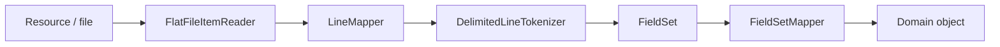

# DelimitedLineTokenizer

Trong Spring Batch, khi đọc file dạng CSV hoặc một file văn bản có các cột được phân cách bằng dấu phẩy, tab, dấu pipe hay ký tự khác, ứng dụng cần tách từng dòng thành các trường dữ liệu. **DelimitedLineTokenizer** là thành phần thực hiện việc tách đó.

Tokenizer nhận một chuỗi đại diện cho một record và chuyển nó thành **FieldSet**. FieldSet chứa các giá trị theo vị trí hoặc theo tên cột để bước tiếp theo ánh xạ chúng thành object nghiệp vụ.

Một pipeline đọc file thường có dạng:



DelimitedLineTokenizer chỉ chịu trách nhiệm phân tách record. Nó không tự đọc file, không quản lý checkpoint, không validate toàn bộ quy tắc nghiệp vụ và không ghi dữ liệu. Những trách nhiệm đó thuộc reader, mapper, processor và writer trong pipeline.

## 1. DelimitedLineTokenizer nằm ở đâu?

Trong Spring Batch, FlatFileItemReader đọc resource theo record rồi dùng LineMapper để chuyển mỗi record thành một item. LineMapper thường kết hợp hai thành phần:

- LineTokenizer: chia chuỗi thành các field.
- FieldSetMapper: chuyển FieldSet thành object.

DelimitedLineTokenizer là một implementation của LineTokenizer dành cho record có các field phân cách bằng delimiter.

Ví dụ file orders.csv:

```text
orderId,customerId,amount
1001,C001,250.00
1002,C002,175.50
1003,C003,99.99
```

Với dòng 1002,C002,175.50, tokenizer tạo ba field:

| Vị trí | Giá trị |
|---:|---|
| 0 | 1002 |
| 1 | C002 |
| 2 | 175.50 |

Nếu tên field đã được cấu hình là orderId, customerId và amount, FieldSet có thể được truy cập theo tên thay vì chỉ theo chỉ số.

## 2. Cấu hình cơ bản

Có thể cấu hình tokenizer trực tiếp:

```java
DelimitedLineTokenizer tokenizer = new DelimitedLineTokenizer();
tokenizer.setDelimiter(",");
tokenizer.setNames("orderId", "customerId", "amount");
tokenizer.setStrict(true);
```

Các thiết lập chính:

- **delimiter**: chuỗi phân cách giữa các field.
- **names**: tên tương ứng với các field được tokenizer trả về.
- **strict**: quy định có yêu cầu số field khớp với số tên đã cấu hình hay không.
- **quoteCharacter**: ký tự bao quanh field có chứa delimiter hoặc nội dung đặc biệt.
- **includedFields**: các vị trí field cần giữ lại khi chỉ muốn lấy một phần cột.

Ví dụ trên dùng dấu phẩy và yêu cầu số field khớp với ba tên đã khai báo.

### Tên field phải theo đúng thứ tự cột

Với dữ liệu:

```text
1001,C001,250.00
```

Tên phải được khai báo đúng thứ tự:

```java
tokenizer.setNames("orderId", "customerId", "amount");
```

Nếu khai báo nhầm:

```java
tokenizer.setNames("customerId", "orderId", "amount");
```

Tokenizer vẫn có thể tách thành ba field, nhưng mapper sẽ đọc sai ý nghĩa của dữ liệu. Đây là lỗi mapping nguy hiểm vì không nhất thiết làm job thất bại.

## 3. Chọn delimiter

DelimitedLineTokenizer hỗ trợ cấu hình delimiter để phù hợp với định dạng file đầu vào.

Ví dụ:

| Định dạng | Delimiter |
|---|---|
| CSV | dấu phẩy (,) |
| TSV | tab (\t) |
| Pipe-separated | dấu pipe (\|) |
| Dữ liệu phân cách bằng dấu chấm phẩy | dấu chấm phẩy (;) |

Ví dụ file dùng pipe:

```text
1001|C001|250.00
1002|C002|175.50
```

Cấu hình:

```java
DelimitedLineTokenizer tokenizer = new DelimitedLineTokenizer();
tokenizer.setDelimiter("|");
tokenizer.setNames("orderId", "customerId", "amount");
```

Với tab:

```java
tokenizer.setDelimiter("\t");
```

Delimiter là giá trị phân cách trong dữ liệu, không phải biểu thức regular expression. Nếu file dùng một chuỗi phân cách nhiều ký tự, hãy cấu hình đúng chuỗi mà định dạng nguồn quy định và kiểm thử với dữ liệu thực tế.

Không chọn delimiter dựa trên suy đoán từ một vài dòng mẫu. Hãy lấy định dạng từ hợp đồng nguồn dữ liệu hoặc đặc tả file.

## 4. Tách field có chứa delimiter bên trong

Một field có thể chứa chính ký tự đang dùng làm delimiter. Với CSV, tên khách hàng có thể chứa dấu phẩy:

```text
1001,"Smith, Jane",250.00
1002,"Nguyen, An",175.50
```

Nếu chỉ tách theo mọi dấu phẩy, dòng đầu sẽ bị chia thành nhiều field sai. DelimitedLineTokenizer hỗ trợ ký tự quote để đánh dấu vùng nội dung cần được xem là một field.

Mặc định tokenizer sử dụng dấu nháy kép. Có thể cấu hình tường minh:

```java
DelimitedLineTokenizer tokenizer = new DelimitedLineTokenizer();
tokenizer.setDelimiter(",");
tokenizer.setQuoteCharacter('"');
tokenizer.setNames("orderId", "customerName", "amount");
```

Khi đọc dòng:

```text
1001,"Smith, Jane",250.00
```

Field customerName được giữ thành một giá trị chứa dấu phẩy thay vì bị chia thành hai cột.

### Quote không thay thế delimiter

Quote dùng để bao field; delimiter vẫn xác định ranh giới giữa các field bên ngoài vùng quote. Ví dụ:

```text
1001,"Smith, Jane",250.00
```

Có ba field: order ID, customer name và amount. Không nên thêm quote tùy ý quanh mọi giá trị nếu định dạng nguồn không yêu cầu.

### Ký tự quote khác

Một số file dùng dấu nháy đơn để bao field. Có thể cấu hình quote character tương ứng bằng setQuoteCharacter(...) với ký tự theo đặc tả nguồn.

Chỉ thay quote character khi hợp đồng file quy định rõ. Nếu dữ liệu có nhiều kiểu quoting khác nhau, hãy chuẩn hóa upstream hoặc viết một tokenizer chuyên biệt và có test cho từng trường hợp.

## 5. Escape quote bên trong field

CSV có thể chứa chính ký tự quote bên trong giá trị. Ví dụ:

```text
1001,"She said ""Approved""",250.00
```

Đây là một tình huống cần kiểm tra kỹ với phiên bản Spring Batch và dialect file thực tế. Quy tắc escape của nguồn CSV phải khớp cách tokenizer diễn giải quote. Không nên mặc định rằng mọi biến thể CSV, mọi quy tắc escape hoặc mọi file xuất từ spreadsheet đều giống nhau.

Hãy viết test cho ít nhất các trường hợp:

- Field được bao bởi quote.
- Field có delimiter bên trong quote.
- Field có quote được escape.
- Field rỗng.
- Field có khoảng trắng đầu/cuối.
- Quote không cân bằng.

Nếu nguồn file dùng quy tắc phức tạp hơn khả năng tokenizer đang cấu hình, hãy dùng parser phù hợp với dialect đó hoặc tạo LineTokenizer riêng. Đừng xử lý bằng cách thay thế chuỗi thủ công trước khi tokenize nếu phép thay thế có thể làm thay đổi dữ liệu hợp lệ.

## 6. Đặt tên field bằng setNames

Khi biết cấu trúc record, nên cấu hình tên field để mapper truy cập rõ nghĩa:

```java
tokenizer.setNames(
        "orderId",
        "customerId",
        "customerName",
        "amount",
        "currency");
```

FieldSetMapper có thể đọc theo tên:

```java
public class OrderFieldSetMapper
        implements FieldSetMapper<OrderInput> {

    @Override
    public OrderInput mapFieldSet(FieldSet fieldSet) {
        return new OrderInput(
                fieldSet.readLong("orderId"),
                fieldSet.readString("customerId"),
                fieldSet.readString("customerName"),
                fieldSet.readBigDecimal("amount"),
                fieldSet.readString("currency"));
    }
}
```

Named access dễ đọc và ít phụ thuộc vào thứ tự chỉ số trong code mapper. Tuy nhiên, thứ tự trong setNames vẫn phải khớp thứ tự cột của file.

Nếu không cấu hình names, FieldSet vẫn có thể được truy cập theo vị trí. Với file có schema cố định, named fields thường giúp code rõ ràng và giảm nhầm lẫn.

## 7. Kết hợp DelimitedLineTokenizer và FieldSetMapper

Tokenizer chỉ tạo FieldSet. Việc chuyển dữ liệu thành object thuộc FieldSetMapper.

Ví dụ model:

```java
public record OrderInput(
        long orderId,
        String customerId,
        String customerName,
        BigDecimal amount) {
}
```

Mapper:

```java
public class OrderFieldSetMapper
        implements FieldSetMapper<OrderInput> {

    @Override
    public OrderInput mapFieldSet(FieldSet fieldSet) {
        return new OrderInput(
                fieldSet.readLong("orderId"),
                fieldSet.readString("customerId"),
                fieldSet.readString("customerName"),
                fieldSet.readBigDecimal("amount"));
    }
}
```

Kết hợp thành LineMapper:

```java
DelimitedLineTokenizer tokenizer = new DelimitedLineTokenizer();
tokenizer.setDelimiter(",");
tokenizer.setNames(
        "orderId",
        "customerId",
        "customerName",
        "amount");

DefaultLineMapper<OrderInput> lineMapper = new DefaultLineMapper<>();
lineMapper.setLineTokenizer(tokenizer);
lineMapper.setFieldSetMapper(new OrderFieldSetMapper());
lineMapper.afterPropertiesSet();
```

FlatFileItemReader dùng lineMapper để biến mỗi record thành OrderInput:

```java
@Bean
FlatFileItemReader<OrderInput> orderReader(
        Resource inputResource,
        LineMapper<OrderInput> orderLineMapper) {

    return new FlatFileItemReaderBuilder<OrderInput>()
            .name("orderReader")
            .resource(inputResource)
            .lineMapper(orderLineMapper)
            .linesToSkip(1)
            .saveState(true)
            .build();
}
```

Ở đây, dòng đầu là header nên được bỏ qua. Nếu cần kiểm tra tên cột trong header, có thể dùng callback xử lý dòng bị bỏ qua hoặc bước validate riêng thay vì bỏ qua mà không xác nhận.

## 8. Dùng builder delimited của FlatFileItemReader

Với cấu hình thông dụng, không cần tạo tokenizer và LineMapper thủ công. FlatFileItemReaderBuilder có DSL delimited để cấu hình các thuộc tính thường dùng:

```java
@Bean
FlatFileItemReader<OrderInput> orderReader() {
    return new FlatFileItemReaderBuilder<OrderInput>()
            .name("orderReader")
            .resource(new ClassPathResource("orders.csv"))
            .delimited()
            .delimiter(",")
            .names(
                    "orderId",
                    "customerId",
                    "customerName",
                    "amount")
            .targetType(OrderInput.class)
            .linesToSkip(1)
            .saveState(true)
            .build();
}
```

Builder tạo tokenizer và mapper phù hợp dựa trên các thuộc tính được khai báo. Cách này ngắn gọn khi mapping có thể được thực hiện theo target type hoặc FieldSetMapper mà builder hỗ trợ.

Khi cần quy tắc tokenize hoặc mapping đặc biệt, cấu hình LineMapper thủ công sẽ linh hoạt hơn. Hãy chọn một cách cấu hình rõ ràng, tránh tạo tokenizer thủ công rồi đồng thời cấu hình một tokenizer khác qua builder.

## 9. Strict mode và số lượng field

Khi đã khai báo tên field, tokenizer cần biết có phải yêu cầu mỗi record có đúng số field hay không. Strict mode được điều khiển bằng setStrict(...).

Ví dụ:

```java
tokenizer.setNames("orderId", "customerId", "amount");
tokenizer.setStrict(true);
```

Với strict=true, record có số field không khớp với số tên được cấu hình sẽ bị xem là lỗi token count. Đây thường là lựa chọn an toàn khi file có schema cố định.

Ví dụ mong đợi ba field:

```text
1001,C001,250.00
```

Các dòng sai cấu trúc:

```text
1002,C002
1003,C003,99.00,EXTRA
```

Nếu số cột thay đổi ngoài dự kiến, fail rõ ràng thường tốt hơn âm thầm gán nhầm dữ liệu.

### Khi nào dùng strict=false?

Strict mode có thể được nới lỏng khi định dạng nguồn cho phép số field thay đổi và mapper có quy tắc xử lý giá trị thiếu hoặc dư. Tuy nhiên, không nên dùng strict=false chỉ để job không thất bại khi file sai schema.

Khi tắt strict:

- Mapper phải xử lý trường hợp thiếu giá trị.
- Phải xác định rõ có chấp nhận field dư hay không.
- Không giả định field bị thiếu sẽ có giá trị mặc định đúng nghiệp vụ.
- Cần test hành vi cụ thể của phiên bản Spring Batch đang dùng.

Nếu file có version schema, hãy xác định version trước và chọn mapping tương ứng thay vì nới lỏng strict cho mọi record.

## 10. Chọn một phần cột với includedFields

Có những file chứa nhiều cột nhưng step chỉ cần một số cột. Có thể cấu hình includedFields để giữ lại những vị trí cần thiết.

Ví dụ file:

```text
orderId,customerId,customerName,amount,currency,sourceSystem
1001,C001,Jane Smith,250.00,USD,ERP
```

Nếu chỉ cần orderId, customerId và amount:

```java
DelimitedLineTokenizer tokenizer = new DelimitedLineTokenizer();
tokenizer.setDelimiter(",");
tokenizer.setIncludedFields(0, 1, 3);
tokenizer.setNames("orderId", "customerId", "amount");
```

Các vị trí trong includedFields được tính từ 0:

| Chỉ số | Cột | Có lấy? |
|---:|---|---|
| 0 | orderId | Có |
| 1 | customerId | Có |
| 2 | customerName | Không |
| 3 | amount | Có |
| 4 | currency | Không |
| 5 | sourceSystem | Không |

Names phải tương ứng với các field được chọn theo thứ tự. Nếu chọn sai index, mapper vẫn có thể đọc được giá trị nhưng gán nhầm ý nghĩa.

### includedFields không phải là schema validation

Chọn một số cột không thay thế việc xác nhận file có đúng schema. Nếu nguồn thay đổi thứ tự cột, các index cũ có thể trỏ sang dữ liệu khác. Hãy kiểm tra header hoặc schema version nếu thứ tự cột có thể thay đổi.

## 11. Field rỗng, khoảng trắng và giá trị thiếu

Delimited file có thể có field rỗng:

```text
1001,C001,,250.00
1002,,Jane Smith,175.50
1003,C003,Alex,
```

Field rỗng khác với field không tồn tại. Ví dụ record có đủ số delimiter-separated fields nhưng field thứ ba rỗng vẫn có thể là một record đủ số cột. Record thiếu delimiter có thể là sai token count.

Hãy xác định quy tắc cho từng cột:

- Field có bắt buộc không?
- Chuỗi rỗng có được xem là null không?
- Khoảng trắng có được trim không?
- Giá trị mặc định có hợp lệ không?
- Nếu thiếu dữ liệu, item bị reject, skip hay làm job fail?

Không nên giả định tokenizer tự hiểu ý nghĩa nghiệp vụ của chuỗi rỗng. FieldSetMapper hoặc ItemProcessor nên parse và validate theo schema.

Ví dụ mapper kiểm tra:

```java
public OrderInput mapFieldSet(FieldSet fieldSet) {
    String customerId = fieldSet.readString("customerId").trim();
    if (customerId.isEmpty()) {
        throw new InvalidOrderException(
                "customerId is required");
    }

    BigDecimal amount = fieldSet.readBigDecimal("amount");
    if (amount.signum() < 0) {
        throw new InvalidOrderException(
                "amount must not be negative");
    }

    return new OrderInput(
            fieldSet.readLong("orderId"),
            customerId,
            fieldSet.readString("customerName"),
            amount);
}
```

Chỉ trim khi quy tắc nguồn cho phép. Với field mà khoảng trắng có ý nghĩa, việc trim có thể làm thay đổi dữ liệu hợp lệ.

## 12. Chuyển đổi kiểu dữ liệu qua FieldSet

FieldSet cung cấp các phương thức đọc kiểu dữ liệu phổ biến:

| Phương thức | Kiểu kết quả |
|---|---|
| readString(...) | String |
| readInt(...) | int |
| readLong(...) | long |
| readBigDecimal(...) | BigDecimal |
| readDate(...) | Date |
| readBoolean(...) | boolean |

Ví dụ:

```java
public Payment mapFieldSet(FieldSet fieldSet) {
    return new Payment(
            fieldSet.readLong("paymentId"),
            fieldSet.readBigDecimal("amount"),
            fieldSet.readDate(
                    "paymentDate",
                    "yyyy-MM-dd"),
            fieldSet.readString("currency"));
}
```

Format ngày phải khớp dữ liệu nguồn. Decimal nên dùng BigDecimal cho tiền tệ thay vì double để tránh sai số nhị phân.

Nếu giá trị không chuyển đổi được, mapper có thể ném exception. Hãy quyết định đó là lỗi dữ liệu có thể skip/reject hay lỗi schema nghiêm trọng cần dừng job.

Không đặt logic chuyển đổi quá phức tạp trong tokenizer. Tokenizer nên phân tách; mapper chịu trách nhiệm chuyển đổi và tạo object.

## 13. Header, dòng bỏ qua và comment

File delimited thường có header:

```text
orderId,customerId,amount
1001,C001,250.00
1002,C002,175.50
```

Có thể bỏ qua header bằng:

```java
.linesToSkip(1)
```

Nếu cần xác nhận header, dùng callback xử lý dòng bị bỏ qua hoặc một bước validate riêng. Header validation giúp phát hiện file sai schema trước khi dữ liệu bị gán nhầm cột. Nếu header có thể thay đổi theo version, hãy parse header và chọn mapping theo version một cách tường minh.

Reader cũng có thể được cấu hình comment prefix để bỏ qua dòng comment theo định dạng file. Comment handling thuộc reader, không phải trách nhiệm của DelimitedLineTokenizer.

## 14. Record nhiều dòng và giới hạn của tokenizer

DelimitedLineTokenizer xử lý một chuỗi record đã được reader cung cấp. Nó không tự quản lý việc nhiều dòng vật lý thuộc cùng một record logic.

Ví dụ CSV có field chứa newline:

```text
1001,"Customer note starts here
and continues on the next physical line",250.00
```

Nếu reader coi mỗi dòng vật lý là một record độc lập, tokenizer sẽ nhận một phần record và có thể báo lỗi quote hoặc token count.

Khi nguồn hỗ trợ quoted multiline fields, cần cấu hình RecordSeparatorPolicy phù hợp trên FlatFileItemReader. Chính sách đó quyết định khi nào các dòng vật lý được ghép thành một logical record trước khi LineTokenizer chạy.

Không nên cho rằng DelimitedLineTokenizer tự ghép các dòng có quote chưa đóng. Hãy kiểm tra RecordSeparatorPolicy và test file có multiline field theo đúng dialect.

Nếu file nguồn không tuân theo một quy tắc record boundary rõ ràng, hãy chuẩn hóa file trước khi đưa vào batch hoặc dùng parser chuyên dụng có hỗ trợ định dạng đó.

## 15. Cấu hình quote và record separator nhất quán

Nếu tokenizer dùng quote character khác mặc định, record separator policy cũng cần hiểu cùng quy tắc quote để xác định logical record kết thúc ở đâu.

Ví dụ về nguyên tắc:

- Tokenizer dùng dấu nháy kép để nhận diện field được quote.
- Record separator policy phải dùng cùng quote character khi xác định một record có tiếp tục sang dòng sau hay không.
- Nếu hai cấu hình không khớp, reader có thể tách record sai trước khi tokenizer nhận dữ liệu.

Hãy kiểm thử các trường hợp quote đóng/mở, delimiter trong quote và newline trong quote với cấu hình reader thực tế, không chỉ gọi tokenizer trực tiếp.

## 16. Xử lý lỗi tokenization

Một dòng có thể lỗi vì:

- Số field không khớp với names khi strict mode bật.
- Quote không cân bằng.
- Dữ liệu không tuân theo delimiter đã cấu hình.
- Header hoặc schema không đúng.
- Field có giá trị không thể parse ở bước mapping.

Spring Batch có thể bọc lỗi parse dòng trong exception chứa line number và nội dung dòng, tùy đường thực thi. Thông tin này giúp xác định record lỗi trong file.

Không nên bắt mọi exception rồi trả object rỗng để job tiếp tục. Điều đó biến lỗi schema thành dữ liệu giả và có thể làm sai báo cáo downstream.

Phân loại lỗi:

| Loại lỗi | Hành động thường cân nhắc |
|---|---|
| Record sai định dạng riêng lẻ, được phép bỏ qua | Reject/skip có ghi nhận |
| Thiếu cột bắt buộc trong toàn file | Fail sớm vì schema không phù hợp |
| Sai kiểu một giá trị | Reject item nếu nghiệp vụ cho phép |
| Sai delimiter toàn file | Fail vì cấu hình reader không khớp nguồn |
| Quote không đóng hoặc record boundary sai | Fail hoặc cách ly file để điều tra |

Skip policy cần được thiết kế theo loại exception và vị trí lỗi. Không skip rộng tất cả parse exception nếu lỗi có thể biểu thị cả file bị hỏng.

## 17. Kiểm thử DelimitedLineTokenizer độc lập

Tokenizer có thể được kiểm thử trực tiếp mà không cần launch job:

```java
class DelimitedLineTokenizerTest {

    @Test
    void tokenizesSimpleDelimitedLine() {
        DelimitedLineTokenizer tokenizer = new DelimitedLineTokenizer();
        tokenizer.setDelimiter(",");
        tokenizer.setNames("orderId", "customerId", "amount");

        FieldSet fields =
                tokenizer.tokenize("1001,C001,250.00");

        assertEquals("1001", fields.readString("orderId"));
        assertEquals("C001", fields.readString("customerId"));
        assertEquals(
                new BigDecimal("250.00"),
                fields.readBigDecimal("amount"));
    }
}
```

Kiểm thử field có delimiter trong quote:

```java
@Test
void keepsDelimiterInsideQuotedField() {
    DelimitedLineTokenizer tokenizer = new DelimitedLineTokenizer();
    tokenizer.setDelimiter(",");
    tokenizer.setNames("orderId", "customerName", "amount");

    FieldSet fields =
            tokenizer.tokenize("1001,\"Smith, Jane\",250.00");

    assertEquals("Smith, Jane", fields.readString("customerName"));
}
```

Các constructor và API có thể thay đổi theo phiên bản. Nếu cần cấu hình quote character hoặc strict mode, hãy dùng setter được cung cấp trong phiên bản đang dùng và viết test cho đúng dialect nguồn.

## 18. Kiểm thử token count và included fields

Test strict mode:

```java
@Test
void rejectsUnexpectedNumberOfFields() {
    DelimitedLineTokenizer tokenizer = new DelimitedLineTokenizer();
    tokenizer.setDelimiter(",");
    tokenizer.setNames("orderId", "customerId", "amount");
    tokenizer.setStrict(true);

    assertThrows(
            IncorrectTokenCountException.class,
            () -> tokenizer.tokenize("1001,C001"));
}
```

Test included fields:

```java
@Test
void selectsOnlyConfiguredColumns() {
    DelimitedLineTokenizer tokenizer = new DelimitedLineTokenizer();
    tokenizer.setDelimiter(",");
    tokenizer.setIncludedFields(0, 2);
    tokenizer.setNames("orderId", "amount");

    FieldSet fields =
            tokenizer.tokenize("1001,C001,250.00");

    assertEquals("1001", fields.readString("orderId"));
    assertEquals("250.00", fields.readString("amount"));
}
```

Ngoài các ví dụ, hãy test:

- Record có field rỗng ở giữa.
- Record kết thúc bằng delimiter.
- Field có khoảng trắng.
- Quote character khác mặc định.
- Quote bị thiếu hoặc không cân bằng.
- Field có ký tự escape.
- Delimiter nhiều ký tự nếu nguồn sử dụng.
- Dòng có encoding/ký tự Unicode.

## 19. Integration test với FlatFileItemReader

Unit test tokenizer không kiểm tra được header, encoding, record separator, line number, restart hoặc cách reader kết hợp LineMapper. Nên có integration test đọc file nhỏ thực tế.

Ví dụ cấu hình:

```java
@Bean
FlatFileItemReader<OrderInput> orderReader(Resource inputResource) {
    return new FlatFileItemReaderBuilder<OrderInput>()
            .name("orderReader")
            .resource(inputResource)
            .encoding("UTF-8")
            .linesToSkip(1)
            .delimited()
            .delimiter(",")
            .names("orderId", "customerId", "customerName", "amount")
            .targetType(OrderInput.class)
            .saveState(true)
            .build();
}
```

Test nên xác nhận:

1. Header được xử lý đúng.
2. Số item đọc bằng số record hợp lệ.
3. Field có delimiter trong quote được giữ đúng.
4. Giá trị được map đúng kiểu.
5. Dòng sai token count tạo lỗi có line number phù hợp.
6. Restart tiếp tục từ checkpoint đúng.

Nếu reader dùng multiline record, test phải dùng chính RecordSeparatorPolicy và quote configuration của production.

## 20. Hiệu năng và file lớn

DelimitedLineTokenizer xử lý từng record khi reader đọc file. Với file lớn, chi phí chính thường đến từ I/O, parsing, mapping, database và xử lý nghiệp vụ; tuy nhiên, cấu hình không phù hợp có thể làm tăng allocation hoặc gây lỗi dữ liệu.

Một số nguyên tắc:

- Dùng FlatFileItemReader để đọc theo luồng thay vì tải toàn bộ file vào bộ nhớ.
- Chọn chunk size phù hợp với writer và transaction manager.
- Không tạo regex hoặc parser nặng mới cho mỗi item nếu không cần.
- Tránh chuyển đổi kiểu nhiều lần trong processor nếu mapper có thể tạo kiểu đúng ngay từ đầu.
- Chỉ giữ các cột cần thiết nếu schema ổn định và includedFields phù hợp.
- Đo throughput bằng dữ liệu gần với production.

Không hy sinh validation chỉ để tăng tốc. Với batch dữ liệu tài chính hoặc dữ liệu quan trọng, phát hiện sai schema sớm thường quan trọng hơn một mức tăng throughput nhỏ.

## 21. Khi nào cần tokenizer tùy chỉnh?

DelimitedLineTokenizer phù hợp khi:

- Record có một delimiter xác định.
- Quote behavior tương thích với tokenizer.
- Cấu trúc cột có thể mô tả bằng names/includedFields.
- Mapping có thể thực hiện bằng FieldSetMapper.

Nên cân nhắc tokenizer riêng hoặc parser khác khi:

- File dùng nhiều delimiter tùy theo trạng thái.
- Escape rule phức tạp hoặc không theo quote convention thông thường.
- Một field có cấu trúc lồng nhau cần parser chuyên dụng.
- Record boundary phụ thuộc logic nhiều dòng đặc biệt.
- File có schema thay đổi phức tạp theo version.
- Cần hỗ trợ đầy đủ một CSV dialect mà tokenizer hiện tại không đáp ứng.

Nếu tự triển khai LineTokenizer, hãy giữ hợp đồng đơn giản: nhận một logical record và trả FieldSet; ném exception rõ ràng khi record không hợp lệ. Tách parsing khỏi business validation để code có thể kiểm thử độc lập.

## 22. Những lỗi thường gặp

**Dùng sai delimiter.** File dùng dấu chấm phẩy nhưng tokenizer dùng dấu phẩy, khiến mỗi dòng trở thành một field hoặc bị tách sai. Đọc đặc tả nguồn và kiểm tra sample thực.

**Không cấu hình names hoặc cấu hình sai thứ tự.** FieldSet có thể được map nhầm sang property. Đặt tên theo schema và kiểm thử từng cột.

**Tắt strict để che file sai cấu trúc.** Record thiếu/dư cột có thể bị map không đúng. Giữ strict khi schema cố định và xử lý version schema rõ ràng.

**Không xử lý delimiter bên trong quoted field.** Tên hoặc địa chỉ có dấu phẩy bị tách thành nhiều cột. Cấu hình quote character và test dữ liệu có quote.

**Giả định tokenizer hỗ trợ mọi CSV dialect.** Escape quote, multiline và record separator cần được kiểm tra theo nguồn dữ liệu. Dùng parser phù hợp nếu dialect phức tạp.

**Nhầm tokenizer với FieldSetMapper.** Tokenizer tách chuỗi; mapper chuyển FieldSet thành object. Giữ trách nhiệm riêng để dễ kiểm thử.

**Dùng includedFields sai index.** Index bắt đầu từ 0 và thứ tự names phải khớp các field được chọn.

**Bỏ qua header mà không xác thực.** File sai version có thể làm cột bị gán nhầm. Kiểm tra header khi schema cần được bảo vệ.

**Trim mọi field.** Có thể làm mất khoảng trắng có ý nghĩa. Chuẩn hóa theo quy tắc của từng cột.

**Bắt mọi lỗi parse rồi tạo object mặc định.** Dữ liệu sai có thể đi tiếp như dữ liệu hợp lệ. Reject hoặc fail có chủ đích.

## 23. Quy trình cấu hình tokenizer

Khi nhận một file delimited mới, hãy làm theo trình tự:

1. Xác nhận delimiter và encoding từ hợp đồng nguồn.
2. Xác định thứ tự, tên và kiểu dữ liệu của các cột.
3. Xác định quote character và quy tắc escape.
4. Xác định có header, comment hoặc multiline record không.
5. Cấu hình DelimitedLineTokenizer với delimiter, names, quote và strict mode.
6. Chỉ dùng includedFields khi schema và index đã được xác nhận.
7. Tạo FieldSetMapper để chuyển kiểu và validate dữ liệu.
8. Kết hợp tokenizer/mapper vào LineMapper và FlatFileItemReader.
9. Viết unit test cho tokenizer và integration test cho reader.
10. Xác định cách reject/skip/fail và checkpoint/restart cho file lớn.

Giữ một fixture chứa các trường hợp biên từ nguồn thật. Khi schema thay đổi, cập nhật fixture và test cùng với cấu hình tokenizer.

## 24. Kết luận thực hành

DelimitedLineTokenizer là thành phần của Spring Batch dùng để chia một logical record thành các field dựa trên delimiter. Nó hỗ trợ cấu hình delimiter, tên field, quote character, strict mode và included fields. Kết quả là FieldSet, sau đó FieldSetMapper chuyển thành object mà step xử lý.

Với file đơn giản, có thể dùng FlatFileItemReaderBuilder.delimited() để cấu hình nhanh. Khi cần kiểm soát chi tiết, tạo DelimitedLineTokenizer và DefaultLineMapper trực tiếp. Luôn xác nhận thứ tự cột, token count, quote/escape, field rỗng và record boundary. Tokenizer không thay thế validation nghiệp vụ hoặc parser chuyên dụng cho mọi CSV dialect.

Một cấu hình đáng tin cậy dựa trên hợp đồng file rõ ràng, strict mode phù hợp, mapper chuyển kiểu có kiểm soát và test bao phủ dữ liệu bình thường lẫn trường hợp biên. Khi reader, tokenizer và mapper được tách trách nhiệm, việc thay đổi schema hoặc xử lý file lỗi sẽ dễ quan sát và phục hồi hơn.
