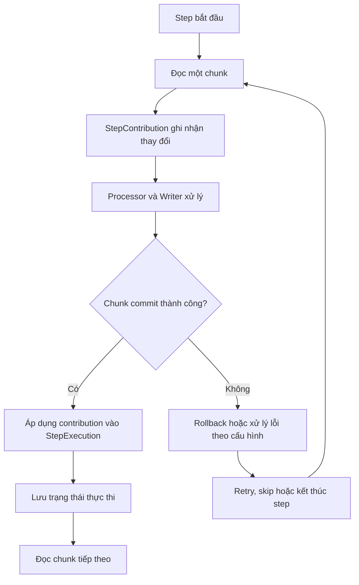

# Step contribution và số lượng đọc, ghi, bỏ qua

Khi một step của Spring Batch xử lý dữ liệu, framework không chỉ cần biết step thành công hay thất bại. Nó còn phải ghi nhận đã đọc bao nhiêu item, ghi được bao nhiêu item, lọc bao nhiêu item và bỏ qua bao nhiêu item do lỗi. Những con số này giúp nhóm phát triển hiểu kết quả xử lý, theo dõi tiến độ, điều tra dữ liệu bất thường và quyết định có cần chạy lại công việc hay không.

Hai khái niệm quan trọng để hiểu các số liệu đó là **`StepContribution`** và **`StepExecution`**. `StepContribution` ghi nhận phần thay đổi phát sinh trong một đơn vị thực thi, chẳng hạn một chunk. `StepExecution` giữ thông tin tổng hợp của một lần chạy step, bao gồm các bộ đếm đã được cập nhật từ những contribution được áp dụng.

## 1. StepExecution lưu kết quả của một lần chạy step

Một job thường gồm một hoặc nhiều step. Mỗi lần một step được thực thi, Spring Batch tạo một đối tượng `StepExecution` để lưu trạng thái và số liệu của lần chạy đó.

`StepExecution` có thể lưu những thông tin như:

- Tên step và ID của lần thực thi.
- Thời điểm bắt đầu, thời điểm kết thúc và thời gian thực thi.
- `BatchStatus` và `ExitStatus`.
- Số item đã đọc, đã ghi và đã bị lọc.
- Số item bị bỏ qua ở giai đoạn đọc, xử lý hoặc ghi.
- Số lần commit và rollback.
- `ExecutionContext` dùng để lưu trạng thái cần thiết cho việc tiếp tục step.

Ví dụ, step `importCustomerStep` đọc dữ liệu khách hàng từ tệp CSV, kiểm tra từng bản ghi rồi ghi dữ liệu hợp lệ vào cơ sở dữ liệu. Khi step kết thúc, `StepExecution` cung cấp số liệu cho biết đã đọc bao nhiêu bản ghi, bao nhiêu bản ghi được ghi, bao nhiêu bản ghi bị lọc hoặc bị bỏ qua.

`StepExecution` thuộc về một lần thực thi step. Nó không phải định nghĩa step trong cấu hình và cũng không phải trạng thái tổng hợp của toàn bộ lịch sử mọi lần chạy. Khi step được chạy lại, cần xem đúng execution tương ứng để hiểu các bộ đếm.

## 2. StepContribution ghi nhận phần đóng góp của một đơn vị xử lý

Trong mô hình xử lý theo chunk, Spring Batch chia dữ liệu thành các nhóm item. Mỗi chunk được đọc, xử lý, ghi và commit như một đơn vị giao dịch. Trong quá trình xử lý đơn vị đó, framework ghi nhận các thay đổi về số liệu vào một `StepContribution`.

Có thể hiểu quan hệ giữa hai đối tượng như sau:

- **`StepContribution`** chứa phần tăng thêm của các bộ đếm phát sinh trong một đơn vị thực thi.
- **`StepExecution`** chứa số liệu tích lũy của lần chạy step.
- Khi đơn vị xử lý hoàn tất và được commit theo cơ chế của step, contribution được áp dụng vào execution để cập nhật số liệu tổng hợp.

Ví dụ, một step xử lý chunk 100 item. Trong chunk đó, reader đọc 100 item, processor lọc 4 item, 1 item bị bỏ qua do lỗi xử lý và writer ghi thành công 95 item. Contribution của chunk phản ánh phần số liệu phát sinh từ lần xử lý đó. Sau khi chunk được commit, số liệu được cộng vào `StepExecution`.



Sơ đồ thể hiện ý tưởng chung. Cách framework xử lý contribution trong các nhánh retry, rollback và skip có chi tiết phụ thuộc vào loại lỗi và cấu hình fault-tolerant. Khi xem số liệu vận hành, nên đọc bộ đếm đã được ghi nhận trong `StepExecution` sau khi chunk ổn định thay vì tự cộng các sự kiện log trung gian.

## 3. Các bộ đếm đọc, ghi và lọc

Trong step xử lý item, các bộ đếm phổ biến phản ánh những giai đoạn khác nhau của pipeline.

### readCount — số item đã đọc

`readCount` là số item được `ItemReader` đọc thành công và trả về cho step. Mỗi lần reader trả về một item hợp lệ, số lượng đọc được tăng tương ứng.

Khi reader trả về `null` để báo hết dữ liệu, đó là tín hiệu kết thúc, không phải một item được đọc. Vì vậy, lần trả về `null` cuối cùng không làm tăng `readCount`.

Nếu reader phát sinh exception và exception được cấu hình để skip, item không đọc được sẽ được ghi nhận ở `readSkipCount`, không được tính như một item đã đọc thành công.

### writeCount — số item đã ghi

`writeCount` phản ánh số item được ghi thành công bởi `ItemWriter`. Trong chunk-oriented processing, writer thường nhận một danh sách item đã qua bước đọc và xử lý.

`writeCount` có thể nhỏ hơn `readCount` vì:

- Processor lọc một số item bằng cách trả về `null`.
- Một số item bị bỏ qua do exception được phép skip.
- Một số item không đi đến writer vì flow hoặc logic xử lý loại chúng khỏi đầu ra.

Không nên xem `writeCount` là số lần writer được gọi. Một lần gọi writer có thể ghi nhiều item; số liệu này nói về số item được ghi, không phải số invocation của phương thức.

### filterCount — số item bị lọc

Trong `ItemProcessor`, trả về `null` có nghĩa item đó được lọc khỏi luồng đầu ra. Item đã được reader đọc nhưng không được chuyển cho writer.

Ví dụ, một tệp chứa cả khách hàng đang hoạt động và khách hàng đã đóng tài khoản. Nếu chỉ cần nhập khách hàng đang hoạt động, processor có thể trả về `null` cho những khách hàng đã đóng tài khoản. Những item này được phản ánh trong `filterCount`.

Lọc dữ liệu là một quyết định xử lý bình thường, không nhất thiết là lỗi. Vì vậy, `filterCount` tách biệt với các bộ đếm skip.

## 4. Các bộ đếm skip theo từng giai đoạn

Spring Batch phân biệt item bị bỏ qua do lỗi xảy ra ở đâu trong pipeline. Ba bộ đếm chính là `readSkipCount`, `processSkipCount` và `writeSkipCount`.

### readSkipCount — lỗi khi đọc

`readSkipCount` tăng khi `ItemReader` gặp exception và chính sách skip cho phép bỏ qua lỗi đó.

Ví dụ, reader đọc một tệp đầu vào và gặp một dòng không đúng định dạng. Nếu exception tương ứng được cấu hình là skippable và skip limit chưa bị vượt quá, Spring Batch có thể bỏ qua dòng lỗi để tiếp tục đọc các dòng tiếp theo.

Item gây lỗi đọc không trở thành một item đọc thành công, do đó không được cộng vào `readCount`. Số lượng lỗi được bỏ qua được phản ánh trong `readSkipCount`.

### processSkipCount — lỗi khi xử lý

`processSkipCount` tăng khi `ItemProcessor` phát sinh exception và exception đó được cho phép skip.

Ví dụ, processor chuyển đổi chuỗi ngày thành `LocalDate`. Một bản ghi có ngày không hợp lệ khiến processor ném exception. Nếu chính sách cho phép skip loại lỗi này, bản ghi được bỏ qua và step tiếp tục.

Item đó đã được reader đọc thành công, vì vậy vẫn nằm trong `readCount`. Tuy nhiên, nó không được chuyển thành kết quả đầu ra cho writer.

### writeSkipCount — lỗi khi ghi

`writeSkipCount` tăng khi `ItemWriter` gặp exception và chính sách skip cho phép bỏ qua item gây lỗi.

Ví dụ, writer ghi các khách hàng vào cơ sở dữ liệu nhưng một bản ghi vi phạm ràng buộc dữ liệu. Nếu lỗi được phân loại là skippable, Spring Batch có thể xác định item gây lỗi và tiếp tục với các item còn lại theo cơ chế xử lý skip của writer.

Xử lý lỗi ghi có thể phức tạp hơn lỗi đọc hoặc xử lý vì writer thường nhận cả một chunk. Tùy writer, transaction và cấu hình, framework có thể cần rollback chunk rồi thử lại hoặc cô lập item lỗi. Vì thế, không nên giả định mọi writer đều có thể bỏ qua một item mà không ảnh hưởng đến các item khác.

### skipCount — tổng số item bị bỏ qua

`skipCount` là tổng số skip ở cả ba giai đoạn:

\[
\text{skipCount} = \text{readSkipCount} + \text{processSkipCount} + \text{writeSkipCount}
\]

Ví dụ, nếu step có 2 lỗi đọc được skip, 3 lỗi xử lý được skip và 1 lỗi ghi được skip, tổng `skipCount` là 6.

Việc phân tách theo giai đoạn giúp tìm nguyên nhân. Tổng skip bằng 6 chỉ cho biết có 6 item bị bỏ qua; các bộ đếm chi tiết cho biết lỗi tập trung ở nguồn dữ liệu, logic xử lý hay hệ thống đích.

## 5. Phân biệt filter và skip

`filterCount` và `skipCount` thường bị nhầm lẫn vì cả hai đều làm cho item không đến được writer. Tuy nhiên, ý nghĩa của chúng khác nhau.

| Tiêu chí | Filter | Skip |
|---|---|---|
| Nguyên nhân | Processor chủ động trả về `null` | Một exception được chính sách cho phép bỏ qua |
| Có phải lỗi không? | Không nhất thiết; đây là quyết định nghiệp vụ | Có exception xảy ra, nhưng ứng dụng chọn tiếp tục |
| Bộ đếm | `filterCount` | `readSkipCount`, `processSkipCount` hoặc `writeSkipCount` |
| Ví dụ | Loại khách hàng không thuộc phạm vi nhập | Dòng CSV sai định dạng hoặc bản ghi không ghi được |
| Item có đến writer không? | Không | Không, nếu đã được skip |

Ví dụ: hệ thống chỉ nhập khách hàng có trạng thái `ACTIVE`. Khách hàng `INACTIVE` được processor trả về `null`, nên được tính là filter. Nếu một khách hàng `ACTIVE` có ngày sinh sai định dạng khiến processor ném exception và lỗi được skip, bản ghi đó được tính là process skip.

Không nên dùng skip để biểu diễn mọi quyết định loại dữ liệu. Nếu dữ liệu hợp lệ nhưng không thuộc phạm vi nghiệp vụ, filter thường mô tả đúng ý nghĩa hơn.

## 6. Ví dụ tính các bộ đếm trong một chunk

Giả sử một chunk có 100 bản ghi đầu vào. Trong quá trình xử lý:

- Reader đọc thành công 100 item.
- Processor lọc 5 item vì chúng không thuộc phạm vi nghiệp vụ.
- Processor phát sinh lỗi ở 2 item; cả hai lỗi được cho phép skip.
- Writer gặp lỗi ở 1 item; lỗi được cho phép skip.
- Writer ghi thành công 92 item còn lại.

Các số liệu của chunk có thể được minh họa như sau:

| Bộ đếm | Giá trị | Giải thích |
|---|---:|---|
| `readCount` | 100 | 100 item được đọc thành công |
| `filterCount` | 5 | 5 item bị processor lọc |
| `readSkipCount` | 0 | Không có lỗi đọc được skip |
| `processSkipCount` | 2 | 2 item bị skip do lỗi processor |
| `writeSkipCount` | 1 | 1 item bị skip do lỗi writer |
| `skipCount` | 3 | Tổng 2 + 1 + 0 |
| `writeCount` | 92 | 92 item được ghi thành công |

Trong ví dụ đơn giản này, có thể đối chiếu:

\[
100 = 5 + 2 + 1 + 92
\]

Tức là 100 item đã đọc được chia thành 5 item filter, 3 item skip và 92 item ghi thành công. Đây là cách đối chiếu minh họa cho một luồng xử lý không có biến động khác. Trong job thực tế, cần tính đến reader lỗi trước khi trả item, retry, rollback, writer có hành vi đặc thù và nhiều chunk khác nhau; không nên áp dụng một đẳng thức tổng quát cho mọi loại step.

## 7. Skip policy và skip limit

Spring Batch cho phép cấu hình những loại exception nào được phép skip. Chính sách này cần dựa trên ý nghĩa nghiệp vụ của lỗi.

Ví dụ, ứng dụng nhập dữ liệu có thể cho phép bỏ qua `FlatFileParseException` vì một số dòng tệp bị sai định dạng, nhưng không cho phép bỏ qua lỗi mất kết nối cơ sở dữ liệu. Dữ liệu sai định dạng có thể được đưa vào báo cáo lỗi để xử lý sau; lỗi hạ tầng có thể cần retry hoặc làm step thất bại.

Skip limit xác định số lượng lỗi tối đa mà step chấp nhận bỏ qua. Số lượng này được tính tổng qua lỗi đọc, xử lý và ghi, không phải một giới hạn độc lập cho từng giai đoạn. Khi số lần skip vượt quá giới hạn, step sẽ thất bại.

Ví dụ, nếu cấu hình skip limit là 10:

- Những lần skip trong phạm vi giới hạn được chấp nhận.
- Khi phát sinh lần skip vượt quá giới hạn, step không tiếp tục bỏ qua lỗi đó và kết thúc thất bại.

Không phải mọi exception đều tự động được skip. Cần khai báo rõ loại lỗi được phép bỏ qua; lỗi không nằm trong chính sách hoặc vượt giới hạn có thể làm step thất bại.

Retry và skip cũng là hai quyết định khác nhau:

- **Retry** thử thực hiện lại thao tác khi lỗi được xem là tạm thời, chẳng hạn timeout ngắn hoặc lỗi khóa dữ liệu có thể biến mất.
- **Skip** chấp nhận bỏ qua item sau khi lỗi được phân loại là có thể bỏ qua.

Nếu một thao tác retry thành công, item không bị skip chỉ vì trước đó đã có lần thử thất bại. Skip count phản ánh item cuối cùng bị bỏ qua theo chính sách, không phải tổng số lần exception xuất hiện trong mọi lần thử.

## 8. Commit, rollback và ý nghĩa của số liệu

Trong chunk-oriented processing, transaction thường bao quanh việc xử lý và ghi một chunk. Khi chunk thành công, transaction commit và contribution được áp dụng vào `StepExecution`. Khi chunk rollback, framework có thể retry, xử lý skip hoặc kết thúc step tùy cấu hình.

Các bộ đếm cần được hiểu trong bối cảnh giao dịch:

- **`commitCount`** cho biết số lần commit được ghi nhận trong step.
- **`rollbackCount`** cho biết số lần rollback được ghi nhận.
- **`readCount` và `writeCount`** phản ánh kết quả xử lý item được ghi vào metadata step, không phải số dòng log hoặc số lần gọi reader/writer.
- **Các bộ đếm skip** phản ánh item đã bị bỏ qua theo chính sách skip; retry tạm thời không đồng nghĩa với skip.

Một chunk có thể được thử lại sau rollback. Vì vậy, log có thể cho thấy reader hoặc writer đã được gọi nhiều lần trong khi số liệu cuối cùng của step chỉ phản ánh kết quả thực thi được framework ghi nhận. Khi phân tích, nên ưu tiên `StepExecution` và lịch sử execution trong repository thay vì tự cộng số lần gọi từ log.

Ngoài ra, transaction của Spring Batch thường không bao trùm mọi hệ thống bên ngoài. Nếu writer gửi HTTP request, gửi email hoặc ghi tệp trên một máy chủ khác, rollback cơ sở dữ liệu không nhất thiết hoàn tác tác dụng phụ đó. Bộ đếm của step cũng không thể chứng minh hệ thống ngoài đã thực hiện đúng một lần. Với các thao tác này, nên thiết kế idempotency, khóa nghiệp vụ hoặc cơ chế đối soát.

## 9. Đọc các bộ đếm từ StepExecution

Sau khi truy xuất được `StepExecution`, ứng dụng có thể đọc các số liệu qua những phương thức tương ứng. Ví dụ sau minh họa cách ghi log trong một `StepExecutionListener`:

```java
import org.springframework.batch.core.ExitStatus;
import org.springframework.batch.core.StepExecution;
import org.springframework.batch.core.StepExecutionListener;

public class StepMetricsListener implements StepExecutionListener {

    @Override
    public ExitStatus afterStep(StepExecution stepExecution) {
        System.out.println("Step: " + stepExecution.getStepName());
        System.out.println("Status: " + stepExecution.getStatus());
        System.out.println("Read: " + stepExecution.getReadCount());
        System.out.println("Write: " + stepExecution.getWriteCount());
        System.out.println("Filter: " + stepExecution.getFilterCount());
        System.out.println("Read skip: " + stepExecution.getReadSkipCount());
        System.out.println("Process skip: " + stepExecution.getProcessSkipCount());
        System.out.println("Write skip: " + stepExecution.getWriteSkipCount());
        System.out.println("Total skip: " + stepExecution.getSkipCount());
        System.out.println("Commit: " + stepExecution.getCommitCount());
        System.out.println("Rollback: " + stepExecution.getRollbackCount());

        return stepExecution.getExitStatus();
    }
}
```

Listener trên chỉ đọc và hiển thị số liệu sau step. Nó trả lại `ExitStatus` hiện tại để không vô tình thay đổi kết quả của step. Trong ứng dụng thực tế, có thể gửi các số liệu này tới hệ thống metrics hoặc lưu báo cáo theo job execution.

Để theo dõi step đang chạy, có thể đọc `StepExecution` qua cơ chế quan sát phù hợp của ứng dụng hoặc `JobExplorer`. Không nên chỉ chờ `afterStep`, vì callback đó chạy khi step kết thúc; dashboard tiến độ cần lấy snapshot metadata trong lúc execution vẫn đang hoạt động.

## 10. Dùng số liệu để điều tra dữ liệu và vận hành

Các bộ đếm hữu ích nhất khi được đọc cùng nhau và đặt trong bối cảnh của nguồn dữ liệu, step và lần chạy cụ thể.

### Khi readCount thấp hơn dự kiến

Kiểm tra phạm vi dữ liệu, điều kiện truy vấn, vị trí bắt đầu của reader, tệp đầu vào và lỗi đọc. Nếu `readSkipCount` tăng, có thể nguồn dữ liệu có bản ghi không đọc được. Nếu reader kết thúc sớm nhưng skip count bằng 0, có thể truy vấn hoặc điều kiện chọn dữ liệu không bao gồm những bản ghi mong đợi.

### Khi readCount cao nhưng writeCount thấp

Kiểm tra `filterCount`, các bộ đếm skip và logic processor. Nhiều item bị filter có thể là kết quả đúng nếu nghiệp vụ chủ động loại dữ liệu. `processSkipCount` cao có thể cho thấy dữ liệu đầu vào không phù hợp hoặc quy tắc chuyển đổi có vấn đề. `writeSkipCount` cao có thể chỉ ra ràng buộc hoặc chất lượng dữ liệu ở hệ thống đích.

### Khi skip count tăng đột biến

Xem bộ đếm chi tiết theo giai đoạn và exception tương ứng. Đừng chỉ xem tổng skip. Một đợt tăng `readSkipCount` có thể liên quan tới thay đổi định dạng tệp; `processSkipCount` có thể do dữ liệu nghiệp vụ mới; `writeSkipCount` có thể do schema hoặc ràng buộc cơ sở dữ liệu thay đổi.

### Khi rollback count tăng

Kiểm tra lỗi transaction, deadlock, timeout, lỗi writer và chính sách retry. Rollback nhiều lần có thể làm giảm thông lượng và kéo dài thời gian chạy, ngay cả khi cuối cùng job vẫn `COMPLETED`.

### Khi writeCount bằng 0

Điều này không nhất thiết có nghĩa reader không hoạt động. Có thể không có dữ liệu đầu vào, tất cả item bị filter, tất cả item bị skip hoặc writer không ghi được item nào. Cần xem đồng thời `readCount`, `filterCount` và ba bộ đếm skip.

## 11. Ví dụ: nhập khách hàng từ tệp CSV

Giả sử tệp `customers.csv` có 10.000 dòng dữ liệu. Step `importCustomerStep` dùng reader để đọc dòng, processor để chuẩn hóa và kiểm tra, writer để lưu khách hàng.

Sau khi step kết thúc, số liệu được ghi nhận như sau:

| Chỉ số | Giá trị |
|---|---:|
| `readCount` | 9.990 |
| `filterCount` | 1.200 |
| `readSkipCount` | 10 |
| `processSkipCount` | 25 |
| `writeSkipCount` | 5 |
| `skipCount` | 40 |
| `writeCount` | 8.760 |

Diễn giải:

1. Có 10 dòng không đọc được và được skip, vì vậy 9.990 item được reader trả về thành công.
2. Processor chủ động lọc 1.200 khách hàng không thuộc phạm vi nhập.
3. Có 25 item gây lỗi xử lý và được skip.
4. Có 5 item gây lỗi ghi và được skip.
5. Writer ghi thành công 8.760 item.

Các số liệu trên giúp nhóm vận hành trả lời những câu hỏi khác nhau: nguồn có bao nhiêu item đọc được, nghiệp vụ đã loại bao nhiêu khách hàng, dữ liệu lỗi xuất hiện ở giai đoạn nào và hệ thống đích đã nhận được bao nhiêu item.

Nếu `processSkipCount` tăng mạnh so với các ngày trước, nhóm phát triển có thể kiểm tra quy tắc chuẩn hóa hoặc dữ liệu mới từ hệ thống nguồn. Nếu `writeSkipCount` tăng, cần xem ràng buộc ở cơ sở dữ liệu đích và exception của writer. Việc phân loại này giúp xử lý đúng nguyên nhân thay vì chỉ tăng skip limit để job tiếp tục chạy.

## 12. Lưu ý khi đọc số liệu trong các kiểu step khác nhau

Các bộ đếm item đặc biệt có ý nghĩa trong chunk-oriented step sử dụng `ItemReader`, `ItemProcessor` và `ItemWriter`. Với tasklet step thực hiện một tác vụ như gọi stored procedure hoặc dọn tệp, không có pipeline item tiêu chuẩn nên các bộ đếm read/write/filter có thể bằng 0. Điều đó không có nghĩa tasklet không làm việc; nó chỉ không xử lý item theo mô hình reader-processor-writer.

Nếu tasklet tự quản lý việc đọc hoặc ghi, ứng dụng có thể cập nhật contribution phù hợp khi cần báo cáo số liệu. Tuy nhiên, chỉ nên tăng bộ đếm theo đúng ý nghĩa của nó. Ví dụ, không nên tăng `writeCount` chỉ vì đã gọi một stored procedure nếu con số đó không đại diện cho số item thực sự được ghi.

Với partitioned step, mỗi partition có execution và số liệu riêng. Khi xây dựng báo cáo tổng hợp, cần xác định rõ đang xem số liệu của partition, step execution điều phối hay tổng hợp toàn bộ partition để tránh cộng trùng.

Khi restart một job, cần phân biệt số liệu của execution hiện tại với lịch sử các execution trước. Một lần chạy lại có thể có `StepExecution` mới. Không cộng tất cả số liệu của mọi lần thử thành tổng số item duy nhất nếu các chunk hoặc item có thể đã được đọc lại trong quá trình restart.

## 13. Những nguyên tắc cần nhớ

- `StepContribution` ghi nhận phần thay đổi của một đơn vị xử lý; `StepExecution` lưu số liệu tích lũy của một lần chạy step.
- `readCount` là số item reader trả về thành công; tín hiệu kết thúc `null` không phải item.
- `writeCount` là số item được ghi thành công, không phải số lần gọi writer.
- `filterCount` là số item processor chủ động loại bằng cách trả về `null`.
- `readSkipCount`, `processSkipCount` và `writeSkipCount` phân loại item bị bỏ qua theo giai đoạn xảy ra lỗi.
- `skipCount` là tổng của ba bộ đếm skip.
- Filter và skip có ý nghĩa khác nhau: filter là quyết định xử lý; skip là cách tiếp tục sau một exception được cho phép.
- Skip limit áp dụng cho tổng số skip của step; retry là thử lại và không tự động làm tăng skip count.
- Đọc các bộ đếm cùng `BatchStatus`, `ExitStatus`, commit/rollback và log exception để hiểu đúng kết quả.
- Với tasklet hoặc partition, cần hiểu cấu trúc thực thi trước khi diễn giải hay tổng hợp các số liệu item.

Khi hiểu rõ `StepContribution` và các bộ đếm trong `StepExecution`, nhóm phát triển có thể giải thích được dữ liệu đã đi qua step như thế nào, phần nào bị lọc, phần nào bị bỏ qua do lỗi và số item thực sự được ghi. Đây là nền tảng để theo dõi chất lượng dữ liệu và vận hành batch job một cách có kiểm soát.
