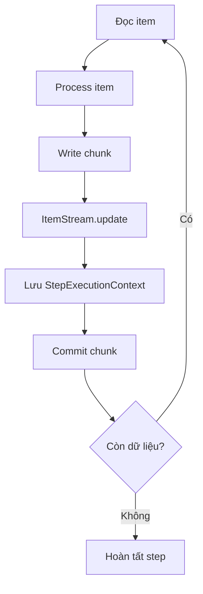

# StepExecutionContext lưu trạng thái gì?

Trong Spring Batch, mỗi `StepExecution` có một `ExecutionContext` riêng để lưu trạng thái mà step cần giữ lại giữa các lần commit và dùng khi restart. Context này thường được gọi là **Step ExecutionContext** hoặc `StepExecutionContext`, dù kiểu dữ liệu trong API là `ExecutionContext` và được truy cập qua `stepExecution.getExecutionContext()`.

Nó chủ yếu lưu checkpoint và dữ liệu trạng thái nhỏ cần thiết để tiếp tục step, chẳng hạn vị trí reader đã đọc đến đâu, trang dữ liệu tiếp theo cần xử lý, khóa cuối cùng đã hoàn tất hoặc thông tin trung gian chỉ step đó sử dụng. Spring Batch lưu context cùng metadata thực thi trong `JobRepository`, nhờ đó step có thể khôi phục trạng thái đã lưu khi được restart.

Điều quan trọng là phân biệt context này với các thông tin khác của batch. `StepExecution` đã có những trường riêng cho trạng thái thực thi và bộ đếm như `readCount`, `writeCount`, `commitCount`, `rollbackCount`, `filterCount`, số item bị skip, `BatchStatus` và `ExitStatus`. `ExecutionContext` là vùng key-value bổ sung để ứng dụng hoặc reader/writer lưu trạng thái cần khôi phục; nó không phải nơi chứa toàn bộ dữ liệu đã xử lý.

## 1. Step ExecutionContext là gì?

`ExecutionContext` là một cấu trúc key-value được Spring Batch quản lý và lưu bền vững thông qua `JobRepository`. Trong mỗi step execution, context được gắn với đối tượng `StepExecution`:

```java
ExecutionContext stepContext = stepExecution.getExecutionContext();
```

Ứng dụng có thể ghi hoặc đọc các giá trị theo khóa:

```java
stepContext.putLong("orders.lastProcessedId", 8450L);

long lastProcessedId = stepContext.getLong(
        "orders.lastProcessedId", 0L);
```

Trong ví dụ, `orders.lastProcessedId` lưu mã đơn hàng cuối cùng mà step đã xử lý đến checkpoint. Khi step được khôi phục, ứng dụng có thể đọc giá trị này để tiếp tục từ phạm vi phù hợp.

Step ExecutionContext có các đặc điểm chính:

- **Phạm vi theo step:** context thuộc về một `StepExecution`, vì vậy dữ liệu trong đó dành cho step đó.
- **Có thể được lưu bền vững:** Spring Batch lưu context trong metadata repository, không chỉ giữ trong bộ nhớ của đối tượng Java.
- **Có thể khôi phục:** khi restart một step chưa hoàn thành, context đã lưu của lần thực thi trước có thể được dùng để khôi phục trạng thái.
- **Lưu theo checkpoint:** trong chunk-oriented processing, context được cập nhật tại các điểm commit theo vòng đời của step và các `ItemStream`.
- **Là dữ liệu key-value:** ứng dụng tự chọn khóa và giá trị, đồng thời phải bảo đảm các giá trị tương thích với cơ chế serialize được cấu hình.

Không có một lớp Java độc lập tên `StepExecutionContext` mà ứng dụng phải tạo. Tên gọi này thường chỉ `ExecutionContext` được lấy từ `StepExecution`.

## 2. Những loại trạng thái thường được lưu

### 2.1. Vị trí đọc hoặc checkpoint của reader

Đây là trường hợp sử dụng phổ biến nhất. Một step có thể xử lý hàng triệu dòng. Nếu tiến trình dừng sau khi đã commit một số chunk, lần restart cần biết reader nên tiếp tục từ đâu.

Ví dụ, reader đọc file có thể lưu số dòng hoặc vị trí đọc đã được xác nhận. Reader đọc database có thể lưu khóa cuối cùng đã xử lý hoặc thông tin phân trang. Reader xử lý dữ liệu theo ngày có thể lưu mốc thời gian hoặc partition hiện tại.

Các reader chuẩn của Spring Batch có hỗ trợ `ItemStream` thường tự lưu trạng thái cần thiết vào `ExecutionContext`. Ví dụ, các reader dựa trên `AbstractItemCountingItemStreamItemReader` duy trì vị trí item để có thể mở lại tại vị trí đã lưu. Cần kiểm tra reader cụ thể và cấu hình `saveState`; nếu tắt lưu trạng thái, reader đó sẽ không tự tạo checkpoint cho restart.

Ví dụ cấu hình `FlatFileItemReader`:

```java
@Bean
@StepScope
FlatFileItemReader<OrderInput> orderReader(
        @Value("#{jobParameters['inputFile']}") Resource inputFile) {

    return new FlatFileItemReaderBuilder<OrderInput>()
            .name("orderReader")
            .resource(inputFile)
            .delimited()
            .names("orderId", "customerId", "amount")
            .targetType(OrderInput.class)
            .build();
}
```

Reader được đặt tên ổn định bằng `.name("orderReader")`. Reader có thể dùng tên này để tạo các khóa trạng thái trong context. Khi step được cấu hình với reader triển khai `ItemStream`, Spring Batch gọi vòng đời `open`, `update` và `close` để reader quản lý checkpoint. Khi restart, reader sử dụng trạng thái đã lưu để tiếp tục đọc.

### 2.2. Trạng thái nội bộ của reader hoặc writer

Một reader tùy chỉnh có thể cần lưu trang hiện tại, offset, mã bản ghi cuối cùng hoặc trạng thái phân đoạn. Một writer có thể cần lưu thông tin checkpoint riêng nếu thiết kế của writer yêu cầu tiếp tục sau restart.

Ví dụ, một reader đọc dữ liệu theo trang có thể lưu `nextPage` thay vì lưu toàn bộ danh sách item. Khi mở lại step, reader lấy số trang từ context và tiếp tục truy vấn từ trang phù hợp.

Việc lưu trạng thái nội bộ nên được thực hiện thông qua giao diện `ItemStream`, vì giao diện này gắn việc mở, cập nhật và đóng tài nguyên với vòng đời của step:

```java
public interface ItemStream {
    void open(ExecutionContext executionContext);
    void update(ExecutionContext executionContext);
    void close();
}
```

`ItemStreamReader` và `ItemStreamWriter` kết hợp hợp đồng này với chức năng đọc hoặc ghi item. Spring Batch gọi `open()` khi step bắt đầu, `update()` tại checkpoint và `close()` khi step kết thúc. Nhờ vậy, reader/writer không cần tự quản lý việc truy cập trực tiếp vào bảng metadata của Spring Batch.

### 2.3. Trạng thái tùy chỉnh cần thiết để tiếp tục tasklet

Không phải step nào cũng dùng reader, processor và writer. Một tasklet có thể chia công việc thành nhiều lượt, ví dụ xử lý từng trang dữ liệu, từng file con hoặc từng partition nhỏ. Context có thể lưu đơn vị công việc cuối cùng đã hoàn tất để tasklet tiếp tục ở lượt kế tiếp.

Ví dụ tasklet xử lý lần lượt các trang:

```java
@Bean
Step processPagesStep(
        JobRepository jobRepository,
        PlatformTransactionManager transactionManager) {

    Tasklet processPages = (contribution, chunkContext) -> {
        ExecutionContext context =
                contribution.getStepExecution().getExecutionContext();

        int lastCompletedPage =
                context.getInt("pages.lastCompleted", 0);
        int pageToProcess = lastCompletedPage + 1;

        if (pageToProcess > totalPages()) {
            return RepeatStatus.FINISHED;
        }

        processPage(pageToProcess);
        context.putInt("pages.lastCompleted", pageToProcess);

        return pageToProcess == totalPages()
                ? RepeatStatus.FINISHED
                : RepeatStatus.CONTINUABLE;
    };

    return new StepBuilder("processPagesStep", jobRepository)
            .tasklet(processPages, transactionManager)
            .build();
}
```

Mỗi lượt tasklet xử lý một trang rồi cập nhật `pages.lastCompleted`. Khi trả về `RepeatStatus.CONTINUABLE`, tasklet được gọi tiếp; mỗi lượt được quản lý theo transaction của tasklet step. Khi tiến trình dừng sau một lượt đã commit, lần restart có thể đọc checkpoint đã lưu để tiếp tục ở trang tiếp theo.

Đoạn mã là ví dụ về cách lưu tiến độ. Trong ứng dụng thực tế, `totalPages()` cần trả về phạm vi ổn định trong suốt lần chạy, `processPage()` cần có hành vi an toàn khi retry, và thao tác cập nhật context phải nằm trong đúng ranh giới transaction của step.

### 2.4. Thông tin trung gian chỉ step hiện tại cần dùng

Một step có thể lưu một số giá trị nhỏ phục vụ chính logic tiếp tục của nó, chẳng hạn:

- Mã partition hoặc phân đoạn đang xử lý.
- Khóa cuối cùng đã hoàn tất trong một truy vấn phân trang.
- Tên hoặc định danh của file trung gian được tạo trong step.
- Số trang đã hoàn tất khi tasklet xử lý theo nhiều lượt.
- Một giá trị tổng hợp cần được khôi phục để tiếp tục bước tính toán.

Chỉ nên lưu dữ liệu cần thiết để khôi phục hoặc tiếp tục step. Nếu giá trị có thể tính lại dễ dàng và không ảnh hưởng đến tính đúng đắn, không nhất thiết phải lưu nó trong context.

## 3. Context được cập nhật và lưu vào lúc nào?

Để hiểu giá trị trong context có ý nghĩa gì, cần hiểu vòng đời checkpoint.

Với chunk-oriented step, Spring Batch thường thực hiện các thao tác sau:

1. Đọc item từ reader.
2. Chuyển item qua processor nếu có.
3. Ghi nhóm item trong writer.
4. Gọi `ItemStream.update()` để các thành phần stream cập nhật trạng thái cần checkpoint vào `ExecutionContext`.
5. Lưu metadata thực thi và context theo cơ chế transaction/checkpoint của step.
6. Commit chunk.

Sơ đồ khái quát:



Điểm mấu chốt: context phản ánh trạng thái đã được lưu tại checkpoint gần nhất. Nếu step xử lý thêm item sau checkpoint nhưng tiến trình dừng trước khi checkpoint mới được commit, lần restart có thể phải xử lý lại phần công việc sau checkpoint trước đó.

Vì vậy, không nên hiểu một lần gọi `put()` là trạng thái đã lập tức được ghi xuống database. `put()` cập nhật đối tượng context trong bộ nhớ; Spring Batch chịu trách nhiệm lưu context trong vòng đời thực thi và transaction của step. Với tài nguyên bên ngoài hoặc nhiều transaction manager, tính nguyên tử giữa metadata và tác động nghiệp vụ phụ thuộc vào cấu hình transaction. Không nên giả định một HTTP call, gửi email hoặc ghi sang hệ thống khác sẽ tự rollback cùng transaction database.

Với tasklet step, tasklet được thực thi trong vòng lặp do Spring Batch quản lý. Khi tasklet trả về `CONTINUABLE`, step có thể thực hiện lượt tiếp theo; trạng thái context được cập nhật qua các transaction của step. Khi tasklet trả về `FINISHED`, step kết thúc.

## 4. Spring Batch sử dụng ItemStream để lưu checkpoint như thế nào?

`ItemStream` là cơ chế chuẩn để reader và writer tham gia vào vòng đời checkpoint. Ba phương thức có vai trò khác nhau:

| Phương thức | Thời điểm và mục đích |
|---|---|
| `open(ExecutionContext)` | Khi step bắt đầu, đọc trạng thái đã lưu để khôi phục hoặc khởi tạo trạng thái ban đầu |
| `update(ExecutionContext)` | Tại checkpoint, ghi trạng thái nội bộ hiện tại vào context để Spring Batch lưu lại |
| `close()` | Khi step kết thúc, giải phóng tài nguyên như stream hoặc file handle |

Một reader tùy chỉnh có thể triển khai `ItemStreamReader` như sau:

```java
public class PagedOrderReader implements ItemStreamReader<OrderInput> {

    private static final String NEXT_PAGE_KEY = "pagedOrderReader.nextPage";

    private int nextPage;

    @Override
    public void open(ExecutionContext executionContext) {
        nextPage = executionContext.getInt(NEXT_PAGE_KEY, 0);
    }

    @Override
    public OrderInput read() {
        // Đọc item từ trang nextPage theo thứ tự ổn định.
        // Khi trang đã hết, chuyển sang trang tiếp theo theo logic reader.
        return readNextOrder();
    }

    @Override
    public void update(ExecutionContext executionContext) {
        executionContext.putInt(NEXT_PAGE_KEY, nextPage);
    }

    @Override
    public void close() {
        // Giải phóng tài nguyên nếu reader có mở tài nguyên.
    }
}
```

Đây là khung minh họa hợp đồng `ItemStream`; phần `readNextOrder()` và cách tăng `nextPage` phải được triển khai để bảo đảm giá trị được lưu là trang tiếp theo cần đọc tại checkpoint. Reader cũng cần xử lý rollback/retry đúng cách trong cùng lần chạy, giữ thứ tự dữ liệu ổn định và tránh bỏ sót hoặc đọc trùng khi restart.

Nếu reader hoặc writer được lồng bên trong một delegate khác, cần bảo đảm thành phần `ItemStream` bên trong được đăng ký với step để Spring Batch gọi `open`, `update` và `close`. Khi dùng builder chuẩn với reader/writer triển khai `ItemStream` được gắn trực tiếp vào step, framework thường tự nhận diện và quản lý vòng đời đó.

## 5. StepExecutionContext khác JobExecutionContext như thế nào?

Spring Batch có hai `ExecutionContext` thường được sử dụng:

- **Step ExecutionContext:** lấy từ `StepExecution.getExecutionContext()`, dành cho trạng thái riêng của một step và được cập nhật tại các checkpoint của step.
- **Job ExecutionContext:** lấy từ `JobExecution.getExecutionContext()`, dành cho dữ liệu cần chia sẻ giữa các step trong cùng một `JobExecution`.

So sánh:

| Tiêu chí | Step ExecutionContext | Job ExecutionContext |
|---|---|---|
| Phạm vi | Một `StepExecution` | Một `JobExecution` |
| Mục đích | Checkpoint và trạng thái riêng của step | Dữ liệu cần chuyển giữa các step |
| Thời điểm lưu | Tại các điểm commit/checkpoint của step | Thường được cập nhật khi step hoàn tất |
| Ví dụ | Trang reader tiếp theo, offset file, khóa cuối đã xử lý | Mã batch, đường dẫn artifact cần dùng ở step sau, kết quả tổng hợp |
| Truy cập | `stepExecution.getExecutionContext()` | `jobExecution.getExecutionContext()` |

Giả sử `validateInputStep` tạo ra một đường dẫn file đã chuẩn hóa và `importOrdersStep` cần sử dụng đường dẫn đó. Nếu giá trị chỉ nằm trong Step ExecutionContext của step đầu, step sau không tự động nhìn thấy nó. Có thể đưa khóa cần thiết lên Job ExecutionContext bằng `ExecutionContextPromotionListener`.

Ví dụ khai báo listener:

```java
@Bean
ExecutionContextPromotionListener promoteInputFile() {
    ExecutionContextPromotionListener listener =
            new ExecutionContextPromotionListener();
    listener.setKeys(new String[] {"validatedInputFile"});
    return listener;
}
```

Đăng ký listener với step tạo khóa:

```java
@Bean
Step validateInputStep(
        JobRepository jobRepository,
        PlatformTransactionManager transactionManager,
        ExecutionContextPromotionListener promoteInputFile) {

    return new StepBuilder("validateInputStep", jobRepository)
            .tasklet((contribution, chunkContext) -> {
                String path = validateAndResolveInputFile();

                contribution.getStepExecution()
                        .getExecutionContext()
                        .putString("validatedInputFile", path);

                return RepeatStatus.FINISHED;
            }, transactionManager)
            .listener(promoteInputFile)
            .build();
}
```

Khi step hoàn tất, listener chuyển khóa được cấu hình từ step context sang job context. Step sau có thể đọc giá trị từ `JobExecution.getExecutionContext()` hoặc tham chiếu qua `jobExecutionContext` trong một bean có `@StepScope`.

Không nên dùng Step ExecutionContext làm vùng chia sẻ ngầm giữa nhiều step. Nếu dữ liệu cần tồn tại xuyên suốt job, hãy cân nhắc Job ExecutionContext hoặc kho lưu trữ nghiệp vụ; nếu dữ liệu chỉ cần cho một step, giữ nó trong Step ExecutionContext.

## 6. Phân biệt ExecutionContext với JobParameters và StepExecution metadata

Ba loại dữ liệu này có mục đích khác nhau:

| Thành phần | Chứa gì? | Ví dụ |
|---|---|---|
| `JobParameters` | Tham số đầu vào xác định lần xử lý nghiệp vụ | `businessDate`, `inputFile`, `batchId` |
| `StepExecution` metadata | Trạng thái và số liệu framework theo dõi | `status`, `exitStatus`, `readCount`, `writeCount`, `commitCount`, `skipCount` |
| Step `ExecutionContext` | Trạng thái key-value cần giữ để khôi phục step | `reader.nextPage`, `file.currentOffset`, `orders.lastProcessedId` |

`JobParameters` thường được xem là đầu vào của job. Không nên thay đổi identifying parameters khi restart cùng một batch, vì bộ tham số khác có thể tạo `JobInstance` mới.

Các bộ đếm như `readCount` hoặc `writeCount` đã được Spring Batch quản lý trong `StepExecution`. Không cần tự sao chép chúng vào context trừ khi có lý do nghiệp vụ cụ thể. Context nên lưu trạng thái tùy chỉnh mà framework không thể tự suy ra từ các trường metadata có sẵn.

Ngoài ra, `StepContext` là một đối tượng khác được dùng trong cơ chế scope của Spring Batch. `StepContext` cung cấp thông tin của step hiện tại cho các bean theo step scope; nó không phải tên gọi thay thế cho `ExecutionContext`.

## 7. Truy cập Step ExecutionContext trong bean StepScope

Một bean có `@StepScope` được khởi tạo trong phạm vi step, vì vậy có thể đọc các giá trị trong execution context bằng SpEL. Ví dụ:

```java
@Bean
@StepScope
FlatFileItemReader<OrderInput> orderReader(
        @Value("#{stepExecutionContext['validatedInputFile']}") String filePath) {

    return new FlatFileItemReaderBuilder<OrderInput>()
            .name("orderReader")
            .resource(new FileSystemResource(filePath))
            .delimited()
            .names("orderId", "customerId", "amount")
            .targetType(OrderInput.class)
            .build();
}
```

Ở đây, `validatedInputFile` phải được ghi vào Step ExecutionContext trước khi reader được tạo. Nếu giá trị được đưa sang Job ExecutionContext, biểu thức tương ứng là `#{jobExecutionContext['validatedInputFile']}`. Để tham chiếu tham số đầu vào, có thể dùng `#{jobParameters['inputFile']}`.

Sử dụng `@StepScope` giúp trì hoãn việc tạo bean cho đến khi step bắt đầu, khi các giá trị runtime đã sẵn sàng. Nếu bean singleton được khởi tạo quá sớm, biểu thức cần dữ liệu của step có thể chưa được phân giải đúng thời điểm.

## 8. Quy tắc thiết kế dữ liệu trong context

ExecutionContext được lưu trong metadata repository, vì vậy cần thiết kế như một phần của dữ liệu bền vững.

**Chọn kiểu dữ liệu có thể serialize.** Giá trị đưa vào context phải tương thích với `ExecutionContextSerializer` được cấu hình cho ứng dụng. Các giá trị đơn giản như chuỗi, số và boolean thường phù hợp. Nếu lưu object tùy chỉnh, kiểu đó phải đáp ứng cơ chế serialize và tương thích khi ứng dụng restart sau khi được triển khai phiên bản mới.

**Lưu dữ liệu nhỏ, có ý nghĩa checkpoint.** Không đưa toàn bộ danh sách item, nội dung file lớn hoặc object đồ sộ vào context. Hãy lưu một khóa, offset, mã batch hoặc đường dẫn để tham chiếu dữ liệu nằm trong database hay file.

**Dùng key rõ ràng và ổn định.** Đặt tên có namespace như `orders.lastProcessedId` hoặc `input.currentPage`, tránh các khóa chung chung như `index` có thể đụng với thành phần khác. Giữ tên khóa ổn định giữa các lần restart.

**Không lưu đối tượng runtime.** Tránh lưu `Connection`, `EntityManager`, `InputStream`, `File`, thread, bean Spring hoặc object giữ tài nguyên đang mở. Các đối tượng này không phải trạng thái checkpoint có thể khôi phục sau khi tiến trình JVM kết thúc.

**Không lưu dữ liệu nhạy cảm nếu không cần.** Metadata repository là nơi lưu bền vững. Không đưa token, mật khẩu hoặc dữ liệu cá nhân vào context chỉ để tiện truyền giữa các thành phần. Nếu phải lưu thông tin nghiệp vụ nhạy cảm, cần áp dụng chính sách bảo vệ dữ liệu tương ứng.

**Bảo đảm giá trị được cập nhật đúng thời điểm.** Nếu lưu `lastProcessedId`, hãy xác định đó là ID đã đọc, đã xử lý hay đã commit. Với restart, giá trị cần biểu thị tiến độ đã được xác nhận tại checkpoint, không phải tiến độ mới chỉ tồn tại trong bộ nhớ.

**Giữ dữ liệu nguồn ổn định hoặc dùng khóa tiếp tục phù hợp.** Lưu chỉ số dòng hoặc offset chỉ đáng tin cậy khi nguồn dữ liệu và thứ tự đọc không thay đổi theo cách làm lệch vị trí. Với dữ liệu database, nên dùng thứ tự sắp xếp xác định và khóa tiếp tục phù hợp, chẳng hạn khóa chính hoặc cursor có tính ổn định.

## 9. Những điều Step ExecutionContext không tự đảm bảo

Context là một phần của cơ chế restart, nhưng chỉ lưu giá trị thôi chưa đủ để bảo đảm job chạy lại đúng.

- Nó không tự làm cho writer idempotent. Nếu một API đã nhận yêu cầu nhưng job chưa lưu checkpoint, restart có thể gửi yêu cầu lần nữa.
- Nó không tự rollback side effect đã xảy ra bên ngoài transaction.
- Nó không tự bảo đảm reader có thể khôi phục. Reader phải hỗ trợ `ItemStream` hoặc có cơ chế checkpoint riêng.
- Nó không tự bảo đảm dữ liệu nguồn vẫn giữ nguyên thứ tự hoặc nội dung giữa các lần chạy.
- Nó không tự chia sẻ dữ liệu cho step khác. Cần dùng Job ExecutionContext hoặc cơ chế promotion.
- Nó không thay thế `JobRepository`, transaction manager hoặc identifying `JobParameters`.
- Nó không phải bộ nhớ dùng chung an toàn cho các thread để điều phối đồng thời. Với step đa luồng hoặc partitioning, cần hiểu phạm vi `StepExecution` riêng của từng worker và thiết kế đồng bộ phù hợp.

Một job có thể có context được lưu rất tốt nhưng vẫn tạo dữ liệu trùng nếu writer thực hiện thao tác không idempotent. Vì vậy, checkpoint cần đi cùng thiết kế transaction, khóa nghiệp vụ và cách xử lý side effect.

## 10. Kiểm thử Step ExecutionContext và restart

Để kiểm tra context, nên mô phỏng một lần chạy bị gián đoạn rồi restart cùng `JobInstance` bằng cùng identifying parameters. Kiểm thử cần xác nhận trạng thái đã lưu được khôi phục và kết quả nghiệp vụ cuối cùng chính xác.

Một số tình huống nên kiểm tra:

1. **Lần chạy đầu:** context chưa có khóa checkpoint; reader hoặc tasklet bắt đầu từ trạng thái ban đầu.
2. **Sau một chunk commit:** context chứa vị trí hoặc khóa cuối cùng đã được xác nhận.
3. **Lỗi trước checkpoint tiếp theo:** restart dùng checkpoint đã lưu trước đó, vì vậy một phần công việc có thể được thực hiện lại.
4. **Restart:** reader đọc tiếp từ vị trí phù hợp, không bỏ sót dữ liệu.
5. **Chạy lại side effect:** writer hoặc dịch vụ ngoài không tạo kết quả trùng khi item được xử lý lại.
6. **Promotion:** khóa cần dùng ở step sau đã được chuyển sang Job ExecutionContext.
7. **Tương thích khi nâng cấp:** context được ghi bởi phiên bản ứng dụng trước vẫn có thể được đọc hoặc có kế hoạch chuyển đổi phù hợp.

Spring Batch cung cấp các tiện ích kiểm thử job và repository như `JobLauncherTestUtils` và `JobRepositoryTestUtils` trong module test tương ứng. Nên dùng metadata repository có hành vi gần với môi trường thật khi kiểm thử restart, đồng thời kiểm tra dữ liệu nghiệp vụ trong database hoặc output file. Chỉ kiểm tra rằng job có trạng thái `COMPLETED` chưa đủ để chứng minh checkpoint đã đúng.

## Kết luận

Step ExecutionContext lưu các giá trị key-value cần thiết để một step tiếp tục đúng từ checkpoint đã được lưu, phổ biến nhất là vị trí reader, trạng thái nội bộ của reader/writer và tiến độ tùy chỉnh của tasklet. Spring Batch quản lý việc cập nhật và lưu context trong vòng đời thực thi của step thông qua `JobRepository` và cơ chế transaction/checkpoint.

Hãy dùng Step ExecutionContext cho trạng thái riêng của step; dùng Job ExecutionContext cho dữ liệu cần chia sẻ giữa các step; dùng JobParameters cho đầu vào của lần chạy; và dùng các trường `StepExecution` cho bộ đếm cùng trạng thái framework đã quản lý. Khi các ranh giới này rõ ràng, job có thể restart dễ dự đoán hơn và tránh nhầm lẫn giữa tiến độ trong bộ nhớ với tiến độ đã được commit.
