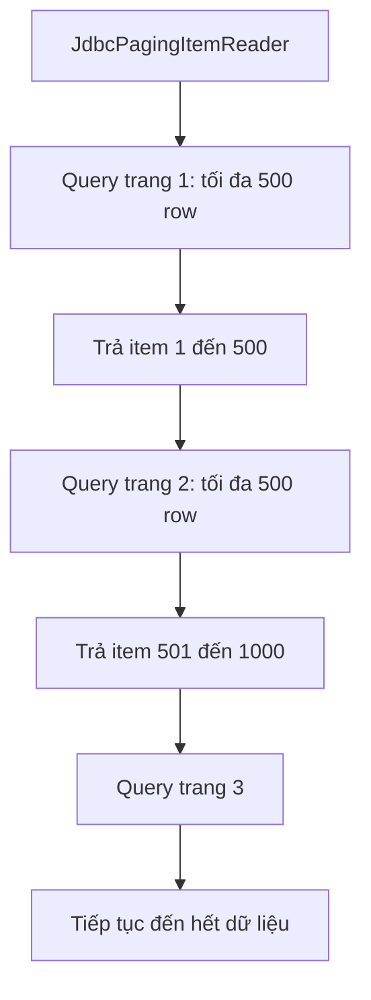
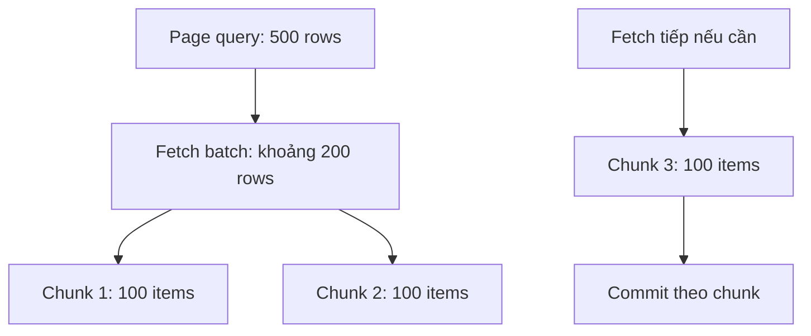

# Page size và fetch size

Khi Spring Batch đọc một lượng lớn dữ liệu từ database, hiệu năng không chỉ phụ thuộc vào câu SQL. Cách reader chia truy vấn thành các trang và cách JDBC driver lấy dữ liệu từ ResultSet cũng ảnh hưởng đến số lần round trip, bộ nhớ, thời gian xử lý và độ ổn định của job.

Hai cấu hình thường được nhắc đến là **page size** và **fetch size**:

- **Page size** quyết định số record mà một lần truy vấn phân trang của reader yêu cầu.
- **Fetch size** là gợi ý cho JDBC driver về số record nên lấy từ database trong mỗi lần fetch ResultSet.

Ngoài hai giá trị này, chunk size cũng rất quan trọng: nó quyết định số item được xử lý trong một chunk trước khi transaction commit. Ba giá trị có liên quan đến hiệu năng nhưng điều khiển ba phần khác nhau của pipeline.


Hiểu đúng ba thông số giúp tránh các cấu hình tưởng như tăng tốc nhưng lại làm tăng bộ nhớ, số truy vấn hoặc thời gian transaction.

## 1. Page size là gì?

Page size thường được dùng với **JdbcPagingItemReader**. Reader chia tập kết quả thành nhiều trang (page). Mỗi lần cần trang tiếp theo, reader thực hiện một truy vấn phân trang và lấy tối đa số row được cấu hình.

Ví dụ page size là 500:

1. Reader truy vấn trang đầu với tối đa 500 row.
2. Các item trong trang được trả dần cho step.
3. Khi trang hiện tại đã được tiêu thụ, reader truy vấn trang tiếp theo.
4. Quá trình tiếp tục đến khi không còn row.



Page size không phải số item được commit trong một transaction. Nó điều khiển kích thước trang của truy vấn paging.

### Cấu hình page size

Ví dụ Spring Batch 5:

```java
@Bean
JdbcPagingItemReader<Customer> customerReader(
        DataSource dataSource,
        PagingQueryProvider customerQueryProvider) {

    return new JdbcPagingItemReaderBuilder<Customer>()
            .name("customerReader")
            .dataSource(dataSource)
            .queryProvider(customerQueryProvider)
            .pageSize(500)
            .rowMapper((rs, rowNum) -> new Customer(
                    rs.getLong("id"),
                    rs.getString("name"),
                    rs.getString("email")))
            .saveState(true)
            .build();
}
```

Với cấu hình này, reader yêu cầu tối đa 500 row trong mỗi page query. Số row thực tế có thể ít hơn nếu trang cuối còn ít dữ liệu hoặc điều kiện truy vấn chỉ trả về một phần.

Page size lớn hơn thường giảm số lần chạy query phân trang, nhưng làm tăng lượng dữ liệu một trang được giữ trong bộ nhớ. Không nên chọn page size chỉ dựa vào tổng số row của bảng.

## 2. Cơ chế paging của JdbcPagingItemReader

JdbcPagingItemReader dùng PagingQueryProvider để tạo câu SQL phù hợp với database dialect. Provider sinh truy vấn trang đầu và các truy vấn trang tiếp theo dựa trên sort key và thông tin vị trí cuối của trang trước.

Ví dụ dữ liệu:

```text
id | customer_name
---+--------------
1  | An
2  | Binh
3  | Chi
4  | Dung
5  | Giang
```

Với page size là 2, reader lần lượt lấy:

| Trang | Các ID |
|---|---|
| 1 | 1, 2 |
| 2 | 3, 4 |
| 3 | 5 |

Truy vấn trang tiếp theo cần biết điểm bắt đầu sau trang trước. Tùy database, SQL có thể dùng row number, offset/fetch hoặc điều kiện keyset. Spring Batch QueryProvider chịu trách nhiệm sinh câu truy vấn phù hợp.

### Sort key phải ổn định

Paging cần một thứ tự xác định. Hãy cấu hình sort key có tính duy nhất, hoặc kết hợp các cột để tạo thứ tự duy nhất.

Ví dụ chỉ sort theo last_name có thể không ổn định nếu nhiều customer cùng họ. Nên dùng thêm id làm tie-breaker:

```java
Map<String, Order> sortKeys = new LinkedHashMap<>();
sortKeys.put("last_name", Order.ASCENDING);
sortKeys.put("id", Order.ASCENDING);
```

Nếu thứ tự không ổn định, record có thể bị bỏ sót hoặc đọc trùng giữa các trang, đặc biệt khi dữ liệu nguồn thay đổi trong lúc job chạy.

## 3. Fetch size là gì?

Fetch size là gợi ý cho JDBC driver về số row nên lấy từ database trong mỗi lượt fetch của ResultSet. Nó thường được cấu hình trên reader dùng JDBC cursor hoặc trên reader paging nếu phiên bản/implementation cung cấp thuộc tính tương ứng.

Ví dụ fetch size là 200:

- JDBC statement thực hiện query.
- Driver nhận gợi ý fetch 200 row mỗi lượt.
- Khi ứng dụng đọc ResultSet, driver có thể lấy dữ liệu theo từng nhóm thay vì truyền từng row riêng lẻ.
- Cách thực thi cụ thể phụ thuộc JDBC driver, database và cấu hình kết nối.

Fetch size là **hint**, không phải cam kết tuyệt đối. Driver có thể bỏ qua, diễn giải khác hoặc cần cấu hình bổ sung để thực sự dùng cursor/fetch theo batch.

### Cấu hình fetch size với JdbcCursorItemReader

JdbcCursorItemReader đọc qua một ResultSet mở trong thời gian step chạy. Ví dụ:

```java
@Bean
JdbcCursorItemReader<Customer> customerCursorReader(
        DataSource dataSource) {

    return new JdbcCursorItemReaderBuilder<Customer>()
            .name("customerCursorReader")
            .dataSource(dataSource)
            .sql("""
                    select id, name, email
                    from customer
                    order by id
                    """)
            .fetchSize(500)
            .rowMapper((rs, rowNum) -> new Customer(
                    rs.getLong("id"),
                    rs.getString("name"),
                    rs.getString("email")))
            .saveState(true)
            .build();
}
```

Ở đây không có page size vì JdbcCursorItemReader không chia kết quả thành các trang truy vấn như JdbcPagingItemReader. Fetch size gợi ý cách driver lấy dữ liệu cho ResultSet đang mở.

## 4. Phân biệt page size, fetch size và chunk size

Đây là ba thông số dễ bị nhầm nhất:

| Thông số | Điều khiển | Thường gặp ở | Ví dụ |
|---|---|---|---:|
| Page size | Số row tối đa trong một truy vấn/trang paging | JdbcPagingItemReader | 500 |
| Fetch size | Gợi ý số row driver lấy mỗi lượt từ ResultSet | JDBC cursor/paging statement | 200 |
| Chunk size | Số item xử lý trong một chunk trước commit | Chunk-oriented step | 100 |

Giả sử:

- Page size = 500.
- Fetch size = 200.
- Chunk size = 100.

Ý nghĩa:

1. Reader paging yêu cầu tối đa 500 row cho một trang.
2. JDBC driver có thể lấy ResultSet theo các lượt khoảng 200 row, nếu driver hỗ trợ fetch hint theo cách đó.
3. Spring Batch đưa item vào xử lý theo chunk 100 và commit theo transaction của chunk.

Không có quy tắc page size phải bằng chunk size hoặc fetch size. Chúng có thể bằng nhau trong một số cấu hình nhưng đó không phải yêu cầu kỹ thuật.



Sơ đồ chỉ minh họa ba lớp kích thước. Thứ tự fetch thực tế do driver quyết định; với paging reader, reader có thể tiêu thụ một page trong nhiều chunk.

## 5. Page size ảnh hưởng đến điều gì?

### Page size nhỏ

Ví dụ page size = 50:

- Mỗi query chỉ trả tối đa 50 row.
- Reader phải thực hiện nhiều query hơn để đọc cùng một lượng dữ liệu.
- Bộ nhớ dành cho page thường thấp hơn.
- Overhead round trip, parse query và khởi tạo ResultSet có thể tăng.

Page size nhỏ có thể phù hợp khi row object lớn, bộ nhớ hạn chế hoặc query mỗi trang tốn ít thời gian. Tuy nhiên, quá nhỏ có thể làm database và ứng dụng tốn nhiều chi phí điều phối.

### Page size lớn

Ví dụ page size = 5.000:

- Mỗi query lấy được nhiều row hơn.
- Số lần query paging có thể giảm.
- Reader giữ một trang lớn hơn trong bộ nhớ.
- Thời gian một lần query và mapping trang có thể dài hơn.
- Nếu một page query chậm, độ trễ trước khi item đầu tiên của trang tiếp theo được xử lý có thể tăng.

Page size lớn có thể cải thiện throughput với dữ liệu nhỏ gọn và database xử lý tốt, nhưng không phải lúc nào cũng nhanh hơn. Nếu mỗi item chứa nhiều cột hoặc object graph lớn, page lớn có thể gây áp lực heap và garbage collection.

## 6. Fetch size ảnh hưởng đến điều gì?

Fetch size ảnh hưởng đến cách driver trao đổi dữ liệu giữa database và JVM:

- Fetch size thấp có thể làm tăng số lượt trao đổi khi đọc ResultSet lớn.
- Fetch size cao có thể giảm số lượt fetch nhưng tăng bộ nhớ driver/client dùng để đệm row.
- Fetch size bằng 0 thường có nghĩa dùng mặc định của driver theo JDBC API/implementation.
- Driver có thể bỏ qua hoặc áp dụng khác với giá trị được yêu cầu.

Ví dụ query trả về 100.000 row:

| Fetch size | Hành vi dự kiến nếu driver hỗ trợ | Đánh đổi |
|---:|---|---|
| 10 | Nhiều lượt fetch nhỏ | Ít row đệm, nhiều round trip |
| 200 | Các lượt vừa phải | Cân bằng có thể phù hợp |
| 2.000 | Ít lượt fetch hơn | Đệm nhiều row hơn |
| 0 | Driver tự chọn | Phụ thuộc mặc định driver |

Đây là mô tả định hướng, không phải số lượt fetch được bảo đảm. Một số driver có thể materialize toàn bộ ResultSet hoặc yêu cầu chế độ cursor cụ thể.

## 7. Page size và fetch size trong JdbcPagingItemReader

JdbcPagingItemReader thực hiện nhiều query phân trang. Page size xác định kích thước mỗi trang. Một số cấu hình/phiên bản của reader cũng cho phép đặt fetch size cho JDBC statement được dùng khi thực hiện truy vấn trang.

Ví dụ cấu hình theo API builder có hỗ trợ cả hai thuộc tính:

```java
@Bean
JdbcPagingItemReader<Customer> customerPagingReader(
        DataSource dataSource,
        PagingQueryProvider queryProvider) {

    return new JdbcPagingItemReaderBuilder<Customer>()
            .name("customerPagingReader")
            .dataSource(dataSource)
            .queryProvider(queryProvider)
            .pageSize(1000)
            .fetchSize(500)
            .rowMapper(customerRowMapper())
            .saveState(true)
            .build();
}
```

Trong ví dụ:

- Mỗi trang yêu cầu tối đa 1.000 row.
- Fetch size 500 là gợi ý cho JDBC driver khi đọc ResultSet của query trang.
- Reader trả các item cho step; chunk size vẫn quyết định commit interval.

API builder và cách fetch size được áp dụng có thể khác theo phiên bản Spring Batch. Nếu builder của phiên bản dự án không cung cấp thuộc tính fetchSize, hãy dùng API reader/statement được phiên bản đó hỗ trợ; đừng giả định pageSize tự động đặt JDBC fetch size.

Nếu fetch size lớn hơn page size, một query trang vốn chỉ trả tối đa page size row nên fetch size lớn hơn thường không đem lại lợi ích rõ rệt cho query đó. Nếu fetch size nhỏ hơn page size, driver có thể cần nhiều lượt fetch để hoàn tất ResultSet của một trang.

## 8. JdbcCursorItemReader chỉ có fetch size

JdbcCursorItemReader mở một cursor/ResultSet và đọc tuần tự qua kết quả. Nó không thực hiện page query lặp lại theo page size.

Ví dụ:

```java
@Bean
JdbcCursorItemReader<Order> orderCursorReader(DataSource dataSource) {
    return new JdbcCursorItemReaderBuilder<Order>()
            .name("orderCursorReader")
            .dataSource(dataSource)
            .sql("""
                    select id, customer_id, amount
                    from orders
                    where business_date = ?
                    order by id
                    """)
            .preparedStatementSetter(statement ->
                    statement.setDate(
                            1,
                            Date.valueOf(LocalDate.of(2026, 11, 15))))
            .fetchSize(500)
            .rowMapper((rs, rowNum) -> new Order(
                    rs.getLong("id"),
                    rs.getString("customer_id"),
                    rs.getBigDecimal("amount")))
            .saveState(true)
            .build();
}
```

Fetch size ở đây là gợi ý cho driver về việc đọc ResultSet. Nếu database/driver không hỗ trợ streaming theo cách mong muốn, việc tăng fetch size có thể không làm giảm memory footprint như dự kiến.

Cursor reader giữ tài nguyên database trong thời gian đọc. Cần đánh giá thời gian mở cursor, connection pool, transaction lifecycle và khả năng restart trước khi chọn nó cho job chạy lâu.

## 9. Chọn JdbcPagingItemReader hay JdbcCursorItemReader?

Hai reader giải quyết việc đọc dữ liệu lớn theo cách khác nhau:

| Tiêu chí | JdbcPagingItemReader | JdbcCursorItemReader |
|---|---|---|
| Cách đọc | Nhiều query theo trang | Một query mở ResultSet/cursor |
| Page size | Có | Không |
| Fetch size | Có thể cấu hình tùy API/implementation | Là cấu hình quan trọng cho JDBC fetch |
| Kết nối/cursor | Query theo từng page | Giữ cursor/connection trong thời gian đọc |
| Restart | Dựa vào paging state và sort key | Dựa vào state/row position theo reader |
| Thay đổi dữ liệu nguồn | Cần thứ tự và điều kiện paging ổn định | Cần hiểu snapshot/cursor semantics |
| Phù hợp | Paging/keyset và restart qua query | Đọc tuần tự từ cursor khi connection lifecycle phù hợp |

Không có reader nào luôn nhanh hơn. Hãy chọn theo database, driver, quy mô dữ liệu, tính ổn định của sort key, yêu cầu restart và thời gian giữ connection.

## 10. Cấu hình query provider và sort key

JdbcPagingItemReader cần PagingQueryProvider hoặc thông tin query để tạo truy vấn phân trang. Query provider phải biết select, from, where và sort keys.

Ví dụ cấu hình provider:

```java
@Bean
SqlPagingQueryProviderFactoryBean customerQueryProvider(
        DataSource dataSource) {

    SqlPagingQueryProviderFactoryBean provider =
            new SqlPagingQueryProviderFactoryBean();
    provider.setDataSource(dataSource);
    provider.setSelectClause("select id, name, email");
    provider.setFromClause("from customer");
    provider.setWhereClause("where active = :active");
    provider.setSortKey("id");
    return provider;
}
```

Reader:

```java
@Bean
JdbcPagingItemReader<Customer> customerReader(
        DataSource dataSource,
        PagingQueryProvider customerQueryProvider) {

    return new JdbcPagingItemReaderBuilder<Customer>()
            .name("customerReader")
            .dataSource(dataSource)
            .queryProvider(customerQueryProvider)
            .parameterValues(Map.of("active", true))
            .pageSize(500)
            .rowMapper(customerRowMapper())
            .saveState(true)
            .build();
}
```

Ví dụ rút gọn; cách khai báo bean cho factory provider có thể cần khai báo kiểu trả về cụ thể hoặc khởi tạo provider theo database trong cấu hình ứng dụng.

Sort key cần ổn định và tốt nhất là duy nhất. Nếu sort key không duy nhất, hãy cấu hình thêm cột tie-breaker. Không dùng cột có giá trị thay đổi liên tục làm key phân trang nếu điều đó có thể làm record di chuyển giữa các trang trong lúc job đang chạy.

## 11. Page size, fetch size và chunk size có thể khác nhau

Ví dụ một step đọc 10.000 customer:

```java
return new StepBuilder("importCustomersStep", jobRepository)
        .<Customer, Customer>chunk(100, transactionManager)
        .reader(customerPagingReader)
        .processor(customerProcessor)
        .writer(customerWriter)
        .build();
```

Giả sử reader có page size 500 và JDBC fetch size 250:

- Một page query có thể trả tối đa 500 row.
- Driver có thể lấy ResultSet theo các lượt khoảng 250 row.
- Step xử lý các item theo chunk 100.
- Mỗi chunk commit sau khi writer hoàn tất thành công.

Một page 500 row có thể trải qua nhiều chunk. Ngược lại, nếu chunk size lớn hơn page size, một chunk có thể tiêu thụ phần còn lại của một page và tiếp tục sang page kế tiếp.

Không cần ép ba thông số bằng nhau. Hãy chọn từng thông số theo mục tiêu riêng:

- Page size: chi phí query paging và lượng dữ liệu giữ cho một trang.
- Fetch size: chi phí fetch qua JDBC và buffer phía driver.
- Chunk size: transaction duration, commit frequency và lượng dữ liệu phải rollback khi lỗi.

## 12. Tác động đến bộ nhớ

Page size lớn có thể khiến reader giữ nhiều item hơn trong một lần đọc trang. Fetch size lớn có thể khiến JDBC driver đệm nhiều row hơn. Chunk size lớn có thể giữ nhiều item/output hơn trong một transaction.

Một ước lượng đơn giản để suy nghĩ về memory:

```text
Memory pressure
  ≈ page buffer
  + JDBC driver buffer
  + current chunk items
  + processor/writer working data
```

Đây không phải công thức tính heap chính xác. Object overhead, cột dữ liệu, driver implementation, row mapper và cách reader giữ page đều ảnh hưởng.

Nếu một item có nhiều cột văn bản lớn hoặc chứa collection/object graph, page size 5.000 có thể chiếm bộ nhớ đáng kể. Khi chạy nhiều step/job đồng thời, tổng memory pressure là tổng của các execution chứ không chỉ một reader.

Hãy đo heap, allocation rate và garbage collection trong môi trường gần production. Không dựa vào kích thước file hoặc số row đơn thuần để suy ra memory.

## 13. Tác động đến database và transaction

Page size lớn có thể làm mỗi query paging kéo dài hơn và trả về nhiều dữ liệu hơn. Fetch size lớn có thể giảm số lượt fetch nhưng giữ nhiều row trong buffer. Chunk size lớn kéo dài transaction và có thể giữ lock lâu hơn nếu writer cập nhật nhiều row.

Ba cấu hình này có tác động khác nhau:

| Thay đổi | Tác động có thể gặp |
|---|---|
| Tăng page size | Ít query paging hơn, mỗi query lớn hơn |
| Tăng fetch size | Ít lượt fetch JDBC hơn, buffer lớn hơn |
| Tăng chunk size | Ít commit hơn, transaction dài hơn và rollback có thể lớn hơn |

Nếu database đang chịu tải cao, tăng page size hoặc fetch size không chắc giúp cải thiện. Query plan, index, lock contention, network latency và connection pool có thể mới là nút thắt.

Với reader paging, điều kiện lọc và sort key nên được hỗ trợ bởi index phù hợp. Dùng EXPLAIN/EXPLAIN ANALYZE theo database để xem query của từng page có quét quá nhiều row hay không.

## 14. Chọn giá trị ban đầu

Không có một giá trị tối ưu cho mọi ứng dụng. Có thể bắt đầu với các mức vừa phải rồi đo:

| Tình huống | Page size khởi đầu tham khảo | Fetch size khởi đầu tham khảo |
|---|---:|---:|
| Row nhỏ, dữ liệu vừa | 500 | 500 |
| Row lớn, heap hạn chế | 100 | 100 |
| Database ở xa, latency cao | 500–1.000 | 500–1.000 |
| Query paging nặng | 100–500 | Theo driver |
| Cursor reader đọc tuần tự | Không áp dụng | 100–500 |

Các con số này chỉ là điểm bắt đầu để benchmark, không phải khuyến nghị cố định. Hãy điều chỉnh theo row width, database, driver, connection pool và tải đồng thời.

Một quy trình thử nghiệm:

1. Chạy baseline với cấu hình hiện tại.
2. Ghi throughput, thời gian query, số query, memory và commit duration.
3. Thay đổi một thông số mỗi lần.
4. Chạy cùng bộ dữ liệu và cùng điều kiện database.
5. So sánh throughput cùng với memory, lock và error rate.
6. Chọn cấu hình cân bằng thay vì chỉ chọn lần chạy nhanh nhất.

Không thay page size, fetch size và chunk size cùng lúc trong một benchmark. Nếu kết quả tốt hoặc xấu, sẽ khó biết thay đổi nào gây ra khác biệt.

## 15. Fetch size phụ thuộc JDBC driver

JDBC định nghĩa fetch size như một hint cho driver. Cách hint này được thực thi phụ thuộc database và driver:

- Có driver dùng fetch size để lấy dữ liệu theo các batch qua network.
- Có driver mặc định đọc trước một số row và dùng fetch size để điều chỉnh row prefetch.
- Có driver có thể materialize kết quả hoặc bỏ qua hint trong một số chế độ.
- Một số database yêu cầu cursor hoặc transaction setting phù hợp để streaming hoạt động.

Ví dụ, PostgreSQL JDBC có các điều kiện liên quan đến autocommit/cursor khi muốn fetch theo từng batch; MySQL Connector/J có các chế độ cursor fetch riêng; Oracle JDBC có cơ chế row prefetch. Hãy đọc tài liệu đúng phiên bản driver và test trên cấu hình production.

Không kết luận fetch size đã giảm memory chỉ vì setter không báo lỗi. Cần đo hành vi thực tế hoặc kiểm tra driver/network metrics.

### Fetch size bằng 0

Trong JDBC, fetch size bằng 0 thường có nghĩa driver dùng giá trị mặc định. Điều này có thể phù hợp, nhưng mặc định của từng driver khác nhau. Nếu muốn kiểm soát hiệu năng, hãy benchmark cả default và các giá trị tường minh.

## 16. Paging và dữ liệu thay đổi trong lúc job chạy

Paging ổn định nhất khi tập dữ liệu được xác định rõ trong suốt lần chạy. Nếu record mới được thêm, sort key thay đổi hoặc record bị xóa giữa các page query, reader có thể gặp kết quả không mong muốn tùy chiến lược phân trang và isolation level.

Ví dụ reader đã đọc trang đầu với ID 1–500. Trong lúc job chạy, một record mới được insert với ID nằm trước vị trí hiện tại hoặc một record bị cập nhật sort key. Query trang tiếp theo có thể không còn phản ánh cùng một snapshot dữ liệu.

Các cách giảm rủi ro:

- Lọc theo batch ID hoặc business date đã chốt.
- Dùng snapshot/version của nguồn nếu database hỗ trợ.
- Dùng sort key duy nhất và bất biến.
- Xác định transaction isolation phù hợp.
- Không để dữ liệu đang đọc bị cập nhật sort key giữa job nếu có thể tránh.

Page size không tự tạo snapshot nhất quán. Đó là vấn đề của query, isolation và hợp đồng dữ liệu nguồn.

## 17. Restart và checkpoint

JdbcPagingItemReader hỗ trợ restart thông qua state của reader và thông tin vị trí đã đọc. Reader cần có name ổn định và saveState được bật khi cần khôi phục.

Ví dụ:

```java
new JdbcPagingItemReaderBuilder<Customer>()
        .name("customerPagingReader")
        .dataSource(dataSource)
        .queryProvider(queryProvider)
        .pageSize(500)
        .rowMapper(customerRowMapper())
        .saveState(true)
        .build();
```

Khi step thất bại và được restart:

- Spring Batch khôi phục execution context của step.
- Reader sử dụng state đã lưu để xác định vị trí tiếp tục.
- Query, sort key và tập dữ liệu phải tương thích với lần chạy trước.
- Writer phải xử lý an toàn các chunk đã commit.

Thay đổi page size giữa lần chạy đầu và restart có thể ảnh hưởng cách reader tính page/offset hoặc hiệu năng. Không nên thay đổi cấu hình paging tùy tiện trong khi một JobInstance đang cần restart; hãy kiểm thử hành vi của phiên bản reader cụ thể.

Với cursor reader, restart có cơ chế khác với paging reader. Hãy kiểm tra state/row position, driver behavior và khả năng mở lại cursor sau lỗi. Không giả định fetch size là checkpoint.

## 18. Chọn sort key và query cho restart an toàn

Với paging reader, sort key không chỉ ảnh hưởng thứ tự mà còn ảnh hưởng cách truy vấn trang tiếp theo và khôi phục vị trí.

Một query tốt thường có:

- Sort key duy nhất hoặc tổ hợp key duy nhất.
- Điều kiện where ổn định qua restart.
- Index hỗ trợ filter và sort.
- Cột sort key không thay đổi trong lúc batch chạy.
- Parameter cố định cho cùng JobInstance.

Ví dụ:

```sql
select id, customer_id, amount
from orders
where batch_id = :batchId
order by id
```

Nếu batchId xác định một tập input đã chốt và id là unique, reader có thứ tự ổn định hơn. Nếu query dùng order by created_at mà nhiều row có cùng timestamp, hãy thêm id làm tie-breaker.

Không dùng offset paging trên một tập dữ liệu thay đổi liên tục mà không hiểu tác động của insert/delete đến vị trí trang.

## 19. Kết hợp với chunk size

Chunk size quyết định transaction commit interval. Khi chunk size nhỏ:

- Commit thường xuyên hơn.
- Transaction ngắn hơn.
- Nếu lỗi, lượng item trong chunk cần rollback thường nhỏ hơn.
- Overhead commit và metadata có thể tăng.

Khi chunk size lớn:

- Số lần commit giảm.
- Transaction kéo dài hơn.
- Writer có thể xử lý batch lớn hiệu quả hơn.
- Bộ nhớ cho chunk tăng.
- Khi lỗi, lượng công việc phải thực hiện lại có thể lớn hơn.

Ví dụ:

```java
@Bean
Step importCustomersStep(
        JobRepository jobRepository,
        PlatformTransactionManager transactionManager,
        JdbcPagingItemReader<Customer> customerReader,
        ItemWriter<Customer> customerWriter) {

    return new StepBuilder("importCustomersStep", jobRepository)
            .<Customer, Customer>chunk(100, transactionManager)
            .reader(customerReader)
            .writer(customerWriter)
            .build();
}
```

Chunk size 100 không buộc page size phải là 100. Reader có thể lấy một page 500 row rồi trả từng item; step commit theo từng nhóm 100 item.

Nếu writer dùng JDBC batch update, chunk size cũng có thể ảnh hưởng kích thước batch ghi. Hãy benchmark reader và writer riêng để xác định nút thắt.

## 20. Đo hiệu năng đúng cách

Không nên đánh giá page/fetch size chỉ bằng tổng thời gian job. Thu thập nhiều số liệu:

- Tổng số row đọc và ghi.
- Thời gian query mỗi page.
- Số lần query paging.
- Thời gian đọc ResultSet.
- Throughput item/giây.
- Thời gian xử lý processor và writer.
- Commit duration và rollback count.
- Heap usage, allocation và garbage collection.
- Số connection đang sử dụng và thời gian chờ connection.
- Database CPU, I/O, lock wait và query plan.
- Network round trips nếu có metric.

Một bảng benchmark mẫu:

| Page size | Fetch size | Chunk size | Rows/s | Heap peak | Query count |
|---:|---:|---:|---:|---:|---:|
| 100 | 100 | 100 | Đo thực tế | Đo thực tế | Đo thực tế |
| 500 | 250 | 100 | Đo thực tế | Đo thực tế | Đo thực tế |
| 1.000 | 500 | 100 | Đo thực tế | Đo thực tế | Đo thực tế |

Không điền số liệu giả định vào báo cáo benchmark. Chạy trên cùng dataset, cùng index, cùng driver, cùng connection pool và cùng tải nền để so sánh có ý nghĩa.

## 21. Những lỗi thường gặp

**Nhầm page size với chunk size.** Page size điều khiển số row mỗi trang query; chunk size điều khiển số item mỗi transaction. Chọn riêng theo mục tiêu.

**Nhầm fetch size là số row tối đa query trả về.** Fetch size là JDBC hint cho việc đọc ResultSet. Page size hoặc SQL limit mới điều khiển số row trong một trang.

**Cho rằng fetch size luôn được driver tuân thủ.** Driver có thể bỏ qua hoặc yêu cầu cấu hình cursor riêng. Đo trên driver thực tế.

**Tăng cả ba thông số cùng lúc.** Không xác định được yếu tố nào cải thiện hoặc làm xấu hiệu năng. Thay đổi từng biến trong benchmark.

**Page size quá lớn.** Page buffer và thời gian query có thể tăng, gây áp lực heap và latency.

**Page size quá nhỏ.** Số lần query paging tăng và overhead round trip có thể chiếm đáng kể thời gian.

**Fetch size quá lớn.** Driver có thể đệm nhiều row, tăng memory pressure mà throughput không cải thiện.

**Fetch size quá nhỏ.** Nhiều lượt fetch qua network có thể làm chậm reader.

**Sort key không duy nhất.** Paging có thể bỏ sót hoặc đọc trùng row ở ranh giới trang. Dùng key ổn định và duy nhất.

**Nguồn thay đổi giữa các page query.** Kết quả paging có thể không phản ánh một tập dữ liệu nhất quán. Chốt batch input hoặc dùng snapshot phù hợp.

**Thay page size hoặc query giữa restart.** State cũ có thể không còn tương thích. Giữ cấu hình ổn định cho JobInstance và kiểm thử restart.

**Không quan sát database query plan.** Tăng page size không sửa được query thiếu index hoặc sort/filter tốn kém.

## 22. Quy trình chọn page size và fetch size

Khi cấu hình database reader, hãy làm theo trình tự:

1. Chọn loại reader: paging hay cursor dựa trên yêu cầu query, restart và connection lifecycle.
2. Với paging reader, chọn page size ban đầu phù hợp với row width và khả năng database.
3. Chọn fetch size theo JDBC driver và cách driver xử lý ResultSet.
4. Chọn chunk size theo transaction duration, writer và rollback requirements.
5. Đặt sort key ổn định, tốt nhất là duy nhất, cho paging reader.
6. Bảo đảm query filter/sort có index phù hợp.
7. Bật saveState và đặt reader name ổn định nếu cần restart.
8. Benchmark từng thông số riêng với dữ liệu gần production.
9. Đo throughput cùng memory, query count, lock và connection usage.
10. Kiểm thử restart và hành vi khi dữ liệu nguồn thay đổi.

Đừng tối ưu một thông số trong khi bỏ qua các phần còn lại của pipeline. Reader có thể đọc nhanh hơn nhưng writer hoặc database commit lại trở thành bottleneck.

## 23. Kết luận thực hành

Page size và fetch size đều ảnh hưởng đến việc đọc dữ liệu database nhưng điều khiển hai tầng khác nhau. Page size xác định số row mà một lần query paging yêu cầu; fetch size là gợi ý cho JDBC driver về số row lấy từ ResultSet mỗi lượt. Chunk size lại xác định số item xử lý trước khi transaction commit.

Với JdbcPagingItemReader, hãy chọn page size phù hợp, dùng sort key ổn định và giữ query tương thích qua restart. Với JdbcCursorItemReader, fetch size ảnh hưởng đến cách driver lấy dữ liệu trong cursor; hiệu quả phụ thuộc driver và cấu hình database. Không coi fetch size là cam kết streaming hoặc giới hạn row của query.

Hãy bắt đầu bằng cấu hình vừa phải, benchmark từng thông số riêng và quan sát cả throughput, memory, query count, transaction duration lẫn database load. Một cấu hình tốt là cấu hình cân bằng được hiệu năng, khả năng restart và giới hạn tài nguyên trong tải thực tế.
