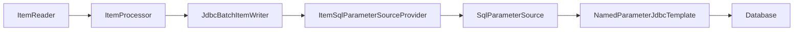

# SqlParameterSourceProvider

Khi ghi dữ liệu bằng JDBC trong Spring Batch, `JdbcBatchItemWriter` cần chuyển mỗi item Java thành các tham số SQL để thực thi câu lệnh `INSERT`, `UPDATE` hoặc `MERGE`. Với SQL dùng named parameter như `:orderId`, writer cần một đối tượng `SqlParameterSource` chứa giá trị tương ứng cho từng tên tham số.

Trong API Spring Batch, extension point thường được dùng cho việc này có tên đầy đủ là **`ItemSqlParameterSourceProvider<T>`**. Provider nhận một item và tạo ra `SqlParameterSource` cho item đó. Tên bài học “SqlParameterSourceProvider” thường được dùng để nói tới cơ chế này trong ngữ cảnh batch writer.

Provider có nhiệm vụ ánh xạ dữ liệu của item sang named SQL parameters. Nó không mở connection, không tự thực thi SQL, không quản lý transaction và cũng không quyết định chunk size. Những phần đó thuộc trách nhiệm của `JdbcBatchItemWriter`, `NamedParameterJdbcTemplate` và transaction manager của step.

## 1. SqlParameterSource là gì?

`SqlParameterSource` là abstraction của Spring JDBC dùng để cung cấp giá trị tham số cho SQL có tên. Thay vì truyền các giá trị theo vị trí `?`, câu SQL có thể đặt tên cho từng giá trị:

```sql
insert into orders(order_id, customer_id, amount)
values (:orderId, :customerId, :amount)
```

Một `SqlParameterSource` cung cấp giá trị cho các tên `orderId`, `customerId` và `amount`. Spring JDBC dùng các tên này để bind giá trị vào câu SQL trước khi gọi JDBC `PreparedStatement`.

Các implementation thường gặp:

- `BeanPropertySqlParameterSource`: lấy giá trị từ property của JavaBean.
- `MapSqlParameterSource`: lấy giá trị từ một map được cấu hình trực tiếp, đồng thời cho phép khai báo SQL type.
- `EmptySqlParameterSource`: biểu diễn nguồn tham số rỗng cho câu lệnh không cần giá trị động.

Trong Spring Batch, `ItemSqlParameterSourceProvider<T>` kết nối item của pipeline với abstraction `SqlParameterSource` này.

## 2. ItemSqlParameterSourceProvider<T> làm nhiệm vụ gì?

Interface của Spring Batch có phương thức cốt lõi:

```java
public interface ItemSqlParameterSourceProvider<T> {

    SqlParameterSource createSqlParameterSource(T item);
}
```

Provider nhận một item kiểu `T` và trả về nguồn tham số SQL cho item đó. `JdbcBatchItemWriter` gọi provider khi chuẩn bị batch update để lấy các tham số tương ứng với từng item.

Ví dụ:

```text
Order item
  orderId = 1001
  customerId = C001
  amount = 250.00
       |
       v
ItemSqlParameterSourceProvider
       |
       v
SqlParameterSource
  orderId    -> 1001
  customerId -> C001
  amount     -> 250.00
       |
       v
NamedParameterJdbcTemplate
       |
       v
PreparedStatement parameters
```

Provider chỉ tạo phần ánh xạ tham số. Writer vẫn chịu trách nhiệm thực hiện batch update bằng SQL đã cấu hình.

## 3. Provider được dùng ở đâu trong Spring Batch?

Trường hợp điển hình là `JdbcBatchItemWriter<T>`. Writer nhận từng item đã được reader đọc và processor xử lý, sau đó chuyển item thành named parameters để ghi xuống database.



Provider thường được cấu hình khi tạo writer bằng builder method `itemSqlParameterSourceProvider(...)`. Builder cũng cho phép cung cấp `DataSource` hoặc `NamedParameterJdbcTemplate`, SQL và các tùy chọn kiểm tra update count.

Trong nhiều phiên bản Spring Batch, API dùng tên `ItemSqlParameterSourceProvider<T>`, không phải interface Spring JDBC độc lập tên `SqlParameterSourceProvider`. `SqlParameterSource` là kiểu Spring JDBC; `ItemSqlParameterSourceProvider` là adapter extension point của Spring Batch nhận item.

## 4. Dùng BeanPropertyItemSqlParameterSourceProvider

Nếu item là JavaBean có getter tương ứng với tên named parameter trong SQL, cách đơn giản nhất là dùng `BeanPropertyItemSqlParameterSourceProvider<T>`.

Ví dụ model:

```java
public class OrderRecord {

    private Long orderId;
    private String customerId;
    private BigDecimal amount;

    public Long getOrderId() {
        return orderId;
    }

    public String getCustomerId() {
        return customerId;
    }

    public BigDecimal getAmount() {
        return amount;
    }
}
```

Tạo provider:

```java
ItemSqlParameterSourceProvider<OrderRecord> provider =
        new BeanPropertyItemSqlParameterSourceProvider<>();

SqlParameterSource parameters =
        provider.createSqlParameterSource(orderRecord);
```

Implementation này tạo `BeanPropertySqlParameterSource` dựa trên item. Spring JDBC tra cứu property theo tên, thường thông qua JavaBean getter. Với item ở trên, các tên SQL `:orderId`, `:customerId` và `:amount` có thể được ánh xạ tới `getOrderId()`, `getCustomerId()` và `getAmount()`.

Ưu điểm:

- Ít code mapping thủ công.
- Tên property trong model có thể trùng trực tiếp với tên tham số SQL.
- Dễ đọc khi item là một DTO chuyên dùng cho database writer.
- Có thể tận dụng thông tin kiểu property để hỗ trợ xác định SQL type.

Hạn chế:

- SQL phụ thuộc vào tên property của model.
- Nếu schema database và model dùng tên khác nhau, cần đổi tên alias trong SQL hoặc viết provider tùy chỉnh.
- Item phải cung cấp property mà Spring JDBC có thể truy cập.
- Không nên dùng một entity có quá nhiều property không liên quan nếu writer chỉ cần một phần dữ liệu.

## 5. Cấu hình JdbcBatchItemWriter với bean property provider

Ví dụ một writer ghi `OrderRecord` vào bảng `orders`:

```java
@Bean
public JdbcBatchItemWriter<OrderRecord> orderWriter(DataSource dataSource) {
    return new JdbcBatchItemWriterBuilder<OrderRecord>()
            .dataSource(dataSource)
            .sql("""
                    insert into orders(order_id, customer_id, amount)
                    values (:orderId, :customerId, :amount)
                    """)
            .itemSqlParameterSourceProvider(
                    new BeanPropertyItemSqlParameterSourceProvider<>())
            .assertUpdates(true)
            .build();
}
```

Trong ví dụ:

- `.dataSource(dataSource)` cung cấp datasource cho writer.
- `.sql(...)` khai báo câu SQL dùng named parameters.
- `.itemSqlParameterSourceProvider(...)` chuyển mỗi item thành `SqlParameterSource`.
- `.assertUpdates(true)` yêu cầu writer kiểm tra update count theo hành vi của writer.
- `.build()` tạo writer đã cấu hình.

Tên placeholder trong SQL phải khớp với property có thể đọc từ item. `:orderId` khác với `:id`; provider không tự suy đoán rằng hai tên này có cùng ý nghĩa.

Nếu dùng Java version chưa hỗ trợ text block, có thể viết SQL thành chuỗi nối hoặc string literal thông thường.

## 6. Dùng MapItemSqlParameterSourceProvider

Nếu item đã là `Map<String, Object>`, có thể dùng `MapItemSqlParameterSourceProvider` để chuyển map thành nguồn tham số SQL.

Ví dụ item:

```java
Map<String, Object> item = new HashMap<>();
item.put("orderId", 1001L);
item.put("customerId", "C001");
item.put("amount", new BigDecimal("250.00"));
```

Provider:

```java
ItemSqlParameterSourceProvider<Map<String, Object>> provider =
        new MapItemSqlParameterSourceProvider<>();

SqlParameterSource parameters = provider.createSqlParameterSource(item);
```

Tên key trong map phải khớp với named parameter trong SQL. Nếu SQL có `:customerId` nhưng map chỉ có key `customer_id`, Spring JDBC sẽ không tìm được giá trị tương ứng.

Map provider phù hợp khi dữ liệu đã được tạo dưới dạng key/value, ví dụ kết quả từ bước chuẩn hóa, dữ liệu động theo schema hoặc item được xây dựng từ nhiều nguồn. Tuy nhiên, map làm giảm tính kiểm tra kiểu ở compile time và lỗi sai tên key thường chỉ xuất hiện khi writer thực thi.

## 7. Dùng MapSqlParameterSource trực tiếp

Không nhất thiết phải dùng `MapItemSqlParameterSourceProvider`. Với mapping cần khai báo SQL type, giá trị mặc định hoặc tên property khác với tên SQL, có thể viết provider trả về `MapSqlParameterSource` trực tiếp.

Ví dụ:

```java
ItemSqlParameterSourceProvider<OrderRecord> provider = item ->
        new MapSqlParameterSource()
                .addValue("orderId", item.getOrderId(), Types.BIGINT)
                .addValue("customerId", item.getCustomerId(), Types.VARCHAR)
                .addValue("amount", item.getAmount(), Types.DECIMAL);
```

Provider này tạo một `MapSqlParameterSource` mới cho mỗi item. Có thể khai báo SQL type tường minh, đặc biệt hữu ích khi giá trị là `null` hoặc driver cần thông tin type rõ ràng.

Ví dụ với giá trị null:

```java
return new MapSqlParameterSource()
        .addValue("orderId", item.getOrderId(), Types.BIGINT)
        .addValue("note", null, Types.VARCHAR);
```

Khi không có type metadata và giá trị là null, một số driver hoặc kiểu cột có thể cần Spring JDBC suy luận hoặc dùng cách bind riêng. Khai báo `Types.VARCHAR`, `Types.DECIMAL`, `Types.TIMESTAMP`... giúp giảm sự mơ hồ.

## 8. Viết custom ItemSqlParameterSourceProvider

Khi item model không khớp trực tiếp với tên SQL hoặc cần chuyển đổi dữ liệu trước khi bind, có thể implement interface.

Ví dụ item có property `id`, nhưng SQL dùng `:orderId`; enum trạng thái cần ghi bằng code:

```java
public class OrderSqlParameterSourceProvider
        implements ItemSqlParameterSourceProvider<OrderRecord> {

    @Override
    public SqlParameterSource createSqlParameterSource(OrderRecord item) {
        return new MapSqlParameterSource()
                .addValue("orderId", item.getId(), Types.BIGINT)
                .addValue("customerId", item.getCustomerId(), Types.VARCHAR)
                .addValue("amount", item.getAmount(), Types.DECIMAL)
                .addValue("status", item.getStatus().getCode(), Types.VARCHAR);
    }
}
```

Gắn provider vào writer:

```java
@Bean
public JdbcBatchItemWriter<OrderRecord> orderWriter(
        DataSource dataSource,
        OrderSqlParameterSourceProvider provider) {

    return new JdbcBatchItemWriterBuilder<OrderRecord>()
            .dataSource(dataSource)
            .sql("""
                    insert into orders(order_id, customer_id, amount, status)
                    values (:orderId, :customerId, :amount, :status)
                    """)
            .itemSqlParameterSourceProvider(provider)
            .build();
}
```

Custom provider hữu ích khi:

- Tên property Java khác tên placeholder SQL.
- Cần ghép dữ liệu từ nhiều property.
- Cần chuyển enum sang code hoặc chuỗi theo quy ước database.
- Cần khai báo SQL type rõ ràng.
- Cần xử lý null/default value theo nghiệp vụ.
- Cần tạo tham số tính toán từ item.

Hãy giữ mapping tập trung và dễ kiểm thử. Tránh đưa logic truy vấn database hoặc gọi API vào provider; provider nên chuyển đổi item thành tham số, không thực hiện nghiệp vụ phụ thuộc hạ tầng.

## 9. Tên named parameter phải khớp chính xác

Named parameter giúp SQL dễ đọc, nhưng tên phải khớp giữa câu lệnh và `SqlParameterSource`.

Ví dụ đúng:

```sql
update orders
set amount = :amount,
    status = :status
where order_id = :orderId
```

Provider phải cung cấp:

```java
new MapSqlParameterSource()
        .addValue("amount", item.getAmount())
        .addValue("status", item.getStatus())
        .addValue("orderId", item.getId());
```

Không thêm dấu `:` vào tên key khi gọi `addValue`. Dấu `:` chỉ xuất hiện trong SQL; key trong parameter source là `orderId`, không phải `:orderId`.

Một số lỗi phổ biến:

| SQL placeholder | Key provider | Kết quả |
|---|---|---|
| `:orderId` | `orderId` | Khớp |
| `:orderId` | `order_id` | Không khớp nếu không có mapping bổ sung |
| `:customerId` | `:customerId` | Sai cách đặt key |
| `:amount` | Không có `amount` | Lỗi thiếu tham số khi thực thi |

Hãy chọn một quy ước đặt tên thống nhất, ví dụ camelCase trong Java và named placeholders, còn tên cột database có thể dùng snake_case.

## 10. Ánh xạ property khác tên cột database

Tên cột database không bắt buộc phải giống tên property Java. SQL chịu trách nhiệm nối hai phía:

```sql
insert into order_line(order_id, customer_code, net_amount)
values (:id, :customerCode, :amount)
```

Nếu item có `getId()`, `getCustomerCode()` và `getAmount()`, `BeanPropertyItemSqlParameterSourceProvider` có thể cung cấp các property tương ứng. SQL placeholder dùng tên Java property, còn danh sách cột bên trái dùng tên database.

Nếu property cần biến đổi hoặc không có getter phù hợp, custom provider có thể tạo key riêng. Không cần đổi schema database chỉ để tên cột trùng với tên field Java.

## 11. Kiểu dữ liệu SQL và Java

Spring JDBC có thể suy luận nhiều SQL type từ kiểu Java, nhưng ứng dụng nên hiểu cách bind các kiểu quan trọng.

| Kiểu Java thường gặp | SQL type thường dùng | Lưu ý |
|---|---|---|
| `Long` / `long` | `BIGINT` | ID hoặc bộ đếm |
| `Integer` / `int` | `INTEGER` | Số nguyên |
| `String` | `VARCHAR` hoặc `CHAR` | Độ dài và encoding theo schema |
| `BigDecimal` | `DECIMAL` / `NUMERIC` | Phù hợp tiền tệ; kiểm soát precision/scale |
| `Boolean` | `BOOLEAN` hoặc kiểu tương ứng của DB | Một số database biểu diễn bằng số/bit |
| `LocalDate` | `DATE` | Kiểu hỗ trợ phụ thuộc Spring/driver |
| `LocalDateTime` | `TIMESTAMP` | Không tự chứa timezone |
| `Instant` / `OffsetDateTime` | `TIMESTAMP`/`TIMESTAMP WITH TIME ZONE` tùy DB | Cần thống nhất quy ước timezone |
| `byte[]` | `VARBINARY`/`BLOB` | Cân nhắc kích thước payload |

Tên SQL type và khả năng bind chính xác phụ thuộc database và JDBC driver. Với kiểu nhạy cảm như thời gian, JSON, UUID, enum hoặc null, hãy kiểm tra mapping thực tế bằng integration test.

## 12. Xử lý null

Null là trường hợp cần chú ý vì database có kiểu cột cụ thể trong khi Java reference có thể không có giá trị.

Với bean property provider, `BeanPropertySqlParameterSource` có thể đọc kiểu property từ metadata bean ngay cả khi giá trị hiện tại là null. Tuy nhiên, với map hoặc custom source, nên khai báo SQL type nếu driver không suy luận được.

Ví dụ:

```java
return new MapSqlParameterSource()
        .addValue("orderId", item.getOrderId(), Types.BIGINT)
        .addValue("comment", item.getComment(), Types.VARCHAR)
        .addValue("shippedAt", item.getShippedAt(), Types.TIMESTAMP);
```

Không tự chuyển null thành chuỗi rỗng hoặc số 0 nếu nghiệp vụ phân biệt “không có giá trị” với giá trị rỗng/zero. Hãy quyết định rõ cột có cho phép null không và xử lý validation ở processor hoặc database constraint.

## 13. Enum, ngày giờ và chuyển đổi giá trị

Provider là nơi thích hợp để chuyển đổi representation trước khi bind nếu quy ước database khác với kiểu trong model.

Ví dụ enum:

```java
enum OrderStatus {
    NEW("N"), PAID("P"), CANCELLED("C");

    private final String code;

    OrderStatus(String code) {
        this.code = code;
    }

    public String getCode() {
        return code;
    }
}
```

Provider có thể bind `item.getStatus().getCode()` thay vì enum object. Điều này giúp database lưu mã ổn định thay vì phụ thuộc tên enum Java.

Với ngày giờ, hãy quyết định rõ cột lưu ngày lịch, local timestamp hay thời điểm tuyệt đối. Không chuyển `Instant` sang `LocalDateTime` bằng timezone mặc định của máy vì môi trường chạy có thể khác nhau. Có thể chuẩn hóa về UTC hoặc dùng kiểu SQL hỗ trợ timezone theo quy ước hệ thống.

Provider không nên tự thực hiện chuyển đổi phức tạp không có kiểm tra. Nếu dữ liệu không hợp lệ, processor nên phát hiện và trả lỗi nghiệp vụ trước khi writer được gọi.

## 14. Nested property và item DTO

Trong một số trường hợp, item có object lồng nhau:

```java
public class OrderRecord {
    private Long id;
    private Customer customer;
    private BigDecimal amount;

    public Long getId() { return id; }
    public Customer getCustomer() { return customer; }
    public BigDecimal getAmount() { return amount; }
}
```

SQL có thể cần `customerId`, lấy từ `item.getCustomer().getId()`. Có thể dùng custom provider để xử lý rõ ràng:

```java
return new MapSqlParameterSource()
        .addValue("orderId", item.getId(), Types.BIGINT)
        .addValue("customerId", item.getCustomer().getId(), Types.BIGINT)
        .addValue("amount", item.getAmount(), Types.DECIMAL);
```

Điều này cũng cho phép xử lý trường hợp `customer` null với thông báo hoặc giá trị phù hợp. Không nên giả định nested path luôn tồn tại nếu model có quan hệ tùy chọn.

Với writer đơn giản, DTO phẳng thường dễ kiểm soát hơn entity có nhiều association lazy. Truy cập association lazy trong provider có thể gây thêm query hoặc lỗi nếu persistence context đã đóng.

## 15. Provider và SQL động

`SqlParameterSource` bind giá trị của biểu thức SQL, không bind tên bảng, tên cột hoặc từ khóa SQL.

Ví dụ hợp lệ:

```sql
select * from orders where tenant_id = :tenantId
```

`tenantId` là giá trị và có thể bind bằng parameter source.

Không thể dùng:

```sql
select * from :tableName
```

để bind tên bảng bằng `SqlParameterSource`. JDBC parameter marker không đại diện cho SQL identifier. Nếu cần chọn bảng hoặc cột động, hãy dùng whitelist identifier được ứng dụng kiểm soát và xây dựng SQL từ lựa chọn đã xác thực.

Parameter binding giúp tránh nối trực tiếp dữ liệu người dùng vào giá trị SQL và giảm nguy cơ SQL injection. Tuy nhiên, nó không bảo vệ các identifier hoặc fragment được nối vào câu lệnh.

## 16. ItemSqlParameterSourceProvider khác ItemPreparedStatementSetter

`JdbcBatchItemWriter` hỗ trợ hai cách bind dữ liệu phổ biến:

- `ItemSqlParameterSourceProvider<T>`: dùng named parameters với `SqlParameterSource`.
- `ItemPreparedStatementSetter<T>`: tự bind giá trị theo vị trí trên `PreparedStatement`.

Ví dụ positional setter:

```java
public class OrderPreparedStatementSetter
        implements ItemPreparedStatementSetter<OrderRecord> {

    @Override
    public void setValues(
            OrderRecord item,
            PreparedStatement ps) throws SQLException {

        ps.setLong(1, item.getId());
        ps.setString(2, item.getCustomerId());
        ps.setBigDecimal(3, item.getAmount());
    }
}
```

So sánh:

| Tiêu chí | ItemSqlParameterSourceProvider | ItemPreparedStatementSetter |
|---|---|---|
| Cách đặt tham số | Named parameter như `:orderId` | Vị trí `?` như 1, 2, 3 |
| Mapping | Trả về `SqlParameterSource` | Gọi setter trực tiếp trên `PreparedStatement` |
| Độ dễ đọc | Tên tham số rõ trong SQL | Phải giữ đúng thứ tự bind |
| Khai báo SQL type | Có thể qua `MapSqlParameterSource` | Qua `PreparedStatement` setter hoặc `setNull` |
| Phù hợp | SQL nhiều tham số, mapping theo tên | SQL đơn giản hoặc cần kiểm soát JDBC binding trực tiếp |

Không cấu hình cả hai cách cùng lúc cho một writer. Builder yêu cầu một chiến lược binding phù hợp với SQL được cung cấp.

## 17. Provider được gọi cho từng item trong batch

`JdbcBatchItemWriter` nhận một chunk gồm nhiều item. Với mỗi item, writer cần một nguồn tham số tương ứng để tạo batch update. Provider do đó có thể được gọi nhiều lần trong một lần `write()`.

Ví dụ chunk size 500 có thể khiến provider được gọi khoảng 500 lần trong một lần ghi chunk, tùy cách writer xử lý và các retry/skip diễn ra.

Vì provider có thể được gọi lại khi chunk rollback/retry hoặc khi writer cô lập item lỗi, implementation nên:

- Có kết quả xác định với cùng một item.
- Không gửi message, email hoặc gọi API ngoài.
- Không ghi dữ liệu nghiệp vụ vào database.
- Không giữ một `MapSqlParameterSource` mutable dùng chung giữa nhiều item.
- Không lưu item hiện tại trong field của singleton provider.
- Tránh tính toán nặng hoặc truy vấn phụ cho từng item nếu có thể chuẩn bị ở processor.

Thông thường provider nên là stateless mapper. Mỗi lời gọi trả về một `SqlParameterSource` mới hoặc một source độc lập, không bị thay đổi bởi lần gọi kế tiếp.

## 18. Thread safety khi writer chạy song song

Trong một số mô hình, writer có thể được sử dụng từ nhiều thread hoặc nhiều step execution. Khi đó provider cũng có thể bị gọi đồng thời.

Một provider stateless chỉ đọc property của item và tạo parameter source mới thường dễ dùng an toàn hơn. Provider có field mutable, counter hoặc cache không đồng bộ có thể tạo race condition.

Ví dụ không nên dùng:

```java
public class UnsafeProvider
        implements ItemSqlParameterSourceProvider<OrderRecord> {

    private final MapSqlParameterSource shared =
            new MapSqlParameterSource();

    @Override
    public SqlParameterSource createSqlParameterSource(OrderRecord item) {
        shared.addValue("orderId", item.getId());
        return shared;
    }
}
```

Các lần gọi có thể ghi đè giá trị của nhau. Hãy tạo source mới cho mỗi item:

```java
public class SafeProvider
        implements ItemSqlParameterSourceProvider<OrderRecord> {

    @Override
    public SqlParameterSource createSqlParameterSource(OrderRecord item) {
        return new MapSqlParameterSource()
                .addValue("orderId", item.getId(), Types.BIGINT);
    }
}
```

Stateless provider không tự làm item an toàn luồng. Nếu item mutable và bị nhiều thread cùng thay đổi, mapping vẫn có thể đọc dữ liệu không nhất quán. Mỗi item nên có ownership rõ ràng trong pipeline.

## 19. Transaction và rollback của writer

Provider không quản lý transaction. Khi `JdbcBatchItemWriter` chạy trong chunk-oriented step, các lệnh JDBC thường tham gia transaction được quản lý bởi transaction manager của step nếu writer dùng cùng datasource/resource phù hợp.

Nếu batch update thất bại trước commit, transaction có thể rollback các thay đổi database của chunk. Khi retry, writer có thể được gọi lại và provider tạo lại parameter source cho item.

Vì provider chỉ ánh xạ giá trị, nó không nên có side effect ngoài transaction. Nếu provider gọi API hoặc ghi file, các thao tác đó không được rollback tự động cùng database và có thể lặp khi writer retry.

Hãy đặt logic chuyển đổi thuần trong provider, còn side effect nghiệp vụ nên nằm trong một cơ chế có transaction/idempotency phù hợp như outbox hoặc bước xử lý riêng.

## 20. assertUpdates và ý nghĩa update count

`JdbcBatchItemWriterBuilder` có tùy chọn `assertUpdates`. Khi bật, writer kiểm tra kết quả update theo contract của writer; nếu một lệnh không cập nhật dòng nào, writer có thể ném exception.

Điều này hữu ích khi mỗi item bắt buộc phải tạo hoặc cập nhật một bản ghi. Tuy nhiên, một số câu SQL hợp lệ có thể trả update count bằng 0 theo semantics của database hoặc câu lệnh, ví dụ thao tác idempotent không thay đổi dữ liệu hoặc một upsert có hành vi đặc thù.

Hãy xác định rõ ý nghĩa của update count đối với SQL đang dùng. Nếu 0 row là lỗi nghiệp vụ, giữ `assertUpdates(true)`. Nếu 0 row có thể hợp lệ, hãy cân nhắc cấu hình phù hợp và tự kiểm tra kết quả theo quy tắc nghiệp vụ. Không tắt assertion chỉ để che một lỗi mapping hoặc điều kiện `WHERE` sai.

## 21. Xử lý thiếu tham số hoặc tên property sai

Nếu SQL yêu cầu `:orderId` nhưng provider không cung cấp key này, `NamedParameterJdbcTemplate` thường báo lỗi khi chuẩn bị thực thi câu lệnh. Lỗi có thể xuất hiện ở bước writer chứ không phải lúc application context khởi tạo.

Nguyên nhân thường gặp:

- Tên placeholder không khớp tên getter/property.
- Map thiếu key.
- Property không có getter hoặc không thể truy cập.
- SQL thay đổi nhưng provider chưa được cập nhật.
- Item có giá trị null nhưng SQL type không rõ với driver.
- Custom provider trả nhầm source hoặc source bị tái sử dụng.

Nên kiểm thử mapping độc lập và có integration test cho câu SQL thật. Log lỗi nên ghi tên tham số bị thiếu và loại item, nhưng tránh log toàn bộ payload chứa dữ liệu nhạy cảm.

## 22. Không truy vấn database trong provider

Provider được gọi theo từng item. Nếu mỗi lần gọi lại truy vấn database để lấy dữ liệu bổ sung, một chunk 1.000 item có thể tạo thêm 1.000 query, gây N+1 và làm giảm throughput.

Ví dụ không nên làm:

```java
@Override
public SqlParameterSource createSqlParameterSource(OrderRecord item) {
    Customer customer = customerRepository.findById(item.getCustomerId())
            .orElseThrow();

    return new MapSqlParameterSource()
            .addValue("orderId", item.getId())
            .addValue("customerName", customer.getName());
}
```

Nếu cần dữ liệu khách hàng, hãy làm giàu item ở processor, dùng join trong reader hoặc tải dữ liệu theo batch/cache có kiểm soát. Provider nên chỉ ánh xạ item đã sẵn sàng thành tham số SQL.

## 23. Provider với stored procedure hoặc câu SQL đặc biệt

`SqlParameterSource` có thể cung cấp tham số cho named SQL statement, nhưng `JdbcBatchItemWriter` được thiết kế chủ yếu cho batch update/insert thông thường. Nếu cần gọi stored procedure, output parameter, cursor hoặc logic phức tạp, hãy xem xét `StoredProcedureItemWriter`, `SimpleJdbcCall` hoặc writer tùy chỉnh phù hợp với API Spring Batch/Spring JDBC.

Không nên ép một `JdbcBatchItemWriter` thông thường xử lý output parameter hoặc nhiều result set nếu abstraction batch update không hỗ trợ đúng semantics.

## 24. Kiểm thử provider độc lập

Provider là mapper nhỏ nên có thể unit test trực tiếp mà không cần database.

Ví dụ:

```java
class OrderSqlParameterSourceProviderTest {

    private final OrderSqlParameterSourceProvider provider =
            new OrderSqlParameterSourceProvider();

    @Test
    void mapsOrderFieldsToNamedParameters() {
        OrderRecord item = new OrderRecord(
                1001L,
                "C001",
                new BigDecimal("250.00"),
                OrderStatus.PAID);

        SqlParameterSource source =
                provider.createSqlParameterSource(item);

        assertEquals(1001L, source.getValue("orderId"));
        assertEquals("C001", source.getValue("customerId"));
        assertEquals(new BigDecimal("250.00"), source.getValue("amount"));
        assertEquals("P", source.getValue("status"));
    }
}
```

Test nên kiểm tra:

- Tất cả named parameter bắt buộc đều có giá trị.
- Property được ánh xạ đúng tên và đúng kiểu.
- Enum/date/decimal được chuyển đổi theo quy ước.
- Null được xử lý đúng và có SQL type khi cần.
- Mỗi item nhận một source độc lập.
- Item thiếu dữ liệu bắt buộc được xử lý theo policy rõ ràng.

## 25. Integration test với JdbcBatchItemWriter

Unit test provider không chứng minh SQL placeholder, schema database và JDBC driver hoạt động đúng. Nên có integration test cho writer với database test phù hợp.

Ví dụ khung:

```java
@SpringBatchTest
@SpringJUnitConfig(JdbcWriterTestConfiguration.class)
class JdbcBatchWriterIntegrationTest {

    @Autowired
    private JdbcBatchItemWriter<OrderRecord> orderWriter;

    @Autowired
    private JdbcTemplate jdbcTemplate;

    @Test
    void writesItemsUsingNamedParameters() throws Exception {
        Chunk<OrderRecord> items = new Chunk<>();
        items.add(new OrderRecord(
                1001L, "C001", new BigDecimal("250.00"), OrderStatus.PAID));

        orderWriter.write(items);

        Integer count = jdbcTemplate.queryForObject(
                "select count(*) from orders where order_id = ?",
                Integer.class,
                1001L);

        assertEquals(1, count);
    }
}
```

Đây là khung minh họa; cấu hình test cần tạo schema, datasource và transaction phù hợp. Tùy phiên bản Spring Batch, cách tạo `Chunk` và gọi writer có thể cần điều chỉnh theo API đang dùng.

Integration test nên kiểm tra cả trường hợp rollback: writer ghi một phần rồi gặp lỗi, transaction rollback, sau đó retry hoặc restart không tạo dữ liệu trùng.

## 26. Các lỗi thường gặp

| Tình huống | Nguyên nhân | Cách xử lý |
|---|---|---|
| Không tìm thấy named parameter | Tên placeholder không khớp key/property | Đồng bộ tên SQL và provider |
| Giá trị bị bind sai cột | Dùng sai property hoặc mapping | Unit test từng key và integration test SQL |
| Null gây lỗi JDBC | Driver không suy luận được SQL type | Dùng `MapSqlParameterSource.addValue` với `Types.*` |
| Enum không ghi được | JDBC driver không biết cách bind enum Java | Chuyển sang code/string/int rõ ràng |
| Provider trả dữ liệu của item trước | Tái sử dụng mutable `SqlParameterSource` | Tạo source mới cho mỗi item |
| Writer chậm bất thường | Provider truy vấn DB hoặc gọi API cho từng item | Chuyển enrichment sang reader/processor hoặc batch lookup |
| Retry gây side effect trùng | Provider thực hiện I/O ngoài mapping | Giữ provider thuần, dùng outbox/idempotency cho side effect |
| Hai thread ghi đè tham số | Provider có state mutable dùng chung | Dùng provider stateless và source riêng |
| SQL injection qua identifier | Cố bind tên bảng/cột bằng parameter | Whitelist và kiểm soát SQL identifier riêng |
| Writer báo update count bằng 0 | `assertUpdates` không phù hợp với semantics SQL hoặc `WHERE` không khớp | Xác định update count mong đợi và kiểm tra câu SQL |
| Map thiếu key chỉ phát hiện lúc chạy | Mapping động không được kiểm tra trước | Unit test provider và validate item trước writer |

## 27. Quy trình chọn provider

1. **Xem item model:** item có JavaBean getter trùng với named parameter không?
2. **Nếu có:** dùng `BeanPropertyItemSqlParameterSourceProvider` để giảm mapping thủ công.
3. **Nếu item là map:** cân nhắc `MapItemSqlParameterSourceProvider`.
4. **Nếu cần đổi tên/chuyển đổi/type/null:** viết custom `ItemSqlParameterSourceProvider<T>` trả về `MapSqlParameterSource`.
5. **Khai báo SQL:** dùng named placeholder rõ ràng và đối chiếu từng key.
6. **Kiểm tra kiểu:** xác định SQL type, đặc biệt với null, enum, ngày giờ và kiểu đặc thù của database.
7. **Giữ provider stateless:** không lưu source mutable dùng chung và không thực hiện side effect.
8. **Cấu hình writer:** truyền provider qua `itemSqlParameterSourceProvider(...)` và cấu hình datasource/SQL.
9. **Kiểm thử mapping:** unit test source cho từng loại item.
10. **Kiểm thử ghi thật:** integration test với database, transaction, update count và rollback.

## 28. Những nguyên tắc cần nhớ

- Trong Spring Batch, extension point thường dùng có tên `ItemSqlParameterSourceProvider<T>`; nó tạo `SqlParameterSource` từ mỗi item.
- `SqlParameterSource` thuộc Spring JDBC và cung cấp giá trị theo tên cho named SQL parameters.
- `JdbcBatchItemWriter` dùng provider để bind tham số cho từng item trong batch.
- `BeanPropertyItemSqlParameterSourceProvider` phù hợp với item có JavaBean property trùng tên placeholder.
- `MapItemSqlParameterSourceProvider` phù hợp với item dạng map; `MapSqlParameterSource` hữu ích khi cần khai báo SQL type.
- Custom provider phù hợp khi cần đổi tên, chuyển đổi enum/date, xử lý null hoặc ánh xạ nhiều property.
- Tên key trong source phải khớp tên placeholder; key không có dấu `:`.
- Bind value không bind được tên bảng/cột hoặc SQL fragment; identifier động phải được whitelist.
- Provider nên stateless, tạo source độc lập cho mỗi item và không gọi API/database.
- Provider có thể được gọi lại khi writer retry; mapping phải xác định và không có side effect.
- Provider không quản lý transaction, chunk size, retry hay connection; đó là trách nhiệm của writer và step.
- Dùng `ItemPreparedStatementSetter` nếu cần bind positional parameters trực tiếp.
- Kiểm thử provider riêng và kiểm thử tích hợp với SQL/driver thật.

`ItemSqlParameterSourceProvider` là lớp nối giữa object item của Spring Batch và named parameters của Spring JDBC. Khi chọn đúng implementation, đặt tên placeholder nhất quán, xử lý kiểu/null rõ ràng và giữ provider thuần, `JdbcBatchItemWriter` có thể ghi batch dữ liệu dễ đọc, dễ kiểm thử và an toàn hơn khi retry hoặc chạy song song.
