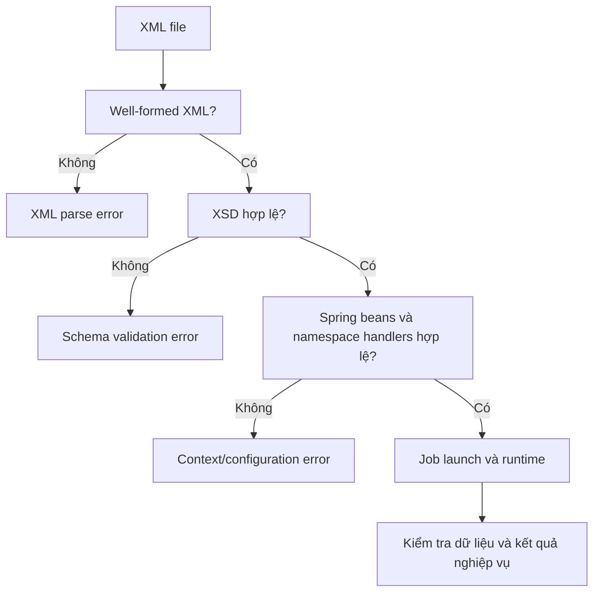

# Validation XML schema

Spring Batch có thể khai báo job, step, tasklet và chunk bằng XML namespace. Để Spring hiểu đúng các phần tử như <batch:job> hoặc <batch:chunk>, file XML cần khai báo namespace và schema tương ứng. **XML Schema (XSD) validation** kiểm tra cấu trúc tài liệu có tuân theo hợp đồng của namespace hay không trước khi cấu hình được sử dụng.

Với Spring Batch, XSD giúp phát hiện sớm các lỗi như:

- Dùng sai namespace hoặc thiếu schema mapping.
- Đặt phần tử không hợp lệ bên trong job/step/tasklet.
- Thiếu thuộc tính bắt buộc của một phần tử.
- Dùng tên thuộc tính hoặc giá trị không được schema cho phép.
- Đặt các phần tử theo thứ tự không đúng với cấu trúc XSD.

Tuy nhiên, XSD chỉ kiểm tra cấu trúc XML. Nó không thể bảo đảm bean được tham chiếu tồn tại, SQL chạy được, file đầu vào có dữ liệu đúng hoặc job hoàn tất thành công. Cần phân biệt XML well-formedness, XSD validation, Spring bean validation và kiểm thử runtime.

## 1. XML namespace và XSD liên quan thế nào?

Một file Spring Batch XML thường dùng hai namespace:

- Spring Beans namespace để khai báo bean thông thường.
- Spring Batch namespace để khai báo job, step, flow, chunk và các thành phần batch.

Namespace xác định vocabulary mà phần tử XML thuộc về. XSD mô tả cấu trúc, thuộc tính, kiểu dữ liệu và các ràng buộc hợp lệ của vocabulary đó.

Ví dụ phần khai báo đầu file:

```xml
<?xml version="1.0" encoding="UTF-8"?>
<beans xmlns="http://www.springframework.org/schema/beans"
       xmlns:xsi="http://www.w3.org/2001/XMLSchema-instance"
       xmlns:batch="http://www.springframework.org/schema/batch"
       xsi:schemaLocation="
           http://www.springframework.org/schema/beans
           http://www.springframework.org/schema/beans/spring-beans.xsd
           http://www.springframework.org/schema/batch
           http://www.springframework.org/schema/batch/spring-batch.xsd">

    <!-- Bean definitions và batch job được khai báo ở đây. -->

</beans>
```

Trong ví dụ:

- xmlns khai báo namespace mặc định là Spring Beans.
- xmlns:xsi khai báo namespace XML Schema Instance để dùng thuộc tính xsi:schemaLocation.
- xmlns:batch gắn prefix batch với Spring Batch namespace.
- xsi:schemaLocation cung cấp các cặp namespace URI và vị trí schema tương ứng.

Prefix batch chỉ là tên alias trong tài liệu. Có thể dùng prefix khác, nhưng URI namespace phải đúng. Hai tài liệu dùng prefix khác nhau vẫn thuộc cùng namespace nếu URI giống nhau.

## 2. Đọc đúng xsi:schemaLocation

Giá trị của xsi:schemaLocation là một danh sách các cặp:

1. Namespace URI.
2. Địa chỉ hoặc resource location của XSD mô tả namespace đó.

Ví dụ:

```xml
xsi:schemaLocation="
    http://www.springframework.org/schema/beans
    http://www.springframework.org/schema/beans/spring-beans.xsd
    http://www.springframework.org/schema/batch
    http://www.springframework.org/schema/batch/spring-batch.xsd"
```

Ở đây có hai cặp độc lập. Cặp đầu dùng cho <beans>, <bean>, <property> và các phần tử Spring Beans. Cặp thứ hai dùng cho <batch:job>, <batch:step>, <batch:tasklet> và các phần tử Spring Batch.

Một lỗi thường gặp là chỉ khai báo schema của Spring Beans nhưng lại dùng phần tử thuộc Spring Batch. XML parser khi đó không có schema mapping phù hợp cho batch namespace.

### Namespace URI không phải là file XSD

http://www.springframework.org/schema/batch là namespace URI. http://www.springframework.org/schema/batch/spring-batch.xsd là schema location. Hai giá trị có quan hệ nhưng không thay thế cho nhau.

Không đặt XSD URL vào xmlns:batch, cũng không đặt namespace URI đơn lẻ vào xsi:schemaLocation mà thiếu location tương ứng.

## 3. Một Spring Batch XML configuration hoàn chỉnh ở mức cấu trúc

Ví dụ sau minh họa cách khai báo một job có chunk step:

```xml
<?xml version="1.0" encoding="UTF-8"?>
<beans xmlns="http://www.springframework.org/schema/beans"
       xmlns:xsi="http://www.w3.org/2001/XMLSchema-instance"
       xmlns:batch="http://www.springframework.org/schema/batch"
       xsi:schemaLocation="
           http://www.springframework.org/schema/beans
           http://www.springframework.org/schema/beans/spring-beans.xsd
           http://www.springframework.org/schema/batch
           http://www.springframework.org/schema/batch/spring-batch.xsd">

    <batch:job id="importOrdersJob">
        <batch:step id="importOrdersStep">
            <batch:tasklet>
                <batch:chunk reader="orderReader"
                             processor="orderProcessor"
                             writer="orderWriter"
                             commit-interval="100"/>
            </batch:tasklet>
        </batch:step>
    </batch:job>

</beans>
```

Các bean có ID orderReader, orderProcessor và orderWriter phải được khai báo trong context hoặc được cung cấp từ cấu hình khác. XSD có thể xác nhận các thuộc tính reader, processor, writer được phép dùng ở vị trí đó, nhưng không chứng minh các bean ID này thực sự tồn tại.

Ví dụ này tập trung vào cấu trúc namespace. Khi đưa vào ứng dụng, cần có hạ tầng Spring Batch phù hợp với phiên bản đang dùng, gồm JobRepository và transaction manager theo cách cấu hình của dự án.

## 4. XSD validation kiểm tra những gì?

XSD mô tả grammar của XML. Với Spring Batch namespace, schema có thể kiểm tra:

- Phần tử nào được phép xuất hiện dưới <batch:job>.
- Một step có thể chứa loại tasklet hoặc flow nào.
- Thuộc tính nào được phép trên <batch:chunk>.
- Kiểu dữ liệu của các thuộc tính, ví dụ số nguyên cho commit interval.
- Phần tử con nào bắt buộc hoặc tùy chọn.
- Thứ tự các phần tử con theo schema.
- Các giá trị enum hoặc pattern được schema định nghĩa.

Ví dụ, phần tử chunk cần các thuộc tính reader, writer và commit interval theo cấu trúc của schema tương ứng. Nếu viết sai tên thuộc tính hoặc đặt chunk ở ngoài tasklet, XSD validation có thể báo lỗi ngay khi parse XML.

### XSD không kiểm tra logic nghiệp vụ

Giả sử XML khai báo:

```xml
<batch:chunk reader="missingReader"
             writer="orderWriter"
             commit-interval="100"/>
```

Nếu schema cho phép các thuộc tính này, XML vẫn có thể hợp lệ về XSD. Việc missingReader có phải bean ID tồn tại hay không là vấn đề của Spring bean container khi cấu hình được nạp và resolve dependency.

Tương tự, XSD không biết file /data/orders.csv có tồn tại, database có bảng ORDERS, hoặc một JobParameter có được truyền khi launch hay không.

## 5. Phân biệt bốn lớp validation

Khi điều tra lỗi XML configuration, hãy xác định lỗi xảy ra ở lớp nào:

| Lớp | Kiểm tra | Ví dụ lỗi |
|---|---|---|
| XML well-formedness | Cú pháp XML cơ bản | Thiếu thẻ đóng, dấu nháy attribute không khớp |
| XSD validation | Namespace, phần tử, thuộc tính, thứ tự và kiểu | Dùng <batch:chunks> không tồn tại |
| Spring context validation | Namespace handler, bean definition và dependency | Bean ID được tham chiếu không tồn tại |
| Batch/runtime/business validation | Hạ tầng, dữ liệu và hành vi khi chạy | Không mở được file, SQL lỗi, dữ liệu không hợp lệ |

Một file có thể well-formed nhưng không hợp lệ theo XSD. Một file vượt qua XSD vẫn có thể thất bại khi Spring tạo bean hoặc khi job thực thi.



Không nên gọi mọi lỗi khi nạp XML là lỗi XSD. Đọc exception gốc và vị trí dòng/cột để xác định đúng lớp.

## 6. Spring tìm XSD ở đâu?

Các schema của Spring thường được đóng gói cùng thư viện framework. Spring sử dụng cơ chế namespace handler và schema mapping trong classpath để phân giải các URL schema quen thuộc sang resource trong JAR.

Vì vậy, URL như:

```text
http://www.springframework.org/schema/batch/spring-batch.xsd
```

thường được ánh xạ đến XSD nằm trong dependency Spring Batch tương ứng thông qua metadata META-INF/spring.schemas.

Điều này giúp ứng dụng có thể nạp schema từ classpath mà không cần tải XSD từ Internet ở mỗi lần khởi động, miễn là dependency và mapping phù hợp đã có trong runtime classpath.

### Vì sao IDE vẫn có thể báo không tìm thấy schema?

IDE có thể dùng cơ chế XML catalog hoặc tải schema riêng với Spring runtime. Vì vậy:

- Spring application có thể nạp XML thành công nhưng IDE vẫn gạch đỏ nếu IDE không resolve schema.
- IDE có thể cache một schema cũ trong khi dependency dự án đã đổi version.
- Môi trường offline có thể không truy cập được URL schema nếu IDE không dùng local catalog.
- Dependency Spring Batch bị thiếu hoặc lệch version có thể làm runtime không resolve được namespace handler/schema mapping.

Hãy phân biệt lỗi hiển thị của editor với lỗi thực tế khi Spring tạo application context.

## 7. Dùng schema phù hợp với phiên bản Spring Batch

Spring Batch XSD và namespace handler phải tương thích với phiên bản thư viện trong ứng dụng. Một số điểm cần giữ nhất quán:

- Version của Spring Batch dependency.
- Version Spring Framework mà Spring Batch đang hỗ trợ.
- Namespace URI và schema location dùng trong XML.
- Các phần tử và thuộc tính được XSD của version đó hỗ trợ.
- Cấu hình hạ tầng Batch phù hợp với major version.

URL schema không version hóa trong XML thường được Spring ánh xạ tới schema nằm trong dependency trên classpath. Do đó, version XSD thực tế mà runtime sử dụng phụ thuộc dependency được đóng gói, không chỉ phụ thuộc chuỗi URL ghi trong XML.

Khi nâng cấp Spring Batch, hãy kiểm tra migration guide và schema đi kèm version mới. Không copy một phần tử từ ví dụ version khác rồi giả định XSD hiện tại hỗ trợ nó.

### Không trộn cấu hình cũ và mới

Một số thuộc tính, namespace element hoặc cách khai báo hạ tầng có thể thay đổi giữa các major version. XML hợp lệ với schema cũ có thể không còn hợp lệ với schema mới.

Nếu nâng cấp:

1. Xác định version Spring Batch đang chạy.
2. Kiểm tra XSD và namespace handler thực tế trong dependency.
3. Đối chiếu các element/attribute đã thay đổi.
4. Cập nhật XML theo tài liệu migration của version đích.
5. Nạp application context và chạy integration test.

## 8. Thứ tự phần tử và thuộc tính

XML Schema có thể định nghĩa thứ tự phần tử con bằng xs:sequence. Khi đó, các phần tử phải xuất hiện theo đúng thứ tự schema quy định, dù tất cả đều có tên hợp lệ.

Ví dụ, một cấu trúc tasklet chunk thường đặt chunk bên trong tasklet:

```xml
<batch:step id="importStep">
    <batch:tasklet>
        <batch:chunk reader="reader"
                     writer="writer"
                     commit-interval="100"/>
    </batch:tasklet>
</batch:step>
```

Nếu đưa <batch:chunk> ra ngoài <batch:tasklet>, cấu trúc có thể bị XSD từ chối.

Thuộc tính cũng phải dùng đúng tên và kiểu. Ví dụ commit-interval là tên thuộc tính trong XML namespace, không phải commitInterval theo camelCase của Java.

Khi gặp lỗi “Invalid content was found starting with element ...”, hãy kiểm tra:

- Phần tử đó có thuộc namespace đúng không?
- Nó có được phép làm con của phần tử hiện tại không?
- Có phần tử bắt buộc nào cần đứng trước không?
- Có đang dùng cấu trúc từ một version schema khác không?

## 9. Namespace prefix và namespace mặc định

Prefix không quyết định schema; URI namespace mới quyết định. Ví dụ:

```xml
<batch:job xmlns:batch="http://www.springframework.org/schema/batch"
           id="exampleJob">
</batch:job>
```

và:

```xml
<sb:job xmlns:sb="http://www.springframework.org/schema/batch"
        id="exampleJob">
</sb:job>
```

đều dùng cùng Spring Batch namespace. Prefix batch và sb chỉ là alias.

Tuy nhiên, nếu một phần tử không có prefix, nó thuộc namespace mặc định hiện hành. Trong file có default namespace là Spring Beans, phần tử <job> không prefix sẽ không tự động thuộc Spring Batch namespace.

Ví dụ dễ nhầm:

```xml
<beans xmlns="http://www.springframework.org/schema/beans"
       xmlns:batch="http://www.springframework.org/schema/batch">
    <job id="importJob">
        ...
    </job>
</beans>
```

Ở đây <job> thuộc Spring Beans namespace, không phải Spring Batch. Cần viết <batch:job> hoặc thay đổi default namespace có chủ đích.

## 10. Lỗi thiếu hoặc sai schemaLocation

Một số cấu hình sai thường gặp:

### Thiếu cặp schema của Batch

XML có xmlns:batch nhưng xsi:schemaLocation chỉ khai báo Spring Beans. IDE hoặc XML parser có thể không biết schema của batch namespace.

### Đảo thứ tự trong cặp

xsi:schemaLocation yêu cầu namespace URI trước, schema location sau. Nếu đảo ngược, parser có thể cố phân giải sai namespace.

### Namespace URI không khớp

xmlns:batch và namespace URI trong cặp schemaLocation phải giống nhau chính xác. Một ký tự khác cũng có thể làm mapping không khớp.

### Dùng URL XSD sai

Một URL không tồn tại hoặc không được mapping có thể khiến IDE/runtime cố truy cập mạng và thất bại khi offline.

### Có namespace nhưng không có prefix tương ứng

Nếu element dùng batch: mà xmlns:batch chưa được khai báo, XML không well-formed và parser sẽ lỗi trước cả XSD validation.

## 11. Bật XSD validation trong Spring XML reader

Spring XML bean definition reader hỗ trợ các chế độ validation. Chế độ tự động thường nhận diện kiểu validation dựa trên nội dung XML; trong trường hợp cần ép XSD validation, có thể cấu hình XmlBeanDefinitionReader.VALIDATION_XSD.

Ví dụ:

```java
DefaultListableBeanFactory beanFactory =
        new DefaultListableBeanFactory();

XmlBeanDefinitionReader xmlReader =
        new XmlBeanDefinitionReader(beanFactory);

xmlReader.setValidationMode(
        XmlBeanDefinitionReader.VALIDATION_XSD);

xmlReader.loadBeanDefinitions(
        new ClassPathResource("jobs/order-job.xml"));
```

Ví dụ này minh họa việc nạp bean definitions và ép XSD validation. Trong ứng dụng Spring thông thường, ApplicationContext sẽ quản lý quá trình nạp XML và validation; không cần tự tạo XmlBeanDefinitionReader chỉ để kiểm tra mọi file.

Nếu muốn kiểm tra cấu hình thực tế, nên dùng đúng ApplicationContext và namespace handlers của ứng dụng thay vì chỉ parse XML bằng một parser XML chung.

## 12. Validation trong IDE

IDE như IntelliJ IDEA hoặc Eclipse có thể kiểm tra XML theo schema và cung cấp:

- Gợi ý phần tử hợp lệ khi gõ.
- Gợi ý thuộc tính của phần tử.
- Cảnh báo element hoặc attribute không có trong XSD.
- Kiểm tra cấu trúc và thứ tự phần tử.
- Điều hướng đến định nghĩa schema.

Để IDE nhận schema:

1. Khai báo đúng xmlns và xsi:schemaLocation.
2. Đảm bảo project có dependency Spring Batch phù hợp.
3. Bật XML schema validation trong IDE.
4. Nếu IDE không resolve URL, kiểm tra XML catalog hoặc schema mapping của IDE.
5. Làm mới project/dependency cache nếu version library đã thay đổi.

Không tắt toàn bộ XML validation chỉ để hết cảnh báo. Hãy sửa namespace hoặc schema mapping nếu file thực sự chưa được IDE nhận diện.

## 13. Validation bằng công cụ XML độc lập

Có thể dùng công cụ XML validator để kiểm tra well-formedness và XSD khi có đường dẫn XSD local.

Ví dụ với xmllint khi schema đã được lấy từ dependency và lưu ở một vị trí local:

```bash
xmllint --noout --schema /path/to/spring-batch.xsd jobs/order-job.xml
```

Lệnh này chỉ minh họa cách dùng công cụ. Đường dẫn schema phải là XSD đúng version và các schema import/include của nó cũng phải resolve được.

Một XML validator chung có thể không hiểu cơ chế Spring META-INF/spring.schemas. Nếu dùng URL trong schemaLocation mà môi trường offline, validator có thể cố truy cập Internet. Khi đó cần catalog hoặc bản XSD local tương ứng.

Kết quả validator độc lập không thay thế việc nạp Spring ApplicationContext, vì parser chung không tạo bean definitions và không chạy namespace handlers của Spring.

## 14. Kiểm thử nạp ApplicationContext

Một integration test có thể xác nhận XML vừa hợp lệ theo schema, vừa được Spring hiểu và resolve các bean cần thiết.

Ví dụ dùng Spring Test:

```java
@SpringJUnitConfig
@ContextConfiguration(locations = "classpath:/jobs/order-job.xml")
class OrderJobXmlConfigurationTest {

    @Autowired
    private ApplicationContext applicationContext;

    @Test
    void loadsBatchXmlConfiguration() {
        assertNotNull(applicationContext);
        assertTrue(applicationContext.containsBean("importOrdersJob"));
    }
}
```

Đây là khung test. Context cần có các bean phụ thuộc như reader, writer, transaction manager và JobRepository theo cấu hình ứng dụng. Nếu các bean nằm trong XML khác, hãy import chúng hoặc nạp các resource cần thiết cùng context.

Test nạp context phát hiện thêm lỗi như:

- Namespace handler không có trong classpath.
- Bean được tham chiếu nhưng không tồn tại.
- Bean constructor/property không thể được tạo hoặc inject.
- Cấu hình hạ tầng không tương thích.

## 15. Kiểm thử XSD và bean wiring riêng biệt

Khi debug, tách hai mục tiêu:

**Schema test** xác nhận XML tuân theo XSD. Nó tập trung vào cấu trúc, namespace, phần tử, thuộc tính và kiểu.

**Context test** xác nhận Spring nạp được bean definitions và resolve dependency. Nó tập trung vào namespace handler, bean ID, constructor, property và hạ tầng.

Hai test có thể cùng nằm trong integration test suite, nhưng khi lỗi xảy ra, phân loại đúng giúp rút ngắn thời gian tìm nguyên nhân.

Ví dụ:

| Kết quả | Khả năng nguyên nhân |
|---|---|
| XML parser báo mismatched tag | XML không well-formed |
| cvc-complex-type hoặc invalid content | XSD validation thất bại |
| No NamespaceHandler found | Thiếu namespace handler/dependency |
| Cannot resolve reference to bean | Bean ID hoặc dependency không tồn tại |
| Job launch thất bại | Lỗi hạ tầng hoặc runtime |

Thông báo cụ thể phụ thuộc parser và Spring version. Hãy xem root cause, resource name, line và column thay vì chỉ nhìn exception ngoài cùng.

## 16. Lỗi schema thường gặp và cách xử lý

| Thông báo/triệu chứng | Nguyên nhân thường gặp | Cách kiểm tra |
|---|---|---|
| cvc-elt.1.a: Cannot find the declaration of element | Namespace hoặc XSD không được resolve | Kiểm tra xmlns và cặp schemaLocation |
| cvc-complex-type.2.4.a: Invalid content was found | Phần tử con sai hoặc sai thứ tự | Đối chiếu cấu trúc với XSD |
| Attribute is not allowed | Thuộc tính sai tên hoặc sai vị trí | Kiểm tra version schema và element chứa attribute |
| Attribute is required | Thiếu thuộc tính bắt buộc | Bổ sung theo schema |
| No NamespaceHandler found | Dependency/namespace handler thiếu | Kiểm tra classpath Spring Batch |
| IDE báo schema unavailable nhưng app chạy | IDE không resolve local mapping hoặc cache cũ | Kiểm tra XML catalog và dependency |
| Bean reference cannot be resolved | XSD hợp lệ nhưng bean ID thiếu | Kiểm tra bean definitions và import |

Khi parser chỉ ra dòng/cột, hãy bắt đầu ở element được nêu và kiểm tra phần tử cha trực tiếp. Lỗi thứ tự thường xuất hiện tại phần tử đầu tiên không phù hợp với vị trí parser đang mong đợi.

## 17. Ví dụ XML sai và cách sửa

### Sai namespace của phần tử job

Sai:

```xml
<beans xmlns="http://www.springframework.org/schema/beans"
       xmlns:batch="http://www.springframework.org/schema/batch">
    <job id="importJob"/>
</beans>
```

job không có prefix nên thuộc namespace mặc định là Spring Beans. Hãy sửa thành:

```xml
<batch:job id="importJob"/>
```

### Sai vị trí chunk

Sai:

```xml
<batch:step id="importStep">
    <batch:chunk reader="reader"
                 writer="writer"
                 commit-interval="100"/>
</batch:step>
```

Với cấu trúc chunk-oriented step, chunk phải nằm bên trong tasklet:

```xml
<batch:step id="importStep">
    <batch:tasklet>
        <batch:chunk reader="reader"
                     writer="writer"
                     commit-interval="100"/>
    </batch:tasklet>
</batch:step>
```

### Sai tên thuộc tính

Sai:

```xml
<batch:chunk reader="reader"
             writer="writer"
             commitInterval="100"/>
```

XML namespace dùng tên thuộc tính theo schema, trong ví dụ là commit-interval. Hãy tra đúng tên trong XSD thay vì chuyển tên Java property sang camelCase một cách tự động.

## 18. Kiểm tra bean reference sau XSD validation

XSD chỉ biết kiểu dữ liệu của thuộc tính reader, writer hoặc ref theo schema. Nó không truy vấn bean registry để xác nhận ID có tồn tại.

Ví dụ:

```xml
<batch:chunk reader="orderReader"
             writer="missingWriter"
             commit-interval="100"/>
```

Nếu cấu trúc và kiểu thuộc tính hợp lệ, XSD có thể chấp nhận đoạn này. Khi Spring tạo context, bean reference missingWriter mới được resolve và lỗi thiếu bean sẽ xuất hiện.

Hãy bảo đảm:

- Bean ID được khai báo đúng chính tả.
- File XML chứa bean definition đã được import.
- Các profile/conditional configuration cần thiết được kích hoạt.
- Bean type tương thích với contract của reader/writer/processor.
- Không có hai bean cùng ID gây ghi đè ngoài ý muốn.

Đây là lý do context test cần thiết sau schema validation.

## 19. Kiểm tra tài nguyên và giá trị runtime

Ngay cả khi XML và Spring context hợp lệ, job vẫn có thể thất bại khi launch hoặc thực thi:

- File được truyền qua JobParameters không tồn tại.
- Database không truy cập được.
- SQL sai với schema database hiện tại.
- Transaction manager không phù hợp với resource.
- JobParameters bắt buộc bị thiếu.
- Reader không thể mở resource hoặc checkpoint không tương thích.
- Dữ liệu đầu vào vi phạm quy tắc nghiệp vụ.

XSD không thể kiểm tra các điều kiện này vì chúng phụ thuộc môi trường và dữ liệu runtime. Dùng validation step, health check, integration test và kiểm thử dữ liệu mẫu để phát hiện.

## 20. Custom XML namespace và schema riêng

Ứng dụng có thể định nghĩa custom XML namespace với XSD riêng. Khi đó cần cung cấp:

- Namespace URI của vocabulary.
- XSD mô tả element/attribute.
- Namespace handler để chuyển element thành Spring bean definitions nếu tích hợp Spring.
- Mapping schema và handler trong metadata tương ứng để Spring resolve từ classpath.

Không nên tạo custom namespace chỉ để rút gọn vài bean nếu XML namespace chuẩn đã đáp ứng nhu cầu. Nếu tạo namespace riêng, phải version hóa schema và kiểm thử compatibility khi nâng cấp.

Custom XSD cũng chỉ kiểm tra cấu trúc. Namespace handler vẫn cần xác thực bean wiring và chuyển đổi cấu hình thành object hợp lệ.

## 21. Dùng XML validation trong quy trình phát triển

Một quy trình hợp lý cho Spring Batch XML:

1. Viết XML với namespace và schemaLocation đúng.
2. Dùng IDE để nhận autocomplete và lỗi XSD ngay khi chỉnh sửa.
3. Kiểm tra XML well-formedness và XSD trong môi trường build nếu dự án có validator.
4. Nạp ApplicationContext trong integration test.
5. Xác nhận Job bean và các step được tạo.
6. Launch một job test với input nhỏ.
7. Kiểm tra JobExecution, StepExecution và dữ liệu output.
8. Khi nâng cấp Spring Batch, xác nhận lại schema version và namespace handler.

Đừng dựa riêng vào IDE vì IDE có thể dùng schema cache khác runtime. Cũng đừng chỉ dựa vào context startup vì một số lỗi chỉ xuất hiện khi step mở resource hoặc khi job nhận parameters.

## 22. Checklist điều tra lỗi XML schema

Khi một Spring Batch XML file không nạp được, hãy kiểm tra lần lượt:

1. XML có well-formed không: root element, closing tags, quote và encoding.
2. xmlns:batch có đúng Spring Batch namespace URI không.
3. xsi:schemaLocation có cặp namespace/location cho cả beans và batch không.
4. Mỗi cặp có đúng thứ tự namespace trước, XSD location sau không.
5. Spring Batch dependency có trong runtime classpath không.
6. Version XSD và namespace handler có khớp version dependency không.
7. Element có thuộc đúng namespace prefix không.
8. Element con và attribute có đúng vị trí, tên và kiểu không.
9. Bean ID được tham chiếu có được khai báo/import không.
10. ApplicationContext có nạp được không.
11. Job có launch được với parameters và resource thực tế không.

Ghi lại root cause, resource XML, line/column và version dependency khi báo lỗi. Các thông tin đó giúp phân biệt lỗi schema với lỗi wiring hoặc runtime.

## 23. Những lỗi thường gặp

**Chỉ khai báo Spring Beans schema.** Các element batch:* không có schema phù hợp. Thêm cặp namespace/location cho Spring Batch.

**Nhầm namespace URI với XSD URL.** Namespace URI và schema location là hai giá trị riêng trong mỗi cặp xsi:schemaLocation.

**Dùng sai prefix hoặc quên prefix batch.** Element không prefix có thể thuộc default beans namespace. Dùng đúng prefix hoặc default namespace có chủ đích.

**Cho rằng XSD kiểm tra bean ID.** XSD không resolve Spring bean registry. Nạp ApplicationContext để phát hiện reference bị thiếu.

**Cho rằng XML hợp lệ nghĩa là job chạy được.** XSD không kiểm tra database, file, parameters hoặc business data. Cần integration test và runtime validation.

**Copy XML từ version khác.** Element hoặc attribute có thể không được XSD hiện tại hỗ trợ. Đối chiếu schema cùng dependency version.

**Tắt validation để bỏ cảnh báo.** Có thể che lỗi cấu trúc thật. Sửa schema mapping hoặc XML catalog.

**Sửa schemaLocation để trỏ đến một XSD bất kỳ.** Có thể khiến IDE hết lỗi nhưng runtime dùng schema khác. Dùng schema tương thích với Spring Batch dependency.

**Bỏ qua thứ tự element.** XSD có thể dùng sequence nên các phần tử đúng tên vẫn không hợp lệ nếu sai thứ tự.

**Sửa trực tiếp file XSD trong dependency.** Làm lệch schema giữa môi trường và gây khó tái lập. Sửa XML hoặc nâng dependency có chủ đích.

## 24. Kết luận thực hành

XML Schema validation giúp kiểm tra Spring Batch XML có tuân theo cấu trúc namespace mà framework định nghĩa hay không. Khai báo đúng Spring Beans và Spring Batch namespace, cung cấp các cặp namespace/XSD trong xsi:schemaLocation, và dùng schema tương thích với dependency là nền tảng để IDE và Spring parser hiểu cấu hình.

XSD phát hiện lỗi element, attribute, kiểu và thứ tự, nhưng không xác nhận bean reference tồn tại hay job chạy thành công. Sau XSD validation, hãy nạp ApplicationContext để kiểm tra namespace handler và dependency, rồi chạy integration test để xác nhận JobRepository, transaction manager, reader, writer, JobParameters và dữ liệu runtime.

Khi tách rõ XML syntax, schema, bean wiring và runtime behavior, việc điều tra lỗi cấu hình sẽ nhanh hơn và quá trình nâng cấp Spring Batch ít rủi ro hơn.
