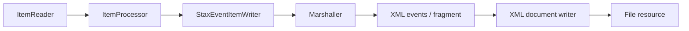

# Marshaller trong writer

Khi một batch job cần xuất dữ liệu thành XML, writer phải chuyển từng object Java thành một đoạn XML hợp lệ rồi ghép các đoạn đó vào một tài liệu hoàn chỉnh. Spring Batch hỗ trợ cách làm này thông qua `StaxEventItemWriter`, còn Spring OXM cung cấp abstraction **`Marshaller`** để chuyển object thành XML.

Marshaller chịu trách nhiệm ánh xạ object và cấu trúc dữ liệu Java sang XML. Writer chịu trách nhiệm quản lý file đầu ra, phần tử gốc của tài liệu, thứ tự item, encoding, callback header/footer, checkpoint và vòng đời ghi theo chunk. Hai thành phần phối hợp với nhau nhưng có trách nhiệm riêng.

Ví dụ, job xuất nhiều đơn hàng có thể tạo tài liệu:

```xml
<?xml version="1.0" encoding="UTF-8"?>
<orders>
    <order>
        <orderId>1001</orderId>
        <customerId>C001</customerId>
        <amount>250.00</amount>
    </order>
    <order>
        <orderId>1002</orderId>
        <customerId>C002</customerId>
        <amount>175.50</amount>
    </order>
</orders>
```

`StaxEventItemWriter` tạo phần tử gốc `<orders>`, sau đó gọi marshaller cho từng item để tạo các phần tử `<order>`. Nhờ đó, ứng dụng không phải tự nối chuỗi XML trong writer.

## 1. Marshaller là gì?

`Marshaller` là interface trong Spring OXM (`org.springframework.oxm.Marshaller`). Nó định nghĩa cách chuyển một object graph thành XML thông qua một đối tượng đích thuộc Spring `Result`.

Hai thao tác quan trọng của abstraction này là:

- `supports(Class<?>)`: cho biết marshaller có hỗ trợ kiểu object được hỏi hay không.
- `marshal(Object, Result)`: ghi biểu diễn XML của object vào kết quả đích.

Mã khái quát:

```java
public interface Marshaller {

    boolean supports(Class<?> clazz);

    void marshal(Object graph, Result result)
            throws IOException, XmlMappingException;
}
```

Spring OXM tách việc ánh xạ object sang XML khỏi cách ghi file. Một implementation có thể dùng JAXB hoặc một công nghệ binding XML khác. Trong Spring Batch, `StaxEventItemWriter` sử dụng marshaller để ghi từng item thành XML event/fragment vào tài liệu đang mở.

Marshaller không tự đọc item từ nguồn, không điều phối chunk và không commit transaction. Những phần đó thuộc pipeline và writer của Spring Batch.

## 2. Marshaller nằm ở đâu trong batch pipeline?

Trong một chunk-oriented step, dữ liệu đi qua reader, processor và writer. Nếu writer là `StaxEventItemWriter`, mỗi item đầu ra được chuyển qua marshaller trước khi XML được ghi vào resource.



Trách nhiệm được phân chia như sau:

| Thành phần | Trách nhiệm |
|---|---|
| `ItemReader` | Đọc item đầu vào |
| `ItemProcessor` | Chuyển đổi hoặc lọc item |
| `Marshaller` | Ánh xạ object thành XML |
| `StaxEventItemWriter` | Ghép XML của từng item vào tài liệu, quản lý file và state |
| Transaction manager | Quản lý transaction của chunk và resource tham gia transaction |
| `JobRepository` | Lưu metadata và checkpoint của job/step |

Việc dùng marshaller giúp writer tập trung vào điều phối XML output, còn mapping schema được cấu hình riêng trong model hoặc binding metadata.

## 3. StaxEventItemWriter

`StaxEventItemWriter<T>` là writer của Spring Batch dùng StAX để tạo XML output theo luồng. StAX là API xử lý XML theo kiểu streaming, phù hợp với batch vì writer có thể ghi từng item mà không cần tạo toàn bộ tài liệu XML lớn trong bộ nhớ.

Các cấu hình thường gặp:

- `resource`: file hoặc resource đầu ra.
- `marshaller`: object chuyển item thành XML.
- `rootTagName`: tên phần tử gốc bao quanh các item.
- `encoding`: encoding của tài liệu.
- `headerCallback` và `footerCallback`: nội dung bổ sung ở đầu/cuối tài liệu.
- `saveState`: lưu state để restart.
- `overwriteOutput`: quy định cách xử lý output đã tồn tại khi bắt đầu ghi theo cấu hình writer.
- `name`: tên ổn định dùng cho state trong execution context.

Ví dụ XML output có một root element chứa nhiều item:

```xml
<orders>
    <order>...</order>
    <order>...</order>
    <order>...</order>
</orders>
```

`rootTagName` là tên phần tử bao ngoài, còn root element của từng item thường được xác định bởi JAXB annotation hoặc metadata của marshaller.

## 4. Dùng JAXB làm marshaller

JAXB là công nghệ binding giữa Java object và XML. Trong Spring OXM, `Jaxb2Marshaller` cung cấp implementation của Spring `Marshaller` dựa trên JAXB.

Với Spring Framework 6/Spring Batch 5 hiện đại, JAXB API thường thuộc namespace `jakarta.xml.bind`. Dự án cũ có thể dùng namespace `javax.xml.bind`; cần dùng đồng bộ với phiên bản Spring và dependency JAXB của ứng dụng.

Ví dụ model XML:

```java
import jakarta.xml.bind.annotation.XmlAccessType;
import jakarta.xml.bind.annotation.XmlAccessorType;
import jakarta.xml.bind.annotation.XmlElement;
import jakarta.xml.bind.annotation.XmlRootElement;
import jakarta.xml.bind.annotation.XmlType;

import java.math.BigDecimal;

@XmlRootElement(name = "order")
@XmlAccessorType(XmlAccessType.FIELD)
@XmlType(propOrder = {"orderId", "customerId", "amount"})
public class OrderXml {

    @XmlElement(required = true)
    private Long orderId;

    private String customerId;
    private BigDecimal amount;

    public OrderXml() {
    }

    public OrderXml(Long orderId, String customerId, BigDecimal amount) {
        this.orderId = orderId;
        this.customerId = customerId;
        this.amount = amount;
    }
}
```

Trong ví dụ:

- `@XmlRootElement(name = "order")` định nghĩa phần tử gốc cho một item.
- `@XmlAccessorType(XmlAccessType.FIELD)` yêu cầu JAXB đọc field trực tiếp.
- `@XmlType(propOrder = ...)` quy định thứ tự các phần tử con.
- `@XmlElement` có thể khai báo thêm metadata cho phần tử.
- Constructor không tham số giúp JAXB tạo object trong nhiều cấu hình binding thông dụng.

Khi dùng field access, getter/setter không bắt buộc cho các field đã được JAXB ánh xạ, nhưng model vẫn có thể cung cấp chúng cho các phần khác của ứng dụng.

## 5. Cấu hình Jaxb2Marshaller

Có thể khai báo `Jaxb2Marshaller` thành Spring bean và đăng ký các class cần bind:

```java
@Bean
public Jaxb2Marshaller orderMarshaller() {
    Jaxb2Marshaller marshaller = new Jaxb2Marshaller();
    marshaller.setClassesToBeBound(OrderXml.class);
    marshaller.setMarshallerProperties(Map.of(
            "jaxb.formatted.output", Boolean.TRUE));
    return marshaller;
}
```

`setClassesToBeBound(...)` đăng ký các kiểu Java mà JAXB context cần biết. Nếu có nhiều kiểu XML, có thể truyền nhiều class. Một lựa chọn khác là `setPackagesToScan(...)` khi model được tổ chức theo package và annotation phù hợp.

`setMarshallerProperties(...)` chuyển các thuộc tính cho JAXB marshaller. Ví dụ `jaxb.formatted.output` bật pretty printing. Cách trình bày đẹp có thể làm output dễ đọc hơn, nhưng sẽ tăng kích thước file và chi phí ghi so với XML compact.

Hãy cấu hình marshaller hoàn chỉnh trước khi job chạy. Tránh thay đổi binding metadata trong lúc writer đang sử dụng nó.

## 6. Cấu hình StaxEventItemWriter với builder

Spring Batch cung cấp `StaxEventItemWriterBuilder<T>` để tạo writer dễ đọc hơn so với cấu hình từng setter.

```java
@Bean
public StaxEventItemWriter<OrderXml> orderXmlWriter(
        Jaxb2Marshaller orderMarshaller,
        @Value("#{jobParameters['outputFile']}") String outputFile) {

    return new StaxEventItemWriterBuilder<OrderXml>()
            .name("orderXmlWriter")
            .resource(new FileSystemResource(outputFile))
            .marshaller(orderMarshaller)
            .rootTagName("orders")
            .encoding(StandardCharsets.UTF_8.name())
            .saveState(true)
            .overwriteOutput(true)
            .build();
}
```

Các điểm cần hiểu:

- `.name("orderXmlWriter")` cung cấp tên ổn định cho writer state.
- `.resource(...)` xác định XML file đích.
- `.marshaller(...)` gắn cơ chế chuyển item thành XML.
- `.rootTagName("orders")` tạo phần tử bao ngoài của tài liệu.
- `.encoding(...)` đặt encoding rõ ràng.
- `.saveState(true)` bật lưu state phục vụ restart.
- `.overwriteOutput(true)` cho phép xử lý output đã tồn tại theo chính sách overwrite của writer khi bắt đầu một lần ghi mới; chỉ dùng khi output path thuộc lần chạy cần được tạo mới và việc thay thế là chủ đích.

Không nên dùng một path đã publish của kỳ trước làm resource với overwrite bật. Hãy tạo staging path riêng theo định danh công việc và phân biệt restart với một lần export mới.

## 7. Ghép writer vào step

Sau khi tạo marshaller và writer, cấu hình chúng trong chunk-oriented step:

```java
@Bean
public Step exportOrdersStep(
        JobRepository jobRepository,
        PlatformTransactionManager transactionManager,
        ItemReader<OrderInput> orderReader,
        ItemProcessor<OrderInput, OrderXml> orderProcessor,
        StaxEventItemWriter<OrderXml> orderXmlWriter) {

    return new StepBuilder("exportOrdersStep", jobRepository)
            .<OrderInput, OrderXml>chunk(500, transactionManager)
            .reader(orderReader)
            .processor(orderProcessor)
            .writer(orderXmlWriter)
            .build();
}
```

Processor chuyển model đầu vào sang `OrderXml`, tức kiểu dữ liệu được JAXB hỗ trợ. Writer nhận chunk `OrderXml` và gọi marshaller cho từng item.

Chunk size 500 chỉ là ví dụ. Kích thước phù hợp phụ thuộc độ lớn object, chi phí marshal, tốc độ filesystem và yêu cầu commit/restart.

## 8. Tách model nghiệp vụ và model XML

Không nhất thiết phải annotate entity nghiệp vụ bằng JAXB. Có thể tạo DTO chuyên dùng cho XML để tách schema bên ngoài khỏi cấu trúc nội bộ của ứng dụng.

Ví dụ:

```java
public class OrderProcessor
        implements ItemProcessor<Order, OrderXml> {

    @Override
    public OrderXml process(Order order) {
        return new OrderXml(
                order.getId(),
                order.getCustomer().getCode(),
                order.getTotalAmount());
    }
}
```

Lợi ích:

- XML schema không phụ thuộc trực tiếp vào entity persistence.
- Có thể đổi tên element/attribute mà không thay đổi domain model.
- Không vô tình serialize association lazy hoặc field nội bộ.
- Chỉ đưa dữ liệu cần xuất vào file.
- Có thể version hóa DTO XML theo hợp đồng tích hợp.

Với batch export cho hệ thống bên ngoài, DTO XML riêng thường dễ kiểm soát hơn việc marshal toàn bộ entity JPA.

## 9. Root element của tài liệu và root element của item

Có hai cấp root cần phân biệt:

1. Root document do `StaxEventItemWriter` quản lý, ví dụ `<orders>`.
2. Root element của mỗi item do marshaller tạo ra, ví dụ `<order>`.

Ví dụ:

```xml
<orders>
    <order>
        <orderId>1001</orderId>
    </order>
    <order>
        <orderId>1002</orderId>
    </order>
</orders>
```

Nếu `rootTagName` là `orders`, model JAXB cho item cần marshal thành element `order`. Không nên đặt root element của từng item trùng với root document nếu cấu trúc mong muốn là danh sách item bên trong một wrapper.

Nếu model không có `@XmlRootElement`, JAXB có thể cần một `JAXBElement` được tạo qua `ObjectFactory` hoặc cơ chế mapping tương ứng. Khi đó, processor hoặc custom marshaller cần trả đúng object wrapper mà JAXB có thể marshal thành root element.

## 10. Dùng JAXBElement khi class không có XmlRootElement

Một số model được sinh từ XSD không gắn `@XmlRootElement` trực tiếp lên class. JAXB có thể tạo `ObjectFactory` với method trả về `JAXBElement<T>`.

Ví dụ khái quát:

```java
ObjectFactory factory = new ObjectFactory();
JAXBElement<OrderXml> element = factory.createOrder(orderXml);
marshaller.marshal(element, result);
```

Nếu writer nhận `OrderXml` nhưng marshaller chỉ hỗ trợ `JAXBElement<OrderXml>`, có thể viết adapter/provider riêng để chuyển item thành kiểu mà marshaller hỗ trợ, hoặc điều chỉnh processor để tạo wrapper. Cần bảo đảm `supports(...)` và kiểu object thực tế được marshal tương thích.

Không nên thêm `@XmlRootElement` tùy tiện vào class được generate từ schema nếu thay đổi đó sẽ bị ghi đè ở lần generate tiếp theo. Dùng `ObjectFactory` hoặc custom adapter theo cấu trúc JAXB được sinh ra.

## 11. XML element, attribute và thứ tự field

JAXB annotation cho phép điều khiển cách field xuất hiện trong XML.

Ví dụ dùng attribute và element:

```java
@XmlRootElement(name = "order")
@XmlAccessorType(XmlAccessType.FIELD)
@XmlType(propOrder = {"customerId", "amount"})
public class OrderXml {

    @XmlAttribute(name = "id")
    private Long orderId;

    @XmlElement(name = "customer")
    private String customerId;

    @XmlElement(name = "total")
    private BigDecimal amount;
}
```

XML tạo ra có dạng:

```xml
<order id="1001">
    <customer>C001</customer>
    <total>250.00</total>
</order>
```

Các annotation thường dùng:

| Annotation | Vai trò |
|---|---|
| `@XmlRootElement` | Tên root element của object |
| `@XmlElement` | Ánh xạ property thành child element |
| `@XmlAttribute` | Ánh xạ property thành XML attribute |
| `@XmlType(propOrder = ...)` | Chỉ định thứ tự element con |
| `@XmlElementWrapper` | Tạo wrapper cho collection |
| `@XmlTransient` | Loại property khỏi XML binding |
| `@XmlJavaTypeAdapter` | Chuyển đổi kiểu Java tùy chỉnh |

Thứ tự XML có thể là một phần của hợp đồng XSD. Nếu schema yêu cầu thứ tự element cụ thể, hãy khai báo `propOrder` và kiểm thử XML output với schema đó.

## 12. Collection bên trong một item

Một item có thể chứa danh sách dòng chi tiết. JAXB có thể marshal collection thành nhiều element con.

Ví dụ:

```java
@XmlRootElement(name = "order")
@XmlAccessorType(XmlAccessType.FIELD)
public class OrderXml {

    private Long orderId;

    @XmlElementWrapper(name = "lines")
    @XmlElement(name = "line")
    private List<OrderLineXml> lines;
}
```

XML có thể có cấu trúc:

```xml
<order>
    <orderId>1001</orderId>
    <lines>
        <line>...</line>
        <line>...</line>
    </lines>
</order>
```

Đây là collection bên trong một item. Nó khác với nhiều item độc lập mà `StaxEventItemWriter` ghi dưới root document `<orders>`.

Nếu một item chứa hàng nghìn child object, kích thước object graph có thể lớn. Marshaller cần duyệt toàn bộ graph của item đó; chunk size không làm giảm kích thước một item đơn lẻ. Có thể cần phân trang dữ liệu chi tiết hoặc thay đổi mô hình export nếu một record quá lớn.

## 13. Namespace XML

Nhiều hợp đồng XML yêu cầu namespace để phân biệt vocabulary. JAXB hỗ trợ namespace qua annotation và package-level schema metadata.

Ví dụ:

```java
@XmlRootElement(name = "order", namespace = "urn:example:orders:v1")
@XmlAccessorType(XmlAccessType.FIELD)
public class OrderXml {
    private Long orderId;
}
```

XML có thể được marshal với namespace URI tương ứng. Để điều khiển prefix mặc định hoặc prefix cụ thể, có thể cần cấu hình namespace/package metadata hoặc adapter phụ thuộc JAXB implementation.

Khi dùng namespace, cần kiểm tra:

- URI namespace đúng với XSD/hợp đồng.
- Root document và các item dùng namespace nhất quán.
- Prefix chỉ là bí danh; namespace URI mới là định danh thực tế.
- `xsi:schemaLocation` nếu cần phải được khai báo theo đúng hợp đồng.
- Header/footer callback không tạo thêm root hoặc namespace declaration sai.

Không so sánh XML chỉ bằng chuỗi prefix nếu điều cần xác nhận là namespace URI và cấu trúc. Hai prefix khác nhau vẫn có thể đại diện cùng namespace.

## 14. Encoding và XML declaration

Encoding của file cần nhất quán với XML declaration và byte output thực tế. Với tích hợp hiện đại, UTF-8 thường là lựa chọn phổ biến.

```java
.encoding(StandardCharsets.UTF_8.name())
```

Nếu file chứa tiếng Việt hoặc ký tự ngoài ASCII, hãy kiểm thử byte output bằng UTF-8 và parse lại bằng XML parser. Không chỉ mở file trong editor rồi dựa vào cách editor tự đoán encoding.

XML declaration có thể chứa version và encoding. Writer quản lý document-level output; marshaller được gọi cho từng item và nên tạo fragment phù hợp với tài liệu đang mở. Không để mỗi item tạo thêm một XML declaration hoặc một document root lồng nhau.

Nếu đối tác yêu cầu XML version hoặc standalone declaration cụ thể, kiểm tra cấu hình writer và XML declaration được tạo ra trong phiên bản Spring Batch đang dùng. Đừng tự thêm declaration lần nữa trong header callback nếu writer đã tạo declaration.

## 15. HeaderCallback và FooterCallback

`StaxEventItemWriter` có thể thêm nội dung ở đầu và cuối tài liệu thông qua callback StAX. Callback hữu ích cho metadata hoặc phần trailer theo schema.

Ví dụ cấu trúc:

```xml
<?xml version="1.0" encoding="UTF-8"?>
<orders>
    <!-- Header hoặc metadata nếu hợp đồng cho phép -->
    <order>...</order>
    <order>...</order>
    <!-- Footer nếu schema định nghĩa -->
</orders>
```

Callback header/footer làm việc với XML event writer, cho phép ghi event phù hợp thay vì nối chuỗi tùy tiện. API callback cụ thể là `StaxWriterCallback` trong Spring Batch.

Ví dụ cấu hình ở mức builder:

```java
.headerCallback(eventWriter -> {
    // Ghi các XML event được schema cho phép.
})
.footerCallback(eventWriter -> {
    // Ghi các XML event kết thúc hoặc metadata cuối.
})
```

Không ghi thêm document root trong callback nếu writer đã quản lý `rootTagName`. Header/footer phải tạo event hợp lệ trong vị trí mà writer gọi callback. Một lỗi namespace hoặc thứ tự event có thể làm XML không parse được.

## 16. Header/footer không phải nơi ghi dữ liệu item

Header/footer callback thường được gọi theo vòng đời mở/đóng tài liệu hoặc resource, không phải một lần cho mỗi item. Vì vậy, không dùng chúng để ghi từng record hoặc tạo logic phụ thuộc vào chunk.

Phù hợp:

- Ghi metadata cố định của file.
- Ghi version schema.
- Ghi thời điểm tạo nếu hợp đồng cho phép.
- Ghi trailer/count nếu ứng dụng có cách tính và thời điểm chính xác.

Không phù hợp:

- Ghi mỗi order hoặc customer.
- Gọi API tạo side effect cho từng item.
- Tăng counter theo số item nếu callback không được gọi ở đúng lifecycle cần thiết.
- Ghi footer phụ thuộc số item đã commit mà không xét restart/rollback.

Nếu cần record count cuối file, có thể tính từ metadata hoặc dữ liệu bền vững và đưa vào bước tạo manifest/footer riêng theo thiết kế. Cần chú ý restart vì footer chỉ nên xuất hiện một lần trong tài liệu hoàn chỉnh.

## 17. XML validation và XSD

Marshaller chuyển object sang XML theo mapping, nhưng việc marshal thành công không tự bảo đảm output phù hợp với XSD mà đối tác yêu cầu.

Có thể kiểm tra output bằng XML Schema sau khi file hoàn tất:

1. Đóng XML writer để tài liệu có đủ root và footer.
2. Dùng `SchemaFactory` tải XSD tin cậy.
3. Tạo `Validator` và validate file output.
4. Nếu hợp lệ, cho phép bước publish tiếp tục.
5. Nếu không hợp lệ, giữ staging file để điều tra và kết thúc job theo policy.

Ví dụ Java:

```java
SchemaFactory schemaFactory =
        SchemaFactory.newInstance(XMLConstants.W3C_XML_SCHEMA_NS_URI);

Schema schema = schemaFactory.newSchema(xsdResource.getURL());
Validator validator = schema.newValidator();
validator.validate(new StreamSource(xmlFile));
```

Trong production, cần cấu hình nguồn XSD an toàn và hạn chế external entity/schema access nếu không cần thiết. Không tải XSD từ URL không tin cậy trong lúc validate output.

Validation theo từng item có thể giúp phát hiện lỗi sớm, nhưng schema validation toàn file vẫn cần thiết nếu các quy tắc phụ thuộc cấu trúc tổng thể hoặc root/document-level metadata.

## 18. Khi marshaller không hỗ trợ kiểu item

Spring OXM `Marshaller` có phương thức `supports(Class<?>)`. Nếu marshaller không hỗ trợ class của item, quá trình marshal có thể thất bại khi writer xử lý item.

Nguyên nhân thường gặp:

- Class chưa được đăng ký trong JAXB context.
- Model thiếu annotation hoặc `ObjectFactory` cần thiết.
- Processor trả về một DTO khác với kiểu đã cấu hình.
- Writer nhận `JAXBElement` nhưng marshaller chỉ bind class gốc, hoặc ngược lại.
- JAXB namespace `javax` và `jakarta` bị trộn giữa dependency.

Hãy kiểm tra kiểu đầu ra của processor, danh sách class được bind và implementation marshaller. Có thể kiểm tra hỗ trợ trước khi launch job trong cấu hình/preflight test, nhưng writer vẫn cần xử lý lỗi mapping thực tế.

## 19. Lỗi marshal và xử lý trong batch

Marshaller có thể phát sinh lỗi khi object không phù hợp mapping, property không hợp lệ, adapter thất bại hoặc output result gặp lỗi I/O.

Các lỗi thường thấy:

- `XmlMappingException`: lỗi ánh xạ object sang XML.
- `IOException`: lỗi đọc/ghi resource hoặc stream.
- JAXB exception được Spring OXM chuyển thành `XmlMappingException` hoặc exception tương ứng.
- Lỗi StAX khi tạo XML event không hợp lệ.

Khi writer ném exception trong chunk, transaction chunk có thể rollback các resource tham gia transaction. XML output có hành vi phụ thuộc cấu hình transactional của writer và resource. Với lỗi mapping cố định như property không marshal được, retry thường không giúp; cần sửa model hoặc dữ liệu. Với lỗi I/O tạm thời, có thể cân nhắc retry có giới hạn nếu writer và resource hỗ trợ khôi phục an toàn.

Không nên skip mọi lỗi marshal một cách rộng rãi. Nếu bỏ qua item, XML output có thể thiếu record nghiệp vụ. Chỉ skip khi nghiệp vụ cho phép và cần ghi lại item lỗi cùng lý do.

## 20. Transactional writing và rollback chunk

`StaxEventItemWriter` hỗ trợ ghi theo transaction của chunk. Trong cấu hình transactional mặc định, writer có thể buffer XML events/nội dung của chunk và chỉ chuyển phần dữ liệu đó vào output khi transaction commit; nếu rollback, phần ghi chưa commit có thể bị loại bỏ theo cơ chế writer.

Điều này giúp tránh một số trường hợp chunk rollback để lại một phần item trong file. Tuy nhiên, file system không trở thành một database transaction tổng quát:

- Process có thể dừng ở cửa sổ giữa ghi file và lưu metadata.
- Storage có thể gặp lỗi flush hoặc mất kết nối.
- File có thể được hệ thống ngoài đọc khi đang được tạo nếu ghi trực tiếp vào published path.
- Header/footer và thao tác publish có vòng đời riêng.
- Các side effect ngoài file/database không tự rollback.

Với output quan trọng, nên ghi vào staging file, đóng và validate, sau đó publish bằng bước riêng có thể phục hồi. Không để downstream đọc file đang được writer tạo dở.

## 21. Restart và saveState

`StaxEventItemWriter` là một `ItemStreamWriter` có thể lưu state để restart. Khi bật `saveState(true)` và đặt tên writer ổn định, writer lưu tiến độ cần thiết vào `ExecutionContext` để tiếp tục output theo checkpoint.

Ví dụ:

```java
.name("orderXmlWriter")
.saveState(true)
```

Để restart an toàn:

- Dùng cùng identifying job parameters để restart đúng `JobInstance`.
- Giữ cùng output resource của staging artifact.
- Giữ tên writer ổn định.
- Không thay đổi schema/model hoặc nội dung nguồn theo cách làm checkpoint không còn tương ứng.
- Để writer khôi phục state qua `ExecutionContext` thay vì tự append từ đầu.
- Đảm bảo output đã commit trước đó không bị xóa khi mở lại resource.

Nếu dùng `overwriteOutput(true)` cho một resource đã tồn tại, hãy hiểu rõ sự khác nhau giữa lần chạy mới và restart theo hành vi của phiên bản. Không để cấu hình overwrite xóa output đã commit cần tiếp tục. Một cách an toàn là output path riêng cho từng `JobInstance` và một quy trình staging/publish rõ ràng.

## 22. Output path và không ghi đè kết quả cũ

Một output XML thường nên được định danh theo ngày nghiệp vụ, tenant và output version:

```text
exports/
  staging/
    orders-2026-11-15-tenant-42-v1.xml
  published/
    orders-2026-11-15-tenant-42-v1.xml
```

Restart cùng `JobInstance` tiếp tục staging file tương ứng. Một lần reprocess có chủ đích dùng version mới, không ghi đè file đã publish.

Không dùng `JobExecution` ID mới làm output identity duy nhất nếu restart cần mở lại cùng resource. Ngược lại, không dùng một file cố định cho nhiều `JobInstance` chạy đồng thời.

Khi publish, hãy kiểm tra file đích và manifest/checksum. Nếu file đã tồn tại và khớp với artifact của cùng job/version, có thể xem publish đã hoàn tất. Nếu nội dung khác, dừng và báo collision thay vì ghi đè âm thầm.

## 23. Marshaller và hiệu năng

Marshal XML có chi phí CPU và allocation. Với job xuất nhiều item, cần cân nhắc:

- Độ phức tạp của object graph.
- Số lượng child object trong mỗi item.
- Pretty printing và whitespace.
- Adapter hoặc converter tùy chỉnh.
- Namespace/schema metadata.
- Kích thước chunk và transaction buffer.
- Tốc độ storage và flush.

StAX cho phép ghi theo luồng thay vì dựng toàn bộ XML document trong heap. Tuy nhiên, marshaller vẫn cần xử lý object graph của từng item. Một item chứa collection khổng lồ vẫn có thể gây áp lực bộ nhớ.

Không nên tạo JAXB context hoặc cấu hình marshaller mới cho từng item. Cấu hình `Jaxb2Marshaller` thành bean dùng lại sau khi khởi tạo. Nếu có custom marshaller, kiểm tra thread-safety và vòng đời nội bộ trước khi chia sẻ.

Pretty printing hữu ích khi người đọc cần xem file trực tiếp, nhưng nếu file rất lớn và downstream chỉ parse bằng máy, XML compact có thể giảm byte output và chi phí I/O.

## 24. Thread safety

Trong một step tuần tự, writer thường được gọi theo thứ tự chunk của step. Nhưng nếu cùng writer hoặc marshaller tùy chỉnh được chia sẻ giữa nhiều step/thread, cần xem thread safety.

- `StaxEventItemWriter` quản lý trạng thái file và XML event writer; không nên dùng cùng một writer instance để ghi đồng thời vào một resource từ nhiều thread.
- `Jaxb2Marshaller` là Spring OXM abstraction được thiết kế để cấu hình và tái sử dụng; tránh tự chia sẻ một đối tượng JAXB `Marshaller` thô giữa nhiều thread vì JAXB marshaller không phải lúc nào cũng thread-safe.
- Custom `Marshaller` phải không giữ state mutable dùng chung hoặc phải đồng bộ rõ ràng.
- DTO item không nên bị sửa trong lúc marshal.
- Parallel flow nên ghi ra resource riêng cho mỗi nhánh, sau đó merge hoặc publish theo bước riêng.

Nếu cần chạy song song nhiều XML export, mỗi step/job nên có writer instance và output resource riêng. Không dùng một `XMLStreamWriter` mutable chung cho các nhánh.

## 25. Dùng custom Spring OXM Marshaller

Không bắt buộc phải dùng JAXB. Có thể dùng bất kỳ implementation Spring OXM nào tương thích với kiểu `Result` mà `StaxEventItemWriter` cung cấp.

Một custom marshaller có thể implement:

```java
public class OrderMarshaller implements Marshaller {

    @Override
    public boolean supports(Class<?> clazz) {
        return OrderXml.class.isAssignableFrom(clazz);
    }

    @Override
    public void marshal(Object graph, Result result)
            throws IOException, XmlMappingException {
        OrderXml order = (OrderXml) graph;
        // Ghi XML theo mapping đã định nghĩa.
    }
}
```

Đây chỉ là khung minh họa; phần ghi XML phải sử dụng API StAX/Result tương thích và xử lý exception đúng. Nếu tự implement, cần kiểm tra:

- `supports(...)` chỉ trả true cho kiểu thực sự được hỗ trợ.
- Output là fragment/item hợp lệ trong root document do writer quản lý.
- Không tự đóng stream/result mà writer sở hữu.
- Không tạo XML declaration hoặc document root lồng nhau.
- Escaping XML được thực hiện đúng cho text và attribute.
- Namespace và encoding tuân theo hợp đồng.
- Implementation thread-safe nếu được dùng đồng thời.

Trong hầu hết trường hợp, dùng `Jaxb2Marshaller` sẽ ít lỗi hơn so với tự viết serializer XML.

## 26. XML escaping và dữ liệu không tin cậy

Marshaller chuẩn xử lý việc escape ký tự đặc biệt trong text/attribute theo quy tắc XML. Ví dụ giá trị `A & B` cần được biểu diễn thành `A &amp; B` trong XML.

Không tự nối chuỗi XML kiểu:

```java
String xml = "<customer>" + customerName + "</customer>";
```

vì dữ liệu có thể chứa `&`, `<`, `>` hoặc dấu nháy, khiến XML không hợp lệ hoặc mở ra lỗi injection vào cấu trúc XML.

Hãy marshal object bằng thư viện XML binding hoặc dùng XML writer có escaping đúng. Nếu cần đưa nội dung HTML/XML lồng nhau, xác định rõ đó là text, CDATA hay XML subtree theo schema; không tắt escaping để “giữ nguyên chuỗi” mà không kiểm soát.

## 27. Namespace và schema versioning

XML thường là hợp đồng tích hợp lâu dài. Khi schema thay đổi, không nên âm thầm thay đổi mapping của job đang chạy nếu restart cần tiếp tục cùng output.

Có thể version hóa model:

```text
OrderXmlV1 -> urn:example:orders:v1
OrderXmlV2 -> urn:example:orders:v2
```

Chọn model/marshaller theo identifying parameter hoặc cấu hình version rõ ràng. Nếu một `JobInstance` đã tạo checkpoint với V1, restart cần tiếp tục cùng schema/resource. Muốn xuất V2, hãy tạo output version/instance mới.

Schema version cũng nên được ghi vào metadata/manifest để downstream biết cách parse file. Không chỉ dựa vào tên file hoặc thời điểm tạo.

## 28. Xác thực output XML sau khi ghi

Một bước kiểm tra sau writer có thể:

- Parse file bằng XML parser.
- Xác nhận root element và namespace.
- Validate theo XSD.
- Kiểm tra số lượng item xuất ra.
- Kiểm tra các field bắt buộc.
- Tính checksum và ghi manifest.

Nên thực hiện sau khi writer đã đóng tài liệu, vì khi còn đang mở, closing root tag/footer có thể chưa được ghi.

Nếu XML không hợp lệ, không publish file. Giữ staging output và log vị trí/lỗi parse để điều tra. Không xóa output đã publish trước đó chỉ vì bản staging mới không hợp lệ.

## 29. Kiểm thử marshaller độc lập

Có thể kiểm tra marshaller mà không cần chạy toàn bộ job bằng cách marshal một object vào `StringResult` hoặc `StreamResult` phù hợp với implementation.

Ví dụ với Spring OXM:

```java
Jaxb2Marshaller marshaller = new Jaxb2Marshaller();
marshaller.setClassesToBeBound(OrderXml.class);
marshaller.afterPropertiesSet();

StringResult result = new StringResult();
marshaller.marshal(
        new OrderXml(1001L, "C001", new BigDecimal("250.00")),
        result);

String xml = result.toString();
```

Sau đó parse `xml` và kiểm tra root/element/value. Không nên chỉ so sánh chuỗi nguyên văn nếu whitespace hoặc namespace prefix có thể khác nhưng XML vẫn tương đương về cấu trúc.

Các trường hợp nên kiểm tra:

- Object hợp lệ được marshal thành đúng root item.
- Field null được xử lý theo schema.
- Decimal/date/time có định dạng đúng.
- Enum được chuyển thành giá trị mong đợi.
- Namespace và thứ tự element đúng.
- Collection lồng nhau có wrapper phù hợp.
- Ký tự đặc biệt được escape.
- Class không hỗ trợ bị từ chối rõ ràng.

## 30. Integration test với StaxEventItemWriter

Unit test marshaller không chứng minh writer tạo đúng tài liệu bao ngoài, header/footer và restart state. Nên có integration test với writer thật.

Một test cơ bản có thể:

1. Tạo `Jaxb2Marshaller` cho `OrderXml`.
2. Cấu hình `StaxEventItemWriter` với root `orders` và file tạm.
3. Gọi `open`, `write`, `update` và `close` theo lifecycle `ItemStream` hoặc chạy qua step test.
4. Parse file output bằng XML parser.
5. Xác nhận có một root `<orders>` và số lượng `<order>` đúng.
6. Validate XSD nếu hợp đồng có schema.

Với Spring Batch, kiểm thử qua step/job thường phản ánh đúng transaction, checkpoint và callback hơn việc tự gọi writer thủ công. Có thể dùng `JobLauncherTestUtils` trong cấu hình test.

### Kiểm thử rollback và restart

- Cố ý làm writer hoặc step thất bại sau một số chunk đã commit.
- Restart cùng `JobInstance` và xác nhận XML không có item trùng.
- Xác nhận root document chỉ xuất hiện một lần.
- Xác nhận không có XML declaration lặp giữa các item.
- Xác nhận file staging được hoàn tất trước khi publish.
- Xác nhận output cũ không bị overwrite khi chạy instance mới.

## 31. Các lỗi thường gặp

| Tình huống | Nguyên nhân | Cách xử lý |
|---|---|---|
| Writer không marshal được item | Class chưa được bind hoặc marshaller không hỗ trợ kiểu | Đăng ký class, kiểm tra `supports` và kiểu processor trả về |
| Thiếu root element của item | Model không có `@XmlRootElement` hoặc `JAXBElement` phù hợp | Dùng annotation hoặc `ObjectFactory` wrapper |
| XML có root lồng nhau sai cấu trúc | Nhầm `rootTagName` của document với root của item | Tách wrapper document và item root |
| XML declaration lặp | Custom marshaller tạo document đầy đủ cho từng item | Marshal fragment tương thích với writer |
| XML sai namespace | Annotation/package namespace không khớp XSD | Kiểm tra URI/prefix và validate schema |
| Thứ tự element sai | Không khai báo `propOrder` theo schema | Dùng `@XmlType(propOrder=...)` |
| Ký tự `&` làm XML lỗi | Tự nối chuỗi không escape | Dùng marshaller/XML writer chuẩn |
| File bị ghi đè | Output path dùng chung và overwrite bật | Dùng staging path riêng, version và publish có kiểm soát |
| Restart tạo XML trùng | Writer state không được lưu/khôi phục hoặc append sai | Dùng `saveState`, tên/resource ổn định và restart đúng instance |
| Header/footer bị lặp hoặc sai vị trí | Callback không phù hợp lifecycle hoặc tự ghi root | Dùng callback cho document-level event đúng vị trí |
| Heap tăng cao | Item có object graph lớn hoặc buffer chunk lớn | Giảm chunk size, làm phẳng DTO và stream dữ liệu |
| Writer lỗi khi chạy song song | Dùng chung writer/event writer mutable | Mỗi step/flow có writer và resource riêng |
| Output không hợp XSD dù marshal thành công | JAXB mapping không bao phủ toàn bộ schema constraint | Validate file sau khi ghi và trước publish |

## 32. Quy trình thiết kế XML writer

1. **Xác định hợp đồng XML:** root document, root item, namespace, encoding và XSD.
2. **Tạo DTO XML:** chỉ chứa dữ liệu cần xuất và annotation phù hợp.
3. **Cấu hình marshaller:** dùng `Jaxb2Marshaller` hoặc implementation Spring OXM tương thích.
4. **Kiểm tra kiểu được hỗ trợ:** class phải nằm trong binding context hoặc được wrap bằng `JAXBElement`.
5. **Cấu hình `StaxEventItemWriter`:** resource, root tag, encoding, name và save state.
6. **Quy định output lifecycle:** staging riêng theo JobInstance, restart cùng resource và publish sau validation.
7. **Chọn chunk size:** cân bằng throughput, memory, rollback và kích thước item XML.
8. **Xử lý header/footer:** chỉ thêm event theo đúng schema và lifecycle writer.
9. **Kiểm thử mapping và document:** unit test marshaller, integration test writer và XSD validation.
10. **Theo dõi lỗi và restart:** ghi job/step ID, item key, output path, record count và checksum.

## 33. Những nguyên tắc cần nhớ

- Spring OXM `Marshaller` chuyển object thành XML; `StaxEventItemWriter` quản lý tài liệu và resource đầu ra.
- Extension point trong writer là `ItemWriter` nhận item; marshaller được gọi để serialize từng item.
- `rootTagName` là root document, còn `@XmlRootElement` hoặc `JAXBElement` xác định root của item.
- `Jaxb2Marshaller` là lựa chọn phổ biến; đăng ký class/package cần marshal trước khi job chạy.
- Tên namespace `jakarta.xml.bind` hay `javax.xml.bind` phải khớp phiên bản dependency.
- Dùng DTO XML riêng để tách schema tích hợp khỏi domain/entity nội bộ.
- Dùng annotation như `@XmlElement`, `@XmlAttribute`, `@XmlType(propOrder)` và `@XmlElementWrapper` để điều khiển cấu trúc.
- Cấu hình encoding rõ ràng, tránh XML declaration lặp và bảo đảm namespace đúng.
- Header/footer callback dành cho document-level event, không phải nơi ghi từng item.
- Marshal thành công không đồng nghĩa output hợp XSD; validate file trước publish nếu schema yêu cầu.
- Lỗi mapping cố định thường không giải quyết được bằng retry; sửa model hoặc dữ liệu.
- `saveState` và writer name ổn định hỗ trợ restart; staging path phải ổn định theo JobInstance.
- Không dùng overwrite/append mù quáng; bảo vệ output đã publish bằng version, manifest và bước publish riêng.
- Không chia sẻ một `StaxEventItemWriter` mutable cho nhiều thread/flow ghi đồng thời.
- Kiểm thử cả marshaller, XML document, namespace/schema, rollback và restart.

Marshaller trong writer giúp Spring Batch xuất object thành XML theo một hợp đồng có cấu trúc. Khi tách rõ mapping object với việc quản lý tài liệu, cấu hình đúng JAXB/namespace, giữ writer restartable và validate output trước publish, job có thể tạo XML lớn theo luồng mà vẫn kiểm soát được schema, hiệu năng và khả năng phục hồi.
