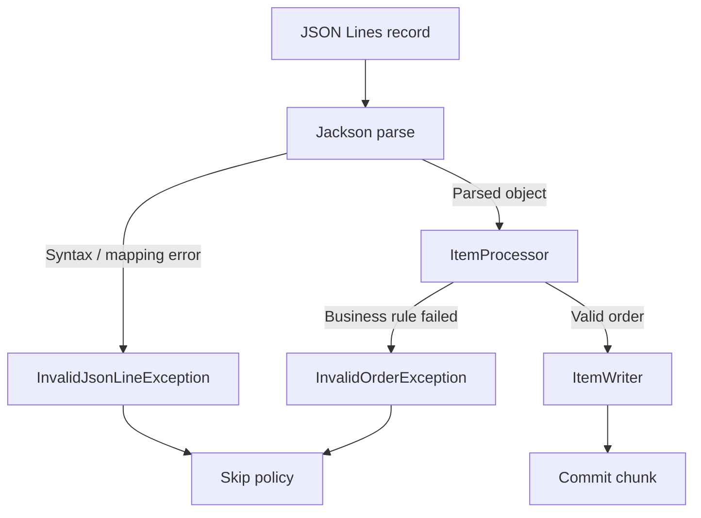

# Lỗi parse JSON và skip

Trong Spring Batch, khi đọc dữ liệu JSON, một record có thể không được phân tích thành object vì JSON sai cú pháp, kiểu dữ liệu không đúng hoặc dữ liệu không thỏa mãn quy tắc nghiệp vụ. Với một batch lớn, ứng dụng thường muốn cách ly một số record lỗi và tiếp tục xử lý các record hợp lệ. Spring Batch hỗ trợ cơ chế skip để thực hiện việc đó trong chunk-oriented step.

Tuy nhiên, **skip policy chỉ quyết định exception nào được phép bỏ qua; nó không tự khôi phục một reader đã mất khả năng xác định vị trí record tiếp theo**. Đây là điểm đặc biệt quan trọng khi parse JSON.

JSON có thể được lưu dưới dạng một document/array lớn hoặc JSON Lines (mỗi dòng là một JSON object độc lập). Với JSON Lines, reader đã tiêu thụ một dòng khi parse lỗi nên có thể chuyển sang dòng kế tiếp một cách rõ ràng. Với một JSON array lớn, lỗi cú pháp có thể làm parser mất đồng bộ và không thể xác định an toàn ranh giới object tiếp theo. Trong trường hợp đó, thêm skip policy không đủ để bảo đảm tiếp tục đọc đúng dữ liệu.

Bài này phân biệt các loại lỗi JSON, cách Spring Batch skip lỗi ở read/process/write, cách xây dựng reader cho JSON Lines, cách ghi nhận record bị loại và cách kiểm thử khả năng phục hồi.

## 1. Các loại lỗi khi xử lý JSON

Không phải mọi lỗi liên quan JSON đều giống nhau. Cần xác định lỗi xảy ra ở tầng nào:

| Loại lỗi | Ví dụ | Nơi thường phát hiện |
|---|---|---|
| JSON syntax error | Thiếu dấu ngoặc đóng, dấu phẩy sai vị trí, chuỗi không đóng quote | JSON parser/reader |
| Mapping/deserialization error | Trường amount là object trong khi model cần số | Jackson mapper |
| Schema/contract error | Thiếu orderId bắt buộc, xuất hiện field không được phép | Deserializer hoặc validation |
| Business validation error | Amount âm, trạng thái đơn hàng không được phép | ItemProcessor/domain validator |
| Writer/data constraint error | Vi phạm unique key, dữ liệu không ghi được | ItemWriter/database |

Ví dụ JSON hợp lệ về cú pháp nhưng sai kiểu dữ liệu:

```json
{
  "orderId": 1001,
  "amount": "not-a-number"
}
```

Parser có thể đọc được cấu trúc JSON, nhưng Jackson không thể ánh xạ chuỗi not-a-number thành kiểu số mà model yêu cầu.

Ví dụ JSON sai cú pháp:

```json
{
  "orderId": 1001,
  "amount": 250.00
```

Object chưa được đóng. Đây là lỗi cú pháp của document, không phải lỗi quy tắc nghiệp vụ của một order.

Ví dụ JSON hợp lệ nhưng vi phạm nghiệp vụ:

```json
{
  "orderId": 1002,
  "amount": -50.00,
  "currency": "USD"
}
```

Nếu nghiệp vụ không cho phép amount âm, nên để processor hoặc validator ném exception nghiệp vụ riêng. Việc tách các loại lỗi giúp skip đúng record và không che giấu lỗi hạ tầng hoặc lỗi cấu trúc của cả file.

## 2. Skip trong Spring Batch hoạt động như thế nào?

Trong chunk-oriented processing, Spring Batch có thể áp dụng skip policy cho exception xảy ra ở ba giai đoạn:

- **Read skip**: reader không thể tạo item từ record đầu vào.
- **Process skip**: processor từ chối một item đã đọc.
- **Write skip**: writer không thể ghi item.

Ví dụ cấu hình:

```java
return new StepBuilder("importOrdersStep", jobRepository)
        .<OrderInput, Order>chunk(100, transactionManager)
        .reader(orderReader)
        .processor(orderProcessor)
        .writer(orderWriter)
        .faultTolerant()
        .skip(InvalidJsonLineException.class)
        .skip(InvalidOrderException.class)
        .skipLimit(100)
        .build();
```

Trong ví dụ:

- InvalidJsonLineException đại diện cho một dòng JSON độc lập không thể parse.
- InvalidOrderException đại diện cho dữ liệu đã parse được nhưng không hợp lệ theo nghiệp vụ.
- Skip limit giới hạn tổng số item bị skip theo policy của step.
- Exception không được phép skip hoặc vượt giới hạn sẽ làm step thất bại.

Skip không có nghĩa record bị xóa khỏi file hoặc tự động được ghi vào một file reject. Nếu cần kiểm toán, phải ghi nhận record lỗi, line number, batch ID và nguyên nhân bằng listener hoặc một cơ chế reject riêng.

## 3. Điều kiện quan trọng: reader phải có thể tiếp tục

Spring Batch chỉ có thể gọi reader lần tiếp theo sau một read exception nếu reader vẫn ở trạng thái có thể tiến đến record kế tiếp.

Với một reader đọc theo từng dòng:

1. Reader lấy một dòng vật lý từ file.
2. LineMapper parse dòng đó thành JSON object.
3. Nếu parse thất bại, dòng đã được tiêu thụ.
4. Skip policy cho phép bỏ qua exception.
5. Lần read tiếp theo lấy dòng kế tiếp.

Với một parser streaming đọc một JSON array:

1. Parser đọc các token của document.
2. Một object ở giữa array bị lỗi cú pháp.
3. Parser có thể không còn biết vị trí bắt đầu object tiếp theo.
4. Gọi read lần nữa có thể tiếp tục ném lỗi hoặc đọc sai ranh giới.

Do đó, không được giả định rằng cấu hình .skip(JsonProcessingException.class) sẽ giúp mọi JSON reader tự bỏ qua object hỏng và tìm object tiếp theo.

Hãy xác định ranh giới record trước khi chọn skip strategy. Nếu mỗi record là một dòng JSON độc lập, JSON Lines thường dễ phục hồi theo từng record hơn. Nếu đầu vào là một document JSON duy nhất hoặc một array có cú pháp hỏng, thường nên cách ly hoặc từ chối toàn file để xử lý lại từ nguồn.

## 4. Hai định dạng đầu vào phổ biến

### JSON array

Một file có thể chứa một mảng JSON:

```json
[
  {"orderId": 1001, "amount": 250.00},
  {"orderId": 1002, "amount": 175.50},
  {"orderId": 1003, "amount": 99.99}
]
```

Spring Batch cung cấp JsonItemReader cùng JsonObjectReader để đọc từng object trong JSON resource. Với Jackson, có thể dùng JacksonJsonObjectReader.

Ví dụ:

```java
@Bean
JsonItemReader<OrderInput> orderJsonReader(
        @Value("#{jobParameters['input.file']}") String inputFile) {

    return new JsonItemReaderBuilder<OrderInput>()
            .name("orderJsonReader")
            .resource(new FileSystemResource(inputFile))
            .jsonObjectReader(
                    new JacksonJsonObjectReader<>(OrderInput.class))
            .saveState(true)
            .build();
}
```

JsonItemReader phù hợp khi input tuân theo cấu trúc JSON mà JsonObjectReader hỗ trợ. Với JSON array bị hỏng cú pháp ở giữa, khả năng tiếp tục sau parse error phụ thuộc parser và trạng thái stream. Không coi skip policy là cơ chế resynchronize parser.

### JSON Lines (NDJSON)

JSON Lines lưu mỗi JSON value/object trên một dòng riêng:

```text
{"orderId":1001,"amount":250.00}
{"orderId":1002,"amount":175.50}
{"orderId":1003,"amount":99.99}
```

Mỗi dòng là một JSON document độc lập. Nếu dòng thứ hai lỗi cú pháp, reader vẫn có thể đọc dòng thứ ba vì ranh giới record là newline.

Đây là định dạng thuận tiện cho streaming, log, import lớn và skip theo record. Tuy nhiên, một JSON Lines record không được chứa newline vật lý chưa escape bên trong JSON string; newline trong string phải được biểu diễn bằng escape hợp lệ.

## 5. Dùng FlatFileItemReader để đọc JSON Lines

Có thể dùng FlatFileItemReader để đọc từng dòng và một LineMapper để parse mỗi dòng bằng Jackson.

Tạo exception có thông tin line number:

```java
public class InvalidJsonLineException extends RuntimeException {

    private final int lineNumber;

    public InvalidJsonLineException(int lineNumber, Throwable cause) {
        super("Invalid JSON at line " + lineNumber, cause);
        this.lineNumber = lineNumber;
    }

    public int getLineNumber() {
        return lineNumber;
    }
}
```

LineMapper:

```java
@Bean
LineMapper<OrderInput> orderJsonLineMapper(ObjectMapper objectMapper) {
    return (line, lineNumber) -> {
        try {
            if (line.isBlank()) {
                throw new InvalidJsonLineException(
                        lineNumber,
                        new IllegalArgumentException("Blank JSON line"));
            }

            return objectMapper.readValue(line, OrderInput.class);
        } catch (JsonProcessingException exception) {
            throw new InvalidJsonLineException(lineNumber, exception);
        }
    };
}
```

Reader:

```java
@Bean
@StepScope
FlatFileItemReader<OrderInput> orderJsonLinesReader(
        @Value("#{jobParameters['input.file']}") String inputFile,
        LineMapper<OrderInput> orderJsonLineMapper) {

    return new FlatFileItemReaderBuilder<OrderInput>()
            .name("orderJsonLinesReader")
            .resource(new FileSystemResource(inputFile))
            .lineMapper(orderJsonLineMapper)
            .strict(true)
            .saveState(true)
            .build();
}
```

Ở đây FlatFileItemReader đọc từng dòng vật lý. Khi LineMapper ném InvalidJsonLineException, dòng lỗi đã được lấy khỏi resource; nếu exception được cấu hình là skippable, lần đọc kế tiếp có thể tiếp tục ở dòng tiếp theo.

Ví dụ này giả định một dòng không rỗng tương ứng đúng một JSON object. Nếu file cho phép comment, header hoặc blank line, hãy định nghĩa quy tắc xử lý rõ ràng thay vì mặc định coi tất cả là lỗi parse.

## 6. Cấu hình skip cho lỗi parse từng dòng

Sau khi reader có thể tiến qua dòng lỗi, cấu hình fault-tolerant step:

```java
@Bean
Step importOrdersStep(
        JobRepository jobRepository,
        PlatformTransactionManager transactionManager,
        ItemReader<OrderInput> orderJsonLinesReader,
        ItemProcessor<OrderInput, Order> orderProcessor,
        ItemWriter<Order> orderWriter,
        SkipListener<OrderInput, Order> orderSkipListener) {

    return new StepBuilder("importOrdersStep", jobRepository)
            .<OrderInput, Order>chunk(100, transactionManager)
            .reader(orderJsonLinesReader)
            .processor(orderProcessor)
            .writer(orderWriter)
            .faultTolerant()
            .skip(InvalidJsonLineException.class)
            .skip(InvalidOrderException.class)
            .skipLimit(100)
            .listener(orderSkipListener)
            .build();
}
```

Nếu có hơn 100 lỗi được phép skip theo cấu hình này, step sẽ thất bại khi vượt giới hạn. Hãy chọn skip limit dựa trên hợp đồng chất lượng dữ liệu, không đặt một con số lớn tùy tiện để job luôn chạy đến cuối.

Có thể dùng noSkip(...) để loại trừ một loại exception khỏi skip policy nếu cần. Ví dụ, lỗi đọc file hoặc lỗi I/O nghiêm trọng thường không nên bị coi là một record JSON lỗi.

## 7. Phân biệt lỗi JSON parse và lỗi nghiệp vụ

Một pipeline rõ ràng tách parse, mapping và business validation:



Ví dụ:

- JSON thiếu dấu ngoặc hoặc có dấu phẩy sai: lỗi parse.
- amount là chuỗi không thể chuyển sang BigDecimal: lỗi deserialization.
- amount âm: JSON parse thành công nhưng vi phạm nghiệp vụ.
- orderId đã tồn tại: lỗi ghi hoặc constraint, cần policy riêng.

Không gộp tất cả vào một exception chung nếu mỗi loại lỗi cần cách xử lý khác nhau. Việc phân loại giúp theo dõi read skip, process skip và write skip riêng biệt.

## 8. Validate dữ liệu sau khi parse

JSON có thể hợp lệ về cú pháp nhưng vẫn thiếu field hoặc chứa giá trị không chấp nhận. Hãy dùng processor hoặc validator để kiểm tra quy tắc nghiệp vụ.

Ví dụ:

```java
public class OrderValidationProcessor
        implements ItemProcessor<OrderInput, Order> {

    @Override
    public Order process(OrderInput input) {
        if (input.orderId() <= 0) {
            throw new InvalidOrderException("orderId must be positive");
        }

        if (input.amount() == null || input.amount().signum() < 0) {
            throw new InvalidOrderException("amount is invalid");
        }

        if (input.currency() == null || input.currency().isBlank()) {
            throw new InvalidOrderException("currency is required");
        }

        return new Order(
                input.orderId(),
                input.amount(),
                input.currency());
    }
}
```

Processor nhận một object đã parse. Nếu dữ liệu vi phạm quy tắc có thể bỏ qua, ném exception nghiệp vụ cụ thể và thêm loại đó vào skip policy. Nếu lỗi thể hiện sai cấu hình hoặc vi phạm invariant nghiêm trọng, hãy để step thất bại.

Không dùng default value cho field bắt buộc chỉ để Jackson không ném lỗi. Một giá trị mặc định như orderId = 0 có thể khiến dữ liệu sai đi sâu vào writer và gây hậu quả khó phát hiện.

## 9. Cấu hình Jackson cho deserialization

ObjectMapper quyết định cách JSON được chuyển thành Java object. Các lựa chọn như unknown fields, null, coercion và date format ảnh hưởng việc lỗi được phát hiện ở đâu.

Ví dụ cấu hình:

```java
@Bean
ObjectMapper batchObjectMapper() {
    return JsonMapper.builder()
            .enable(DeserializationFeature.FAIL_ON_UNKNOWN_PROPERTIES)
            .enable(DeserializationFeature.FAIL_ON_NULL_FOR_PRIMITIVES)
            .build();
}
```

Ý nghĩa:

- FAIL_ON_UNKNOWN_PROPERTIES khiến field không có trong model tạo lỗi thay vì bị bỏ qua âm thầm.
- FAIL_ON_NULL_FOR_PRIMITIVES giúp phát hiện null được gán vào primitive khi cấu hình Jackson hỗ trợ trường hợp đó.
- Các rule khác về missing creator properties, enum, date/time và coercion cần được chọn theo contract dữ liệu.

Không bật tất cả chế độ nghiêm ngặt một cách máy móc. Một nguồn JSON có thể thêm field mới mà consumer được phép bỏ qua. Hãy xác định compatibility policy: unknown field được chấp nhận, cảnh báo hay làm record bị reject.

Nếu dùng Spring Boot, thường nên cấu hình ObjectMapper dùng chung qua bean/customizer thay vì tạo mapper mới không đồng nhất trong từng reader. Đảm bảo reader và test dùng cùng cấu hình.

## 10. Ghi nhận record bị skip bằng SkipListener

Với lỗi ở read phase, chưa có object OrderInput hoàn chỉnh để truyền vào listener. SkipListener có callback onSkipInRead(Throwable), vì vậy exception cần giữ line number hoặc record identifier có thể xác định được.

Ví dụ:

```java
@Component
public class OrderSkipListener
        implements SkipListener<OrderInput, Order> {

    private final RejectRepository rejectRepository;

    public OrderSkipListener(RejectRepository rejectRepository) {
        this.rejectRepository = rejectRepository;
    }

    @Override
    public void onSkipInRead(Throwable throwable) {
        if (throwable instanceof InvalidJsonLineException invalid) {
            rejectRepository.recordReadFailure(
                    invalid.getLineNumber(),
                    "INVALID_JSON",
                    safeMessage(invalid));
        }
    }

    @Override
    public void onSkipInProcess(OrderInput item, Throwable throwable) {
        rejectRepository.recordProcessFailure(
                item.orderId(),
                "INVALID_ORDER",
                safeMessage(throwable));
    }

    @Override
    public void onSkipInWrite(Order item, Throwable throwable) {
        rejectRepository.recordWriteFailure(
                item.orderId(),
                "WRITE_FAILURE",
                safeMessage(throwable));
    }

    private String safeMessage(Throwable throwable) {
        return throwable.getClass().getSimpleName();
    }
}
```

Ví dụ minh họa các callback; repository cần được triển khai với transaction và idempotency phù hợp. Với read skip, listener không nhận item đã parse vì item không tồn tại. Nếu cần lưu raw line, exception có thể giữ một đoạn preview đã giới hạn và đã loại dữ liệu nhạy cảm.

Không ghi toàn bộ JSON record vào log hoặc reject table nếu record có thông tin cá nhân, token hay dữ liệu bí mật. Thường chỉ cần batch ID, line number, loại lỗi, correlation ID và một phần thông tin đã được phép lưu.

## 11. Transaction và SkipListener

SkipListener là điểm ghi nhận một item bị skip, nhưng cần hiểu transaction của callback. Với process/write skip, listener thường được gọi gần thời điểm chunk commit để tránh ghi reject nhiều lần cho cùng một item khi chunk retry. Tuy nhiên, tính bền vững cuối cùng vẫn phụ thuộc transaction manager và resource mà rejectRepository sử dụng.

Hãy xác định:

- Reject record có tham gia cùng transaction với chunk không?
- Nếu chunk rollback, reject record có bị rollback cùng không?
- Nếu listener được gọi lại sau retry/restart, có tạo duplicate không?
- Có cần unique key như batchId + lineNumber + errorType không?
- Có cần ghi reject vào outbox hoặc resource riêng không?

Nếu reject log phải tồn tại ngay cả khi transaction chunk rollback, hãy thiết kế một cơ chế lưu trữ riêng có chủ đích. Không giả định một thao tác ghi trong listener luôn nằm ngoài transaction hiện tại.

## 12. Phân biệt skip và retry

Skip và retry giải quyết hai loại vấn đề khác nhau:

| Cơ chế | Dùng khi | Ví dụ |
|---|---|---|
| Skip | Một record không thể hoặc không nên xử lý, nghiệp vụ cho phép loại bỏ | JSON line sai schema, order thiếu field bắt buộc |
| Retry | Lỗi tạm thời có thể thành công khi thử lại | Deadlock, timeout tạm thời của database |
| Fail | Lỗi cấu hình, hạ tầng hoặc cấu trúc input khiến tiếp tục không an toàn | File không đọc được, JSON document mất đồng bộ |

Ví dụ cấu hình retry lỗi database và skip lỗi record:

```java
.faultTolerant()
.skip(InvalidJsonLineException.class)
.skip(InvalidOrderException.class)
.skipLimit(100)
.retry(DeadlockLoserDataAccessException.class)
.retryLimit(3)
```

Không retry lỗi cú pháp JSON cố định. Cùng một dòng hỏng sẽ tiếp tục hỏng khi đọc lại, trừ khi nguồn dữ liệu được sửa. Ngược lại, không skip lỗi deadlock chỉ vì nó xảy ra trong lúc ghi; lỗi tạm thời nên được retry theo policy.

## 13. Vì sao JSON array lỗi cú pháp khó skip?

Một JSON array là một document duy nhất. Parser phải theo dõi trạng thái token, dấu ngoặc, dấu phẩy và vị trí trong cấu trúc.

Ví dụ:

```json
[
  {"orderId": 1001, "amount": 250.00},
  {"orderId": 1002, "amount": 175.50
  {"orderId": 1003, "amount": 99.99}
]
```

Object thứ hai thiếu dấu đóng và dấu phẩy ngăn cách. Parser có thể không biết object thứ ba bắt đầu ở đâu trong cấu trúc hợp lệ. Tìm chuỗi "orderId" tiếp theo bằng cách scan text cũng không an toàn: chuỗi đó có thể xuất hiện trong một value, trong nested object hoặc trong nội dung bị escape.

Nếu file array bị hỏng cú pháp:

- Cách ly file và báo lỗi với byte/line/column nếu parser cung cấp.
- Yêu cầu upstream tạo lại document hợp lệ.
- Chạy bước pre-validation toàn file trước khi import.
- Nếu nghiệp vụ yêu cầu bỏ từng record, cân nhắc đổi format nguồn sang JSON Lines.

Không cấu hình skip rộng cho JsonParseException rồi tuyên bố đã có recovery. Hãy kiểm tra reader có thể đọc tiếp đúng object kế tiếp bằng integration test với chính phiên bản Spring Batch/Jackson và dữ liệu thực.

## 14. Khi nào JsonItemReader vẫn phù hợp?

JsonItemReader là lựa chọn phù hợp nếu:

- Nguồn cung cấp JSON document theo cấu trúc được reader hỗ trợ, thường là array object.
- Document phải hợp lệ toàn cục.
- Khi lỗi cú pháp, ứng dụng chấp nhận fail/cách ly toàn file.
- Mapping mỗi object sang domain type phù hợp với JacksonJsonObjectReader.
- Cần restart theo state của reader.

Ví dụ step đọc JSON array và để lỗi parse làm step fail:

```java
@Bean
Step importJsonDocumentStep(
        JobRepository jobRepository,
        PlatformTransactionManager transactionManager,
        JsonItemReader<OrderInput> orderJsonReader,
        ItemWriter<OrderInput> orderWriter) {

    return new StepBuilder("importJsonDocumentStep", jobRepository)
            .<OrderInput, OrderInput>chunk(100, transactionManager)
            .reader(orderJsonReader)
            .writer(orderWriter)
            .build();
}
```

Nếu muốn skip mapping/business error sau khi object đã được tạo, có thể xử lý trong processor. Còn syntax error ở giữa document cần được đánh giá riêng vì reader có thể không tiếp tục an toàn.

## 15. Blank line và comment trong JSON Lines

JSON Lines thường quy định mỗi dòng không rỗng là một JSON value. Một số nguồn có thể phát sinh dòng trống hoặc comment dù đó không phải quy ước JSON Lines chuẩn.

Hãy chọn chính sách rõ ràng:

- Dòng trống được bỏ qua có chủ đích.
- Dòng trống được coi là record lỗi.
- Comment chỉ được hỗ trợ nếu hợp đồng nguồn định nghĩa comment prefix.

Ví dụ bỏ qua dòng trống có chủ đích bằng LineMapper:

```java
@Bean
LineMapper<OrderInput> orderJsonLineMapper(ObjectMapper objectMapper) {
    return (line, lineNumber) -> {
        if (line.isBlank()) {
            return null;
        }

        try {
            return objectMapper.readValue(line, OrderInput.class);
        } catch (JsonProcessingException exception) {
            throw new InvalidJsonLineException(lineNumber, exception);
        }
    };
}
```

Tuy nhiên, LineMapper thông thường phải tạo item cho record. Trả null từ mapper không phải cách skip chuẩn trong mọi cấu hình và có thể gây nhầm với end-of-input hoặc item bị filter. Cách rõ ràng hơn là dùng callback/filter ở reader phù hợp, một custom reader bỏ qua blank line có đếm số liệu, hoặc coi blank line là lỗi và để skip policy xử lý. Hãy kiểm tra semantics của implementation trước khi dùng null.

Không tự thêm comment prefix nếu file contract không cho phép comment. Dòng bắt đầu bằng # có thể là JSON string hợp lệ trong một số cấu trúc, hoặc đơn giản là dữ liệu sai.

## 16. Giới hạn record và an toàn khi lưu raw JSON

Một JSON line lỗi có thể rất dài. Đưa toàn bộ line vào exception message, log hoặc reject table có thể:

- Làm phình log và metadata.
- Làm lộ thông tin cá nhân hoặc secret.
- Tăng bộ nhớ khi xử lý lỗi.
- Gây khó tìm kiếm do message quá dài.

Thay vào đó:

- Lưu line number và batch ID.
- Lưu error code ổn định.
- Lưu một preview đã giới hạn và redacted nếu được phép.
- Lưu checksum hoặc source reference để truy xuất bản gốc trong vùng lưu trữ được kiểm soát.
- Đặt giới hạn kích thước record và từ chối record vượt giới hạn.

Với file JSON Lines có record cực lớn, cần đánh giá giới hạn dòng của reader, memory allocation và giới hạn của downstream. Không nên giả định một record JSON có thể lớn tùy ý.

## 17. Skip limit và metric

Skip limit là giới hạn số item được phép skip theo policy của step. Nếu vượt giới hạn, step thất bại. Cần hiểu skip count có thể đến từ read, process và write:

- Read skip count: record không thể đọc/parse thành item.
- Process skip count: item đã đọc nhưng bị processor từ chối.
- Write skip count: item không ghi được.
- Tổng skip count: tổng của các phase.

Ví dụ log:

```text
step=importOrdersStep
readCount=10000
writeCount=9870
readSkipCount=80
processSkipCount=40
writeSkipCount=10
totalSkipCount=130
exitStatus=COMPLETED
```

Số liệu trên chỉ minh họa. Nếu skip limit là 100, step sẽ không thể kết thúc thành công với tổng skip 130 theo policy tương ứng; ví dụ cần được hiểu như trạng thái đo trong một lần chạy khác hoặc cấu hình giới hạn lớn hơn. Hãy đảm bảo dashboard hiển thị cả skip count theo phase và skip limit thực tế.

Không chỉ quan sát job status. Tỷ lệ read skip tăng mạnh có thể báo hiệu upstream đổi schema hoặc file bị hỏng. Tỷ lệ process skip tăng có thể báo hiệu dữ liệu không đạt quy tắc nghiệp vụ.

## 18. Kiểm thử lỗi parse và skip với JSON Lines

Một integration test cần dùng file có cả dòng hợp lệ và dòng sai:

```text
{"orderId":1001,"amount":250.00,"currency":"USD"}
{"orderId":1002,"amount":"not-a-number","currency":"USD"}
{"orderId":1003,"amount":99.99,"currency":"USD"}
```

Test nên xác nhận:

1. Dòng đầu được parse và ghi.
2. Dòng thứ hai ném InvalidJsonLineException.
3. SkipListener nhận lỗi ở read phase và ghi line number đúng.
4. Reader tiếp tục đọc dòng thứ ba.
5. Hai record hợp lệ được ghi.
6. Read skip count là một.
7. Job/step kết thúc theo skip limit và flow policy.

Không chỉ unit test ObjectMapper. Cần launch step thật để xác nhận Spring Batch gọi skip policy và reader tiếp tục sau exception.

## 19. Kiểm thử JSON array bị hỏng

Nếu ứng dụng dùng JsonItemReader cho JSON array, hãy có test với:

- Document hợp lệ.
- JSON syntax error ở đầu file.
- JSON syntax error giữa array.
- Object có field sai kiểu.
- File bị truncate ở cuối.
- File rỗng hoặc không đúng root structure.

Mục tiêu không nhất thiết là skip được tất cả lỗi. Test phải xác nhận policy thực tế:

- Document hợp lệ: đọc hết.
- Document sai cú pháp: fail/cách ly file nếu không thể resynchronize.
- Mapping error: chỉ skip nếu reader thực sự có thể tiếp tục và test chứng minh object sau vẫn đúng.
- File truncate: không publish output như một batch hoàn chỉnh.

Nếu yêu cầu nghiệp vụ bắt buộc bỏ qua từng object lỗi, hãy chọn format record-isolated như JSON Lines hoặc triển khai reader có recovery contract rõ ràng. Không viết test chỉ assert job COMPLETED mà bỏ qua tính đúng của các object phía sau.

## 20. Kiểm thử skip limit

Hãy test giới hạn:

| Số record lỗi | Skip limit | Kết quả mong đợi |
|---:|---:|---|
| 0 | 10 | Hoàn tất nếu không có lỗi khác |
| 3 | 10 | Hoàn tất và ghi nhận 3 skip |
| 10 | 10 | Có thể hoàn tất đúng tại giới hạn |
| 11 | 10 | Step thất bại khi vượt giới hạn |

Trong test thật, kiểm tra chính xác semantics của phiên bản Spring Batch, đặc biệt khi có read retry, process retry hoặc write rollback. Dùng StepExecution counters và trạng thái cuối để xác nhận.

## 21. Kiểm thử reject recording

SkipListener hoặc reject service nên được kiểm thử để bảo đảm:

- Read skip lưu line number dù không có domain item.
- Process skip lưu business ID nếu item đã được parse.
- Write skip lưu ID của item không ghi được.
- Error code ổn định, không phụ thuộc message tự do.
- Raw payload được redacted/giới hạn.
- Restart không tạo duplicate reject record.
- Transaction rollback không để reject state ở trạng thái sai.

Một unique key như batch ID + line number + phase + error code có thể giúp idempotency, tùy nghiệp vụ. Nếu cùng một dòng có thể phát sinh nhiều lỗi khác nhau qua các lần xử lý, key cần phản ánh đúng semantics.

## 22. Những lỗi thường gặp

**Chỉ thêm skip(JsonProcessingException.class) rồi mong parser tiếp tục.** Skip policy không tự khôi phục trạng thái streaming parser. Dùng record boundary rõ ràng hoặc fail/cách ly document khi parser mất đồng bộ.

**Nhầm JSON syntax error với business validation error.** JSON có thể hợp lệ nhưng order sai nghiệp vụ. Tách parse exception và exception từ processor.

**Dùng JSON array cho nhu cầu skip từng record mà không kiểm tra recovery.** Một lỗi cú pháp có thể làm mất ranh giới object tiếp theo. Cân nhắc JSON Lines.

**Bắt mọi exception rồi trả object rỗng.** Dữ liệu giả có thể được ghi xuống database. Ném exception cụ thể để skip/reject hoặc fail.

**Skip lỗi I/O hoặc lỗi database diện rộng.** Những lỗi này thường cần retry hoặc fail, không phải loại bỏ record.

**Không ghi nhận read skip.** Read skip không có item hoàn chỉnh. Exception cần giữ line number hoặc source position.

**Đưa raw JSON vào log.** Có thể làm lộ dữ liệu và tạo log rất lớn. Lưu reference, line number và preview đã redacted.

**Đặt skip limit quá cao.** Job có thể hoàn tất dù phần lớn dữ liệu đầu vào bị loại. Dựa trên SLA chất lượng dữ liệu để đặt giới hạn.

**Không test record ngay sau dòng lỗi.** Job có thể skip được exception nhưng reader không thực sự tiếp tục đúng. Kiểm tra output của dòng kế tiếp.

**Dùng retry cho JSON lỗi cố định.** Retry không sửa nội dung record. Chỉ retry lỗi tạm thời.

**Không kiểm tra restart.** Reader có thể tiếp tục từ checkpoint nhưng reject log hoặc output bị trùng. Test cùng JobInstance và resource ổn định.

## 23. Quy trình thiết kế JSON parse và skip

Khi nhận yêu cầu xử lý JSON lỗi, hãy thực hiện theo trình tự:

1. Xác định input là JSON document, JSON array hay JSON Lines.
2. Xác định ranh giới record có thể phục hồi sau lỗi hay không.
3. Tách syntax error, deserialization error và business validation error.
4. Chọn reader phù hợp: JsonItemReader cho document theo contract; FlatFileItemReader + Jackson cho JSON Lines.
5. Tạo exception cụ thể có line number/source position khi parse record thất bại.
6. Cấu hình skip policy chỉ cho loại lỗi được phép bỏ qua.
7. Giữ lỗi I/O, cấu hình và lỗi hạ tầng ở policy retry/fail phù hợp.
8. Ghi nhận read/process/write skip bằng listener hoặc reject store.
9. Đặt skip limit theo tiêu chuẩn chất lượng dữ liệu.
10. Integration test record sau lỗi, skip limit, restart và reject idempotency.

Nếu nguồn gửi một JSON array hỏng cú pháp và không có cách xác định ranh giới record đáng tin cậy, hãy cách ly toàn file hoặc yêu cầu upstream sửa. Không đánh đổi tính đúng dữ liệu để job có trạng thái COMPLETED.

## 24. Kết luận thực hành

Spring Batch có thể skip lỗi phát sinh ở reader, processor hoặc writer thông qua fault-tolerant step và skip policy. Với JSON, điều quan trọng là xác định reader có thể tiếp tục từ vị trí sau record lỗi hay không. JSON Lines tạo ranh giới theo từng dòng, nên FlatFileItemReader kết hợp Jackson LineMapper là một cách rõ ràng để skip record parse lỗi và tiếp tục dòng kế tiếp.

JsonItemReader phù hợp với document/array JSON có cấu trúc hợp lệ, nhưng một lỗi cú pháp giữa array có thể làm parser mất đồng bộ. Skip policy không tự tìm lại ranh giới object. Hãy phân biệt syntax, mapping và business validation; dùng exception cụ thể, skip limit hợp lý, SkipListener có thông tin source position và reject storage có idempotency.

Cuối cùng, kiểm thử bằng file có record hợp lệ nằm ngay sau record lỗi, xác nhận reader thực sự tiếp tục đúng, skip count chính xác và restart không tạo dữ liệu trùng. Mục tiêu là bỏ qua đúng record được phép loại bỏ trong khi giữ nguyên tính toàn vẹn của toàn bộ batch.
