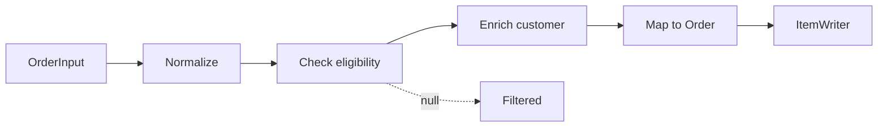
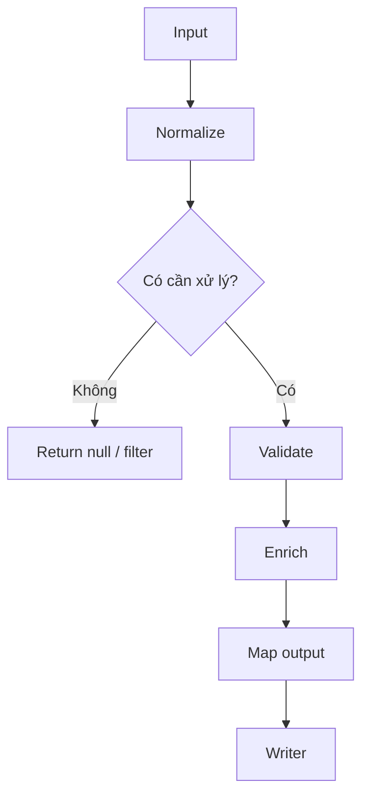

# Processor trả null giữa chain

Trong Spring Batch, một step có thể dùng nhiều processor để chuẩn hóa dữ liệu, kiểm tra điều kiện, làm giàu thông tin và chuyển đổi sang model mà writer cần. Khi các processor được nối tuần tự bằng **CompositeItemProcessor**, output của processor trước trở thành input của processor tiếp theo.

Một quy tắc quan trọng của chain là: **nếu bất kỳ delegate nào trả về null, CompositeItemProcessor dừng chain và trả về null ngay lập tức**. Các delegate phía sau không được gọi cho item đó.

Ở cấp chunk step, ItemProcessor trả về null có nghĩa item được **filter**: item đã được reader đọc nhưng không được chuyển đến writer. Đây là hành vi lọc có chủ đích, không phải skip do exception. Vì vậy, item được tính vào filter count thay vì process skip count.

Bài này giải thích cách null lan truyền qua processor chain, cách phân biệt filter với skip và end-of-input, cách tổ chức delegate, theo dõi filter count và kiểm thử để bảo đảm các processor phía sau không chạy khi một delegate đã lọc item.

## 1. CompositeItemProcessor hoạt động như thế nào?

CompositeItemProcessor nhận một danh sách ItemProcessor và gọi chúng theo thứ tự. Output của delegate hiện tại được truyền làm input cho delegate tiếp theo.

Ví dụ một chain xử lý đơn hàng:



Các bước:

1. Normalize chuẩn hóa mã khách hàng và chuỗi đầu vào.
2. Check eligibility kiểm tra đơn hàng có cần xử lý không.
3. Enrich customer bổ sung thông tin khách hàng.
4. Map to Order tạo object cuối cùng cho writer.
5. Writer nhận item cuối cùng nếu toàn bộ chain trả về object khác null.

Nếu Check eligibility trả null, CompositeItemProcessor không gọi Enrich customer hoặc Map to Order. Composite trả null cho step, step xem item đó là filtered và không ghi nó.

## 2. Ý nghĩa của null trong ItemProcessor

Contract của ItemProcessor cho phép trả về một output item hoặc null:

- Trả về object: item tiếp tục đến writer sau khi hoàn thành các processor.
- Trả về null: item được lọc và không đi tiếp đến writer.
- Ném exception: quá trình xử lý item gặp lỗi; step áp dụng retry/skip/fail policy đã cấu hình.

Ví dụ processor lọc đơn hàng đã bị hủy:

```java
public class ActiveOrderProcessor
        implements ItemProcessor<OrderInput, Order> {

    @Override
    public Order process(OrderInput input) {
        if (input.status() == OrderStatus.CANCELLED) {
            return null;
        }

        return new Order(
                input.orderId(),
                input.customerId(),
                input.amount());
    }
}
```

Đơn hàng CANCELLED được loại khỏi luồng xử lý bình thường. Không có exception nào được ném ra, nên đây là filter chứ không phải lỗi cần skip.

Null ở đây là tín hiệu điều khiển của ItemProcessor. Nếu dữ liệu nghiệp vụ cần lưu một giá trị null ở một field, hãy trả về object có field đó bằng null; đừng trả về null cho toàn bộ item trừ khi muốn loại item khỏi pipeline.

## 3. CompositeItemProcessor dừng chain khi gặp null

Giả sử chain có ba delegate:

```java
ItemProcessor<OrderInput, NormalizedOrder> normalizeProcessor;
ItemProcessor<NormalizedOrder, EnrichedOrder> enrichProcessor;
ItemProcessor<EnrichedOrder, Order> mapProcessor;
```

CompositeItemProcessor thực hiện logic tương đương:

```java
Object current = input;

for (ItemProcessor delegate : delegates) {
    if (current == null) {
        return null;
    }

    current = delegate.process(current);
}

return current;
```

Đây là pseudocode mô tả hành vi, không phải phần triển khai nội bộ cần copy vào ứng dụng.

Nếu normalizeProcessor trả null:

- enrichProcessor không được gọi.
- mapProcessor không được gọi.
- CompositeItemProcessor trả null.
- Step lọc item.

Nếu enrichProcessor trả null:

- normalizeProcessor đã chạy.
- enrichProcessor đã chạy và quyết định lọc.
- mapProcessor không được gọi.
- Writer không nhận item đó.

Nếu mapProcessor trả null, không còn delegate phía sau nhưng composite vẫn trả null và step vẫn tính filter.

## 4. Khai báo chain bằng Java configuration

Ví dụ Spring Batch 5 dùng các kiểu dữ liệu khác nhau giữa các bước:

```java
@Bean
CompositeItemProcessor<OrderInput, Order> orderCompositeProcessor(
        ItemProcessor<OrderInput, NormalizedOrder> normalizeProcessor,
        ItemProcessor<NormalizedOrder, EnrichedOrder> enrichProcessor,
        ItemProcessor<EnrichedOrder, Order> mapProcessor)
        throws Exception {

    CompositeItemProcessor<OrderInput, Order> composite =
            new CompositeItemProcessor<>();

    composite.setDelegates(List.of(
            normalizeProcessor,
            enrichProcessor,
            mapProcessor));

    composite.afterPropertiesSet();
    return composite;
}
```

Các generic type mô tả hợp đồng của từng bước:

| Delegate | Input | Output |
|---|---|---|
| normalizeProcessor | OrderInput | NormalizedOrder |
| enrichProcessor | NormalizedOrder | EnrichedOrder |
| mapProcessor | EnrichedOrder | Order |

Danh sách delegate phải được sắp xếp theo đúng luồng kiểu dữ liệu. Output của một processor phải tương thích với input của processor kế tiếp.

Gắn composite vào step:

```java
@Bean
Step importOrdersStep(
        JobRepository jobRepository,
        PlatformTransactionManager transactionManager,
        ItemReader<OrderInput> orderReader,
        ItemProcessor<OrderInput, Order> orderCompositeProcessor,
        ItemWriter<Order> orderWriter) {

    return new StepBuilder("importOrdersStep", jobRepository)
            .<OrderInput, Order>chunk(100, transactionManager)
            .reader(orderReader)
            .processor(orderCompositeProcessor)
            .writer(orderWriter)
            .build();
}
```

Step chỉ nhìn thấy input type và output type của toàn chain. Các kiểu trung gian được quản lý ở các delegate.

## 5. Ví dụ delegate đầu tiên trả null

Giả sử dữ liệu đầu vào:

```json
[
  {"orderId": 1001, "status": "ACTIVE", "amount": 250.00},
  {"orderId": 1002, "status": "CANCELLED", "amount": 175.50},
  {"orderId": 1003, "status": "ACTIVE", "amount": 99.99}
]
```

Processor chuẩn hóa:

```java
public class NormalizeOrderProcessor
        implements ItemProcessor<OrderInput, NormalizedOrder> {

    @Override
    public NormalizedOrder process(OrderInput input) {
        return new NormalizedOrder(
                input.orderId(),
                input.status(),
                input.amount(),
                input.customerId().trim().toUpperCase(Locale.ROOT));
    }
}
```

Processor kiểm tra eligibility:

```java
public class EligibleOrderProcessor
        implements ItemProcessor<NormalizedOrder, EnrichedOrder> {

    @Override
    public EnrichedOrder process(NormalizedOrder input) {
        if (input.status() == OrderStatus.CANCELLED) {
            return null;
        }

        return new EnrichedOrder(
                input.orderId(),
                input.customerId(),
                input.amount(),
                "READY");
    }
}
```

Processor map:

```java
public class OrderMappingProcessor
        implements ItemProcessor<EnrichedOrder, Order> {

    @Override
    public Order process(EnrichedOrder input) {
        return new Order(
                input.orderId(),
                input.customerId(),
                input.amount(),
                input.processingStatus());
    }
}
```

Với order 1002, EligibleOrderProcessor trả null. OrderMappingProcessor không chạy. Writer chỉ nhận order 1001 và 1003.

## 6. Null không phải là skip

Đây là khác biệt quan trọng khi thiết kế fault-tolerant step:

| Tình huống | Cách thể hiện | Kết quả |
|---|---|---|
| Không muốn xử lý item theo điều kiện nghiệp vụ | Processor trả null | Filter |
| Item không hợp lệ và cần được tính là lỗi có thể bỏ qua | Processor ném exception skippable | Process skip |
| Lỗi tạm thời có thể thử lại | Processor ném exception retryable | Retry theo policy |
| Lỗi không thể xử lý an toàn | Ném exception không được phân loại | Step thất bại |

Ví dụ filter:

```java
if (input.isDuplicate()) {
    return null;
}
```

Ví dụ skip:

```java
if (input.amount() == null) {
    throw new InvalidOrderException("amount is required");
}
```

Nếu InvalidOrderException được cấu hình là skippable, Spring Batch tăng process skip count và có thể gọi SkipListener.onSkipInProcess(...).

Nếu processor trả null, Spring Batch tăng filter count. SkipListener không được gọi chỉ vì item bị filter.

Không dùng null để che một record lỗi cần kiểm toán. Nếu nghiệp vụ muốn reject và ghi lý do, hãy dùng exception skippable hoặc một luồng reject tường minh thay vì filter âm thầm.

## 7. Null không phải end-of-input

Reader và processor dùng null với hai ý nghĩa khác nhau:

| Component | Null có nghĩa |
|---|---|
| ItemReader.read() | Không còn item; kết thúc input |
| ItemProcessor.process(item) | Loại item hiện tại khỏi pipeline |

Reader trả null báo hiệu hết dữ liệu. Processor trả null không kết thúc step; nó chỉ loại item hiện tại và reader tiếp tục cung cấp item tiếp theo.

Ví dụ:

```java
public OrderInput read() {
    // null từ reader nghĩa là hết input.
    return nextOrderOrNull();
}

public Order process(OrderInput input) {
    // null ở đây nghĩa là filter riêng input hiện tại.
    if (shouldIgnore(input)) {
        return null;
    }
    return convert(input);
}
```

Đừng nhầm hai contract này khi viết custom reader/processor. Một reader vô tình trả null sau một record lỗi có thể làm step nghĩ rằng input đã kết thúc và bỏ qua toàn bộ dữ liệu còn lại.

## 8. Delegate phía sau không được chạy

Khi một delegate trả null, composite dừng chain. Điều này giúp tránh chạy các bước tốn chi phí hoặc có side effect sau khi item đã bị loại.

Ví dụ:

```java
ItemProcessor<NormalizedOrder, EnrichedOrder> enrichProcessor =
        input -> {
            customerLookupCounter.increment();
            return enrich(input);
        };
```

Nếu delegate trước đó trả null, customerLookupCounter không tăng cho item đó vì enrichProcessor không được gọi.

Hãy thiết kế chain theo hướng các processor phía sau chỉ chạy khi output trước đó còn tồn tại. Không viết code downstream giả định nó luôn được gọi cho mọi record reader đã đọc.

Nếu một processor phía sau phải luôn được gọi để ghi audit hoặc đếm lý do filter, đừng đặt trách nhiệm đó sau delegate có thể trả null. Hãy dùng listener, metrics hoặc một thành phần quan sát riêng ở đúng lifecycle.

## 9. Sắp xếp thứ tự processor

Thứ tự delegate ảnh hưởng cả kết quả lẫn chi phí xử lý. Một thứ tự thường hợp lý:

1. Chuẩn hóa dữ liệu cơ bản.
2. Kiểm tra điều kiện lọc rẻ và xác định sớm.
3. Validate dữ liệu bắt buộc.
4. Làm giàu bằng database/service.
5. Map sang output model.

Ví dụ:



Đặt filter sớm có thể tránh gọi service hoặc truy vấn database cho item không cần xử lý. Tuy nhiên, thứ tự phải giữ đúng semantics nghiệp vụ. Không chuyển một filter lên trước nếu nó cần dữ liệu chỉ có sau bước enrich hoặc nếu việc chuẩn hóa làm thay đổi điều kiện so sánh.

Nếu filter condition cần dữ liệu ngoài, cân nhắc chi phí và tính ổn định của lookup. Processor không nên tạo side effect không thể lặp lại an toàn vì một item có thể được xử lý lại sau retry hoặc restart.

## 10. Theo dõi filter count

Spring Batch ghi số item bị filter trong StepExecution:

```java
long filterCount = stepExecution.getFilterCount();
long readCount = stepExecution.getReadCount();
long writeCount = stepExecution.getWriteCount();
long processSkipCount = stepExecution.getProcessSkipCount();
```

Các chỉ số có ý nghĩa khác nhau:

- readCount: số item reader đã trả về.
- filterCount: số item processor loại bằng cách trả null.
- writeCount: số item writer đã ghi theo counter của step.
- processSkipCount: số item bị skip do exception ở process phase.

Ví dụ một lần chạy:

| Metric | Giá trị minh họa |
|---|---:|
| Read count | 1.000 |
| Filter count | 120 |
| Process skip count | 5 |
| Write count | 875 |

Đây là số liệu minh họa để phân biệt filter và skip. Các counter thực tế phụ thuộc đường xử lý, retry và write behavior.

Nếu filter count tăng đột ngột, có thể điều kiện nghiệp vụ đã thay đổi, dữ liệu đầu vào có trạng thái mới hoặc một processor đang trả null ngoài dự kiến. Hãy theo dõi tỷ lệ filter cùng batch ID, step name và phiên bản rule.

## 11. Filter count không làm step thất bại

Một item bị filter không được xem là exception. Nếu tất cả item được xử lý bình thường và một số item trả null, step vẫn có thể kết thúc với BatchStatus.COMPLETED.

Skip limit không áp dụng cho filter count. Ví dụ cấu hình:

```java
.faultTolerant()
.skip(InvalidOrderException.class)
.skipLimit(20)
```

chỉ đặt giới hạn cho các exception được skip. Nó không giới hạn số item mà processor trả null.

Nếu nghiệp vụ cần giới hạn số item bị filter, hãy tự kiểm tra filter count hoặc dùng metric/policy riêng. Ví dụ, nếu tỷ lệ bị filter vượt 30%, có thể làm step thất bại hoặc chuyển sang review bằng một quy tắc rõ ràng.

Không đặt skipLimit chỉ để kiểm soát filter. Hai counter và hai semantics khác nhau.

## 12. Ghi nhận lý do filter

ItemProcessor trả null chỉ cho biết item bị loại; bản thân null không mang theo reason. Nếu cần biết vì sao item bị filter, hãy thiết kế một cách quan sát rõ ràng.

Một cách đơn giản là dùng service ghi metric theo reason:

```java
public class EligibilityProcessor
        implements ItemProcessor<NormalizedOrder, EnrichedOrder> {

    private final FilterMetrics filterMetrics;

    public EligibilityProcessor(FilterMetrics filterMetrics) {
        this.filterMetrics = filterMetrics;
    }

    @Override
    public EnrichedOrder process(NormalizedOrder input) {
        if (input.status() == OrderStatus.CANCELLED) {
            filterMetrics.increment("CANCELLED");
            return null;
        }

        if (input.amount().signum() == 0) {
            filterMetrics.increment("ZERO_AMOUNT");
            return null;
        }

        return enrich(input);
    }
}
```

Metric service phải thread-safe nếu step có xử lý đa luồng. Nếu cần lưu audit bền vững, hãy cân nhắc một reject/filter record có batch ID và business key, đồng thời thiết kế transaction và idempotency.

Không nên ghi database trực tiếp từ processor chỉ để lưu lý do filter nếu thao tác đó tạo side effect khó rollback hoặc bị lặp khi retry. Có thể ghi metric trong bộ nhớ, dùng listener phù hợp hoặc tạo một nhánh audit có cơ chế nhất quán riêng.

### ItemProcessListener quan sát kết quả cuối của chain

Listener gắn với step có thể quan sát input và output của processor được cấu hình trên step:

```java
public class ProcessorOutcomeListener
        implements ItemProcessListener<OrderInput, Order> {

    @Override
    public void beforeProcess(OrderInput item) {
        // Ghi nhận bắt đầu nếu cần.
    }

    @Override
    public void afterProcess(OrderInput item, Order result) {
        if (result == null) {
            // Composite đã filter item ở một delegate nào đó.
        }
    }

    @Override
    public void onProcessError(OrderInput item, Exception exception) {
        // Xử lý quan sát lỗi process.
    }
}
```

Listener này nhìn thấy kết quả cuối của composite, không tự biết delegate cụ thể nào trả null. Muốn biết chính xác lý do hoặc tên delegate, hãy instrument delegate hoặc truyền một context/metric service có chủ đích.

## 13. CompositeItemProcessor không phải CompositeItemWriter

CompositeItemProcessor nối các phép biến đổi item tuần tự. CompositeItemWriter gửi cùng item đến nhiều writer theo cấu hình của nó. Hai composite có semantics khác nhau.

Với processor:

- Output của delegate trước là input của delegate sau.
- Null dừng chain và filter item.

Với writer:

- Writer nhận chunk đã qua processor.
- Writer có thể chuyển cùng dữ liệu đến nhiều đích.
- Không có quy tắc null output như ItemProcessor.

Đừng dùng composite processor để fan-out một item sang nhiều output. Nếu cần một item tạo nhiều record, hãy dùng processor trả về một collection kết hợp writer phù hợp, hoặc thiết kế step riêng.

## 14. Phân biệt CompositeItemProcessor với ClassifierCompositeItemProcessor

CompositeItemProcessor chạy tất cả delegate theo thứ tự cho đến khi một delegate trả null hoặc chain kết thúc.

ClassifierCompositeItemProcessor chọn một delegate dựa trên classifier, thay vì chạy tất cả processor tuần tự.

Ví dụ classifier:

```java
Classifier<OrderInput, ItemProcessor<?, ? extends Order>> classifier =
        input -> input.isPriority()
                ? priorityProcessor
                : standardProcessor;
```

Nếu processor được chọn trả null, item vẫn được filter theo contract của ItemProcessor. Tuy nhiên, các processor không được chọn không chạy ngay từ đầu.

Chọn:

- CompositeItemProcessor khi cần pipeline biến đổi tuần tự.
- ClassifierCompositeItemProcessor khi cần chọn một chiến lược xử lý theo loại item.

Không dùng chain tuần tự chỉ để mô phỏng if/else nếu mỗi item chỉ cần một trong nhiều processor độc lập.

## 15. Tránh side effect trước khi filter

Một processor có thể thực hiện lookup hoặc ghi nhận metric trước khi trả null. Nhưng cần phân biệt thao tác đọc an toàn với side effect.

Ví dụ rủi ro:

```java
public Order process(OrderInput input) {
    paymentService.charge(input.paymentId());

    if (input.status() == OrderStatus.CANCELLED) {
        return null;
    }

    return map(input);
}
```

Ở đây payment đã bị charge trước khi item được filter. Đây là thứ tự nghiệp vụ sai và side effect không được writer/transaction của chunk tự động hoàn tác nếu payment service là hệ thống ngoài.

Hãy thực hiện điều kiện filter trước side effect:

```java
public Order process(OrderInput input) {
    if (input.status() == OrderStatus.CANCELLED) {
        return null;
    }

    return map(input);
}
```

Các processor nên càng thuần (pure) càng tốt: nhận input, trả output hoặc null, không tạo side effect khó lặp lại. Nếu cần gọi dịch vụ ngoài, dùng idempotency key và thiết kế retry phù hợp.

## 16. Null giữa chain và exception

Nếu delegate trả null, composite dừng bình thường. Nếu delegate ném exception, exception truyền ra khỏi chain và step áp dụng policy đã cấu hình.

Ví dụ:

```java
public EnrichedOrder process(NormalizedOrder input) {
    if (input.isOutOfScope()) {
        return null; // Filter
    }

    if (input.customerId() == null) {
        throw new InvalidOrderException("customerId is required");
    }

    return enrich(input);
}
```

Hai nhánh có ý nghĩa khác nhau:

- Out of scope: item không cần xử lý, loại khỏi pipeline.
- Missing customer ID: item không hợp lệ, có thể cần reject/skip.

Nếu exception được cấu hình retryable, framework có thể gọi lại processor theo retry policy. Nếu skippable, process skip count tăng. Nếu không được phân loại, step có thể thất bại.

Không bắt mọi exception rồi trả null. Cách đó biến lỗi kỹ thuật hoặc lỗi dữ liệu thành filter im lặng, khiến job có thể COMPLETED trong khi nhiều item thực ra không được xử lý.

## 17. Null và kiểu dữ liệu trung gian

CompositeItemProcessor dùng generic type để nối các bước. Khi một delegate trả null, không có output instance để truyền sang type kế tiếp.

Ví dụ:

```java
ItemProcessor<OrderInput, NormalizedOrder> normalize;
ItemProcessor<NormalizedOrder, EnrichedOrder> enrich;
ItemProcessor<EnrichedOrder, Order> map;
```

Luồng bình thường:

```text
OrderInput
    -> NormalizedOrder
    -> EnrichedOrder
    -> Order
```

Luồng bị filter ở delegate thứ hai:

```text
OrderInput
    -> NormalizedOrder
    -> null
    -> dừng
```

Không tạo một placeholder object chỉ để chain tiếp tục nếu nghiệp vụ đã quyết định item không tồn tại trong output. Placeholder có thể khiến downstream hiểu nhầm một item rỗng là item hợp lệ.

Nếu downstream cần biết item bị loại để thực hiện một hành động riêng, hãy biểu diễn quyết định đó bằng một kết quả có kiểu rõ ràng như ProcessingDecision hoặc route sang nhánh riêng thay vì lạm dụng null.

## 18. Khi cần giữ lý do filter trong type system

Nếu pipeline cần phân biệt nhiều kết quả như ACCEPT, IGNORE, REJECT, có thể dùng một result type thay vì null:

```java
public sealed interface OrderDecision
        permits AcceptedOrder, IgnoredOrder, RejectedOrder {
}

public record AcceptedOrder(OrderInput input)
        implements OrderDecision {
}

public record IgnoredOrder(OrderInput input, String reason)
        implements OrderDecision {
}

public record RejectedOrder(OrderInput input, String reason)
        implements OrderDecision {
}
```

Processor có thể trả OrderDecision không null cho mọi input. Một processor sau đó phân loại:

- AcceptedOrder: tiếp tục enrich/map.
- IgnoredOrder: ghi metric/audit hoặc route riêng.
- RejectedOrder: ghi reject output hoặc ném exception skippable tùy policy.

Thiết kế này hữu ích khi lý do lọc cần được lưu, hiển thị hoặc kiểm toán. Đổi lại, chain phức tạp hơn và cần một bước phân loại kết quả.

Null phù hợp khi semantics đơn giản: item không cần đi tiếp và không cần mang thêm kết quả. Khi cần nhiều trạng thái, một result type tường minh thường dễ bảo trì hơn.

## 19. Unit test: delegate trả null thì downstream không chạy

Đây là hành vi cốt lõi cần test:

```java
@Test
void stopsChainWhenDelegateReturnsNull() throws Exception {
    ItemProcessor<OrderInput, NormalizedOrder> normalize =
            input -> new NormalizedOrder(
                    input.orderId(),
                    input.customerId());

    ItemProcessor<NormalizedOrder, EnrichedOrder> filter =
            input -> null;

    @SuppressWarnings("unchecked")
    ItemProcessor<EnrichedOrder, Order> map =
            mock(ItemProcessor.class);

    CompositeItemProcessor<OrderInput, Order> composite =
            new CompositeItemProcessor<>();
    composite.setDelegates(List.of(normalize, filter, map));
    composite.afterPropertiesSet();

    Order result = composite.process(
            new OrderInput(1001L, "C001"));

    assertNull(result);
    verifyNoInteractions(map);
}
```

Test xác nhận:

- Composite trả null.
- Delegate sau filter không được gọi.
- Item không tạo output Order.

Trong test thực tế, có thể mock cả delegate đầu và giữa để xác nhận thứ tự gọi, hoặc dùng fake có counter để kiểm tra số lần thực thi.

## 20. Unit test: null ở vị trí khác nhau

Nên test null ở đầu, giữa và cuối chain:

| Vị trí trả null | Kỳ vọng |
|---|---|
| Delegate đầu tiên | Không delegate nào phía sau chạy |
| Delegate ở giữa | Delegate trước đã chạy; các delegate sau không chạy |
| Delegate cuối cùng | Chain trả null; step filter item |
| Không delegate nào trả null | Output cuối được trả về |

Ví dụ null ở delegate đầu:

```java
@Test
void firstDelegateCanFilterWithoutCallingOthers() throws Exception {
    ItemProcessor<OrderInput, NormalizedOrder> first = input -> null;

    @SuppressWarnings("unchecked")
    ItemProcessor<NormalizedOrder, Order> second =
            mock(ItemProcessor.class);

    CompositeItemProcessor<OrderInput, Order> composite =
            new CompositeItemProcessor<>();
    composite.setDelegates(List.of(first, second));
    composite.afterPropertiesSet();

    assertNull(composite.process(new OrderInput(1001L, "C001")));
    verifyNoInteractions(second);
}
```

Ví dụ chain thành công:

```java
@Test
void passesOutputFromEachDelegateToNext() throws Exception {
    ItemProcessor<OrderInput, NormalizedOrder> first =
            input -> new NormalizedOrder(
                    input.orderId(),
                    input.customerId().trim());

    ItemProcessor<NormalizedOrder, Order> second =
            normalized -> new Order(
                    normalized.orderId(),
                    normalized.customerId());

    CompositeItemProcessor<OrderInput, Order> composite =
            new CompositeItemProcessor<>();
    composite.setDelegates(List.of(first, second));
    composite.afterPropertiesSet();

    Order result = composite.process(new OrderInput(1001L, " C001 "));

    assertEquals("C001", result.customerId());
}
```

Các model constructor trong ví dụ là minh họa; điều quan trọng là kiểm tra output của delegate trước được truyền đúng vào delegate sau.

## 21. Integration test: filter count và writer output

Unit test composite không xác nhận cách chunk step tính filter count. Nên có integration test launch job với một tập item có cả item được giữ và item bị filter.

Ví dụ fixture:

| Order ID | Status | Kết quả |
|---:|---|---|
| 1001 | ACTIVE | Ghi |
| 1002 | CANCELLED | Filter |
| 1003 | ACTIVE | Ghi |
| 1004 | CANCELLED | Filter |

Sau job:

- Read count là 4.
- Filter count là 2.
- Writer chỉ nhận 2 item.
- Process skip count không tăng nếu không có exception.
- Step có thể kết thúc COMPLETED.

Ví dụ assertion:

```java
StepExecution stepExecution = execution.getStepExecutions().stream()
        .filter(step -> step.getStepName().equals("importOrdersStep"))
        .findFirst()
        .orElseThrow();

assertEquals(4, stepExecution.getReadCount());
assertEquals(2, stepExecution.getFilterCount());
assertEquals(0, stepExecution.getProcessSkipCount());
assertEquals(2, stepExecution.getWriteCount());
```

Các số liệu phụ thuộc fixture và cách writer được cấu hình. Nếu processor có retry hoặc writer có skip, hãy kiểm tra riêng các counter tương ứng.

## 22. Kiểm thử side effect của delegate phía sau

Nếu delegate phía sau gọi service hoặc repository, test cần xác nhận nó không được gọi cho item đã bị filter.

Ví dụ:

```java
@Test
void filteredOrderDoesNotTriggerCustomerLookup() throws Exception {
    CustomerLookup lookup = mock(CustomerLookup.class);

    ItemProcessor<OrderInput, NormalizedOrder> normalize =
            input -> new NormalizedOrder(
                    input.orderId(),
                    input.status());

    ItemProcessor<NormalizedOrder, EnrichedOrder> eligibility =
            input -> input.status() == OrderStatus.CANCELLED
                    ? null
                    : new EnrichedOrder(input.orderId());

    ItemProcessor<EnrichedOrder, Order> enrich =
            input -> {
                lookup.find(input.orderId());
                return new Order(input.orderId());
            };

    CompositeItemProcessor<OrderInput, Order> composite =
            new CompositeItemProcessor<>();
    composite.setDelegates(List.of(normalize, eligibility, enrich));
    composite.afterPropertiesSet();

    assertNull(composite.process(
            new OrderInput(1002L, OrderStatus.CANCELLED)));

    verifyNoInteractions(lookup);
}
```

Test này bảo vệ một lợi ích quan trọng của short-circuit: tránh lookup hoặc side effect không cần thiết sau khi item đã bị loại.

## 23. Những lỗi thường gặp

**Nghĩ rằng null ở giữa chain chỉ bỏ qua một delegate.** Composite dừng toàn bộ phần còn lại của chain cho item đó. Các delegate sau không chạy.

**Nhầm null với skip.** Null là filter; exception skippable mới làm tăng skip count và đi qua skip policy.

**Nhầm null từ processor với hết input.** Reader trả null mới báo end-of-input. Processor trả null chỉ loại item hiện tại.

**Trả null cho field bị thiếu.** Nếu chỉ một field không có giá trị, hãy trả object có field null hoặc dùng Optional/result type phù hợp; null toàn item sẽ filter cả record.

**Dùng null để che lỗi parse hoặc lỗi kỹ thuật.** Item có thể biến mất mà job vẫn COMPLETED. Ném exception cụ thể nếu đó là lỗi cần theo dõi.

**Đặt filter sau bước làm giàu tốn kém.** Có thể gọi service/database không cần thiết. Đưa điều kiện rẻ lên sớm khi semantics cho phép.

**Đặt side effect trước điều kiện filter.** Item bị loại vẫn có thể tạo side effect. Kiểm tra điều kiện trước và dùng idempotency khi gọi hệ thống ngoài.

**Mong SkipListener nhận item bị filter.** Filter không phải skip; dùng filter metrics hoặc ItemProcessListener để quan sát kết quả null.

**Không biết delegate nào trả null.** Composite chỉ trả kết quả cuối. Instrument từng delegate hoặc ghi reason có cấu trúc.

**Không kiểm thử downstream không được gọi.** Chain có thể trả null đúng nhưng vẫn có side effect nếu code tự gọi delegate ngoài composite. Test bằng mock/fake và verify interactions.

## 24. Quy trình thiết kế processor chain có filter

Khi xây dựng CompositeItemProcessor, hãy làm theo các bước:

1. Xác định từng phép biến đổi và kiểu input/output của delegate.
2. Định nghĩa rõ điều kiện nào là filter có chủ đích.
3. Chọn vị trí filter sao cho tránh xử lý tốn kém không cần thiết.
4. Chỉ trả null khi muốn loại toàn bộ item khỏi writer.
5. Dùng exception cụ thể khi item lỗi cần skip/reject hoặc làm step thất bại.
6. Đảm bảo delegate phía sau không cần chạy cho item đã filter.
7. Giữ processor thuần hoặc bảo đảm side effect có idempotency.
8. Theo dõi filter count và lý do filter nếu cần vận hành.
9. Unit test null ở đầu, giữa, cuối chain và output bình thường.
10. Integration test filter count, writer output và listener behavior.

Nếu cần nhiều kết quả như ACCEPT, IGNORE và REJECT, hãy cân nhắc một decision type thay vì dùng null cho mọi trường hợp. Kiểu dữ liệu tường minh giúp ghi nhận lý do và điều phối nhánh dễ hơn.

## 25. Kết luận thực hành

Trong CompositeItemProcessor, các delegate chạy tuần tự và output của bước trước trở thành input của bước sau. Khi một delegate trả null, composite dừng ngay và trả null cho step; tất cả delegate phía sau không được gọi. Spring Batch xem item đó là filtered, không chuyển đến writer và tăng filter count.

Filter bằng null khác với skip do exception và khác với reader trả null để báo hết input. Hãy dùng null cho trường hợp nghiệp vụ chủ động loại item, dùng exception skippable khi cần ghi nhận một item lỗi theo skip policy, và để lỗi nghiêm trọng làm step thất bại. Nếu cần biết lý do filter, hãy dùng metric, listener hoặc result type tường minh.

Một chain dễ bảo trì xác định rõ kiểu dữ liệu giữa các delegate, đặt filter hợp lý, tránh side effect trước quyết định loại item và có test chứng minh downstream không chạy sau null. Integration test cần kiểm tra filter count, process skip count và dữ liệu thực tế writer nhận để bảo đảm semantics của chain đúng với nghiệp vụ.
