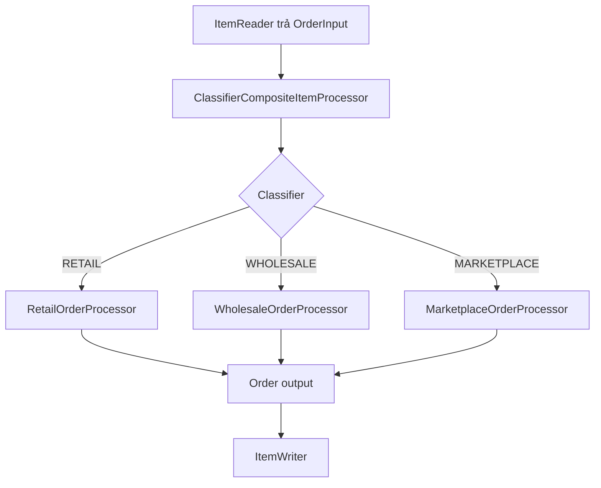
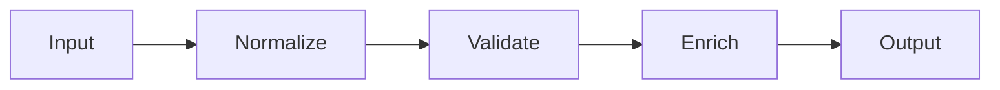
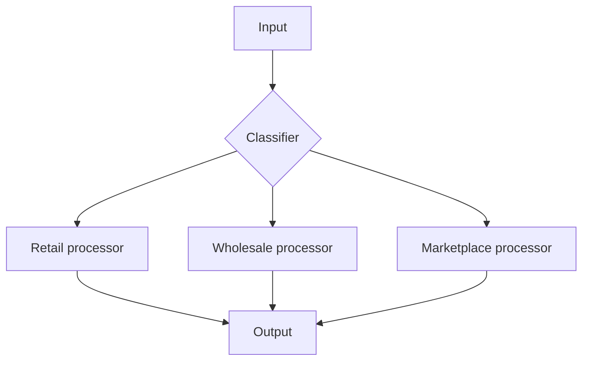

# ClassifierCompositeItemProcessor

Trong Spring Batch, một step có thể nhận nhiều loại item đầu vào và cần áp dụng cách xử lý khác nhau cho từng loại. Ví dụ, đơn hàng bán lẻ cần tính phí vận chuyển, đơn hàng bán buôn cần áp dụng chiết khấu theo hợp đồng, còn đơn hàng từ marketplace cần xác minh mã giao dịch. Nếu viết tất cả nhánh trong một processor lớn, logic dễ trở nên khó đọc và khó kiểm thử.

**ClassifierCompositeItemProcessor** giải quyết tình huống này bằng cách phân loại từng item, chọn một ItemProcessor phù hợp và chuyển item đó cho processor được chọn. Mỗi item đi theo một nhánh xử lý dựa trên kết quả của classifier.

Điểm quan trọng là đây là cơ chế **chọn một processor cho mỗi item**, không phải chạy tất cả processor tuần tự. Nếu processor được chọn trả về null, item bị filter theo contract của ItemProcessor; composite không thử processor khác.

## 1. ClassifierCompositeItemProcessor là gì?

ClassifierCompositeItemProcessor là một implementation của ItemProcessor trong Spring Batch. Nó giữ một Classifier để quyết định processor nào sẽ xử lý item hiện tại.

Luồng xử lý:



Với mỗi lần gọi process(item):

1. Classifier nhận item đầu vào.
2. Classifier trả về một ItemProcessor được chọn.
3. ClassifierCompositeItemProcessor gọi processor đó với item.
4. Kết quả của processor được trả về cho step.
5. Nếu kết quả khác null, item tiếp tục đến writer; nếu null, item được filter.

Classifier chỉ quyết định **ai xử lý item**. Việc biến đổi dữ liệu, validate hoặc làm giàu vẫn thuộc processor được chọn.

## 2. Khi nào nên dùng?

ClassifierCompositeItemProcessor phù hợp khi các item có cùng kiểu đầu vào và đầu ra của step nhưng cần những thuật toán xử lý khác nhau.

Ví dụ:

- Đơn hàng bán lẻ và bán buôn có quy tắc tính giá khác nhau.
- Thanh toán bằng thẻ, chuyển khoản hoặc ví điện tử cần các processor riêng.
- Hồ sơ khách hàng cá nhân và doanh nghiệp cần các bước chuẩn hóa khác nhau.
- Sự kiện có loại CREATED, UPDATED hoặc DELETED cần mapping khác nhau.
- Record đến từ nhiều hệ thống có format khác nhau nhưng cần trả về cùng domain model.

Một số dấu hiệu cho thấy nên tách processor:

- Một processor đang có nhiều nhánh if/else lớn.
- Mỗi loại item có quy tắc nghiệp vụ riêng.
- Các nhánh cần được unit test độc lập.
- Một nhánh thay đổi thường xuyên mà không nên ảnh hưởng nhánh khác.
- Cần đo số lượng item được xử lý theo từng loại.

Không cần dùng classifier cho một điều kiện đơn giản chỉ có một hành động ngắn. Một processor thông thường với một if nhỏ có thể dễ đọc hơn.

## 3. Phân biệt classifier và processor

Hai thành phần có nhiệm vụ khác nhau:

| Thành phần | Input | Output | Trách nhiệm |
|---|---|---|---|
| Classifier | Item đầu vào | Một ItemProcessor | Chọn nhánh xử lý |
| ItemProcessor được chọn | Item đầu vào | Item output hoặc null | Xử lý nghiệp vụ |
| ClassifierCompositeItemProcessor | Item đầu vào | Item output hoặc null | Kết hợp bước chọn và gọi processor |

Classifier không nên tự chuyển đổi item thành output cuối cùng. Nó trả về processor phù hợp, sau đó processor mới thực hiện xử lý.

Ví dụ classifier:

```java
Classifier<OrderInput, ItemProcessor<OrderInput, Order>> classifier =
        input -> input.channel() == OrderChannel.RETAIL
                ? retailProcessor
                : wholesaleProcessor;
```

Ở đây classifier chỉ chọn retailProcessor hoặc wholesaleProcessor. Nó không tính giá, không truy vấn khách hàng và không tạo Order.

## 4. Ví dụ nghiệp vụ: định tuyến đơn hàng

Giả sử input có cấu trúc:

```java
public record OrderInput(
        long orderId,
        OrderChannel channel,
        String customerId,
        BigDecimal amount) {
}

public enum OrderChannel {
    RETAIL,
    WHOLESALE,
    MARKETPLACE
}
```

Output của mọi nhánh đều là Order:

```java
public record Order(
        long orderId,
        String customerId,
        BigDecimal netAmount,
        String processingRoute) {
}
```

Ba processor có thể triển khai quy tắc riêng:

```java
public class RetailOrderProcessor
        implements ItemProcessor<OrderInput, Order> {

    @Override
    public Order process(OrderInput input) {
        BigDecimal netAmount = input.amount();
        return new Order(
                input.orderId(),
                input.customerId(),
                netAmount,
                "RETAIL");
    }
}
```

```java
public class WholesaleOrderProcessor
        implements ItemProcessor<OrderInput, Order> {

    @Override
    public Order process(OrderInput input) {
        BigDecimal discount = input.amount()
                .multiply(new BigDecimal("0.10"));
        BigDecimal netAmount = input.amount().subtract(discount);

        return new Order(
                input.orderId(),
                input.customerId(),
                netAmount,
                "WHOLESALE");
    }
}
```

```java
public class MarketplaceOrderProcessor
        implements ItemProcessor<OrderInput, Order> {

    @Override
    public Order process(OrderInput input) {
        return new Order(
                input.orderId(),
                input.customerId(),
                input.amount(),
                "MARKETPLACE");
    }
}
```

Các ví dụ chỉ minh họa cách tách trách nhiệm. Trong ứng dụng thật, công thức giá, chiết khấu và validation phải đến từ quy tắc nghiệp vụ được xác nhận.

## 5. Cấu hình bằng Java

Tạo các processor bean:

```java
@Bean
ItemProcessor<OrderInput, Order> retailOrderProcessor() {
    return new RetailOrderProcessor();
}

@Bean
ItemProcessor<OrderInput, Order> wholesaleOrderProcessor() {
    return new WholesaleOrderProcessor();
}

@Bean
ItemProcessor<OrderInput, Order> marketplaceOrderProcessor() {
    return new MarketplaceOrderProcessor();
}
```

Sau đó cấu hình classifier và composite:

```java
@Bean
ClassifierCompositeItemProcessor<OrderInput, Order>
orderClassifierProcessor(
        @Qualifier("retailOrderProcessor")
        ItemProcessor<OrderInput, Order> retailProcessor,
        @Qualifier("wholesaleOrderProcessor")
        ItemProcessor<OrderInput, Order> wholesaleProcessor,
        @Qualifier("marketplaceOrderProcessor")
        ItemProcessor<OrderInput, Order> marketplaceProcessor) {

    Classifier<OrderInput, ItemProcessor<OrderInput, Order>> classifier =
            input -> switch (input.channel()) {
                case RETAIL -> retailProcessor;
                case WHOLESALE -> wholesaleProcessor;
                case MARKETPLACE -> marketplaceProcessor;
            };

    ClassifierCompositeItemProcessor<OrderInput, Order> composite =
            new ClassifierCompositeItemProcessor<>();
    composite.setClassifier(classifier);
    return composite;
}
```

Ví dụ dùng switch expression trên enum để mỗi giá trị channel có đúng một nhánh. Khi thêm một enum constant mới, compiler có thể giúp phát hiện switch cần được cập nhật.

Nếu các bean processor cùng kiểu generic, việc inject và cấu hình rõ ràng hơn. Dùng @Qualifier để Spring biết bean nào thuộc nhánh nào khi context có nhiều bean cùng type ItemProcessor.

## 6. Gắn vào chunk-oriented step

ClassifierCompositeItemProcessor được khai báo như một ItemProcessor thông thường của step:

```java
@Bean
Step importOrdersStep(
        JobRepository jobRepository,
        PlatformTransactionManager transactionManager,
        ItemReader<OrderInput> orderReader,
        ClassifierCompositeItemProcessor<OrderInput, Order>
                orderClassifierProcessor,
        ItemWriter<Order> orderWriter) {

    return new StepBuilder("importOrdersStep", jobRepository)
            .<OrderInput, Order>chunk(100, transactionManager)
            .reader(orderReader)
            .processor(orderClassifierProcessor)
            .writer(orderWriter)
            .build();
}
```

Reader trả OrderInput. Classifier chọn một processor tương ứng với channel. Các processor đều trả Order nên writer chỉ cần làm việc với một output type thống nhất.

Từ góc nhìn của step, không cần biết có bao nhiêu nhánh nội bộ. Step vẫn có một reader, một processor và một writer.

## 7. Classifier chọn một nhánh, không chạy tất cả

Điểm khác biệt lớn nhất so với CompositeItemProcessor là cách gọi delegate.

Với ClassifierCompositeItemProcessor:

- Classifier được gọi cho item hiện tại.
- Một processor được chọn.
- Chỉ processor đó được gọi.
- Các processor còn lại không chạy cho item này.

Ví dụ:

```text
Order 1001 / RETAIL       -> RetailOrderProcessor
Order 1002 / WHOLESALE    -> WholesaleOrderProcessor
Order 1003 / MARKETPLACE  -> MarketplaceOrderProcessor
```

Nếu một batch có 1.000 item, có thể có 400 item đi qua retail processor, 350 qua wholesale processor và 250 qua marketplace processor. Không có nghĩa mỗi item đi qua cả ba nhánh.

Đây là item-level routing trong một step. Nó không tạo thêm StepExecution hoặc chuyển sang một step/job flow khác.

## 8. Phân biệt với CompositeItemProcessor

CompositeItemProcessor và ClassifierCompositeItemProcessor đều kết hợp nhiều ItemProcessor nhưng có semantics khác nhau:

| Tiêu chí | CompositeItemProcessor | ClassifierCompositeItemProcessor |
|---|---|---|
| Mục đích | Chuỗi biến đổi tuần tự | Chọn processor theo item |
| Delegate được gọi | Nhiều delegate theo thứ tự | Một delegate được chọn |
| Input của delegate sau | Output delegate trước | Item đầu vào ban đầu |
| Null từ delegate | Dừng chain và filter | Processor được chọn trả null thì filter |
| Dùng khi | Các bước xử lý bổ sung nối tiếp nhau | Các loại item cần chiến lược khác nhau |

Ví dụ chain:



Ví dụ classifier:



Hai cơ chế có thể kết hợp: một classifier chọn processor riêng cho loại item; bên trong processor đó có thể dùng CompositeItemProcessor để chạy một pipeline con. Hãy giữ cấu trúc đủ đơn giản để người đọc hiểu item đi theo nhánh nào.

## 9. Dùng Map để quản lý route

Khi số loại item tăng hoặc route được cấu hình ở một nơi, có thể dùng Map thay cho switch dài:

```java
@Bean
ClassifierCompositeItemProcessor<OrderInput, Order>
orderClassifierProcessor(
        @Qualifier("retailOrderProcessor")
        ItemProcessor<OrderInput, Order> retail,
        @Qualifier("wholesaleOrderProcessor")
        ItemProcessor<OrderInput, Order> wholesale,
        @Qualifier("marketplaceOrderProcessor")
        ItemProcessor<OrderInput, Order> marketplace) {

    Map<OrderChannel, ItemProcessor<OrderInput, Order>> routes =
            Map.of(
                    OrderChannel.RETAIL, retail,
                    OrderChannel.WHOLESALE, wholesale,
                    OrderChannel.MARKETPLACE, marketplace);

    Classifier<OrderInput, ItemProcessor<OrderInput, Order>> classifier =
            input -> {
                ItemProcessor<OrderInput, Order> selected =
                        routes.get(input.channel());

                if (selected == null) {
                    throw new UnsupportedOrderChannelException(
                            "Unsupported channel: " + input.channel());
                }

                return selected;
            };

    ClassifierCompositeItemProcessor<OrderInput, Order> composite =
            new ClassifierCompositeItemProcessor<>();
    composite.setClassifier(classifier);
    return composite;
}
```

Map.of tạo map không thể thay đổi, phù hợp với bảng route cố định trong suốt vòng đời bean. Nếu route được tải từ cấu hình động, hãy xác thực đầy đủ map trước khi job chạy và không sửa map trong lúc nhiều thread đang xử lý item.

## 10. Xử lý loại item không được hỗ trợ

Classifier phải có hành vi rõ ràng khi gặp loại item không có route.

Có ba chính sách thường gặp:

1. **Fail**: ném exception nghiệp vụ/cấu hình để step thất bại hoặc đi qua skip policy được định nghĩa.
2. **Default processor**: chuyển item sang processor mặc định nếu nghiệp vụ cho phép.
3. **Filter**: chỉ khi yêu cầu nghiệp vụ xác định rõ loại item đó cần bị loại khỏi output.

Ví dụ default route:

```java
Classifier<OrderInput, ItemProcessor<OrderInput, Order>> classifier =
        input -> routes.getOrDefault(
                input.channel(),
                defaultOrderProcessor);
```

Default processor không nên trở thành nơi xử lý mọi loại dữ liệu không rõ nghĩa. Nếu channel lạ có thể biểu thị upstream gửi sai schema hoặc có loại giao dịch chưa được hỗ trợ, fail rõ ràng thường an toàn hơn.

Ví dụ fail rõ ràng:

```java
Classifier<OrderInput, ItemProcessor<OrderInput, Order>> classifier =
        input -> {
            ItemProcessor<OrderInput, Order> processor =
                    routes.get(input.channel());
            if (processor == null) {
                throw new UnsupportedOrderChannelException(
                        "No processor configured for channel "
                                + input.channel());
            }
            return processor;
        };
```

Không trả null từ classifier để biểu diễn filter. Classifier được kỳ vọng trả về một ItemProcessor; null ở vị trí này là cấu hình/logic định tuyến không hợp lệ và có thể dẫn đến NullPointerException khi composite gọi processor. Muốn filter item, processor được chọn phải trả null.

## 11. Null từ processor được chọn

ClassifierCompositeItemProcessor tuân theo contract của ItemProcessor. Nếu processor được chọn trả null:

- Composite trả null cho step.
- Item bị filter.
- Writer không nhận item.
- Filter count tăng.
- Classifier không thử route thứ hai.

Ví dụ:

```java
public class RetailOrderProcessor
        implements ItemProcessor<OrderInput, Order> {

    @Override
    public Order process(OrderInput input) {
        if (input.amount().signum() <= 0) {
            return null;
        }

        return createRetailOrder(input);
    }
}
```

Nếu đơn hàng retail có amount không dương, nhánh retail lọc item đó. Composite không chuyển sang wholesale processor như một fallback tự động.

Nếu muốn thử một processor khác khi processor đầu không chấp nhận item, đó là một quy tắc fallback riêng. Hãy triển khai rõ ràng bên trong processor hoặc một routing component khác; không dựa vào null để kích hoạt nhánh kế tiếp.

## 12. Exception từ classifier và processor

Classifier có thể ném runtime exception nếu không thể xác định route. Processor được chọn cũng có thể ném exception khi xử lý item.

Spring Batch xử lý các exception này theo fault-tolerant policy của step:

- Exception được cấu hình retryable có thể được thử lại.
- Exception được cấu hình skippable có thể làm item bị skip.
- Exception không được xử lý theo policy sẽ làm step thất bại.

Ví dụ:

```java
return new StepBuilder("importOrdersStep", jobRepository)
        .<OrderInput, Order>chunk(100, transactionManager)
        .reader(orderReader)
        .processor(orderClassifierProcessor)
        .writer(orderWriter)
        .faultTolerant()
        .skip(InvalidOrderException.class)
        .skipLimit(50)
        .retry(DeadlockLoserDataAccessException.class)
        .retryLimit(3)
        .build();
```

Nếu UnsupportedOrderChannelException không nằm trong skip policy, step sẽ thất bại khi classifier không tìm được route. Đây thường là lựa chọn phù hợp nếu loại item mới thể hiện lỗi hợp đồng dữ liệu.

Không bắt mọi exception trong classifier rồi chọn default processor. Cách đó có thể biến lỗi cấu hình hoặc lỗi code thành dữ liệu được xử lý sai nhánh.

## 13. Cùng input/output type giúp giữ type safety

ClassifierCompositeItemProcessor thường được dùng thuận tiện nhất khi các delegate đều nhận cùng kiểu input và trả cùng kiểu output:

```java
ItemProcessor<OrderInput, Order> retail;
ItemProcessor<OrderInput, Order> wholesale;
ItemProcessor<OrderInput, Order> marketplace;
```

Classifier chọn một trong các processor đó:

```java
Classifier<OrderInput, ItemProcessor<OrderInput, Order>> classifier;
```

Điều này giúp:

- Compiler kiểm tra input/output type của từng bean.
- Step chỉ cần khai báo một output type.
- Writer không cần biết nhánh nào đã xử lý item.
- Unit test mỗi nhánh độc lập dễ dàng.

Nếu các loại nguồn có input class khác nhau, hãy cân nhắc chuẩn hóa chúng thành một sealed interface/base type trước khi định tuyến, hoặc tạo adapter để các processor có cùng contract. Tránh dùng raw ItemProcessor và ép kiểu không kiểm soát vì lỗi có thể chỉ xuất hiện lúc runtime.

## 14. Định tuyến theo loại class

Không phải lúc nào classifier cũng dựa trên enum. Có thể chọn processor theo loại item:

```java
public sealed interface ImportRecord
        permits CustomerRecord, SupplierRecord {
}

public record CustomerRecord(long id, String name)
        implements ImportRecord {
}

public record SupplierRecord(long id, String companyName)
        implements ImportRecord {
}
```

Nếu output chung là ImportResult, có thể tạo adapter để cả hai processor nhận cùng base type:

```java
ItemProcessor<ImportRecord, ImportResult> customerProcessor =
        record -> {
            CustomerRecord customer = (CustomerRecord) record;
            return mapCustomer(customer);
        };
```

Đây là ví dụ minh họa; nếu phải ép kiểu trong từng processor, hãy bảo đảm classifier và adapter thống nhất. Một lựa chọn an toàn hơn là tạo các adapter riêng kiểm tra type và ném lỗi rõ ràng khi nhận sai loại.

Với class hierarchy phức tạp, có thể dùng classifier theo subclass hoặc viết classifier tường minh. Cần xác định thứ tự ưu tiên khi một object có thể khớp nhiều loại cha/interface.

## 15. Định tuyến theo nhiều thuộc tính

Classifier có thể xét nhiều field của item:

```java
Classifier<OrderInput, ItemProcessor<OrderInput, Order>> classifier =
        input -> {
            if (input.channel() == OrderChannel.WHOLESALE
                    && input.amount().compareTo(
                            new BigDecimal("10000")) >= 0) {
                return highValueWholesaleProcessor;
            }

            if (input.channel() == OrderChannel.WHOLESALE) {
                return wholesaleProcessor;
            }

            if (input.channel() == OrderChannel.RETAIL) {
                return retailProcessor;
            }

            return marketplaceProcessor;
        };
```

Khi có nhiều điều kiện, thứ tự kiểm tra rất quan trọng. Điều kiện cụ thể như wholesale giá trị cao cần đứng trước điều kiện tổng quát wholesale.

Nếu rule phức tạp, không nên để classifier trở thành một khối business logic lớn. Tách route decision thành một service hoặc một enum/record biểu diễn route:

```java
public enum OrderRoute {
    RETAIL,
    WHOLESALE_STANDARD,
    WHOLESALE_HIGH_VALUE,
    MARKETPLACE
}
```

Sau đó classifier chỉ ánh xạ OrderRoute sang processor. Cách này giúp kiểm thử decision rule độc lập với Spring Batch.

## 16. Classifier không phải Flow trong Job

ClassifierCompositeItemProcessor định tuyến từng item bên trong một step. Nó không thay đổi JobExecution hoặc tạo các StepExecution riêng.

Phân biệt:

| Cơ chế | Đơn vị định tuyến | Ví dụ |
|---|---|---|
| ClassifierCompositeItemProcessor | Một item | Order retail sang retail processor |
| Conditional flow transition | Kết quả của step | Step COMPLETED đi đến step tiếp theo |
| Split flow | Các flow trong một job | Hai flow độc lập chạy song song |
| Partitioning | Phần dữ liệu/worker step | Mỗi worker xử lý một khoảng ID |

Nếu cần mỗi loại item ghi ra một database/table hoặc file riêng, classifier processor có thể biến đổi dữ liệu nhưng writer của step vẫn là writer được cấu hình cho step. Để chọn writer theo item, hãy xem ClassifierCompositeItemWriter hoặc thiết kế routing writer phù hợp.

Nếu cần các nhánh có transaction, retry, checkpoint hoặc lifecycle độc lập, một step/flow riêng có thể phù hợp hơn. Đừng dùng classifier để thay thế workflow orchestration khi nghiệp vụ cần trạng thái riêng cho từng nhánh.

## 17. Kết hợp với CompositeItemProcessor

Một nhánh có thể cần nhiều bước xử lý tuần tự. Có thể dùng CompositeItemProcessor bên trong từng route:

```java
@Bean
ItemProcessor<OrderInput, Order> retailPipeline(
        ItemProcessor<OrderInput, NormalizedOrder> normalizeRetail,
        ItemProcessor<NormalizedOrder, Order> calculateRetail) throws Exception {

    CompositeItemProcessor<OrderInput, Order> pipeline =
            new CompositeItemProcessor<>();
    pipeline.setDelegates(List.of(
            normalizeRetail,
            calculateRetail));
    pipeline.afterPropertiesSet();
    return pipeline;
}
```

Classifier sau đó chọn retailPipeline hoặc một pipeline khác:

```java
Classifier<OrderInput, ItemProcessor<OrderInput, Order>> classifier =
        input -> switch (input.channel()) {
            case RETAIL -> retailPipeline;
            case WHOLESALE -> wholesalePipeline;
            case MARKETPLACE -> marketplacePipeline;
        };
```

Kiến trúc này có hai tầng:

1. Classifier chọn pipeline theo loại item.
2. CompositeItemProcessor trong pipeline chạy các bước tuần tự.

Nếu một delegate trong pipeline trả null, pipeline đó dừng và item bị filter. Classifier không chọn pipeline khác sau khi pipeline được chọn đã trả null.

## 18. Đo số item theo từng route

Khi định tuyến nhiều loại item, vận hành thường cần biết số item mỗi nhánh đã xử lý. Có thể dùng counter hoặc Micrometer metrics.

Ví dụ:

```java
public class RetailOrderProcessor
        implements ItemProcessor<OrderInput, Order> {

    private final Counter processedCounter;

    public RetailOrderProcessor(MeterRegistry registry) {
        this.processedCounter = Counter.builder("batch.orders.processed")
                .tag("route", "retail")
                .register(registry);
    }

    @Override
    public Order process(OrderInput input) {
        processedCounter.increment();
        return createRetailOrder(input);
    }
}
```

Có thể tạo counter tương tự cho wholesale và marketplace. Metric giúp quan sát phân bố route, phát hiện một nhánh đột nhiên không nhận item hoặc nhận quá nhiều.

Counter trong processor đếm số lần process được gọi; nếu có retry, cùng một item có thể làm counter tăng nhiều lần. Nếu cần số lượng item cuối cùng được commit, hãy phân biệt processing attempts với committed output và dùng step metrics hoặc dữ liệu bền vững phù hợp.

Không dùng metric counter làm nguồn sự thật cho dữ liệu nghiệp vụ. Metric phục vụ quan sát; writer/database mới lưu kết quả nghiệp vụ.

## 19. Thread safety và chạy song song

Classifier và các processor bean thường được Spring quản lý lâu dài. Nếu step chạy đa luồng, cùng một processor instance có thể được gọi đồng thời từ nhiều thread.

Vì vậy:

- Ưu tiên processor stateless.
- Không lưu item hiện tại vào mutable field của processor.
- Dùng immutable route map nếu route cố định.
- Nếu dùng counter hoặc cache, phải chọn cấu trúc thread-safe.
- Không sửa classifier route trong lúc job đang chạy.
- Đảm bảo service được gọi từ processor an toàn khi đồng thời.

Ví dụ không an toàn:

```java
public class RetailOrderProcessor
        implements ItemProcessor<OrderInput, Order> {

    private OrderInput currentItem;

    @Override
    public Order process(OrderInput input) {
        this.currentItem = input;
        return calculate(this.currentItem);
    }
}
```

Hai thread có thể ghi đè currentItem của nhau. Hãy dùng biến local:

```java
@Override
public Order process(OrderInput input) {
    return calculate(input);
}
```

@StepScope không tự làm processor thread-safe nếu nhiều thread cùng thực thi trong một StepExecution. Với partitioning, mỗi worker có StepExecution riêng và StepScope tạo target theo worker; nhưng dependency singleton được inject vào vẫn cần thread safety nếu được chia sẻ.

## 20. Xử lý null field trong classifier

Nếu classifier định tuyến dựa trên field như channel, cần xác định hành vi khi field null:

```java
Classifier<OrderInput, ItemProcessor<OrderInput, Order>> classifier =
        input -> {
            if (input.channel() == null) {
                throw new InvalidOrderChannelException(
                        "Order channel is required");
            }

            return routes.get(input.channel());
        };
```

Không để null vô tình rơi vào switch và tạo NullPointerException khó hiểu. Hãy validate trước hoặc ném exception nghiệp vụ có thông điệp rõ ràng.

Nếu null có nghĩa một route mặc định, hãy thể hiện rõ:

```java
ItemProcessor<OrderInput, Order> selected =
        input.channel() == null
                ? legacyOrderProcessor
                : routes.get(input.channel());
```

Chỉ dùng fallback này nếu hợp đồng dữ liệu quy định channel thiếu được hiểu là legacy. Nếu không, fail rõ ràng sẽ an toàn hơn.

## 21. Kiểm thử classifier độc lập

Classifier là logic định tuyến nên có thể unit test mà không cần launch job:

```java
@Test
void routesRetailOrderToRetailProcessor() {
    ItemProcessor<OrderInput, Order> retail =
            input -> new Order(
                    input.orderId(),
                    input.customerId(),
                    input.amount(),
                    "RETAIL");
    ItemProcessor<OrderInput, Order> wholesale =
            input -> new Order(
                    input.orderId(),
                    input.customerId(),
                    input.amount(),
                    "WHOLESALE");

    Map<OrderChannel, ItemProcessor<OrderInput, Order>> routes =
            Map.of(
                    OrderChannel.RETAIL, retail,
                    OrderChannel.WHOLESALE, wholesale);

    Classifier<OrderInput, ItemProcessor<OrderInput, Order>> classifier =
            input -> routes.get(input.channel());

    assertSame(
            retail,
            classifier.classify(new OrderInput(
                    1001L,
                    OrderChannel.RETAIL,
                    "C001",
                    new BigDecimal("100.00"))));
}
```

Test này chỉ kiểm tra classifier trả đúng delegate. Nó chưa chứng minh ClassifierCompositeItemProcessor gọi đúng delegate; phần đó cần test composite riêng.

## 22. Unit test: chỉ processor được chọn chạy

Dùng mock để xác nhận các nhánh không được chọn không bị gọi:

```java
@Test
void invokesOnlySelectedProcessor() throws Exception {
    @SuppressWarnings("unchecked")
    ItemProcessor<OrderInput, Order> retail =
            mock(ItemProcessor.class);
    @SuppressWarnings("unchecked")
    ItemProcessor<OrderInput, Order> wholesale =
            mock(ItemProcessor.class);

    Order expected = new Order(
            1001L,
            "C001",
            new BigDecimal("100.00"),
            "RETAIL");
    when(retail.process(any())).thenReturn(expected);

    Classifier<OrderInput, ItemProcessor<OrderInput, Order>> classifier =
            input -> input.channel() == OrderChannel.RETAIL
                    ? retail
                    : wholesale;

    ClassifierCompositeItemProcessor<OrderInput, Order> composite =
            new ClassifierCompositeItemProcessor<>();
    composite.setClassifier(classifier);

    OrderInput input = new OrderInput(
            1001L,
            OrderChannel.RETAIL,
            "C001",
            new BigDecimal("100.00"));

    assertEquals(expected, composite.process(input));
    verify(retail).process(input);
    verifyNoInteractions(wholesale);
}
```

Test chứng minh một item chỉ gọi retail processor. Trong test suite thực tế, hãy kiểm tra từng route và cả nhánh không hỗ trợ.

## 23. Test processor được chọn trả null

Nếu processor được chọn trả null, composite trả null và không thử processor khác:

```java
@Test
void selectedProcessorReturningNullFiltersItem() throws Exception {
    @SuppressWarnings("unchecked")
    ItemProcessor<OrderInput, Order> retail =
            mock(ItemProcessor.class);
    @SuppressWarnings("unchecked")
    ItemProcessor<OrderInput, Order> wholesale =
            mock(ItemProcessor.class);

    when(retail.process(any())).thenReturn(null);

    Classifier<OrderInput, ItemProcessor<OrderInput, Order>> classifier =
            input -> input.channel() == OrderChannel.RETAIL
                    ? retail
                    : wholesale;

    ClassifierCompositeItemProcessor<OrderInput, Order> composite =
            new ClassifierCompositeItemProcessor<>();
    composite.setClassifier(classifier);

    OrderInput input = new OrderInput(
            1002L,
            OrderChannel.RETAIL,
            "C002",
            new BigDecimal("0.00"));

    assertNull(composite.process(input));
    verify(retail).process(input);
    verifyNoInteractions(wholesale);
}
```

Null là kết quả filter của processor được chọn. Nó không phải tín hiệu để thử wholesale processor.

## 24. Integration test cho chunk step

Unit test không kiểm tra toàn bộ reader-processor-writer flow. Nên có integration test launch job với các loại item khác nhau và xác nhận output của từng route.

Fixture minh họa:

| Order ID | Channel | Processor mong đợi | Route trong output |
|---:|---|---|---|
| 1001 | RETAIL | RetailOrderProcessor | RETAIL |
| 1002 | WHOLESALE | WholesaleOrderProcessor | WHOLESALE |
| 1003 | MARKETPLACE | MarketplaceOrderProcessor | MARKETPLACE |
| 1004 | RETAIL | RetailOrderProcessor | RETAIL |

Sau khi job hoàn tất, kiểm tra:

- Tổng số item được đọc.
- Số lần mỗi processor được gọi.
- Giá trị output được tính theo đúng nhánh.
- Writer chỉ nhận output type thống nhất.
- Không có processor của nhánh khác được gọi cho item đó.
- Filter count đúng nếu một processor trả null.
- Skip count đúng nếu một processor ném exception được phép skip.

Ví dụ assertion ở mức output:

```java
assertEquals(
        new BigDecimal("90.00"),
        orderRepository.findById(1002L).orElseThrow().netAmount());
assertEquals(
        "WHOLESALE",
        orderRepository.findById(1002L).orElseThrow().processingRoute());
```

Giá trị 90.00 chỉ phù hợp với ví dụ chiết khấu 10% trên amount 100.00. Trong test thật, dùng fixture và quy tắc nghiệp vụ của ứng dụng.

## 25. Test loại item không hỗ trợ

Nếu classifier ném UnsupportedOrderChannelException, cần xác nhận step phản ứng theo policy:

- Không có skip rule: step thất bại.
- Có skip rule cụ thể: item bị skip và SkipListener ghi nhận.
- Có default route: default processor được gọi đúng.

Không viết một test chỉ assert job FAILED nếu chưa xác nhận exception đến từ classifier. Có thể kiểm tra exception hoặc StepExecution failure exception để chắc chắn lỗi được phân loại đúng.

Nếu channel là enum và input parser từ chối giá trị enum không hợp lệ trước processor, classifier có thể không bao giờ nhận được item đó. Khi đó cần test riêng tầng mapping/deserialization.

## 26. Test filter, skip và retry theo từng route

Mỗi delegate có thể có hành vi lỗi khác nhau. Hãy kiểm tra:

| Nhánh | Hành vi | Kết quả mong đợi |
|---|---|---|
| Retail | Trả null theo rule | Filter count tăng |
| Wholesale | Ném InvalidOrderException | Process skip nếu được cấu hình |
| Marketplace | Ném lỗi deadlock tạm thời | Retry theo policy |
| Unknown channel | Ném UnsupportedOrderChannelException | Fail hoặc skip theo policy rõ ràng |

Skip/retry policy được cấu hình ở step, nên thường áp dụng cho exception từ classifier hoặc delegate nếu exception type khớp policy. Nếu cần chính sách khác nhau theo route, hãy dùng exception type cụ thể hoặc tách step để có policy độc lập.

Không nên để mọi processor ném cùng một exception chung nếu mỗi nhánh cần retry/skip behavior khác nhau.

## 27. Hiệu năng và chi phí định tuyến

Classifier thường chỉ thực hiện một quyết định đơn giản dựa trên field của item. Chi phí phân loại nhỏ so với các thao tác như truy vấn database hoặc gọi service, nhưng classifier vẫn nên gọn và có tính xác định.

Nguyên tắc:

- Dùng enum, discriminator hoặc key đã chuẩn hóa để route.
- Dùng Map bất biến cho bảng ánh xạ cố định.
- Không gọi service bên ngoài chỉ để xác định route nếu có thể đưa discriminator vào input.
- Không tính lại cùng một quy tắc phức tạp nhiều lần trong các delegate.
- Đo metric theo route để phát hiện phân bố bất thường.

Nếu route decision cần lookup database, hãy đánh giá cache, batching hoặc bước enrich riêng. Tránh để classifier tạo một query cho từng item nếu có thể xác định route từ dữ liệu đã đọc.

## 28. Những lỗi thường gặp

**Nhầm classifier với processor.** Classifier trả về delegate; processor mới xử lý item. Không đặt toàn bộ business transformation trong classifier.

**Nghĩ rằng tất cả delegate đều chạy.** ClassifierCompositeItemProcessor chỉ gọi một processor được chọn cho mỗi item.

**Dùng sai input/output type.** Delegate được chọn phải nhận được kiểu item mà composite truyền vào và trả về output type tương thích. Tránh raw type và unchecked cast.

**Không xử lý route không tồn tại.** Nếu classifier trả null, composite không có processor hợp lệ để gọi. Hãy fail, dùng default hoặc filter theo chính sách tường minh.

**Nghĩ null từ processor sẽ thử route khác.** Null có nghĩa filter item. Composite không thực hiện fallback tự động.

**Đặt fallback quá rộng.** Loại item mới hoặc lỗi dữ liệu có thể bị xử lý như loại mặc định và tạo kết quả sai. Chỉ dùng default khi nghiệp vụ cho phép.

**Dùng một processor stateful cho nhiều thread.** Nhiều item có thể gọi cùng delegate đồng thời. Giữ processor stateless hoặc bảo vệ state đúng cách.

**Đưa workflow orchestration vào classifier.** Classifier định tuyến item trong một step; nó không tạo StepExecution hoặc thay thế conditional flow.

**Không test nhánh không được chọn.** Output đúng chưa chứng minh processor khác không chạy. Dùng mock và verify interactions.

**Không quan sát route distribution.** Một nhánh có thể ngừng nhận item sau thay đổi dữ liệu. Theo dõi số lượng theo route và batch.

## 29. Quy trình thiết kế ClassifierCompositeItemProcessor

Khi cần định tuyến item đến các processor khác nhau, hãy làm theo trình tự:

1. Xác định discriminator: enum, type, source system hoặc thuộc tính nghiệp vụ.
2. Xác định các route hợp lệ và hành vi với route không hỗ trợ.
3. Chuẩn hóa input để các delegate có cùng input contract nếu có thể.
4. Chuẩn hóa output để các delegate trả cùng output type cho writer.
5. Viết và unit test classifier độc lập.
6. Cấu hình ClassifierCompositeItemProcessor bằng setClassifier(...).
7. Gắn composite vào step như một ItemProcessor bình thường.
8. Xác định null, exception, retry và skip behavior cho từng nhánh.
9. Bảo đảm processor thread-safe nếu step chạy đồng thời.
10. Integration test route, output, filter count, skip count và unknown type.

Nếu mỗi route cần transaction, checkpoint, listener hoặc lifecycle độc lập, hãy cân nhắc tách thành step/flow riêng. Classifier phù hợp khi các nhánh vẫn là những cách xử lý item trong cùng một step.

## 30. Kết luận thực hành

ClassifierCompositeItemProcessor giúp Spring Batch chọn một ItemProcessor cho từng item dựa trên Classifier. Classifier nhận item và trả về delegate phù hợp; delegate xử lý item và trả output thống nhất cho writer. Cơ chế này phù hợp khi nhiều loại item cần quy tắc xử lý riêng nhưng vẫn đi qua cùng một chunk step.

Hãy giữ classifier tập trung vào việc định tuyến, dùng delegate có input/output type tương thích, xác định rõ default hoặc lỗi cho route không hỗ trợ và không trông chờ null kích hoạt fallback. Nếu processor được chọn trả null, item bị filter; nếu ném exception, step áp dụng retry/skip/fail policy. Các processor khác không chạy cho item đó.

Phân biệt item routing với CompositeItemProcessor tuần tự và conditional job flow. Giữ delegate stateless hoặc thread-safe, đo số lượng theo route và kiểm thử cả nhánh được chọn lẫn nhánh không được gọi. Khi mỗi route có contract rõ ràng, ClassifierCompositeItemProcessor giúp tách biệt quy tắc nghiệp vụ mà vẫn giữ một pipeline reader-processor-writer thống nhất.
