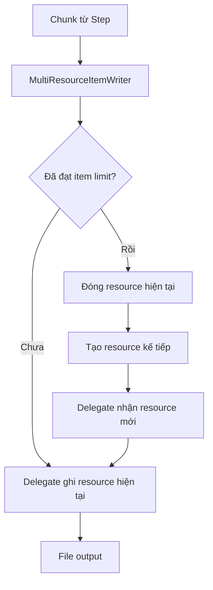

# MultiResourceItemWriter

Trong Spring Batch, một job có thể phải xuất hàng trăm nghìn hoặc hàng triệu record ra file. Nếu ghi tất cả vào một file duy nhất, file có thể quá lớn để tải, truyền, lưu trữ hoặc xử lý ở hệ thống downstream. Một cách phổ biến là chia output thành nhiều file có kích thước gần nhau.

**MultiResourceItemWriter** là writer wrapper giúp ghi item ra nhiều resource theo một giới hạn số item trên mỗi resource. Nó quản lý việc chuyển sang resource kế tiếp và ủy quyền thao tác ghi thực tế cho một writer khác, thường là FlatFileItemWriter.

Ví dụ, nếu cấu hình tối đa 1.000 item trên mỗi resource và step ghi 2.350 item, writer sẽ tạo các file theo thứ tự:

| Resource | Số item |
|---|---:|
| orders.1 | 1.000 |
| orders.2 | 1.000 |
| orders.3 | 350 |

Giới hạn này là **số item**, không phải kích thước file tính bằng byte. Nếu mỗi item có độ dài khác nhau, dung lượng các file cũng có thể khác nhau.

## 1. MultiResourceItemWriter giải quyết vấn đề gì?

Một FlatFileItemWriter thông thường ghi output vào một resource. Khi cần chia output thành nhiều file, nếu tự viết logic đổi file trong processor hoặc writer, ứng dụng phải tự quản lý:

- Số item đã ghi vào file hiện tại.
- Thời điểm đóng file cũ và mở file mới.
- Tên file tiếp theo.
- Header/footer cho từng file.
- Checkpoint và trạng thái khi restart.
- Vòng đời open, update và close của delegate writer.

MultiResourceItemWriter đóng gói phần điều phối này. Ứng dụng chỉ cần cung cấp resource gốc, giới hạn item trên mỗi resource và một delegate writer có khả năng nhận resource mới.



MultiResourceItemWriter không tự định dạng object thành CSV/JSON. Delegate mới chịu trách nhiệm chuyển item thành bytes hoặc record theo định dạng mong muốn.

## 2. Các thành phần chính

Một cấu hình MultiResourceItemWriter thường có bốn thành phần:

| Thành phần | Trách nhiệm |
|---|---|
| Resource gốc | Cơ sở để tạo tên resource đầu ra |
| itemCountLimitPerResource | Số item tối đa được ghi vào mỗi resource |
| ResourceSuffixCreator | Tạo phần suffix cho từng resource |
| Delegate writer | Thực hiện ghi dữ liệu vào resource hiện tại |

Delegate phải triển khai contract phù hợp, thường là ResourceAwareItemWriterItemStream. Contract này cho phép wrapper đặt resource mới và quản lý lifecycle của writer.

Ví dụ delegate FlatFileItemWriter có thể nhận resource mới qua setResource(...), sau đó mở và ghi file đó.

## 3. Cấu hình cơ bản với FlatFileItemWriter

Ví dụ Spring Batch 5 dùng MultiResourceItemWriterBuilder:

```java
@Bean
FlatFileItemWriter<Order> orderFileDelegate() {
    return new FlatFileItemWriterBuilder<Order>()
            .name("orderFileDelegate")
            .lineAggregator(order ->
                    order.orderId() + ","
                            + order.customerId() + ","
                            + order.amount())
            .encoding("UTF-8")
            .headerCallback(writer ->
                    writer.write("orderId,customerId,amount"))
            .build();
}

@Bean
MultiResourceItemWriter<Order> multiResourceOrderWriter(
        FlatFileItemWriter<Order> orderFileDelegate) {

    return new MultiResourceItemWriterBuilder<Order>()
            .name("multiResourceOrderWriter")
            .resource(new FileSystemResource(
                    "output/orders.csv"))
            .delegate(orderFileDelegate)
            .itemCountLimitPerResource(1000)
            .resourceSuffixCreator(index -> "." + index)
            .build();
}
```

Trong ví dụ:

- orderFileDelegate chuyển mỗi Order thành một dòng CSV.
- Resource gốc là output/orders.csv.
- itemCountLimitPerResource(1000) giới hạn 1.000 item mỗi file.
- ResourceSuffixCreator thêm hậu tố theo index.
- MultiResourceItemWriter quản lý việc đổi resource và gọi delegate.

Tên file thực tế được tạo bằng cách kết hợp resource gốc với suffix do ResourceSuffixCreator trả về. Với suffix dạng .1, .2, các tên có dạng orders.csv.1, orders.csv.2 và tiếp tục tăng. Nếu cần định dạng tên khác, hãy cung cấp suffix creator riêng và kiểm tra tên file trong integration test.

Tùy phiên bản Spring Batch, builder có thể yêu cầu các thuộc tính khác hoặc cách cấu hình delegate khác. Hãy dùng API của dependency thực tế trong dự án.

## 4. Delegate phải là ResourceAwareItemWriterItemStream

MultiResourceItemWriter không ghi trực tiếp nội dung file. Nó cần một delegate có thể nhận resource hiện tại và thực hiện các thao tác ItemStream.

Contract quan trọng là ResourceAwareItemWriterItemStream:

- Nhận resource bằng setResource(Resource).
- Hỗ trợ ghi item qua ItemWriter.
- Hỗ trợ open/update/close qua ItemStream.

FlatFileItemWriter đáp ứng contract này, vì vậy nó thường được dùng làm delegate.

Một custom writer cũng có thể làm delegate nếu triển khai đầy đủ contract. Khi wrapper chuyển sang resource mới, custom writer phải đóng resource cũ, nhận resource mới và mở lại đúng cách.

Không dùng một writer chỉ triển khai ItemWriter nếu nó không có cách nhận resource mới. MultiResourceItemWriter cần điều khiển resource và lifecycle của delegate.

## 5. itemCountLimitPerResource hoạt động như thế nào?

itemCountLimitPerResource xác định số item tối đa được ghi vào một resource trước khi wrapper chuyển sang resource tiếp theo.

Ví dụ giới hạn 3 item và input có 8 item:

```text
File orders.1: item 1, item 2, item 3
File orders.2: item 4, item 5, item 6
File orders.3: item 7, item 8
```

Giới hạn là số item mà writer nhận và ghi, không phải số byte hoặc số dòng vật lý sau khi format. Nếu một item được chuyển thành nhiều dòng bởi delegate, MultiResourceItemWriter vẫn đếm item theo contract của ItemWriter.

Nên đặt giới hạn dương và có ý nghĩa vận hành. Giới hạn quá nhỏ tạo nhiều file; giới hạn quá lớn có thể làm file khó phân phối hoặc xử lý ở downstream.

### Item count không phải chunk size

Chunk size quyết định số item trong một transaction chunk. itemCountLimitPerResource quyết định số item trên mỗi file.

Ví dụ:

- Chunk size = 100.
- Item limit mỗi resource = 250.

Một file có thể nhận hai chunk đầy đủ (200 item) và một phần chunk kế tiếp (50 item). Khi đạt 250, phần item còn lại của chunk được ghi vào resource tiếp theo theo cách wrapper phân chia chunk.

Không cần đặt hai giá trị bằng nhau. Chọn chunk size theo transaction và writer; chọn item limit theo yêu cầu chia file.

## 6. Chunk có thể vượt qua ranh giới resource

Chunk và resource là hai ranh giới độc lập. Một chunk có thể chứa item cuối cùng của file hiện tại và item đầu tiên của file kế tiếp.

Ví dụ:

- File hiện tại đã có 90 item.
- itemCountLimitPerResource là 100.
- Chunk tiếp theo có 30 item.

Writer cần ghi 10 item đầu vào file hiện tại, sau đó chuyển sang resource mới và ghi 20 item còn lại.


Điều này giúp giới hạn item trên resource được tuân thủ ngay cả khi chunk size lớn hơn số chỗ còn lại của file hiện tại. Khi kiểm thử, hãy dùng chunk size không chia hết cho item limit để xác nhận boundary behavior.

## 7. ResourceSuffixCreator và quy tắc đặt tên

ResourceSuffixCreator quyết định suffix được thêm vào resource gốc cho mỗi file. Suffix nên:

- Duy nhất trong một lần chạy.
- Có thể sắp xếp theo thứ tự nếu downstream cần ghép file.
- Không chứa ký tự không hợp lệ với filesystem.
- Không trùng tên file của execution khác.
- Ổn định qua restart của cùng JobInstance.

Ví dụ suffix có số thứ tự ba chữ số:

```java
.resourceSuffixCreator(index ->
        String.format(".part-%03d", index))
```

Hoặc dùng tên thể hiện thứ tự:

```java
.resourceSuffixCreator(index ->
        String.format("-segment-%05d.csv", index))
```

Nếu resource gốc là output/orders, suffix -segment-00001.csv tạo tên orders-segment-00001.csv theo quy tắc nối resource và suffix của writer.

Đừng giả định index bắt đầu từ 0 hay 1 nếu tên file là hợp đồng downstream. Hãy cấu hình suffix rõ ràng và viết test kiểm tra tên resource đầu tiên, resource kế tiếp và tên sau restart trên phiên bản Spring Batch đang dùng.

## 8. Tổ chức thư mục output

MultiResourceItemWriter thường dùng FileSystemResource cho output file. Thư mục đích cần tồn tại và process chạy job phải có quyền ghi.

Ví dụ:

```java
Resource outputBase =
        new FileSystemResource("/data/export/orders");
```

Trước khi launch job, có thể dùng một bước chuẩn bị để:

- Xác nhận thư mục output tồn tại.
- Tạo thư mục nếu chính sách ứng dụng cho phép.
- Kiểm tra quyền ghi.
- Xác nhận tên file không xung đột với batch khác.
- Ghi metadata về batch ID và output directory.

Không dùng ClassPathResource làm đích ghi file. Resource trên classpath thường nằm trong JAR hoặc thư mục ứng dụng và không phải vị trí output có thể ghi.

Tránh dùng thư mục output chung cho nhiều JobInstance nếu suffix chỉ bắt đầu lại từ cùng một index. Hai job đồng thời có thể cùng tạo orders.1, dẫn đến ghi đè hoặc lỗi mở file.

## 9. Cấu hình step sử dụng MultiResourceItemWriter

MultiResourceItemWriter được inject vào step như một ItemWriter bình thường:

```java
@Bean
Step exportOrdersStep(
        JobRepository jobRepository,
        PlatformTransactionManager transactionManager,
        ItemReader<Order> orderReader,
        MultiResourceItemWriter<Order> multiResourceOrderWriter) {

    return new StepBuilder("exportOrdersStep", jobRepository)
            .<Order, Order>chunk(100, transactionManager)
            .reader(orderReader)
            .writer(multiResourceOrderWriter)
            .build();
}
```

Step không cần biết writer đang tạo bao nhiêu file. Nó gửi từng chunk đến MultiResourceItemWriter, còn wrapper quyết định item thuộc resource nào.

Nếu step có processor, output type của processor phải khớp với input type của delegate writer.

## 10. Ghi header và footer cho từng resource

Nếu delegate là FlatFileItemWriter, có thể cấu hình headerCallback và footerCallback. Vì delegate được mở lại cho mỗi resource, header callback được thực hiện khi mở mỗi file. Footer callback được gọi khi delegate đóng resource theo lifecycle của writer.

Ví dụ:

```java
@Bean
FlatFileItemWriter<Order> orderFileDelegate() {
    return new FlatFileItemWriterBuilder<Order>()
            .name("orderFileDelegate")
            .lineAggregator(order ->
                    order.orderId() + ","
                            + order.customerId() + ","
                            + order.amount())
            .headerCallback(writer ->
                    writer.write("orderId,customerId,amount"))
            .footerCallback(writer ->
                    writer.write("# end of file"))
            .encoding("UTF-8")
            .build();
}
```

Nếu header/footer là một phần của format downstream, hãy xác nhận mỗi file đều có đúng header và footer. Một số consumer không chấp nhận comment/footer; hãy cấu hình theo hợp đồng file.

Với header chứa batch ID, ngày export hoặc schema version, có thể dùng callback đọc cấu hình đã inject vào delegate. Đảm bảo giá trị ổn định qua restart.

## 11. Ghi file CSV với LineAggregator

FlatFileItemWriter dùng LineAggregator để biến item thành một dòng. Ví dụ nối chuỗi thủ công phù hợp với dữ liệu đơn giản, nhưng không an toàn cho CSV tổng quát nếu field có dấu phẩy, quote hoặc newline.

Ví dụ dùng DelimitedLineAggregator:

```java
@Bean
FlatFileItemWriter<Order> orderFileDelegate() {
    DelimitedLineAggregator<Order> aggregator =
            new DelimitedLineAggregator<>();
    aggregator.setDelimiter(",");

    BeanWrapperFieldExtractor<Order> extractor =
            new BeanWrapperFieldExtractor<>();
    extractor.setNames(new String[] {
            "orderId", "customerId", "amount"
    });
    aggregator.setFieldExtractor(extractor);

    return new FlatFileItemWriterBuilder<Order>()
            .name("orderFileDelegate")
            .lineAggregator(aggregator)
            .encoding("UTF-8")
            .build();
}
```

Đoạn cấu hình trên minh họa cách tách field và delimiter. Nếu dữ liệu có quy tắc quote/escape CSV phức tạp, hãy dùng aggregator/parser tương thích với dialect của downstream thay vì nối chuỗi thủ công.

MultiResourceItemWriter không thay đổi nội dung record. Mọi quy tắc encoding, delimiter, quote, escaping và line ending thuộc delegate.

## 12. Suffix theo batch ID và execution

Một batch có thể xuất nhiều file, và nhiều batch có thể chạy cùng lúc. Tên file cần phân biệt được từng execution.

Ví dụ:

```java
@Bean
@StepScope
MultiResourceItemWriter<Order> multiResourceOrderWriter(
        FlatFileItemWriter<Order> orderFileDelegate,
        @Value("#{jobParameters['batchId']}") String batchId) {

    return new MultiResourceItemWriterBuilder<Order>()
            .name("multiResourceOrderWriter")
            .resource(new FileSystemResource(
                    "/data/export/" + batchId + "/orders"))
            .delegate(orderFileDelegate)
            .itemCountLimitPerResource(1000)
            .resourceSuffixCreator(index ->
                    String.format(".%05d.csv", index))
            .build();
}
```

Ví dụ dùng @StepScope vì output path phụ thuộc JobParameters của lần chạy. Trong production, batchId phải được validate trước khi dùng để tạo path. Không nối giá trị không tin cậy vào đường dẫn filesystem mà không chuẩn hóa và giới hạn thư mục đích.

Một thư mục riêng theo batch giúp tránh hai execution tạo cùng tên file. Nếu job restart, cùng identifying parameters phải xác định cùng batch directory và base resource.

## 13. MultiResourceItemWriter và late binding

Resource gốc có thể phụ thuộc JobParameters hoặc JobExecutionContext. Khi đó, khai báo writer bằng @StepScope để SpEL được phân giải khi StepExecution hiện hành tồn tại.

Ví dụ:

```java
@Bean
@StepScope
MultiResourceItemWriter<Order> multiResourceWriter(
        FlatFileItemWriter<Order> delegate,
        @Value("#{jobParameters['output.directory']}") String directory,
        @Value("#{jobParameters['batchId']}") String batchId) {

    Resource baseResource = new FileSystemResource(
            Path.of(directory, batchId, "orders").toFile());

    return new MultiResourceItemWriterBuilder<Order>()
            .name("multiResourceWriter")
            .resource(baseResource)
            .delegate(delegate)
            .itemCountLimitPerResource(5000)
            .resourceSuffixCreator(index -> "." + index + ".csv")
            .build();
}
```

Nếu dùng JobExecutionContext, key cần được ghi trước khi target writer được tạo. Không đọc StepExecutionContext của step trước trong step hiện tại; mỗi step có context riêng.

Late binding chỉ xác định resource khi target bean được tạo. Nếu output directory hoặc batch ID thay đổi giữa restart của cùng JobInstance, writer có thể trỏ đến resource khác với lần chạy trước.

## 14. ResourceSuffixCreator và index

Suffix creator nhận index của resource và trả về chuỗi suffix. Nên xem index như thứ tự segment của output.

Ví dụ:

```java
ResourceSuffixCreator suffixCreator =
        index -> String.format(".part-%04d", index);
```

Đầu ra có thể có dạng:

```text
orders.part-0001
orders.part-0002
orders.part-0003
```

Hãy kiểm tra quy ước index của phiên bản Spring Batch đang dùng bằng một test nhỏ. Nếu downstream dựa vào tên file, không để mặc định suffix thay đổi mà không cập nhật hợp đồng.

Suffix creator nên thuần và xác định: cùng một index luôn trả cùng một suffix. Không dùng timestamp hiện tại hoặc random UUID trong suffix nếu cần restart vì tên resource phải được tái tạo ổn định.

## 15. Lưu state và restart

MultiResourceItemWriter là ItemStreamWriter và cần lưu trạng thái để restart đúng vị trí. Các thông tin liên quan gồm:

- Resource index hiện tại.
- Số item đã ghi vào resource hiện tại.
- State của delegate writer, ví dụ vị trí ghi file.
- Tên writer ổn định để định danh key trong ExecutionContext.

Với builder, hãy đặt name ổn định và bật saveState khi cần restart:

```java
return new MultiResourceItemWriterBuilder<Order>()
        .name("multiResourceOrderWriter")
        .resource(baseResource)
        .delegate(orderFileDelegate)
        .itemCountLimitPerResource(1000)
        .saveState(true)
        .build();
```

Khi job restart cùng JobInstance:

1. Spring Batch khôi phục StepExecutionContext đã lưu.
2. MultiResourceItemWriter đọc resource index và item count đã lưu.
3. Delegate được gắn với resource tương ứng.
4. Writer tiếp tục từ state của file hiện tại.
5. Khi đạt giới hạn, writer chuyển sang resource tiếp theo.

Đây là lý do tên writer, resource base, suffix rule và item limit phải ổn định trong suốt một JobInstance cần restart.

Không đổi itemCountLimitPerResource, suffix creator hoặc output base path giữa lần chạy đầu và restart nếu chưa thiết kế migration state tương ứng. Thay đổi này có thể khiến index/state cũ không còn trỏ đúng file.

## 16. saveState và tên writer

saveState cho phép writer ghi metadata cần thiết vào ExecutionContext. Nếu tắt saveState, restart có thể không khôi phục được vị trí resource và số item đã ghi.

Tên writer cần:

- Không rỗng.
- Ổn định giữa các lần chạy cùng cấu hình.
- Duy nhất trong phạm vi step nếu có nhiều stream writer.
- Không đổi tùy theo timestamp hoặc dữ liệu ngẫu nhiên.

Ví dụ:

```java
.name("multiResourceOrderWriter")
```

Không dùng cùng tên cho hai writer độc lập trong cùng step vì state key có thể xung đột. Nếu có nhiều output stream, mỗi writer cần một name riêng và một base resource riêng.

## 17. Restart và file đã tồn tại

Khi restart, một số file segment có thể đã được ghi trong các chunk đã commit. Writer cần tiếp tục resource hiện tại và giữ các file trước đó theo state của execution.

Hãy phân biệt:

- **Restart cùng JobInstance**: tiếp tục batch đã thất bại, dùng lại identifying parameters và output layout đã xác định.
- **Chạy JobInstance mới**: tạo một lần export mới, thường cần thư mục hoặc batch ID mới.
- **Reprocess có chủ đích**: xử lý lại cùng dữ liệu theo version/reprocess ID mới để không ghi đè output của lần trước.

Không xóa toàn bộ output directory trước mỗi lần khởi động nếu đây có thể là restart. Bước cleanup phải biết job đang là execution mới hay restart và chỉ xóa resource được phép.

Nếu output đã publish cho downstream trước khi job hoàn tất, restart có thể tạo trạng thái khó nhất quán. Tốt hơn là ghi vào thư mục staging riêng rồi publish/đổi tên thư mục sau khi job hoàn tất thành công.

## 18. Transaction và file rotation

Chunk-oriented step thường commit theo transaction manager. Delegate FlatFileItemWriter có cơ chế buffering/transactional state để phối hợp ghi file với chunk commit. MultiResourceItemWriter điều phối resource rotation bên ngoài delegate.

Khi một chunk vượt qua ranh giới file, writer có thể ghi một phần chunk vào resource hiện tại và phần còn lại vào resource mới. Nếu chunk thất bại, việc rollback file phụ thuộc ItemStream/transactional behavior của delegate và cách step được cấu hình.

Không giả định filesystem có transaction ACID giống database. Nếu step vừa ghi database vừa ghi nhiều file, transaction manager không thể tự động làm cho cả hai resource trở thành một giao dịch phân tán nguyên tử trong mọi cấu hình.

Các biện pháp thực tế:

- Dùng FlatFileItemWriter hoặc delegate có hỗ trợ transaction/chunk lifecycle.
- Không tạo side effect ngoài writer mà không có cơ chế idempotency.
- Giữ file output ở trạng thái staging trong khi job đang chạy.
- Chỉ publish khi job hoàn tất thành công.
- Có manifest ghi nhận file segment và checksum nếu downstream cần xác nhận đầy đủ.

## 19. Empty input và resource đầu ra

Nếu reader không trả item nào, ứng dụng cần xác định có cần tạo file rỗng hay không. Hành vi thực tế phụ thuộc thời điểm MultiResourceItemWriter khởi tạo resource và delegate được mở, cùng phiên bản/configuration.

Đừng giả định luôn có file đầu ra khi input rỗng. Nếu downstream yêu cầu một file rỗng có header, hãy xử lý rõ ràng bằng bước tạo file/manifest riêng hoặc kiểm thử hành vi writer với input rỗng.

Tương tự, nếu số item là bội số chính xác của item limit, hãy xác nhận writer không tạo thêm một file segment rỗng ở cuối. Test boundary giúp phát hiện khác biệt giữa các version hoặc cấu hình delegate.

## 20. Sử dụng custom ResourceAwareItemWriterItemStream

Không bắt buộc delegate phải là FlatFileItemWriter. Có thể dùng custom writer nếu nó có thể thay resource và quản lý stream:

```java
public class JsonResourceWriter<T>
        implements ResourceAwareItemWriterItemStream<T> {

    private Resource resource;
    private BufferedWriter writer;

    @Override
    public void setResource(Resource resource) {
        this.resource = resource;
    }

    @Override
    public void open(ExecutionContext executionContext) {
        // Mở resource hiện tại và khôi phục state nếu cần.
    }

    @Override
    public void write(Chunk<? extends T> chunk) throws Exception {
        // Serialize và ghi các item vào resource hiện tại.
    }

    @Override
    public void update(ExecutionContext executionContext) {
        // Lưu checkpoint cần thiết.
    }

    @Override
    public void close() {
        // Flush và đóng resource hiện tại.
    }
}
```

Đây là skeleton minh họa, không phải writer production hoàn chỉnh. Một custom delegate cần xử lý exception, encoding, resource open/close, checkpoint, restart, flush và cleanup cẩn thận. Hãy ưu tiên writer có sẵn nếu định dạng output đã được hỗ trợ.

## 21. Chia file theo số item hay theo dung lượng?

MultiResourceItemWriter chia theo item count. Nó không bảo đảm mỗi file có dung lượng byte bằng nhau.

Ví dụ:

| File | Số item | Dung lượng minh họa |
|---|---:|---:|
| orders.1 | 1.000 | 1.2 MB |
| orders.2 | 1.000 | 8.5 MB |
| orders.3 | 1.000 | 2.0 MB |

Nếu một số record chứa description dài, file tương ứng có thể lớn hơn nhiều dù cùng số item.

Nếu yêu cầu là giới hạn kích thước byte chính xác, MultiResourceItemWriter không trực tiếp đáp ứng. Có thể cần custom writer theo dõi byte count, một bước chia file sau khi export hoặc định dạng record có độ dài cố định. Khi viết custom rotation, cần tính đến encoding, newline, header/footer và record không được chia đôi.

Không dùng itemCountLimitPerResource để cam kết file luôn nhỏ hơn một số MB cụ thể.

## 22. Chia file theo ngày, tenant hoặc loại dữ liệu

MultiResourceItemWriter tạo resource theo index, không tự động nhóm item theo business key. Nếu cần mỗi tenant hoặc ngày nghiệp vụ có một file riêng, hãy xác định chiến lược:

- Sắp xếp input theo key và dùng custom routing writer.
- Dùng ClassifierCompositeItemWriter để chọn writer theo item.
- Tạo các step riêng cho từng nhóm.
- Dùng partitioning nếu các nhóm cần xử lý độc lập.

MultiResourceItemWriter phù hợp khi muốn chia tuần tự một luồng item thành các segment có giới hạn số lượng.

Có thể kết hợp classifier writer với nhiều MultiResourceItemWriter nếu mỗi route cần nhiều segment riêng, nhưng cần quản lý state và tên writer riêng cho từng route. Không dùng một base resource chung cho nhiều route có thể ghi đồng thời.

## 23. Chạy song song và thread safety

MultiResourceItemWriter giữ state như resource index, item count và delegate hiện tại. Đây là state thay đổi trong quá trình write, vì vậy không nên giả định một instance dùng chung có thể được gọi đồng thời an toàn từ nhiều thread.

Với multi-threaded step:

- Kiểm tra thread-safety của writer và delegate.
- Tránh nhiều thread cùng rotate một resource.
- Nếu cần parallelism, cân nhắc partitioning với output riêng cho từng worker.
- Dùng base resource hoặc thư mục khác nhau theo partition ID.
- Kết hợp output sau khi tất cả partition hoàn tất.

Ví dụ tên file theo partition:

```text
export/partition-0/orders.1
export/partition-0/orders.2
export/partition-1/orders.1
export/partition-1/orders.2
```

Mỗi worker có output namespace riêng nên không ghi đè file của worker khác. Một bước cuối có thể tạo manifest tổng hợp hoặc chuyển các file vào thư mục publish chung.

@StepScope tạo target writer riêng theo StepExecution, hữu ích cho partition worker. Tuy nhiên, scope không tự làm các dependency singleton mà delegate sử dụng trở nên thread-safe.

## 24. Tích hợp với ItemStream và lifecycle

MultiResourceItemWriter cần quản lý lifecycle của delegate:

1. Khi step mở stream, wrapper mở delegate với resource hiện tại.
2. Khi đạt item limit, wrapper đóng resource hiện tại.
3. Wrapper tạo resource mới và gọi setResource(...) trên delegate.
4. Delegate được mở cho resource mới.
5. Item tiếp theo được ghi vào resource mới.
6. Khi step kết thúc, wrapper đóng delegate.
7. Khi commit, wrapper/delegate cập nhật state vào ExecutionContext.

Không tự gọi open/close delegate từ processor hoặc listener khác trong khi MultiResourceItemWriter đang quản lý nó. Điều đó có thể làm lifecycle bị lặp hoặc resource hiện tại không còn nhất quán.

Nếu dùng custom delegate, hãy kiểm tra nó có thể được mở nhiều lần trong cùng StepExecution trên các resource khác nhau theo contract của wrapper.

## 25. Kiểm thử số file và số item mỗi file

Integration test nên tạo một tập input nhỏ và cấu hình item limit thấp để kiểm tra rotation dễ dàng.

Ví dụ input có 7 item, limit 3:

```text
orders.1 -> 3 item
orders.2 -> 3 item
orders.3 -> 1 item
```

Test nên xác nhận:

- Có đúng ba resource được tạo.
- Mỗi resource đầu tiên có ba item.
- Resource cuối có một item.
- Tổng item trên tất cả resource bằng số item hợp lệ từ reader.
- Không item nào bị mất hoặc ghi trùng.
- Nội dung mỗi file theo đúng thứ tự đầu vào nếu thứ tự được yêu cầu.

Không chỉ kiểm tra số file tồn tại. Hãy đọc lại từng file và kiểm tra các business key để xác nhận ranh giới rotation đúng.

## 26. Kiểm thử chunk vượt ranh giới file

Đây là test quan trọng vì chunk size và item limit thường không bằng nhau.

Ví dụ:

- Chunk size = 4.
- Item limit = 5.
- Input có 11 item.

Kết quả mong đợi theo item count:

| File | Item |
|---|---|
| orders.1 | 1, 2, 3, 4, 5 |
| orders.2 | 6, 7, 8, 9, 10 |
| orders.3 | 11 |

Chunk thứ hai chứa item 5–8 có thể được chia giữa hai resource: item 5 kết thúc file thứ nhất, item 6–8 đi vào file thứ hai. Hãy kiểm tra delegate nhận đúng các phần chunk và không tạo item trùng/lệch thứ tự.

## 27. Kiểm thử restart

Để xác nhận restart, tạo một job test có thể thất bại sau khi một số chunk đã commit:

1. Cấu hình item limit nhỏ, ví dụ 3.
2. Đọc đủ dữ liệu để tạo ít nhất hai resource.
3. Cố tình gây lỗi sau một số chunk đã commit.
4. Xác nhận các file và state được lưu theo execution.
5. Restart cùng JobInstance với cùng identifying parameters.
6. Xác nhận writer tiếp tục đúng resource/index và item count.
7. Đọc toàn bộ file để xác nhận không thiếu hoặc trùng item.

Khi test restart:

- Giữ tên MultiResourceItemWriter ổn định.
- Giữ tên delegate ổn định.
- Giữ base resource và suffix rule ổn định.
- Giữ itemCountLimitPerResource không đổi.
- Dùng lại identifying JobParameters.
- Không xóa staging output trước khi restart.

Nếu thay đổi bất kỳ yếu tố nào, hãy coi đó là thay đổi cấu hình restart cần được kiểm thử riêng.

## 28. Kiểm thử header, footer và file rỗng

Với FlatFileItemWriter delegate, kiểm tra từng resource:

- Header có xuất hiện ở đầu mỗi file không?
- Footer có xuất hiện khi file được đóng không?
- File cuối có số dòng đúng không?
- Input rỗng có tạo resource hay không?
- Khi số item là bội số chính xác của limit, có tạo file rỗng thừa không?
- Khi job restart, header/footer có bị lặp hoặc thiếu không?

Header/footer thường là đặc tính của từng resource, không phải chỉ của toàn bộ batch. Nếu downstream cần một header duy nhất cho cả batch, có thể cần manifest hoặc file metadata tổng hợp riêng.

## 29. Kiểm thử suffix và collision

Test ResourceSuffixCreator như một phần của output contract:

| Index | Suffix minh họa |
|---:|---|
| 1 | .part-0001.csv |
| 2 | .part-0002.csv |
| 3 | .part-0003.csv |

Xác nhận:

- Suffix không tạo tên trùng.
- Tên hợp lệ trên filesystem mục tiêu.
- Các segment có thể sắp xếp theo thứ tự.
- Hai batch khác nhau không dùng cùng output path.
- Restart tái tạo đúng tên file đã dùng.

Nếu downstream nhận danh sách file qua manifest, hãy ghi tên file theo đúng thứ tự và chỉ publish manifest khi mọi segment hoàn tất.

## 30. Publish file sau khi job hoàn tất

Trong khi step đang chạy, downstream không nên đọc các segment chưa hoàn chỉnh. Một cách triển khai an toàn là:

1. Ghi tất cả file vào thư mục staging riêng theo batch ID.
2. Chờ JobExecution kết thúc thành công.
3. Kiểm tra số file, số item và checksum nếu cần.
4. Tạo manifest liệt kê segment theo thứ tự.
5. Đổi tên hoặc chuyển thư mục staging sang vị trí publish nếu filesystem hỗ trợ thao tác phù hợp.
6. Thông báo downstream chỉ sau khi publish hoàn tất.

Nếu job thất bại, staging output có thể được giữ lại để restart hoặc điều tra. Không để consumer coi các file dở dang là export hoàn chỉnh.

Với filesystem object storage, thao tác rename có thể không nguyên tử hoặc không tồn tại như filesystem truyền thống. Khi đó, dùng trạng thái manifest/marker hoàn tất và thiết kế consumer chỉ đọc batch có marker.

## 31. Những lỗi thường gặp

**Nhầm item limit với byte limit.** MultiResourceItemWriter đếm item, không đo dung lượng file. Nếu yêu cầu là giới hạn MB, cần chiến lược khác.

**Nhầm item limit với chunk size.** Hai giá trị điều khiển hai ranh giới khác nhau. Một chunk có thể bị chia qua hai resource.

**Delegate không hỗ trợ ResourceAwareItemWriterItemStream.** Wrapper không thể gắn resource mới hoặc quản lý lifecycle đúng. Dùng delegate tương thích.

**Quên đặt tên writer ổn định.** State trong ExecutionContext có thể không được lưu/khôi phục đúng hoặc xung đột với writer khác.

**Suffix creator dùng timestamp/random.** Restart có thể tạo tên resource khác. Dùng suffix xác định từ index.

**Hai job dùng chung base resource.** File segment có thể va chạm. Dùng thư mục hoặc batch ID riêng.

**Thư mục output chưa tồn tại hoặc không có quyền ghi.** Delegate thất bại khi mở resource. Validate output directory trước khi export.

**Cho rằng header chỉ xuất hiện một lần.** Delegate được mở cho mỗi resource nên header callback có thể chạy cho từng file. Kiểm tra contract downstream.

**Không kiểm thử chunk vượt ranh giới.** Item có thể bị ghi sai file hoặc thiếu khi cấu hình không được kiểm chứng. Dùng chunk size không chia hết item limit.

**Tắt saveState khi cần restart.** Wrapper không thể khôi phục vị trí resource và item count như mong đợi.

**Xóa output khi restart.** Có thể phá các file segment đã commit. Phân biệt restart với execution mới.

**Dùng một writer instance cho nhiều thread.** Resource index và delegate state có thể bị race. Dùng partition output riêng hoặc cơ chế tuần tự hóa phù hợp.

**Publish file trước khi job hoàn tất.** Downstream có thể đọc batch chưa đầy đủ. Dùng staging và manifest/marker hoàn tất.

## 32. Quy trình triển khai MultiResourceItemWriter

Khi cần chia output thành nhiều file, hãy thực hiện theo trình tự:

1. Xác định lý do chia file: giới hạn số record, thuận tiện phân phối hay yêu cầu downstream.
2. Xác nhận giới hạn là item count hay byte size.
3. Chọn delegate writer phù hợp với định dạng output.
4. Đảm bảo delegate triển khai ResourceAwareItemWriterItemStream.
5. Chọn base resource và thư mục output riêng cho batch.
6. Đặt itemCountLimitPerResource theo nhu cầu vận hành.
7. Cấu hình ResourceSuffixCreator xác định và dễ sắp xếp.
8. Đặt name ổn định và bật saveState nếu cần restart.
9. Gắn MultiResourceItemWriter vào step với chunk size được chọn độc lập.
10. Kiểm thử rotation, boundary chunk, header/footer, empty input, restart và collision.
11. Ghi manifest và publish output sau khi job thành công nếu downstream cần batch hoàn chỉnh.

Giữ base path, suffix rule, item limit và writer names ổn định qua restart. Nếu cần thay đổi output layout, hãy dùng một JobInstance mới hoặc thiết kế migration state rõ ràng.

## 33. Kết luận thực hành

MultiResourceItemWriter cho phép Spring Batch chia một luồng item thành nhiều resource theo giới hạn số item trên mỗi resource. Nó điều phối việc tạo resource, chuyển suffix và lifecycle của delegate; delegate như FlatFileItemWriter chịu trách nhiệm định dạng và ghi nội dung.

itemCountLimitPerResource là số item, không phải giới hạn byte. Nó độc lập với chunk size, vì vậy một chunk có thể được chia giữa hai file. ResourceSuffixCreator cần tạo tên xác định và duy nhất; writer và delegate cần name ổn định, saveState phù hợp để hỗ trợ restart.

Hãy dùng output directory riêng theo batch, kiểm tra quyền ghi, kiểm thử ranh giới chunk/resource, xác nhận header/footer trên từng file và giữ cấu hình không đổi trong restart. Với job chạy song song, cấp resource riêng cho từng partition. Chỉ publish các segment sau khi job hoàn tất và có manifest/marker xác nhận đầy đủ. Cách tổ chức này giúp output được chia nhỏ có kiểm soát mà vẫn giữ thứ tự, khả năng phục hồi và tính toàn vẹn dữ liệu.
