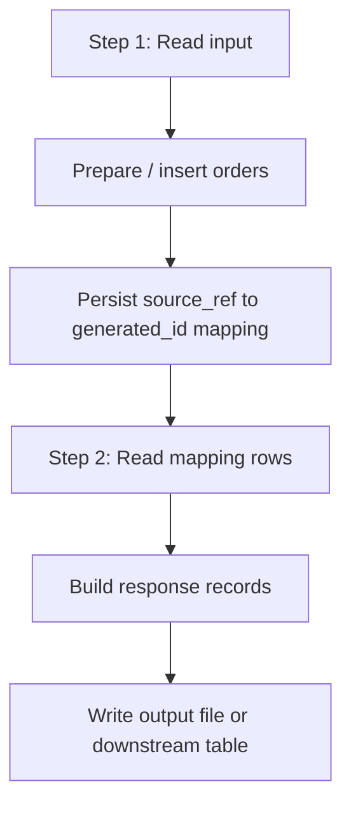
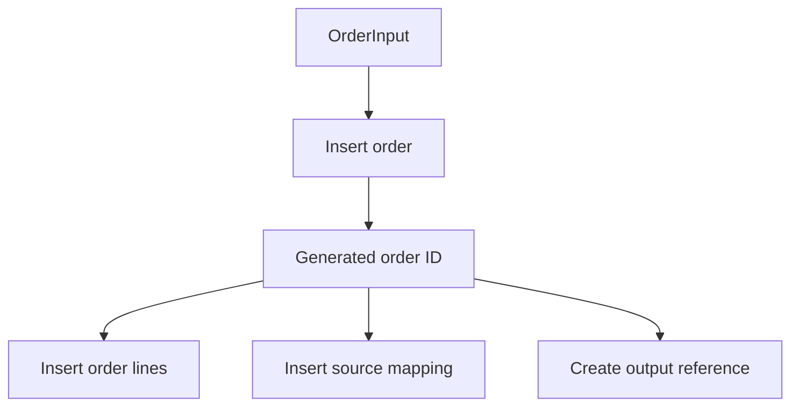

# Generated key và output mapping

Trong Spring Batch, một bước JDBC thường đọc dữ liệu, chuyển đổi item rồi ghi các bản ghi mới vào database. Nhiều bảng sử dụng khóa chính tự sinh (identity, auto-increment hoặc sequence). Khi insert thành công, database tạo ra một **generated key**. Ứng dụng đôi khi cần giữ khóa đó để ghi bảng liên quan, tạo file kết quả hoặc liên kết item đầu vào với bản ghi vừa được tạo.

Đây là vấn đề của **generated key và output mapping**: làm sao lấy được khóa do database tạo và ánh xạ nó trở lại với item hoặc business key tương ứng.

Điểm cần hiểu trước tiên là JdbcBatchItemWriter được thiết kế để ghi một chunk bằng JDBC batch update. Nó không cung cấp một contract portable để trả về generated key cho từng item. Khả năng driver trả generated keys cho batch và cách ánh xạ các key đó về đúng item phụ thuộc database/driver. Vì vậy, nếu cần mapping chính xác, hãy chọn chiến lược rõ ràng: cấp key trước khi insert, dùng insert từng dòng với KeyHolder, dùng câu lệnh database-specific có RETURNING/OUTPUT, hoặc đọc mapping từ database ở step sau.

## 1. Generated key là gì?

Generated key là giá trị khóa được database tạo khi insert một row. Các cách phổ biến:

- **Identity / auto-increment**: database tự tăng giá trị khi insert.
- **Sequence**: ứng dụng hoặc database lấy giá trị tiếp theo từ sequence rồi dùng trong insert.
- **Default expression**: cột có default expression tạo giá trị khi insert.
- **Trigger**: trigger gán giá trị cho khóa hoặc cột khác trong quá trình insert.
- **UUID do ứng dụng tạo**: ứng dụng tạo ID trước khi insert; về mặt thời điểm đây không phải key do database sinh, nhưng thường giải quyết cùng nhu cầu định danh.

Ví dụ bảng:

```sql
create table orders (
    id bigint generated by default as identity primary key,
    source_ref varchar(80) not null,
    amount decimal(18, 2) not null
);
```

Ứng dụng insert source_ref và amount, database tự tạo id:

```sql
insert into orders (source_ref, amount)
values ('SRC-1001', 250.00);
```

Sau insert, row có thể có id = 84521. Giá trị cụ thể do database quyết định. Nếu bước tiếp theo cần lưu orders.id vào bảng khác, ứng dụng cần lấy khóa này và liên kết nó với source_ref hoặc một identifier của item đầu vào.

## 2. Output mapping nghĩa là gì?

Trong batch processing, output mapping thường là việc liên kết item đầu vào hoặc dữ liệu đã xử lý với kết quả được database tạo ra.

Ví dụ:

| Input reference | Generated order ID |
|---|---:|
| SRC-1001 | 84521 |
| SRC-1002 | 84522 |
| SRC-1003 | 84523 |

Mapping này có thể được dùng để:

- Ghi các bảng con có foreign key trỏ đến order vừa tạo.
- Tạo file phản hồi cho hệ thống nguồn.
- Lưu bảng đối chiếu source reference và database ID.
- Cập nhật trạng thái xử lý cho từng record đầu vào.
- Cho phép step tiếp theo đọc lại các ID vừa tạo.

Generated key là giá trị được tạo; output mapping là quan hệ giữa giá trị đó và item nghiệp vụ tương ứng. Chỉ lấy được một danh sách ID mà không biết mỗi ID thuộc item nào thì chưa đủ để mapping an toàn.

## 3. Vị trí của generated key trong chunk pipeline

Một chunk step thường thực hiện theo thứ tự:


Processor chạy trước writer. Nếu database chỉ tạo khóa khi writer thực hiện insert, processor không thể biết khóa đó trong lần xử lý hiện tại.

Contract của ItemWriter cũng không trả về một danh sách output item. Trong Spring Batch 5, writer nhận Chunk<? extends T> và ghi dữ liệu; nó không có return value để truyền generated key ngược lại processor.

Vì vậy, nếu cần generated ID ngay trong output object trước khi ghi, hãy tạo ID trước insert. Nếu bắt buộc dùng identity do database cấp, hãy lấy key trong writer và lưu mapping vào một nơi mà step sau có thể đọc.

## 4. JdbcBatchItemWriter và generated keys

JdbcBatchItemWriter là lựa chọn phù hợp để insert/update nhiều item trong một chunk. Nó dùng JDBC batch update và hỗ trợ bind giá trị từ item bằng ItemPreparedStatementSetter hoặc ItemSqlParameterSourceProvider.

Ví dụ:

```java
@Bean
JdbcBatchItemWriter<OrderToInsert> orderBatchWriter(
        DataSource dataSource) {

    return new JdbcBatchItemWriterBuilder<OrderToInsert>()
            .dataSource(dataSource)
            .sql("""
                    insert into orders (id, source_ref, amount)
                    values (?, ?, ?)
                    """)
            .itemPreparedStatementSetter((item, statement) -> {
                statement.setLong(1, item.id());
                statement.setString(2, item.sourceRef());
                statement.setBigDecimal(3, item.amount());
            })
            .assertUpdates(true)
            .build();
}
```

Trong ví dụ này, item đã có id trước khi writer chạy, nên writer có thể batch insert với khóa đã biết.

Nếu bỏ cột id để database tự sinh, JdbcBatchItemWriter vẫn có thể thực hiện insert, nhưng writer không cung cấp cơ chế chuẩn để trả generated key tương ứng cho từng item. Đừng giả định rằng sau write(chunk) có thể lấy một KeyHolder chứa danh sách key được sắp theo thứ tự input.

JDBC driver và database có thể hỗ trợ generated keys cho batch ở các mức khác nhau. Thứ tự trả về, số cột key, hỗ trợ trigger và hành vi khi một phần batch lỗi có thể khác nhau. Nếu dùng API batch generated keys riêng của driver, hãy coi đó là một triển khai database-specific và kiểm thử trực tiếp trên đúng driver/version production.

## 5. Chiến lược 1: tạo key trước khi insert

Nếu ứng dụng có thể chọn khóa, cách đơn giản nhất là tạo key trong processor hoặc trước khi bắt đầu ghi:

- Tạo UUID ở ứng dụng.
- Lấy giá trị từ database sequence trước khi batch insert.
- Cấp ID từ một dịch vụ ID tập trung.

Khi key đã có trong item, output mapping trở nên đơn giản: processor tạo một output object chứa cả ID và source reference; writer batch insert object đó.

Ví dụ model:

```java
public record OrderInput(
        String sourceRef,
        BigDecimal amount) {
}

public record OrderToInsert(
        long id,
        String sourceRef,
        BigDecimal amount) {
}
```

Processor dùng sequence incrementer:

```java
@Bean
ItemProcessor<OrderInput, OrderToInsert> prepareOrder(
        DataFieldMaxValueIncrementer orderIdIncrementer) {

    return input -> new OrderToInsert(
            orderIdIncrementer.nextLongValue(),
            input.sourceRef(),
            input.amount());
}
```

DataFieldMaxValueIncrementer là abstraction của Spring JDBC để lấy giá trị tiếp theo từ sequence hoặc cơ chế tăng giá trị phù hợp database. Cấu hình implementation cụ thể phụ thuộc database và schema.

Sau đó JdbcBatchItemWriter insert id, source_ref và amount trong một batch. Output object đã giữ được ID được cấp trước để ghi bảng liên quan hoặc tạo file mapping.

### Ưu điểm và giới hạn

- Dễ batch insert vì mỗi item đã có khóa.
- Mapping giữa input và ID rõ ràng, không cần đoán thứ tự generated keys.
- Có thể ghi nhiều bảng trong các writer/step tiếp theo bằng cùng ID.
- Sequence có thể tạo khoảng trống nếu transaction rollback; sequence không đảm bảo liên tục.
- Nếu dùng UUID, cần thống nhất kiểu cột và quy tắc sinh ID giữa các hệ thống.

Nếu nghiệp vụ chỉ cần khóa duy nhất chứ không bắt buộc database phải tự tạo identity, đây thường là phương án đơn giản và dễ mở rộng.

## 6. Cấu hình JdbcBatchItemWriter cho key đã cấp trước

Ví dụ writer hoàn chỉnh hơn:

```java
@Bean
JdbcBatchItemWriter<OrderToInsert> orderBatchWriter(
        DataSource dataSource) {

    return new JdbcBatchItemWriterBuilder<OrderToInsert>()
            .dataSource(dataSource)
            .sql("""
                    insert into orders (id, source_ref, amount)
                    values (?, ?, ?)
                    """)
            .itemPreparedStatementSetter((item, statement) -> {
                statement.setLong(1, item.id());
                statement.setString(2, item.sourceRef());
                statement.setBigDecimal(3, item.amount());
            })
            .assertUpdates(true)
            .build();
}
```

Với cách này, ID đã được biết trước khi ghi. Nếu cần tạo bảng liên quan:

```java
@Bean
JdbcBatchItemWriter<OrderToInsert> orderAuditWriter(
        DataSource dataSource) {

    return new JdbcBatchItemWriterBuilder<OrderToInsert>()
            .dataSource(dataSource)
            .sql("""
                    insert into order_audit (order_id, source_ref)
                    values (?, ?)
                    """)
            .itemPreparedStatementSetter((item, statement) -> {
                statement.setLong(1, item.id());
                statement.setString(2, item.sourceRef());
            })
            .assertUpdates(true)
            .build();
}
```

Hai writer có thể được kết hợp trong một composite writer nếu cùng một chunk cần ghi cả hai bảng và transaction được cấu hình phù hợp. Đảm bảo thứ tự insert tôn trọng foreign key: bảng cha trước, bảng con sau.

## 7. Chiến lược 2: lấy một generated key bằng KeyHolder

Nếu bắt buộc dùng identity do database sinh, Spring JDBC hỗ trợ KeyHolder cho một câu insert đơn. GeneratedKeyHolder giữ giá trị do JDBC driver trả về.

Ví dụ với JdbcTemplate:

```java
KeyHolder keyHolder = new GeneratedKeyHolder();

int updated = jdbcTemplate.update(connection -> {
    PreparedStatement statement = connection.prepareStatement(
            """
            insert into orders (source_ref, amount)
            values (?, ?)
            """,
            new String[] { "id" });

    statement.setString(1, input.sourceRef());
    statement.setBigDecimal(2, input.amount());
    return statement;
}, keyHolder);

if (updated != 1) {
    throw new IllegalStateException(
            "Expected one inserted order");
}

Number generatedKey = keyHolder.getKey();
if (generatedKey == null) {
    throw new IllegalStateException(
            "Database did not return the generated order ID");
}

long orderId = generatedKey.longValue();
```

Ở đây:

- PreparedStatement được tạo với tên cột key cần trả về.
- JdbcTemplate.update thực hiện một insert.
- GeneratedKeyHolder nhận generated key từ driver.
- getKey() phù hợp khi kết quả có đúng một row và một key column.

Một số database/driver dùng Statement.RETURN_GENERATED_KEYS thay cho danh sách tên cột. Hãy kiểm tra JDBC driver đang dùng và chọn overload được hỗ trợ.

### KeyHolder không tự tạo mapping cho một batch

Ví dụ trên lấy key cho một insert. Nếu lặp qua nhiều item và tạo một KeyHolder cho từng item, ứng dụng biết chính xác key thuộc item nào nhưng đổi lại có thể thực hiện một round trip insert cho mỗi item.

Nếu muốn batch insert nhiều row và nhận một danh sách generated keys, phải xác nhận driver có hỗ trợ, API được sử dụng trả key theo cách nào và có một correlation key ổn định để map kết quả về input hay không. Không giả định thứ tự key trả về luôn trùng thứ tự item trong chunk.

## 8. Chiến lược 3: custom ItemWriter dùng KeyHolder và lưu mapping

Khi cần identity do database sinh nhưng vẫn cần mapping chính xác, có thể viết custom writer. Writer nhận chunk, insert từng item, lấy key ngay sau mỗi insert và lưu quan hệ source reference với generated ID.

Ví dụ:

```java
public class OrderIdentityWriter
        implements ItemWriter<OrderInput> {

    private final JdbcTemplate jdbcTemplate;

    public OrderIdentityWriter(JdbcTemplate jdbcTemplate) {
        this.jdbcTemplate = jdbcTemplate;
    }

    @Override
    public void write(Chunk<? extends OrderInput> chunk) {
        for (OrderInput item : chunk) {
            KeyHolder keyHolder = new GeneratedKeyHolder();

            int updated = jdbcTemplate.update(connection -> {
                PreparedStatement statement = connection.prepareStatement(
                        """
                        insert into orders (source_ref, amount)
                        values (?, ?)
                        """,
                        new String[] { "id" });

                statement.setString(1, item.sourceRef());
                statement.setBigDecimal(2, item.amount());
                return statement;
            }, keyHolder);

            if (updated != 1 || keyHolder.getKey() == null) {
                throw new IllegalStateException(
                        "Could not obtain generated order ID");
            }

            long orderId = keyHolder.getKey().longValue();

            jdbcTemplate.update(
                    """
                    insert into order_output_mapping
                        (source_ref, order_id)
                    values (?, ?)
                    """,
                    item.sourceRef(),
                    orderId);
        }
    }
}
```

Writer này thực hiện theo từng item:

1. Insert row cha.
2. Lấy generated key.
3. Ghi bảng mapping với source reference và key.
4. Tiếp tục item kế tiếp.

Đây là ví dụ minh họa cho một database hỗ trợ generated keys theo cách JDBC được cấu hình. Cần bảo đảm JdbcTemplate dùng cùng DataSource và transaction manager với chunk step nếu muốn insert order và mapping cùng commit/rollback.

### Đánh đổi hiệu năng

Một insert riêng cho mỗi item thường chậm hơn JDBC batch vì có nhiều lần gọi database. Dùng cách này khi cần generated key tức thời và driver không cung cấp một cơ chế batch mapping đáng tin cậy, hoặc khi chunk size nhỏ và throughput chấp nhận được.

Nếu dữ liệu lớn, hãy cân nhắc cấp sequence/UUID trước, hoặc dùng câu lệnh database-specific trả về key kèm correlation value.

## 9. Chiến lược 4: database RETURNING hoặc OUTPUT

Một số database hỗ trợ cú pháp insert trả về dữ liệu vừa tạo:

- PostgreSQL hỗ trợ RETURNING.
- SQL Server hỗ trợ OUTPUT INSERTED....
- Oracle có cơ chế RETURNING ... INTO với JDBC phù hợp.

Ví dụ PostgreSQL với một item:

```java
Long orderId = jdbcTemplate.queryForObject(
        """
        insert into orders (source_ref, amount)
        values (?, ?)
        returning id
        """,
        Long.class,
        input.sourceRef(),
        input.amount());
```

Ví dụ SQL Server:

```sql
insert into orders (source_ref, amount)
output inserted.id
values (?, ?);
```

Các câu lệnh này không phải SQL portable. Cách gọi từ Spring JDBC phụ thuộc driver và API query/update phù hợp với câu lệnh trả result set.

### Trả cả generated key và correlation key

Nếu database cho phép trả nhiều cột, hãy trả cả key và business reference:

```sql
insert into orders (source_ref, amount)
values (?, ?)
returning id, source_ref;
```

Khi nhận kết quả, mapping dựa trên source_ref thay vì dựa vào vị trí của row trong batch. Với batch insert nhiều row, cú pháp và khả năng trả nhiều row phụ thuộc database; cần kiểm tra tài liệu và test trên đúng dialect.

## 10. Không map generated keys chỉ bằng thứ tự nếu không có bảo đảm

Một lỗi phổ biến là:

1. Gửi 100 item vào batch insert.
2. Nhận về 100 generated keys.
3. Gán key thứ nhất cho item thứ nhất, key thứ hai cho item thứ hai.

Điều này chỉ an toàn nếu database/driver/API cụ thể bảo đảm số lượng và thứ tự generated keys tương ứng với thứ tự input. JDBC batch generated key behavior không đồng nhất trên mọi driver.

Các vấn đề có thể gặp:

- Driver không trả generated keys cho batch.
- Driver trả ít key hơn số insert thành công.
- Batch bị lỗi một phần hoặc có update count đặc biệt.
- Trigger tạo hoặc thay đổi key theo cách riêng.
- Thứ tự kết quả không được bảo đảm theo giả định của ứng dụng.

Nếu cần mapping đáng tin cậy, ưu tiên:

- Key đã được cấp trước khi batch insert.
- Business key/source reference duy nhất được lưu cùng row.
- Database trả về key kèm correlation field.
- Insert từng item với KeyHolder nếu chấp nhận chi phí.

## 11. Output mapping bằng bảng đối chiếu

Một bảng mapping riêng giúp lưu quan hệ giữa dữ liệu nguồn và khóa chính mới:

```sql
create table order_output_mapping (
    batch_id varchar(80) not null,
    source_ref varchar(80) not null,
    order_id bigint not null,
    primary key (batch_id, source_ref),
    foreign key (order_id) references orders(id)
);
```

Ví dụ dữ liệu:

| batch_id | source_ref | order_id |
|---|---|---:|
| BATCH-2026-11 | SRC-1001 | 84521 |
| BATCH-2026-11 | SRC-1002 | 84522 |
| BATCH-2026-11 | SRC-1003 | 84523 |

batch_id phân biệt các lần import; source_ref xác định record trong nguồn; order_id là khóa chính do database tạo.

Step tiếp theo có thể đọc mapping:

```sql
select source_ref, order_id
from order_output_mapping
where batch_id = :batchId
order by source_ref;
```

Cách này phù hợp khi cần tạo file phản hồi, cập nhật hệ thống nguồn hoặc ghi bảng con sau khi insert hoàn tất. Nó cũng tránh giữ một map rất lớn trong bộ nhớ hoặc StepExecutionContext.

## 12. Output mapping qua step tiếp theo

Nếu generated key chỉ được tạo trong writer, một cách thiết kế rõ ràng là chia công việc thành hai step:



Step 1 insert row và lưu mapping trong cùng transaction chunk. Step 2 đọc mapping theo batch ID và tạo output.

Ví dụ reader cho step 2 có thể dùng JdbcPagingItemReader:

```java
@Bean
@StepScope
JdbcPagingItemReader<OrderMapping> orderMappingReader(
        DataSource dataSource,
        PagingQueryProvider mappingQueryProvider,
        @Value("#{jobParameters['batchId']}") String batchId) {

    return new JdbcPagingItemReaderBuilder<OrderMapping>()
            .name("orderMappingReader")
            .dataSource(dataSource)
            .queryProvider(mappingQueryProvider)
            .parameterValues(Map.of("batchId", batchId))
            .pageSize(500)
            .rowMapper((rs, rowNum) -> new OrderMapping(
                    rs.getString("source_ref"),
                    rs.getLong("order_id")))
            .saveState(true)
            .build();
}
```

Step 2 có thể ghi CSV, gọi API hoặc cập nhật trạng thái hệ thống nguồn. Việc đọc mapping từ database giúp restart và phân trang dễ hơn so với giữ toàn bộ generated IDs trong memory.

## 13. Tại sao không giữ toàn bộ mapping trong ExecutionContext?

ExecutionContext phù hợp để lưu trạng thái nhỏ cần cho restart, chẳng hạn offset, file position, partition range hoặc một số identifier.

Không nên lưu hàng trăm nghìn hoặc hàng triệu cặp mapping trong ExecutionContext:

- Metadata database phình to.
- Mỗi lần update context có thể phải serialize lượng dữ liệu lớn.
- Restart phải khôi phục một object rất lớn.
- Dữ liệu mapping khó truy vấn và khó kiểm toán.
- Có thể vượt giới hạn kích thước cột hoặc giới hạn serialization.

Hãy lưu mapping lớn trong bảng nghiệp vụ/staging riêng hoặc file mapping có kiểm soát. ExecutionContext chỉ nên giữ batch ID, resource name hoặc checkpoint cần thiết.

## 14. Chiến lược 5: UUID do ứng dụng tạo

Nếu database schema cho phép dùng UUID làm primary key, ứng dụng có thể tạo ID trước khi insert:

```java
public record OrderToInsert(
        UUID id,
        String sourceRef,
        BigDecimal amount) {
}

@Bean
ItemProcessor<OrderInput, OrderToInsert> prepareOrder() {
    return input -> new OrderToInsert(
            UUID.randomUUID(),
            input.sourceRef(),
            input.amount());
}
```

Writer batch insert UUID cùng các field khác. ID đã có trước khi ghi nên có thể dùng cho bảng con và output mapping.

Ưu điểm:

- Không cần round trip để lấy key.
- Có thể tạo ID độc lập với database.
- Hữu ích khi import phân tán hoặc nhiều worker tạo dữ liệu đồng thời.

Đánh đổi:

- UUID chiếm nhiều dung lượng hơn một số kiểu integer.
- Index có thể có đặc tính locality khác với sequence tăng dần.
- Cần thống nhất biểu diễn UUID giữa Java, JDBC và database.
- UUID ngẫu nhiên không thay thế business key hoặc idempotency key.

Có thể cân nhắc UUID dạng time-ordered nếu database và hệ thống hỗ trợ, nhưng cần thống nhất format và chiến lược index.

## 15. Generated key và idempotency khi restart

Restart hoặc retry có thể làm cùng một item được xử lý lại. Nếu writer insert một row mới và database tạo identity mới mỗi lần, một input có thể tạo duplicate business record.

Ví dụ:

1. Chunk insert order thành công ở database.
2. Transaction/metadata commit không nhất quán do cấu hình nhiều resource hoặc lỗi xảy ra ở ranh giới commit.
3. Job restart và đọc lại item.
4. Writer insert thêm một row mới với generated ID khác.

Để chống duplicate:

- Lưu source reference có unique constraint.
- Dùng batch ID + source reference làm idempotency key.
- Dùng upsert/merge nếu database và nghiệp vụ hỗ trợ.
- Kiểm tra record đã tồn tại trước khi insert khi cần.
- Đảm bảo insert order và mapping tham gia cùng transaction nếu cùng database.

Ví dụ unique constraint:

```sql
alter table orders
add constraint uk_orders_source_ref
unique (source_ref);
```

Nếu source reference chỉ duy nhất trong một batch, constraint cần bao gồm batch ID. Hãy chọn khóa idempotency theo hợp đồng dữ liệu nguồn, không giả định một reference duy nhất toàn hệ thống.

Sequence/identity có thể tạo khoảng trống sau rollback. Đây là hành vi bình thường; không dùng việc ID phải liên tục làm điều kiện kiểm tra tính đúng của batch.

## 16. Transaction khi lấy generated key

Khi JdbcTemplate dùng cùng DataSource và transaction manager với step, các lệnh JDBC trong ItemWriter.write thường tham gia transaction chunk đang hoạt động.

Ví dụ trong cùng một writer:

1. Insert row orders.
2. Lấy generated key.
3. Insert row order_output_mapping.
4. Writer kết thúc.
5. Chunk commit.

Nếu bước 3 lỗi và exception làm chunk rollback, insert ở bước 1 cũng được rollback nếu cả hai lệnh dùng cùng transaction và cùng transactional resource.

Hãy kiểm tra:

- Writer dùng đúng DataSource.
- Transaction manager của step quản lý DataSource đó.
- Mapping table nằm trong cùng database/transaction nếu muốn atomic.
- Không dùng một connection độc lập ngoài transaction một cách vô ý.
- Exception được ném ra để Spring Batch biết chunk thất bại.

Nếu orders và mapping nằm ở hai database khác nhau, một local JDBC transaction không tự động làm hai database commit nguyên tử. Khi đó cần outbox, saga hoặc quy trình đối soát/retry phù hợp.

## 17. Batch insert, KeyHolder và hiệu năng

Các chiến lược có chi phí khác nhau:

| Chiến lược | Khả năng batch | Lấy key ngay | Đặc điểm |
|---|---|---|---|
| Preallocate sequence/UUID | Tốt | Có, trước insert | Phù hợp throughput cao |
| JdbcBatchItemWriter với key đã biết | Tốt | Key có sẵn | Dễ batch nhiều item |
| JdbcTemplate + KeyHolder từng item | Thấp hơn | Có | Mapping trực tiếp, nhiều round trip |
| Database RETURNING/OUTPUT | Tùy database/API | Có | Hiệu quả và semantics phụ thuộc dialect |
| Insert rồi đọc mapping ở step sau | Tốt cho step ghi | Không cần giữ key trong processor | Tách biệt rõ, dễ restart |

Benchmark với dữ liệu và driver thật. Đừng chọn chiến lược chỉ dựa vào số dòng code.

Nếu cần insert nhiều item mỗi chunk và output mapping lớn, sequence preallocation hoặc UUID thường cho phép giữ được batching. Nếu identity bắt buộc do database sinh, hãy xem database có hỗ trợ multi-row insert returning kèm correlation key hay không.

## 18. Sử dụng generated key để ghi bảng con

Nếu cần insert bảng cha rồi bảng con có foreign key, có hai mô hình:

### Cấp ID trước

Processor tạo OrderToInsert(id, ...). Writer có thể insert parent và child bằng cùng ID. Với composite writer, bảo đảm parent được ghi trước child và hai writer tham gia cùng transaction.

### Lấy ID trong writer

Custom writer insert parent, lấy KeyHolder, sau đó insert child dùng ID vừa lấy:

```java
long orderId = insertOrderAndReturnId(orderInput);

jdbcTemplate.update(
        """
        insert into order_line (order_id, sku, quantity)
        values (?, ?, ?)
        """,
        orderId,
        line.sku(),
        line.quantity());
```

Đây là cách trực tiếp khi database identity là bắt buộc. Cần xử lý tất cả child trong cùng transaction chunk hoặc thiết kế idempotency để restart không tạo duplicate parent/child.

## 19. Ánh xạ nhiều bảng từ một input

Một input có thể tạo nhiều row ở database:



Hãy xác định generated ID cần tồn tại ở đâu:

- Parent table: row chính.
- Child table: foreign key.
- Mapping table: source reference sang generated ID.
- Output file/API: phản hồi cho hệ thống nguồn.

Nếu nhiều output cần cùng key, một custom writer có thể lấy key một lần rồi dùng cho tất cả insert trong cùng transaction. Nếu các bước có lifecycle khác nhau, lưu mapping bền vững và để step sau đọc lại.

## 20. Kiểu dữ liệu của generated key

Không phải mọi generated key đều là long. Có thể gặp:

- Integer hoặc bigint.
- UUID.
- Chuỗi do trigger/default tạo.
- Composite key gồm nhiều cột.

Với KeyHolder:

- getKey() phù hợp khi có một giá trị key đơn.
- getKeys() có thể dùng khi driver trả nhiều cột key cho một row.
- getKeyList() có thể biểu diễn nhiều map key nếu API/driver trả nhiều generated-key rows.

Các phương thức này không bảo đảm driver hỗ trợ mọi trường hợp. Kiểm tra số row, số cột và kiểu dữ liệu thực tế trước khi ép kiểu.

Không ép một generated key tùy ý sang long nếu database trả UUID hoặc chuỗi. Hãy định nghĩa output DTO theo kiểu khóa thực tế và dùng conversion rõ ràng.

## 21. Kiểm thử KeyHolder với database thật hoặc test database tương thích

Một test cho insert đơn cần xác nhận:

1. Insert thành công đúng một row.
2. KeyHolder nhận key không null.
3. Key có kiểu và giá trị có thể chuyển đổi đúng.
4. Query lại row theo key trả đúng source reference.
5. Mapping table lưu đúng sourceRef và generated ID.

Ví dụ:

```java
@Test
void insertReturnsGeneratedOrderId() {
    OrderInput input = new OrderInput(
            "SRC-1001",
            new BigDecimal("250.00"));

    long orderId = orderRepository.insertAndReturnId(input);

    assertTrue(orderId > 0);
    assertEquals(
            "SRC-1001",
            jdbcTemplate.queryForObject(
                    "select source_ref from orders where id = ?",
                    String.class,
                    orderId));
}
```

Test này cần chạy trên database có identity/sequence tương thích với câu SQL và driver đang dùng. H2 có thể hữu ích cho test nhanh, nhưng không thay thế hoàn toàn integration test với database production nếu generated-key behavior là phần quan trọng.

## 22. Kiểm thử output mapping

Với mapping table, test nên xác nhận cả hai chiều:

- Từ source reference tìm đúng generated ID.
- Từ generated ID truy ra đúng source reference/batch.

Ví dụ:

```java
@Test
void persistsSourceToGeneratedIdMapping() {
    OrderInput input = new OrderInput(
            "SRC-2001",
            new BigDecimal("175.50"));

    writer.write(new Chunk<>(List.of(input)));

    OrderMapping mapping = jdbcTemplate.queryForObject(
            """
            select source_ref, order_id
            from order_output_mapping
            where source_ref = ?
            """,
            (rs, rowNum) -> new OrderMapping(
                    rs.getString("source_ref"),
                    rs.getLong("order_id")),
            "SRC-2001");

    assertNotNull(mapping);
    assertTrue(mapping.orderId() > 0);
}
```

Đây là khung test cho custom writer. Nếu writer cần transaction do Spring quản lý, nên kiểm thử qua step integration test thay vì gọi write trực tiếp mà không có transaction context.

## 23. Kiểm thử rollback và retry

Hãy kiểm thử tình huống insert parent thành công nhưng ghi mapping thất bại:

1. Bắt đầu chunk transaction.
2. Insert order và lấy generated key.
3. Cố tình làm mapping insert thất bại.
4. Xác nhận chunk rollback.
5. Xác nhận row order không còn nếu cả hai lệnh cùng transaction.
6. Restart hoặc retry item theo policy.
7. Xác nhận không tạo duplicate business record.

Sequence có thể đã cấp một giá trị dù transaction rollback. Không yêu cầu ID bị rollback phải được tái sử dụng.

Nếu writer gọi API ngoài hoặc ghi sang database khác, rollback local không thể hoàn tác side effect đó. Dùng outbox hoặc idempotent operation để tránh trạng thái nửa hoàn tất.

## 24. Kiểm thử batch generated keys của driver

Nếu quyết định dùng generated keys từ batch insert, tạo integration test trên đúng database và JDBC driver:

- Insert chunk có nhiều item.
- Xác nhận driver trả đúng số generated keys.
- Xác nhận mỗi key thuộc đúng source reference.
- Kiểm tra behavior khi một row vi phạm constraint.
- Kiểm tra batch có thể trả update count đặc biệt hay không.
- Kiểm tra trigger/default có ảnh hưởng kết quả không.
- Kiểm tra restart và retry.

Không chỉ test một item vì batch generated-key behavior có thể khác khi nhiều item. Cũng không chỉ test trên H2 nếu production dùng PostgreSQL, Oracle, SQL Server hoặc MySQL.

Nếu không có bảo đảm rõ ràng về thứ tự/correlation, không dùng index của danh sách generated keys để map về item đầu vào.

## 25. Những lỗi thường gặp

**Mong JdbcBatchItemWriter trả generated key.** Writer này tập trung vào batch update và không cung cấp contract portable để trả key cho từng item. Cấp key trước hoặc dùng custom writer phù hợp.

**Dùng một KeyHolder cho cả batch nhưng không xác nhận driver.** API và driver có thể không trả đủ key hoặc không bảo đảm thứ tự. Test đúng database/driver và dùng correlation field.

**Map key theo thứ tự một cách mặc định.** Nếu thứ tự generated keys không được bảo đảm, output mapping có thể gán nhầm ID. Dùng source reference duy nhất.

**Muốn processor dùng key được tạo trong writer cùng chunk.** Processor chạy trước writer. Dùng key preallocated hoặc lưu mapping để step sau đọc.

**Lưu hàng triệu cặp mapping trong ExecutionContext.** Metadata trở nên lớn và khó restart. Dùng bảng mapping hoặc file output riêng.

**Không lưu business/source reference.** Khi chỉ có generated IDs, ứng dụng có thể không biết key thuộc record đầu vào nào. Lưu correlation key cùng row.

**Không xử lý rollback giữa parent và mapping.** Có thể tạo row mồ côi hoặc mapping thiếu. Dùng cùng transaction khi có thể và test rollback.

**Giả định sequence không có khoảng trống.** Sequence thường không rollback giá trị đã cấp. Không dùng tính liên tục làm điều kiện nghiệp vụ.

**Không thiết kế idempotency.** Restart có thể insert lại cùng input thành row mới. Dùng unique business key, batch/source reference hoặc upsert phù hợp.

**Ép mọi key sang long.** UUID hoặc composite key cần kiểu dữ liệu khác. Dùng model đúng với database schema.

**Dùng cú pháp RETURNING trên mọi database.** RETURNING/OUTPUT là database-specific. Tách dialect và kiểm thử đúng driver.

## 26. Quy trình chọn chiến lược generated key

Khi một step cần generated key và output mapping, hãy xác định theo trình tự:

1. Xác định ai phải tạo khóa: ứng dụng, sequence, identity, default hay trigger.
2. Xác định khi nào cần key: trước insert, ngay trong writer hay ở step sau.
3. Xác định output mapping cần lưu những trường nào: batch ID, source reference, generated ID và trạng thái.
4. Nếu được phép, cấp UUID/sequence trước insert để giữ lợi ích JDBC batch.
5. Nếu phải dùng identity, dùng KeyHolder cho insert đơn hoặc database-specific RETURNING/OUTPUT.
6. Không giả định generated keys từ batch có thứ tự tương ứng input nếu driver không bảo đảm.
7. Lưu mapping bền vững nếu dữ liệu lớn hoặc cần dùng ở step sau.
8. Đảm bảo insert và mapping cùng transaction khi cùng database.
9. Thiết kế unique key/idempotency để retry và restart không tạo duplicate.
10. Kiểm thử key retrieval, mapping, rollback, retry và driver behavior trên database mục tiêu.

## 27. Kết luận thực hành

Generated key là khóa do database tạo khi insert; output mapping là quan hệ giữa khóa đó với item hoặc source reference tương ứng. JdbcBatchItemWriter phù hợp với batch insert nhưng không cung cấp một cách portable để trả generated key cho từng item. Vì processor chạy trước writer và ItemWriter không trả output list, không thể trông chờ processor nhận lại identity được tạo trong cùng lần ghi.

Nếu có thể chọn khóa, hãy cấp UUID hoặc lấy sequence trước insert rồi batch insert các item đã có ID. Nếu identity bắt buộc do database sinh, dùng KeyHolder cho insert đơn, hoặc cú pháp RETURNING/OUTPUT của database trong custom writer. Với output mapping lớn hoặc cần restart, lưu source reference và generated ID trong bảng mapping rồi để step tiếp theo đọc lại.

Giữ mapping có correlation key rõ ràng, không dựa vào thứ tự generated keys nếu driver không bảo đảm, và làm cho insert/mapping có tính transaction cùng idempotency. Kiểm thử trên đúng database và JDBC driver, bao gồm rollback, retry và restart. Khi chiến lược tạo khóa và nơi lưu mapping được xác định từ đầu, batch vừa giữ được hiệu năng ghi dữ liệu vừa tạo ra kết quả có thể truy vết chính xác.
