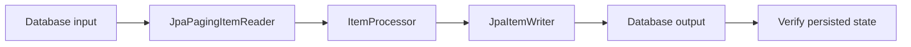

# Kiểm thử JPA batch

Spring Batch có thể dùng JPA để đọc entity theo trang, xử lý dữ liệu và ghi entity vào database. Khi một job chạy trên dữ liệu lớn, chỉ kiểm tra một repository hoặc một câu query riêng lẻ là chưa đủ. Cần kiểm thử cả cách reader phân trang, processor biến đổi entity, writer flush dữ liệu, transaction commit theo chunk và trạng thái restart được lưu trong JobRepository.

**Kiểm thử JPA batch** là kiểm tra hành vi của các thành phần JPA trong một luồng Spring Batch, từ reader đến writer và database thực tế. Một bộ test tốt thường có ba lớp:

- Unit test cho processor và logic mapping, không cần database.
- Integration test cho JPA reader/writer và repository với database kiểm thử.
- Job/step integration test để xác nhận transaction, chunk, skip, restart và kết quả cuối cùng.

Điểm dễ gây lỗi nhất là ranh giới transaction và persistence context. Test có thể đọc thấy entity trong first-level cache dù dữ liệu chưa commit; hoặc test method mở transaction riêng khiến dữ liệu setup chưa nhìn thấy từ transaction của job. Vì vậy, cần chủ động quản lý thời điểm seed dữ liệu, flush, clear và commit trước khi launch job.

## 1. Mục tiêu của kiểm thử JPA batch

Một job JPA thường có cấu trúc:



Các câu hỏi cần được trả lời bằng test:

- Reader có lấy đủ record và không bỏ sót qua ranh giới page không?
- JPQL, parameter binding và sort order có đúng không?
- Processor có biến đổi field hoặc filter item theo yêu cầu không?
- Writer có insert/update đúng entity và flush được constraint không?
- Chunk có commit/rollback đúng khi một item lỗi không?
- Generated ID, relationship và foreign key có được lưu đúng không?
- Job có thể restart từ checkpoint mà không đọc trùng hoặc bỏ sót dữ liệu không?
- Kết quả có đúng sau khi đọc lại từ database bằng một persistence context mới không?

Test không nên chỉ assert rằng JobExecution có BatchStatus.COMPLETED. Một job có thể hoàn tất nhưng vẫn ghi sai số lượng, sai giá trị hoặc không tạo được quan hệ mong đợi.

## 2. Ba lớp test nên có

| Lớp test | Thành phần | Mục tiêu |
|---|---|---|
| Unit test | Processor, mapper, rule nghiệp vụ | Kiểm tra logic thuần và các trường hợp biên |
| Component integration test | JpaPagingItemReader, JpaItemWriter, repository | Kiểm tra JPA query, mapping và persistence |
| Batch integration test | Job/Step cùng database | Kiểm tra chunk, transaction, listener, skip và restart |

Unit test thường chạy nhanh và không cần Spring context. Component integration test dùng database test để kiểm tra mapping thực. Batch integration test nạp cấu hình job thật và chạy qua JobLauncherTestUtils hoặc JobLauncher.

Không cần khởi động toàn bộ job chỉ để test một hàm tính toán trong processor. Ngược lại, không thể chứng minh restart hoặc commit behavior bằng một unit test gọi processor trực tiếp.

## 3. Dependencies cho Spring Batch test

Với Gradle, thêm module test của Spring Batch vào test scope:

```groovy
dependencies {
    testImplementation("org.springframework.batch:spring-batch-test")
    testImplementation("org.springframework.boot:spring-boot-starter-test")
}
```

Nếu dự án quản lý version bằng Spring Boot dependency management hoặc Spring Batch BOM, không cần tự gắn version khác với runtime. Test library phải tương thích với version Spring Batch đang dùng.

Các tiện ích thường dùng:

- SpringBatchTest: đăng ký test support cho Spring Batch.
- JobLauncherTestUtils: launch job hoặc một step để test.
- JobRepositoryTestUtils: dọn metadata execution trong test.
- StepScopeTestExecutionListener và JobScopeTestExecutionListener: hỗ trợ scoped bean trong test.
- StepScopeTestUtils: thực thi code trong StepExecutionContext giả lập.

Trong dự án không dùng Spring Boot, cần cấu hình ApplicationContext và Batch infrastructure theo cách của ứng dụng. Các test utility không tự tạo toàn bộ datasource, JobRepository hoặc transaction manager cho một cấu hình chưa có.

## 4. Kiểm thử processor không cần database

Processor nên được test độc lập khi logic không phụ thuộc JPA. Ví dụ processor chuyển trạng thái đơn hàng:

```java
public class OrderProcessor
        implements ItemProcessor<OrderEntity, OrderEntity> {

    @Override
    public OrderEntity process(OrderEntity item) {
        if (item.getAmount().signum() <= 0) {
            throw new InvalidOrderException("amount must be positive");
        }

        item.setStatus(OrderStatus.PROCESSED);
        return item;
    }
}
```

Unit test:

```java
class OrderProcessorTest {

    private final OrderProcessor processor = new OrderProcessor();

    @Test
    void marksValidOrderAsProcessed() throws Exception {
        OrderEntity input = new OrderEntity();
        input.setAmount(new BigDecimal("125.50"));
        input.setStatus(OrderStatus.NEW);

        OrderEntity result = processor.process(input);

        assertSame(input, result);
        assertEquals(OrderStatus.PROCESSED, result.getStatus());
    }

    @Test
    void rejectsNonPositiveAmount() {
        OrderEntity input = new OrderEntity();
        input.setAmount(BigDecimal.ZERO);

        assertThrows(
                InvalidOrderException.class,
                () -> processor.process(input));
    }
}
```

Test này xác nhận rule nghiệp vụ và không cần tạo EntityManager. Nếu processor gọi repository, clock hoặc service ngoài, inject dependency qua constructor và mock/fake dependency đó trong unit test.

## 5. Entity model dùng trong ví dụ

Ví dụ entity có khóa identity và một số field nghiệp vụ:

```java
@Entity
@Table(name = "orders")
public class OrderEntity {

    @Id
    @GeneratedValue(strategy = GenerationType.IDENTITY)
    private Long id;

    @Column(name = "source_ref", nullable = false, unique = true)
    private String sourceRef;

    @Column(nullable = false, precision = 18, scale = 2)
    private BigDecimal amount;

    @Enumerated(EnumType.STRING)
    @Column(nullable = false)
    private OrderStatus status;

    // Constructors, getters and setters
}
```

Với entity thật, test cần dùng đúng mapping, column constraint, enum strategy và relationship của ứng dụng. Nếu test chỉ tạo object Java mà không persist, nó không kiểm tra được schema hoặc hành vi của JPA provider.

Nên dùng migration schema giống production khi có thể. Schema tự sinh từ Hibernate có thể hữu ích cho test nhanh nhưng không phát hiện được mọi sai lệch giữa mapping entity và migration thực tế.

## 6. Kiểm thử JpaPagingItemReader

JpaPagingItemReader đọc entity bằng JPQL và chia kết quả thành các page. Test reader nên xác nhận:

- JPQL trả đúng tập record.
- Parameter binding hoạt động.
- Page size được áp dụng.
- Ranh giới page không làm mất hoặc lặp item.
- Sort order ổn định.
- Reader mở, đọc, cập nhật state và đóng đúng lifecycle.

Ví dụ cấu hình:

```java
@Bean
JpaPagingItemReader<OrderEntity> orderReader(
        EntityManagerFactory entityManagerFactory) {

    return new JpaPagingItemReaderBuilder<OrderEntity>()
            .name("orderReader")
            .entityManagerFactory(entityManagerFactory)
            .queryString("""
                    select o
                    from OrderEntity o
                    where o.status = :status
                    order by o.id
                    """)
            .parameterValues(Map.of(
                    "status",
                    OrderStatus.NEW))
            .pageSize(2)
            .saveState(true)
            .build();
}
```

Page size bằng 2 giúp test nhỏ vẫn đi qua nhiều page khi có từ ba record trở lên. Sort theo khóa duy nhất giúp thứ tự ổn định giữa các trang.

Với paging query, đừng bỏ ORDER BY nếu test hoặc job phụ thuộc vào thứ tự. Nếu sort theo một cột không duy nhất, hãy thêm khóa chính làm tie-breaker.

## 7. Test reader trực tiếp

Có thể kiểm thử reader mà không launch toàn job bằng cách mở stream, đọc đến hết và đóng reader:

```java
@Test
void readsAllMatchingOrdersAcrossPages() throws Exception {
    seedCommittedOrders();

    JpaPagingItemReader<OrderEntity> reader = createOrderReader();
    reader.afterPropertiesSet();

    ExecutionContext context = new ExecutionContext();
    reader.open(context);

    List<Long> ids = new ArrayList<>();
    try {
        OrderEntity item;
        while ((item = reader.read()) != null) {
            ids.add(item.getId());
        }
    } finally {
        reader.close();
    }

    assertEquals(List.of(1L, 2L, 3L), ids);
}
```

Đây là khung minh họa; ID cụ thể trong test nên được lấy từ fixture đã persist thay vì giả định sequence luôn bắt đầu từ 1.

Reader là ItemStreamReader nên cần open trước read và close sau khi dùng. Nếu muốn test restart, cần giữ ExecutionContext sau một số lần read, đóng reader, tạo reader mới rồi mở bằng context đã lưu theo đúng lifecycle.

## 8. Seed dữ liệu phải commit trước khi job đọc

Một lỗi phổ biến là tạo fixture trong transaction test rồi launch job ngay. Job có thể chạy trong transaction khác và không nhìn thấy dữ liệu chưa commit của test.

Ví dụ:

```java
transactionTemplate.executeWithoutResult(status -> {
    entityManager.persist(newOrder("SRC-1001"));
    entityManager.persist(newOrder("SRC-1002"));
    entityManager.flush();
});

JobExecution execution = jobLauncherTestUtils.launchJob(parameters);
```

TransactionTemplate commit khi callback kết thúc thành công. Khi đó job có thể đọc dữ liệu từ transaction riêng.

Nếu dùng TestEntityManager trong @DataJpaTest, nhớ rằng test slice thường chạy trong transaction và rollback sau test. Một reader dùng EntityManager khác có thể không thấy fixture chưa commit. Có thể seed bằng transaction đã commit riêng, hoặc thiết kế test slice phù hợp với mục tiêu.

Không dựa vào việc cùng JVM hoặc cùng DataSource để giả định mọi EntityManager đều nhìn thấy dữ liệu chưa commit. Isolation level và transaction boundary quyết định điều đó.

## 9. Kiểm thử JpaItemWriter

JpaItemWriter ghi item thông qua JPA EntityManager. Builder nhận EntityManagerFactory và có thể cấu hình việc dùng persist thay vì merge tùy loại item và lifecycle entity.

Ví dụ:

```java
@Bean
JpaItemWriter<OrderEntity> orderWriter(
        EntityManagerFactory entityManagerFactory) {

    return new JpaItemWriterBuilder<OrderEntity>()
            .entityManagerFactory(entityManagerFactory)
            .build();
}
```

Test writer nên xác nhận:

- Entity được insert hoặc update đúng theo semantics mong muốn.
- Generated ID được tạo khi flush/commit nếu dùng identity.
- Relationship và cascade hoạt động theo mapping.
- Constraint violation xuất hiện ở thời điểm flush/commit phù hợp.
- Không ghi duplicate do persist/merge bị dùng sai.

JpaItemWriter phải được chạy trong transaction của step hoặc một transaction test rõ ràng. Gọi writer ngoài transaction có thể không phản ánh cách step thật vận hành.

## 10. Persist và merge cần được kiểm thử đúng

JPA phân biệt hai thao tác:

- persist dùng cho entity mới chưa được quản lý.
- merge sao chép state của entity vào một managed instance và trả về instance được quản lý đó.

JpaItemWriterBuilder có tùy chọn usePersist để chọn hành vi phù hợp. Hãy xác định item là entity mới hay entity đã có khóa và cần cập nhật.

Ví dụ:

```java
new JpaItemWriterBuilder<OrderEntity>()
        .entityManagerFactory(entityManagerFactory)
        .usePersist(true)
        .build();
```

Chỉ bật persist khi input thực sự là entity mới và không có xung đột khóa. Nếu item đại diện entity detached cần cập nhật, merge thường là lựa chọn phù hợp hơn.

Đừng chỉ assert object truyền vào writer đã có ID sau khi write. Với merge, JPA có thể trả một managed copy khác; object input không nhất thiết được cập nhật giống instance được quản lý. Hãy query lại database để xác nhận trạng thái cuối.

## 11. Flush và clear khi xác nhận kết quả

JPA dùng persistence context (first-level cache). Một entity đã được load hoặc persist có thể vẫn tồn tại trong memory và làm test đọc lại cùng trạng thái cache thay vì trạng thái database.

Khi kiểm thử:

1. Flush để đẩy thay đổi pending xuống database.
2. Clear EntityManager hoặc dùng một EntityManager mới.
3. Query lại dữ liệu.

Ví dụ:

```java
entityManager.flush();
entityManager.clear();

OrderEntity saved = entityManager.find(OrderEntity.class, orderId);
assertEquals(OrderStatus.PROCESSED, saved.getStatus());
```

Với Spring Boot test, có thể dùng TestEntityManager.flush() và clear() trong JPA slice test. Với job integration test, nên query qua repository/JdbcTemplate sau khi job đã commit.

Flush không đồng nghĩa commit. Constraint có thể được kiểm tra ở flush, nhưng transaction vẫn có thể rollback sau đó. Nếu test cần xác nhận dữ liệu đã commit, hãy đọc trong transaction mới sau khi job kết thúc.

## 12. First-level cache có thể che giấu lỗi

Ví dụ test:

```java
OrderEntity order = entityManager.find(OrderEntity.class, id);
order.setStatus(OrderStatus.PROCESSED);

OrderEntity again = entityManager.find(OrderEntity.class, id);
assertEquals(OrderStatus.PROCESSED, again.getStatus());
```

Assertion này không chứng minh writer đã ghi database. Lần find thứ hai có thể trả đúng instance đang được quản lý trong persistence context.

Để kiểm tra kết quả thực sự:

```java
entityManager.flush();
entityManager.clear();

OrderEntity reloaded = entityManager.find(OrderEntity.class, id);
assertEquals(OrderStatus.PROCESSED, reloaded.getStatus());
```

Hoặc dùng transaction mới và query bằng repository/JdbcTemplate sau khi transaction chunk đã commit.

## 13. Transaction manager cho JPA batch

JPA reader/writer cần EntityManagerFactory và transaction semantics phù hợp. Step phải dùng transaction manager quản lý đúng persistence resource mà writer sử dụng.

Trong cấu hình JPA, thường dùng JpaTransactionManager cho EntityManagerFactory tương ứng. Nếu Batch metadata và dữ liệu nghiệp vụ dùng nhiều DataSource, cần xác định transaction manager nào quản lý chunk và transaction manager nào quản lý JobRepository.

Một số điểm cần kiểm tra:

- JpaItemWriter dùng đúng EntityManagerFactory.
- Transaction manager của step quản lý cùng persistence unit.
- Repository và writer không vô tình dùng DataSource khác.
- Nếu cần atomicity giữa batch metadata và business data, hiểu rõ cấu hình transaction thực tế.
- Nếu ghi nhiều database, không giả định một local transaction bao trùm tất cả.

Không chọn transaction manager chỉ dựa trên tên bean. Kiểm tra bean type, EntityManagerFactory và DataSource thực tế được inject.

## 14. Vì sao không nên đặt @Transactional tùy tiện trên job test?

Một test method có @Transactional thường mở transaction do test framework quản lý và rollback khi kết thúc test. Trong khi đó, chunk step cũng có transaction boundary riêng.

Nếu job được launch trong test-managed transaction:

- Fixture chưa commit có thể không hiển thị cho transaction của job.
- Writer có thể tham gia transaction hiện tại theo cách không mong đợi nếu cùng thread/manager.
- Assertion có thể chạy trước khi dữ liệu commit thật.
- Rollback cuối test có thể làm kết quả test khác với một job production độc lập.

Với full job integration test, thường dễ hiểu hơn nếu test method không được bọc trong transaction. Seed fixture bằng transaction riêng đã commit, launch job, sau đó query kết quả bằng transaction mới và dọn dữ liệu có chủ đích.

Với repository slice test, @Transactional là hành vi thuận tiện và phù hợp vì test thường tập trung vào một repository operation trong cùng transaction.

## 15. @DataJpaTest và @SpringBootTest khác nhau

| Annotation | Phạm vi | Phù hợp với |
|---|---|---|
| @DataJpaTest | JPA slice, entity/repository và database test | Mapping, JPQL, repository |
| @SpringBootTest | ApplicationContext gần ứng dụng thật | Job/step, Batch infrastructure, JPA integration |
| @SpringBatchTest | Batch test utilities và scoped test support | Launch job/step và test scope |

Ví dụ JPA slice:

```java
@DataJpaTest
class OrderRepositoryTest {

    @Autowired
    private OrderRepository orderRepository;

    @Autowired
    private TestEntityManager entityManager;

    @Test
    void findsOrdersByStatus() {
        entityManager.persistAndFlush(newOrder("SRC-1001"));

        List<OrderEntity> result =
                orderRepository.findByStatus(OrderStatus.NEW);

        assertEquals(1, result.size());
    }
}
```

Test này không tự động chứng minh Spring Batch job chạy đúng. @DataJpaTest là slice nên có thể không load Job, Step hoặc Batch infrastructure.

Với job integration test, dùng @SpringBootTest cùng @SpringBatchTest hoặc cấu hình Spring Test tương đương. Nếu muốn kết hợp slice với Batch, phải import rõ các configuration cần thiết và hiểu những bean bị slice filter loại bỏ.

## 16. Launch job bằng JobLauncherTestUtils

Spring Batch test module cung cấp JobLauncherTestUtils để chạy job từ test.

Ví dụ:

```java
@SpringBootTest
@SpringBatchTest
class JpaImportJobTest {

    @Autowired
    private JobLauncherTestUtils jobLauncherTestUtils;

    @Autowired
    private Job importOrdersJob;

    @BeforeEach
    void configureJob() {
        jobLauncherTestUtils.setJob(importOrdersJob);
    }

    @Test
    void importsOrdersSuccessfully() throws Exception {
        JobParameters parameters = new JobParametersBuilder()
                .addString("run.id", UUID.randomUUID().toString())
                .toJobParameters();

        JobExecution execution =
                jobLauncherTestUtils.launchJob(parameters);

        assertEquals(BatchStatus.COMPLETED, execution.getStatus());
        assertEquals(
                ExitStatus.COMPLETED.getExitCode(),
                execution.getExitStatus().getExitCode());
    }
}
```

Nếu application context có nhiều Job bean, setJob giúp utility biết job nào cần launch. JobParameters cần có identifying value mới khi muốn tạo JobInstance độc lập cho mỗi test.

Nếu job có parameter bắt buộc như input file, batch ID hoặc business date, test phải truyền đầy đủ. Không thêm parameter ngẫu nhiên nếu parameter đó ảnh hưởng query hoặc output path theo cách làm test mất tính xác định.

## 17. Launch riêng một step

Khi chỉ cần kiểm tra một step JPA, có thể dùng launchStep:

```java
JobExecution execution =
        jobLauncherTestUtils.launchStep(
                "importOrdersStep",
                new JobParametersBuilder()
                        .addString(
                                "run.id",
                                UUID.randomUUID().toString())
                        .toJobParameters());

assertEquals(BatchStatus.COMPLETED, execution.getStatus());
```

Launch step giúp tập trung vào reader, processor, writer và transaction của step đó mà không cần chạy toàn bộ flow của job.

Tuy nhiên, nếu step phụ thuộc dữ liệu trong JobExecutionContext được tạo bởi step trước, test cần chuẩn bị context hoặc chạy cả job. Đừng bỏ qua dependency đó rồi kết luận step hoạt động độc lập.

## 18. Kiểm tra StepExecution metrics

Sau khi job chạy, hãy kiểm tra StepExecution:

```java
StepExecution stepExecution = execution.getStepExecutions()
        .stream()
        .filter(step -> step.getStepName().equals("importOrdersStep"))
        .findFirst()
        .orElseThrow();

assertEquals(3, stepExecution.getReadCount());
assertEquals(3, stepExecution.getWriteCount());
assertEquals(0, stepExecution.getReadSkipCount());
assertEquals(0, stepExecution.getProcessSkipCount());
assertEquals(0, stepExecution.getWriteSkipCount());
```

Các counter hữu ích:

- readCount: số item reader trả về.
- writeCount: số item được ghi theo execution counter.
- filterCount: số item processor lọc bằng cách trả null.
- readSkipCount: số lỗi được skip khi đọc.
- processSkipCount: số lỗi được skip khi xử lý.
- writeSkipCount: số lỗi được skip khi ghi.
- commitCount và rollbackCount: số transaction commit/rollback của step.

Số liệu mong đợi phải phù hợp fixture. Nếu processor filter hoặc step có skip/retry, hãy assert từng counter thay vì chỉ kiểm tra tổng.

## 19. Kiểm tra dữ liệu sau job bằng persistence context mới

Ví dụ sau khi job hoàn tất:

```java
@Autowired
private JdbcTemplate jdbcTemplate;

@Test
void persistsProcessedOrders() throws Exception {
    seedCommittedOrders();

    JobExecution execution = launchImportJob();
    assertEquals(BatchStatus.COMPLETED, execution.getStatus());

    Integer count = jdbcTemplate.queryForObject(
            "select count(*) from orders where status = ?",
            Integer.class,
            "PROCESSED");

    assertEquals(3, count);
}
```

JdbcTemplate query sau job đọc trạng thái từ database thay vì trả entity đã nằm trong persistence context của test. Có thể dùng repository trong transaction mới nếu muốn assert domain object và relationship.

Nếu test dùng JPA EntityManager trực tiếp, hãy clear hoặc tạo EntityManager mới trước khi query lại. Không chỉ assert state của object ban đầu đã truyền qua processor.

## 20. Kiểm thử page boundary

Reader paging cần test số lượng record lớn hơn page size để thực sự đi qua nhiều page.

Ví dụ:

- Seed 5 entity có status NEW.
- Cấu hình pageSize = 2.
- Đọc hết reader.
- Mong đợi 5 item, không duplicate và không missing.

Kiểm tra:

| Page | Expected IDs |
|---|---|
| 1 | 1, 2 |
| 2 | 3, 4 |
| 3 | 5 |

Các ID chỉ minh họa. Test nên lấy ID thực từ fixture hoặc sort theo source reference có thứ tự ổn định.

Nếu page size bằng hoặc lớn hơn tổng dữ liệu, test không kiểm tra được logic chuyển trang. Hãy chọn page size nhỏ hơn số record và có ít nhất một trang cuối không đầy.

## 21. Kiểm thử JPQL và parameter binding

Một reader có thể trả đúng số lượng nhưng dùng sai filter hoặc parameter. Hãy seed record ở nhiều trạng thái và xác nhận chỉ record phù hợp được đọc.

Ví dụ JPQL:

```java
select o
from OrderEntity o
where o.status = :status
  and o.createdAt < :cutoff
order by o.id
```

Test nên có:

- Record thỏa cả hai điều kiện.
- Record sai status.
- Record có createdAt sau cutoff.
- Record ở đúng boundary theo quy tắc so sánh.
- Record có field nullable nếu query có xử lý null.

Với JPQL có join, fetch join hoặc entity graph, hãy xác nhận không có duplicate root entity và không phát sinh N+1 query ngoài dự kiến. Fetch join collection kết hợp pagination có thể có semantics/hiệu năng khác theo JPA provider; kiểm thử với dữ liệu có nhiều child record.

## 22. Kiểm thử writer insert và update

JpaItemWriter có thể ghi entity mới hoặc cập nhật entity detached tùy cách cấu hình persist/merge.

Test nên có hai tình huống riêng:

### Insert entity mới

- ID ban đầu null nếu dùng generated identity.
- Writer insert entity.
- Flush/commit tạo row.
- Query lại xác nhận ID và field.

### Update entity đã tồn tại

- Seed entity và commit.
- Tạo item detached hoặc đọc entity theo cách phù hợp.
- Thay đổi field.
- Writer merge item.
- Query lại bằng EntityManager mới để xác nhận update.

Không trộn hai mục tiêu vào một test nếu cần xác định rõ persist/merge semantics. Một entity có ID nhưng không tồn tại trong database có thể có hành vi khác với entity mới và cần được kiểm tra theo JPA provider.

## 23. Kiểm thử relationship và cascade

JPA batch thường ghi entity có quan hệ ManyToOne, OneToMany hoặc ManyToMany. Test cần xác nhận:

- Foreign key được ghi đúng.
- Cascade type phù hợp với lifecycle.
- Child entity có được persist hay không.
- Không tạo duplicate parent khi merge graph.
- Không vô tình xóa child do orphanRemoval.
- Fetch strategy không tạo N+1 query nghiêm trọng.

Ví dụ:

```java
@Entity
class OrderLine {

    @Id
    @GeneratedValue(strategy = GenerationType.IDENTITY)
    private Long id;

    @ManyToOne(fetch = FetchType.LAZY, optional = false)
    @JoinColumn(name = "order_id")
    private OrderEntity order;
}
```

Sau job, query bảng order_line và join với orders để xác nhận mỗi line trỏ đến đúng parent. Không chỉ assert collection trên object gốc vì collection đó có thể vẫn nằm trong persistence context cũ.

## 24. Kiểm thử constraint và lỗi flush

Một số lỗi JPA chỉ xuất hiện khi flush hoặc commit:

- NOT NULL violation.
- Unique constraint violation.
- Foreign key violation.
- Column length/precision overflow.
- Optimistic locking conflict.
- Entity state không hợp lệ.

Test nên cố tình tạo một input vi phạm constraint để xác định exception xuất hiện ở phase nào và skip policy có xử lý đúng không.

Ví dụ, nếu writer flush ở cuối chunk, lỗi constraint có thể xuất hiện trong write call hoặc lúc transaction commit tùy provider. Không giả định mọi lỗi database đều được ném ngay khi gọi persist.

Nếu step dùng skip policy, kiểm tra đúng loại exception được Spring Batch nhìn thấy sau khi exception được translate/wrap. Không skip quá rộng mọi PersistenceException nếu điều đó có thể che lỗi schema hoặc hạ tầng.

## 25. Kiểm thử skip và filter trong JPA step

Phân biệt:

- Processor trả null: filter item, tăng filterCount.
- Processor ném exception skippable: process skip.
- Writer ném exception skippable: write skip nếu framework có thể xác định item gây lỗi theo cấu hình.
- Constraint/hạ tầng không được phép skip: step fail.

Với lỗi writer, một batch write có thể chứa nhiều item. Tùy writer và chế độ fault tolerance, Spring Batch có thể cần rollback và xác định item gây lỗi. Test nên dùng database thật/test dialect tương thích và xác nhận record nào được ghi, record nào bị reject.

Nếu dùng skip listener để ghi reject data, kiểm tra transaction của listener và tính idempotent khi chunk rollback/retry.

## 26. Kiểm thử rollback của chunk

Để xác nhận transaction, tạo test với chunk chứa một số item hợp lệ và một item gây lỗi không được skip:

1. Reader trả các item trong chunk.
2. Processor hoặc writer gây lỗi.
3. Step rollback chunk.
4. Query database trong transaction mới.
5. Xác nhận các thay đổi của chunk thất bại không tồn tại.
6. Xác nhận các chunk đã commit trước đó vẫn tồn tại.

Ví dụ:

```text
Chunk 1: items 1-2 -> commit
Chunk 2: items 3-4 -> rollback vì item 4 lỗi
Chunk 3: chưa chạy
```

Kết quả kỳ vọng là dữ liệu của chunk 1 còn trong database, dữ liệu chunk 2 bị rollback nếu cùng transaction, chunk 3 chưa được xử lý.

Đừng kiểm tra rollback bằng entity object đã được giữ trong memory. Dùng transaction mới hoặc JDBC query sau khi transaction lỗi kết thúc.

## 27. Kiểm thử restart và ExecutionContext

JpaPagingItemReader hỗ trợ lưu state khi saveState được bật và reader có name ổn định. Restart test cần xác nhận reader tiếp tục từ vị trí checkpoint sau khi job thất bại.

Một kịch bản:

1. Seed nhiều record hơn một page.
2. Cấu hình page size và chunk size nhỏ.
3. Cho một writer/test processor cố tình fail sau khi một số chunk đã commit.
4. Xác nhận StepExecution lưu ExecutionContext.
5. Restart cùng JobInstance bằng cùng identifying JobParameters.
6. Xác nhận reader tiếp tục đúng vị trí.
7. Kiểm tra toàn bộ output không thiếu và không duplicate.

Giữ các giá trị sau ổn định qua restart:

- Reader name.
- Query và parameter.
- Sort order.
- Page size và cách phân trang.
- Identifying JobParameters.
- Cấu hình writer và business key.

Nếu thay đổi query, sort key hoặc tập dữ liệu nguồn giữa lần chạy đầu và restart, checkpoint cũ có thể không còn đại diện đúng vị trí dữ liệu.

## 28. Dữ liệu nguồn thay đổi trong lúc paging

Paging reader thường dựa vào query và thứ tự để lấy các trang kế tiếp. Nếu dữ liệu nguồn bị insert/delete hoặc thay đổi sort key trong khi job chạy, kết quả các page query có thể thay đổi.

Test nên mô phỏng hoặc xác định chính sách:

- Input được chốt theo batch ID hoặc business date.
- Sort key duy nhất và bất biến.
- Isolation level phù hợp với yêu cầu.
- Dữ liệu nguồn không bị thay đổi trong cửa sổ xử lý, hoặc thay đổi được xử lý theo contract.

Không cho rằng saveState tự tạo snapshot dữ liệu. SaveState lưu vị trí/checkpoint; consistency của tập dữ liệu phụ thuộc database transaction/isolation và query design.

## 29. Kiểm thử @StepScope và JobParameters

Reader/writer có thể dùng @StepScope để bind JobParameters:

```java
@Bean
@StepScope
JpaPagingItemReader<OrderEntity> orderReader(
        EntityManagerFactory entityManagerFactory,
        @Value("#{jobParameters['batchId']}") String batchId) {

    return new JpaPagingItemReaderBuilder<OrderEntity>()
            .name("orderReader")
            .entityManagerFactory(entityManagerFactory)
            .queryString("""
                    select o
                    from OrderEntity o
                    where o.batchId = :batchId
                    order by o.id
                    """)
            .parameterValues(Map.of("batchId", batchId))
            .pageSize(100)
            .saveState(true)
            .build();
}
```

Khi test scoped bean trực tiếp, cần có StepExecution context để SpEL phân giải jobParameters. SpringBatchTest đăng ký StepScopeTestExecutionListener; cũng có thể dùng StepScopeTestUtils để chạy code trong một StepExecution được tạo cho test.

Nếu không có scope context, lỗi có thể xuất hiện khi lấy bean thay vì khi gọi read. Đó là lỗi setup test, không phải lỗi JPQL.

## 30. Test step-scoped reader với StepScopeTestUtils

Ví dụ minh họa:

```java
StepExecution stepExecution =
        MetaDataInstanceFactory.createStepExecution(
                new JobParametersBuilder()
                        .addString("batchId", "BATCH-100")
                        .toJobParameters());

List<OrderEntity> items =
        StepScopeTestUtils.doInStepScope(stepExecution, () -> {
            JpaPagingItemReader<OrderEntity> reader =
                    applicationContext.getBean("orderReader",
                            JpaPagingItemReader.class);

            reader.open(new ExecutionContext());
            try {
                List<OrderEntity> result = new ArrayList<>();
                OrderEntity item;
                while ((item = reader.read()) != null) {
                    result.add(item);
                }
                return result;
            } finally {
                reader.close();
            }
        });
```

Đây là khung minh họa; bean name, generic type và cách khởi tạo StepExecution phải khớp dự án. Test cần seed record có batchId tương ứng và commit trước khi reader chạy.

## 31. JobRepositoryTestUtils và cleanup

JobRepositoryTestUtils giúp xóa job/step execution metadata sau test:

```java
@Autowired
private JobRepositoryTestUtils jobRepositoryTestUtils;

@AfterEach
void cleanBatchMetadata() {
    jobRepositoryTestUtils.removeJobExecutions();
}
```

Utility này dọn metadata của Spring Batch; nó không tự xóa entity nghiệp vụ trong các bảng orders hoặc order_lines. Cần cleanup business tables riêng theo thứ tự tôn trọng foreign key.

Ví dụ:

```java
@AfterEach
void cleanBusinessData() {
    jdbcTemplate.update("delete from order_lines");
    jdbcTemplate.update("delete from orders");
}
```

Trong dự án có nhiều test chạy song song, không xóa toàn bộ bảng dùng chung nếu test khác có thể đang chạy. Dùng batch ID/test ID riêng và xóa đúng dữ liệu của test đó.

## 32. Chọn database test: H2 hay Testcontainers?

H2 phù hợp cho test nhanh khi query, mapping và DDL dùng các tính năng tương thích. Nhưng database in-memory có dialect, type mapping, identity, locking và constraint behavior khác database production.

Testcontainers giúp chạy database thực tế trong container:

| Lựa chọn | Ưu điểm | Giới hạn |
|---|---|---|
| H2 | Nhanh, setup đơn giản | Không đại diện đầy đủ dialect production |
| Testcontainers | Kiểm tra driver và database thật | Chậm hơn, cần Docker/runtime container |
| Database dùng chung cho test | Có thể sát môi trường tích hợp | Cần cô lập dữ liệu và cleanup cẩn thận |

Nếu job phụ thuộc vào native query, sequence, identity, JSON column, locking hoặc generated key behavior, hãy có integration test trên đúng loại database và JDBC driver production.

Không dùng H2 để kết luận một JPQL/native query chắc chắn hoạt động giống PostgreSQL, Oracle, SQL Server hoặc MySQL.

## 33. Dùng migration thật trong integration test

Nếu production dùng Flyway hoặc Liquibase, hãy chạy migration tương ứng trong test để schema phản ánh môi trường thật.

Kiểm tra:

- Column type và precision.
- Primary key/sequence/identity.
- Unique và foreign key constraints.
- Index phục vụ paging query.
- Default và trigger.
- Enum/string representation.
- Version của schema.

Hibernate ddl-auto=create-drop có thể thuận tiện cho test entity đơn giản, nhưng có thể che mất lỗi migration hoặc khác biệt giữa entity mapping và schema production.

## 34. Kiểm thử hiệu năng và N+1 query

Một test chức năng có thể pass nhưng reader vẫn chạy chậm vì:

- Page size quá nhỏ hoặc quá lớn.
- Query thiếu index.
- Processor truy vấn repository cho từng item.
- Lazy relationship gây N+1 query.
- Writer flush quá thường xuyên hoặc chunk size không phù hợp.

Có thể theo dõi SQL log, Hibernate statistics hoặc datasource metrics trong một performance/integration test riêng. Tránh assert chính xác số query nếu provider/version có thể thay đổi số query nội bộ, trừ khi query count là một contract quan trọng được kiểm soát.

Ví dụ N+1:

```java
for (OrderEntity order : orders) {
    String customerName = order.getCustomer().getName();
}
```

Nếu customer là LAZY và không được fetch cùng query, mỗi lần truy cập có thể phát sinh thêm query. Dùng projection, entity graph hoặc fetch strategy phù hợp và đo trên dữ liệu nhiều item.

Không thêm fetch join collection một cách tùy tiện vào paged query. Join collection có thể nhân bản root rows hoặc khiến pagination được thực hiện trong memory tùy provider. Kiểm thử SQL và kết quả với dataset có nhiều child.

## 35. Kiểm thử optimistic locking và concurrent update

Nếu entity dùng @Version, test cần xác nhận optimistic locking conflict được xử lý theo policy:

```java
@Version
private long version;
```

Một transaction đọc version cũ; transaction khác cập nhật entity và commit; transaction đầu cố ghi lại có thể nhận optimistic locking exception.

Trong batch:

- Xác định conflict là lỗi retryable, skippable hay làm step fail.
- Kiểm tra exception thực tế được JPA provider/Spring translate.
- Xác nhận retry không ghi đè thay đổi mới.
- Không retry vô hạn khi conflict là do dữ liệu liên tục bị cập nhật.

Test concurrency cần dùng transaction và thread thực sự riêng; một unit test tuần tự không mô phỏng được optimistic locking race.

## 36. Kiểm thử lazy loading và detached entity

JpaPagingItemReader có lifecycle EntityManager riêng và có thể trả về entity không còn được quản lý trong persistence context của reader sau khi page được đọc. Vì vậy, code không nên giả định lazy relationship luôn truy cập được trong processor.

Test nên kiểm tra:

- Processor có truy cập lazy association không?
- Reader query có fetch đủ dữ liệu cần dùng không?
- Có cần DTO projection thay vì entity không?
- Có LazyInitializationException khi xử lý item không?
- Writer dùng merge/persist có phù hợp với detached entity không?

Nếu processor cần nhiều dữ liệu liên quan, có thể dùng JPQL projection/DTO hoặc fetch strategy có kiểm soát. Tránh mở rộng transaction hoặc persistence context chỉ để che một query design kém hiệu quả.

## 37. Test lỗi writer và constraint translation

JPA provider có thể bọc SQLException trong PersistenceException, ConstraintViolationException hoặc exception Spring đã translate. Test cần kiểm tra loại exception thực tế mà skip policy nhận được.

Ví dụ step cấu hình skip:

```java
.faultTolerant()
.skip(DataIntegrityViolationException.class)
.skipLimit(10)
```

Chỉ cấu hình skip exception khi nghiệp vụ cho phép bỏ record vi phạm constraint. Nếu lỗi là schema mismatch, thiếu bảng hoặc database unavailable, skip có thể che lỗi hệ thống và làm job hoàn tất với dữ liệu thiếu.

Hãy test cả:

- Một record vi phạm unique constraint.
- Nhiều record trong cùng chunk có một record lỗi.
- Lỗi xuất hiện ở flush/commit.
- Skip listener ghi reject đúng.
- Chunk rollback và các item hợp lệ được xử lý lại theo policy.

## 38. Kiểm thử JobParameters và tính lặp lại

Batch job thường dùng identifying JobParameters để xác định JobInstance. Test chạy cùng identifying parameters lần thứ hai có thể nhận JobInstanceAlreadyCompleteException nếu job đã hoàn tất.

Dùng một run ID hoặc batch ID mới cho mỗi test case độc lập:

```java
JobParameters parameters = new JobParametersBuilder()
        .addString("batchId", "TEST-" + UUID.randomUUID())
        .toJobParameters();
```

Với restart test, ngược lại, phải dùng lại đúng identifying parameters của lần chạy thất bại. Đừng tạo batch ID mới khi mục tiêu là resume cùng JobInstance.

Nếu output hoặc query phụ thuộc batchId, seed fixture với cùng giá trị và xác nhận job không đọc dữ liệu của batch khác.

## 39. Cấu trúc một full job integration test

Ví dụ khung tổng thể:

```java
@SpringBootTest
@SpringBatchTest
class JpaOrderJobIntegrationTest {

    @Autowired
    private JobLauncherTestUtils jobLauncherTestUtils;

    @Autowired
    private JobRepositoryTestUtils jobRepositoryTestUtils;

    @Autowired
    private JdbcTemplate jdbcTemplate;

    @Autowired
    private Job importOrdersJob;

    @BeforeEach
    void setUp() {
        jobLauncherTestUtils.setJob(importOrdersJob);
        cleanBusinessRows();
        seedCommittedRows();
    }

    @Test
    void processesNewOrders() throws Exception {
        JobParameters parameters = new JobParametersBuilder()
                .addString("batchId", "TEST-ORDERS-01")
                .addString("run.id", UUID.randomUUID().toString())
                .toJobParameters();

        JobExecution execution =
                jobLauncherTestUtils.launchJob(parameters);

        assertEquals(BatchStatus.COMPLETED, execution.getStatus());

        StepExecution step = execution.getStepExecutions()
                .stream()
                .filter(item ->
                        item.getStepName().equals("processOrdersStep"))
                .findFirst()
                .orElseThrow();

        assertEquals(3, step.getReadCount());
        assertEquals(3, step.getWriteCount());

        Integer processed = jdbcTemplate.queryForObject(
                """
                select count(*)
                from orders
                where batch_id = ?
                  and status = ?
                """,
                Integer.class,
                "TEST-ORDERS-01",
                "PROCESSED");

        assertEquals(3, processed);
    }

    @AfterEach
    void tearDown() {
        cleanBusinessRows();
        jobRepositoryTestUtils.removeJobExecutions();
    }

    private void cleanBusinessRows() {
        jdbcTemplate.update(
                "delete from orders where batch_id like 'TEST-%'");
    }

    private void seedCommittedRows() {
        // Seed trong transaction riêng đã commit trước khi launch.
    }
}
```

Đây là skeleton minh họa. Trong test thật, cleanup cần xóa child table trước parent table; fixture phải được commit trước launch; batch ID phải duy nhất theo test; và query assertion cần khớp schema ứng dụng.

## 40. Test job chạy bất đồng bộ

JobLauncherTestUtils thường dùng launcher đồng bộ trong test configuration đơn giản, nhưng ứng dụng có thể cấu hình task executor bất đồng bộ. Khi đó launchJob có thể trả JobExecution trước khi job kết thúc.

Nếu launcher bất đồng bộ:

- Không assert COMPLETED ngay sau khi launch trả về.
- Chờ trạng thái terminal với timeout hữu hạn.
- Không dùng sleep cố định dài nếu có thể dùng polling condition có timeout.
- Khi timeout, in JobExecution/StepExecution status và failure exceptions để chẩn đoán.

Tốt nhất, cấu hình test launcher đồng bộ nếu mục tiêu là kiểm thử kết quả cuối của job và không cần test async behavior. Nếu async là một phần yêu cầu, hãy có test riêng cho lifecycle đó.

## 41. Kiểm thử JobRepository metadata và business data riêng

JobRepository lưu metadata như JobInstance, JobExecution, StepExecution và ExecutionContext. JPA entity nghiệp vụ nằm trong các bảng ứng dụng.

Hai nhóm dữ liệu cần cleanup và assertion riêng:

| Dữ liệu | Nơi lưu | Cách kiểm tra |
|---|---|---|
| JobExecution/StepExecution | Batch metadata tables | JobRepositoryTestUtils hoặc repository |
| Entity nghiệp vụ | Các bảng JPA | Repository, EntityManager mới hoặc JdbcTemplate |
| Checkpoint | ExecutionContext | StepExecution execution context |
| Reject/error record | Bảng reject hoặc resource lỗi | Query theo batch ID/source key |

JobRepositoryTestUtils không thay thế cleanup bảng nghiệp vụ. Tương tự, xóa bảng orders không xóa JobExecution metadata.

## 42. Những lỗi thường gặp

**Chỉ assert JobExecution COMPLETED.** Job có thể hoàn tất nhưng ghi sai dữ liệu hoặc sai số lượng. Assert thêm StepExecution counters và database state.

**Seed fixture trong test transaction chưa commit.** Transaction của job có thể không nhìn thấy dữ liệu. Commit fixture trước khi launch.

**Query lại trong cùng persistence context.** First-level cache có thể che giấu dữ liệu chưa flush/commit. Flush, clear hoặc dùng transaction mới.

**Dùng @DataJpaTest để kết luận cả job chạy đúng.** JPA slice không tự load Batch infrastructure. Dùng @SpringBootTest và @SpringBatchTest cho job integration.

**Không kiểm thử nhiều page.** Page size lớn hơn toàn bộ fixture không đi qua ranh giới page. Seed nhiều item hơn page size.

**Không có ORDER BY ổn định.** Paging có thể cho thứ tự không xác định và làm test/restart khó tin cậy. Dùng sort key duy nhất.

**Dùng transaction manager không quản lý EntityManagerFactory của writer.** Flush/commit có thể không theo transaction mong muốn. Kiểm tra wiring của persistence unit và step.

**Nhầm flush với commit.** Flush gửi SQL nhưng transaction vẫn có thể rollback. Xác nhận kết quả từ transaction mới.

**Không test persist và merge riêng.** Entity mới và detached entity cần semantics khác nhau. Chọn usePersist theo input lifecycle và test cả insert/update.

**Dùng H2 cho tính năng đặc thù database.** Test có thể pass nhưng production fail do dialect/driver. Dùng Testcontainers cho database mục tiêu.

**Bỏ qua lazy loading và N+1.** Job có thể đúng nhưng rất chậm hoặc lỗi LazyInitializationException. Test query strategy và association cần dùng.

**Restart với JobParameters mới.** Đây là JobInstance mới, không kiểm tra resume. Dùng lại identifying parameters của lần chạy lỗi.

**Cleanup toàn bảng khi test chạy song song.** Có thể xóa dữ liệu của test khác. Cô lập fixture theo batch/test ID.

**Skip mọi PersistenceException.** Có thể che lỗi schema hoặc hạ tầng. Chỉ skip exception được xác định là lỗi record có thể loại bỏ.

## 43. Quy trình xây dựng test suite JPA batch

Khi thêm một job dùng JPA, có thể triển khai test theo thứ tự:

1. Unit test processor và mapping thuần.
2. JPA repository test cho JPQL và constraint.
3. Reader test với page size nhỏ và fixture đã commit.
4. Writer test cho insert, update, relationship và generated key.
5. Step integration test cho chunk, transaction, filter và skip.
6. Full job integration test cho parameters, flow và output cuối.
7. Restart test cho ExecutionContext và checkpoint.
8. Database-specific test bằng đúng engine/driver nếu dùng query hoặc feature đặc thù.
9. Performance test cho page size, chunk size, N+1 và query plan khi quy mô dữ liệu yêu cầu.

Không nhất thiết mọi job nhỏ đều cần tất cả lớp test với cùng độ sâu. Nhưng job có restart, nhiều quan hệ hoặc dữ liệu quan trọng cần test transaction và persisted output một cách rõ ràng.

## 44. Kết luận thực hành

Kiểm thử JPA batch cần xác nhận cả logic JPA lẫn lifecycle của Spring Batch. Unit test phù hợp với processor và rule nghiệp vụ; repository/reader/writer test kiểm tra JPQL, mapping và persistence; job integration test kiểm tra chunk, transaction, skip, restart và dữ liệu cuối cùng.

Hãy chú ý persistence context và transaction boundary: seed dữ liệu trong transaction đã commit trước khi launch, flush/clear hoặc query bằng EntityManager mới khi xác nhận kết quả, và không đặt @Transactional tùy tiện quanh full job test. Dùng page size nhỏ để kiểm tra nhiều trang, sort key ổn định, kiểm tra StepExecution counters và xác nhận business data từ database sau commit.

Với các tính năng phụ thuộc dialect, sequence, identity, locking hoặc native query, hãy chạy test trên đúng database và JDBC driver production bằng Testcontainers hoặc môi trường tích hợp tương đương. Khi test bao phủ reader, processor, writer, transaction và restart, kết quả mới cho thấy job không chỉ chạy hết mà còn ghi đúng dữ liệu và có thể phục hồi an toàn.
