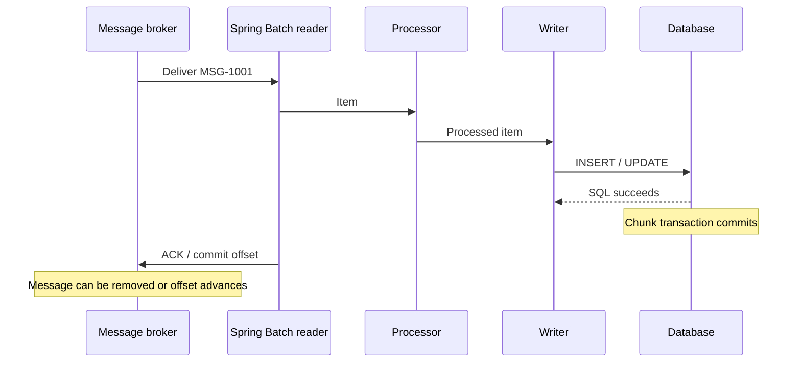
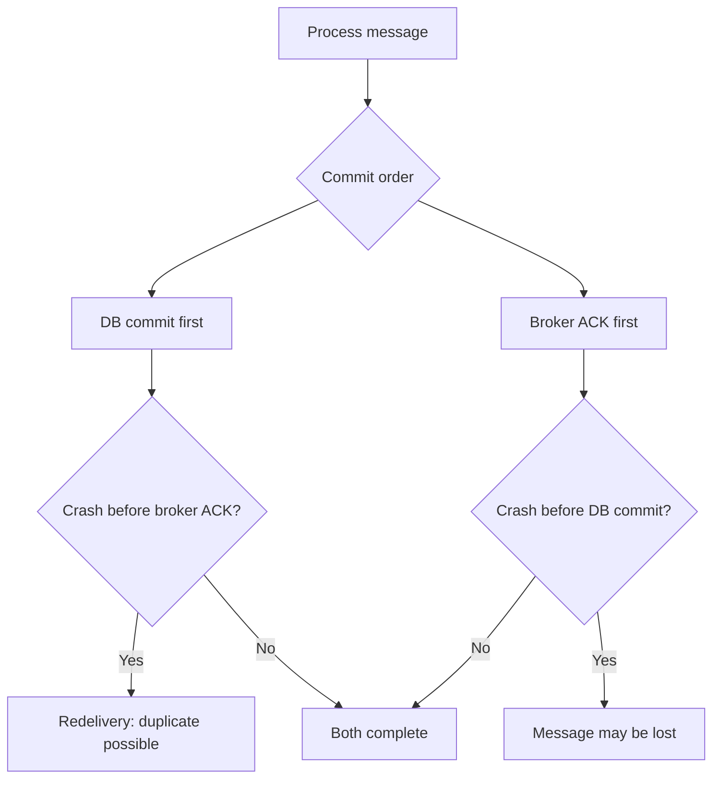
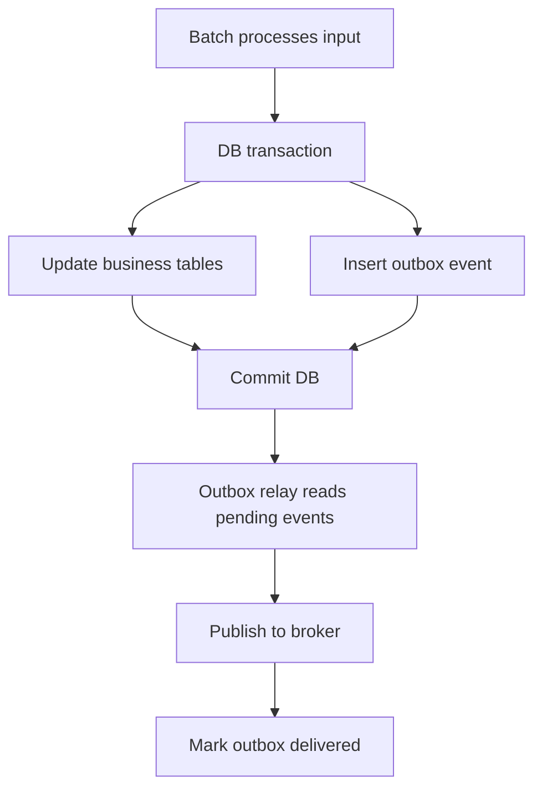
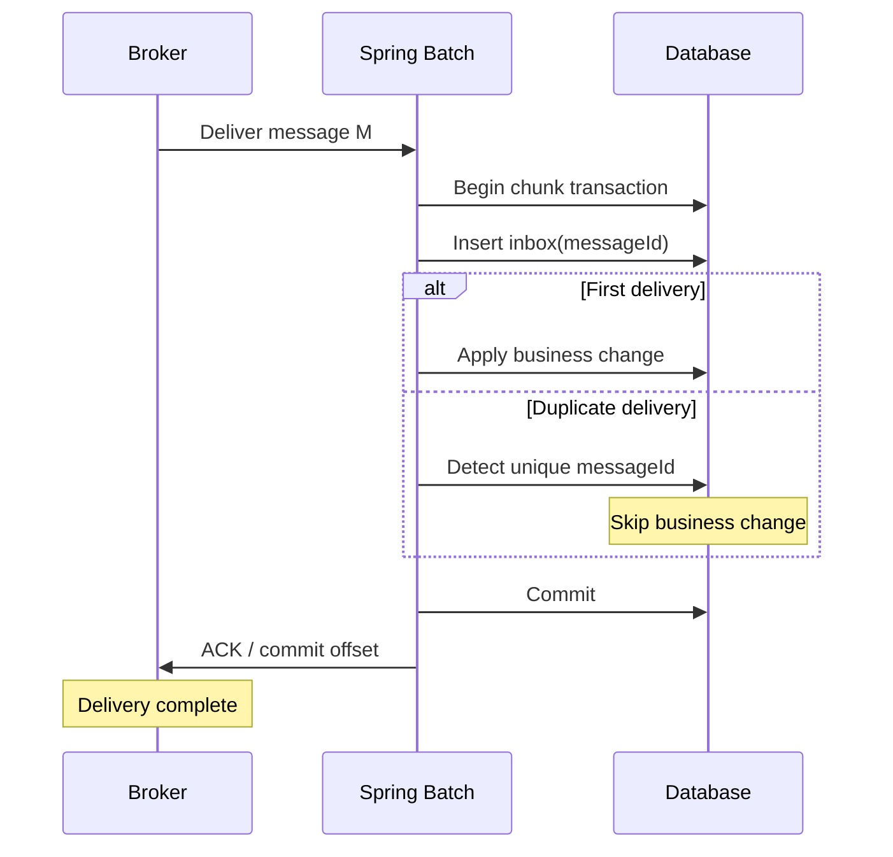

# Batch commit và broker commit

Khi Spring Batch xử lý message từ Kafka, RabbitMQ, JMS hoặc một message broker khác, có ít nhất hai trạng thái cần được quản lý: dữ liệu nghiệp vụ đã được commit vào database và message đã được broker xác nhận là đã xử lý. Hai thao tác này thường được gọi là **batch/database commit** và **broker commit** (hoặc acknowledgment/offset commit tùy broker).

Hai thao tác có mục tiêu khác nhau:

- **Batch commit** xác nhận transaction của chunk đã hoàn tất. Các thay đổi nghiệp vụ trong database được commit theo transaction manager của step.
- **Broker commit** xác nhận message đã được tiêu thụ hoặc offset đã được lưu. Broker dựa vào trạng thái này để quyết định có giao lại message hay không.

Nếu hai thao tác không cùng một transaction nguyên tử, có một khoảng thời gian mà một bên đã commit còn bên kia chưa commit. Đây là nguồn gốc của duplicate processing hoặc message loss.

Vì vậy, khi thiết kế message processing bằng Spring Batch, không nên chỉ hỏi “chunk commit khi nào?”. Cần xác định reader nhận message theo cách nào, broker ack/offset được thực hiện ở đâu, transaction manager nào quản lý mỗi resource và điều gì xảy ra nếu process chết giữa hai lần commit.

## 1. Hai loại commit giải quyết hai việc khác nhau

Giả sử một job đọc message yêu cầu tạo đơn hàng:

1. Broker giao message MSG-1001.
2. Spring Batch đọc và chuyển message thành item.
3. Processor validate và tạo dữ liệu đơn hàng.
4. Writer insert đơn hàng vào database.
5. Chunk transaction commit.
6. Broker được xác nhận message đã xử lý.

Batch commit làm dữ liệu nghiệp vụ bền vững. Broker commit/ack làm cho message không tiếp tục được giao như một message chưa xử lý.



Sơ đồ mô tả thứ tự mong muốn trong một thiết kế thường gặp. Thứ tự thực tế phụ thuộc reader, listener container, transaction manager và broker integration. Không phải mọi ItemReader đều đợi đến chunk commit mới ack message.

## 2. Batch commit là gì?

Trong chunk-oriented step, Spring Batch đọc và xử lý item theo từng nhóm. Với chunk size là 100, step thường đọc tối đa 100 item, xử lý chúng, gọi writer rồi commit transaction của chunk nếu mọi thao tác thành công.

Ví dụ:

```java
return new StepBuilder("consumeMessagesStep", jobRepository)
        .<IncomingMessage, Order>chunk(100, transactionManager)
        .reader(messageReader)
        .processor(messageProcessor)
        .writer(orderWriter)
        .build();
```

Ở đây transactionManager quản lý transaction cho chunk theo cấu hình của ứng dụng. Nếu writer dùng JDBC/JPA và cùng resource được transaction manager quản lý, thay đổi database có thể commit hoặc rollback theo chunk.

Batch commit thường bao gồm:

- Insert/update/delete dữ liệu nghiệp vụ.
- Ghi các bảng inbox/deduplication nếu dùng cùng database transaction.
- Cập nhật checkpoint/ExecutionContext theo lifecycle của Spring Batch và JobRepository.
- Commit transaction do step quản lý.

Batch commit không tự động có nghĩa broker đã ack message. JobRepository cũng không phải message broker; metadata của job và offset/ack của broker là hai loại state khác nhau.

## 3. Broker commit có nghĩa gì?

“Broker commit” là cách gọi tổng quát. API cụ thể khác nhau theo broker:

| Công nghệ | Thao tác thường gặp | Ý nghĩa |
|---|---|---|
| Kafka | Commit consumer offset | Lưu vị trí consumer group đã xử lý đến đâu |
| RabbitMQ | ACK delivery | Xác nhận một delivery đã được xử lý |
| JMS transacted session | Session commit | Commit giao dịch JMS, bao gồm ack các message đã nhận trong session |
| JMS CLIENT_ACKNOWLEDGE | Message/session acknowledge theo semantics JMS | Xác nhận message đã được tiêu thụ |

Không nên dùng từ “commit offset” cho RabbitMQ hoặc gọi ACK của JMS là Kafka offset. Dù mục tiêu gần nhau, semantics và failure behavior không giống nhau.

### Kafka offset

Kafka lưu message trong partition theo offset. Consumer group commit offset để broker biết vị trí tiếp theo cần đọc khi consumer khởi động hoặc rebalance.

Nếu consumer xử lý đến offset 105 và commit offset tiếp theo là 106, consumer group có thể tiếp tục từ 106. Offset commit không xóa record khỏi log; retention policy quyết định record được giữ bao lâu.

### RabbitMQ acknowledgment

RabbitMQ giao message cho consumer. Khi consumer gửi ACK, broker có thể loại message khỏi queue. Nếu consumer/channel đóng trước ACK, message chưa được xác nhận có thể được requeue và giao lại tùy cấu hình.

ACK thường gắn với delivery tag trên channel. Delivery tag không phải business ID và không nên lưu như một identifier bền vững của message.

### JMS acknowledgment/transaction

Với JMS transacted session, commit session xác nhận các message đã nhận trong transaction và commit các message được gửi trong cùng session transaction. Với chế độ acknowledge khác, thời điểm và phạm vi acknowledge phụ thuộc chế độ session và provider.

Một JMS transaction cục bộ không tự động bao gồm transaction database nếu không có cơ chế phối hợp phù hợp.

## 4. Vì sao hai commit có thể lệch nhau?

Database và broker thường là hai resource độc lập. Một local database transaction chỉ commit database; một broker acknowledgment chỉ cập nhật trạng thái tiêu thụ trên broker.

Nếu ứng dụng thực hiện hai thao tác tuần tự:

1. Commit database.
2. Ack message.

thì process có thể dừng sau bước 1 và trước bước 2. Database đã lưu kết quả nhưng broker vẫn giao lại message.

Nếu đảo thứ tự:

1. Ack message.
2. Commit database.

process có thể dừng sau bước 1 và trước bước 2. Broker nghĩ message đã xong, nhưng database rollback hoặc chưa lưu dữ liệu. Message có thể bị mất khỏi luồng xử lý.



Đây là hai failure window cơ bản. Chọn thứ tự commit có thể ưu tiên tránh mất message, nhưng vẫn cần idempotency để xử lý duplicate.

## 5. DB commit trước, broker ACK sau

Đây là cách tiếp cận phổ biến khi cần ưu tiên không mất message:

1. Nhận message.
2. Xử lý và ghi database.
3. Commit database.
4. Chỉ sau đó mới ACK hoặc commit offset.

Nếu process chết sau bước 3, broker có thể giao lại message. Vì database đã commit, lần giao lại phải được nhận diện là duplicate và không tạo thêm hiệu ứng nghiệp vụ.

Ưu điểm:

- Không ACK một message trước khi dữ liệu nghiệp vụ đã được lưu.
- Nếu lỗi trước database commit, message vẫn có thể được giao lại.
- Có thể đạt at-least-once delivery kết hợp idempotent processing.

Đánh đổi:

- Duplicate delivery là bình thường trong failure window.
- Cần business key hoặc inbox table để deduplicate.
- Nếu ACK thất bại kéo dài, broker có thể giao lại nhiều lần.

Không gọi đây là exactly-once chỉ vì database commit đứng trước ACK. Đây là at-least-once với khả năng xử lý lặp an toàn.

## 6. Broker ACK trước, DB commit sau

Nếu message được ACK trước khi transaction database commit, một lỗi database sau đó có thể làm mất message khỏi queue/consumer group mà không có business data tương ứng.

Ví dụ:

1. Consumer nhận MSG-1001.
2. Broker nhận ACK hoặc offset commit.
3. Database insert thất bại.
4. Chunk rollback.
5. Broker không giao lại message vì nó đã được xác nhận.

Đây thường là thứ tự không phù hợp với yêu cầu không mất dữ liệu.

Chỉ chọn semantics này nếu ứng dụng có một cơ chế bền vững khác đã lưu message trước đó, hoặc nghiệp vụ chấp nhận mất message ở bước này. Nếu không, hãy thiết kế ACK sau khi dữ liệu đã được commit hoặc dùng transaction coordination phù hợp.

## 7. At-most-once, at-least-once và exactly-once

Ba khái niệm mô tả số lần một message có thể tạo hiệu ứng xử lý:

| Semantics | Đặc điểm | Rủi ro chính |
|---|---|---|
| At-most-once | Message không được xử lý lặp, nhưng có thể bị mất | Data loss |
| At-least-once | Message được giao lại cho đến khi xác nhận, có thể xử lý lặp | Duplicate side effect |
| Exactly-once effect | Kết quả nghiệp vụ được áp dụng một lần về mặt quan sát | Cần transaction/deduplication phù hợp |

Broker có thể cung cấp tính năng giao/consume theo semantics nhất định, nhưng điều đó không tự động làm database update và broker ACK thành một thao tác nguyên tử.

Ví dụ, Kafka transactions có thể hỗ trợ atomic consume-transform-produce trong phạm vi Kafka: output records và consumer offsets được commit trong cùng Kafka transaction. Điều này không tự động bao gồm một database quan hệ bên ngoài.

Trong ứng dụng ghi database, cách thực tế phổ biến là at-least-once delivery cộng với idempotent database writes. Nên diễn đạt chính xác là “một lần áp dụng hiệu ứng nghiệp vụ” nếu hệ thống deduplicate thành công, thay vì tuyên bố mọi message chỉ được broker giao đúng một lần.

## 8. Idempotency là nền tảng khi commit độc lập

Idempotent processing nghĩa là xử lý cùng một message nhiều lần không tạo thêm hiệu ứng nghiệp vụ ngoài kết quả đã được áp dụng lần đầu.

Mỗi message nên có một identifier ổn định, ví dụ:

- messageId do producer tạo.
- eventId trong payload.
- business transaction reference duy nhất.
- kết hợp producer ID và sequence nếu contract quy định.

Không dùng delivery tag, Kafka consumer offset đơn lẻ hoặc thời điểm nhận message làm business idempotency key. Delivery tag có phạm vi channel; offset chỉ có ý nghĩa trong một topic/partition; timestamp có thể trùng.

Một bảng inbox có thể lưu các message đã xử lý:

```sql
create table processed_message (
    message_id varchar(120) primary key,
    processed_at timestamp not null,
    result_ref varchar(120)
);
```

Trong cùng database transaction:

1. Thử insert messageId vào bảng inbox.
2. Nếu insert thành công, thực hiện thay đổi nghiệp vụ.
3. Commit cả inbox row và business data.
4. Sau commit mới ACK message.
5. Nếu message được giao lại, unique key phát hiện duplicate và ứng dụng bỏ qua business update lần hai.

Điều kiện quan trọng: inbox marker và business changes phải cùng một transaction. Nếu ghi inbox rồi commit riêng trước business update, process có thể crash và lần giao lại bị coi là đã xử lý dù business data chưa được ghi.

## 9. Ví dụ Inbox pattern với Spring

Một service xử lý message có thể dùng transaction database:

```java
@Service
public class MessageProcessingService {

    private final ProcessedMessageRepository processedMessages;
    private final OrderRepository orders;

    public MessageProcessingService(
            ProcessedMessageRepository processedMessages,
            OrderRepository orders) {
        this.processedMessages = processedMessages;
        this.orders = orders;
    }

    @Transactional
    public ProcessingResult process(IncomingMessage message) {
        if (processedMessages.existsById(message.messageId())) {
            return ProcessingResult.ALREADY_PROCESSED;
        }

        processedMessages.save(
                new ProcessedMessage(message.messageId()));

        orders.apply(message.toOrderCommand());

        return ProcessingResult.APPLIED;
    }
}
```

Đây là skeleton minh họa. Trong triển khai đồng thời, check-then-insert có race condition nếu chỉ gọi existsById rồi save. Nên dựa vào unique constraint trên message_id và xử lý duplicate-key conflict một cách an toàn, hoặc dùng insert-if-absent/upsert theo database.

Nếu transaction rollback, cả inbox row và business update rollback. Nếu commit thành công nhưng ACK thất bại, lần giao lại sẽ gặp message_id đã tồn tại và không áp dụng business update lần nữa.

## 10. Tránh race condition khi deduplicate

Hai consumer hoặc hai lần giao lại có thể cùng xử lý một message gần như đồng thời. Pattern sau không đủ an toàn:

```java
if (!repository.existsById(messageId)) {
    repository.save(new ProcessedMessage(messageId));
    applyBusinessChange();
}
```

Hai transaction có thể cùng thấy chưa tồn tại và cùng chạy business logic trước khi một transaction bị unique constraint từ chối.

Hãy để database bảo vệ uniqueness:

```sql
insert into processed_message(message_id, processed_at)
values (:messageId, current_timestamp)
on conflict (message_id) do nothing;
```

Đây là cú pháp PostgreSQL. Database khác có thể dùng MERGE, INSERT IGNORE hoặc cơ chế tương ứng. Sau insert, kiểm tra số row được tạo; chỉ transaction thắng quyền insert mới thực hiện business update.

Nếu dùng JPA, có thể dựa vào unique constraint và bắt exception duplicate key ở ranh giới transaction phù hợp. Cẩn thận: sau một persistence exception, transaction có thể đã bị đánh dấu rollback-only; không tiếp tục dùng transaction đó như thể vẫn hợp lệ.

## 11. Chunk size và broker batch size

Chunk size của Spring Batch và số message broker giao trong một lần poll/delivery là hai thông số khác nhau.

Ví dụ:

- Reader có thể poll tối đa 500 message.
- Step chunk size là 100 item.
- Một lần poll có thể cấp dữ liệu cho nhiều chunk.
- Mỗi chunk có thể commit database riêng.

Không suy ra rằng poll 500 message nghĩa là 500 message được ACK cùng một thời điểm. Reader/container có thể quản lý ack, buffer và checkpoint theo semantics riêng.

| Thông số | Điều khiển |
|---|---|
| Chunk size | Số item trong một transaction chunk của Spring Batch |
| Broker poll/fetch size | Số message broker trả trong một lần fetch/poll |
| Prefetch (ví dụ RabbitMQ) | Số delivery broker có thể gửi trước khi consumer ACK |
| Commit interval/offset batch | Số record hoặc thời điểm offset được commit theo integration |

Các thông số có thể ảnh hưởng lẫn nhau về throughput và memory, nhưng không thể thay thế cho nhau.

## 12. Reader nhận message có ACK ngay khi đọc không?

Đây là điều phải xác minh với implementation cụ thể. Một ItemReader có thể:

- Đọc message từ một queue qua JMS API.
- Dùng listener container nhận message trước và đưa vào buffer.
- Poll Kafka consumer rồi giữ record trong bộ nhớ.
- Dùng adapter Spring Integration hoặc Spring Cloud Stream.
- Dùng custom reader quản lý offset/ack.

Một số integration có thể ACK khi callback/listener hoàn tất, một số giữ message trong transacted session, một số commit offset theo batch hoặc theo checkpoint. Không thể suy ra thời điểm ACK chỉ từ việc step dùng chunk size 100.

Khi đánh giá reader, hãy tìm câu trả lời:

1. Message được broker giao lúc nào?
2. Message được giữ trong memory hay được lấy trực tiếp trong read()?
3. Reader có ACK/commit offset trong read(), update(), close() hay qua listener container?
4. Nếu processor/writer lỗi, message có được redeliver không?
5. Nếu process chết sau DB commit, offset/ack đã được lưu chưa?
6. Restart của Spring Batch khôi phục ExecutionContext hay broker tự giao lại message?

Nếu không trả lời được các câu hỏi này từ code và cấu hình, chưa thể khẳng định job không mất hoặc không trùng message.

## 13. Spring Batch ExecutionContext không phải broker offset

Spring Batch lưu checkpoint của reader trong ExecutionContext để restart một StepExecution. Broker lại lưu offset/ack state theo cơ chế riêng.

Hai state có thể lệch nhau:

- ExecutionContext đã lưu vị trí item nhưng broker offset chưa commit.
- Broker offset đã commit nhưng ExecutionContext chưa lưu checkpoint.
- Broker giao lại message mà Batch checkpoint cho rằng item đã qua.
- Batch restart đọc lại item trong khi broker consumer group tiếp tục từ offset sau.

Nếu reader quản lý message position, cần xác định state nào là nguồn sự thật và cách đồng bộ hai loại checkpoint.

Không lưu broker offset vào ExecutionContext một cách tùy tiện rồi đồng thời để consumer tự động commit. Hai cơ chế có thể cạnh tranh và tạo vị trí restart không nhất quán.

## 14. Kafka: commit offset và database transaction

Với Kafka, consumer group commit offset theo partition. Nếu ứng dụng dùng auto commit, offset có thể được commit theo lịch của consumer, độc lập với việc chunk database đã commit hay chưa.

Đối với xử lý batch ghi database, auto commit có thể nguy hiểm nếu consumer commit offset trước khi dữ liệu được lưu bền vững. Một crash có thể làm record không được giao lại.

Các nguyên tắc thường dùng:

- Tắt hoặc kiểm soát auto commit khi cần gắn offset với kết quả xử lý.
- Chỉ commit offset sau khi business transaction đã commit nếu ưu tiên không mất message.
- Dùng idempotency vì crash giữa DB commit và offset commit vẫn có thể gây redelivery.
- Giữ thứ tự xử lý theo partition nếu nghiệp vụ phụ thuộc ordering.
- Hiểu rõ rebalance và consumer group khi worker dừng hoặc mất heartbeat.

Spring Kafka có các acknowledgment mode và transaction support riêng cho listener container. Nếu Spring Batch đọc trực tiếp qua KafkaItemReader hoặc custom KafkaConsumer reader, semantics lại phụ thuộc reader implementation. Không áp dụng cấu hình listener container một cách máy móc cho KafkaItemReader.

### Offset là vị trí tiếp theo

Khi commit offset, giá trị thường biểu thị vị trí tiếp theo consumer sẽ đọc trong partition. Ví dụ record có offset 25 được xử lý xong thì consumer group thường commit 26 để lần sau bắt đầu từ 26.

Hãy cẩn thận khi so sánh “last processed offset” với “committed offset”; chúng lệch nhau một đơn vị theo quy ước next-offset.

## 15. Kafka consume-transform-produce trong Kafka transaction

Nếu một job đọc Kafka và ghi kết quả trở lại Kafka, Kafka transactions có thể hỗ trợ atomic consume-transform-produce trong phạm vi Kafka:

1. Consumer đọc record.
2. Producer gửi output record trong transaction.
3. Consumer offsets được đưa vào transaction.
4. Kafka commit transaction.

Nếu transaction abort, output records và offsets trong transaction không được coi là đã commit. Consumer khác dùng isolation level read_committed sẽ không đọc các output record chưa commit.

Điều này hữu ích khi input và output đều ở Kafka. Nó không tự động commit một JPA/JDBC database cùng transaction. Nếu cùng một step vừa ghi PostgreSQL vừa produce Kafka, cần thiết kế thêm outbox/inbox hoặc transaction coordination.

## 16. RabbitMQ: ACK, NACK và requeue

RabbitMQ sử dụng acknowledgment cho từng delivery hoặc một nhóm delivery tùy API:

- ACK xác nhận message đã xử lý.
- NACK/Reject có thể requeue hoặc loại message tùy tham số/cấu hình.
- Nếu consumer/channel đóng trước ACK, message chưa xác nhận có thể được giao lại.

Trong một thiết kế ưu tiên không mất message:

1. Nhận delivery.
2. Ghi database trong transaction.
3. Commit database.
4. ACK delivery.

Nếu process chết giữa 3 và 4, message có thể được giao lại. Inbox/idempotency xử lý duplicate.

Nếu dùng Spring AMQP listener container, acknowledgment mode, channel transaction và transaction manager cần được cấu hình rõ. Một channel transaction và database transaction không tự động là một distributed transaction nguyên tử.

Publisher confirms cũng khác consumer ACK:

- Publisher confirm xác nhận broker đã nhận/persist publish theo semantics của broker.
- Consumer ACK xác nhận consumer đã xử lý delivery.

Không dùng publisher confirm để thay thế consumer acknowledgment.

## 17. JMS: transacted session và database transaction

JMS có chế độ transacted session. Trong một JMS session transaction, acknowledge các message đã nhận và gửi các message đi có thể được commit cùng nhau bằng session.commit().

Nhưng nếu ứng dụng đồng thời cập nhật database qua một local JDBC/JPA transaction, hai resource vẫn độc lập trừ khi dùng XA/JTA coordination đúng cách.

Các chế độ cần phân biệt:

- Session transacted: commit/rollback session JMS.
- AUTO_ACKNOWLEDGE: provider acknowledge theo quy tắc tự động sau khi listener nhận message thành công.
- CLIENT_ACKNOWLEDGE: client chủ động acknowledge theo semantics JMS.
- DUPS_OK_ACKNOWLEDGE: cho phép acknowledge lười và có khả năng duplicate.

Thời điểm ACK và phạm vi ACK phụ thuộc session và provider. Với Spring JMS, DefaultMessageListenerContainer hoặc các adapter khác có thể quản lý session transaction thay cho code reader trực tiếp.

Nếu dùng JMS reader trong Spring Batch, cần kiểm tra transaction manager và session mode thực tế. Không suy luận rằng transactionManager của chunk tự động commit JMS session nếu reader không tham gia transaction đó.

## 18. XA/JTA: phối hợp database và broker

XA/JTA có thể phối hợp nhiều resource hỗ trợ XA trong một distributed transaction thông qua two-phase commit (2PC).

Ở mức khái niệm:

1. Transaction manager bắt đầu global transaction.
2. Database và broker tham gia transaction.
3. Prepare phase: mỗi resource xác nhận có thể commit.
4. Commit phase: transaction manager yêu cầu các resource commit.
5. Nếu prepare thất bại, transaction manager có thể yêu cầu rollback.

Nếu database và broker đều tham gia đúng XA transaction, mục tiêu là tránh trạng thái một resource commit còn resource kia rollback trong một transaction bình thường.

Tuy nhiên, XA có điều kiện:

- Cả database driver và broker phải hỗ trợ XA resource phù hợp.
- Cần JTA transaction manager và cấu hình resource enlistment đúng.
- Có chi phí coordination và logging.
- Có thể phát sinh in-doubt/heuristic outcome khi resource hoặc network lỗi nghiêm trọng.
- Vận hành recovery log và transaction manager phức tạp hơn.
- Không phải mọi broker integration hoặc cloud service đều hỗ trợ XA.

Không bật XA chỉ bằng cách thêm một annotation. Phải cấu hình đúng transaction manager, XA datasource/connection factory và kiểm thử crash/recovery.

## 19. Local transaction synchronization không giống XA

Một số Spring integration cho phép đồng bộ hai local transaction theo thứ tự commit. Ví dụ database transaction commit trước, sau đó broker transaction commit; hoặc ngược lại theo cấu hình.

Đây là transaction synchronization, không nhất thiết là XA 2PC. Nếu resource thứ hai commit thất bại sau khi resource thứ nhất đã commit, không có rollback nguyên tử nào tự động đảo ngược resource thứ nhất.

Hãy đọc rõ:

- Transaction manager chính của step.
- Transaction manager phụ của broker.
- Thứ tự commit.
- Cách exception ở commit phase được báo về step.
- Recovery behavior sau process crash.

Một test chỉ chạy thành công bình thường không chứng minh hai local transaction atomic. Cần kiểm thử failure window hoặc chọn pattern idempotent/outbox phù hợp.

## 20. Outbox pattern khi batch vừa ghi database vừa publish message

Một trường hợp phổ biến là batch đọc message, cập nhật database và phát một event mới. Nếu cập nhật database và publish message riêng rẽ, có thể xảy ra:

- DB commit nhưng publish thất bại: downstream không nhận event.
- Publish thành công nhưng DB rollback: downstream nhận event không tương ứng với state database.

Outbox pattern giải quyết bằng cách ghi business data và outbox row trong cùng database transaction:



Transaction của batch commit cả business data và outbox row. Một relay riêng đọc outbox và publish. Nếu relay crash sau publish nhưng trước khi đánh dấu delivered, event có thể được publish lại; consumer vẫn cần idempotency.

Outbox không đảm bảo publish đúng một lần tuyệt đối, nhưng nó loại bỏ cửa sổ “business DB commit mà không có durable record để publish”.

## 21. Inbox và Outbox có thể kết hợp

Trong hệ thống event-driven:

- Inbox bảo vệ consumer khỏi xử lý cùng message nhiều lần.
- Outbox bảo đảm business transaction lưu lại event cần publish.

Một batch có thể:

1. Nhận input message.
2. Insert inbox marker.
3. Cập nhật business data.
4. Insert outbox event.
5. Commit một database transaction.
6. ACK input message sau commit.
7. Outbox relay publish event output.

Tất cả bước 2–4 cùng transaction database. Input broker ACK vẫn là thao tác riêng, nên crash sau DB commit có thể tạo redelivery; inbox ngăn duplicate business effect.

Nếu output được publish từ outbox, relay cũng cần retry, publisher confirmation và idempotency phía consumer.

## 22. Skip, poison message và dead-letter queue

Không phải message nào cũng có thể xử lý thành công:

- Payload sai format.
- Thiếu field bắt buộc.
- Vi phạm business rule.
- Lỗi database tạm thời.
- Message quá lớn hoặc vượt giới hạn.

Phân biệt:

| Lỗi | Hành vi thường phù hợp |
|---|---|
| Lỗi tạm thời như timeout/deadlock | Retry có giới hạn và backoff |
| Message không hợp lệ vĩnh viễn | Reject/quarantine hoặc dead-letter |
| Lỗi cấu hình/hạ tầng diện rộng | Fail step/job và giữ message chưa ACK |
| Duplicate đã được xử lý | Không lặp business effect, sau đó ACK/commit theo policy |

Với Spring Batch skip, một item có thể bị skip trong chunk. Nhưng việc item bị skip có làm broker ACK hay không phụ thuộc reader/container integration. Cần xác định message bị skip được:

- ACK và bỏ qua có chủ đích.
- Publish sang DLQ rồi mới ACK.
- Ghi vào reject table/outbox trong DB transaction rồi ACK.
- Giữ lại và làm step fail để điều tra.

Không chỉ cấu hình skip rồi cho rằng broker sẽ tự chuyển message sang DLQ. Skip policy và broker dead-letter policy là hai cơ chế khác nhau.

Nếu publish message lỗi sang DLQ, hãy thiết kế để không mất message giữa thao tác publish DLQ và ACK message gốc. Có thể dùng broker transaction phù hợp, outbox hoặc idempotent DLQ publisher.

## 23. Retry và broker redelivery

Retry trong Spring Batch và redelivery của broker cũng khác nhau:

- **Batch retry**: Spring Batch thử lại thao tác trong phạm vi chunk/retry policy.
- **Broker redelivery**: broker giao lại message sau khi consumer không ACK, session rollback hoặc offset chưa commit.

Một item có thể bị retry trong cùng step trước khi chunk rollback. Nếu step thất bại, message có thể được broker giao lại ở lần chạy/consumer tiếp theo tùy ack semantics.

Hãy tránh retry vô hạn cho lỗi dữ liệu cố định. Dùng retry limit, backoff và phân loại exception:

```java
return new StepBuilder("consumeMessagesStep", jobRepository)
        .<IncomingMessage, Order>chunk(50, transactionManager)
        .reader(messageReader)
        .processor(messageProcessor)
        .writer(orderWriter)
        .faultTolerant()
        .retry(TransientDataAccessException.class)
        .retryLimit(3)
        .skip(InvalidMessageException.class)
        .skipLimit(20)
        .build();
```

Đây chỉ là cấu hình policy cho chunk step. Nó không cấu hình Kafka offset, Rabbit ACK hoặc JMS session commit. Broker integration phải được cấu hình và kiểm thử riêng.

## 24. Ordering và partition

Broker có thể bảo đảm ordering trong một phạm vi nhất định:

- Kafka ordering theo partition.
- RabbitMQ ordering chịu ảnh hưởng queue, consumer concurrency, requeue và redelivery.
- JMS ordering phụ thuộc provider, session, selector và consumer concurrency.

Nếu chunk gom message từ nhiều partition hoặc queue, batch commit có thể hoàn tất các message không cùng thứ tự broker. Nếu nghiệp vụ cần ordering theo customer/order key:

- Partition message theo business key.
- Giữ tuần tự trong từng partition.
- Tránh xử lý song song các message có quan hệ thứ tự bắt buộc.
- Đảm bảo offset/ack chỉ tiến qua các message đã xử lý an toàn theo semantics broker.

Với Kafka, không commit offset cao hơn một record chưa xử lý trong cùng partition nếu việc đó khiến record lỗi bị bỏ qua. Consumer commit offset thường là vị trí liên tục đã xử lý; xử lý song song phải giữ track các offset hoàn tất theo partition.

## 25. Batch commit theo chunk và broker commit theo partition

Kafka commit offset thường được thực hiện theo partition, trong khi một chunk của Spring Batch có thể chứa message từ nhiều partition.

Ví dụ:

| Partition | Offset trong chunk |
|---|---|
| P0 | 10, 11, 12 |
| P1 | 40, 41 |

Nếu tất cả item trong chunk commit database thành công, có thể commit vị trí tiếp theo cho từng partition là P0:13 và P1:42, nếu reader đã xử lý liên tục đến các offset đó.

Nếu offset 11 của P0 lỗi nhưng 12 đã được xử lý song song, không thể đơn giản commit P0:13 mà bỏ qua 11. Reader/consumer integration phải theo dõi contiguous completed offsets.

Với một batch reader tùy chỉnh, hãy lưu partition và offset cùng message ID. Không chỉ lưu một offset global cho tất cả partition.

## 26. Reader tự quản lý broker state hay listener container?

Có hai kiến trúc thường gặp:

### Spring Batch reader poll trực tiếp

Reader gọi API consumer/queue để lấy message và quản lý vị trí/ack. Reader có thể triển khai ItemStream để lưu checkpoint. Cần thiết kế cẩn thận việc giữ message trong buffer khi chunk chưa commit.

### Listener container nhận message trước

Một listener container quản lý consumer, thread, acknowledgment và error handling; ứng dụng có thể đưa message vào queue/buffer để batch step xử lý. Cách này tạo thêm ranh giới giữa listener transaction và batch transaction.

Không có một cách đúng cho mọi hệ thống. Hãy chọn kiến trúc theo yêu cầu throughput, ordering, backpressure, restart và transaction.

Nếu listener ACK message ngay sau khi đẩy vào in-memory queue, process crash có thể làm mất message khỏi memory. Nếu cần buffer giữa listener và batch, buffer phải bền vững hoặc listener chỉ ACK sau khi dữ liệu được lưu vào một durable staging/inbox.

## 27. Backpressure và giới hạn bộ nhớ

Nếu broker giao message nhanh hơn tốc độ batch xử lý, reader hoặc listener có thể tích lũy message trong memory.

Các thông số cần cân nhắc:

- Kafka max.poll.records và poll interval.
- RabbitMQ prefetch count.
- JMS consumer/session buffering.
- Batch chunk size.
- Thread count và partition count.
- Kích thước payload trung bình/lớn nhất.
- Thời gian xử lý mỗi item và writer latency.

Chunk size lớn không tự giải quyết backpressure. Nó có thể làm transaction dài hơn và tăng số message đang chờ commit.

Hãy giới hạn số message in-flight, đo queue lag/consumer lag, thời gian xử lý chunk và heap usage. Với listener-to-batch buffer, dùng bounded queue và có chính sách pause/resume hoặc flow control.

## 28. Quan sát commit và redelivery

Để vận hành, cần đo cả hai phía:

**Spring Batch**

- Job/Step status.
- Read, write, filter và skip count.
- Commit/rollback count.
- Chunk duration.
- Restart count và failure exception.

**Broker**

- Kafka committed offset và consumer lag theo partition.
- RabbitMQ ready/unacked messages, redelivery count và DLQ depth.
- JMS queue depth, pending/in-flight messages và redelivery count theo provider.
- ACK/commit failures và consumer rebalance/reconnect.

**Database**

- Transaction commit/rollback.
- Lock wait, deadlock và connection pool.
- Inbox duplicate count.
- Business write count và constraint errors.

Đừng chỉ nhìn JobExecution COMPLETED. Job có thể hoàn tất nhưng consumer lag tăng hoặc message bị redeliver liên tục. Ngược lại, broker lag thấp không chứng minh database đã ghi đúng.

## 29. Kiểm thử bình thường chưa đủ

Một integration test chỉ xác nhận:

1. Publish message.
2. Launch job.
3. Job COMPLETED.
4. Database có một row.

chưa kiểm tra failure window giữa batch commit và broker commit.

Hãy kiểm thử các tình huống:

- Message được nhận nhưng processor ném exception.
- Writer lỗi trước database commit.
- Database commit thành công nhưng broker ACK/offset commit thất bại.
- Broker ACK thành công nhưng process chết trước checkpoint Batch.
- Message được giao lại sau restart.
- Hai consumer nhận cùng message gần như đồng thời.
- Chunk có message từ nhiều partition.
- Poison message được đưa vào DLQ.

Mục tiêu là xác nhận không mất message và duplicate không tạo duplicate business effect.

## 30. Test crash sau DB commit nhưng trước ACK

Đây là test quan trọng cho at-least-once:

1. Publish message có messageId cố định.
2. Cho batch ghi business data và inbox marker rồi commit.
3. Mô phỏng lỗi trước khi ACK/offset commit.
4. Xác nhận broker giao lại message.
5. Chạy lại consumer/job.
6. Xác nhận inbox nhận ra duplicate.
7. Xác nhận business row chỉ được áp dụng một lần.
8. Xác nhận message cuối cùng được ACK/offset commit sau khi duplicate được xử lý an toàn.

Có thể dùng fault injection hook trong test để tạo lỗi đúng ranh giới này. Không nên dựa vào timing ngẫu nhiên hoặc kill process thủ công cho test lặp lại.

## 31. Test lỗi trước DB commit

Một test khác:

1. Publish message.
2. Reader nhận message.
3. Writer thực hiện một phần thay đổi rồi cố tình ném exception trước commit.
4. Xác nhận database rollback.
5. Xác nhận message chưa được ACK hoặc offset chưa tiến qua message đó.
6. Restart/retry.
7. Xác nhận message được xử lý thành công.

Nếu message đã bị ACK trước khi writer lỗi, test sẽ phát hiện nguy cơ message loss. Đây là lý do cần kiểm tra acknowledgment mode thực tế.

## 32. Test Kafka consumer offset

Với Kafka, integration test nên kiểm tra:

- Record được đọc từ partition/offset mong đợi.
- Offset không được commit trước khi business transaction hoàn tất.
- Khi DB rollback, record có thể được đọc lại.
- Khi DB commit nhưng offset commit thất bại, redelivery không tạo duplicate.
- Offset commit theo partition và không nhảy qua record chưa xử lý.
- Rebalance không làm mất record đang xử lý.

Dùng Embedded Kafka hoặc Testcontainers Kafka phù hợp với phiên bản Spring Kafka. Nếu kiểm thử consumer group behavior, dùng group ID riêng cho mỗi test và kiểm tra committed offsets bằng consumer/admin API.

## 33. Test RabbitMQ ACK và redelivery

Với RabbitMQ, kiểm tra:

- Message chưa ACK được requeue khi consumer/channel đóng.
- ACK sau DB commit làm message không còn trong queue.
- DB rollback trước ACK khiến message được giao lại.
- DB commit rồi ACK thất bại tạo redelivery nhưng inbox ngăn duplicate.
- NACK/reject có requeue hoặc dead-letter đúng cấu hình.
- Publisher confirm cho DLQ/outbox publish được kiểm tra riêng với consumer ACK.

Dùng Testcontainers RabbitMQ hoặc broker test tương thích. Tránh chỉ mock Channel.basicAck vì mock không kiểm tra broker có thực sự redeliver hay chuyển message sang DLQ không.

## 34. Test JMS transaction

Với JMS, kiểm tra:

- Transacted session commit xác nhận message nhận được.
- Rollback session làm message có thể được giao lại theo provider semantics.
- AUTO_ACKNOWLEDGE và CLIENT_ACKNOWLEDGE có behavior đúng với listener/reader.
- Database transaction rollback không vô tình để JMS session commit.
- Nếu dùng XA, test prepare/commit/rollback và recovery behavior trên broker/DB hỗ trợ XA.

JMS provider có thể có khác biệt về redelivery count, delay và dead-letter policy. Test trên provider gần production thay vì giả định mọi provider có hành vi giống nhau.

## 35. Kiểm thử restart Spring Batch và broker

Restart Spring Batch và reconnect consumer không phải cùng một việc.

Một restart test cần xác định:

- JobInstance có được resume hay tạo mới?
- ExecutionContext khôi phục vị trí reader nào?
- Broker offset/ack state đang ở đâu?
- Message chưa ACK có được redeliver không?
- Message đã ACK nhưng Batch checkpoint chưa cập nhật có bị bỏ qua không?
- Inbox/idempotency có bảo vệ duplicate không?

Với Kafka, một consumer group có thể tiếp tục từ committed offset; Spring Batch có thể có checkpoint riêng. Nếu cả hai cùng điều khiển vị trí, cần một chiến lược rõ ràng để không đọc lại quá nhiều hoặc bỏ qua record.

Với RabbitMQ/JMS, message chưa ACK thường được broker giao lại sau khi consumer/session mất, nhưng Batch ExecutionContext vẫn có thể giữ state riêng. Hãy xác nhận tương tác thực tế bằng test restart.

## 36. Ví dụ thiết kế at-least-once với Inbox

Một luồng khái niệm:



Nếu crash sau DB commit trước ACK, broker giao lại M. Inbox nhận ra duplicate, không áp dụng business change lần nữa và ACK sau khi transaction xử lý duplicate hoàn tất.

Đây là cách đạt hiệu ứng nghiệp vụ một lần trong khi delivery vẫn có thể lặp. Nó cần message ID ổn định, unique constraint và transaction đúng.

## 37. Ví dụ kết hợp Inbox và Outbox

Nếu batch vừa consume message vừa tạo event mới:

```text
Input broker
    -> Batch reader
    -> DB transaction:
         - insert inbox marker
         - update business state
         - insert outbox event
    -> DB commit
    -> ACK input
    -> Outbox relay publishes output event
```

Ưu điểm:

- Input duplicate không lặp business update.
- Business update và ý định publish event được lưu atomically trong database.
- Outbox relay có thể retry sau lỗi broker.
- Consumer downstream cũng có thể dùng inbox để deduplicate.

Outbox relay có thể publish duplicate nếu broker nhận event nhưng relay chết trước khi đánh dấu delivered. Consumer downstream vẫn cần idempotency.

## 38. Các lựa chọn transaction và khi nào dùng

| Pattern | Phù hợp khi | Đánh đổi |
|---|---|---|
| DB commit rồi ACK + Inbox | Muốn tránh mất message và chấp nhận redelivery | Cần deduplication |
| XA/JTA | DB và broker đều hỗ trợ XA, cần phối hợp distributed transaction | Vận hành và recovery phức tạp |
| Kafka transaction | Consume-transform-produce hoàn toàn trong Kafka | Không tự bao gồm DB ngoài Kafka |
| Inbox + Outbox | Cần DB state nhất quán với input dedup và output events | Thêm bảng và relay |
| ACK trước DB commit | Chỉ khi có durable staging khác hoặc chấp nhận loss | Có nguy cơ mất message |

Chọn theo semantics nghiệp vụ, khả năng broker/database và khả năng vận hành. Không có một annotation Spring Batch duy nhất giải quyết mọi loại commit.

## 39. Checklist thiết kế

Trước khi triển khai batch message processing, hãy trả lời:

1. Broker là Kafka, RabbitMQ, JMS hay công nghệ khác?
2. Reader/adapter nào nhận message và ai quản lý consumer/session/channel?
3. Khi nào message được ACK hoặc offset được commit?
4. Khi nào chunk database transaction commit?
5. Hai resource có tham gia XA/JTA hay chỉ dùng local transaction?
6. Nếu DB commit thành công nhưng ACK thất bại, duplicate được xử lý thế nào?
7. Nếu ACK thành công nhưng DB rollback, có durable copy nào để phục hồi không?
8. Message có stable message ID/business key không?
9. Inbox/dedup marker có cùng transaction với business changes không?
10. Skip/poison message đi đâu: DLQ, reject table hay fail job?
11. Batch ExecutionContext và broker offset/ack state có đồng bộ không?
12. Ordering, partition và concurrency có làm offset nhảy qua message chưa xử lý không?
13. Có test crash ở từng failure window không?
14. Metrics có theo dõi batch commit, broker commit, redelivery và consumer lag không?

Nếu chưa xác định được thứ tự commit và failure behavior, chưa nên bật auto-ack/auto-commit trong một job ghi dữ liệu nghiệp vụ quan trọng.

## 40. Những lỗi thường gặp

**Cho rằng chunk commit tự động commit broker.** Chunk transaction chỉ quản lý resource tham gia transaction đó. ACK/offset có thể do reader hoặc listener container quản lý riêng.

**Commit broker trước database.** Process crash có thể làm message biến mất trong khi business transaction rollback. Ưu tiên commit DB trước ACK nếu cần at-least-once.

**Commit DB trước ACK nhưng không idempotent.** Crash giữa hai thao tác gây redelivery và duplicate business write. Dùng inbox hoặc unique business key.

**Nhầm Spring Batch checkpoint với Kafka offset.** Hai state có lifecycle và storage khác nhau. Xác định nguồn sự thật và cách đồng bộ.

**Dùng auto commit mà không hiểu poll/processing time.** Offset có thể tiến trước khi chunk hoàn tất. Kiểm tra consumer configuration và tắt/kiểm soát auto commit khi cần.

**Cho rằng Kafka exactly-once bao gồm database.** Kafka transaction chỉ phối hợp các thao tác trong phạm vi Kafka trừ khi có transaction coordination riêng.

**Cho rằng Rabbit publisher confirm là consumer ACK.** Confirm của publisher và ACK của consumer là hai hướng khác nhau.

**Cho rằng JMS local transaction bao gồm JPA/JDBC.** Session transaction không tự động enlist database local transaction. Cần XA/JTA hoặc pattern khác.

**Coi Spring Batch skip là DLQ.** Skip policy chỉ quyết định item exception có được bỏ qua. Chuyển message sang DLQ là trách nhiệm integration/broker hoặc writer riêng.

**ACK message khi mới đưa vào in-memory queue.** Process crash có thể làm mất message chưa được batch xử lý. Dùng durable staging hoặc ACK sau khi dữ liệu được lưu bền vững.

**Commit offset vượt qua record chưa xử lý.** Đặc biệt nguy hiểm khi xử lý song song trong cùng Kafka partition. Chỉ commit contiguous completed offsets.

**Không test crash window.** Test happy path không phát hiện duplicate/loss giữa DB commit và broker commit. Dùng fault injection và broker thật trong integration test.

## 41. Quy trình triển khai

Một quy trình thực tế:

1. Xác định broker và semantics ack/offset của nó.
2. Xác định reader/adapter và nơi broker state được commit.
3. Xác định transaction manager cho chunk database.
4. Chọn thứ tự DB commit và broker ACK/offset commit.
5. Nếu hai resource không có atomic transaction, ưu tiên at-least-once và idempotent processing.
6. Tạo stable message ID và inbox table có unique constraint.
7. Nếu cần publish output event, ghi outbox row trong cùng business transaction.
8. Phân loại retryable, skippable và fatal errors; thiết kế DLQ/reject flow.
9. Cấu hình chunk, poll/fetch, prefetch và concurrency theo throughput/backpressure.
10. Kiểm thử DB rollback, ACK failure, redelivery, duplicate, restart và ordering.
11. Theo dõi Batch metrics, broker lag/redelivery và database transaction metrics.
12. Chỉ tuyên bố exactly-once khi có cơ chế nguyên tử/idempotent chứng minh được semantics end-to-end.

## 42. Kết luận thực hành

Batch commit và broker commit là hai thao tác khác nhau. Batch commit làm bền vững các thay đổi của chunk trong database; broker commit/ACK/offset commit xác nhận message đã được tiêu thụ theo semantics của broker. Nếu hai thao tác không tham gia cùng một distributed transaction, luôn có failure window mà một bên đã commit còn bên kia chưa commit.

Với xử lý message ghi database, mô hình phổ biến và dễ vận hành là DB commit trước, broker ACK sau, kết hợp stable message ID và Inbox pattern để redelivery không tạo duplicate business effect. Nếu batch còn publish event, Outbox pattern giúp lưu ý định publish cùng transaction với business data. XA/JTA có thể phối hợp database và broker khi cả hai resource hỗ trợ và hệ thống chấp nhận chi phí vận hành; Kafka transactions chỉ bảo đảm atomicity trong phạm vi Kafka.

Hãy kiểm tra chính xác reader/container nào quản lý ACK hoặc offset, không nhầm ExecutionContext với broker checkpoint, và test các tình huống crash giữa hai lần commit. Một thiết kế đáng tin cậy phải giải thích được cả happy path lẫn cách phục hồi khi database commit thành công nhưng broker chưa xác nhận, hoặc ngược lại.
