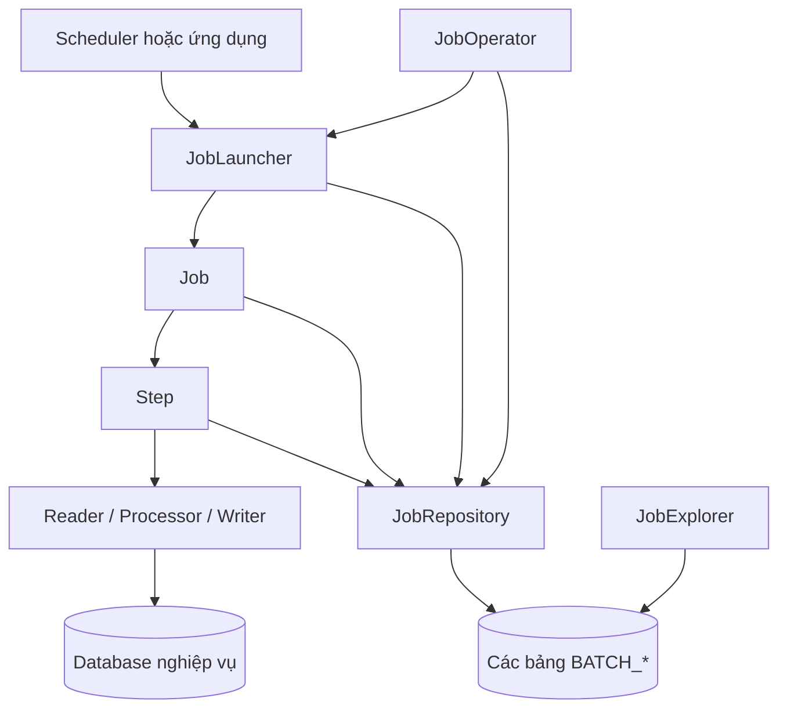
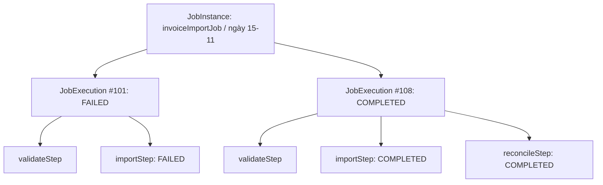
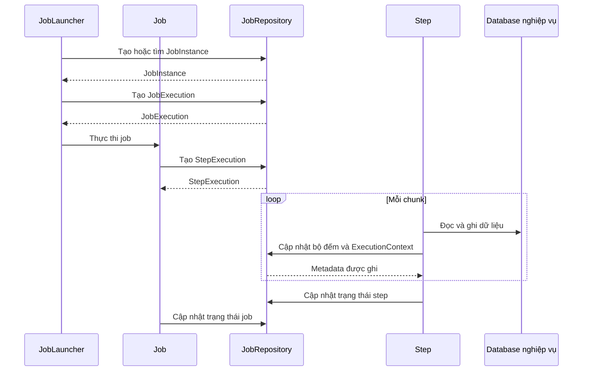

# JobRepository lưu metadata batch như thế nào?

Trong Spring Batch, một job không chỉ thực hiện công việc rồi kết thúc. Framework còn phải biết job nào đã được khởi chạy, lần chạy đó dùng tham số gì, step nào đã hoàn tất, có bao nhiêu item được đọc hoặc ghi, lần chạy có thất bại hay không và có thể tiếp tục từ đâu. Thông tin vận hành này được gọi là **batch metadata**.

`JobRepository` là thành phần chịu trách nhiệm lưu và truy xuất metadata đó. Với cấu hình JDBC thông dụng, dữ liệu được lưu trong các bảng có tiền tố `BATCH_` của database. Metadata giúp Spring Batch phân biệt một lần chạy logic với từng lần thực thi, quản lý restart, ngăn một số trường hợp chạy trùng và cung cấp dữ liệu cho công cụ giám sát.

Bài này đi từ mô hình đối tượng đến các bảng lưu trữ, vòng đời ghi metadata, transaction, restart, cách truy vấn và những quyết định cần có khi vận hành production. Ví dụ tập trung vào Spring Batch 5.x và Spring Boot 3.x; tên cột hoặc schema cụ thể có thể khác giữa các thế hệ Spring Batch và các hệ quản trị database.

## 1. JobRepository là gì?

`JobRepository` là abstraction trung tâm để Spring Batch quản lý trạng thái của job và step. Các thành phần như `JobLauncher`, `Job`, `Step` và các tasklet/chunk step tương tác với repository trong quá trình khởi chạy và thực thi.

Với JDBC repository, metadata được ghi vào database để tồn tại qua lần restart ứng dụng. Đây là cấu hình phổ biến trong môi trường thật vì process có thể dừng, container có thể được tạo lại và job có thể cần tiếp tục sau sự cố.

Các trách nhiệm chính của `JobRepository` gồm:

- Tạo và lưu một `JobInstance` khi có một lần chạy logic mới.
- Tạo `JobExecution` cho mỗi lần thực thi của instance đó.
- Tạo và cập nhật `StepExecution` khi các step bắt đầu, kết thúc hoặc thay đổi trạng thái.
- Lưu `JobParameters` dùng để xác định và mô tả lần chạy.
- Lưu `ExecutionContext` để khôi phục trạng thái cần thiết khi restart.
- Cập nhật trạng thái, thời gian chạy, số lượng item, số lần commit và rollback.
- Phối hợp transaction và kiểm soát việc tạo execution khi có các yêu cầu launch đồng thời.

`JobRepository` không phải nơi lưu toàn bộ dữ liệu nghiệp vụ của batch. Ví dụ, các hóa đơn được nhập vẫn nằm trong bảng nghiệp vụ hoặc staging table. Repository chỉ lưu metadata mô tả quá trình xử lý các hóa đơn đó.

### Vị trí của JobRepository trong kiến trúc



Luồng xử lý nghiệp vụ đọc và ghi dữ liệu qua reader, processor và writer. Song song với luồng đó, Spring Batch dùng repository để ghi lại tiến độ và trạng thái. `JobExplorer` đọc metadata để phục vụ tra cứu; `JobOperator` cung cấp các thao tác vận hành như start, stop hoặc restart thông qua các dịch vụ batch tương ứng.

## 2. Phân biệt JobInstance, JobExecution và StepExecution

Đây là ba khái niệm quan trọng nhất khi đọc metadata.

### 2.1. JobInstance — một lần chạy logic

`JobInstance` đại diện cho một lần chạy logic của một job. Danh tính của nó được xác định bởi:

- Tên job.
- Các `JobParameters` được đánh dấu là identifying.

Ví dụ, job `invoiceImportJob` xử lý file `invoice-2026-11-15.csv` cho ngày nghiệp vụ `2026-11-15`. Nếu hai tham số này là identifying, chúng xác định một `JobInstance`.

Khi cùng job được gọi lại với đúng bộ identifying parameters đó, Spring Batch nhận diện đây là cùng một instance. Điều này rất quan trọng khi restart: lần chạy tiếp theo phải gắn với instance đã thất bại, để framework có thể khôi phục metadata và trạng thái trước đó.

### 2.2. JobExecution — một lần thực thi cụ thể

`JobExecution` đại diện cho một lần thực thi của `JobInstance`. Một instance có thể có nhiều execution:

- Execution đầu tiên bắt đầu nhưng thất bại vì database tạm thời mất kết nối.
- Execution tiếp theo restart cùng instance và hoàn tất.
- Mỗi execution có ID, thời gian bắt đầu/kết thúc, trạng thái và thông tin lỗi riêng.

Vì vậy, `JobInstance` và `JobExecution` không phải hai tên gọi cho cùng một thứ. Instance mô tả công việc logic cần xử lý; execution mô tả một lần thử thực hiện công việc đó.

### 2.3. StepExecution — một lần thực thi của step

Mỗi khi một step được thực thi trong một `JobExecution`, Spring Batch tạo hoặc cập nhật một `StepExecution` tương ứng. Metadata của step ghi nhận:

- Tên step và ID của job execution cha.
- Trạng thái và exit status.
- Thời gian bắt đầu, kết thúc và cập nhật gần nhất.
- Số item đã đọc, ghi, lọc và bỏ qua.
- Số lần commit và rollback.
- Số lỗi đọc, xử lý hoặc ghi bị skip.
- Execution context của step.

Một job nhiều step có nhiều bản ghi step execution trong quá trình chạy. Nhờ đó, người vận hành biết chính xác giai đoạn nào đã hoàn thành và giai đoạn nào gặp lỗi.

### Quan hệ giữa ba đối tượng



Sơ đồ cho thấy một instance có thể có execution thất bại và execution restart hoàn tất. Mỗi execution có tập step executions của riêng nó. Các ID trong sơ đồ chỉ là ví dụ để minh họa quan hệ.

| Đối tượng | Trả lời câu hỏi | Định danh thường dùng |
|---|---|---|
| `JobInstance` | Đây là lô công việc logic nào? | Job name + identifying parameters |
| `JobExecution` | Lần thực thi cụ thể nào? | Job execution ID |
| `StepExecution` | Step nào trong lần thực thi đó? | Step execution ID, step name và job execution ID |

## 3. JobParameters được lưu và dùng để định danh ra sao?

`JobParameters` là tập tham số được truyền khi launch job. Chúng có thể chứa thông tin đầu vào như:

- Đường dẫn hoặc mã file nguồn.
- Ngày nghiệp vụ.
- Mã batch hoặc mã yêu cầu.
- Khoảng thời gian cần xử lý.
- Các tùy chọn điều khiển được job hỗ trợ.

Mỗi parameter có tên, giá trị, kiểu dữ liệu và thuộc tính identifying. Chỉ các parameter identifying tham gia tạo danh tính `JobInstance`.

Ví dụ:

```java
JobParameters parameters = new JobParametersBuilder()
        .addString("inputFile", "invoice-2026-11-15.csv", true)
        .addString("businessDate", "2026-11-15", true)
        .addString("requestId", "request-8f21", false)
        .toJobParameters();

jobLauncher.run(invoiceImportJob, parameters);
```

Trong ví dụ:

- `inputFile` là identifying parameter.
- `businessDate` là identifying parameter.
- `requestId` là non-identifying parameter, hữu ích cho truy vết nhưng không làm thay đổi danh tính instance.

Hai lần launch với cùng tên job, cùng file và cùng ngày nghiệp vụ sẽ trỏ đến cùng `JobInstance`, dù `requestId` khác nhau. Nếu job đã hoàn tất, Spring Batch thường từ chối chạy lại instance đó như một lần chạy mới. Nếu execution trước thất bại và có thể restart, ứng dụng có thể restart cùng instance.

Khi cần xử lý một lô nghiệp vụ mới, hãy truyền identifying parameter mới có ý nghĩa, chẳng hạn ngày nghiệp vụ hoặc mã batch mới. Không thêm timestamp ngẫu nhiên chỉ để né lỗi instance đã hoàn tất: cách đó tạo một instance khác và làm mất ngữ nghĩa restart.

### Bảng JobExecutionParams

Trong schema Spring Batch 5, bảng thường có tên `BATCH_JOB_EXECUTION_PARAMS`. Bảng này lưu các tham số gắn với một job execution, gồm tên parameter, kiểu, giá trị, cờ identifying và ID execution liên quan.

Tên cột của bảng này đã thay đổi giữa các phiên bản. Schema cũ có thể dùng các cột kiểu `TYPE_CD`, `KEY_NAME`, `STRING_VAL`, `LONG_VAL`, `DOUBLE_VAL` hoặc `DATE_VAL`; schema Spring Batch 5 dùng mô hình `PARAMETER_NAME`, `PARAMETER_TYPE`, `PARAMETER_VALUE` và `IDENTIFYING`. Khi viết SQL vận hành, luôn đối chiếu schema thực tế của phiên bản ứng dụng.

## 4. Những bảng metadata chính

Với JDBC `JobRepository`, Spring Batch dùng một nhóm bảng quan hệ. Tên mặc định thường bắt đầu bằng `BATCH_`.

| Bảng | Nội dung |
|---|---|
| `BATCH_JOB_INSTANCE` | Danh tính các job instances |
| `BATCH_JOB_EXECUTION` | Mỗi lần thực thi job, trạng thái và thời gian |
| `BATCH_JOB_EXECUTION_PARAMS` | Các job parameters của execution |
| `BATCH_STEP_EXECUTION` | Trạng thái và bộ đếm của từng step execution |
| `BATCH_JOB_EXECUTION_CONTEXT` | Execution context ở cấp job |
| `BATCH_STEP_EXECUTION_CONTEXT` | Execution context ở cấp step |

Một số database hoặc schema còn có các bảng sequence như `BATCH_JOB_SEQ`, `BATCH_JOB_EXECUTION_SEQ` và `BATCH_STEP_EXECUTION_SEQ` để cấp ID. Cách cấp ID phụ thuộc database và schema được cung cấp cho nền tảng đó.

### 4.1. BATCH_JOB_INSTANCE

Bảng này lưu danh tính logic của mỗi instance. Các cột thường gặp:

| Cột | Ý nghĩa |
|---|---|
| `JOB_INSTANCE_ID` | Khóa chính của instance |
| `VERSION` | Version dùng cho optimistic locking |
| `JOB_NAME` | Tên job |
| `JOB_KEY` | Giá trị đại diện cho bộ identifying parameters |

Spring Batch dùng tên job và khóa được tạo từ identifying parameters để nhận diện instance. Database schema có ràng buộc unique tương ứng để tránh tạo hai instance giống nhau trong điều kiện bình thường.

`JOB_KEY` không phải nơi lưu toàn bộ parameter để người vận hành đọc. Chi tiết parameter được lưu trong bảng job execution parameters.

### 4.2. BATCH_JOB_EXECUTION

Bảng này lưu từng lần thực thi cụ thể. Những trường thường gặp gồm:

| Cột | Ý nghĩa |
|---|---|
| `JOB_EXECUTION_ID` | ID của execution |
| `JOB_INSTANCE_ID` | Instance cha |
| `CREATE_TIME` | Thời điểm tạo execution |
| `START_TIME` | Thời điểm bắt đầu thực thi |
| `END_TIME` | Thời điểm kết thúc |
| `STATUS` | Trạng thái kỹ thuật của execution |
| `EXIT_CODE` | Mã kết thúc dùng cho flow và báo cáo |
| `EXIT_MESSAGE` | Thông tin giải thích kết quả hoặc lỗi |
| `LAST_UPDATED` | Thời điểm metadata được cập nhật gần nhất |
| `VERSION` | Version phục vụ optimistic locking |

Một execution đang chạy có thể chưa có `END_TIME`. Vì thế, không nên kết luận một job bị treo chỉ dựa trên trường này; cần kết hợp `STATUS`, `LAST_UPDATED`, heartbeat của ứng dụng nếu có và thông tin process thực tế.

### 4.3. BATCH_STEP_EXECUTION

Bảng này giúp quan sát tiến độ theo từng step. Ngoài tên step, execution cha và trạng thái, các bộ đếm thường gặp gồm:

| Bộ đếm | Ý nghĩa |
|---|---|
| `READ_COUNT` | Số item reader đã đọc |
| `WRITE_COUNT` | Số item writer đã ghi thành công theo thống kê step |
| `FILTER_COUNT` | Số item bị processor lọc bằng cách trả về null |
| `READ_SKIP_COUNT` | Số item bị bỏ qua do lỗi đọc theo skip policy |
| `PROCESS_SKIP_COUNT` | Số item bị bỏ qua do lỗi xử lý |
| `WRITE_SKIP_COUNT` | Số item bị bỏ qua do lỗi ghi |
| `COMMIT_COUNT` | Số lần commit được ghi nhận |
| `ROLLBACK_COUNT` | Số lần rollback được ghi nhận |

Các bộ đếm là số liệu vận hành theo ngữ nghĩa của Spring Batch. Chúng không thay thế đối soát nghiệp vụ ở database đích. Ví dụ, `WRITE_COUNT` không tự chứng minh rằng mọi hóa đơn đã được ghi đúng hoặc không bị ghi trùng ở một hệ thống ngoài transaction.

### 4.4. BATCH_JOB_EXECUTION_CONTEXT và BATCH_STEP_EXECUTION_CONTEXT

Hai bảng này lưu `ExecutionContext` tương ứng ở cấp job và cấp step.

- Job execution context lưu trạng thái cần thiết cho toàn job hoặc được chia sẻ giữa các step.
- Step execution context lưu trạng thái riêng của step, thường được reader/writer dùng để khôi phục vị trí hoặc tiến độ.

Với reader đọc file, execution context có thể chứa vị trí dòng hoặc offset cần đọc tiếp. Với reader database, context có thể chứa trạng thái phân trang hoặc khóa cuối cùng tùy implementation.

Schema JDBC thường có các cột như `SHORT_CONTEXT` và `SERIALIZED_CONTEXT`, nhưng chi tiết phụ thuộc schema và phiên bản. Nội dung context có thể được serialize; không nên giả định mọi giá trị sẽ được lưu thành một cột SQL dễ đọc.

Không đưa password, access token, dữ liệu cá nhân nhạy cảm hoặc payload lớn vào execution context. Context là trạng thái phục vụ khôi phục, không phải kho bí mật hay kho lưu dữ liệu nghiệp vụ.

## 5. Metadata được ghi trong vòng đời của một job như thế nào?

Một lần chạy thường đi qua các mốc sau:



Ở mức khái niệm, các bước diễn ra như sau:

1. `JobLauncher` nhận tên job và `JobParameters`.
2. Repository tìm hoặc tạo `JobInstance` tương ứng với identifying parameters.
3. Repository tạo `JobExecution` mới cho lần thực thi.
4. Khi step bắt đầu, Spring Batch tạo `StepExecution` và lưu trạng thái ban đầu.
5. Trong lúc chạy, framework cập nhật bộ đếm, thời gian và execution context.
6. Khi step kết thúc, trạng thái và exit status của step được cập nhật.
7. Khi job kết thúc, trạng thái và exit status của job được cập nhật.

Không phải mọi trường metadata đều chỉ được ghi đúng một lần. Một số trường được cập nhật trong quá trình chạy, chẳng hạn bộ đếm chunk, `LAST_UPDATED`, execution context và trạng thái.

### Tại sao phải lưu trạng thái theo từng chunk?

Giả sử một file có 10.000 dòng và chunk size là 500. Nếu 6 chunk đầu đã commit, rồi chunk thứ 7 gặp lỗi, metadata có thể cho biết step đã xử lý đến ranh giới commit trước đó. Reader có khả năng lưu trạng thái có thể khôi phục vị trí tương ứng khi job được restart.

Nếu chỉ lưu một trạng thái duy nhất ở cuối job, hệ thống sẽ không biết phần nào đã hoàn thành và phải đọc lại toàn bộ file. Chunk boundary cùng execution context giúp Spring Batch theo dõi tiến độ chi tiết hơn.

Điều này phụ thuộc reader/writer có hỗ trợ lưu trạng thái và được cấu hình đúng. Ví dụ, `saveState(false)` trên một reader có hỗ trợ state sẽ tắt việc lưu trạng thái của reader đó; khi restart, ứng dụng phải có chiến lược khác để xác định vị trí tiếp tục.

## 6. Transaction và tính nhất quán giữa metadata với dữ liệu nghiệp vụ

Metadata cần nhất quán với tiến độ xử lý. Nếu dữ liệu nghiệp vụ đã commit nhưng metadata lại nói chunk chưa hoàn tất, hoặc ngược lại, restart có thể gây bỏ sót hoặc xử lý lặp.

Với cấu hình chunk thông dụng, step thực hiện đọc, xử lý và ghi trong ranh giới transaction. Các cập nhật execution context và metadata liên quan đến chunk được phối hợp với transaction theo cấu hình repository và transaction manager.

### Khi metadata và dữ liệu nghiệp vụ dùng cùng transaction

Nếu business writer và JDBC `JobRepository` cùng tham gia một transaction manager trên cùng transactional resource, việc ghi dữ liệu nghiệp vụ và cập nhật trạng thái chunk có thể được commit hoặc rollback cùng nhau. Đây là điều kiện thuận lợi để restart chính xác theo chunk boundary.

Tuy nhiên, không nên suy rộng điều này cho mọi kiến trúc. Nếu metadata repository và business database là hai datasource khác nhau, hoặc writer gọi một HTTP service, gửi message hay ghi object storage, một transaction database đơn lẻ không thể tự rollback tất cả các side effect đó.

### Khi metadata và business data tách database

Nếu hai database khác nhau, cần xác định rõ cách phối hợp:

- Chấp nhận và xử lý khả năng một hệ thống commit trong khi hệ thống kia chưa commit.
- Dùng cơ chế transaction phân tán nếu nền tảng và yêu cầu thật sự cần, đồng thời hiểu chi phí vận hành.
- Thiết kế writer idempotent để thao tác có thể thực hiện lại an toàn.
- Dùng staging table và bước merge có thể kiểm soát.
- Dùng transactional outbox khi cần phát sự kiện sau khi dữ liệu nghiệp vụ được commit.

Không giả định rằng `JobRepository` tự biến các database hoặc hệ thống bên ngoài thành một transaction nguyên tử.

### Optimistic locking

Một số bảng metadata có cột `VERSION`. Repository dùng cơ chế version để phát hiện cập nhật đồng thời không mong muốn. Nếu hai luồng cùng cập nhật một execution dựa trên cùng một version, một luồng có thể nhận lỗi optimistic locking thay vì ghi đè âm thầm trạng thái của luồng kia.

Khi gặp lỗi optimistic locking, cần xem lại việc cùng một execution có bị cập nhật đồng thời từ nhiều thread/process hay không, cấu hình repository và transaction, cũng như cách step được partition hoặc chạy song song.

### Isolation khi tạo execution

Khi hai yêu cầu launch cùng một job với cùng identifying parameters đến gần như đồng thời, repository phải ngăn cả hai cùng tạo instance hoặc execution xung đột. JDBC repository có thể dùng isolation level cao cho thao tác tạo job execution; mặc định thường được cấu hình theo hướng `SERIALIZABLE` cho bước tạo này.

Isolation level có thể được điều chỉnh khi cấu hình repository, nhưng thay đổi nó cần dựa trên database, tải launch đồng thời và cách ứng dụng điều phối job. Không hạ isolation chỉ để tránh lock mà chưa kiểm tra nguy cơ tạo execution trùng.

## 7. Trạng thái: BatchStatus và ExitStatus

Metadata lưu trạng thái để mô tả vòng đời kỹ thuật của job/step. Cần phân biệt `BatchStatus` và `ExitStatus`.

### BatchStatus

`BatchStatus` là trạng thái vòng đời do Spring Batch quản lý. Những trạng thái thường gặp gồm:

| Trạng thái | Ý nghĩa khái quát |
|---|---|
| `STARTING` | Execution đang được khởi tạo |
| `STARTED` | Execution đang chạy |
| `STOPPING` | Đã yêu cầu dừng và đang chờ xử lý |
| `STOPPED` | Execution đã dừng theo yêu cầu |
| `COMPLETED` | Execution hoàn tất theo luồng kỹ thuật |
| `FAILED` | Execution thất bại |
| `ABANDONED` | Execution được đánh dấu không tiếp tục restart |
| `UNKNOWN` | Không thể xác định chắc chắn trạng thái |

Các trạng thái cụ thể và chuyển đổi hợp lệ cần được đối chiếu với phiên bản framework.

### ExitStatus

`ExitStatus` mô tả kết quả kết thúc và có thể được dùng trong flow transitions. Ngoài các mã phổ biến như `COMPLETED`, `FAILED` hoặc `STOPPED`, ứng dụng có thể tạo exit code riêng như `COMPLETED_WITH_WARNINGS`.

Ví dụ, một step có thể hoàn tất về mặt kỹ thuật nhưng có một số bản ghi bị skip. Ứng dụng có thể dùng exit status riêng để điều hướng sang step đối soát hoặc cảnh báo.

Không nên chỉ nhìn `BatchStatus=COMPLETED` rồi kết luận dữ liệu nghiệp vụ hoàn toàn chính xác. Hãy kiểm tra exit code, skip counts, reconciliation result và các chỉ số nghiệp vụ.

## 8. JobRepository, JobExplorer và JobOperator khác nhau thế nào?

Ba thành phần thường xuất hiện cùng nhau nhưng có vai trò khác nhau:

| Thành phần | Vai trò |
|---|---|
| `JobRepository` | Ghi và quản lý metadata trong quá trình thực thi |
| `JobExplorer` | Đọc metadata để tra cứu job instances, executions và step executions |
| `JobOperator` | Cung cấp thao tác vận hành như start, stop, restart và abandon |

### Dùng JobExplorer để xem lịch sử

Ví dụ service tra cứu các instance gần đây của một job:

```java
@Service
public class BatchHistoryService {

    private final JobExplorer jobExplorer;

    public BatchHistoryService(JobExplorer jobExplorer) {
        this.jobExplorer = jobExplorer;
    }

    public List<JobExecution> recentExecutions(String jobName) {
        List<JobInstance> instances =
                jobExplorer.findJobInstancesByName(jobName, 0, 20);

        return instances.stream()
                .flatMap(instance ->
                        jobExplorer.getJobExecutions(instance).stream())
                .sorted(Comparator.comparing(
                        JobExecution::getCreateTime).reversed())
                .toList();
    }
}
```

Đây là ví dụ tra cứu cơ bản. Trong ứng dụng thật, nên phân trang kết quả, xử lý trường hợp chưa có execution và chỉ trả về các trường cần thiết cho màn hình hoặc API.

### Dùng JobOperator cho thao tác vận hành

`JobOperator` cung cấp các thao tác quản lý execution ở mức cao hơn, chẳng hạn:

- Start job với tên job và chuỗi tham số theo định dạng được hỗ trợ.
- Restart một execution đủ điều kiện restart.
- Gửi yêu cầu stop cho execution đang chạy.
- Abandon execution theo chính sách vận hành.

Các thao tác này cần được bảo vệ bằng phân quyền và audit log. Không để một endpoint công khai cho phép người dùng bất kỳ restart hoặc stop batch production.

## 9. Truy vấn metadata bằng SQL

`JobExplorer` là API phù hợp để ứng dụng đọc metadata theo mô hình Spring Batch. SQL trực tiếp hữu ích cho điều tra, dashboard nội bộ hoặc báo cáo vận hành, nhưng phải phụ thuộc đúng schema phiên bản đang triển khai.

### 9.1. Xem các lần chạy gần đây

Ví dụ với tên bảng và các cột phổ biến trong schema JDBC:

```sql
SELECT
    ji.JOB_NAME,
    je.JOB_INSTANCE_ID,
    je.JOB_EXECUTION_ID,
    je.STATUS,
    je.EXIT_CODE,
    je.CREATE_TIME,
    je.START_TIME,
    je.END_TIME,
    je.LAST_UPDATED
FROM BATCH_JOB_INSTANCE ji
JOIN BATCH_JOB_EXECUTION je
    ON je.JOB_INSTANCE_ID = ji.JOB_INSTANCE_ID
WHERE ji.JOB_NAME = 'invoiceImportJob'
ORDER BY je.CREATE_TIME DESC;
```

Truy vấn này cho biết các execution thuộc job được chọn, gồm ID instance, ID execution, trạng thái và thời gian. Có thể thêm điều kiện theo ngày hoặc trạng thái tùy database và dashboard.

### 9.2. Xem bộ đếm của các step

```sql
SELECT
    STEP_EXECUTION_ID,
    STEP_NAME,
    STATUS,
    READ_COUNT,
    WRITE_COUNT,
    FILTER_COUNT,
    READ_SKIP_COUNT,
    PROCESS_SKIP_COUNT,
    WRITE_SKIP_COUNT,
    COMMIT_COUNT,
    ROLLBACK_COUNT,
    START_TIME,
    END_TIME
FROM BATCH_STEP_EXECUTION
WHERE JOB_EXECUTION_ID = :jobExecutionId
ORDER BY STEP_EXECUTION_ID;
```

Truy vấn này giúp xác định step nào đọc nhiều dữ liệu, step nào có skip hoặc rollback và step nào chưa có thời gian kết thúc. Dùng bind parameter thay vì ghép ID từ chuỗi đầu vào.

### 9.3. Xem parameters của execution — schema Spring Batch 5

```sql
SELECT
    PARAMETER_NAME,
    PARAMETER_TYPE,
    PARAMETER_VALUE,
    IDENTIFYING
FROM BATCH_JOB_EXECUTION_PARAMS
WHERE JOB_EXECUTION_ID = :jobExecutionId;
```

Nếu hệ thống dùng schema cũ, câu truy vấn cần đổi tên cột theo DDL thực tế. Không chạy câu SQL dựa trên schema 5.x trên một database vẫn dùng schema cũ.

### 9.4. Tìm execution đang chạy quá lâu

Có thể bắt đầu bằng truy vấn tìm execution ở trạng thái `STARTED` và có `LAST_UPDATED` cũ hơn ngưỡng vận hành:

```sql
SELECT
    ji.JOB_NAME,
    je.JOB_EXECUTION_ID,
    je.STATUS,
    je.START_TIME,
    je.LAST_UPDATED
FROM BATCH_JOB_INSTANCE ji
JOIN BATCH_JOB_EXECUTION je
    ON je.JOB_INSTANCE_ID = ji.JOB_INSTANCE_ID
WHERE je.STATUS IN ('STARTED', 'STARTING', 'STOPPING')
ORDER BY je.LAST_UPDATED ASC;
```

Đây chỉ là danh sách cần điều tra. Một job có thể hợp lệ khi xử lý lâu mà không cập nhật metadata thường xuyên; ngược lại, process có thể đã chết nhưng metadata chưa được phục hồi. Hãy kết hợp với log, metric, trạng thái container/process và SLA trước khi quyết định stop hoặc restart.

## 10. Cấu hình và khởi tạo JDBC JobRepository

Trong ứng dụng Spring Boot có Spring Batch starter và datasource phù hợp, Boot thường tự cấu hình cơ sở hạ tầng batch, bao gồm `JobRepository`, rồi cung cấp bean để job/step sử dụng.

Một job nên nhận repository qua dependency injection:

```java
@Configuration
public class InvoiceJobConfig {

    @Bean
    Job invoiceImportJob(
            JobRepository jobRepository,
            Step importInvoicesStep) {

        return new JobBuilder("invoiceImportJob", jobRepository)
                .start(importInvoicesStep)
                .build();
    }
}
```

Không cần tự tạo một implementation `JobRepository` trong từng job. Hãy để cấu hình hạ tầng của ứng dụng quản lý repository và dùng bean đó ở các builder.

### Khởi tạo schema

Spring Batch cung cấp DDL theo các database được hỗ trợ. Trong môi trường phát triển hoặc kiểm thử, Spring Boot có thể tự khởi tạo schema bằng cấu hình:

```properties
spring.batch.jdbc.initialize-schema=always
```

Các lựa chọn thường gặp gồm `always`, `embedded` và `never`; giá trị mặc định và hành vi cụ thể phụ thuộc phiên bản Spring Boot. Khi dùng database embedded, schema có thể được khởi tạo tự động theo mặc định.

Trong production, nên quản lý DDL metadata bằng migration có kiểm soát. Chọn một phiên bản schema tương thích với Spring Batch đang chạy, triển khai migration trước khi đưa phiên bản ứng dụng mới vào sử dụng và kiểm tra quyền của database user.

Không xóa rồi tạo lại các bảng `BATCH_*` mỗi lần deploy. Việc đó làm mất lịch sử, execution context và khả năng restart.

### Table prefix và schema riêng

Trong một số hệ thống, metadata cần nằm trong schema hoặc nhóm bảng riêng. JDBC repository hỗ trợ cấu hình table prefix; cách cấu hình phụ thuộc cách ứng dụng bật batch infrastructure và phiên bản Spring Batch/Spring Boot.

Nếu thay prefix, phải bảo đảm tất cả bảng metadata liên quan, DDL, `JobRepository` và `JobExplorer` cùng trỏ đến đúng nhóm bảng. Prefix không thay thế database schema và không tự tạo các bảng mới.

### Chú ý khi dùng @EnableBatchProcessing

`@EnableBatchProcessing` có thể được dùng để bật và tùy chỉnh hạ tầng Spring Batch. Trong ứng dụng Spring Boot, việc tự thêm annotation này có thể làm thay đổi hoặc khiến một phần auto-configuration batch của Boot không còn được áp dụng, tùy phiên bản. Chỉ thêm khi cần kiểm soát hạ tầng một cách chủ động và đã hiểu tác động tới cấu hình hiện tại.

## 11. Restart dựa vào metadata như thế nào?

Khi một job thất bại, metadata giúp Spring Batch biết:

- Instance nào đang được restart.
- Execution trước kết thúc với trạng thái nào.
- Step nào đã hoàn thành.
- Step nào thất bại hoặc chưa chạy.
- Execution context chứa trạng thái khôi phục nào.

Khi restart cùng identifying parameters, Spring Batch có thể tạo một `JobExecution` mới cho cùng `JobInstance`. Các step đã hoàn thành thường không được chạy lại trong flow restart tiêu chuẩn; step chưa hoàn thành được thực thi theo trạng thái đã lưu và cấu hình job.

Ví dụ, job có ba step:

1. `validateFileStep` hoàn thành.
2. `importInvoicesStep` thất bại ở chunk thứ 7.
3. `reconcileStep` chưa chạy.

Khi restart hợp lệ, Spring Batch có thể bỏ qua step validation đã hoàn thành, tiếp tục step import từ trạng thái lưu được và chỉ chạy reconcile sau khi import hoàn tất.

### Điều kiện để restart có ý nghĩa

- Dùng lại đúng identifying parameters để khớp với instance cũ.
- Reader hỗ trợ lưu state và giữ tên ổn định.
- Input không bị thay đổi giữa lần chạy và lần restart.
- Execution context có thể được deserialize bởi phiên bản ứng dụng hiện tại.
- Writer có chính sách chống ghi trùng hoặc side effect được bảo vệ.
- Metadata schema và transaction manager còn nhất quán.

Nếu reader dùng `saveState(false)`, nguồn dữ liệu không ổn định hoặc writer tạo side effect không idempotent, việc restart có thể không tạo ra kết quả nghiệp vụ đúng dù repository vẫn lưu metadata đầy đủ.

### Restart khác reprocess

Restart là tiếp tục cùng một instance chưa hoàn tất. Reprocess là chủ động xử lý lại dữ liệu đã hoàn tất hoặc tạo một lần xử lý logic mới. Reprocess cần mã batch/version hoặc identifying parameter mới và quy tắc ghi lại dữ liệu được thiết kế rõ ràng.

Không chỉnh sửa trực tiếp `BATCH_JOB_EXECUTION` hoặc xóa metadata để ép một job chạy lại. Dùng API vận hành được hỗ trợ và quy trình reprocess có audit.

## 12. Thay đổi schema và tương thích giữa các phiên bản

Metadata schema là một phần của hạ tầng ứng dụng. Nâng cấp Spring Batch có thể đi kèm thay đổi về DDL, tên cột, kiểu dữ liệu hoặc cách lưu parameters và execution context.

Một số điểm cần lưu ý:

- Schema Spring Batch 5 có cấu trúc lưu job parameters khác schema cũ.
- Kiểu cột lưu execution context phụ thuộc database và DDL được cung cấp.
- Các bảng sequence có thể khác nhau giữa database có native sequence và database dùng bảng sequence.
- Repository, explorer và job đang chạy phải cùng hiểu một schema tương thích.
- Không để hai phiên bản ứng dụng không tương thích cùng ghi metadata vào một schema trong quá trình rolling deployment.

Khi nâng cấp:

1. Đọc hướng dẫn migration của phiên bản Spring Batch mục tiêu.
2. So sánh DDL hiện tại với DDL được cung cấp cho phiên bản mới.
3. Sao lưu metadata database theo chính sách backup.
4. Chạy migration trên môi trường thử nghiệm có bản metadata đại diện.
5. Kiểm thử đọc lịch sử, restart một execution thất bại và launch job mới.
6. Lên kế hoạch triển khai để tránh phiên bản cũ và mới cùng ghi schema không tương thích.

Không tự đổi tên cột hoặc kiểu dữ liệu chỉ dựa trên một ví dụ SQL trên Internet. DDL của ứng dụng đang chạy mới là căn cứ chính xác.

## 13. Hiệu năng, chỉ mục và dung lượng metadata

Metadata thường nhỏ hơn dữ liệu nghiệp vụ, nhưng hệ thống chạy nhiều job mỗi ngày trong thời gian dài vẫn có thể tích lũy hàng triệu execution records.

### Các yếu tố ảnh hưởng hiệu năng

- Số lượng job instances và executions được tạo.
- Tần suất cập nhật step execution và execution context.
- Kích thước dữ liệu serialize trong execution context.
- Số worker/partition cập nhật metadata đồng thời.
- Isolation level và lock contention khi launch.
- Index và constraint trên các khóa join, tìm kiếm.
- Tốc độ commit của database metadata.

Không nên tối ưu bằng cách giảm cập nhật metadata một cách tùy tiện. Trước hết, đo thời gian query, lock wait, transaction và kích thước context.

### Index và constraint

DDL chuẩn của Spring Batch tạo các khóa và index cần thiết cho các quan hệ phổ biến. Khi có dashboard hoặc truy vấn điều tra riêng, xem execution plan trước khi bổ sung index. Index bổ sung cũng làm tăng chi phí ghi khi job cập nhật metadata liên tục.

Giữ các unique constraint của schema. Chúng là một phần bảo vệ tính toàn vẹn của metadata, đặc biệt khi có launch đồng thời.

### Dọn dẹp metadata

Metadata có thể cần được lưu lâu để kiểm toán, hỗ trợ điều tra và restart. Thiết lập retention policy dựa trên yêu cầu doanh nghiệp:

- Giữ các execution đang chạy hoặc còn có thể restart.
- Giữ lịch sử cần thiết cho kiểm toán và báo cáo.
- Chỉ xóa metadata cũ khi chắc chắn không còn quan hệ phụ thuộc.
- Dùng công cụ hoặc quy trình cleanup đã được kiểm thử với schema và phiên bản hiện tại.
- Sao lưu trước khi cleanup theo chính sách vận hành.

Không xóa riêng một bảng hoặc một execution row bằng câu SQL tùy tiện. Các bảng có foreign key và quan hệ giữa instance, execution, step execution, parameters và context. Xóa không đúng thứ tự có thể làm hỏng tham chiếu hoặc mất khả năng điều tra.

## 14. Bảo mật và độ tin cậy của metadata

Job parameters và execution context có thể chứa đường dẫn file, mã khách hàng, thông tin định tuyến hoặc dữ liệu vận hành. Vì vậy:

- Chỉ lưu giá trị thực sự cần để định danh hoặc restart.
- Không lưu credential, secret hoặc token.
- Hạn chế dữ liệu cá nhân và dữ liệu nghiệp vụ nhạy cảm.
- Phân quyền đọc/ghi các bảng metadata theo vai trò.
- Không cấp quyền update/delete trực tiếp cho người dùng dashboard.
- Bảo vệ API dùng `JobExplorer` và `JobOperator`.
- Log lỗi nên có execution ID và mã tham chiếu thay vì dump toàn bộ context.

`EXIT_MESSAGE` và exception message có thể chứa thông tin nhạy cảm nếu code đưa dữ liệu đầu vào vào nội dung exception. Hãy chuẩn hóa thông điệp lỗi và kiểm soát quyền xem metadata.

Metadata database cũng cần backup và restore theo chính sách. Nếu khôi phục database nghiệp vụ về một thời điểm nhưng metadata repository ở thời điểm khác, trạng thái batch có thể không khớp với dữ liệu đã commit. Kế hoạch disaster recovery phải xem xét cả hai phía và xác định cách đối soát/reprocess sau khi phục hồi.

## 15. Các lỗi thường gặp khi làm việc với JobRepository

### JobInstanceAlreadyCompleteException

Nguyên nhân phổ biến là launch job với cùng identifying parameters sau khi instance đã hoàn tất. Kiểm tra job name và identifying parameters. Nếu đó là lô nghiệp vụ mới, dùng identifying parameter mới; nếu muốn tiếp tục một execution thất bại, dùng quy trình restart phù hợp.

### JobExecutionAlreadyRunningException

Spring Batch nhận thấy instance tương ứng đang có execution chạy. Kiểm tra process, scheduler và các yêu cầu launch trùng trước khi thao tác. Không tự sửa trạng thái trong database để vượt qua kiểm tra.

### JobRestartException

Execution trước có thể không đủ điều kiện restart, đã bị abandon hoặc trạng thái/metadata không phù hợp. Xem `BatchStatus`, `ExitStatus`, log và chính sách restart của job.

### OptimisticLockingFailureException

Có thể xảy ra khi nhiều luồng cùng cập nhật một bản ghi metadata dựa trên version cũ. Kiểm tra cấu hình đa luồng, partition, transaction và việc có nhiều process cùng tác động lên một execution.

### BadSqlGrammarException hoặc lỗi thiếu bảng/cột

Thường liên quan đến schema không được khởi tạo, dùng nhầm DDL của phiên bản khác, sai table prefix hoặc cấu hình datasource. Đối chiếu log SQL, database/schema hiện tại và DDL đúng phiên bản.

### Restart đọc sai vị trí hoặc xử lý trùng dữ liệu

Repository có thể lưu state đúng nhưng nguồn dữ liệu đã thay đổi, reader không hỗ trợ state hoặc writer không idempotent. Kiểm tra input identity/checksum, reader name, `saveState`, execution context và transaction boundary.

## 16. Checklist thiết kế JobRepository cho production

Trước khi đưa batch job vào production, hãy xác nhận:

- JDBC repository dùng datasource và transaction manager được cấu hình có chủ đích.
- Metadata schema đúng với phiên bản Spring Batch đang chạy.
- Schema được quản lý qua migration và có backup.
- Job name và identifying parameters có ý nghĩa nghiệp vụ ổn định.
- Reader/writer hỗ trợ restart theo đúng hợp đồng dữ liệu.
- Execution context không chứa secret hoặc payload lớn.
- Job/step status, exit status và bộ đếm được quan sát.
- Có cảnh báo cho execution chạy quá lâu, thất bại hoặc có skip vượt ngưỡng.
- Có quy trình restart, stop, abandon và reprocess được phân quyền.
- Có retention policy và cleanup an toàn.
- Có kiểm thử restart sau khi một số chunk đã commit.
- Có kế hoạch nâng cấp schema và khôi phục metadata cùng dữ liệu nghiệp vụ.

## 17. Tóm lược mô hình cần nhớ

`JobRepository` là nền tảng metadata của Spring Batch. Nó lưu quan hệ giữa job instance, job execution và step execution; lưu parameters và execution context; cập nhật trạng thái cùng bộ đếm; đồng thời hỗ trợ restart và kiểm soát việc tạo execution.

Khi điều tra một batch, hãy lần theo chuỗi:

1. Tìm `JOB_NAME` và `JOB_INSTANCE_ID` để xác định lô logic.
2. Xem các `JOB_EXECUTION_ID` để biết lịch sử từng lần chạy.
3. Xem `BATCH_STEP_EXECUTION` để xác định step và bộ đếm gây ra vấn đề.
4. Kiểm tra parameters để xác nhận input và business date.
5. Kiểm tra execution context khi cần hiểu trạng thái restart.
6. Đối chiếu với dữ liệu nghiệp vụ để xác nhận kết quả cuối cùng.

Hiểu rõ metadata giúp thiết kế job có thể phục hồi, vận hành có thể quan sát và điều tra có căn cứ. Repository cho biết Spring Batch đã thực hiện những bước nào; đối soát nghiệp vụ mới xác nhận dữ liệu cuối cùng có đúng với yêu cầu hay không.
