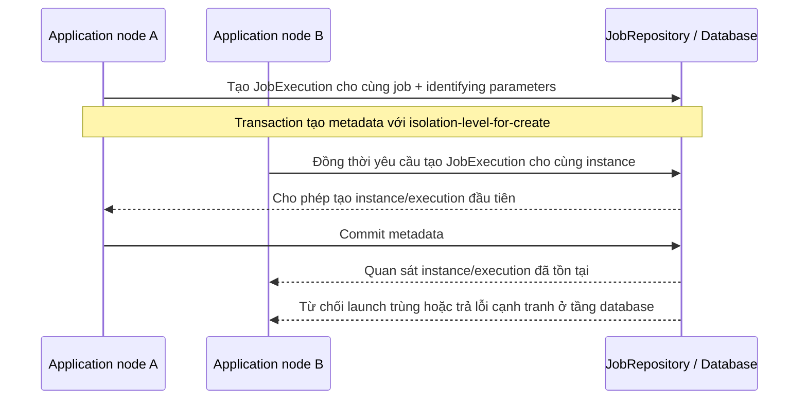

# Isolation khi khởi động cùng job

Trong một hệ thống Spring Batch chạy trên nhiều luồng hoặc nhiều máy chủ, cùng một yêu cầu khởi chạy job có thể đến gần như đồng thời từ scheduler, API, thao tác của người vận hành hoặc nhiều instance ứng dụng. Nếu hai yêu cầu cùng cố tạo một lần chạy cho cùng một công việc nghiệp vụ, hệ thống cần phối hợp để tránh tạo hai `JobInstance` giống nhau hoặc thực thi trùng ngoài ý muốn.

Spring Batch xử lý phần phối hợp này thông qua `JobRepository` và transaction của cơ sở dữ liệu. Một thiết lập quan trọng là **isolation level for create**: mức cô lập transaction được dùng khi repository tạo metadata cho lần khởi chạy mới. Mặc định, thiết lập này thường là `SERIALIZABLE`, nhằm bảo vệ thao tác tạo execution trước các yêu cầu khởi chạy đồng thời cho cùng một `JobInstance`.

Để hiểu cơ chế này, cần phân biệt việc khởi chạy cùng một job definition với việc khởi chạy cùng một `JobInstance`. Isolation của repository bảo vệ định danh instance trong metadata; nó không tự khóa mọi dữ liệu nghiệp vụ mà job sẽ xử lý.

## 1. Vì sao hai yêu cầu khởi chạy có thể đụng nhau?

Giả sử hệ thống có job `dailySettlementJob`, xử lý giao dịch của một ngày nghiệp vụ. Scheduler chạy lúc 01:00, nhưng ứng dụng được triển khai trên hai máy chủ. Do lịch chạy được kích hoạt đồng thời, cả hai máy chủ đều gọi `JobLauncher` với cùng tham số `businessDate=2026-11-15`.

Nếu không có phối hợp phù hợp, hai tiến trình có thể cùng kiểm tra repository và cùng thấy chưa tồn tại instance cho ngày đó. Cả hai sau đó đều cố tạo metadata và khởi chạy công việc. Hậu quả có thể là:

- Hai tiến trình cùng xử lý một tập giao dịch.
- Cả hai cùng ghi kết quả, tạo bản ghi trùng hoặc cập nhật số liệu hai lần.
- Hai execution tranh chấp tài nguyên như bảng dữ liệu, tệp đầu vào hoặc API đối tác.
- Lịch sử thực thi trở nên khó hiểu nếu metadata không được bảo vệ đúng cách.

Đây là một race condition: kết quả phụ thuộc vào thứ tự và thời điểm các transaction chạy. Kiểm tra bằng một câu truy vấn rồi mới gọi launcher không đủ để ngăn race condition, vì một tiến trình khác có thể khởi chạy ngay sau lần kiểm tra.

## 2. Điều gì xác định hai lần launch có cùng JobInstance?

Spring Batch phân biệt `Job`, `JobInstance` và `JobExecution`:

- **Job** là định nghĩa quy trình, ví dụ `dailySettlementJob`.
- **JobInstance** là một công việc nghiệp vụ cụ thể, được xác định bởi tên job cùng các `JobParameters` có thuộc tính identifying.
- **JobExecution** là một lần thực thi cụ thể của một `JobInstance`.

Vì vậy, hai yêu cầu gọi cùng tên job chưa chắc là hai yêu cầu cho cùng instance. Điều quyết định là bộ tham số nhận diện.

Ví dụ:

| JobParameters | Identifying? | Kết quả về JobInstance |
|---|---|---|
| `businessDate=2026-11-15` | Có | Xác định ngày nghiệp vụ cần xử lý |
| `requestedBy=scheduler-A` | Không | Không làm thay đổi định danh instance |
| `requestedBy=operator-B` | Không | Vẫn có thể là cùng instance với yêu cầu trên |
| `businessDate=2026-11-16` | Có | Tạo instance khác cho ngày mới |
| `run.id=42` | Có | Làm định danh khác nếu được dùng như identifying parameter |

Hai yêu cầu có cùng job name và cùng identifying parameters sẽ trỏ tới cùng `JobInstance`, kể cả khi các tham số không nhận diện như `requestedBy` khác nhau.

Ví dụ tạo tham số:

```java
JobParameters parameters = new JobParametersBuilder()
        .addString("businessDate", "2026-11-15", true)
        .addString("requestedBy", "scheduler-A", false)
        .toJobParameters();

jobLauncher.run(dailySettlementJob, parameters);
```

Ở đây `businessDate` là identifying parameter, còn `requestedBy` chỉ bổ sung thông tin về người hoặc thành phần khởi chạy. Một yêu cầu khác dùng `requestedBy=operator-B` nhưng giữ nguyên `businessDate` vẫn nhắm tới cùng instance.

Đừng thêm timestamp hoặc request ID làm identifying parameter một cách máy móc nếu mục tiêu là chỉ cho phép một lần xử lý mỗi ngày nghiệp vụ. Mỗi timestamp khác nhau sẽ tạo một `JobInstance` khác và có thể vô hiệu hóa cơ chế chống launch trùng cho công việc ngày đó.

## 3. JobRepository phối hợp các lần launch như thế nào?

`JobRepository` là nơi lưu metadata của job, instance, execution và step execution. Khi `JobLauncher` khởi chạy job, repository tạo hoặc truy xuất `JobInstance`, kiểm tra các execution trước đó và tạo `JobExecution` mới nếu trạng thái cho phép.

Phần tạo metadata phải được thực hiện trong transaction. Spring Batch đặt một isolation level cho các phương thức tạo của repository để phối hợp những yêu cầu đồng thời.

Luồng khái quát khi hai node khởi chạy cùng instance:



Diễn biến chính xác phụ thuộc database và thời điểm hai transaction chạm nhau. Mục tiêu là bảo đảm metadata không có hai instance trùng định danh và repository không chấp nhận hai execution đồng thời cho cùng instance theo quy tắc vòng đời của Spring Batch.

Trong schema metadata mặc định, bảng `BATCH_JOB_INSTANCE` có ràng buộc duy nhất dựa trên tên job và job key. Job key được tạo từ các identifying parameters. Ràng buộc này bảo vệ tính duy nhất ở tầng database; transaction isolation giúp các thao tác kiểm tra và tạo metadata diễn ra an toàn khi có cạnh tranh.

## 4. Isolation level for create là gì?

Isolation level xác định mức độ một transaction nhìn thấy và tương tác với thay đổi do transaction khác thực hiện đồng thời. Những mức thường gặp trong cơ sở dữ liệu quan hệ gồm:

| Isolation level | Đặc điểm khái quát | Liên quan đến launch đồng thời |
|---|---|---|
| `READ_UNCOMMITTED` | Có thể đọc dữ liệu chưa commit; mức cô lập thấp | Không phù hợp để dựa vào việc kiểm tra metadata trước khi tạo |
| `READ_COMMITTED` | Chỉ đọc dữ liệu đã commit; mỗi câu lệnh có thể thấy snapshot mới | Hai transaction có thể cùng đọc trạng thái chưa có instance trước khi một transaction commit; cần dựa thêm vào ràng buộc duy nhất và xử lý xung đột |
| `REPEATABLE_READ` | Giữ ổn định dữ liệu đã đọc trong transaction; xử lý phantom khác nhau tùy database | Mức bảo vệ cao hơn, nhưng hành vi với bản ghi chưa tồn tại và phantom phụ thuộc hệ quản trị |
| `SERIALIZABLE` | Mức cô lập mạnh nhất theo mô hình SQL; kết quả tương đương một thứ tự thực thi tuần tự hợp lệ | Phù hợp để bảo vệ các thao tác tạo instance/execution khỏi race condition |

Trong Spring Batch, `isolationLevelForCreate` xác định isolation của các thao tác tạo metadata. Giá trị mặc định thường là `SERIALIZABLE`. Đây là lý do hai node cùng khởi chạy một instance không thể chỉ dựa vào việc cả hai cùng đọc thấy “chưa có instance” rồi cùng tạo thành công.

`SERIALIZABLE` có thể khiến một transaction phải chờ transaction khác hoặc bị database hủy do xung đột serialization/deadlock. Cách database triển khai mức cô lập này khác nhau: có hệ thống dùng khóa, có hệ thống dùng kiểm tra xung đột và hủy một transaction. Vì vậy, không nên giả định mọi database đều trả về cùng một loại lỗi hoặc cùng thời gian chờ.

## 5. Vì sao mặc định thường là SERIALIZABLE?

Việc tạo `JobInstance` và `JobExecution` là một thao tác ngắn nhưng có ý nghĩa quyết định. Nếu hai tiến trình cùng tạo metadata cho một instance, job có thể chạy trùng ngay từ đầu. Chi phí của việc bảo vệ transaction tạo thường nhỏ hơn rủi ro xử lý dữ liệu nghiệp vụ hai lần.

Spring Batch vì thế thường chọn `SERIALIZABLE` làm mặc định cho các thao tác `create*` của `JobRepository`. Mức này giúp bảo vệ tình huống hai launcher gần như đồng thời gửi cùng job name và identifying parameters.

Điểm quan trọng là isolation này **không bao quanh toàn bộ thời gian job chạy**. Transaction tạo execution kết thúc sau khi metadata khởi chạy được tạo. Các step sau đó sử dụng transaction của riêng chúng, chẳng hạn transaction cho từng chunk. Vì thế, một job chạy nhiều giờ không giữ một transaction `SERIALIZABLE` trong suốt nhiều giờ.

Isolation của repository cũng không thay thế transaction và ràng buộc dữ liệu nghiệp vụ. Nó bảo vệ việc tạo metadata của job. Nếu hai `JobInstance` khác nhau cùng cập nhật một tài khoản hoặc cùng đọc một tệp, ứng dụng vẫn cần cơ chế bảo vệ phù hợp cho dữ liệu đó.

## 6. Cấu hình isolation-level-for-create

Khi dùng cấu hình XML của Spring Batch, có thể khai báo mức cô lập trên `job-repository`:

```xml
<job-repository id="jobRepository"
                data-source="dataSource"
                transaction-manager="transactionManager"
                isolation-level-for-create="SERIALIZABLE" />
```

Với cấu hình Java dùng `@EnableBatchProcessing`, thuộc tính tương ứng trong các phiên bản hỗ trợ có thể được đặt như sau:

```java
@Configuration
@EnableBatchProcessing(
        isolationLevelForCreate = "ISOLATION_SERIALIZABLE"
)
public class BatchConfiguration {
}
```

Chỉ cần cấu hình theo cơ chế hạ tầng đang dùng. Tên thuộc tính và cách dựng `JobRepository` có thể khác giữa các phiên bản Spring Batch hoặc khi ứng dụng tự tạo `JobRepositoryFactoryBean`; hãy dùng đúng API của phiên bản dự án.

Trong phần lớn ứng dụng, nên giữ mặc định `SERIALIZABLE`. Chỉ cân nhắc mức thấp hơn khi đã có bằng chứng về contention trong transaction tạo repository, hiểu rõ hành vi isolation của database và có cách xử lý xung đột ở tầng ứng dụng. Không nên hạ isolation chỉ để làm biến mất một lỗi launch trùng mà chưa xác định nguyên nhân.

## 7. Khi hai yêu cầu cùng khởi chạy, điều gì xảy ra?

Kết quả của yêu cầu thứ hai phụ thuộc trạng thái của `JobInstance` tại thời điểm repository kiểm tra.

### Yêu cầu đầu tiên vẫn đang chạy

Nếu một `JobExecution` của instance đã ở trạng thái đang chạy, yêu cầu thứ hai không được tạo thêm một execution chạy đồng thời cho cùng instance. Spring Batch thường báo `JobExecutionAlreadyRunningException`.

Đây là tình huống thường gặp khi hai node cùng nhận một lịch chạy hoặc một người dùng bấm nút chạy nhiều lần.

### Instance đã hoàn tất

Nếu execution gần nhất của instance đã `COMPLETED`, yêu cầu khởi chạy lại cùng job và identifying parameters thường bị từ chối bằng `JobInstanceAlreadyCompleteException`.

Muốn chạy cho kỳ nghiệp vụ mới, hãy dùng identifying parameter khác, ví dụ ngày nghiệp vụ mới. Nếu cần chạy lại một kỳ đã hoàn tất để sửa dữ liệu, cần thiết kế một quy trình reprocess rõ ràng và kiểm soát tác động nghiệp vụ.

### Instance trước đó thất bại hoặc đã dừng

Nếu execution trước kết thúc `FAILED` hoặc `STOPPED`, yêu cầu mới có thể được xem là restart của cùng instance, nếu job cho phép restart và metadata đáp ứng các điều kiện. Spring Batch tạo một `JobExecution` mới gắn với cùng `JobInstance`.

Nếu job được khai báo không restartable hoặc trạng thái trước đó không cho phép tiếp tục, repository có thể từ chối bằng `JobRestartException`.

### Lỗi ở tầng database

Khi hai transaction cạnh tranh rất sát nhau, một số database có thể trả lỗi serialization, deadlock hoặc duplicate key. Lỗi cụ thể phụ thuộc database, isolation và thời điểm commit. Ứng dụng cần ghi lại nguyên nhân gốc và phân biệt xung đột launch với lỗi hạ tầng thông thường.

| Tình huống | Kết quả thường gặp |
|---|---|
| Cùng instance đang có execution chạy | `JobExecutionAlreadyRunningException` |
| Cùng instance đã hoàn tất | `JobInstanceAlreadyCompleteException` |
| Instance thất bại/dừng và cho phép restart | Tạo execution mới để restart |
| Job không cho restart hoặc trạng thái không phù hợp | `JobRestartException` |
| Transaction tạo metadata va chạm ở database | Có thể gặp lỗi serialization, deadlock hoặc duplicate key tùy database |

Không nên bắt tất cả các lỗi này rồi bỏ qua như thể job đã chạy thành công. Hãy ghi rõ job name, identifying parameters, execution ID nếu có và nguyên nhân gốc để người vận hành biết trạng thái thực tế.

## 8. Khác biệt giữa launch trùng và chạy song song có chủ đích

Isolation của `JobRepository` bảo vệ việc tạo execution cho cùng một `JobInstance`. Nó không cấm mọi hình thức chạy song song trong Spring Batch.

Ví dụ:

- Hai yêu cầu có cùng `businessDate=2026-11-15` cho `dailySettlementJob`: cùng một instance; repository phối hợp để tránh hai lần launch đồng thời.
- Hai yêu cầu có `businessDate=2026-11-15` và `businessDate=2026-11-16`: hai instance khác nhau; có thể chạy đồng thời nếu ứng dụng và tài nguyên cho phép.
- Một job dùng multi-threaded step hoặc partitioning: các worker xử lý các phần công việc được chia trong cùng flow/execution theo cấu hình; đây là song song có chủ đích, không phải hai lần launch trùng instance.
- Hai job khác tên cùng cập nhật một bảng nghiệp vụ: repository xem chúng là các job khác nhau; cần cơ chế đồng bộ dữ liệu riêng nếu có xung đột.

Nếu mỗi ngày nghiệp vụ là một đơn vị độc lập, chạy song song các ngày có thể hợp lý. Nếu nhiều ngày cùng cập nhật một số dư tổng hợp hoặc cùng một tài khoản, vẫn cần khóa nghiệp vụ, transaction, ràng buộc duy nhất hoặc thiết kế ghi an toàn.

## 9. JobParametersIncrementer và run.id có thể thay đổi kết quả

Một số ứng dụng dùng `RunIdIncrementer` hoặc tham số `run.id` để tạo instance mới mỗi lần khởi chạy. Cách này hữu ích khi nghiệp vụ thực sự cần nhiều instance độc lập, nhưng cũng có thể làm mất hiệu quả chống launch trùng cho một kỳ dữ liệu.

Ví dụ, hai node cùng muốn chạy đối soát ngày 15 tháng 11:

- Nếu cả hai dùng `businessDate=2026-11-15` làm identifying parameter và không thêm identifying parameter khác, chúng nhắm tới cùng instance.
- Nếu mỗi node tự tạo `run.id` khác nhau và `run.id` là identifying, chúng tạo hai instance khác nhau. Repository không coi đó là launch trùng.

Do đó, không nên thêm `run.id` chỉ để tránh `JobExecutionAlreadyRunningException`. Trước khi dùng incrementer, hãy xác định ý nghĩa của một lần chạy mới: đó là kỳ nghiệp vụ mới, một lần chạy lại được phép, hay chỉ là một yêu cầu trùng do scheduler gửi lặp?

Nếu scheduler có thể phát cùng sự kiện nhiều lần, nên dùng identifying parameters ổn định đại diện cho công việc nghiệp vụ. Những thông tin như tên máy chủ, người yêu cầu hoặc thời điểm nhận request thường phù hợp hơn với tham số không nhận diện hoặc log vận hành.

## 10. Tất cả node phải dùng chung JobRepository

Isolation chỉ phối hợp được các tiến trình cùng truy cập một nguồn metadata có chung cơ chế transaction và ràng buộc. Trong môi trường nhiều node, các instance ứng dụng cần dùng chung cơ sở dữ liệu `JobRepository`.

Nếu node A và node B có hai metadata database độc lập, mỗi node có thể không nhìn thấy `JobInstance` được tạo ở node kia. Cả hai đều có thể cho rằng công việc chưa từng chạy và cùng thực thi. Cấu hình `SERIALIZABLE` riêng trên từng database không giải quyết được tình huống này.

Các điểm cần thống nhất trong triển khai nhiều node:

- Cùng kết nối tới database metadata dùng chung.
- Cùng schema và table prefix của Spring Batch.
- Cùng quy tắc tạo `JobParameters`, đặc biệt là identifying parameters.
- Transaction manager được cấu hình đúng với datasource của repository.
- Schema metadata được khởi tạo và quản lý nhất quán; không tự ý xóa hoặc sửa lịch sử execution khi job đang hoạt động.

`JobExplorer` có thể được dùng để đọc trạng thái và lịch sử execution. Tuy nhiên, đọc trạng thái qua `JobExplorer` rồi mới gọi `JobLauncher` không phải cơ chế khóa nguyên tử. Trạng thái có thể thay đổi giữa lần đọc và lần launch. Hãy để `JobRepository` thực hiện việc kiểm tra và tạo execution trong transaction của nó.

## 11. Xử lý yêu cầu launch trùng trong ứng dụng

Một scheduler hoặc REST endpoint có thể nhận yêu cầu trùng do retry HTTP, lịch chạy trên nhiều replica hoặc người dùng bấm nút nhiều lần. Ứng dụng nên xử lý các trường hợp đó như một phần bình thường của vận hành.

Ví dụ, đoạn mã sau phân biệt các lỗi launch thường gặp:

```java
try {
    JobExecution execution = jobLauncher.run(dailySettlementJob, parameters);
    log.info("Started job execution id={}", execution.getId());
} catch (JobExecutionAlreadyRunningException ex) {
    log.info("The same job instance is already running");
} catch (JobInstanceAlreadyCompleteException ex) {
    log.info("The same job instance has already completed");
} catch (JobRestartException ex) {
    log.error("The job instance cannot be restarted", ex);
} catch (JobParametersInvalidException ex) {
    log.error("Invalid job parameters", ex);
}
```

Đây là ví dụ minh họa; ứng dụng cần cấu hình logger và cách phản hồi phù hợp với API hoặc scheduler của mình. Với REST API, có thể trả kết quả cho biết instance đang chạy hoặc đã hoàn tất. Với scheduler, có thể ghi nhận lần kích hoạt trùng như một sự kiện đã được xử lý.

Một số nguyên tắc xử lý:

- Không khởi chạy lại bằng identifying parameters mới chỉ để né lỗi instance đang chạy.
- Không tự đánh dấu một execution đang chạy là thất bại chỉ vì một node khác không nhận được phản hồi launch.
- Nếu database trả lỗi serialization hoặc deadlock, chỉ retry thao tác tạo launch với giới hạn và backoff phù hợp; không lặp lại tùy tiện các tác dụng phụ nghiệp vụ.
- Sau lỗi không rõ trạng thái, kiểm tra repository và execution thực tế trước khi quyết định restart.
- Ghi log các identifying parameters quan trọng để có thể đối chiếu yêu cầu đến từ node nào.

## 12. Isolation của repository không thay thế idempotency

Ngay cả khi repository bảo đảm chỉ một execution của cùng instance được tạo tại một thời điểm, job vẫn có thể được chạy lại sau `FAILED` hoặc `STOPPED`. Ngoài ra, một job khác hoặc một instance khác có thể ghi lên cùng dữ liệu nghiệp vụ.

Ví dụ, step gửi yêu cầu thanh toán tới API đối tác rồi gặp lỗi trước khi metadata ghi nhận chunk hoàn tất. Khi restart, cùng yêu cầu thanh toán có thể được gửi lần nữa. Isolation của `JobRepository` không thể rollback request đã được hệ thống đối tác tiếp nhận.

Để bảo vệ tác dụng phụ nghiệp vụ, nên kết hợp:

- Khóa nghiệp vụ duy nhất cho một giao dịch hoặc một kỳ xử lý.
- Idempotency key nếu API đích hỗ trợ.
- Upsert hoặc thao tác ghi có thể chạy lại an toàn.
- Transactional outbox khi cần phối hợp commit dữ liệu và gửi sự kiện.
- Quy trình đối soát để phát hiện kết quả không chắc chắn sau timeout hoặc crash.

Isolation giải quyết cuộc đua tạo metadata; idempotency giải quyết việc thực thi lại một thao tác nghiệp vụ mà không tạo ra tác dụng phụ trùng. Hai cơ chế phục vụ hai phạm vi khác nhau và thường cần cùng tồn tại.

## 13. Kiểm tra hành vi launch đồng thời

Khi xây dựng ứng dụng nhiều node, nên kiểm tra hành vi cạnh tranh trên đúng loại database sẽ dùng trong môi trường triển khai. Một bài kiểm tra đơn giản có thể tạo hai thread hoặc hai tiến trình, đồng thời gọi cùng job với cùng identifying parameters.

Các điểm cần quan sát:

1. Cả hai yêu cầu dùng cùng job name và identifying parameters.
2. Hai yêu cầu thực sự được gửi gần như đồng thời, thay vì chạy tuần tự.
3. Cả hai node truy cập cùng `JobRepository` và cùng database schema.
4. Chỉ có một `JobInstance` cho job name và job key đó.
5. Repository chỉ chấp nhận một execution đang chạy cho instance; yêu cầu còn lại được xử lý theo trạng thái instance hoặc báo xung đột.
6. Nếu database trả lỗi serialization/deadlock, ứng dụng ghi nhận và xử lý theo chính sách retry đã định.

Nên chạy kiểm tra với transaction manager và isolation giống production. Một repository giả lập hoặc database in-memory không nhất thiết thể hiện đúng hành vi khóa, phantom read, unique constraint và serialization của database thật.

## 14. Những nguyên tắc cần nhớ

- Launch trùng được xác định theo cùng job name và cùng identifying `JobParameters`, tức cùng `JobInstance`.
- `JobRepository` tạo metadata trong transaction và dùng `isolationLevelForCreate` để bảo vệ thao tác tạo.
- Mặc định thường là `SERIALIZABLE`, nhằm tránh race condition khi nhiều launcher cùng tạo một instance.
- Isolation này áp dụng cho thao tác tạo metadata; nó không giữ một transaction serializable trong suốt thời gian job chạy.
- Schema metadata có ràng buộc duy nhất cho job name và job key; ràng buộc database bổ trợ cho transaction isolation.
- Cùng instance đang chạy thường dẫn đến `JobExecutionAlreadyRunningException`; instance đã hoàn tất thường dẫn đến `JobInstanceAlreadyCompleteException`.
- Instance thất bại hoặc dừng có thể restart nếu job và trạng thái metadata cho phép.
- Thêm identifying `run.id` hoặc timestamp có thể tạo instance mới và làm hai yêu cầu tưởng như trùng trở thành hai công việc khác nhau.
- Mọi node phải dùng chung `JobRepository` để phối hợp launch trong môi trường phân tán.
- Isolation của repository không khóa dữ liệu nghiệp vụ và không thay thế idempotency.

Hiểu `isolationLevelForCreate` giúp thiết kế cơ chế khởi chạy an toàn khi nhiều scheduler hoặc node cùng hoạt động. Khi kết hợp định danh `JobInstance` ổn định, repository dùng chung và xử lý tác dụng phụ có tính idempotent, ứng dụng có thể kiểm soát launch trùng và restart một cách đáng tin cậy.
