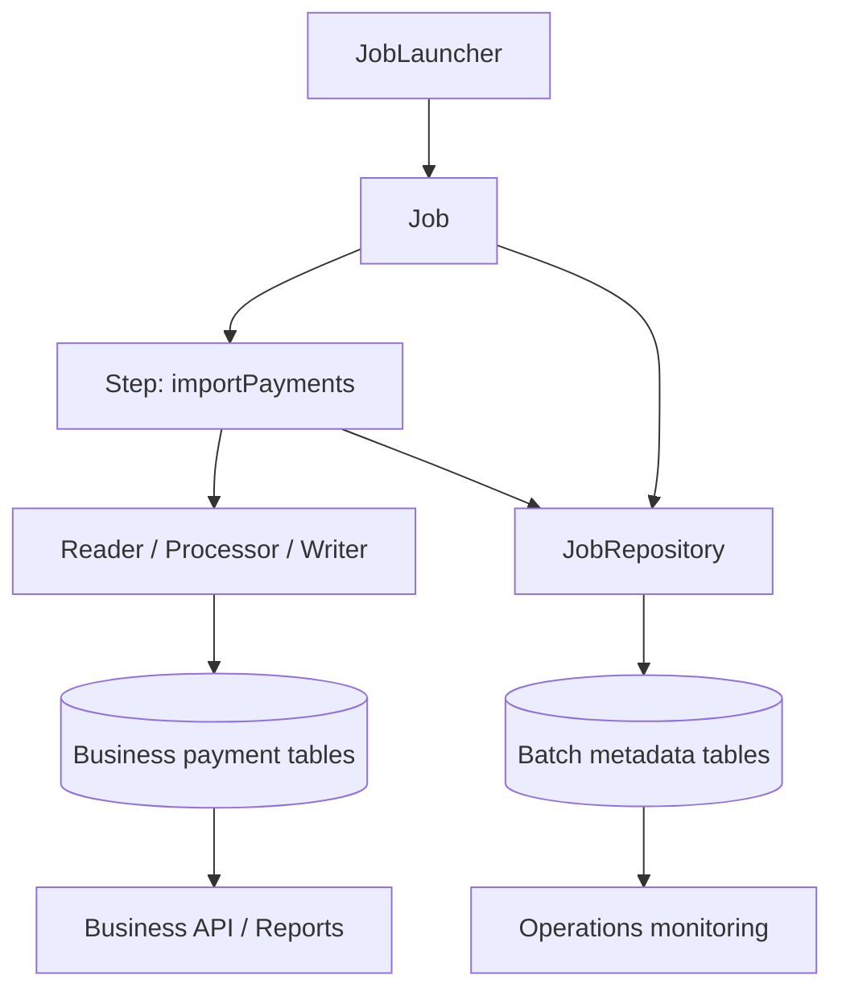

# Không coi metadata repository là dữ liệu nghiệp vụ

Trong Spring Batch, `JobRepository` lưu metadata để framework quản lý vòng đời của job và step: lần chạy nào đang thực hiện, step nào đã hoàn thành, có bao nhiêu item được đọc hoặc ghi, checkpoint nằm ở đâu và job có thể restart từ trạng thái nào. Những thông tin này rất quan trọng cho vận hành batch, nhưng chúng không phải dữ liệu nghiệp vụ của ứng dụng.

Ví dụ, một job nhập thanh toán có thể có `JobExecution` với trạng thái `COMPLETED`. Điều đó cho biết luồng thực thi của Spring Batch đã hoàn thành theo cấu hình. Nó không tự chứng minh rằng mọi khoản thanh toán đều hợp lệ, đã được ghi nhận đúng, đã chuyển tiền thành công hoặc đã được đối soát với hệ thống bên ngoài. Muốn biết trạng thái nghiệp vụ của từng khoản thanh toán, ứng dụng cần lưu và đọc dữ liệu từ các bảng hoặc dịch vụ nghiệp vụ tương ứng.

Phân biệt rõ hai loại dữ liệu giúp tránh phụ thuộc vào cấu trúc nội bộ của Spring Batch, giữ được lịch sử nghiệp vụ lâu dài và xây dựng cơ chế restart, đối soát, kiểm toán đáng tin cậy.

## 1. JobRepository lưu những gì?

`JobRepository` là thành phần hạ tầng của Spring Batch, cung cấp khả năng lưu trữ và truy xuất metadata về các lần thực thi. Job launcher, step và các thành phần quản lý vòng đời sử dụng repository này để đăng ký và cập nhật trạng thái.

Các loại metadata thường được lưu gồm:

- **JobInstance:** định danh một lần xử lý nghiệp vụ theo tên job và các `JobParameters` được đánh dấu identifying.
- **JobExecution:** thông tin một lần thực thi cụ thể của một `JobInstance`, gồm thời gian bắt đầu/kết thúc, trạng thái, `ExitStatus` và thông tin lỗi.
- **StepExecution:** thông tin thực thi từng step, như `BatchStatus`, `ExitStatus`, số item đọc, ghi, filter, skip, số lần commit và rollback.
- **JobParameters:** các tham số được truyền khi khởi chạy job, bao gồm tham số identifying và non-identifying.
- **ExecutionContext:** trạng thái key-value cần thiết để khôi phục job hoặc step, thường chứa checkpoint và thông tin nhỏ phục vụ restart.

Với cấu hình JDBC phổ biến, Spring Batch sử dụng một nhóm bảng metadata. Tên bảng mặc định thường có tiền tố `BATCH_`, ví dụ:

| Bảng metadata | Vai trò chính |
|---|---|
| `BATCH_JOB_INSTANCE` | Lưu định danh các job instance |
| `BATCH_JOB_EXECUTION` | Lưu thông tin từng lần thực thi job |
| `BATCH_JOB_EXECUTION_PARAMS` | Lưu tham số của lần thực thi |
| `BATCH_STEP_EXECUTION` | Lưu trạng thái và bộ đếm của từng step execution |
| `BATCH_JOB_EXECUTION_CONTEXT` | Lưu job execution context |
| `BATCH_STEP_EXECUTION_CONTEXT` | Lưu step execution context |

Tên bảng, cấu trúc cột và cách lưu tham số có thể khác theo phiên bản, schema hoặc cấu hình prefix. Đây là schema metadata do Spring Batch quản lý; ứng dụng nên khởi tạo và nâng cấp schema theo hướng dẫn tương ứng với phiên bản đang dùng.

## 2. Metadata khác dữ liệu nghiệp vụ như thế nào?

Metadata mô tả **quá trình chạy**. Dữ liệu nghiệp vụ mô tả **đối tượng và kết quả mà hệ thống đang quản lý**.

Ví dụ với job xử lý hóa đơn:

| Câu hỏi | Nguồn dữ liệu phù hợp |
|---|---|
| Job nào đang chạy? | `JobRepository` |
| Step nhập hóa đơn đã hoàn thành chưa? | `JobRepository` |
| Lần chạy đã đọc hoặc ghi bao nhiêu item? | `StepExecution` metadata |
| Reader cần tiếp tục từ checkpoint nào? | Step `ExecutionContext` |
| Hóa đơn INV-1001 đã được ghi nhận chưa? | Bảng hóa đơn nghiệp vụ |
| Hóa đơn đã được thanh toán chưa? | Trạng thái thanh toán trong miền nghiệp vụ |
| Ai phê duyệt việc điều chỉnh hóa đơn và vào lúc nào? | Bản ghi audit nghiệp vụ |
| Hệ thống bên ngoài đã nhận thông điệp nào? | Outbox/inbox hoặc bảng tích hợp nghiệp vụ |

Một bản ghi `StepExecution` có thể cho biết writer đã ghi 500 item trong một step. Nó không thay thế danh sách 500 hóa đơn, số tiền, khách hàng, trạng thái thanh toán hoặc lịch sử thay đổi của từng hóa đơn. Các trường bộ đếm được thiết kế để quan sát quá trình xử lý, không phải để truy vấn hoặc tái tạo toàn bộ kết quả nghiệp vụ.

## 3. Vì sao không dùng metadata repository làm kho dữ liệu nghiệp vụ?

### 3.1. Vòng đời và chính sách lưu trữ khác nhau

Metadata thường được lưu theo nhu cầu vận hành: theo dõi lần chạy, hỗ trợ restart, điều tra sự cố và giám sát lịch sử job. Tổ chức có thể đặt chính sách dọn metadata cũ sau khi hết thời gian cần restart hoặc sau thời hạn lưu giữ vận hành.

Dữ liệu nghiệp vụ thường có vòng đời dài hơn và tuân theo yêu cầu riêng: thời hạn lưu hóa đơn, hồ sơ thanh toán, lịch sử khách hàng, kiểm toán hoặc quy định pháp lý. Nếu lưu kết quả nghiệp vụ duy nhất trong metadata, một đợt dọn dữ liệu batch có thể vô tình xóa bằng chứng nghiệp vụ.

### 3.2. Schema metadata thuộc quyền quản lý của framework

Cấu trúc bảng `BATCH_*` phục vụ cơ chế nội bộ của Spring Batch. Framework có thể thay đổi schema hoặc cách lưu dữ liệu giữa các phiên bản. Việc ứng dụng dùng trực tiếp các cột nội bộ làm hợp đồng dữ liệu nghiệp vụ sẽ tạo phụ thuộc chặt vào phiên bản framework và làm nâng cấp khó khăn.

Ứng dụng nên tương tác với metadata qua API được cung cấp, chẳng hạn `JobRepository`, `JobExplorer` hoặc `JobOperator`, tùy mục đích. Không nên tự tạo câu lệnh `INSERT`, `UPDATE` hoặc `DELETE` vào bảng metadata để điều khiển trạng thái job.

### 3.3. Trạng thái job không đồng nghĩa với trạng thái nghiệp vụ

`BatchStatus.COMPLETED` cho biết job hoặc step đã hoàn thành theo luồng thực thi. Một job vẫn có thể hoàn thành khi một số item được skip theo chính sách đã cấu hình. Một nhánh xử lý ngoại lệ cũng có thể được thiết kế để ghi nhận lỗi rồi kết thúc luồng theo trạng thái framework là hoàn thành.

Ngược lại, một job có thể ở trạng thái `FAILED` sau khi một số chunk đã commit thành công. Dữ liệu nghiệp vụ đã ghi ở những chunk đó vẫn có thể tồn tại. Vì vậy:

- Không suy ra toàn bộ bản ghi nghiệp vụ thành công chỉ từ `JobExecution` có trạng thái `COMPLETED`.
- Không suy ra mọi thay đổi nghiệp vụ đã rollback chỉ từ trạng thái `FAILED`.
- Không dùng `ExitStatus` tùy chỉnh làm trạng thái chính thức của hóa đơn, đơn hàng hoặc khoản thanh toán.
- Hãy đọc trạng thái của từng đối tượng nghiệp vụ từ kho dữ liệu nghiệp vụ có thẩm quyền.

### 3.4. Metadata không phải sổ cái hay audit trail nghiệp vụ

Metadata cho biết ai/step nào chạy theo góc nhìn của framework và kết quả thực thi ở cấp job/step. Nó không tự cung cấp lịch sử đầy đủ của từng thay đổi nghiệp vụ: giá trị trước và sau, tác nhân thực hiện, lý do thay đổi, phê duyệt, nguồn dữ liệu hoặc mã giao dịch bên ngoài.

Nếu cần kiểm toán, hãy thiết kế audit log hoặc ledger nghiệp vụ riêng với định danh, thời điểm, actor, nguyên nhân và dữ liệu thay đổi theo yêu cầu. Không nên cố tái tạo lịch sử nghiệp vụ từ log hoặc execution context của batch.

### 3.5. Metadata không phải giao diện truy vấn cho sản phẩm

Các bảng metadata được tối ưu cho việc quản lý thực thi và restart, không phải để cung cấp API cho màn hình nghiệp vụ hoặc báo cáo doanh thu. Dùng truy vấn trực tiếp trên các bảng này để trả lời câu hỏi của sản phẩm có thể tạo ra logic khó bảo trì, truy vấn sai ý nghĩa và ảnh hưởng đến hiệu năng của batch repository.

Nếu cần báo cáo vận hành, có thể đọc metadata qua `JobExplorer` hoặc một giải pháp quan sát phù hợp. Nếu cần báo cáo nghiệp vụ, hãy dùng bảng nghiệp vụ, view hoặc read model được thiết kế cho nhu cầu đó.

## 4. Ví dụ: job nhập thanh toán

Giả sử một job đọc file thanh toán, xác thực từng dòng và ghi các khoản thanh toán vào database. Kiến trúc nên phân chia trách nhiệm như sau:



`JobRepository` nhận metadata về job và step. `ItemWriter` ghi các khoản thanh toán vào bảng nghiệp vụ. Màn hình vận hành có thể hiển thị tiến độ job từ metadata, trong khi màn hình tài chính lấy trạng thái thanh toán từ bảng nghiệp vụ.

Ví dụ một bảng nghiệp vụ có khóa chống nhập trùng:

```sql
CREATE TABLE payment_record (
    payment_id        BIGINT GENERATED ALWAYS AS IDENTITY PRIMARY KEY,
    batch_reference   VARCHAR(80) NOT NULL,
    source_payment_id VARCHAR(80) NOT NULL,
    account_id        VARCHAR(80) NOT NULL,
    amount            DECIMAL(18, 2) NOT NULL,
    payment_status    VARCHAR(30) NOT NULL,
    processed_at      TIMESTAMP,
    CONSTRAINT uq_payment_source
        UNIQUE (batch_reference, source_payment_id)
);
```

Khóa duy nhất `(batch_reference, source_payment_id)` giúp ứng dụng kiểm soát việc một khoản thanh toán nguồn bị nhập lặp trong cùng batch. Bảng này có thể phục vụ truy vấn nghiệp vụ, đối soát và audit theo thiết kế riêng. Đây là dữ liệu do ứng dụng sở hữu, khác với metadata của Spring Batch.

Khi xây dựng writer, hãy ghi vào repository nghiệp vụ hoặc JDBC client của ứng dụng:

```java
@Bean
ItemWriter<Payment> paymentWriter(PaymentRepository paymentRepository) {
    return chunk -> paymentRepository.saveAll(chunk.getItems());
}
```

Đây là ví dụ rút gọn để minh họa ranh giới trách nhiệm: writer ghi các đối tượng `Payment` vào kho dữ liệu nghiệp vụ. Việc xử lý xung đột khóa duy nhất, cập nhật bản ghi đã tồn tại và transaction cần được thiết kế theo quy tắc thanh toán cụ thể.

Trong cấu hình job, `JobRepository` được dùng khi xây dựng job/step để Spring Batch quản lý metadata:

```java
@Bean
Step importPaymentsStep(
        JobRepository jobRepository,
        PlatformTransactionManager transactionManager,
        ItemReader<PaymentInput> reader,
        ItemProcessor<PaymentInput, Payment> processor,
        ItemWriter<Payment> paymentWriter) {

    return new StepBuilder("importPaymentsStep", jobRepository)
            .<PaymentInput, Payment>chunk(100, transactionManager)
            .reader(reader)
            .processor(processor)
            .writer(paymentWriter)
            .build();
}
```

Ở đây, `JobRepository` được truyền cho `StepBuilder` để quản lý metadata. `paymentWriter` chịu trách nhiệm lưu dữ liệu thanh toán. Không cần và không nên tự ghi một dòng vào `BATCH_STEP_EXECUTION` để đánh dấu một khoản thanh toán đã thành công.

## 5. ExecutionContext cũng không phải kho dữ liệu nghiệp vụ

Một điểm dễ gây nhầm lẫn là `ExecutionContext` cho phép ứng dụng lưu các key-value tùy chỉnh. Điều này không biến context thành kho lưu trữ nghiệp vụ.

Step ExecutionContext phù hợp với dữ liệu nhỏ cần khôi phục step, ví dụ:

- Offset hoặc số dòng reader đã xác nhận.
- Trang tiếp theo cần đọc.
- Khóa cuối cùng của một phạm vi dữ liệu đã hoàn tất.
- Định danh file tạm hoặc partition đang xử lý.

Job ExecutionContext phù hợp với một số dữ liệu nhỏ cần chia sẻ giữa các step trong cùng lần thực thi, ví dụ mã tham chiếu của artifact được tạo ở step trước.

Không nên lưu toàn bộ hóa đơn, danh sách thanh toán, hồ sơ khách hàng hoặc lịch sử nghiệp vụ vào context. Hãy lưu dữ liệu đó trong database, object storage hoặc hệ thống nghiệp vụ phù hợp, rồi chỉ lưu khóa tham chiếu trong context nếu step sau cần tiếp tục sử dụng.

Ví dụ, thay vì lưu toàn bộ danh sách ID hóa đơn vào context, có thể lưu `stagingBatchId` và truy vấn bảng staging theo mã batch. Cách này giúp context nhỏ, dễ serialize và dễ khôi phục.

## 6. Transaction giữa metadata và dữ liệu nghiệp vụ

Trong chunk-oriented processing, writer và cập nhật metadata checkpoint thường tham gia vào cơ chế transaction của step. Nếu business writer và `JobRepository` dùng cùng database và cùng transaction manager phù hợp, thay đổi dữ liệu nghiệp vụ của chunk và cập nhật metadata có thể được commit trong cùng transaction. Điều này giúp tránh tình huống business data đã commit nhưng checkpoint tương ứng chưa được ghi, hoặc ngược lại.

Tuy nhiên, không nên mặc định mọi kiến trúc đều có tính nguyên tử như vậy. Nếu business data và metadata nằm ở hai database, dùng hai transaction manager hoặc gọi hệ thống bên ngoài như HTTP API, email hay message broker, một transaction database thông thường không thể tự rollback tất cả tài nguyên đó.

Ví dụ, writer gọi API đối tác và đối tác đã xử lý thanh toán nhưng ứng dụng timeout trước khi nhận phản hồi. Khi chunk bị retry hoặc job restart, API có thể nhận yêu cầu lần nữa. Cần thiết kế idempotency key, outbox/inbox, lưu trạng thái tích hợp và quy trình đối soát để xử lý trường hợp này.

Một số nguyên tắc thực tế:

- Dùng cùng transaction manager khi business write và metadata cần được commit nguyên tử trong cùng cơ sở dữ liệu, nếu kiến trúc cho phép.
- Không dựa vào trạng thái metadata để suy đoán một side effect bên ngoài đã xảy ra hay chưa.
- Dùng khóa nghiệp vụ hoặc unique constraint để chống ghi trùng khi retry/restart.
- Với thông điệp hoặc API bên ngoài, cân nhắc transactional outbox và idempotency key.
- Xây dựng quy trình đối soát để phát hiện chênh lệch giữa trạng thái nội bộ và hệ thống phụ thuộc.

## 7. Đọc metadata đúng cách

Có những trường hợp cần biết trạng thái job để hiển thị trên dashboard, hỗ trợ vận hành hoặc điều tra sự cố. Khi đó, hãy dùng API của Spring Batch thay vì biến các bảng metadata thành giao diện truy vấn của ứng dụng.

`JobExplorer` cung cấp khả năng truy vấn thông tin job instance, job execution và step execution. Nó phù hợp với nhu cầu quan sát và tra cứu metadata. `JobOperator` cung cấp các thao tác quản lý job như khởi chạy, restart hoặc dừng theo khả năng và cấu hình của ứng dụng.

Ví dụ đọc các lần thực thi gần đây qua `JobExplorer`:

```java
@Service
public class BatchOperationsService {

    private final JobExplorer jobExplorer;

    public BatchOperationsService(JobExplorer jobExplorer) {
        this.jobExplorer = jobExplorer;
    }

    public List<JobExecution> recentExecutions(String jobName) {
        List<JobInstance> instances =
                jobExplorer.getJobInstances(jobName, 0, 20);

        return instances.stream()
                .flatMap(instance -> jobExplorer
                        .getJobExecutions(instance).stream())
                .toList();
    }
}
```

Đoạn mã minh họa việc đọc metadata phục vụ vận hành. Trong ứng dụng thực tế, cần sắp xếp, phân trang và giới hạn kết quả phù hợp; không dùng danh sách execution này để thay thế truy vấn trạng thái thanh toán hoặc đơn hàng.

## 8. Quản lý retention và dọn metadata

Metadata repository cần được vận hành như một thành phần hạ tầng. Nếu không có chính sách retention, bảng execution có thể tăng liên tục theo số lần chạy, đặc biệt với job chạy thường xuyên hoặc có nhiều partition.

Khi xây dựng chính sách dọn dữ liệu, cần xem xét:

- Thời gian cần giữ lịch sử job để điều tra và đáp ứng yêu cầu vận hành.
- Các execution đang chạy, bị dừng hoặc thất bại nhưng còn cần restart.
- Quan hệ tham chiếu giữa job instance, job execution, step execution, parameters và execution context.
- Quy trình xóa theo API hoặc công cụ được hỗ trợ cho phiên bản Spring Batch đang dùng.
- Sao lưu, quyền truy cập và khả năng khôi phục metadata khi có sự cố.

Không xóa trực tiếp một số dòng `BATCH_*` tùy ý để giảm dung lượng. Việc xóa thiếu hoặc sai thứ tự có thể phá vỡ quan hệ metadata, khiến restart hoặc tra cứu lịch sử không còn hoạt động đúng. Không xóa metadata của execution còn cần phục hồi. Nếu tổ chức cần lưu lịch sử nghiệp vụ lâu dài, hãy lưu lịch sử đó trong hệ thống nghiệp vụ độc lập với chính sách retention của batch.

## 9. Bảo mật và quyền truy cập

Metadata có thể chứa tên job, tham số khởi chạy, thông tin lỗi và các giá trị trong execution context. Dù đây không phải dữ liệu nghiệp vụ chính, nó vẫn có thể tiết lộ đường dẫn file, mã tham chiếu hoặc thông tin nhạy cảm nếu ứng dụng đưa chúng vào context hoặc parameters.

Nên:

- Chỉ lưu tham số và context cần thiết cho thực thi, tránh đưa mật khẩu, token hoặc secret vào metadata.
- Hạn chế quyền truy cập schema metadata cho tài khoản ứng dụng và người vận hành có trách nhiệm.
- Không hiển thị toàn bộ exception hoặc context cho người dùng cuối nếu có thể lộ thông tin nội bộ.
- Bảo vệ dashboard vận hành và log theo chính sách bảo mật của tổ chức.
- Giữ dữ liệu nghiệp vụ nhạy cảm trong kho lưu trữ có kiểm soát truy cập, mã hóa và audit phù hợp.

## 10. Những cách dùng sai thường gặp

**Dùng `BATCH_STEP_EXECUTION.WRITE_COUNT` để tính số hóa đơn đã thanh toán.** Bộ đếm cho biết số item writer đã xử lý theo góc nhìn của step. Nó không thể hiện trạng thái thanh toán cuối cùng của từng hóa đơn, nhất là khi có skip, retry hoặc nhiều hệ thống tham gia.

**Dùng `BATCH_JOB_EXECUTION.STATUS` làm trạng thái batch nghiệp vụ.** `COMPLETED` là trạng thái thực thi của framework. Nếu cần trạng thái nghiệp vụ như `RECONCILED`, `PARTIALLY_ACCEPTED` hoặc `SETTLED`, hãy lưu chúng trong mô hình nghiệp vụ với quy tắc chuyển trạng thái rõ ràng.

**Đọc bảng `BATCH_*` trực tiếp từ API sản phẩm.** Cách này tạo phụ thuộc vào schema nội bộ và có thể làm truy vấn sản phẩm ảnh hưởng tới hiệu năng batch. Hãy dùng `JobExplorer` cho thông tin vận hành và read model nghiệp vụ cho thông tin sản phẩm.

**Lưu toàn bộ kết quả xử lý trong `ExecutionContext`.** Context có thể được serialize và lưu metadata, nhưng không được thiết kế làm kho dữ liệu lớn. Hãy lưu dữ liệu ở nơi phù hợp và chỉ giữ checkpoint hoặc tham chiếu trong context.

**Xóa metadata cũ mà không kiểm tra khả năng restart.** Một job thất bại có thể cần metadata cũ để restart. Hãy áp dụng retention theo vòng đời thực thi và chính sách phục hồi.

**Sửa trực tiếp trạng thái metadata bằng SQL.** Việc tự đổi status hoặc xóa execution có thể khiến framework hiểu sai trạng thái và phá vỡ quan hệ dữ liệu. Dùng API hoặc quy trình quản trị được hỗ trợ.

## 11. Cách phân chia trách nhiệm khi thiết kế ứng dụng

Khi bắt đầu một batch job, hãy quyết định rõ dữ liệu nào thuộc framework và dữ liệu nào thuộc miền nghiệp vụ:

| Nhu cầu | Thành phần nên dùng |
|---|---|
| Định danh lần chạy theo ngày nghiệp vụ | `JobParameters` |
| Theo dõi job/step đang chạy hay thất bại | `JobRepository` và `JobExplorer` |
| Lưu checkpoint reader hoặc tasklet | Step `ExecutionContext` |
| Chuyển một giá trị nhỏ giữa các step | Job `ExecutionContext` hoặc promotion listener |
| Lưu hóa đơn, đơn hàng, thanh toán | Repository/bảng nghiệp vụ |
| Lưu lịch sử thay đổi nghiệp vụ | Audit table hoặc event store theo thiết kế ứng dụng |
| Chống ghi nhận cùng giao dịch nhiều lần | Khóa duy nhất, idempotency key hoặc ledger nghiệp vụ |
| Phát thông điệp sau khi ghi dữ liệu | Outbox và tiến trình phát thông điệp |
| Hiển thị tiến độ chạy batch | `JobExplorer` hoặc dashboard vận hành |
| Báo cáo doanh thu hoặc trạng thái đối tượng | Read model hoặc truy vấn dữ liệu nghiệp vụ |

Trước khi triển khai, hãy tự hỏi: nếu toàn bộ metadata của một job cũ được lưu trữ hoặc dọn theo chính sách vận hành, hệ thống có còn biết hóa đơn nào đã được nhập, khoản thanh toán nào đã được xử lý và ai đã phê duyệt thay đổi không? Nếu câu trả lời là không, dữ liệu nghiệp vụ đang bị đặt sai chỗ.

## Kết luận

`JobRepository` là kho metadata phục vụ quản lý thực thi, checkpoint và restart của Spring Batch. Nó lưu thông tin về job instance, job execution, step execution, parameters và execution context. Các bảng `BATCH_*` là cấu trúc hạ tầng do framework quản lý, không phải schema nghiệp vụ của ứng dụng.

Hãy lưu đơn hàng, hóa đơn, thanh toán, trạng thái nghiệp vụ, audit trail và dữ liệu đối soát trong các mô hình dữ liệu do ứng dụng sở hữu. Dùng `JobRepository`, `JobExplorer` và các API Spring Batch cho việc quản lý và quan sát thực thi. Khi tách đúng hai trách nhiệm này, chính sách retention metadata có thể thay đổi mà không làm mất dữ liệu nghiệp vụ, còn job vẫn có cơ chế restart và giám sát rõ ràng.
