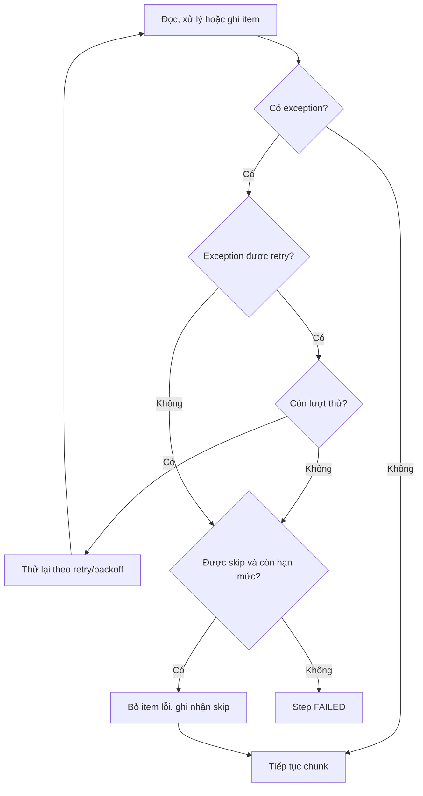

# Kiểm thử skip và retry trong Spring Batch

Một batch job xử lý hàng nghìn hoặc hàng triệu bản ghi khó tránh khỏi dữ liệu sai định dạng, lỗi kết nối tạm thời hoặc tranh chấp khi ghi cơ sở dữ liệu. Spring Batch cung cấp cơ chế **skip** để bỏ qua bản ghi không thể xử lý và **retry** để thử lại thao tác có khả năng thành công ở lần kế tiếp. Khi kiểm thử, điều quan trọng không chỉ là job có chạy xong hay không: cần chứng minh **bản ghi nào được xử lý, lỗi nào bị bỏ qua, thao tác nào được thử lại, giới hạn có hiệu lực và dữ liệu cuối cùng có đúng sau rollback hay không**.

Bài này tập trung vào kiểm thử hai cơ chế trong **chunk-oriented processing** (`ItemReader → ItemProcessor → ItemWriter`). Ví dụ dùng Java DSL của Spring Batch 5.x / Spring Boot 3.x; nếu dự án dùng phiên bản khác, đối chiếu chữ ký API và cấu hình hạ tầng tương ứng. Nguyên tắc kiểm thử, trạng thái job và ý nghĩa các counter vẫn áp dụng rộng rãi.

## 1. Phân biệt skip, retry và filter trước khi viết test

Giả sử một step đọc giao dịch từ tệp:

| Bản ghi / sự cố | Nguyên nhân | Hành vi phù hợp |
|---|---|---|
| `TX-01,150000` | Dữ liệu hợp lệ | Xử lý và ghi |
| `TX-02,abc` | Số tiền không hợp lệ | **Skip** bản ghi, nếu chính sách cho phép |
| `TX-03,250000` nhưng ghi bị deadlock | Lỗi tạm thời | **Retry** thao tác ghi |
| `TX-04,0` theo quy tắc nghiệp vụ không cần xuất | Bản ghi hợp lệ nhưng không cần đầu ra | **Filter**: processor trả `null` |
| Writer luôn ném lỗi lập trình `NullPointerException` | Lỗi không được phân loại là có thể phục hồi | **Fail** để điều tra |

**Skip** chấp nhận mất một bản ghi đầu vào cụ thể theo chính sách đã cấu hình. **Retry** giữ mục tiêu xử lý thành công bản ghi/thao tác đó và thực hiện thêm lần thử sau khi gặp lỗi. **Filter** không phải lỗi: khi `ItemProcessor.process(...)` trả `null`, item được loại khỏi đầu ra và tính vào `filterCount`, không phải `skipCount`.

Luồng quyết định có thể hình dung như sau:



Đây là mô hình khái niệm. Khi lỗi xuất hiện trong writer, Spring Batch có thể rollback và phát lại chunk, sau đó cô lập item gây lỗi. Vì vậy, **số lần gọi processor/writer không nhất thiết bằng số item đã commit**.

## 2. Cấu hình fault tolerance mà test cần bảo vệ

Ví dụ một step chuyển chuỗi đầu vào thành số nguyên, bỏ qua tối đa một chuỗi không hợp lệ và thử lại lỗi ghi tạm thời:

```java
@Bean
Step importStep(
        JobRepository jobRepository,
        PlatformTransactionManager transactionManager,
        ItemReader<String> reader,
        ItemWriter<Integer> writer) {

    return new StepBuilder("importStep", jobRepository)
            .<String, Integer>chunk(10, transactionManager)
            .reader(reader)
            .processor(Integer::parseInt)
            .writer(writer)
            .faultTolerant()
            .skip(NumberFormatException.class)
            .skipLimit(1)
            .retry(TemporaryWriteException.class)
            .retryLimit(3)
            .noRetry(NumberFormatException.class)
            .noSkip(TemporaryWriteException.class)
            .build();
}

class TemporaryWriteException extends RuntimeException {
    TemporaryWriteException(String message) {
        super(message);
    }
}
```

Các điểm cần hiểu để đặt kỳ vọng đúng:

- `faultTolerant()` bật cấu hình skip/retry cho chunk step. Nếu không bật, ngoại lệ thường làm step thất bại.
- `skip(NumberFormatException.class)` xác định loại lỗi **có thể bỏ qua**; `skipLimit(1)` chỉ cho phép **một lần skip** trong step. Lỗi skippable kế tiếp khiến step thất bại vì vượt hạn mức. Hạn mức là **tổng** skip ở reader, processor và writer.
- `retry(TemporaryWriteException.class)` và `retryLimit(3)` xác định loại lỗi có thể thử lại cùng giới hạn của chính sách retry. Khi cần xác minh chính xác số lần gọi, đo qua fake dependency hoặc listener; đừng suy luận mơ hồ rằng cấu hình `3` đồng nghĩa với ba lần gọi **lại** ngoài lần đầu.
- `noRetry(...)` và `noSkip(...)` giúp thể hiện ranh giới chính sách: lỗi dữ liệu không nên thử lại vô ích; lỗi tạm thời không tự động bị coi là bản ghi xấu. Chúng đặc biệt hữu ích khi cấu hình có ngoại lệ cha rộng.
- Lớp con của một exception có thể thuộc quy tắc phân loại của lớp cha. Test nên bao gồm cả lỗi con và quy tắc loại trừ nếu hệ thống sử dụng phân cấp exception phức tạp.

Trong hệ thống thực tế, thay `NumberFormatException` bằng exception nghiệp vụ rõ nghĩa như `InvalidPaymentRowException`. Chỉ phân loại là retryable các lỗi có cơ sở sẽ hồi phục (deadlock, timeout ngắn, sự cố mạng tạm thời). Lỗi xác thực dữ liệu, vi phạm nghiệp vụ vĩnh viễn hoặc lỗi lập trình không nên được retry một cách đại trà.

### Skip và retry cùng áp dụng cho một loại lỗi

Nếu một exception vừa được đăng ký retry vừa được đăng ký skip, hành vi thường cần kiểm thử là: **thử lại trước; nếu vẫn thất bại sau khi hết lượt retry, cân nhắc skip theo skip policy và hạn mức còn lại**. Không nên dựa vào hành vi này một cách ngầm định: hãy viết test riêng để xác nhận quy tắc mong muốn và đảm bảo không bỏ qua lỗi ghi dữ liệu quan trọng.

## 3. Các counter và trạng thái phải assert

Sau khi chạy, lấy `JobExecution` và `StepExecution` để kiểm tra kết quả:

| Thông tin | Ý nghĩa | Cách kiểm thử |
|---|---|---|
| `JobExecution.getStatus()` | Trạng thái tổng thể `COMPLETED`, `FAILED`, ... | So với kết quả dự kiến |
| `StepExecution.getStatus()` | Trạng thái của step cụ thể | Xác nhận step thực sự hoàn thành/thất bại |
| `getReadSkipCount()` | Số lỗi bỏ qua trong reader | Assert khi reader có lỗi skippable |
| `getProcessSkipCount()` | Số item bị skip trong processor | Assert khi validate/chuyển đổi thất bại |
| `getWriteSkipCount()` | Số item bị skip trong writer | Assert khi writer xác định được item lỗi |
| `getSkipCount()` | Tổng skip của ba giai đoạn | So với giới hạn cấu hình |
| `getFilterCount()` | Số item bị processor lọc bằng `null` | Phân biệt với skip |
| `getWriteCount()` | Số item được ghi nhận là đã write thành công | So với kết quả đầu ra đã commit |
| `getFailureExceptions()` | Danh sách exception dẫn tới lỗi step | Kiểm tra nguyên nhân khi `FAILED` |

Không có một counter retry tổng quát tương đương `getSkipCount()` trên `StepExecution`. Để chứng minh retry đã diễn ra, có thể ghi số lượt gọi tại fake service/writer, dùng `RetryListener` hoặc thu thập metric của ứng dụng. Ưu tiên assert **hành vi quan sát được** (thành công sau lỗi tạm thời, dữ liệu cuối đúng, có thêm lượt thử) thay vì kiểm tra nội bộ framework quá chặt.

Ví dụ một đầu vào có ba item, gồm `10`, `bad`, `20`, với skipLimit bằng 1:

```text
Job status         = COMPLETED
Read skip count    = 0
Process skip count = 1
Write skip count   = 0
Total skip count   = 1
Filter count       = 0
Write count        = 2
Committed output   = [10, 20]
```

Những kết quả này chỉ đúng khi writer cuối cùng ghi thành công và không có logic lọc khác.

## 4. Một bài kiểm thử tích hợp có skip lẫn retry

Ví dụ sau sử dụng một job ngắn: đọc `10`, `bad`, `20`; processor bỏ qua lỗi parse; writer cố ý thất bại ở lần gọi đầu và thành công về sau. Đây là **failure injection** có thể dự đoán được, tránh phụ thuộc vào việc mạng hoặc database thực sự gặp lỗi ngẫu nhiên.

Để chạy ví dụ trong dự án Spring Boot 3, cần các thư viện kiểm thử của Spring Boot, `spring-batch-test` và database test (chẳng hạn H2) để lưu metadata của `JobRepository`. Đặt các lớp cấu hình trong phạm vi component scan của ứng dụng; ở test, tắt tự chạy batch khi context khởi tạo bằng `spring.batch.job.enabled=false`.

### 4.1. Cấu hình job và đối tượng quan sát

```java
import java.util.List;
import java.util.concurrent.CopyOnWriteArrayList;
import java.util.concurrent.atomic.AtomicInteger;

import org.springframework.batch.core.Job;
import org.springframework.batch.core.Step;
import org.springframework.batch.core.SkipListener;
import org.springframework.batch.core.configuration.annotation.StepScope;
import org.springframework.batch.core.job.builder.JobBuilder;
import org.springframework.batch.core.repository.JobRepository;
import org.springframework.batch.core.step.builder.StepBuilder;
import org.springframework.batch.item.ItemReader;
import org.springframework.batch.item.ItemWriter;
import org.springframework.batch.item.support.ListItemReader;
import org.springframework.context.annotation.Bean;
import org.springframework.context.annotation.Configuration;
import org.springframework.transaction.PlatformTransactionManager;

final class TestProbe {
    final AtomicInteger writerCalls = new AtomicInteger();
    final List<Integer> successfulWrites = new CopyOnWriteArrayList<>();
    final List<String> skippedInProcessor = new CopyOnWriteArrayList<>();
}

final class TemporaryWriteException extends RuntimeException {
    TemporaryWriteException(String message) {
        super(message);
    }
}

@Configuration
class DemoBatchConfiguration {
    @Bean
    TestProbe testProbe() {
        return new TestProbe();
    }

    @Bean
    @StepScope
    ItemReader<String> demoReader() {
        // Mỗi StepExecution nhận một reader mới.
        return new ListItemReader<>(List.of("10", "bad", "20"));
    }

    @Bean
    Step demoStep(JobRepository repository,
                  PlatformTransactionManager transactionManager,
                  ItemReader<String> demoReader,
                  TestProbe probe) {
        ItemWriter<Integer> flakyWriter = chunk -> {
            int currentCall = probe.writerCalls.incrementAndGet();
            if (currentCall == 1) {
                throw new TemporaryWriteException("Temporary destination failure");
            }
            probe.successfulWrites.addAll(chunk.getItems());
        };

        SkipListener<String, Integer> skipEvents = new SkipListener<>() {
            @Override
            public void onSkipInRead(Throwable error) {
                // Không có lỗi reader trong kịch bản này.
            }

            @Override
            public void onSkipInProcess(String item, Throwable error) {
                probe.skippedInProcessor.add(item);
            }

            @Override
            public void onSkipInWrite(Integer item, Throwable error) {
                // Không có lỗi writer được skip trong kịch bản này.
            }
        };

        return new StepBuilder("demoStep", repository)
                .<String, Integer>chunk(3, transactionManager)
                .reader(demoReader)
                .processor(Integer::parseInt)
                .writer(flakyWriter)
                .faultTolerant()
                .skip(NumberFormatException.class)
                .skipLimit(1)
                .retry(TemporaryWriteException.class)
                .retryLimit(3)
                .listener(skipEvents)
                .build();
    }

    @Bean
    Job demoJob(JobRepository repository, Step demoStep) {
        return new JobBuilder("demoJob", repository)
                .start(demoStep)
                .build();
    }
}
```

`TestProbe` quan sát các lần writer được gọi và các item liên quan. Danh sách trong bộ nhớ ở đây **chỉ phục vụ minh họa** vì không gắn với transaction của database. Khi kiểm thử writer thực, phải truy vấn dữ liệu **sau commit** trong cơ sở dữ liệu hoặc một đích ghi có tính giao dịch. `ListItemReader` cũng chỉ thích hợp cho demo ngắn; test về restart/checkpoint cần reader triển khai `ItemStream` có khả năng lưu, khôi phục vị trí đọc.

### 4.2. Test chạy job và kiểm tra kết quả

```java
import static org.junit.jupiter.api.Assertions.*;

import java.util.List;

import org.junit.jupiter.api.Test;
import org.springframework.batch.core.BatchStatus;
import org.springframework.batch.core.JobExecution;
import org.springframework.batch.core.JobParametersBuilder;
import org.springframework.batch.core.StepExecution;
import org.springframework.batch.test.JobLauncherTestUtils;
import org.springframework.batch.test.context.SpringBatchTest;
import org.springframework.beans.factory.annotation.Autowired;
import org.springframework.boot.test.context.SpringBootTest;

@SpringBatchTest
@SpringBootTest(properties = "spring.batch.job.enabled=false")
class SkipRetryIntegrationTest {
    @Autowired
    JobLauncherTestUtils jobLauncherTestUtils;

    @Autowired
    TestProbe probe;

    @Test
    void skipsInvalidItemAndRetriesTemporaryWriterFailure() throws Exception {
        JobExecution execution = jobLauncherTestUtils.launchJob(
                new JobParametersBuilder()
                        .addLong("run.id", System.nanoTime())
                        .toJobParameters());

        StepExecution step = execution.getStepExecutions()
                .iterator().next();

        assertEquals(BatchStatus.COMPLETED, execution.getStatus());
        assertEquals(BatchStatus.COMPLETED, step.getStatus());

        assertEquals(0, step.getReadSkipCount());
        assertEquals(1, step.getProcessSkipCount());
        assertEquals(0, step.getWriteSkipCount());
        assertEquals(1, step.getSkipCount());
        assertEquals(0, step.getFilterCount());
        assertEquals(2, step.getWriteCount());

        assertEquals(List.of("bad"), probe.skippedInProcessor);
        assertEquals(List.of(10, 20), probe.successfulWrites);
        assertTrue(probe.writerCalls.get() >= 2,
                "Writer phải được gọi lại sau lỗi tạm thời");
    }
}
```

Nếu ứng dụng có nhiều `Job`, truyền đúng job vào `JobLauncherTestUtils` (ví dụ gọi `setJob(...)` trong phần setup) để test không khởi chạy nhầm. Tạo `JobParameters` riêng cho mỗi lượt chạy độc lập; khi kiểm thử **restart**, cố ý giữ **cùng identifying parameters** của JobInstance đã thất bại thay vì tạo `run.id` mới.

Test này đồng thời chứng minh:

1. Lỗi parse được **skip tại processor** và không biến thành lỗi của toàn job.
2. Writer gặp lỗi tạm thời và **có ít nhất một lần gọi tiếp theo**.
3. Job kết thúc `COMPLETED`, chỉ có hai giá trị hợp lệ được ghi nhận.
4. Lỗi writer được retry **không** làm tăng `writeSkipCount`.

Để tránh một test ôm quá nhiều trách nhiệm trong dự án thực, nên bổ sung các test riêng biệt cho từng nhánh lỗi ở bảng dưới đây.

## 5. Ma trận tình huống kiểm thử

| Kịch bản | Thiết lập | Kỳ vọng quan trọng |
|---|---|---|
| Không có lỗi | Tất cả item hợp lệ; writer thành công | `COMPLETED`; skip = 0; writeCount bằng số đầu ra |
| Skip processor trong hạn mức | Một chuỗi sai; `skipLimit(1)` | `COMPLETED`; processSkip = 1; item sai không xuất hiện |
| Vượt skip limit | Hai chuỗi sai; `skipLimit(1)` | Step `FAILED` khi không thể skip thêm; kiểm tra lỗi gốc |
| Lỗi reader skippable | Reader có thể tiến qua một record hỏng | `readSkipCount` tăng; dữ liệu còn lại vẫn xử lý |
| Lỗi writer skippable | Writer xác định được item lỗi, trong hạn mức | `writeSkipCount` tăng; item hợp lệ được commit đúng |
| Retry hồi phục | Dependency fail lần đầu rồi thành công | `COMPLETED`; có nhiều lượt gọi; dữ liệu cuối ghi đúng một lần |
| Retry hết lượt | Dependency luôn ném exception retryable | `FAILED` nếu không có chính sách skip hợp lệ sau đó |
| Lỗi không phân loại | Processor/writer ném exception không được skip/retry | `FAILED`; không âm thầm bỏ item |
| Retry rồi skip | Cùng exception được phép retry và skip | Sau khi thử lại hết lượt, skip nếu còn hạn mức; assert cả hai pha |
| Filter hợp lệ | Processor trả `null` | `filterCount` tăng; `skipCount` giữ nguyên |
| Restart sau failure | Chạy lại JobInstance đã `FAILED` với reader checkpoint được | Không đọc/ghi trùng phần đã commit; dữ liệu cuối đúng |

Mỗi hàng trong ma trận nên là một test với dữ liệu và lỗi được điều khiển bằng fake/stub, mock có giới hạn hoặc test database. Không cố tạo deadlock thật trong unit test vì tính ngẫu nhiên làm giảm giá trị của test.

### 5.1. Test vượt skip limit

Giữ `skipLimit(1)` nhưng đổi đầu vào thành `["10", "bad-A", "bad-B", "20"]`. Test cần assert step/job `FAILED` vì gặp bản ghi không thể skip thêm. Đồng thời kiểm tra `getFailureExceptions()` chứa nguyên nhân phù hợp và xác nhận **không có một lần chạy COMPLETED giả**.

Không nên luôn assert `processSkipCount == 2` cho lần vượt hạn mức: item thứ hai có thể là **lỗi làm step thất bại** chứ không trở thành một item được skip thành công. Phải dựa trên số skip thực sự được ghi nhận và thông điệp/exception của phiên bản đang sử dụng.

### 5.2. Test retry thành công và retry hết lượt

Một fake service có thể chủ động lỗi ở `N` lượt đầu:

```java
final class FlakyGateway {
    private final AtomicInteger attempts = new AtomicInteger();
    private final int failFirst;

    FlakyGateway(int failFirst) {
        this.failFirst = failFirst;
    }

    void send(int value) {
        int attempt = attempts.incrementAndGet();
        if (attempt <= failFirst) {
            throw new TemporaryWriteException("attempt=" + attempt);
        }
        // Ghi nhận việc gửi thành công trong fake.
    }

    int attempts() {
        return attempts.get();
    }
}
```

Ở trường hợp hồi phục, đặt `failFirst=1`, xác nhận có lượt gọi tiếp theo và đầu ra thành công. Ở trường hợp lỗi liên tục, đặt `failFirst` lớn hơn giới hạn thử, xác nhận `FAILED` cùng exception nguyên nhân. Tránh dựa vào `Thread.sleep(...)` hoặc số lượt gọi do framework suy diễn: fake giúp chứng minh giới hạn bằng quan sát thực tế, đồng thời phát hiện retry vô hạn.

Nếu cấu hình có backoff thật, thay bằng chính sách không chờ hoặc độ trễ rất nhỏ trong test để bộ kiểm thử chạy nhanh, ổn định. Với production, chọn backoff phù hợp để không dồn yêu cầu liên tiếp lên dịch vụ đang lỗi.

### 5.3. Test skip trong reader và writer

**Reader:** Có reader gặp record hỏng và vẫn tiến sang record kế tiếp; có reader ném exception nhưng không thay đổi con trỏ đọc. Trường hợp sau có nguy cơ lặp vô hạn trên cùng record. Test phải chứng minh reader bỏ qua đúng record bị lỗi, không mất các record khác, và `readSkipCount` tăng như dự kiến. Với nguồn có transaction như message queue, cấu hình reader/rollback phải phù hợp với khả năng đưa message trở lại hàng đợi.

**Writer:** Writer thường nhận cả `Chunk` thay vì một item. Nếu writer ném exception, Spring Batch có thể **rollback toàn chunk, phát lại và chia nhỏ công việc để nhận diện item không ghi được**. Test cần xác nhận tập dữ liệu **đã commit**, `writeSkipCount`, tính không trùng lặp và khả năng khôi phục. Không assert cứng writer được gọi đúng một lần cho mỗi item.

## 6. Transaction, rollback và các bẫy khi đếm retry

Trong chunk-oriented step, framework gom item theo kích thước chunk rồi thực hiện write trong transaction. Xử lý lỗi ảnh hưởng đến transaction theo giai đoạn:

- Với lỗi ở **processor** được cấu hình skip, Spring Batch thường có thể bỏ item lỗi mà không cần rollback toàn chunk.
- Với lỗi ở **writer**, rollback thường xảy ra ngay cả khi đã bật retry hoặc skip. Các item trong chunk có thể được xử lý/ghi lại khi recovery.
- Với lỗi ở **reader**, hành vi phụ thuộc reader, nguồn dữ liệu và cách quản lý transaction; không mặc định reader đã tiêu thụ được bản ghi hỏng.
- Các lựa chọn như `noRollback(...)` hay `readerIsTransactionalQueue()` thay đổi hành vi transaction. Chỉ dùng khi hiểu rõ nguồn dữ liệu và bổ sung test rollback tương ứng.

Ví dụ writer ghi sang một API bên ngoài, gửi email hoặc đẩy thông điệp thì transaction JDBC **không thể tự hoàn tác** tác dụng bên ngoài. Nếu lần gọi đầu đã thành công ở hệ thống đích nhưng client nhận timeout, retry có thể gây ghi hai lần. Thiết kế writer nên có **idempotency key**, unique constraint, upsert hoặc cơ chế chống trùng. Test phải mô phỏng tình huống "server đã nhận nhưng client thấy lỗi", không chỉ tình huống "server chưa hề nhận".

Một kiểm thử đáng tin cậy có thể theo chuỗi:

1. Chuẩn bị database test sạch và tập input có định danh duy nhất.
2. Cố ý làm writer lỗi sau khi đã bắt đầu thao tác trong một chunk.
3. Cho framework retry hoặc recovery theo chính sách.
4. Query database **ngoài transaction đã rollback** và so sánh tập bản ghi, số lượng và khóa duy nhất.
5. Xác nhận số dòng đã commit đúng, không thiếu/trùng, kể cả khi writer hoặc processor bị gọi lại.

Không dùng một `ArrayList` hoặc mock invocation count thay cho kiểm tra transaction commit: chúng không rollback cùng database.

### Processor bị gọi lại có phải là bug?

Không nhất thiết. Sau rollback, framework có thể đọc/xử lý lại dữ liệu đã buffer, hoặc tái thực hiện một phần chunk. Nếu processor nặng hoặc có side effect, cần xem xét tính thuần hàm/idempotency. Spring Batch có tùy chọn `processorNonTransactional()` để lưu kết quả processor qua một số lần retry/rollback, nhưng việc bật tùy chọn này phải đi kèm test về dữ liệu cache, transaction và hành vi khi khởi động lại.

## 7. Dùng listener để quan sát item bị skip và lý do

Trong test, `SkipListener<I, O>` giúp thu thập item bị bỏ qua cùng exception:

```java
SkipListener<String, Integer> listener = new SkipListener<>() {
    @Override
    public void onSkipInRead(Throwable t) {
        // Không có item đầu vào bảo đảm sẵn để log khi lỗi xảy ra ở reader.
    }

    @Override
    public void onSkipInProcess(String item, Throwable t) {
        // Có thể log id của item và loại lỗi để audit.
    }

    @Override
    public void onSkipInWrite(Integer item, Throwable t) {
        // Có thể log id của item đầu ra bị từ chối.
    }
};
```

Listener có ích để assert **đúng item nào** đã bị skip, bởi `skipCount=1` không nói item bị bỏ qua là gì. Với retry, có thể đăng ký `RetryListener` của Spring Retry để quan sát mở/đóng retry context và lỗi từng lượt; tách số lần thử khỏi các counter skip. Khi viết audit production, cân nhắc độ nhạy cảm của dữ liệu và bảo đảm bản ghi audit không bị nhân đôi ngoài ý muốn sau rollback.

Khi kiểm thử listener, nên kiểm tra sự kiện đã xảy ra và định danh item. Không gắn chặt test vào thứ tự callback nội bộ hoặc số callback của các nhánh recovery nếu nghiệp vụ không yêu cầu.

## 8. Kiểm thử restart sau khi skip/retry thất bại

Retry xử lý lỗi **trong một lần thực thi step**; restart là **lần chạy tiếp theo của cùng JobInstance** sau thất bại. Hai cơ chế có mục tiêu khác nhau và phải kiểm thử riêng.

Một bài test restart đại diện:

1. Tạo job có reader hỗ trợ checkpoint (ví dụ `FlatFileItemReader` hoặc `JdbcPagingItemReader` được cấu hình state), writer có tính idempotent và chunk size xác định.
2. Cho một số chunk đầu commit thành công; sau đó làm dịch vụ ghi tiếp tục lỗi cho đến khi vượt giới hạn retry, khiến job `FAILED`.
3. Sửa fake dependency thành hoạt động bình thường; chạy lại job với **cùng bộ identifying JobParameters**.
4. Kiểm tra job mới kết thúc `COMPLETED`, phần đã commit từ lần trước không bị ghi lại, những record còn lại đầy đủ và các sự kiện skip/retry phản ánh từng lần thực thi.

Chú ý `JobExecution` mới có `StepExecution` riêng và counter riêng; không cộng tùy tiện counter của mọi lần chạy rồi so trực tiếp với skip limit của một step execution. Một job đã `COMPLETED` thường không thể chạy lại cùng JobInstance bằng bộ identifying parameters cũ; cần tạo instance mới cho kịch bản chạy độc lập.

Nếu reader không lưu vị trí, writer không idempotent, hoặc job xử lý nguồn dữ liệu thay đổi trong thời gian dừng, test restart có thể phát hiện mất hoặc trùng bản ghi ngay cả khi test retry trong một execution vẫn xanh.

## 9. Những lỗi kiểm thử thường gặp

| Sai lầm | Hậu quả | Cách làm phù hợp |
|---|---|---|
| Chỉ assert `BatchStatus.COMPLETED` | Có thể âm thầm skip quá nhiều dữ liệu hợp lệ | Assert counter, định danh item và dữ liệu đầu ra |
| Nhầm `filterCount` với `skipCount` | Báo sai số record lỗi | Test riêng processor trả `null` và processor ném exception |
| Kỳ vọng một lần gọi writer/item | Fail giả khi framework replay chunk sau rollback | Assert dữ liệu đã commit, không trùng lặp |
| Retry mọi `Exception` | Che lỗi lập trình, kéo dài job vô ích | Phân loại exception và test loại không retry |
| Chỉ test retry thành công | Không chứng minh giới hạn dừng | Có test lỗi kéo dài đến khi `FAILED` |
| Chỉ test dưới `skipLimit` | Không biết job phản ứng khi quá giới hạn | Test cả đúng ngưỡng và vượt ngưỡng |
| Tạo `run.id` mới cho test restart | Thực ra chạy JobInstance mới | Giữ identifying parameters và quan sát JobExecution mới |
| Dùng reader stateful một lần cho nhiều test | Test phụ thuộc thứ tự, đầu vào đã bị tiêu thụ | Tạo reader mới theo step execution hoặc reset nguồn |
| Dùng danh sách trong RAM để kết luận đã commit | Bỏ sót dữ liệu bị rollback | Query đích giao dịch sau khi job kết thúc |
| Dùng network/deadlock ngẫu nhiên để tạo lỗi | Test chậm và thiếu ổn định | Dùng fake/stub hoặc DB test với fault injection có kiểm soát |

## 10. Tiêu chí hoàn tất một bộ test skip/retry

Một bộ kiểm thử có giá trị nên giúp người đọc trả lời được các câu hỏi cụ thể: dữ liệu lỗi nào được bỏ qua; vì sao được bỏ qua; giới hạn skip có chặn đúng lúc không; lỗi tạm thời có được thử lại và hồi phục không; khi lỗi liên tục thì step có kết thúc thất bại không; writer rollback có làm trùng dữ liệu không; và khi restart có ghi đúng phần còn lại không.

Tối thiểu nên có test cho **skip trong hạn mức**, **skip vượt hạn mức**, **retry hồi phục**, **retry cạn lượt**, **exception không được phân loại** và **kết quả dữ liệu sau transaction**. Với batch chịu trách nhiệm dữ liệu quan trọng, bổ sung test **writer skip**, **idempotency** và **restart/checkpoint**. Lúc đó trạng thái `COMPLETED` mới đi kèm bằng chứng rằng job xử lý đúng dữ liệu, thay vì đơn thuần chạy không ném lỗi.
