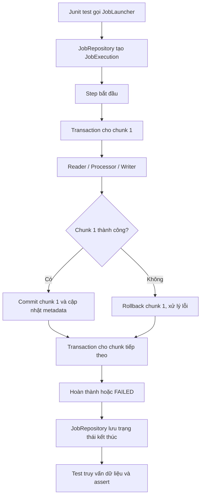

# Transaction manager trong test của Spring Batch

Khi kiểm thử Spring Batch, một kết quả `JobExecution` ở trạng thái `COMPLETED` chưa chứng minh dữ liệu đã được commit đúng. Tương tự, khi job thất bại, việc một mock writer bị gọi không chứng minh thao tác ghi thật đã rollback. **Transaction manager** quyết định ranh giới transaction, thời điểm commit, cách rollback và việc tài nguyên (JDBC, JPA, message queue...) có tham gia cùng transaction hay không.

Bài này trình bày cách chọn, cấu hình và kiểm chứng transaction manager trong **test infrastructure** của Spring Batch, đặc biệt với chunk-oriented step, `JobRepository`, `@SpringBatchTest` và `@Transactional` của Spring Test. Ví dụ dùng Java, Spring Boot 3.x / Spring Batch 5.x, JUnit 5 và cơ sở dữ liệu H2 để minh họa. Tên bean và cách tự cấu hình có thể khác khi dự án dùng nhiều data source hoặc phiên bản framework khác.

## 1. Trong một bài test có thể tồn tại nhiều transaction

Trước khi viết test, cần tách ba vai trò thường bị nhầm lẫn:

| Vai trò | Ai điều khiển | Dùng để làm gì? |
|---|---|---|
| **Transaction của JobRepository** | Hạ tầng Spring Batch | Tạo/cập nhật `JobInstance`, `JobExecution`, `StepExecution` và `ExecutionContext` trong metadata |
| **Transaction của step/chunk** | `PlatformTransactionManager` được truyền cho `StepBuilder.chunk(...)` | Bao các thao tác đọc/xử lý/ghi theo ranh giới chunk và commit hoặc rollback chunk |
| **Transaction do Spring Test quản lý** | `@Transactional` trên test, cùng `TransactionalTestExecutionListener` | Bao lấy lời gọi trong phương thức test và thường rollback sau test để dọn dữ liệu |

Ba vai trò này có thể dùng **cùng transaction manager**, nhưng không đồng nghĩa mọi thao tác đều nằm trong một transaction duy nhất. Hạ tầng Spring Batch mở các transaction metadata và chunk ở những thời điểm khác nhau. Transaction của test lại có vòng đời riêng.

Một luồng chạy job đơn giản:



Sơ đồ mang tính khái niệm: transaction metadata và transaction nghiệp vụ có thể dùng hai manager/hai data source khác nhau, nên không phải lúc nào việc cập nhật metadata cũng nằm trong cùng transaction JDBC với ghi dữ liệu nghiệp vụ.

**Câu hỏi đầu tiên của test:** muốn kiểm tra kết quả của logic thuần, của một thao tác repository trong transaction, hay của **cả một job thực sự commit/rollback chunk**? Câu trả lời quyết định loại test và cách dùng transaction manager.

## 2. Transaction manager nào phù hợp?

Spring định nghĩa giao diện `PlatformTransactionManager`. Các triển khai khác nhau có trách nhiệm khác nhau:

| Manager | Nguồn dữ liệu thường dùng | Vai trò trong test |
|---|---|---|
| `DataSourceTransactionManager` hoặc `JdbcTransactionManager` | JDBC, `JdbcTemplate`, JDBC writer | Kiểm tra commit/rollback SQL trên cùng `DataSource` |
| `JpaTransactionManager` | JPA, `EntityManager`, Spring Data JPA | Kiểm tra transaction của persistence context, flush, commit/rollback entity |
| `JtaTransactionManager` | Nhiều tài nguyên tham gia transaction phân tán khi hạ tầng hỗ trợ | Test môi trường có XA/JTA và yêu cầu phối hợp transaction |
| `ResourcelessTransactionManager` | Không quản lý tài nguyên giao dịch thực | Dùng ở một số test logic/infrastructure rất nhẹ; **không thể chứng minh rollback của JDBC/JPA** |
| Fake/mock `PlatformTransactionManager` | Chỉ mô phỏng hợp đồng API | Kiểm tra lời gọi hoặc wiring; **không kiểm tra commit thật** |

Với một nguồn JDBC, hai nguyên tắc quan trọng là:

1. Transaction manager dùng bởi chunk phải quản lý **đúng `DataSource` mà writer sử dụng**. Nếu writer ghi qua một nguồn khác, commit/rollback của chunk có thể không bao trùm các câu SQL đó.
2. Nếu dùng JPA, cần transaction manager tương thích với `EntityManagerFactory` của writer/repository. Kiểm tra thêm chuyện flush, cache và transaction propagation thay vì suy luận chỉ từ số lần gọi `save(...)`.

Khi sử dụng Spring Boot autoconfiguration cùng một `DataSource`, Spring thường có thể tạo manager phù hợp. Nếu ứng dụng định nghĩa nhiều manager hoặc nhiều data source, hãy dùng `@Qualifier` hoặc tên bean có ý nghĩa để tránh vô tình chọn nhầm.

Ví dụ khai báo rõ manager phục vụ step:

```java
@Bean
Step importStep(
        JobRepository jobRepository,
        @Qualifier("businessTransactionManager")
        PlatformTransactionManager businessTransactionManager,
        ItemReader<OrderRow> reader,
        ItemWriter<OrderRow> writer) {

    return new StepBuilder("importStep", jobRepository)
            .<OrderRow, OrderRow>chunk(100, businessTransactionManager)
            .reader(reader)
            .writer(writer)
            .build();
}
```

Đoạn code giả định `OrderRow`, reader, writer và bean `businessTransactionManager` đã tồn tại. Spring Batch 5 yêu cầu truyền transaction manager trực tiếp vào phương thức `chunk(size, transactionManager)`. Các ví dụ dựa trên `StepBuilderFactory` từ thế hệ Spring Batch cũ có thể gây nhầm khi áp dụng vào Spring Batch 5.

### JobRepository manager khác chunk manager được không?

Được. Một hệ thống có thể lưu metadata Batch trong database A và ghi dữ liệu nghiệp vụ vào database B. Khi đó mỗi bên có transaction manager riêng. Nhưng **hai transaction độc lập không tự động bảo đảm tính nguyên tử trên cả hai database**: có thể đã commit nghiệp vụ rồi mới gặp lỗi khi cập nhật metadata. Test cần mô phỏng và xác nhận cách khôi phục hoặc cách ghi idempotent.

Nếu nghiệp vụ cần một transaction phân tán thực sự, việc triển khai phụ thuộc hạ tầng JTA/XA hoặc một thiết kế nhất quán khác. Không nên coi hai `DataSourceTransactionManager` độc lập là một transaction chung.

## 3. Chọn mức kiểm thử trước khi bật transaction

| Mức test | Thành phần được chạy | Gợi ý hạ tầng | Điều có thể chứng minh |
|---|---|---|---|
| Unit test processor | Gọi trực tiếp `ItemProcessor.process(...)` | JUnit và fake dependency | Logic biến đổi, validate, exception |
| Unit test writer | Gọi trực tiếp `ItemWriter.write(...)` | Mock/fake repository hoặc gateway | Dữ liệu đưa đến dependency |
| Integration test repository/service | Có database thật cho test | `JdbcTemplate` / JPA + manager thật + `TransactionTemplate` | Commit, rollback, constraint, isolation của thao tác đó |
| Integration test step/job | `JobLauncher`, `JobRepository`, reader, writer, metadata thật | `@SpringBatchTest`, `@SpringBootTest`, database test | Ranh giới chunk, status, counter và dữ liệu sau commit |
| End-to-end test nhiều tài nguyên | Job với hệ thống ngoài hoặc môi trường gần production | Testcontainers, sandbox service, quan sát đầu ra | Hệ quả giữa nhiều dịch vụ, idempotency, phục hồi |

**Không cần một transaction manager thật cho phép tính thuần.** Ngược lại, để khẳng định dữ liệu đã rollback sau lỗi writer, phải có tài nguyên transactional thật và query dữ liệu sau khi job kết thúc. Một `List<Integer>` trong RAM hoặc mock `JdbcTemplate` không phản ánh rollback của database.

## 4. Vì sao không nên đặt `@Transactional` bừa bãi lên test chạy job?

Spring Test có hành vi hữu ích: một phương thức test gắn `@Transactional` thường được bao trong transaction và rollback sau test. Điều này phù hợp với nhiều test repository, nhưng dễ gây hiểu sai trong test Spring Batch.

Ví dụ **không phù hợp** khi mục đích là xác minh commit thật của job:

```java
@SpringBatchTest
@SpringBootTest
class MyJobTest {
    @Test
    @Transactional
    void runsJob() throws Exception {
        // Gọi JobLauncher rồi suy luận rằng chunk đã commit vào DB.
    }
}
```

Có hai nhóm vấn đề:

- `JobRepository` có thể từ chối tạo `JobExecution` khi phát hiện một transaction đang mở sẵn. Một lỗi điển hình là thông báo tương tự **"Existing transaction detected in JobRepository"**, tùy cấu hình repository và transaction propagation.
- Nếu công việc có tham gia transaction do test mở (cùng thread/cùng manager), dữ liệu có thể bị rollback khi test kết thúc. Một lần query **bên trong transaction test** có thể nhìn thấy dữ liệu chưa commit, dẫn tới kết luận sai rằng job đã commit.

Các job dùng executor bất đồng bộ còn làm vấn đề khó quan sát hơn: transaction của test được ràng buộc với thread, không tự nhiên truyền sang thread xử lý batch.

Đối với **integration test chạy cả job**, lựa chọn rõ ràng thường là:

- Không đặt `@Transactional` lên class/phương thức test gọi `JobLauncher`.
- Tạo trước fixture bằng SQL hoặc repository theo transaction đã commit; dọn fixture bằng `@Sql`, `JdbcTemplate` hoặc công cụ kiểm thử chuyên dụng.
- Khởi chạy job với `JobParameters` phù hợp, chờ execution hoàn thành nếu launcher bất đồng bộ, sau đó truy vấn dữ liệu qua kết nối mới/bên ngoài transaction test.
- Kiểm tra cả `BatchStatus`, `StepExecution`, số liệu rollback và dữ liệu thực đã persist.

Nếu chỉ kiểm tra repository/service độc lập thì `@Transactional` trên test vẫn hữu ích. Khi đó phải hiểu rằng thao tác commit do test quản lý khác với commit của chunk production.

### `@Rollback(false)` có giải quyết hoàn toàn không?

Không. `@Rollback(false)` chỉ yêu cầu Spring Test **không tự rollback transaction do test quản lý**. Nó không tự sửa vấn đề mở transaction trước khi `JobRepository` tạo execution, không đảm bảo đúng manager được chọn và không xác minh ranh giới transaction của từng chunk. Với test job, cách dễ kiểm soát hơn là bỏ transaction wrapper ở cấp test và dùng chính job để điều khiển commit.

## 5. Ví dụ integration test: chunk đầu commit, chunk sau rollback

Mục tiêu: có bốn ID `1, 2, 3, 4`; step ghi hai item mỗi chunk. Writer cố ý ném lỗi sau khi thực hiện câu INSERT cho ID `4`. Vì writer chạy trong transaction chunk, cả hai INSERT của chunk chứa `3, 4` sẽ rollback, trong khi chunk chứa `1, 2` đã commit từ trước vẫn còn.

Kỳ vọng sau khi job thất bại:

```text
Chunk 1: INSERT 1, INSERT 2  → COMMIT
Chunk 2: INSERT 3, INSERT 4  → exception → ROLLBACK

BatchStatus              = FAILED
Rows trong bảng cuối cùng = [1, 2]
```

Ví dụ dùng một H2 data source cho cả metadata Batch và bảng nghiệp vụ. Trong dự án Spring Boot 3, cần dependency `spring-boot-starter-batch`, `spring-boot-starter-jdbc`, H2 cho test, `spring-batch-test` và Spring Boot test/JUnit. Boot cần tạo schema metadata của Spring Batch; khai báo `spring.batch.jdbc.initialize-schema=always` trong cấu hình test.

### 5.1. Cấu hình job và transaction manager

```java
import java.util.List;

import org.springframework.batch.core.Job;
import org.springframework.batch.core.Step;
import org.springframework.batch.core.configuration.annotation.StepScope;
import org.springframework.batch.core.job.builder.JobBuilder;
import org.springframework.batch.core.repository.JobRepository;
import org.springframework.batch.core.step.builder.StepBuilder;
import org.springframework.batch.item.ItemReader;
import org.springframework.batch.item.ItemWriter;
import org.springframework.batch.item.support.ListItemReader;
import org.springframework.boot.SpringBootConfiguration;
import org.springframework.boot.autoconfigure.EnableAutoConfiguration;
import org.springframework.context.annotation.Bean;
import org.springframework.jdbc.core.JdbcTemplate;
import org.springframework.transaction.PlatformTransactionManager;

@SpringBootConfiguration
@EnableAutoConfiguration
public class TestBatchApplication {

    @Bean
    @StepScope
    ItemReader<Integer> txReader() {
        // Reader mới cho mỗi lần chạy step.
        return new ListItemReader<>(List.of(1, 2, 3, 4));
    }

    @Bean
    Step txStep(
            JobRepository jobRepository,
            PlatformTransactionManager transactionManager,
            ItemReader<Integer> txReader,
            JdbcTemplate jdbcTemplate) {

        ItemWriter<Integer> writer = chunk -> {
            for (Integer id : chunk.getItems()) {
                jdbcTemplate.update(
                        "INSERT INTO business_result (id) VALUES (?)", id);

                if (id == 4) {
                    // Lỗi xảy ra sau khi câu INSERT được gửi tới DB.
                    throw new IllegalStateException("Injected failure");
                }
            }
        };

        return new StepBuilder("txStep", jobRepository)
                .<Integer, Integer>chunk(2, transactionManager)
                .reader(txReader)
                .writer(writer)
                .build();
    }

    @Bean
    Job txJob(JobRepository jobRepository, Step txStep) {
        return new JobBuilder("txJob", jobRepository)
                .start(txStep)
                .build();
    }
}
```

Ở đây không khai báo `@EnableBatchProcessing` vì để Spring Boot tạo hạ tầng Batch/transaction manager mặc định qua autoconfiguration. Với ứng dụng đã tự cấu hình toàn bộ Batch infrastructure, cần dùng cấu hình sẵn có của dự án thay vì trộn cả hai cơ chế.

Điểm quyết định nằm ở:

```java
.chunk(2, transactionManager)
```

Manager này bao phần write của từng chunk. `JdbcTemplate` tự tham gia transaction hiện tại **nếu nó dùng cùng `DataSource` do manager quản lý**. Việc ném exception ở ID `4` làm transaction của chunk thứ hai rollback. Vì chunk đầu đã commit riêng, hai dòng `1, 2` vẫn giữ nguyên.

### 5.2. Kiểm thử với `@SpringBatchTest`

```java
import static org.junit.jupiter.api.Assertions.*;

import java.util.List;
import java.util.UUID;

import org.junit.jupiter.api.BeforeEach;
import org.junit.jupiter.api.Test;
import org.springframework.batch.core.BatchStatus;
import org.springframework.batch.core.JobExecution;
import org.springframework.batch.core.JobParametersBuilder;
import org.springframework.batch.core.StepExecution;
import org.springframework.batch.test.JobLauncherTestUtils;
import org.springframework.batch.test.context.SpringBatchTest;
import org.springframework.beans.factory.annotation.Autowired;
import org.springframework.boot.test.context.SpringBootTest;
import org.springframework.jdbc.core.JdbcTemplate;

@SpringBatchTest
@SpringBootTest(
    classes = TestBatchApplication.class,
    properties = {
        "spring.batch.job.enabled=false",
        "spring.batch.jdbc.initialize-schema=always",
        "spring.datasource.url=jdbc:h2:mem:batch_tx_test;DB_CLOSE_DELAY=-1"
    })
class BatchTransactionIntegrationTest {

    @Autowired
    JobLauncherTestUtils jobLauncherTestUtils;

    @Autowired
    JdbcTemplate jdbcTemplate;

    @BeforeEach
    void prepareBusinessTable() {
        jdbcTemplate.execute("""
                CREATE TABLE IF NOT EXISTS business_result (
                    id INTEGER PRIMARY KEY
                )
                """);
        jdbcTemplate.update("DELETE FROM business_result");
    }

    @Test
    void commitsSuccessfulChunkAndRollsBackFailedChunk() throws Exception {
        JobExecution job = jobLauncherTestUtils.launchJob(
                new JobParametersBuilder()
                        .addString("case-id", UUID.randomUUID().toString())
                        .toJobParameters());

        StepExecution step = job.getStepExecutions()
                .iterator()
                .next();

        assertEquals(BatchStatus.FAILED, job.getStatus());
        assertEquals(BatchStatus.FAILED, step.getStatus());
        assertTrue(step.getRollbackCount() >= 1);
        assertFalse(step.getFailureExceptions().isEmpty());

        List<Integer> persistedIds = jdbcTemplate.queryForList(
                "SELECT id FROM business_result ORDER BY id",
                Integer.class);

        assertEquals(List.of(1, 2), persistedIds);
    }
}
```

**Giải thích test:**

1. `@SpringBatchTest` cung cấp các tiện ích như `JobLauncherTestUtils` và listener hỗ trợ test scope của Spring Batch.
2. `spring.batch.job.enabled=false` ngăn Spring Boot tự chạy job ngay khi context khởi tạo; test chủ động gọi `launchJob(...)`.
3. Test **không** gắn `@Transactional`, để transaction thực sự do `JobRepository` và step quản lý.
4. Bảng `business_result` được tạo và dọn trong `@BeforeEach` ngoài transaction test. Mỗi lần chạy dùng identifying job parameter duy nhất.
5. Writer đưa SQL qua `JdbcTemplate`. Exception ở chunk thứ hai bắt buộc rollback thay đổi của chunk ấy. Truy vấn sau khi job kết thúc thấy **chỉ có ID `1, 2`**.

Nếu ứng dụng có nhiều bean `Job`, cần gán đúng job cho `JobLauncherTestUtils` (ví dụ `setJob(txJob)` trong setup) để tránh test chạy nhầm. Nếu launcher được cấu hình bất đồng bộ, phải đợi `JobExecution` đạt trạng thái kết thúc trước khi assert. Test dùng `ListItemReader` vì chỉ cần một lượt chạy; để kiểm thử restart, hãy chọn reader có quản lý `ExecutionContext`.

### 5.3. Test thực sự chứng minh điều gì?

Test kiểm chứng bằng dữ liệu:

- Transaction manager đã kiểm soát JDBC write theo chunk.
- Chunk đầu commit tồn tại sau khi toàn step `FAILED`.
- Các INSERT của chunk lỗi rollback như một đơn vị.
- Trạng thái Batch và trạng thái dữ liệu khớp với nhau.

Test không tự chứng minh hoạt động của XA giữa hai database, transaction isolation khi nhiều job chạy đồng thời, cũng không bảo đảm idempotency với external API. Những yêu cầu đó cần test tương ứng.

## 6. Test rollback ở cấp service với `TransactionTemplate`

Khi không cần chạy cả job, `TransactionTemplate` giúp tạo một ranh giới transaction có chủ đích. Ví dụ:

```java
@Autowired
PlatformTransactionManager transactionManager;

@Autowired
JdbcTemplate jdbcTemplate;

@Test
void rollsBackDatabaseChangesWhenServiceThrows() {
    TransactionTemplate template =
            new TransactionTemplate(transactionManager);

    assertThrows(IllegalStateException.class, () ->
            template.executeWithoutResult(status -> {
                jdbcTemplate.update(
                        "INSERT INTO business_result(id) VALUES (?)", 99);
                throw new IllegalStateException("Force rollback");
            }));

    Integer count = jdbcTemplate.queryForObject(
            "SELECT COUNT(*) FROM business_result WHERE id = 99",
            Integer.class);

    assertEquals(0, count);
}
```

Test giả định bảng đã được tạo trước đó và chưa có ID `99`; có thể dùng setup tương tự ví dụ trước. `TransactionTemplate` mặc định xử lý lỗi runtime bằng rollback. Phương pháp này phù hợp để kiểm tra chính xác contract của một service/repository với database, nhưng **không thay thế** test tích hợp step vì nó không chạy `ItemReader`, `ItemWriter`, `JobRepository` hay ranh giới chunk.

Ngược lại, nếu test dùng `@Transactional` và chỉ assert rằng dữ liệu được xóa sau khi test kết thúc, rất khó phân biệt hành vi rollback do ứng dụng hay rollback tự động của test framework. `TransactionTemplate` giúp thể hiện rõ ranh giới đang được kiểm chứng.

## 7. Transaction manager trong các trường hợp skip và retry

Skip/retry thay đổi số lần thao tác có thể được thực hiện, còn transaction manager quyết định **phần nào được commit**:

| Tình huống | Transaction cần quan sát | Assert quan trọng |
|---|---|---|
| Processor ném lỗi skippable | Item lỗi được bỏ qua theo chính sách | `processSkipCount` và dữ liệu các item hợp lệ |
| Writer ném lỗi retryable rồi thành công | Chunk có thể rollback và phát lại | Dữ liệu cuối cùng không thiếu/trùng, writer có retry |
| Writer ném lỗi mãi, hết retry | Chunk lỗi rollback; step có thể `FAILED` | `BatchStatus.FAILED`, dữ liệu đã commit từ trước còn đúng |
| Writer ném lỗi skippable | Framework có thể rollback và cô lập item hỏng | `writeSkipCount`, chỉ item hợp lệ được commit |
| Reader từ transactional queue | Message có thể được đưa lại queue khi rollback | Không mất hoặc xử lý trùng ngoài ý muốn |
| Bật `noRollback(...)` | Một số exception không kích hoạt rollback theo cấu hình | Dữ liệu và trạng thái phù hợp với ngoại lệ đó |

Đặc biệt, **không nên suy ra số transaction hoặc số lần gọi writer từ số item thành công**. Trong trường hợp writer thất bại, Spring Batch có thể retry, rollback, phát lại chunk hoặc cô lập item gây lỗi. Một test chỉ xác minh `writerCalls == 1` có thể thất bại mặc dù dữ liệu sau commit hoàn toàn đúng.

Trong integration test, ưu tiên kiểm tra **dữ liệu thực sau khi job kết thúc**, số skip/rollback trên `StepExecution` và tình trạng `COMPLETED`/`FAILED`. Số lượt thử qua mock/fake vẫn có giá trị, nhưng phản ánh thao tác được gọi chứ không phản ánh transaction đã commit.

### External side effects không tự rollback với JDBC

Nếu writer vừa ghi database vừa gọi REST API hoặc gửi message, transaction JDBC chỉ kiểm soát thao tác trên tài nguyên tham gia transaction của nó. Trường hợp API nhận request thành công nhưng client thấy timeout rồi retry rất dễ tạo bản ghi trùng.

Ví dụ chiến lược test:

1. Cho API giả lập nhận request và lưu idempotency key, sau đó trả timeout.
2. Cho job retry cùng yêu cầu.
3. Assert hệ thống đích chỉ áp dụng nghiệp vụ **một lần**, dù số request có thể lớn hơn một.
4. Truy vấn database để kiểm tra commit nhất quán theo thiết kế.

Đối với luồng cần đảm bảo giao hàng tin cậy, có thể dùng outbox pattern hoặc cơ chế idempotency tại downstream. Không thể dùng `@Transactional` của JDBC như bằng chứng rằng mọi external side effect có khả năng rollback.

## 8. Khi kiểm thử JPA writer

Với `JpaItemWriter` hoặc Spring Data JPA, có thêm điểm đặc thù:

- `EntityManager.persist(...)` hoặc `repository.save(...)` chưa nhất thiết tạo SQL INSERT ngay lập tức. SQL có thể chỉ chạy khi `flush()` hoặc transaction commit.
- Exception constraint có thể xuất hiện lúc flush/commit, không phải tại lời gọi `save(...)`.
- Persistence context giữ entity trong cache. Một query trong cùng transaction có thể không cho góc nhìn giống transaction mới sau commit.
- Một rollback có thể làm các entity vẫn tồn tại trong bộ nhớ của test, dù dữ liệu database đã không còn. Không dựa vào trạng thái object trong RAM để chứng minh commit.

Để kiểm chứng rollback với JPA, dùng manager gắn với đúng `EntityManagerFactory`, cho step thực thi, rồi quan sát database ở một transaction/kết nối độc lập. Khi cần, `flush()` và `clear()` có chủ đích để test không đọc dữ liệu chỉ từ persistence context. Với nhiều manager, inject bằng `@Qualifier`.

Ví dụ wiring:

```java
@Bean
Step jpaStep(
        JobRepository jobRepository,
        @Qualifier("businessJpaTransactionManager")
        PlatformTransactionManager txManager,
        ItemReader<Customer> reader,
        ItemWriter<Customer> writer) {

    return new StepBuilder("jpaStep", jobRepository)
            .<Customer, Customer>chunk(50, txManager)
            .reader(reader)
            .writer(writer)
            .build();
}
```

Ở đây `Customer` và các bean nghiệp vụ là ví dụ giả định. Test cần xác nhận manager có thực sự điều khiển `EntityManagerFactory` mà writer sử dụng, thay vì mặc định manager đầu tiên trong context là phù hợp.

## 9. Nhiều DataSource và rủi ro transaction không bao trùm writer

Giả sử dự án định nghĩa:

```text
batchDataSource    → BATCH_JOB_EXECUTION, BATCH_STEP_EXECUTION, ...
businessDataSource → orders, payments, invoices, ...

batchTxManager     → batchDataSource
businessTxManager  → businessDataSource
```

Step phải nhận manager nghiệp vụ nếu writer cần transaction trên `businessDataSource`:

```java
return new StepBuilder("orderStep", jobRepository)
        .<Order, Order>chunk(200, businessTxManager)
        .reader(orderReader)
        .writer(orderWriter)
        .build();
```

Nếu vô tình truyền `batchTxManager`, metadata vẫn có thể cập nhật bình thường và job vẫn báo thành công trong test đơn giản. Nhưng SQL của `orderWriter` trên data source khác có thể chạy autocommit hoặc nằm trong transaction không như mong muốn. Lỗi này đặc biệt nguy hiểm vì test chỉ đếm số lần gọi writer sẽ không phát hiện.

Một test nên cố ý:

1. Cho chunk 1 ghi thành công, chunk 2 ghi một phần rồi ném exception.
2. Truy vấn **businessDataSource** sau khi job thất bại.
3. Assert không có phần ghi dang dở của chunk 2.
4. Truy vấn **batchDataSource** để xác nhận metadata ghi nhận job/step thất bại tương ứng.

Khi có hai database, đừng mặc định metadata và dữ liệu nghiệp vụ commit cùng lúc: test cần bao phủ tình huống crash giữa hai thao tác, recovery, restart và idempotency.

## 10. Isolation, propagation và connection trong test

Ngay cả khi chọn đúng transaction manager, cấu hình transaction vẫn ảnh hưởng kết quả:

**Propagation:** `REQUIRED` thường tham gia transaction đang có; `REQUIRES_NEW` mở transaction riêng; `NOT_SUPPORTED` tạm dừng transaction hiện tại. Nếu một service được writer gọi lại dùng `REQUIRES_NEW`, thao tác trong service đó có thể commit **dù chunk ngoài cùng sau đó rollback**. Hãy thêm test chứng minh đây là hành vi mong muốn, không vô tình tạo dữ liệu mồ côi.

**Isolation:** `READ_COMMITTED`, `REPEATABLE_READ` và các mức khác điều khiển tính nhất quán khi nhiều transaction cùng truy cập dữ liệu. H2 phù hợp cho ví dụ rollback cơ bản nhưng có thể khác PostgreSQL, Oracle hoặc MySQL về locking, deadlock và isolation. Với nghiệp vụ dựa vào hành vi database cụ thể, dùng Testcontainers hoặc database test tương ứng production.

**Connection binding:** `JdbcTemplate`, Spring Data và nhiều adapter của Spring dùng cơ chế transaction synchronization để lấy connection tham gia transaction. Nếu code tự gọi `dataSource.getConnection()` rồi quản lý/autocommit theo cách riêng, hoặc dùng data source khác với manager, test rollback có thể phát hiện các thao tác ghi nằm ngoài transaction.

**Checked vs runtime exception:** Spring transaction mặc định rollback khi runtime exception hoặc error được ném ra. Với transaction trên service dùng `@Transactional`, checked exception có thể cần `rollbackFor`. Spring Batch chunk có cơ chế xử lý lỗi và rollback riêng; hãy kiểm tra chính sách thực tế và loại exception của writer, thay vì suy luận giống hệt mọi phương thức `@Transactional`.

**Timeout và concurrency:** Test concurrent job không nên ngủ ngẫu nhiên để hy vọng gặp deadlock. Dùng barrier/latch khi phù hợp, tạo dữ liệu có khóa xác định, assert trạng thái và tác động sau khi các transaction đã kết thúc. Với hệ thống có job launcher async, luôn đồng bộ trước khi query.

## 11. Quản lý fixture và metadata giữa các test

Spring Batch lưu trạng thái execution vào database. Dữ liệu metadata và dữ liệu nghiệp vụ có vòng đời khác nhau nên cần dọn riêng:

- Dùng unique identifying `JobParameters` cho các lần chạy độc lập; nếu chạy lại cùng tham số sau một execution `COMPLETED`, framework có thể từ chối vì JobInstance đã hoàn tất.
- Khi test restart, cố ý dùng **cùng JobInstance** với identifying parameters cũ sau một execution `FAILED`; thay đổi `run.id` sẽ tạo instance khác và không kiểm tra restart.
- Dùng `JobRepositoryTestUtils` của `spring-batch-test` khi cần dọn execution metadata trong môi trường test có kiểm soát. Không xóa bảng metadata thủ công theo thứ tự tùy tiện vì có khóa ngoại.
- Dùng SQL/fixture setup để làm sạch bảng nghiệp vụ. Nếu data source được dùng chung giữa nhiều test chạy song song, chỉ dọn dữ liệu thuộc test hoặc dùng schema/database riêng.
- Không phụ thuộc vào rollback tự động của một phương thức test `@Transactional` để dọn toàn bộ công việc mà Batch đã commit trong transaction riêng.

Ví dụ nhu cầu test ngắn:

```java
// Độc lập: run mới với JobInstance mới.
var firstRun = new JobParametersBuilder()
        .addString("case-id", UUID.randomUUID().toString())
        .toJobParameters();

// Restart: dùng lại chính identifying parameters của lần FAILED.
var restartParameters = failedExecution.getJobParameters();
```

Nếu môi trường test dùng database in-memory, cần lưu ý lifecycle của context và URL database. Nếu dùng chung tên H2 giữa nhiều context/test class, có thể vô tình dùng chung dữ liệu. Đặt schema riêng hoặc chiến lược cleanup rõ ràng giúp test độc lập và có thể chạy lặp lại.

## 12. Chẩn đoán các lỗi transaction hay gặp

| Triệu chứng | Nguyên nhân khả dĩ | Hướng kiểm tra |
|---|---|---|
| `Existing transaction detected in JobRepository` | Test đã mở transaction trước `launchJob(...)` | Gỡ `@Transactional` cấp test hoặc kiểm tra propagation/repository configuration |
| Job `FAILED` nhưng một phần chunk lỗi vẫn có trong DB | Writer dùng sai data source/manager; autocommit; service mở transaction riêng | Đối chiếu manager, data source và connection thực |
| Test thấy dữ liệu nhưng sau test không còn | Query đang nằm trong transaction test chưa commit | Query ngoài test transaction hoặc bỏ wrapper `@Transactional` |
| Mock báo writer đã ghi nhưng database không có dòng | Mock không tham gia transaction hoặc writer chưa commit | Dùng integration test với DB thật |
| `JpaRepository.save(...)` không ném constraint exception tại vị trí mong đợi | SQL bị hoãn tới flush/commit | Dùng `flush()` hoặc kiểm tra failure ở transaction boundary |
| `COMPLETED` nhưng trùng dữ liệu khi retry | Ghi ra ngoài transaction hoặc writer không idempotent | Kiểm tra khóa duy nhất, retry/replay và dữ liệu đích |
| Chạy test lần hai bị `JobInstanceAlreadyCompleteException` | Sử dụng lại identifying parameters cho job đã hoàn thành | Tạo parameters mới cho lượt chạy độc lập |
| Không thấy bảng `BATCH_*` | Chưa tạo Spring Batch metadata schema | Kiểm tra JDBC schema initialization và data source metadata |
| `NoUniqueBeanDefinitionException` cho manager | Có nhiều bean `PlatformTransactionManager` | Dùng `@Qualifier`/`@Primary` và cấu hình tên bean rõ ràng |
| Test transaction pass ở H2 nhưng fail production | SQL dialect, isolation/locking hoặc constraint khác nhau | Test tích hợp trên DB engine tương ứng |

### Đọc dấu hiệu từ `StepExecution`

Trong một test chunk lỗi, xem ít nhất:

```java
StepExecution step = execution.getStepExecutions()
        .iterator().next();

System.out.println("status = " + step.getStatus());
System.out.println("commitCount = " + step.getCommitCount());
System.out.println("rollbackCount = " + step.getRollbackCount());
System.out.println("readCount = " + step.getReadCount());
System.out.println("writeCount = " + step.getWriteCount());
System.out.println("failures = " + step.getFailureExceptions());
```

`commitCount` và `rollbackCount` cung cấp dấu hiệu giao dịch đã diễn ra; chúng **không thay thế việc query database**. Framework còn quản lý các transaction phục vụ trạng thái và recovery, nên đừng mặc định `commitCount` chính xác bằng số chunk đầu vào trong mọi kịch bản lỗi. Các counter theo execution cũng không phải tổng lịch sử mọi lần restart.

## 13. Một chiến lược test transaction đáng tin cậy

Với một Spring Batch job ghi dữ liệu quan trọng, hãy xây bộ test theo chiều tăng dần:

1. **Logic thuần:** test processor/validator không cần database, chứng minh mapping và exception.
2. **Repository/service transaction:** dùng database test và `TransactionTemplate` hoặc test phù hợp để chứng minh insert, constraint và rollback.
3. **Chunk commit/rollback:** dùng `JobLauncherTestUtils`, manager thật và SQL kiểm tra dữ liệu sau job; có ít nhất một test chunk đầu commit, chunk sau fail.
4. **Skip/retry:** tiêm lỗi xác định vào reader/processor/writer, assert dữ liệu sau commit, counter, giới hạn và tính không trùng lặp.
5. **Restart:** chạy lại JobInstance đã fail với reader checkpoint và writer idempotent, đảm bảo không ghi lại phần đã commit.
6. **Đặc điểm production:** nếu có JPA, nhiều data source, isolation, distributed side effects hoặc database cụ thể, kiểm tra bằng môi trường tương ứng.

Điểm quyết định là **phạm vi được manager quản lý phải trùng với phạm vi mà test định chứng minh**. Khi test transaction của chunk, hãy để Spring Batch mở/đóng transaction, cho lỗi xảy ra bên trong chunk rồi đo dữ liệu persisted ở bên ngoài. Khi test transaction của một service, hãy tạo ranh giới transaction rõ ràng và assert sau rollback. Như vậy kết quả test giải thích được cả **vì sao job thành công hay thất bại** lẫn **dữ liệu nào thực sự đã commit**.
