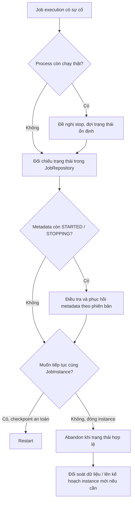

# Abandon job execution trong Spring Batch

Trong Spring Batch, **abandon một job execution** là thao tác đánh dấu một lần thực thi job thành `ABANDONED` để hệ thống coi lần thực thi đó đã bị **từ bỏ vĩnh viễn**. Đây là quyết định điều hành quan trọng: Spring Batch **không restart cùng `JobInstance` sau khi execution cuối đã bị abandon**. Abandon không có nghĩa là job hoàn tất thành công, không tự hoàn tác dữ liệu và cũng không phải lệnh cưỡng bức dừng một process đang chạy.

Chủ đề thuộc nhóm **Execution control** vì người vận hành thường phải lựa chọn giữa **stop**, **restart**, **recover** và **abandon** khi job bị lỗi, chạy sai kỳ dữ liệu hoặc process chết đột ngột. Bài viết giải thích cơ chế, điều kiện sử dụng, API, kịch bản vận hành và các cách kiểm thử hành vi của Spring Batch. Ví dụ chính dùng Spring Batch 5.2 / Spring Boot 3; phần riêng ghi chú điểm khác ở Spring Batch 6.

## 1. Hiểu đúng Job, JobInstance và JobExecution

Muốn abandon đúng đối tượng, trước tiên cần phân biệt ba khái niệm:

- **`Job`**: định nghĩa công việc, gồm tên, flow và các step.
- **`JobInstance`**: một lần chạy *về mặt nghiệp vụ*, xác định bởi **job name + identifying `JobParameters`**. Chẳng hạn job `dailySettlement` với `businessDate=2026-11-15`.
- **`JobExecution`**: một **lần thử thực thi** một `JobInstance`. Một instance thất bại rồi restart có thể có nhiều execution với các execution ID khác nhau.

Ví dụ:

```text
Job: dailySettlement
└─ JobInstance #120 (businessDate=2026-11-15)
   ├─ JobExecution #501 → FAILED
   ├─ JobExecution #506 → STOPPED
   └─ JobExecution #509 → ABANDONED

JobInstance #120 không được restart tiếp sau khi #509 bị ABANDONED.
```

API abandon làm việc với **`jobExecutionId`**, không phải tên job, không phải `jobInstanceId`. Chọn sai ID có thể đánh dấu nhầm một lần chạy khác. Khi xem lịch sử, cần kiểm tra cả tên job, identifying parameters, instance ID, execution ID và trạng thái hiện tại.

Điều kiện restart cũng dựa trên trạng thái của instance và execution cuối, không chỉ dựa vào việc một execution cũ từng `FAILED`. Vì vậy trong ví dụ trên không thể lấy #501 để lách trạng thái `ABANDONED` của #509.

## 2. `BatchStatus.ABANDONED` có ý nghĩa gì?

`ABANDONED` là một giá trị của enum `org.springframework.batch.core.BatchStatus`. Nó mô tả trạng thái vận hành đã kết thúc theo quyết định từ bỏ, khác với kết quả hoàn thành nghiệp vụ.

| Trạng thái | Ý nghĩa vận hành | Quan hệ với restart |
|---|---|---|
| `STARTING` / `STARTED` | Execution bắt đầu / đang chạy theo metadata | Không restart đồng thời; phải xác định còn process thật hay không |
| `STOPPING` | Đã yêu cầu dừng, đang chờ xử lý | Chưa chắc đã dừng; cần theo dõi |
| `STOPPED` | Đã dừng theo cơ chế kiểm soát của Batch | Thường có thể restart nếu job hỗ trợ |
| `FAILED` | Đã thất bại | Thường có thể restart nếu job hỗ trợ và dữ liệu checkpoint hợp lệ |
| `COMPLETED` | Hoàn tất thành công | JobInstance thường đã hoàn tất, không restart như lần thất bại |
| **`ABANDONED`** | Đã quyết định từ bỏ execution/instance | **Không được framework restart cùng JobInstance** |
| `UNKNOWN` | Metadata không xác định được trạng thái đáng tin cậy | Cần điều tra trước khi thao tác |

Khi abandon thông qua `JobOperator`, Spring Batch cập nhật metadata của execution trong `JobRepository`. Những bản ghi đã commit trước đó ở bảng nghiệp vụ, file đích, hàng đợi hoặc hệ thống ngoài **không tự bị xóa**. Vì vậy trạng thái `ABANDONED` có thể song song với một phần dữ liệu đã xử lý thành công.

**`BatchStatus` khác `ExitStatus`**: `BatchStatus` là trạng thái vòng đời do framework quản lý; `ExitStatus` thể hiện mã kết quả dùng cho flow và logic kết thúc. Thao tác abandon không nên được hiểu là tự động biến mọi exit code của job/step thành một mã nhất định. Muốn lập báo cáo, hãy đọc cả `STATUS`, `EXIT_CODE` và `EXIT_MESSAGE` từ metadata.

## 3. Khi nào nên abandon?

Abandon phù hợp khi đã xác định một execution sẽ **không được tiếp tục hoặc khôi phục với cùng `JobInstance`**.

### 3.1. Job bị hủy theo quyết định nghiệp vụ

Ví dụ job `generateMonthlyInvoice` xử lý tháng 10 theo bộ quy tắc cũ. Sau khi phát hiện quy tắc tính sai và có kế hoạch chạy quy trình thay thế, đội vận hành quyết định dừng việc khôi phục execution này. Nếu job đã `FAILED` hoặc `STOPPED`, có thể abandon để phản ánh quyết định đóng hẳn execution.

Điểm cần giải quyết riêng: bản ghi hóa đơn đã được commit, file đã xuất và thông báo đã gửi có thể cần hủy/đối soát bằng nghiệp vụ; `ABANDONED` không thực hiện bù trừ.

### 3.2. Process chết và không còn ý định restart instance cũ

Một JVM bị `kill -9` hoặc máy chủ lỗi có thể khiến `BATCH_JOB_EXECUTION.STATUS` vẫn là `STARTED` dù process đã chết. Spring Batch không tự suy ra chắc chắn rằng execution đã dừng chỉ bằng cách nhìn metadata.

Sau khi xác minh không còn worker xử lý và đánh giá dữ liệu đã ghi, người vận hành có hai hướng:

- Nếu có thể tiếp tục an toàn: khôi phục trạng thái metadata theo cơ chế phù hợp, rồi **restart**.
- Nếu không được tiếp tục instance cũ: cập nhật trạng thái qua **quy trình phục hồi metadata có kiểm soát**, sau đó **abandon** khi API cho phép, hoặc dùng công cụ quản trị tương ứng.

Lưu ý: `JobOperator.abandon(...)` không mặc nhiên bỏ qua kiểm tra trạng thái `STARTED` trong metadata. Một execution đã chết ngoài đời nhưng còn ghi `STARTED` có thể **bị từ chối vì framework coi là đang chạy**. Cần giải quyết tình trạng metadata sai trước; đừng thử gọi abandon liên tục hay xem đó là lệnh kill.

### 3.3. Dữ liệu checkpoint hoặc nguồn đầu vào không còn hợp lệ

Một job đọc file đã bị thay đổi ở giữa chừng; `ExecutionContext` lưu offset cũ; restart có thể đọc trùng hoặc bỏ sót bản ghi. Nếu quyết định hủy đợt xử lý này và tái xử lý toàn bộ với một job instance mới cùng phương án chống trùng, abandon có thể biểu đạt kết thúc vòng đời instance cũ.

Trong trường hợp có thể phục hồi checkpoint đúng và nguồn dữ liệu được cố định, restart vẫn là lựa chọn nên xem xét trước.

## 4. Phân biệt stop, restart, recover và abandon

| Thao tác | Mục tiêu | Kết quả đặc trưng | Có tiếp tục cùng JobInstance? |
|---|---|---|---|
| `stop` | Xin dừng một execution còn chạy | `STOPPING` rồi `STOPPED` khi job phản hồi | Có thể, sau khi dừng thành công |
| `restart` | Tiếp tục job instance từng `FAILED`/`STOPPED` | Tạo **JobExecution mới** cho instance hiện có | Có |
| `recover` | Sửa metadata bị kẹt sau dừng đột ngột, khi API/phiên bản hỗ trợ | Execution được đánh dấu để có thể khởi động lại | Có thể |
| **`abandon`** | Đóng hẳn một execution theo quyết định từ bỏ | `ABANDONED` | **Không** |
| `start` với identifying parameters mới | Chạy một **JobInstance mới** | Execution mới cho instance mới | Không; đây là instance khác |

`stop` là **yêu cầu hợp tác**. Nếu step đang chạy mã nghiệp vụ không trả điều khiển về framework, lệnh stop có thể chưa tác động ngay. `abandon` là **thay đổi metadata về trạng thái kết thúc**, không điều khiển luồng chạy bên trong JVM.

`restart` giữ identifying parameters để Spring Batch liên hệ execution mới với instance cũ và áp dụng quy tắc step/checkpoint. `start` với identifying parameters mới là một công việc mới theo góc nhìn của framework; nó **không tự tiếp tục từ vị trí checkpoint cũ**.



## 5. Sử dụng `JobOperator.abandon(...)` trong Spring Batch 5.x

Spring Batch cung cấp giao diện `JobOperator` để theo dõi và điều khiển job. Trong Spring Batch 5.2:

```java
JobExecution abandon(long jobExecutionId)
    throws NoSuchJobExecutionException,
           JobExecutionAlreadyRunningException;
```

**Đầu vào:** `jobExecutionId` là ID một `JobExecution` hiện có.

**Kết quả:** trả về `JobExecution` đã đánh dấu `ABANDONED` nếu thành công. Những ngoại lệ quan trọng:

- `NoSuchJobExecutionException`: không tìm thấy execution ID trong `JobRepository`.
- `JobExecutionAlreadyRunningException`: trạng thái execution không cho phép abandon vì framework coi execution đang chạy hoặc chưa ở trạng thái có thể đóng.

Đây là một thao tác thay đổi metadata đã lưu, vì vậy phải dựa vào status hiện có, không chỉ dựa vào yêu cầu của scheduler hoặc thông báo trên UI.

Ví dụ một service quản trị cho **execution đã FAILED hoặc STOPPED**:

```java
import org.springframework.batch.core.BatchStatus;
import org.springframework.batch.core.JobExecution;
import org.springframework.batch.core.explore.JobExplorer;
import org.springframework.batch.core.launch.JobOperator;
import org.springframework.stereotype.Service;

@Service
public class BatchExecutionAdminService {

    private final JobExplorer jobExplorer;
    private final JobOperator jobOperator;

    public BatchExecutionAdminService(
            JobExplorer jobExplorer,
            JobOperator jobOperator) {
        this.jobExplorer = jobExplorer;
        this.jobOperator = jobOperator;
    }

    public JobExecution abandonFinishedWithError(long executionId)
            throws Exception {

        JobExecution execution = jobExplorer.getJobExecution(executionId);
        if (execution == null) {
            throw new IllegalArgumentException(
                    "Unknown executionId: " + executionId);
        }

        BatchStatus status = execution.getStatus();
        if (status != BatchStatus.FAILED
                && status != BatchStatus.STOPPED) {
            throw new IllegalStateException(
                    "Execution is not eligible for abandon: " + status);
        }

        // Xác thực quyền thao tác, trạng thái thực tế và dữ liệu nghiệp vụ
        // ở lớp điều hành trước khi gọi tới đây.
        return jobOperator.abandon(executionId);
    }
}
```

Đoạn code cố ý giới hạn ở hai trạng thái hay gặp để tránh dùng nhầm với execution còn chạy hoặc đã hoàn thành. Kiểm tra trước gọi là bước hỗ trợ thông báo rõ ràng; `JobOperator` vẫn là nơi thực thi kiểm tra khi cập nhật. Với môi trường có nhiều scheduler/operator, trạng thái có thể thay đổi giữa lúc đọc và lúc abandon; nghiệp vụ cần cơ chế điều phối và audit thích hợp.

### 5.1. Khai báo `JobOperator` nếu ứng dụng chưa cung cấp

Trong các cấu hình Spring Batch, `JobOperator` có thể đã có sẵn. Nếu cần khai báo thủ công với Spring Batch 5.2, `SimpleJobOperator` dùng các dependency:

```java
@Bean
SimpleJobOperator jobOperator(
        JobExplorer jobExplorer,
        JobRepository jobRepository,
        JobRegistry jobRegistry,
        JobLauncher jobLauncher) {

    SimpleJobOperator operator = new SimpleJobOperator();
    operator.setJobExplorer(jobExplorer);
    operator.setJobRepository(jobRepository);
    operator.setJobRegistry(jobRegistry);
    operator.setJobLauncher(jobLauncher);
    return operator;
}
```

Đoạn bean chỉ được thêm nếu context chưa có `JobOperator` để tránh trùng định nghĩa. Nếu Spring Batch sử dụng table prefix/schema riêng, `JobExplorer` và `JobRepository` cần truy cập cùng bộ bảng metadata. `JobRegistry` phải biết những `Job` có thể được restart.

### 5.2. Sử dụng execution ID từ `JobExplorer`

`JobExplorer` cung cấp API chỉ đọc để đối chiếu trước và sau thao tác:

```java
long executionId = 509L; // Ví dụ: lấy từ trang vận hành hoặc log.

JobExecution before = jobExplorer.getJobExecution(executionId);
if (before == null) {
    throw new IllegalArgumentException("Execution not found");
}

System.out.println("job=" + before.getJobInstance().getJobName());
System.out.println("instance=" + before.getJobInstance().getInstanceId());
System.out.println("execution=" + before.getId());
System.out.println("parameters=" + before.getJobParameters());
System.out.println("before=" + before.getStatus());

JobExecution abandoned = jobOperator.abandon(executionId);

JobExecution after = jobExplorer.getJobExecution(abandoned.getId());
System.out.println("after=" + after.getStatus()); // ABANDONED
```

Đây là đoạn minh họa một thao tác **đã được cho phép về mặt vận hành**, không phải hướng dẫn tự động abandon mọi execution không thành công. Trong ứng dụng thật, cần ghi nhận lý do, người/thành phần yêu cầu, thời điểm và tình trạng xử lý dữ liệu.

## 6. Tại sao `STARTED` sau khi process chết là trường hợp đặc biệt?

Xét chuỗi sự kiện:

```text
09:00  JobExecution #601 bắt đầu, metadata STATUS=STARTED
09:05  Chunk 1 đã commit
09:06  Máy chủ mất nguồn
09:10  Scheduler thấy không còn process; DB vẫn STATUS=STARTED
09:11  Operator muốn đóng hẳn execution #601
```

Metadata `STARTED` **không còn phản ánh process**, nhưng `JobOperator.abandon(601)` vẫn có thể phát sinh `JobExecutionAlreadyRunningException` vì framework đánh giá status đã lưu. Đây là sự khác biệt giữa **liveness thật** và **trạng thái được ghi nhận**.

Không nên sửa bừa `BATCH_JOB_EXECUTION.STATUS` thành `ABANDONED` rồi kết luận đã xử lý xong: trạng thái step, execution context, các transaction dở dang và dữ liệu đã commit có thể chưa được đối soát. Quy trình phục hồi cần cân nhắc phiên bản Spring Batch, job ownership và khả năng restart; trong một số hệ thống phải dùng công cụ quản trị để cập nhật execution/step metadata đồng bộ.

Các bước điều tra thực tế:

1. Xác định execution ID, job name, identifying parameters, máy chủ thực thi, scheduler ID và thời điểm cập nhật cuối.
2. Chứng minh worker/process tương ứng **đã kết thúc** trên mọi node có thể chạy job, hoặc cô lập hệ thống để nó không thể tiếp tục.
3. Xem các step đã commit, checkpoint, dữ liệu nghiệp vụ và tác dụng bên ngoài như gửi message.
4. Quyết định có **restart** hay **từ bỏ**; nếu không restart được thì lưu lý do cụ thể.
5. Dùng cơ chế phục hồi metadata phù hợp với phiên bản và công cụ điều hành; chỉ gọi abandon khi execution đã ở trạng thái hợp lệ.
6. Đọc lại metadata và dữ liệu đầu ra, sau đó cập nhật theo dõi vận hành.

**Khác biệt phiên bản:** Spring Batch 6 cung cấp thêm `JobOperator.recover(JobExecution)` để xử lý execution kẹt sau shutdown đột ngột theo mục đích làm nó có thể restart. Trong Spring Batch 5.x, đừng giả định API này có tồn tại; quá trình xử lý metadata bị kẹt cần dựa vào hạ tầng và quy trình quản trị phù hợp. Cũng không nên coi recover là thao tác đồng nghĩa với abandon.

## 7. Kiểm chứng `ABANDONED` bằng metadata

Spring Batch dùng các bảng metadata như `BATCH_JOB_INSTANCE`, `BATCH_JOB_EXECUTION`, `BATCH_STEP_EXECUTION` và `BATCH_*_CONTEXT`. Một truy vấn chỉ đọc giúp điều tra execution đích:

```sql
SELECT
    je.JOB_EXECUTION_ID,
    je.JOB_INSTANCE_ID,
    ji.JOB_NAME,
    je.STATUS,
    je.EXIT_CODE,
    je.START_TIME,
    je.END_TIME
FROM BATCH_JOB_EXECUTION je
JOIN BATCH_JOB_INSTANCE ji
  ON ji.JOB_INSTANCE_ID = je.JOB_INSTANCE_ID
WHERE je.JOB_EXECUTION_ID = :executionId;
```

Kiểm tra các step thuộc execution đó:

```sql
SELECT
    STEP_EXECUTION_ID,
    STEP_NAME,
    STATUS,
    EXIT_CODE,
    READ_COUNT,
    WRITE_COUNT,
    COMMIT_COUNT,
    ROLLBACK_COUNT
FROM BATCH_STEP_EXECUTION
WHERE JOB_EXECUTION_ID = :executionId
ORDER BY STEP_EXECUTION_ID;
```

Tên cột và cú pháp tham số có thể điều chỉnh theo schema/version/tool SQL. Lưu ý `STATUS=ABANDONED` của **JobExecution** không có nghĩa mọi **StepExecution** đều đổi thành `ABANDONED`. Không suy ra rằng toàn bộ dữ liệu đã rollback hoặc không có step nào commit.

Khi điều tra bằng `JobExplorer`, truy vấn trên được thay bằng `getJobExecution(executionId)` và `getStepExecutions()`, tránh phụ thuộc schema SQL nếu không có yêu cầu vận hành trực tiếp.

## 8. Ví dụ integration test: job FAILED rồi được abandon

Một test tốt cần chứng minh ba điều: job ban đầu thật sự có thể thất bại; abandon cập nhật metadata; cùng `JobInstance` không thể restart sau đó. Không cần giả lập cả JVM chết để chứng minh quy tắc cơ bản này.

### 8.1. Cấu hình job luôn thất bại có chủ đích

Ví dụ Spring Batch 5.x dùng `Tasklet` ném exception để tạo execution `FAILED`:

```java
import org.springframework.batch.core.Job;
import org.springframework.batch.core.Step;
import org.springframework.batch.core.job.builder.JobBuilder;
import org.springframework.batch.core.repository.JobRepository;
import org.springframework.batch.core.step.builder.StepBuilder;
import org.springframework.boot.SpringBootConfiguration;
import org.springframework.boot.autoconfigure.EnableAutoConfiguration;
import org.springframework.context.annotation.Bean;
import org.springframework.transaction.PlatformTransactionManager;

@SpringBootConfiguration
@EnableAutoConfiguration
public class AbandonDemoApplication {

    @Bean
    Step failStep(JobRepository repository,
                  PlatformTransactionManager transactionManager) {
        return new StepBuilder("failStep", repository)
                .tasklet((contribution, chunkContext) -> {
                    throw new IllegalStateException(
                            "Simulated permanent batch failure");
                }, transactionManager)
                .build();
    }

    @Bean
    Job abandonDemoJob(JobRepository repository, Step failStep) {
        return new JobBuilder("abandonDemoJob", repository)
                .start(failStep)
                .build();
    }
}
```

Với Spring Boot test, cần các dependency tương ứng: Spring Batch, Spring JDBC hoặc JPA hạ tầng, database test (chẳng hạn H2), `spring-batch-test` và Spring Boot Test/JUnit 5. Nếu context không cung cấp `JobOperator` thì đăng ký `SimpleJobOperator` như ví dụ ở phần trước. Tránh đăng ký trùng bean nếu autoconfiguration của dự án đã tạo sẵn.

### 8.2. Test metadata và khả năng restart

```java
import static org.junit.jupiter.api.Assertions.*;

import java.util.UUID;

import org.junit.jupiter.api.Test;
import org.springframework.batch.core.BatchStatus;
import org.springframework.batch.core.JobExecution;
import org.springframework.batch.core.JobParametersBuilder;
import org.springframework.batch.core.explore.JobExplorer;
import org.springframework.batch.core.launch.JobOperator;
import org.springframework.batch.core.repository.JobInstanceAlreadyCompleteException;
import org.springframework.batch.test.JobLauncherTestUtils;
import org.springframework.batch.test.context.SpringBatchTest;
import org.springframework.beans.factory.annotation.Autowired;
import org.springframework.boot.test.context.SpringBootTest;

@SpringBatchTest
@SpringBootTest(
        classes = AbandonDemoApplication.class,
        properties = {
                "spring.batch.job.enabled=false",
                "spring.batch.jdbc.initialize-schema=always"
        })
class AbandonJobExecutionTest {

    @Autowired
    JobLauncherTestUtils launcher;

    @Autowired
    JobOperator operator;

    @Autowired
    JobExplorer explorer;

    @Test
    void abandonedExecutionCannotBeRestarted() throws Exception {
        JobExecution failed = launcher.launchJob(
                new JobParametersBuilder()
                        .addString("caseId", UUID.randomUUID().toString())
                        .toJobParameters());

        assertEquals(BatchStatus.FAILED, failed.getStatus());

        long executionId = failed.getId();
        long instanceId = failed.getJobInstance().getInstanceId();

        JobExecution abandoned = operator.abandon(executionId);
        assertEquals(BatchStatus.ABANDONED, abandoned.getStatus());

        JobExecution fromRepository = explorer.getJobExecution(executionId);
        assertNotNull(fromRepository);
        assertEquals(BatchStatus.ABANDONED, fromRepository.getStatus());
        assertEquals(instanceId,
                fromRepository.getJobInstance().getInstanceId());

        assertThrows(JobInstanceAlreadyCompleteException.class,
                () -> operator.restart(executionId));
    }
}
```

Test tạo một `JobInstance` khác nhau cho mỗi lượt bằng identifying parameter `caseId`, tránh va chạm metadata giữa các lần chạy. `spring.batch.job.enabled=false` ngăn Boot tự chạy job lúc khởi tạo context. `@SpringBatchTest` cung cấp `JobLauncherTestUtils`. Ví dụ giả định chỉ có một job được liên kết với tiện ích test; khi context có nhiều job, hãy gán rõ job đích qua `setJob(...)`.

Tùy phiên bản và cấu hình repository, thao tác restart một instance đã `ABANDONED` có thể đi qua tầng kiểm tra khác nhau trước khi ném lỗi. Điều bắt buộc của test là **restart bị từ chối và không xuất hiện execution mới có quyền tiếp tục cùng instance**. `JobInstanceAlreadyCompleteException` là trường hợp thường gặp ở Spring Batch 5.x; nếu test đa phiên bản, chọn assertion dựa trên hợp đồng được hỗ trợ của từng phiên bản.

### 8.3. Các tình huống nên kiểm thử thêm

| Kịch bản | Cách tạo dữ liệu | Điều cần xác nhận |
|---|---|---|
| Abandon execution `FAILED` | Tasklet/writer ném lỗi xác định | Trạng thái chuyển sang `ABANDONED` |
| Abandon execution `STOPPED` | Job phản hồi stop và kết thúc | Trạng thái chuyển sang `ABANDONED` |
| Abandon execution đang chạy | Job bất đồng bộ bị giữ lại bằng latch | API từ chối thao tác khi vẫn chạy |
| Execution ID không tồn tại | Dùng ID không có trong repository | `NoSuchJobExecutionException` |
| Restart sau abandon | Gọi `restart` với ID vừa abandon | Bị từ chối; không có execution mới hợp lệ |
| Đọc metadata sau abandon | Nạp lại bằng `JobExplorer` | Status persisted là `ABANDONED` |
| Partial commit trước abandon | Chunk 1 commit, chunk 2 fail | Dữ liệu chunk 1 vẫn tồn tại |
| Tạo instance mới | Thay identifying parameters sau khi quyết định chạy mới | Instance ID khác; đầu ra phải xử lý chống trùng theo nghiệp vụ |

Với test stop/abandon khi job đang chạy, dùng `CountDownLatch` hoặc cơ chế đồng bộ có giới hạn thay vì `Thread.sleep(...)` tùy ý. Bảo đảm job thật sự đã dừng trước khi kết thúc test, tránh để tác vụ bất đồng bộ làm nhiễu test kế tiếp.

## 9. Abandon một StepExecution khác abandon một JobExecution

Spring Batch cũng có thể dùng trạng thái `ABANDONED` ở **cấp step**. Đây là khái niệm dễ nhầm với thao tác vận hành abandon job.

**JobExecution `ABANDONED`:** execution cuối của instance bị từ bỏ; framework không cho restart lại cùng instance.

**StepExecution `ABANDONED`:** trong một job instance vẫn được restart theo điều kiện phù hợp, step mang dấu `ABANDONED` trong lịch sử có thể được bỏ qua khi flow đi tới step đó, theo thiết kế của Spring Batch.

Ví dụ flow:

```text
importStep → enrichStep → exportStep

JobExecution #700: FAILED
  importStep: COMPLETED
  enrichStep: ABANDONED (được đánh dấu ở cấp step)
  exportStep: FAILED

Restart cùng JobInstance:
  importStep thường được bỏ qua vì đã COMPLETED
  enrichStep được bỏ qua theo ngữ nghĩa ABANDONED của step
  exportStep chạy lại nếu flow và checkpoint cho phép
```

Đây là hành vi quản lý flow/step cần thiết kế và kiểm chứng riêng. **Gọi `JobOperator.abandon(jobExecutionId)` không có nghĩa là tự động đánh dấu từng step thành `ABANDONED` hoặc cho phép bỏ qua một step cụ thể khi restart.** Khi điều hành, phải ghi rõ phạm vi can thiệp: job hay step.

Không nên chỉnh status step thủ công chỉ để né một bước validate thất bại mà không hiểu phụ thuộc dữ liệu, điều kiện flow, exit code và các side effect của bước đó.

## 10. Tác động đến transaction và dữ liệu đã ghi

Abandon thay đổi metadata **sau sự kiện**; nó không mở một transaction để thu hồi các chunk đã commit ở quá khứ.

Giả sử job xử lý năm chunk:

```text
Chunk 1    commit 100 rows
Chunk 2    commit 100 rows
Chunk 3    commit 100 rows
Chunk 4    lỗi và rollback
Chunk 5    chưa thực hiện

JobExecution: FAILED → ABANDONED
Database:    300 rows của chunk 1–3 vẫn còn
```

Trong hệ thống nghiệp vụ, phần dữ liệu này có thể đại diện cho thanh toán đã gửi, invoice đã tạo hoặc sự kiện đã phát. Các tình huống cần phân biệt:

- **Writer ghi DB cùng transaction chunk:** dữ liệu đã commit từ các chunk trước tồn tại; chunk lỗi thường rollback theo transaction policy.
- **Writer gọi API ngoài transaction:** request gửi thành công trước lỗi có thể đã tác động hệ thống đích; Spring Batch không tự thu hồi.
- **Writer xuất file hoặc ghi object storage:** file/đối tượng có thể đã được tạo ngay cả khi database metadata báo thất bại.
- **Job có retry, skip hoặc multi-thread:** số lần gọi dependency không đồng nhất với số bản ghi đã commit; cần quan sát nguồn dữ liệu cuối cùng.

Nếu sau đó chạy **JobInstance mới**, nó thường bắt đầu lại theo dữ liệu đầu vào và logic của instance mới, chứ không tự tiếp tục từ checkpoint của instance đã abandon. Vì vậy cần idempotency key, unique constraint, cơ chế deduplicate, nghiệp vụ bù trừ hoặc phân vùng dữ liệu theo kỳ xử lý.

**Ví dụ:** Job A đã gửi thành công hóa đơn `INV-001` nhưng thất bại khi cập nhật bảng theo dõi. Job A bị abandon. Chạy Job B từ đầu mà không kiểm tra ID đã gửi có thể gửi `INV-001` lần thứ hai. Trạng thái `ABANDONED` không ngăn trùng dữ liệu tại hệ thống ngoài.

## 11. Sổ tay thao tác vận hành

Quy trình cho một execution cụ thể:

### Bước 1 — Xác định chính xác execution

Thu thập `jobName`, `jobInstanceId`, `jobExecutionId`, identifying `JobParameters`, phiên bản ứng dụng, thời điểm start/end và node đã chạy. Nếu scheduler có execution ID riêng, lưu cả hai để tránh đánh đồng ID scheduler với ID của Spring Batch.

### Bước 2 — Xác định trạng thái process thật

Kiểm tra JVM/container/pod, scheduler, hàng đợi và các worker liên quan. Không dựa duy nhất vào dòng metadata `STARTED`, vì metadata có thể không được cập nhật sau crash. Nếu process vẫn chạy, chọn stop có kiểm soát và chờ trạng thái ổn định.

### Bước 3 — Đánh giá khả năng restart

Xem `ExecutionContext`, checkpoint reader, cấu hình `restartable`, trạng thái step, phạm vi commit và sự thay đổi của nguồn dữ liệu. Nếu có thể restart an toàn, abandon sẽ làm mất khả năng đó của cùng instance.

### Bước 4 — Xác nhận dữ liệu đã phát sinh

Đối chiếu số lượng record đã ghi, khóa nghiệp vụ, các file output, message và API downstream. Ghi nhận phần phải bù trừ hoặc phần cần bỏ qua khi tạo job instance mới.

### Bước 5 — Abandon qua API/hệ thống điều hành

Với execution đã `FAILED`/`STOPPED` và đáp ứng điều kiện, gọi `JobOperator.abandon(executionId)`. Nếu metadata còn `STARTED` dù worker chết, thực hiện bước khôi phục metadata có kiểm soát phù hợp với phiên bản trước; không coi abandon là lệnh kill.

### Bước 6 — Đọc lại và lưu bằng chứng

Nạp lại bằng `JobExplorer` hoặc truy vấn metadata để xác nhận `ABANDONED`. Ghi lý do, người phê duyệt/thao tác, execution ID, thời điểm và việc đối soát đã hoàn tất. Cập nhật cảnh báo/scheduler để không tự restart instance đã bị từ bỏ.

Mẫu bản ghi điều hành:

```text
jobName: dailySettlement
jobInstanceId: 120
jobExecutionId: 509
identifyingParameters: businessDate=2026-11-15
previousStatus: FAILED
newStatus: ABANDONED
decisionReason: Input file corrupted, reprocessing required
committedRecords: 300
compensationPlan: Reconcile payment IDs before new run
operator: batch-operations
changedAt: <timestamp>
```

Trong môi trường thực, thay ví dụ này bằng các giá trị được xác minh; các trường lý do/audit thường nằm trong hệ thống điều hành riêng, không nhất thiết là cột mặc định trong bảng Spring Batch.

## 12. Các lỗi thường gặp và cách nhận biết

| Hiện tượng | Nguyên nhân thường gặp | Hướng xử lý |
|---|---|---|
| Gọi `abandon` với ID nhưng nhận `NoSuchJobExecutionException` | Nhầm execution ID, sai database hoặc metadata đã bị xóa | Đối chiếu `JobExplorer`, datasource và ID |
| `JobExecutionAlreadyRunningException` dù server đã chết | Metadata còn `STARTED`/trạng thái đang chạy | Xác minh không có worker rồi phục hồi metadata theo quy trình |
| Scheduler tiếp tục hiển thị job chạy | Scheduler lưu state riêng hoặc chưa đồng bộ | Đồng bộ trạng thái điều hành; kiểm tra process thật |
| Sau abandon, restart cùng parameters thất bại | `ABANDONED` ngăn restart cùng `JobInstance` | Không cố lách; nếu cần chạy mới, thiết kế instance mới và chống trùng |
| Abandon xong dữ liệu DB vẫn còn | Các chunk trước đã commit | Đối soát/bù trừ theo nghiệp vụ, không kỳ vọng rollback toàn job |
| UI báo exit code `FAILED` nhưng status `ABANDONED` | `ExitStatus` và `BatchStatus` khác nhau | Hiển thị và giải thích cả hai trường |
| Đổi parameters để chạy lại và sinh bản ghi trùng | Instance mới xử lý lại dữ liệu cũ | Dùng idempotency, ranh giới kỳ dữ liệu và deduplication |
| Abandon nhầm một lần chạy | Dùng nhầm instance ID, execution ID hoặc scheduler ID | Bắt buộc xem job name, parameters, ID, status trước thao tác |
| Tự sửa SQL metadata làm trạng thái mâu thuẫn | Sửa một bảng nhưng bỏ qua bước/context liên quan | Dùng API/công cụ quản trị phù hợp, đối chiếu metadata |

## 13. Những điều không nên suy luận từ `ABANDONED`

1. **"Job đã dừng process."** Không đúng: abandon không phải cơ chế điều khiển luồng thực thi; phải kiểm tra trạng thái worker.
2. **"Dữ liệu đã được rollback."** Không đúng: chunk commit trước đó vẫn còn, side effect bên ngoài có thể vẫn tồn tại.
3. **"Có thể restart như FAILED."** Không đúng: execution cuối `ABANDONED` chặn restart cùng instance.
4. **"Không thể chạy job cùng tên thêm lần nào."** Không đúng: job có thể có **JobInstance khác** với identifying parameters khác, tùy cấu hình và nghiệp vụ.
5. **"Chỉ cần status STARTED là biết process đang chạy."** Không đúng: sau crash, metadata có thể bị kẹt ở trạng thái cũ.
6. **"Abandon job tương đương abandon mọi step."** Không đúng: trạng thái job và step có phạm vi, ảnh hưởng riêng.

## 14. Lưu ý API giữa Spring Batch 5 và 6

Các ví dụ gọi ID dạng `long` ở phần trên bám theo Spring Batch 5.2:

```java
JobExecution abandoned = jobOperator.abandon(jobExecutionId);
```

Từ Spring Batch 6.0, API ưu tiên nhận đối tượng `JobExecution`:

```java
JobExecution execution = jobRepository.getJobExecution(jobExecutionId);
if (execution == null) {
    throw new IllegalArgumentException("Unknown execution ID");
}
JobExecution abandoned = jobOperator.abandon(execution);
```

Ở Spring Batch 6, chữ ký `abandon(long)` đã được **deprecated** theo hướng chuyển sang `abandon(JobExecution)`. Spring Batch 6 còn có `recover(JobExecution)` để hỗ trợ phục hồi execution bị kẹt do shutdown bất thường với mục tiêu có thể restart. Đừng sao chép ví dụ của 5.x vào 6.x mà không đối chiếu phiên bản thực tế.

Một số API thống kê/khởi chạy của `JobOperator` cũng thay đổi qua các thế hệ. Riêng nguyên tắc nghiệp vụ vẫn giữ nguyên: **abandon là quyết định từ bỏ một execution/instance; stop là xin dừng; restart là tiếp tục instance cũ khi hợp lệ; start với parameters mới tạo instance khác**.

## 15. Tài liệu tham khảo chính thức

- [Spring Batch 5.2 — Advanced Metadata Usage, phần Stopping/Aborting a Job](https://docs.spring.io/spring-batch/reference/5.2/job/advanced-meta-data.html)
- [Spring Batch 5.2 — JobOperator API](https://docs.spring.io/spring-batch/docs/5.2.2/api/org/springframework/batch/core/launch/JobOperator.html)
- [Spring Batch 6 — JobOperator API](https://docs.spring.io/spring-batch/reference/api/org/springframework/batch/core/launch/JobOperator.html)

Khi vận hành, câu hỏi trọng tâm là: **execution này có còn đang chạy thật không, có thể restart an toàn không, dữ liệu nào đã commit, và quyết định từ bỏ có thực sự phù hợp với nghiệp vụ không?** Chỉ khi trả lời được các câu hỏi đó thì trạng thái `ABANDONED` mới phản ánh đúng một lần xử lý đã được đóng lại có chủ đích, thay vì chỉ che khuất một job đang gặp sự cố.
