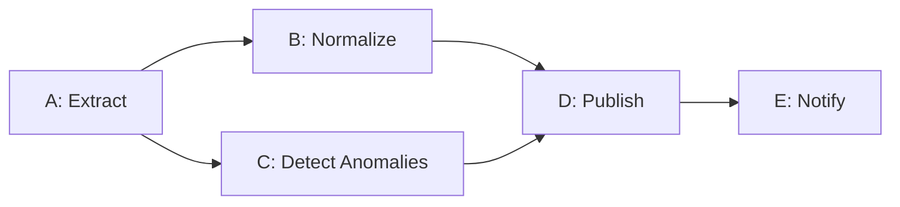
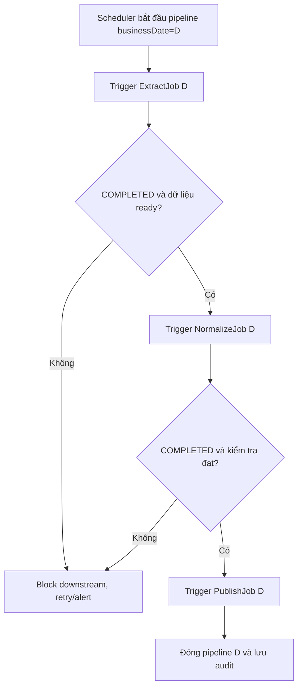
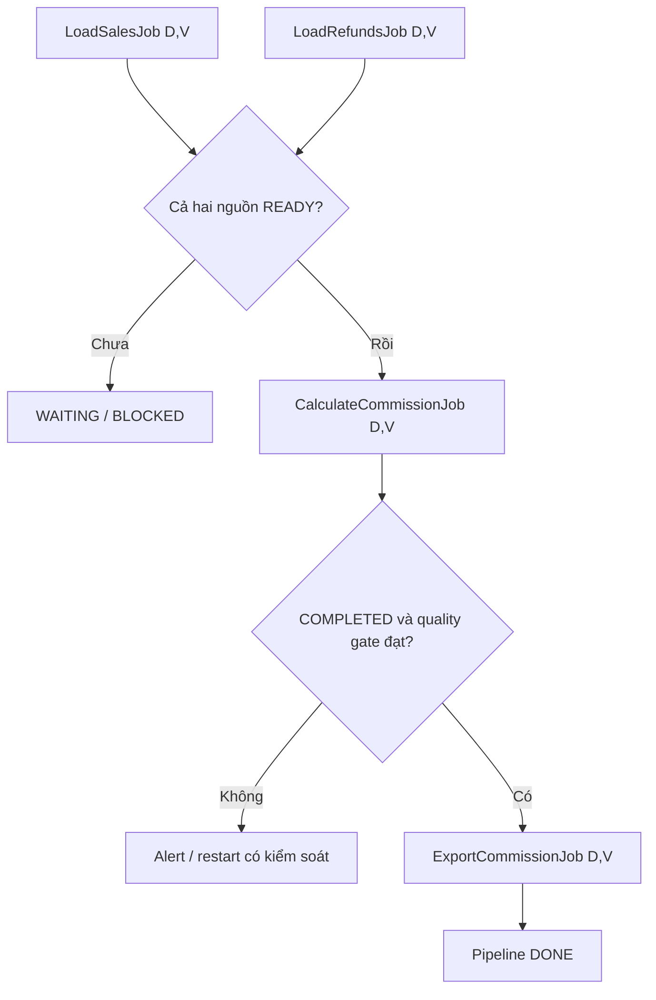

# Dependency giữa các job trong Spring Batch

Trong các hệ thống batch, nhiều job thường tạo thành một chuỗi xử lý dữ liệu: job trích xuất hoàn tất thì job chuẩn hóa mới được chạy; job chuẩn hóa và job đối soát đều hoàn tất thì job xuất báo cáo mới được phát hành. Đây là **dependency giữa các job** (phụ thuộc liên job): điều kiện để một job bắt đầu hoặc được coi là sẵn sàng phụ thuộc vào **kết quả của một hay nhiều job khác**, theo đúng kỳ dữ liệu và phiên bản đầu vào.

Ví dụ pipeline cuối ngày:

```text
ImportTransactionsJob  →  ValidateTransactionsJob  →  PublishLedgerJob
       (A)                         (B)                       (C)

A thất bại             →  B và C chưa chạy
A thành công; B lỗi    →  C chưa chạy
A, B thành công       →  C được phép chạy
```

Spring Batch quản lý vòng đời, transaction, checkpoint và restart của **từng JobInstance/JobExecution**. Bản thân một biểu thức cron hay một lịch chạy độc lập của mỗi job **không tạo ra bảo đảm phụ thuộc giữa các job**. Để vận hành chuỗi A → B → C an toàn, cần có cơ chế điều phối (orchestration) kiểm tra trạng thái, định danh kỳ dữ liệu, xử lý thất bại và khởi chạy lại có kiểm soát.

Bài này tập trung vào chủ đề **Scheduling → Dependency giữa các job** trong Spring Batch Core Processing. Các ví dụ Java minh họa Spring Batch 5.x với Spring Boot 3.x; ý tưởng về dependency, trạng thái và an toàn dữ liệu áp dụng cho những phiên bản khác, dù API cấu hình có thể thay đổi.

## 1. Dependency giữa các job là gì?

Giả sử hệ thống xử lý giao dịch ngày `2026-11-15` bằng ba job:

1. **`ExtractJob`**: lấy giao dịch từ hệ thống nguồn và ghi vào bảng staging.
2. **`NormalizeJob`**: đọc staging, chuẩn hóa và đối soát.
3. **`PublishJob`**: xuất dữ liệu đã kiểm chứng cho hệ thống kế toán.

Điều kiện cần thỏa:

- `NormalizeJob` chỉ được chạy khi **`ExtractJob` của cùng business date** đã hoàn thành hợp lệ.
- `PublishJob` chỉ được chạy khi **`NormalizeJob` của cùng business date** đã hoàn thành hợp lệ.
- Nếu job trước thất bại, job sau không được đọc dữ liệu staging còn dang dở.
- Khi một job thất bại rồi được restart thành công, những job sau mới được phép tiếp tục.

**Dependency** không đơn thuần là quan hệ "chạy sau theo thời gian". Nó là **điều kiện tiên quyết được xác nhận**. Ví dụ `NormalizeJob` chạy lúc 02:30 không đồng nghĩa `ExtractJob` chạy lúc 02:00 đã xong; thời gian xử lý có thể biến động hoặc job đầu có thể lỗi.

Phân biệt một số điều kiện thường gặp:

| Kiểu phụ thuộc | Ví dụ | Điều kiện cho job tiếp theo |
|---|---|---|
| **Success dependency** | B cần A thành công | A có trạng thái/kết quả thành công được chấp nhận |
| **Data readiness** | B đọc file do A tạo | File/tập dữ liệu đúng kỳ đã được publish hoàn chỉnh và kiểm tra |
| **AND dependency** | D cần B **và** C | Cả B và C của cùng kỳ đều sẵn sàng |
| **OR/conditional dependency** | D dùng nguồn B hoặc C thay thế | Một nhánh đáp ứng điều kiện nghiệp vụ đã định |
| **Cross-date dependency** | Tổng hợp tháng cần đủ các ngày | Toàn bộ ngày thuộc phạm vi tháng được chốt |
| **Resource dependency** | Hai job cùng cập nhật một partition | Có quyền truy cập độc quyền/khóa điều phối trước khi chạy |

Dependency có thể tồn tại giữa các job trong cùng ứng dụng, giữa nhiều ứng dụng, giữa nhiều cluster hoặc giữa các hệ thống không dùng Spring Batch. Với phạm vi càng rộng, nhu cầu lưu trạng thái điều phối bền vững càng quan trọng.

## 2. Dependency giữa các step khác dependency giữa các job

Spring Batch đã hỗ trợ điều khiển trình tự **step trong cùng một job**:

```java
@Bean
Job dailyJob(JobRepository jobRepository,
             Step extractStep,
             Step normalizeStep,
             Step publishStep) {
    return new JobBuilder("dailyJob", jobRepository)
            .start(extractStep)
            .next(normalizeStep)
            .next(publishStep)
            .build();
}
```

Ở ví dụ trên, thứ tự bước nằm trong định nghĩa **một Job**; Spring Batch quản lý flow và restart step theo `JobExecution`/`StepExecution` của Job đó. Đây thường là lựa chọn đơn giản nếu các công đoạn thuộc cùng vòng đời xử lý, luôn phải chạy chung theo thứ tự và dùng cùng bộ job parameters.

Trong khi đó, **nhiều Job độc lập** có tên, instance, execution và vòng đời restart riêng:

```text
ExtractJob:   JobInstance(date=2026-11-15) → JobExecution #101
NormalizeJob: JobInstance(date=2026-11-15) → JobExecution #102
PublishJob:   JobInstance(date=2026-11-15) → JobExecution #103
```

Spring Batch không tự biết rằng #102 phụ thuộc #101 chỉ vì chúng có cùng tham số ngày. Cần một thành phần điều phối khởi chạy, quan sát và kiểm tra điều kiện.

| Tiêu chí | Một Job gồm nhiều Step | Nhiều Job có dependency |
|---|---|---|
| Đơn vị vòng đời | Một `JobInstance` | Mỗi Job có `JobInstance` riêng |
| Flow | Khai báo bằng Job DSL | Do coordinator/scheduler điều khiển |
| Restart | Spring Batch kiểm soát step trong instance | Phải điều phối lần restart của từng job |
| Tham số | Các step chia sẻ job parameters | Phải truyền/mapping parameters giữa các job |
| Triển khai độc lập | Các step thường đi cùng deployment | Job có thể ở ứng dụng/node khác nhau |
| Tái sử dụng | Step có thể được dùng lại theo cấu hình | Mỗi job có thể phục vụ nhiều pipeline |
| Quan sát dependency | Theo flow của một job | Theo dependency graph và trạng thái từng job |

**Khi nào chọn loại nào?** Nếu ba công đoạn là một nghiệp vụ nhất quán và không có lịch/SLA độc lập, dùng một Job nhiều step thường ít phức tạp hơn. Nếu mỗi công đoạn có lịch riêng, nhóm sở hữu riêng, tài nguyên khác, cần chia sẻ đầu ra với pipeline khác hoặc chạy đa hệ thống, dependency giữa nhiều Job là phù hợp.

Spring Batch còn hỗ trợ khái niệm **`JobStep`** để một job chạy job khác như một step. Đây là lựa chọn trung gian có parent job, nhưng việc mapping job parameters, trạng thái parent/child và restart cần được thiết kế cẩn thận. Nó không thay thế hoàn toàn một scheduler phân tán khi job nằm ở nhiều hệ thống.

## 3. Biểu diễn dependency như đồ thị DAG

Với pipeline nhiều nhánh, nên thể hiện rõ dependency theo **directed acyclic graph** (DAG — đồ thị có hướng không chu trình):



Trong đồ thị này:

- B và C có thể chạy **song song** sau khi A thành công, nếu đọc dữ liệu an toàn.
- D phải đợi **cả B lẫn C** hoàn tất theo quy tắc AND.
- E chỉ gửi thông báo sau khi D publish thành công.
- A, B, C, D, E phải dùng **cùng business key** (ví dụ ngày và phiên bản dữ liệu) khi kiểm tra readiness.

Một dependency dạng A → B → A tạo **chu trình** không có điểm khởi đầu rõ ràng. Scheduler DAG thường từ chối hoặc không thể giải quyết chu trình; cần tái thiết kế bằng cách tách phiên bản/kỳ xử lý, ví dụ A của ngày D phụ thuộc B của ngày D-1.

Đồ thị nên ghi thêm thông tin về điều kiện cụ thể:

```text
Prerequisite:   ExtractJob
Dependent:      NormalizeJob
Business key:   businessDate
Required state: COMPLETED
Data contract:  staging partition published + checksum valid
Failure action: BLOCK downstream, alert owner
Retry policy:   retry/restart ExtractJob within agreed limits
```

Nếu điều kiện phụ thuộc được định nghĩa bằng từ "xong", cần làm rõ **xong theo nghĩa nào**: process thoát, job `COMPLETED`, file đã tạo, dữ liệu đã commit, hay kết quả kiểm tra chất lượng đạt ngưỡng.

## 4. Các khái niệm Spring Batch cần dùng để điều phối

### 4.1. JobInstance và identifying JobParameters

Một `JobInstance` được xác định bởi **job name + các identifying job parameters**. Với các job theo kỳ, nên truyền khóa nghiệp vụ ổn định:

```java
JobParameters parameters = new JobParametersBuilder()
        .addString("businessDate", "2026-11-15")
        .toJobParameters();
```

Với cùng `businessDate`, mỗi job vẫn là **một JobInstance khác nhau** vì tên job khác nhau. Đây là điều kiện thuận lợi để theo dõi pipeline theo ngày. Nếu thêm một identifying parameter như `run.id` ngẫu nhiên mỗi lần retry, Spring Batch sẽ tạo instance mới, **không còn là restart** của instance đã lỗi.

Hãy phân biệt:

- **Business key**: kỳ dữ liệu/partition/batch ID mà dependency phải cùng đối chiếu.
- **Technical run ID**: định danh một lần vận hành hoặc scheduler attempt.
- **JobInstance ID**: định danh instance Spring Batch cấp cho từng job.
- **JobExecution ID**: định danh mỗi lần thử của instance, bao gồm các lần restart.

Trong hệ thống có cơ chế rebuild dữ liệu, có thể cần thêm `dataVersion` hoặc `pipelineVersion` làm identifying parameter. Quy tắc chọn tham số phải nhất quán với khả năng restart, dữ liệu đầu ra và chính sách chống ghi trùng.

### 4.2. BatchStatus và ExitStatus

Khi khởi chạy job qua `JobLauncher`, ta nhận `JobExecution`, nhưng phải đọc trạng thái đúng:

| `BatchStatus` | Diễn giải cho dependency thông thường |
|---|---|
| `COMPLETED` | Có thể qua cửa kiểm tra tiếp theo, nếu điều kiện dữ liệu và exit code đạt |
| `FAILED` | Không cho downstream chạy; xem xét restart/recovery |
| `STOPPED` | Không cho downstream chạy cho đến khi có execution mới hoàn tất |
| `STARTING`, `STARTED`, `STOPPING` | Chưa có kết quả cuối; cần đợi hoặc quan sát |
| `ABANDONED` | Instance bị từ bỏ, không tự restart cùng identifying parameters |
| `UNKNOWN` | Phải điều tra; không xem như thành công |

`ExitStatus` là mã kết quả dùng trong luồng job và có thể được ứng dụng tùy chỉnh. Job có `BatchStatus.COMPLETED` vẫn có thể mang exit code báo **hoàn thành với cảnh báo** hoặc vi phạm ngưỡng chất lượng. Nếu pipeline đòi hỏi chất lượng chặt chẽ, gate phải kiểm tra **cả trạng thái, exit code và dữ liệu đầu ra**; không cho downstream chạy chỉ vì process kết thúc với exit code của hệ điều hành bằng 0.

### 4.3. JobLauncher, JobRepository, JobExplorer và JobOperator

| Thành phần | Trách nhiệm trong dependency |
|---|---|
| `JobLauncher` | Yêu cầu chạy một Job với bộ `JobParameters` |
| `JobRepository` | Lưu metadata và lịch sử các JobExecution/StepExecution |
| `JobExplorer` | Truy vấn trạng thái và execution lịch sử để quan sát |
| `JobOperator` | Cung cấp các thao tác điều hành như start, stop, restart tùy phiên bản |
| External scheduler/orchestrator | Xếp lịch, giải dependency, retry orchestration, alert, backfill và điều phối nhiều ứng dụng |

Không nên đồng nhất **submit thành công** với **job chạy xong thành công**. `JobLauncher.run(...)` có thể trả về rất sớm nếu cấu hình executor bất đồng bộ. Khi ấy `JobExecution.getStatus()` có thể vẫn là `STARTING` hoặc `STARTED`; coordinator phải tiếp tục chờ/truy vấn trạng thái hoàn tất trước khi mở cổng cho job sau.

## 5. Cách 1 — Điều phối tuần tự bằng một Spring service

Với ứng dụng nhỏ, một coordinator có thể chạy A, chỉ chạy B khi A thành công, rồi chạy C khi B thành công.

Ví dụ sau được thiết kế cho **JobLauncher đồng bộ**. Nó tra cứu execution cuối của cùng `JobInstance` để hỗ trợ chạy lại coordinator sau sự cố: job đã `COMPLETED` được bỏ qua; job `FAILED` hoặc `STOPPED` được thử restart bằng cùng identifying parameters; trạng thái không hợp lệ bị chặn.

```java
import java.time.LocalDate;

import org.springframework.batch.core.BatchStatus;
import org.springframework.batch.core.Job;
import org.springframework.batch.core.JobExecution;
import org.springframework.batch.core.JobParameters;
import org.springframework.batch.core.JobParametersBuilder;
import org.springframework.batch.core.launch.JobLauncher;
import org.springframework.batch.core.repository.JobRepository;
import org.springframework.beans.factory.annotation.Qualifier;
import org.springframework.stereotype.Service;

@Service
public class DailyPipelineCoordinator {

    private final JobLauncher jobLauncher;
    private final JobRepository jobRepository;
    private final Job extractJob;
    private final Job normalizeJob;
    private final Job publishJob;

    public DailyPipelineCoordinator(
            JobLauncher jobLauncher,
            JobRepository jobRepository,
            @Qualifier("extractJob") Job extractJob,
            @Qualifier("normalizeJob") Job normalizeJob,
            @Qualifier("publishJob") Job publishJob) {
        this.jobLauncher = jobLauncher;
        this.jobRepository = jobRepository;
        this.extractJob = extractJob;
        this.normalizeJob = normalizeJob;
        this.publishJob = publishJob;
    }

    public void runForDate(LocalDate businessDate) throws Exception {
        JobParameters parameters = new JobParametersBuilder()
                .addString("businessDate", businessDate.toString())
                .toJobParameters();

        ensureCompleted(extractJob, parameters);
        ensureCompleted(normalizeJob, parameters);
        ensureCompleted(publishJob, parameters);
    }

    private void ensureCompleted(Job job, JobParameters parameters)
            throws Exception {

        JobExecution previous = jobRepository.getLastJobExecution(
                job.getName(), parameters);

        if (previous != null) {
            BatchStatus previousStatus = previous.getStatus();

            if (previousStatus == BatchStatus.COMPLETED) {
                // Đã xong trong cùng JobInstance: không chạy lại.
                return;
            }

            if (previousStatus != BatchStatus.FAILED
                    && previousStatus != BatchStatus.STOPPED) {
                throw new IllegalStateException(
                        "Cannot continue job " + job.getName()
                        + " from status " + previousStatus);
            }
        }

        JobExecution execution = jobLauncher.run(job, parameters);

        // Chỉ đúng nếu JobLauncher chờ job kết thúc đồng bộ.
        if (execution.getStatus() != BatchStatus.COMPLETED) {
            throw new IllegalStateException(
                    "Job " + job.getName()
                    + " did not complete: " + execution.getStatus());
        }
    }
}
```

**Hành vi cần hiểu:**

1. Cùng một `businessDate` được truyền cho tất cả job, tránh nối đầu ra ngày D với đầu vào ngày D+1.
2. Nếu `ExtractJob` fail, method ném exception và **không gọi** `NormalizeJob`/`PublishJob`.
3. Nếu Extract đã `COMPLETED`, Normalize fail, sau khi sửa lỗi và gọi lại coordinator, Extract được bỏ qua; Normalize được thử restart; Publish chỉ chạy sau khi Normalize thành công.
4. Nếu execution cuối là `STARTED`, `ABANDONED` hoặc `UNKNOWN`, coordinator không tự đoán và không tiếp tục.
5. Nếu job đặt `preventRestart()` hoặc checkpoint không thể dùng lại, restart có thể bị từ chối; cần quyết định tái xử lý bằng một instance mới với chính sách nghiệp vụ tương ứng.

Đây là ví dụ cơ chế cơ bản. Với production, nên bổ sung **data readiness gate**, phân loại `ExitStatus`, logging/audit, giới hạn retry, lock theo kỳ dữ liệu và alert. Việc kiểm tra execution cuối rồi gọi launcher không phải khóa nguyên tử để chống hai coordinator chạy đồng thời.

### 5.1. Tại sao không tạo `run.id` mới mỗi lần coordinator chạy?

Giả sử Extract đã hoàn thành nhưng Normalize thất bại:

```text
Lần 1: date=2026-11-15, run.id=101
  Extract COMPLETED → Normalize FAILED

Lần 2: date=2026-11-15, run.id=102
  Extract bị chạy lại như JobInstance mới
```

Nếu `run.id` là identifying parameter, lần 2 tạo instance mới cho từng job. Điều đó có thể hợp lý khi **cố ý tái xử lý hoàn toàn**, nhưng không phù hợp với mục tiêu restart Normalize từ checkpoint của lần 1. Muốn restart, dùng lại bộ identifying parameters của instance lỗi.

### 5.2. JobLauncher bất đồng bộ cần theo dõi trạng thái cuối

Nếu launcher dùng `TaskExecutor` bất đồng bộ, đừng viết:

```java
JobExecution execution = jobLauncher.run(extractJob, parameters);
jobLauncher.run(normalizeJob, parameters); // Sai: Extract có thể vẫn STARTED.
```

Thay bằng một trong các giải pháp:

- Dùng synchronous launcher cho orchestration nhỏ và không yêu cầu trả request nhanh.
- Với asynchronous launcher, lấy `executionId` rồi theo dõi qua `JobExplorer`/sự kiện hoàn thành tới khi execution đạt trạng thái kết thúc; chỉ sau đó đánh giá dependency.
- Dùng scheduler có hỗ trợ DAG và event/status tracking bền vững.

Nếu polling, thiết kế giới hạn thời gian, backoff, alert và kiểm tra job bị treo; không dùng vòng lặp busy-wait. Job kết thúc `FAILED`, `STOPPED` hay `UNKNOWN` cần xử lý như nhánh không đạt dependency.

## 6. Cách 2 — Scheduling bằng `@Scheduled` kết hợp coordinator

Spring Framework cung cấp `@Scheduled` để kích hoạt một quy trình theo lịch:

```java
import java.time.LocalDate;
import java.time.ZoneId;

import org.springframework.scheduling.annotation.Scheduled;
import org.springframework.stereotype.Component;

@Component
public class DailyPipelineSchedule {

    private static final ZoneId BUSINESS_ZONE =
            ZoneId.of("Asia/Ho_Chi_Minh");

    private final DailyPipelineCoordinator coordinator;

    public DailyPipelineSchedule(DailyPipelineCoordinator coordinator) {
        this.coordinator = coordinator;
    }

    @Scheduled(cron = "0 10 2 * * *", zone = "Asia/Ho_Chi_Minh")
    public void trigger() throws Exception {
        LocalDate businessDate = LocalDate.now(BUSINESS_ZONE)
                .minusDays(1);
        coordinator.runForDate(businessDate);
    }
}
```

Cần bật scheduling bằng `@EnableScheduling` trong cấu hình ứng dụng. Ví dụ kích hoạt lúc 02:10 theo múi giờ Việt Nam và xử lý dữ liệu của ngày trước. Việc chọn ngày nghiệp vụ phụ thuộc quy tắc hệ thống: có pipeline xử lý *hôm nay*, có pipeline chốt *hôm qua*, có pipeline chạy bù *nhiều ngày*.

**Điểm quan trọng:** Cron chỉ quyết định **khi nào gọi coordinator**. Chính logic coordinator mới quyết định B có được chạy sau A hay không. Không nên tạo ba cron độc lập "A lúc 02:10, B lúc 02:20, C lúc 02:30" rồi giả định dependency đã được bảo đảm.

Giới hạn của `@Scheduled` khi triển khai nhiều instance:

- Mỗi instance ứng dụng có thể kích hoạt lịch riêng; cùng ngày có thể có nhiều coordinator chạy cạnh tranh.
- Một lần app tắt đúng giờ có thể bỏ lỡ trigger tùy cơ chế vận hành.
- Không có DAG, backfill, SLA, dependency lịch sử và dashboard mặc định như một scheduler chuyên dụng.
- Exception từ lần chạy có thể được ghi log, nhưng không tự biến thành kế hoạch retry có kiểm soát.

Đối với nhiều node, dùng cơ chế **leader election/distributed lock** theo business key, hoặc chuyển quyền kích hoạt cho một scheduler trung tâm. Khóa cần có timeout, thông tin owner và cơ chế xử lý khi node chết. Không chỉ dựa vào flag boolean trong memory.

## 7. Cách 3 — Orchestrator hoặc scheduler ngoài ứng dụng

Khi pipeline trải rộng nhiều ứng dụng, có nhánh song song, SLA khác nhau hoặc yêu cầu backfill, hãy để orchestrator quản lý DAG. Ví dụ sản phẩm/công cụ thường gặp là **Airflow, Control-M, Argo Workflows, Quartz kết hợp lớp điều phối, hoặc scheduler doanh nghiệp**.

Mô hình:



Orchestrator có thể gọi API quản trị batch, gửi thông điệp yêu cầu chạy, gọi command/container hoặc thực thi task Spring Batch theo cấu hình. Nhưng nó phải **đợi kết quả thực**, không chỉ dựa vào HTTP 202 Accepted hoặc lệnh đã được đưa vào queue.

### So sánh các lựa chọn

| Giải pháp | Phù hợp khi | Lưu ý |
|---|---|---|
| Một Spring Batch Job nhiều Step | Vòng đời chung và flow đơn giản | Không tạo nhiều Job độc lập |
| Spring coordinator + `JobLauncher` | Một ứng dụng, ít dependency, dễ kiểm soát | Tự lo lock, error handling, observability |
| `@Scheduled` gọi coordinator | Có lịch định kỳ đơn giản | Cron không bảo đảm dependency nếu đứng một mình |
| `JobStep` | Muốn bao các Job con trong một Job cha | Cần thiết kế truyền parameters và restart hai tầng |
| Quartz và custom dependency state | Muốn lịch bền vững trong ứng dụng, trigger linh hoạt | Quartz trigger không tự hiểu quan hệ dữ liệu giữa mọi job |
| Orchestrator DAG chuyên dụng | Nhiều hệ thống, nhiều nhánh, backfill và SLA | Cần đồng bộ chính xác trạng thái JobExecution và dữ liệu |
| Event-driven orchestration | Job hoàn thành phát sự kiện để kích hoạt downstream | Cần durable messaging, deduplication và idempotency |

Không có giải pháp duy nhất cho tất cả trường hợp. Điều cần bảo đảm ở mọi giải pháp là **dependent job không được chạy khi prerequisite chưa đạt** và trạng thái dependency được lưu/khôi phục sau lỗi hệ thống.

## 8. Điều kiện thành công phải gắn với cùng kỳ dữ liệu

Một lỗi thường gặp là câu truy vấn điều hành:

```text
"Có phải ExtractJob lần gần nhất đã COMPLETED?"
```

Giả sử Extract của ngày D-1 đã hoàn tất, còn Extract của ngày D thất bại. Nếu coordinator chỉ đọc "lần gần nhất có COMPLETED" hoặc "latest successful run" mà không lọc parameters, nó có thể kích hoạt Normalize của ngày D trên dữ liệu D-1.

Gate đúng cần kiểm tra:

```text
jobName       = ExtractJob
businessDate  = D
dataVersion   = V (nếu có)
status        = COMPLETED
requiredExit  = accepted
artifact      = đúng partition D, checksum/rowCount hợp lệ
```

Spring Batch metadata ghi nhận `JobParameters` trong các bảng liên quan. Có thể dùng `JobRepository`/`JobExplorer` để truy xuất execution của instance cần kiểm tra. Nếu nhiều hệ thống cùng tham gia, cần một **business readiness record** chung thay vì phụ thuộc vào bảng metadata nội bộ của ứng dụng khác.

### Readiness manifest / bảng trạng thái dữ liệu

Ví dụ một bảng ghi nhận dữ liệu đã xuất bản:

```sql
CREATE TABLE batch_artifact_ready (
    pipeline_name   VARCHAR(100) NOT NULL,
    business_date   DATE NOT NULL,
    stage_name      VARCHAR(100) NOT NULL,
    data_version    VARCHAR(50) NOT NULL,
    ready_status    VARCHAR(20) NOT NULL,
    record_count    BIGINT,
    checksum        VARCHAR(128),
    published_at    TIMESTAMP,
    PRIMARY KEY (
        pipeline_name, business_date, stage_name, data_version
    )
);
```

`NormalizeJob` chỉ nên đọc một partition đã chuyển sang `READY`, kèm version và các kiểm tra bắt buộc. Việc set `READY` phải diễn ra **sau khi dữ liệu đã ghi hoàn chỉnh**, theo transaction/chiến lược publish phù hợp với tài nguyên đang dùng.

Đối với object storage hoặc file, mô hình an toàn thường là: ghi vào đường dẫn staging, hoàn tất kiểm tra, rồi publish manifest/đường dẫn cuối. Sự xuất hiện của một file chưa chứng minh nội dung đã ghi xong. Nếu marker và dữ liệu nằm ở tài nguyên khác nhau, phải tính đến trường hợp mất kết nối giữa hai thao tác.

## 9. Retry và restart khi dependency bị lỗi

Retry trong một step và restart một job là hai cấp độ khác nhau:

- **Retry**: thử lại thao tác có lỗi tạm thời trong cùng step execution theo fault-tolerant policy.
- **Restart**: tạo `JobExecution` mới cho **cùng JobInstance** sau `FAILED`/`STOPPED`, nếu job cho phép.
- **Pipeline retry**: coordinator/scheduler đánh giá lại toàn bộ DAG, bỏ qua những prerequisite đã hoàn thành và tiếp tục phần đang bị chặn.
- **New instance / reprocess**: bắt đầu processing theo một bộ identifying parameters mới, thường đi kèm version/rebuild policy.

Ví dụ A → B → C:

| Lần chạy | Extract A | Normalize B | Publish C | Điều phối |
|---|---|---|---|---|
| 1 | `FAILED` | Chưa chạy | Chưa chạy | Chặn B, C |
| 2 | Restart → `COMPLETED` | `FAILED` | Chưa chạy | Chặn C |
| 3 | Đã `COMPLETED` | Restart → `COMPLETED` | `COMPLETED` | Pipeline hoàn tất |

Lần 3 không cần khởi chạy lại A nếu dữ liệu của A vẫn đúng và hợp lệ. Ngược lại, nếu A đã được **chạy lại với dữ liệu sửa đổi**, B đã hoàn thành trước đó có thể không còn tương thích. Khi đó cần quản lý **dataVersion** và chính sách invalidation/reprocess downstream, không chỉ nhìn trạng thái `COMPLETED` của từng job.

### ABANDONED và UNKNOWN

Khi execution cuối của một JobInstance đã `ABANDONED`, không coi đó là một lỗi có thể tự restart. Scheduler cần nhánh xử lý rõ ràng: khóa pipeline và chuyển sang quyết định điều hành có thẩm quyền. Với `UNKNOWN` hoặc metadata kẹt `STARTED` sau crash, cần xác minh trạng thái thực và dữ liệu trước khi quyết định khởi chạy mới.

### Backfill nhiều ngày

Nếu ngày D-2 thất bại nhưng D-1 đã hoàn thành ở hệ thống nguồn, một scheduler chỉ chạy "ngày hôm qua" sẽ bỏ sót D-2. Hãy lưu trạng thái pipeline **theo businessDate**, hỗ trợ chọn khoảng ngày cần backfill và đảm bảo dependency của từng ngày. Các ngày có thể chạy song song nếu không tranh chấp dữ liệu, hoặc chạy theo thứ tự nếu tổng hợp của ngày sau cần số dư ngày trước.

## 10. Bảo đảm đúng một lần và chống chạy đồng thời

Hai coordinator có thể cùng nhận trigger cho `businessDate=D`:

```text
Node 1 kiểm tra ExtractJob D: chưa tồn tại
Node 2 kiểm tra ExtractJob D: chưa tồn tại
Node 1 gửi yêu cầu start
Node 2 gửi yêu cầu start
```

Spring Batch dùng `JobRepository` để quản lý tính hợp lệ của các JobInstance/JobExecution và chống nhiều execution đang chạy của **cùng instance** trong các điều kiện thích hợp. Tuy nhiên, điều đó không tự bảo vệ **toàn bộ pipeline nhiều job**, các dữ liệu downstream, hai scheduler khác nhau hay các biến thể của identifying parameters.

Cần phối hợp:

1. Một **distributed lock** hoặc claim record theo `pipeline + businessDate + dataVersion` trước khi orchestration.
2. Các job dùng identifying parameters ổn định để Spring Batch áp dụng restart semantics đúng.
3. Writer có **idempotency key**, unique constraint hoặc upsert để không tạo bản ghi trùng sau retry/restart.
4. Dependency state và event có định danh duy nhất; một completion event lặp lại không kích hoạt downstream vô hạn.
5. Quy trình giải phóng lock/điều tra khi node giữ lock chết giữa chừng.

Tránh đặt toàn bộ pipeline trong một transaction database kéo dài nhiều giờ. Mỗi job/chunk có thể commit riêng; orchestrator quản lý tính nhất quán **qua các ranh giới commit** bằng trạng thái bền vững, chất lượng dữ liệu và cơ chế khôi phục.

## 11. Thử nghiệm dependency giữa các job

Một bộ test tốt nên kiểm tra logic điều phối **độc lập** với nội dung xử lý của từng job, sau đó có integration test với `JobRepository` thật để kiểm tra metadata/restart.

### 11.1. Unit test: job trước fail thì job sau không chạy

Với coordinator ở phần 5, có thể dùng Mockito để chứng minh một failed execution chặn downstream:

```java
import static org.junit.jupiter.api.Assertions.assertThrows;
import static org.mockito.ArgumentMatchers.any;
import static org.mockito.ArgumentMatchers.eq;
import static org.mockito.Mockito.*;

import java.time.LocalDate;

import org.junit.jupiter.api.Test;
import org.junit.jupiter.api.extension.ExtendWith;
import org.mockito.Mock;
import org.mockito.junit.jupiter.MockitoExtension;
import org.springframework.batch.core.BatchStatus;
import org.springframework.batch.core.Job;
import org.springframework.batch.core.JobExecution;
import org.springframework.batch.core.JobParameters;
import org.springframework.batch.core.launch.JobLauncher;
import org.springframework.batch.core.repository.JobRepository;

@ExtendWith(MockitoExtension.class)
class DailyPipelineCoordinatorTest {
    @Mock JobLauncher launcher;
    @Mock JobRepository repository;
    @Mock Job extractJob;
    @Mock Job normalizeJob;
    @Mock Job publishJob;

    @Test
    void doesNotStartDependentJobWhenExtractFails() throws Exception {
        when(extractJob.getName()).thenReturn("extractJob");
        when(repository.getLastJobExecution(
                eq("extractJob"), any(JobParameters.class)))
                .thenReturn(null);

        JobExecution failedExecution = mock(JobExecution.class);
        when(failedExecution.getStatus()).thenReturn(BatchStatus.FAILED);
        when(launcher.run(
                eq(extractJob), any(JobParameters.class)))
                .thenReturn(failedExecution);

        DailyPipelineCoordinator coordinator =
                new DailyPipelineCoordinator(
                        launcher, repository,
                        extractJob, normalizeJob, publishJob);

        assertThrows(IllegalStateException.class,
                () -> coordinator.runForDate(
                        LocalDate.of(2026, 11, 15)));

        verify(launcher, never()).run(
                eq(normalizeJob), any(JobParameters.class));
        verify(launcher, never()).run(
                eq(publishJob), any(JobParameters.class));
    }
}
```

Test này xác minh **hợp đồng điều phối**: không mở job phụ thuộc khi job trước thất bại. Nó không kiểm chứng transaction hay kết quả đọc/ghi của từng job. Điều đó cần test riêng cho Job/Step.

### 11.2. Ma trận integration test cho pipeline

| Kịch bản | Thiết lập | Kết quả cần kiểm tra |
|---|---|---|
| Toàn bộ thành công | A, B, C thành công | Thứ tự đúng, status đúng, dữ liệu C đầy đủ |
| A thất bại | A ném lỗi | B/C không có execution mới cho business key đó |
| B thất bại | A thành công, B ném lỗi | C không được chạy; A đã commit vẫn đúng |
| Rerun sau B fail | A đã COMPLETED, B có execution FAILED | A không chạy lại; B restart; C chờ B |
| C đã COMPLETED | Chạy lại coordinator cùng params | Không tạo execution trùng cho job hoàn thành |
| Job A đang STARTED | Launcher async hoặc mock trạng thái đang chạy | Không kích hoạt B sớm |
| Business date khác | A của D-1 thành công, A của D thất bại | B của D bị chặn |
| Data readiness thiếu | A COMPLETED nhưng manifest chưa READY | B bị chặn theo data contract |
| Version mới | A dữ liệu version V2, B đã xong V1 | Không dùng B V1 để publish V2 |
| Hai coordinator song song | Hai trigger cùng key | Chỉ một chủ sở hữu pipeline; không có side effect trùng |
| Restart sau crash | Metadata/job state ở trạng thái cần recovery | Không tự coi STARTED là thành công; pipeline phục hồi đúng |
| Một nhánh DAG fail | A thành công; B hoàn tất; C fail; D cần B AND C | D bị chặn cho đến khi C hồi phục |

Khi integration test, có thể dùng `@SpringBatchTest`, `JobLauncherTestUtils`, `JobExplorer` và một database test cho metadata. Với nhiều Job bean, cần chọn đúng job khi dùng test utility; hoặc gọi `JobLauncher` trực tiếp cho từng job. Các test nên quan sát cả **execution history** và **dữ liệu commit**, không chỉ đếm số lần method được mock gọi.

Không dùng `Thread.sleep` ngẫu nhiên để tạo thứ tự chạy trong test bất đồng bộ. Dùng latch/barrier, fake event, await có timeout hoặc một scheduler kiểm thử có đồng hồ điều khiển được.

## 12. Giám sát dependency và vận hành sự cố

Khi pipeline có nhiều Job, quan sát từng JobExecution riêng lẻ chưa đủ. Nên có thông tin vận hành **theo pipeline run/business key**:

| Trường | Mục đích |
|---|---|
| `pipelineName` | Nhận diện DAG/quy trình |
| `businessDate`, `dataVersion` | Gắn mọi job vào đúng dữ liệu |
| `upstreamJob`, `downstreamJob` | Hiển thị cạnh dependency |
| `jobInstanceId`, `jobExecutionId` | Drill-down lịch sử Spring Batch |
| `dependencyStatus` | `WAITING`, `READY`, `RUNNING`, `BLOCKED`, `FAILED`, `DONE` theo định nghĩa riêng |
| `lastSuccessAt` | Xác định thời điểm dữ liệu thành công mới nhất |
| `recordCount`, `checksum` | Đánh giá dữ liệu sẵn sàng |
| `attemptCount`, `errorReason` | Điều tra và kiểm soát retry |
| `owner`, `SLA` | Chuyển cảnh báo đúng nhóm |

Các giá trị `WAITING` hay `BLOCKED` nói trên là **trạng thái orchestration do ứng dụng tự định nghĩa**, không phải các giá trị của `BatchStatus`.

Mẫu cảnh báo hữu ích:

```text
Pipeline: daily-ledger
BusinessDate: 2026-11-15
Blocked job: PublishJob
Dependency: NormalizeJob
Upstream JobExecution: 8842
Upstream status: FAILED
Last completed stage: ExtractJob
Data version: v3
Recommended action: Inspect NormalizeJob failure; restart same
                    JobInstance if checkpoint and data are valid.
```

Cảnh báo nên phân biệt job **chưa tới giờ chạy**, **đang chạy bình thường**, **đã lỗi** và **kẹt quá SLA**. Nếu mọi trạng thái chờ đều được báo là lỗi, người vận hành sẽ khó nhận ra sự cố thật.

### Sổ tay xử lý khi downstream bị chặn

1. Tìm business key bị chặn; xác định prerequisite chính xác và execution gần nhất của **cùng key**.
2. Đọc `BatchStatus`, `ExitStatus`, lỗi step, thời điểm cập nhật, checkpoint và artifact readiness.
3. Xác định lỗi tạm thời có thể restart, lỗi dữ liệu cần sửa, hay instance đã bị abandon/không hợp lệ.
4. Đối soát những chunk hoặc side effect đã commit trước khi quyết định chạy lại.
5. Nếu restart an toàn, tiếp tục cùng identifying parameters và chỉ mở downstream sau khi gate đạt.
6. Nếu cần rebuild, tạo version/instance mới và đánh dấu phiên bản cũ không còn là nguồn dữ liệu hợp lệ.
7. Xác minh downstream đã dùng đúng artifact, đúng kỳ và không ghi trùng; cập nhật audit và trạng thái pipeline.

## 13. Các sai lầm phổ biến

| Sai lầm | Vì sao nguy hiểm | Cách thay thế |
|---|---|---|
| Lên cron độc lập A lúc 02:00, B lúc 02:10 | A có thể chạy lâu hoặc thất bại | Điều phối theo completion/readiness thật |
| Chỉ kiểm tra exit code process 0 | Với launcher async, request có thể đã submit nhưng job chưa xong | Chờ `JobExecution` terminal và đánh giá kết quả |
| Dùng lần `COMPLETED` bất kỳ của upstream | Dùng nhầm dữ liệu kỳ khác | Tra theo identifying parameters/business key |
| Trộn artifact V1 với downstream V2 | Dữ liệu không nhất quán | Truyền cùng data version, kiểm chứng manifest |
| Mọi lần retry đều thêm `run.id` mới | Mất semantics restart/checkpoint | Giữ identifying parameters khi restart |
| Cho downstream chạy dù upstream `FAILED` | Đọc dữ liệu dang dở | Gate nghiêm ngặt, nhánh lỗi và alert rõ |
| Chỉ kiểm tra `COMPLETED`, bỏ qua quality gate | Pipeline phát dữ liệu rỗng/sai | Kiểm tra exit status và dữ liệu đã publish |
| Dựa vào lock trong memory khi chạy nhiều node | Hai instance cùng sở hữu pipeline | Distributed lock/claim record có expiry |
| Dùng `JobExecutionListener.afterJob` làm orchestrator chính | Logic gọi downstream khó retry/audit sau crash | Coordinator/scheduler lưu trạng thái bền vững |
| Coi nhiều Job là một transaction lớn | Không có rollback nguyên tử cho mọi job | Idempotency, outbox/manifest, bù trừ khi cần |
| Tự restart job `ABANDONED` hoặc metadata `UNKNOWN` | Gây tranh chấp hoặc ghi trùng | Điều tra và quyết định recovery có kiểm soát |

## 14. Bài tập thiết kế một pipeline có dependency

Cho hệ thống tính hoa hồng cuối ngày gồm bốn Job:

- `LoadSalesJob` lấy giao dịch từ nguồn.
- `LoadRefundsJob` lấy hoàn tiền.
- `CalculateCommissionJob` tính hoa hồng từ **cả sales lẫn refunds**.
- `ExportCommissionJob` xuất kết quả sang hệ thống thanh toán.

Yêu cầu:

1. Hai job load có thể chạy đồng thời.
2. Job calculate chỉ chạy khi hai nguồn của **cùng businessDate** đều sẵn sàng.
3. Job export chỉ chạy khi calculate thành công, số bản ghi hợp lệ và version đầu ra đã publish.
4. Nếu LoadRefundsJob lỗi, LoadSalesJob không bị chạy lại vô ích khi xử lý sự cố.
5. Nếu import lại sales theo phiên bản mới, kết quả calculate/export cũ không được tiếp tục sử dụng.

Một thiết kế:



Đáp án vận hành nên bao gồm: một khóa `(businessDate, dataVersion)` chung, trạng thái readiness riêng cho hai nguồn, gate AND trước calculate, chính sách restart từng JobInstance và idempotency khi export. Nếu phiên bản dữ liệu thay đổi, trạng thái của những kết quả phụ thuộc phiên bản cũ phải được vô hiệu hóa theo quy tắc nghiệp vụ.

## 15. Nguyên tắc cốt lõi

Dependency giữa các job là **cam kết rằng dữ liệu/điều kiện đầu vào của job sau đã thực sự sẵn sàng**. Spring Batch cung cấp cơ chế chạy và lưu trạng thái từng job, còn scheduler/coordinator chịu trách nhiệm nối chúng thành một pipeline có thứ tự, nhánh, giới hạn retry và lịch sử khôi phục.

Một thiết kế vững cần đồng thời thỏa năm điều kiện: **đúng JobInstance theo business key; đúng trạng thái cuối và exit policy; dữ liệu đã publish hợp lệ; không chạy trùng khi có retry/concurrency; và có kế hoạch restart/backfill khi upstream thất bại**. Khi năm điều kiện này rõ ràng, pipeline A → B → C mới an toàn trước thời gian chạy biến động, crash, dữ liệu đến muộn và những lần vận hành lại.
