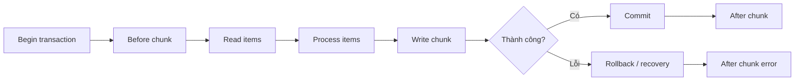
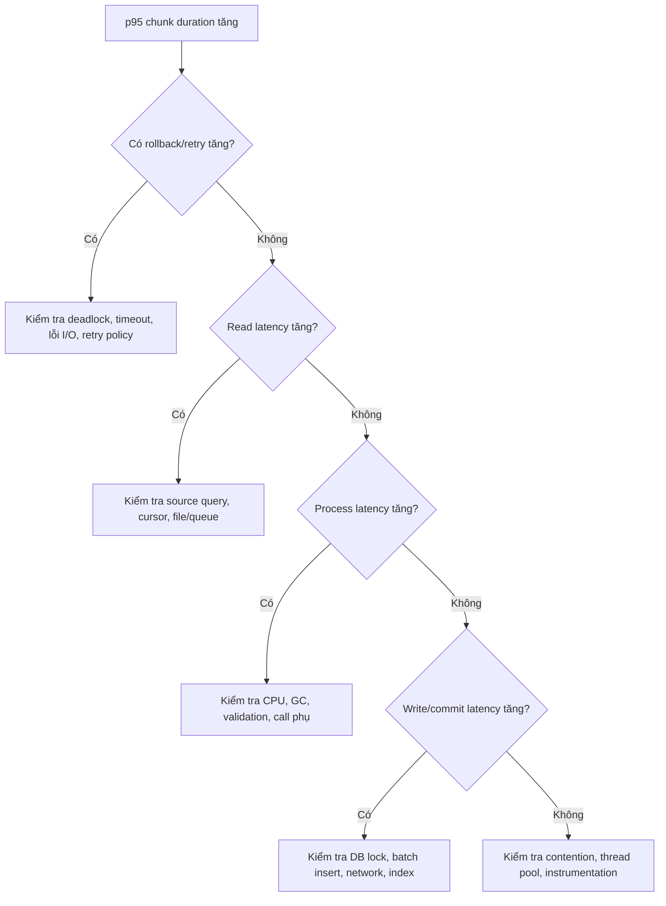

# Theo dõi thời gian mỗi chunk trong Spring Batch

Một batch job có thể báo **COMPLETED** nhưng mất nhiều thời gian hơn dự kiến, hoặc throughput giảm dần dù tổng số bản ghi vẫn tăng. Để tìm nguyên nhân, chỉ đo tổng thời gian của job thường chưa đủ. Với **chunk-oriented processing**, việc đo thời gian **từng chunk** giúp nhận ra những đoạn xử lý bất thường: một chunk phải đợi database lock, một chunk ghi qua API chậm, một chunk liên tục rollback/retry, hoặc một nhóm bản ghi có chi phí xử lý cao hơn phần còn lại.

Bài học thuộc **Spring Batch Core Processing → Monitoring**, tập trung vào thiết kế phép đo, tích hợp listener, ghi log và metrics, lập dashboard, đặt cảnh báo và kiểm thử kết quả đo. Các ví dụ dùng Java, Spring Batch 5.x, Spring Boot 3.x và Micrometer. Một số tên metric có sẵn của framework thay đổi theo phiên bản; ví dụ dưới đây định nghĩa **metric riêng** để bảo đảm ý nghĩa và cách đặt tên rõ ràng.

## 1. Chunk là đơn vị xử lý nào?

Trong chunk-oriented step, Spring Batch đọc và xử lý dữ liệu theo từng nhóm rồi gọi writer trong một ranh giới transaction. Ví dụ:

```java
@Bean
Step importStep(
        JobRepository jobRepository,
        PlatformTransactionManager transactionManager,
        ItemReader<RawRow> reader,
        ItemProcessor<RawRow, ValidRow> processor,
        ItemWriter<ValidRow> writer) {

    return new StepBuilder("importStep", jobRepository)
            .<RawRow, ValidRow>chunk(200, transactionManager)
            .reader(reader)
            .processor(processor)
            .writer(writer)
            .build();
}
```

Ở đây, `RawRow` và `ValidRow` là các kiểu dữ liệu nghiệp vụ giả định. `chunk(200, transactionManager)` tạo step theo chính sách commit interval 200. Một chunk có thể có **ít hơn 200 item được ghi** nếu processor lọc item bằng `null`, có item bị skip hoặc đây là chunk cuối; không nên suy luận số bản ghi đã commit chỉ bằng `chunkSize`.

Chu kỳ điển hình:



Spring Batch có thể xử lý lỗi bằng skip, retry và replay chunk. Khi có rollback, cùng một item hoặc một nhóm item có thể được xử lý lại, vì thế **số lần xử lý, số lần writer được gọi và số chunk đã commit là những đại lượng khác nhau**.

## 2. Định nghĩa chính xác “thời gian mỗi chunk”

Một con số thời gian chỉ hữu ích khi biết nó bắt đầu và kết thúc ở đâu.

| Phép đo | Điểm bắt đầu | Điểm kết thúc | Trả lời câu hỏi |
|---|---|---|---|
| **Chunk elapsed time** | Callback `beforeChunk` | `afterChunk` hoặc `afterChunkError` | Một lượt xử lý chunk mất bao lâu? |
| **Read latency** | Trước khi gọi `ItemReader.read()` | Khi đọc trả về/ném lỗi | Đọc nguồn có chậm? |
| **Process latency** | Trước `ItemProcessor.process()` | Sau xử lý/ném lỗi | Tính toán hoặc xác thực có nặng? |
| **Write latency** | Trước `ItemWriter.write()` | Sau writer trả về/ném lỗi | Ghi xuống đích có chậm? |
| **Job duration** | Job bắt đầu | Job kết thúc | Toàn bộ công việc mất bao lâu? |
| **Scheduling delay** | Kỳ vọng bắt đầu theo lịch | Job thực sự bắt đầu | Job bị chậm do xếp lịch hay tài nguyên? |

Theo hợp đồng `ChunkListener` của Spring Batch, `beforeChunk` được gọi sau khi transaction chunk bắt đầu và trước giai đoạn đọc; `afterChunk` được gọi sau khi chunk commit. Khi chunk gặp lỗi, `afterChunkError` cho phép ghi nhận đường lỗi.

Do đó, **duration đo bằng callback thường bao gồm read, process, write và phần lớn thời gian xử lý transaction/commit**, nhưng không bao gồm thời gian chờ job được scheduler khởi chạy hay mọi công việc bên ngoài callback. Khi có rollback và retry, mỗi lần thử hoặc phục hồi có thể tạo quan sát khác nhau; không mặc định “một số đo = một chunk dữ liệu duy nhất”.

### Phân biệt elapsed time và CPU time

Đo bằng đồng hồ đơn điệu `System.nanoTime()` cho biết **thời gian thực trôi qua** (wall-clock elapsed duration). Nó có thể bao gồm chờ network, I/O, database lock, thread scheduling, backoff và GC pause. Đó là điều phù hợp với giám sát độ trễ chunk.

Nếu mục đích là phân tích CPU, cần thêm profiler/CPU metric riêng. Một chunk mất 4 giây không nhất thiết dùng CPU liên tục 4 giây; nó có thể chỉ thực thi vài mili giây rồi đợi database.

Tránh dùng `System.currentTimeMillis()` để tính khoảng thời gian ngắn vì đồng hồ hệ thống có thể bị điều chỉnh bởi NTP hoặc người quản trị. `System.nanoTime()` phù hợp hơn để lấy **hiệu số giữa hai thời điểm**, còn timestamp wall clock có thể được dùng để ghi log.

## 3. Chọn chiến lược quan sát

Có ba cách phổ biến để theo dõi thời gian chunk.

| Cách đo | Ưu điểm | Giới hạn |
|---|---|---|
| **`ChunkListener` + log** | Đơn giản, thấy job/step/chunk chậm khi tra log | Khó tổng hợp percentile nếu chỉ log; nhiều chunk dễ làm log quá lớn |
| **`ChunkListener` + Micrometer Timer** | Đếm mẫu, đo tổng thời gian và histogram/percentile; phù hợp dashboard/cảnh báo | Cần registry, cấu hình histogram, tags và hệ thống thu thập |
| **Tracing/Observation kết hợp metric tích hợp** | Liên kết chunk với DB/HTTP span để truy vết sâu | Độ chi tiết và metric có sẵn tùy phiên bản, sampling và instrumentation |

Nên dùng Micrometer Timer làm kênh metric chính, ghi log khi chunk vượt ngưỡng hoặc có lỗi, và bật tracing khi cần xác định lời gọi chậm bên trong chunk. Nếu ứng dụng đã bật metrics của Spring Batch, kiểm tra cách định nghĩa và unit trước khi tạo metric mới để không cộng đúp cùng một quan sát.

Một bộ metric hữu ích tối thiểu:

- Thời gian chunk thành công và lỗi (đơn vị seconds khi xuất sang Prometheus).
- Số quan sát chunk theo `job`, `step` và `outcome`.
- Tổng số item đọc/ghi/skip/filter và commit/rollback của step.
- Thời gian step/job, số job thất bại, backlog hoặc chậm lịch.

## 4. Triển khai một `ChunkListener` đo thời gian

Ví dụ dưới đây tạo metric tên **`batch.chunk.duration`**, ghi một mẫu cho callback kết thúc chunk thành công hoặc lỗi. Listener lưu thời điểm bắt đầu trong `ThreadLocal` để các worker thread xử lý chunk đồng thời không ghi đè đồng hồ của nhau.

### 4.1. Listener dùng Micrometer và log chậm

```java
import java.time.Duration;
import java.util.concurrent.TimeUnit;
import java.util.function.LongSupplier;

import io.micrometer.core.instrument.MeterRegistry;
import io.micrometer.core.instrument.Timer;
import org.slf4j.Logger;
import org.slf4j.LoggerFactory;
import org.springframework.batch.core.ChunkListener;
import org.springframework.batch.core.scope.context.ChunkContext;

public final class ChunkDurationListener implements ChunkListener {

    private static final Logger log =
            LoggerFactory.getLogger(ChunkDurationListener.class);
    private static final String METRIC_NAME = "batch.chunk.duration";

    private final MeterRegistry meterRegistry;
    private final LongSupplier nanoClock;
    private final long slowThresholdNanos;

    // Mỗi worker thread giữ thời điểm bắt đầu riêng.
    private final ThreadLocal<Long> startedAtNanos = new ThreadLocal<>();

    public ChunkDurationListener(MeterRegistry meterRegistry) {
        this(meterRegistry, System::nanoTime, Duration.ofSeconds(2));
    }

    // Cho phép truyền clock giả trong unit test.
    ChunkDurationListener(
            MeterRegistry meterRegistry,
            LongSupplier nanoClock,
            Duration slowThreshold) {
        this.meterRegistry = meterRegistry;
        this.nanoClock = nanoClock;
        this.slowThresholdNanos = slowThreshold.toNanos();
    }

    @Override
    public void beforeChunk(ChunkContext context) {
        startedAtNanos.set(nanoClock.getAsLong());
    }

    @Override
    public void afterChunk(ChunkContext context) {
        recordEnd(context, "success");
    }

    @Override
    public void afterChunkError(ChunkContext context) {
        recordEnd(context, "error");
    }

    private void recordEnd(ChunkContext context, String outcome) {
        Long startedAt = startedAtNanos.get();
        startedAtNanos.remove(); // Tránh rò state khi thread được tái sử dụng.

        if (startedAt == null) {
            return; // Không có mốc bắt đầu hợp lệ.
        }

        long elapsedNanos = Math.max(
                0L, nanoClock.getAsLong() - startedAt);

        String jobName = context.getStepContext().getJobName();
        String stepName = context.getStepContext().getStepName();

        Timer.builder(METRIC_NAME)
                .description("Elapsed time of a Spring Batch chunk attempt")
                .tags(
                        "job", jobName,
                        "step", stepName,
                        "outcome", outcome)
                .publishPercentileHistogram()
                .register(meterRegistry)
                .record(elapsedNanos, TimeUnit.NANOSECONDS);

        if (elapsedNanos >= slowThresholdNanos) {
            long durationMs =
                    TimeUnit.NANOSECONDS.toMillis(elapsedNanos);

            log.warn(
                    "Slow batch chunk: job={} step={} outcome={} durationMs={}",
                    jobName, stepName, outcome, durationMs);
        }
    }
}
```

**Các quyết định thiết kế đáng chú ý:**

1. **`beforeChunk` → `afterChunk`/`afterChunkError`:** cùng một khoảng đo cho cả đường thành công và đường lỗi; tag `outcome` phân biệt hai tập mẫu.
2. **`System.nanoTime()`:** đo duration bằng đồng hồ đơn điệu. Hàm clock được inject để test không cần `Thread.sleep()`.
3. **`ThreadLocal`:** hỗ trợ trường hợp listener singleton được chia sẻ bởi các worker thread trong một step đa luồng, với điều kiện các callback của **một chunk** chạy trên cùng thread, như cách thực thi chunk thông thường. Với kiến trúc chuyển callback giữa các thread, phải lưu trạng thái bằng khóa chunk/execution hoặc cơ chế context phù hợp.
4. **`remove()`:** xóa thời điểm sau khi ghi metric để thread từ pool không giữ dữ liệu từ chunk trước.
5. **`Timer`:** lưu count/total time và có thể xuất histogram; không cần tự giữ danh sách mọi duration trong RAM.
6. **Chỉ log chunk chậm:** giảm log volume và chi phí I/O. Có thể log mọi chunk trong môi trường phát triển, nhưng production nên chọn ngưỡng và sampling hợp lý.

Ở ví dụ này, mỗi lượt callback thành công hoặc lỗi có thể tạo một mẫu; đó là **chunk attempt duration**, không phải tổng thời gian đến khi một nhóm item được commit qua nhiều lần retry. Cần giữ định nghĩa này trong mô tả dashboard và tài liệu vận hành.

### 4.2. Đăng ký listener vào step

```java
@Bean
ChunkDurationListener chunkDurationListener(MeterRegistry registry) {
    return new ChunkDurationListener(registry);
}

@Bean
Step importStep(
        JobRepository jobRepository,
        PlatformTransactionManager transactionManager,
        ItemReader<RawRow> reader,
        ItemProcessor<RawRow, ValidRow> processor,
        ItemWriter<ValidRow> writer,
        ChunkDurationListener chunkDurationListener) {

    return new StepBuilder("importStep", jobRepository)
            .<RawRow, ValidRow>chunk(200, transactionManager)
            .reader(reader)
            .processor(processor)
            .writer(writer)
            .listener(chunkDurationListener)
            .build();
}
```

Các class `RawRow` và `ValidRow` đại diện cho dữ liệu ứng dụng và cần được thay bằng kiểu thật. Với Spring Batch 5, builder nhận `JobRepository` và `chunk(size, transactionManager)`. Đảm bảo listener được gắn vào **step cần đo**; khai báo bean mà không đăng ký vào step sẽ không tự sinh metric.

Nếu một job có ba step chunk, có thể dùng cùng listener singleton để ghi chung metric với tag `step` khác nhau. Đừng đăng ký hai listener cùng thực hiện một phép đo nếu không muốn ghi đúp.

### 4.3. Một log khi gặp chunk chậm

```text
WARN Slow batch chunk:
  job=transactionImport
  step=importStep
  outcome=success
  durationMs=3187
```

Log cho biết một lượt xử lý chunk mất khoảng 3,2 giây. Nó **chưa cho biết** chậm ở reader, processor, writer hay transaction commit; để tìm nguyên nhân cần kết hợp thêm phase timing và các chỉ số JDBC/HTTP/CPU/GC.

## 5. Bật Micrometer và xuất metric sang Prometheus

Nếu dùng Spring Boot Actuator, thêm các dependency tương ứng trong build (ví dụ Gradle):

```groovy
dependencies {
    implementation 'org.springframework.boot:spring-boot-starter-batch'
    implementation 'org.springframework.boot:spring-boot-starter-actuator'
    runtimeOnly 'io.micrometer:micrometer-registry-prometheus'
}
```

Các version nên được quản lý theo BOM của Spring Boot để tránh lệch phiên bản Micrometer và framework. Ví dụ cấu hình xuất endpoint:

```yaml
management:
  endpoints:
    web:
      exposure:
        include: health, info, prometheus
```

Với cấu hình mặc định của Actuator, endpoint Prometheus thường nằm tại `/actuator/prometheus`. Khi triển khai thật, giới hạn truy cập theo cơ chế bảo mật và hạ tầng monitoring của hệ thống.

Ví dụ listener dùng `publishPercentileHistogram()` nên Prometheus có thể thu được histogram cho metric theo convention Micrometer, với tên điển hình:

```text
batch_chunk_duration_seconds_count{job="transactionImport",
  step="importStep",outcome="success"} 120
batch_chunk_duration_seconds_sum{job="transactionImport",
  step="importStep",outcome="success"} 18.42
batch_chunk_duration_seconds_bucket{job="transactionImport",
  step="importStep",outcome="success",le="1.0"} ...
```

Đây là **dạng minh họa**; số liệu, bucket và định dạng thực tế tùy registry/phiên bản. Tên Micrometer `batch.chunk.duration` thường được chuyển thành `batch_chunk_duration_seconds_*` ở Prometheus. Kiểm tra endpoint đang chạy để biết tên series thực tế trước khi cấu hình dashboard.

### Vì sao dùng Timer thay vì Gauge?

`Timer` tích lũy các duration đã quan sát, cung cấp count/total time và histogram. `Gauge` thường mô tả **giá trị tức thời** (ví dụ số chunk đang xử lý), không phù hợp để tính percentile của nhiều duration trong quá khứ.

Để tính p95/p99 đáng tin cậy khi có nhiều instance, ưu tiên histogram có thể tổng hợp qua các instance. Percentile tính riêng từng instance rồi đem trung bình thường **không phải** p95 của toàn hệ thống.

## 6. Dashboard: p50, p95, p99 và throughput

Một dashboard tốt thường hiển thị **phân phối thời gian**, thay vì chỉ hiển thị một giá trị trung bình.

Ví dụ bốn chunk có thời gian `90 ms, 110 ms, 110 ms, 900 ms`. Thời gian trung bình là `302,5 ms`, nhưng ba chunk đầu đều nhanh và chunk cuối là outlier. Nếu chỉ nhìn trung bình, khó biết sự khác biệt giữa một step chậm đều và một step thỉnh thoảng bị nghẽn.

Các thống kê quan trọng:

| Chỉ số | Diễn giải | Câu hỏi |
|---|---|---|
| **p50 (median)** | Một nửa mẫu có duration không vượt mức này | Mức điển hình có ổn không? |
| **p95** | Khoảng 95% mẫu ở hoặc dưới mốc này | Có nhiều chunk đuôi chậm không? |
| **p99** | Mốc tương ứng 99% mẫu | Có outlier nghiêm trọng không? |
| **Average** | Tổng duration chia số mẫu | Chi phí bình quân là bao nhiêu? |
| **Max** | Mẫu lớn nhất trong khoảng | Có chunk bất thường rất chậm không? |
| **Count/rate** | Số chunk attempt trong khoảng | Có chạy được bao nhiêu lượt? |
| **Item throughput** | Số item đã xử lý/ghi mỗi giây | Pipeline đang tạo ra lượng dữ liệu bao nhiêu? |
| **Rollback/retry rate** | Số lần rollback/retry so với hoạt động | Mất thời gian do phục hồi lỗi hay không? |

Percentile phụ thuộc vào **khoảng thời gian**, số mẫu và bucket của histogram. Với step chỉ chạy vài chunk mỗi ngày, p99 theo cửa sổ 5 phút rất dễ nhiễu hoặc không có giá trị; có thể xem duration từng chunk hoặc so sánh theo một JobExecution hoàn chỉnh.

### 6.1. PromQL: p95 của chunk thành công

Nếu registry xuất histogram tương ứng:

```promql
histogram_quantile(
  0.95,
  sum by (le, job, step) (
    rate(batch_chunk_duration_seconds_bucket{
      outcome="success"
    }[5m])
  )
)
```

Đây là độ trễ p95 **của các mẫu success** trong cửa sổ 5 phút, nhóm theo tên job/step và tổng hợp qua nhiều instance. Với histogram classic, `le` phải được giữ trong nhóm `sum by` để `histogram_quantile` hoạt động.

### 6.2. PromQL: duration trung bình

```promql
sum by (job, step) (
  rate(batch_chunk_duration_seconds_sum{outcome="success"}[5m])
)
/
sum by (job, step) (
  rate(batch_chunk_duration_seconds_count{outcome="success"}[5m])
)
```

Tử số là lượng thời gian tích lũy mỗi giây, mẫu số là số mẫu mỗi giây; tỷ lệ cho ra **giây/chunk attempt**. Nếu không có mẫu trong cửa sổ thì biểu thức có thể không trả số có ý nghĩa; dashboard cần hiển thị rõ khoảng trống dữ liệu.

### 6.3. PromQL: số chunk attempt lỗi

```promql
sum by (job, step) (
  increase(batch_chunk_duration_seconds_count{
    outcome="error"
  }[15m])
)
```

Đếm lỗi chunk qua callback **không tương đương** số JobExecution bị `FAILED`. Một lỗi chunk có thể được retry/skip rồi job kết thúc `COMPLETED`. Để đếm job thất bại, phải dùng metric hoặc metadata của JobExecution.

### 6.4. Quan hệ giữa duration và throughput

Với một step xử lý tuần tự, nếu chunk size là 200 và chunk trung bình 1 giây, có thể kỳ vọng gần 200 item đầu vào/giây trong điều kiện không filter, không skip, không overhead đáng kể và không có bottleneck khác. Đây chỉ là ước tính minh họa:

```text
Approx input throughput ≈ input items per committed chunk
                          / average elapsed time per chunk
```

Trong thực tế, chunk cuối nhỏ hơn, item có độ nặng khác nhau, writer có batch SQL, retry phát lại chunk và step có thể xử lý đa luồng. Vì vậy hãy đo trực tiếp **item throughput** từ `StepExecution`/business counter và so sánh với duration, thay vì dùng công thức này làm số liệu chính thức.

## 7. Thời gian chunk khi skip, retry và rollback

Đây là điểm quan trọng nhất khi giải thích metric vận hành.

Giả sử writer ghi 200 item nhưng gặp deadlock ở lần đầu:

```text
beforeChunk
  read/process/write → writer lỗi → rollback
afterChunkError             duration=1600ms, outcome=error

beforeChunk
  xử lý lại / retry → ghi thành công → commit
afterChunk                  duration=2100ms, outcome=success
```

**Kết quả có thể có hai mẫu duration cho một nhóm dữ liệu**. Điều này là bình thường nếu metric được định nghĩa theo **attempt**. Không cộng số mẫu rồi suy ra số chunk đã commit. Ngược lại, nếu chỉ xem nhóm `outcome=success`, bạn có thể bỏ qua thời gian tiêu tốn ở các lần lỗi và đánh giá thấp chi phí thật.

| Trường hợp | Ảnh hưởng đến metric | Cách đọc |
|---|---|---|
| Không có lỗi | Một lượt đo success cho chunk | Thường đại diện cho thời gian hoàn thành chunk |
| Retry trong read/process/write | Có thể kéo dài một lượt đo hoặc tạo thêm lượt đo | Dùng thêm retry counter/phase metric |
| Writer fail, rollback, replay | Có thể ghi mẫu error và success sau đó | Error count không đồng nghĩa job fail |
| Skip item lỗi | Chunk có thể hoàn thành với ít output hơn input | Theo dõi skipCount song song duration |
| Processor trả `null` | Item bị filter, không phải lỗi | Theo dõi filterCount |
| Step bị STOPPED | Có thể đã có các chunk commit trước đó | Step/job status khác chunk outcome |
| Lỗi xảy ra trước khi `beforeChunk` | Listener không có mốc start | Theo dõi thêm step/job error metric |

Tại sao `readCount` và `writeCount` có thể khác nhau? Processor có thể filter; reader/processor/writer có thể skip; writer có thể fail; chunk cuối có thể ngắn. Vì vậy **thời gian mỗi chunk** luôn cần được diễn giải cùng khối lượng công việc và số item đã commit.

### Chunk commit và counter Spring Batch

Một số counter hữu ích trên `StepExecution`:

```java
StepExecution step = jobExecution.getStepExecutions()
        .iterator().next();

long readCount = step.getReadCount();
long writeCount = step.getWriteCount();
long filterCount = step.getFilterCount();
long skipCount = step.getSkipCount();
long commitCount = step.getCommitCount();
long rollbackCount = step.getRollbackCount();
```

Các số này mô tả kết quả **của StepExecution** và được cập nhật qua quá trình xử lý. Chúng không tự cung cấp duration riêng cho từng chunk; listener lấp khoảng trống đó. `commitCount`/`rollbackCount` cũng không nên được ghép bằng phép trừ đơn giản với số callback để suy ra từng chunk cụ thể, vì lifecycle/transaction recovery của framework có thể phức tạp hơn một phép đếm đơn.

## 8. Phân tích chunk chậm: read, process, write hay commit?

Khi biểu đồ p95 tăng, nên đi từ tín hiệu tổng thể tới nguyên nhân cụ thể.



Các dấu hiệu thường gặp:

| Triệu chứng | Nguyên nhân khả dĩ | Tín hiệu cần xem thêm |
|---|---|---|
| Chunk chậm đều sau khi dữ liệu tăng | Mỗi item nặng hơn, truy vấn không dùng index | Record size, CPU, plan SQL, time/item |
| Chỉ một số chunk rất chậm | Outlier item, lock contention, network jitter | p95/p99, slow logs, DB wait events |
| Duration tăng cùng rollbackCount | Deadlock, timeout, retry lặp | Exception class, retry count, lock metrics |
| Duration tăng nhưng CPU thấp | Chờ I/O, connection pool, network | DB wait, pool queue, remote latency |
| Chunk đầu tiên chậm | Warm-up, cache, JIT, kết nối lần đầu | So sánh chunk đầu và những chunk sau |
| Chunk cuối có duration thấp | Ít item còn lại | Kết hợp duration và item count |
| Tăng chunk size làm duration tăng | Nhiều item trong mỗi transaction | Đo throughput, memory, lock time |
| Duration thấp nhưng job rất chậm | Chậm ở lịch khởi chạy, giữa step hoặc queue | Scheduling delay, step gap, job duration |

### Đo chi tiết từng giai đoạn

Spring Batch cung cấp các listener ở giai đoạn đọc/xử lý/ghi như `ItemReadListener`, `ItemProcessListener` và `ItemWriteListener`; có thể kết hợp instrumentation tại datasource/client HTTP để đo latency của những thao tác thực. Tuy nhiên:

- Read thường được gọi **nhiều lần** trong một chunk; muốn có read-time của chunk cần cộng các lượt read theo đúng context.
- Processor có thể bị gọi lại khi rollback, nên process-time tổng có thể bao gồm replay.
- Writer có thể được gọi nhiều lần cho cùng item do retry/recovery; timing của writer không đồng nghĩa transaction commit.
- Một phép đo `afterWrite` kết thúc khi writer trả về; **commit transaction có thể xảy ra sau đó**. Khoảng chênh giữa tổng read/process/write và chunk duration có thể gồm commit/transaction/scheduling/overhead khác, nhưng không nên xem nó là phép đo commit chính xác nếu không instrument transaction riêng.

Với hệ thống sử dụng JDBC, có thể kết hợp metrics connection pool (HikariCP), slow SQL query, trace JDBC và cơ sở dữ liệu để xác định lock wait, query plan, batch size hoặc chi phí index. Với REST writer, theo dõi latency HTTP, timeout, circuit breaker và retries phía client.

## 9. Thiết kế tags để metric có thể vận hành

Micrometer có thể tạo nhiều time series khi giá trị tag thay đổi. Các tag phù hợp thường là:

| Tag | Ví dụ | Nên dùng? |
|---|---|---|
| `job` | `dailyImportJob` | Có, số lượng job hữu hạn |
| `step` | `importStep` | Có, số lượng step hữu hạn |
| `outcome` | `success` / `error` | Có, tập giá trị nhỏ |
| `environment` | `prod` / `staging` | Có thể gắn từ cấu hình registry |
| `businessDate` | `2026-11-15`, đổi hàng ngày | **Tránh** trong metrics lâu dài |
| `jobExecutionId` | ID mới theo mỗi execution | **Tránh** vì cardinality tăng |
| `chunkIndex` | 1, 2, 3, ... | **Tránh** vì tạo series cho từng chunk |
| `itemId`, `customerId` | Giá trị rất nhiều và nhạy cảm | **Không gắn** vào metrics |
| `exceptionMessage` | Nội dung lỗi thay đổi liên tục | **Tránh**; dùng exception class chuẩn hóa nếu thật cần |

Nếu cần drill-down theo execution ID hay business date, dùng **structured log/tracing** với ID đó và thời gian tương ứng; metric chỉ giữ tag cardinality thấp. Ví dụ dashboard phát hiện `importStep` chậm, sau đó lọc log theo timestamp và execution ID để tìm chunk cụ thể.

Histogram tiêu thụ bộ nhớ và số time series lớn hơn counter đơn giản. Khi số job/step tăng, cân nhắc bucket/SLO hữu ích thay vì bật mọi tổ hợp tag không giới hạn. Tránh log mọi item chỉ để xác định thời gian một chunk: lượng log có thể chính là nguyên nhân làm job chậm.

## 10. Đặt ngưỡng cảnh báo theo mục tiêu nghiệp vụ

Không có một ngưỡng `2 giây/chunk` phù hợp cho mọi job. Ngưỡng nên dựa trên lịch sử, chunk size, khối lượng dữ liệu, SLA hoàn thành và dữ liệu theo mùa.

Ví dụ một job có 50.000 item, chunk size 500, khoảng 100 chunk:

```text
Số chunk dự kiến                  = 50.000 / 500 = 100
Duration trung bình nếu 0,8s      ≈ 80 giây xử lý chunk
Duration trung bình nếu 2,5s      ≈ 250 giây xử lý chunk
Chênh lệch                       ≈ 170 giây
```

Đây mới là phần thời gian chunk theo một mô hình tuần tự giản lược; tổng job còn bao gồm startup, step transition, checkpoint, metadata, chờ tài nguyên và các overhead khác. Nếu job có nhiều thread hoặc partition, cộng tuần tự duration của mọi chunk sẽ lớn hơn wall-clock runtime của job.

Một chiến lược alert:

1. **Warning:** p95 chunk duration vượt baseline hoặc ngưỡng đã hiệu chuẩn trong nhiều cửa sổ liên tiếp.
2. **Critical:** tốc độ ghi item giảm khiến dự báo hoàn thành vượt SLA, hoặc rollback/retry tăng mạnh.
3. **Traffic gate:** chỉ tính cảnh báo percentile khi có đủ số mẫu trong cửa sổ; với job ít chunk, xem độ dài một execution hoặc outlier cụ thể.
4. **Context:** cảnh báo kèm job, step, môi trường, khoảng thời gian, throughput, rollbackCount và link log/trace.

Ví dụ logic cảnh báo: p95 trên 2 giây liên tục 10 phút **và** có ít nhất 20 mẫu thành công trong cửa sổ tương ứng. Số liệu này chỉ để minh họa, cần điều chỉnh theo workload.

Với job chạy một lần/ngày và chỉ có vài chunk, cảnh báo theo percentile trong 5 phút thường không đủ mẫu. Khi đó có thể báo khi chunk vượt ngưỡng tuyệt đối (qua log/event) hoặc khi **step duration/SLA** vượt giới hạn; đồng thời lưu biểu đồ duration theo execution.

## 11. Kiểm thử listener mà không phụ thuộc đồng hồ thật

Vì constructor của listener cho phép truyền `LongSupplier`, unit test có thể dùng đồng hồ giả. Test không cần ngủ, không phụ thuộc CPU của máy chạy CI và kiểm tra đúng nhãn của metric.

### 11.1. Test đo thành công

```java
import static org.junit.jupiter.api.Assertions.assertEquals;
import static org.mockito.Mockito.mock;
import static org.mockito.Mockito.when;

import java.time.Duration;
import java.util.concurrent.TimeUnit;
import java.util.concurrent.atomic.AtomicLong;

import io.micrometer.core.instrument.Timer;
import io.micrometer.core.instrument.simple.SimpleMeterRegistry;
import org.junit.jupiter.api.Test;
import org.springframework.batch.core.scope.context.ChunkContext;
import org.springframework.batch.core.scope.context.StepContext;

class ChunkDurationListenerTest {

    @Test
    void recordsElapsedTimeForSuccessfulChunk() {
        SimpleMeterRegistry registry = new SimpleMeterRegistry();
        AtomicLong clock = new AtomicLong(1_000_000_000L);

        ChunkDurationListener listener = new ChunkDurationListener(
                registry, clock::get, Duration.ofSeconds(2));

        ChunkContext context = mockContext(
                "transactionImport", "importStep");

        listener.beforeChunk(context);
        clock.addAndGet(TimeUnit.MILLISECONDS.toNanos(2_500));
        listener.afterChunk(context);

        Timer timer = registry.get("batch.chunk.duration")
                .tags(
                        "job", "transactionImport",
                        "step", "importStep",
                        "outcome", "success")
                .timer();

        assertEquals(1L, timer.count());
        assertEquals(
                2_500.0,
                timer.totalTime(TimeUnit.MILLISECONDS),
                0.001);

        registry.close();
    }

    private static ChunkContext mockContext(
            String jobName, String stepName) {
        ChunkContext context = mock(ChunkContext.class);
        StepContext stepContext = mock(StepContext.class);
        when(context.getStepContext()).thenReturn(stepContext);
        when(stepContext.getJobName()).thenReturn(jobName);
        when(stepContext.getStepName()).thenReturn(stepName);
        return context;
    }
}
```

Phần test cần JUnit 5, Mockito và Micrometer test runtime như trong `spring-boot-starter-test` cùng `spring-batch-test` (tùy cấu hình dependency). Số `2_500 ms` được tạo bằng cách điều chỉnh clock, không phải đo thời gian thực nên kết quả ổn định.

### 11.2. Test đường lỗi và tránh ghi đúp

Trong cùng class test, thêm:

```java
@Test
void recordsErrorAndClearsStartTime() {
    SimpleMeterRegistry registry = new SimpleMeterRegistry();
    AtomicLong clock = new AtomicLong(0L);
    ChunkDurationListener listener = new ChunkDurationListener(
            registry, clock::get, Duration.ofSeconds(10));
    ChunkContext context = mockContext("jobA", "stepB");

    listener.beforeChunk(context);
    clock.addAndGet(TimeUnit.MILLISECONDS.toNanos(300));
    listener.afterChunkError(context);

    // Nếu callback khác bị gọi nhầm mà không có beforeChunk mới,
    // listener không được ghi thêm mẫu.
    listener.afterChunk(context);

    Timer errorTimer = registry.get("batch.chunk.duration")
            .tags("job", "jobA", "step", "stepB", "outcome", "error")
            .timer();
    assertEquals(1L, errorTimer.count());
    assertEquals(
            300.0,
            errorTimer.totalTime(TimeUnit.MILLISECONDS),
            0.001);

    registry.close();
}
```

Test này xác minh việc dọn `ThreadLocal` sau callback lỗi. Trong môi trường thật, việc callback xảy ra và thứ tự của chúng do Spring Batch điều khiển; unit test này chỉ kiểm tra logic của **listener**.

### 11.3. Integration test cho step

Sau unit test, nên có một integration test chạy job ngắn với `@SpringBatchTest`, `JobLauncherTestUtils` và `SimpleMeterRegistry`. Test có thể:

1. Tạo reader có dữ liệu xác định và writer ghi vào database test.
2. Đăng ký listener với step có chunk size nhỏ, ví dụ 2.
3. Khởi chạy job với identifying `JobParameters` riêng cho lần test.
4. Assert `JobExecution` và `StepExecution` ở trạng thái `COMPLETED`.
5. Assert Timer có mẫu outcome success và dữ liệu đầu ra đúng sau commit.
6. Với kịch bản writer cố ý lỗi, assert callback error được ghi; đồng thời kiểm tra `BatchStatus` và rollback bằng dữ liệu thật.

Không nên assert cố định rằng `Timer.count() == writeCount / chunkSize` trong mọi trường hợp. Chu kỳ đọc ở EOF, skip/filter, transaction recovery và retry làm số callback khác với phép chia đơn giản. Khi integration test, ưu tiên kiểm tra metric tồn tại và giá trị duration hợp lệ, rồi kiểm tra số liệu kết quả từ chính `StepExecution` và database.

## 12. Một số vấn đề khi đo trong môi trường thật

### 12.1. Multi-threaded step và partitioning

Nếu một step có nhiều worker thread, các chunk có thể chạy song song. `ThreadLocal` trong ví dụ tách thời điểm bắt đầu giữa các thread, nhưng không tự bảo đảm thứ tự chunk hoàn thành hay mối quan hệ một-một giữa chunk và dữ liệu.

Khi partitioning, mỗi worker có thể tạo `StepExecution` riêng với tên step dạng worker/partition. Nếu tên partition chứa giá trị động không giới hạn, gắn nguyên vào tag `step` sẽ tăng cardinality. Có thể chuẩn hóa tag thành tên logical step, để partition ID xuất hiện trong log/tracing.

**Tổng duration của mọi chunk chạy song song không bằng thời gian job trên đồng hồ.** Ví dụ 4 chunk chạy đồng thời, mỗi chunk mất 1 giây: tổng sample durations là 4 giây, nhưng wall-clock elapsed có thể chỉ khoảng 1 giây cộng overhead.

### 12.2. Chunk size và duration

Tăng chunk size có thể giảm overhead commit mỗi item, nhưng làm:

- Thời gian mỗi transaction dài hơn.
- Tăng memory/buffer cần giữ.
- Tăng số item bị replay khi rollback.
- Tăng lock contention khi writer ghi database.

Giảm chunk size có thể giảm duration từng chunk nhưng tăng tổng số transaction và metadata/commit overhead. Vì vậy tối ưu dựa trên **throughput, transaction cost, retry/rollback, memory và SLA**, không dùng một mình mục tiêu “chunk càng nhanh càng tốt”.

### 12.3. Long-running chunk và visibility

Metric `Timer` được ghi khi `afterChunk` hoặc `afterChunkError` xảy ra, tức **sau khi lượt đo kết thúc**. Một chunk treo rất lâu có thể chưa tạo mẫu duration mới, khiến biểu đồ Timer trông yên ắng ngay khi có sự cố.

Để phát hiện chunk đang treo, cần thêm tín hiệu **in-progress duration** hoặc watchdog/heartbeat được thiết kế riêng; hoặc giám sát thời điểm cập nhật StepExecution, thread dump, DB lock và timeout. Với hệ thống yêu cầu giám sát trực tiếp, có thể ghi timestamp bắt đầu và số chunk đang active qua `LongTaskTimer` hoặc observation thích hợp, nhưng phải đảm bảo dừng sample đúng trên mọi đường kết thúc.

### 12.4. Lỗi từ chính hệ thống monitoring

Ghi metrics/log phải có overhead thấp và tránh làm job thất bại chỉ vì backend monitoring tạm thời không khả dụng. Với registry phổ biến, ghi `Timer` thường thực hiện cục bộ, còn việc xuất metrics do thành phần thu thập xử lý. Không nên tự gọi HTTP đồng bộ tới monitoring service trong `afterChunk`.

Nếu listener tự ném exception, nó có thể ảnh hưởng vòng đời batch và làm việc điều tra khó hơn. Giữ logic listener đơn giản, tránh query database nghiệp vụ, tránh I/O nặng, không serialize toàn bộ item và không ghi dữ liệu nhạy cảm.

### 12.5. Clock và khả năng so sánh giữa các node

`System.nanoTime()` dùng để đo hiệu thời gian **trên cùng process**; không dùng giá trị nanoTime tuyệt đối để so sánh hai node. Khi cần đối chiếu log từ nhiều máy, dùng timestamp chuẩn hóa múi giờ và hệ thống tập trung; dùng histogram/metrics để so sánh duration giữa node.

### 12.6. Monitoring có thể nhìn khác do caching và warm-up

Chunk đầu tiên có thể tốn thêm thời gian mở connection, JIT warm-up, nạp cache hoặc đọc metadata. Không nên loại bỏ chunk đầu một cách âm thầm; nếu muốn tách hiệu ứng warm-up khỏi latency vận hành, phải định nghĩa rõ chính sách và giữ dữ liệu thô để điều tra.

## 13. Kịch bản đọc dashboard thực tế

Một job ban đêm có chuỗi số liệu:

| Thời điểm | p50 chunk | p95 chunk | Chunk errors | Write throughput |
|---|---:|---:|---:|---:|
| 01:00–01:10 | 180 ms | 310 ms | 0 | 8.200 items/phút |
| 01:10–01:20 | 200 ms | 450 ms | 0 | 7.900 items/phút |
| 01:20–01:30 | 210 ms | 3.200 ms | 9 | 4.100 items/phút |
| 01:30–01:40 | 190 ms | 330 ms | 0 | 8.000 items/phút |

Đọc kết quả:

1. p50 gần như ổn định: phần lớn chunk không chậm hơn nhiều.
2. p95 tăng mạnh trong cửa sổ 01:20–01:30: xuất hiện nhóm chunk đuôi chậm.
3. Cùng thời điểm có lỗi chunk và throughput giảm: cần kiểm tra rollback/retry, DB lock hoặc timeout chứ chưa đủ cơ sở kết luận processor CPU tăng.
4. Sau 01:30 hệ thống trở lại baseline: có khả năng nút thắt chỉ xuất hiện theo thời điểm hoặc tài nguyên dùng chung.

Giả sử log có:

```text
01:23:11 ERROR Deadlock detected while updating ledger
01:23:14 WARN  Slow batch chunk: job=ledgerJob step=writeStep
               outcome=error durationMs=3020
01:23:16 WARN  Slow batch chunk: job=ledgerJob step=writeStep
               outcome=success durationMs=2180
```

Đó là tín hiệu để điều tra deadlock/transaction và retry policy, không phải bằng chứng cần tăng CPU. Sau khi sửa, theo dõi lại p95, lỗi và item throughput để chứng minh cải thiện.

## 14. Checklist triển khai monitoring theo chunk

| Câu hỏi cần trả lời | Hành động tương ứng |
|---|---|
| Đã định nghĩa thời gian bắt đầu/kết thúc chưa? | Ghi rõ semantics của `beforeChunk` và `afterChunk/afterChunkError` |
| Có phân biệt success và error không? | Tag `outcome` hoặc metric riêng |
| Có nhìn thấy retry và rollback không? | Kết hợp `StepExecution`, log exception và retry metric |
| Có dữ liệu để tính p95/p99 không? | Bật histogram và chọn khoảng thời gian đủ mẫu |
| Tags có cardinality thấp không? | Dùng job, logical step, outcome; tránh executionId/itemId |
| Slow log có quá nhiều không? | Dùng threshold và sampling, không log từng item |
| Có đo read/process/write khi cần không? | Instrument thêm theo phase hoặc DB/HTTP tracer |
| Có biết chunk đang treo dù chưa kết thúc không? | Long task/heartbeat/timeout hoặc monitoring thread/DB |
| Có test listener không? | Unit test bằng clock giả và `SimpleMeterRegistry` |
| Có test integration không? | Chạy step với database test, assert status và dữ liệu commit |
| Có ngưỡng liên quan SLA không? | Hiệu chuẩn bằng baseline, throughput và thời hạn hoàn thành |

## 15. Kết luận

Theo dõi thời gian từng chunk giúp phát hiện điểm nghẽn mà metric ở cấp job hoặc step khó chỉ ra. Một triển khai cơ bản có thể bắt đầu bằng **`ChunkListener` đo elapsed duration bằng `System.nanoTime()`**, xuất **Micrometer Timer** với tags `job`/`step`/`outcome`, ghi log chunk chậm và xây dashboard p50/p95/p99.

Giá trị của phép đo nằm ở cách diễn giải: **chunk attempt có thể lỗi và được retry; item count có thể khác chunk size; transaction có thể rollback; nhiều chunk có thể chạy song song**. Khi kết hợp duration với throughput, skip/retry, rollback, readiness của dữ liệu và trace những thao tác chậm, đội vận hành mới phân biệt được trường hợp phải tối ưu đọc/ghi, điều chỉnh chunk size, xử lý database lock hay thay đổi cơ chế scheduling.
