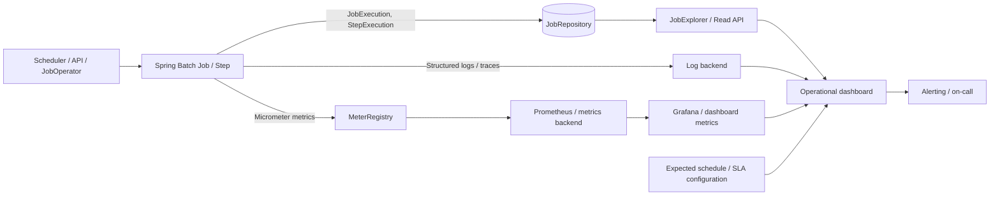

# Dashboard batch operational trong Spring Batch Core Processing

Một batch job báo `COMPLETED` không tự động có nghĩa hệ thống đã hoàn thành nghĩa vụ vận hành. Job có thể hoàn tất trễ SLA, ghi ra 0 bản ghi vì đầu vào sai, bỏ qua quá nhiều item hoặc chạy thành công sau nhiều lần retry. Ngược lại, job có trạng thái `STARTED` chưa chắc đang tiến triển: tiến trình có thể mất kết nối database, kẹt I/O hoặc đã dừng bất thường trước khi kịp ghi trạng thái cuối. **Dashboard batch operational** giúp người trực vận hành nhận ra các tình huống đó, tìm đúng `JobExecution`/`StepExecution` và quyết định bước xử lý tiếp theo.

Trong phạm vi Spring Batch, dashboard hiệu quả phải trả lời được các câu hỏi cụ thể:

1. Job nào **phải chạy** trong kỳ này, đã được kích hoạt chưa và có hoàn thành đúng hạn không?
2. Lần chạy gần nhất của mỗi job đang ở trạng thái nào; đã chạy bao lâu; có lỗi hoặc bị dừng không?
3. Mỗi step đã đọc, ghi, lọc, skip bao nhiêu item; có rollback, retry hoặc xu hướng bất thường không?
4. Khi lỗi xảy ra, có thể mở chi tiết execution, xem exception, log liên quan và lịch sử restart không?
5. Hệ thống có dấu hiệu chậm dần hoặc không có tiến độ trước khi vượt SLA không?

Dashboard không phải thành phần thay thế `JobRepository` hay `JobExplorer`. Nó là **lớp hiển thị và cảnh báo** tổng hợp dữ liệu từ metadata thực thi, metrics và hệ thống log, có các quy tắc SLA theo nghiệp vụ.

## 1. Bức tranh kiến trúc



Ba nhóm nguồn dữ liệu có mục đích khác nhau:

| Nguồn | Có thể biết | Không nên suy ra |
| --- | --- | --- |
| `JobRepository` qua `JobExplorer` | `JobInstance`, `JobExecution`, `StepExecution`, trạng thái, thời gian, bộ đếm, exit code | Hiệu năng chi tiết của từng lần gọi reader/writer hoặc lý do lỗi đầy đủ nếu log không lưu |
| Micrometer và hệ thống metrics | Thời lượng job/step, thời gian đọc/xử lý/ghi, số tác vụ đang hoạt động theo instrumentation | Số bản ghi nghiệp vụ được ghi bền vững chỉ từ số mẫu timer |
| Log/tracing của ứng dụng | Exception, ID correlation, thông tin nguồn dữ liệu, hệ thống phụ thuộc | Trạng thái execution cuối cùng chỉ dựa vào dòng log cuối |
| Lịch chạy kỳ vọng và SLA | Job đáng lẽ chạy lúc nào, hạn hoàn thành, kỳ nghiệp vụ nào bị thiếu | Không thể tự lấy chỉ từ `JobRepository` nếu job chưa bao giờ được khởi chạy |

**Quy tắc nguồn chuẩn:** metadata Batch là nguồn chính để xác định trạng thái và counter của **một execution**; metrics thích hợp cho biểu đồ thời gian; log thích hợp cho điều tra; lịch nghiệp vụ cho biết một lần chạy **bị thiếu** dù repository không có bản ghi nào.

## 2. Các thực thể phải phân biệt trên dashboard

Spring Batch có cấu trúc phân cấp:

```text
Job name: importOrders
   |
   +-- JobInstance A (businessDate=2025-01-15)
   |      +-- JobExecution 101  FAILED
   |      |      +-- StepExecution 201  read=1000 write=950
   |      +-- JobExecution 102  COMPLETED (restart)
   |             +-- StepExecution 202  read=200 write=200
   |
   +-- JobInstance B (businessDate=2025-01-16)
          +-- JobExecution 103  COMPLETED
                 +-- StepExecution 203  read=1100 write=1098
```

- **`Job`**: định nghĩa quy trình xử lý, chẳng hạn `importOrders`.
- **`JobInstance`**: một công việc logic xác định bởi tên job và các identifying `JobParameters`, chẳng hạn `businessDate=2025-01-15`.
- **`JobExecution`**: một lần thử chạy job. Một instance có thể có nhiều execution khi chạy lại sau lỗi.
- **`StepExecution`**: kết quả một lần chạy step trong một execution; giữ các counter `read`, `write`, `filter`, `skip`, `commit`, `rollback`.

Nếu dashboard gộp mọi dữ liệu theo `jobName` rồi chỉ hiển thị một dòng, người vận hành dễ bỏ lỡ việc cùng job có nhiều instance đang chạy, hoặc một instance đã restart nhiều lần. Một bản ghi chi tiết nên luôn có **`jobExecutionId`**, **`jobInstanceId`**, **`jobName`** và các `stepExecutionId` tương ứng.

### Trạng thái và exit status

`BatchStatus` biểu diễn trạng thái vòng đời của execution. Những giá trị cần hiểu gồm:

| `BatchStatus` | Ý nghĩa vận hành | Gợi ý trình bày |
| --- | --- | --- |
| `STARTING` | Đã bắt đầu quá trình khởi động, chưa vào xử lý chính | Chờ khởi động, theo dõi timeout |
| `STARTED` | Đã bắt đầu thực thi | Đang chạy; so tiến độ với SLA |
| `STOPPING` | Đã yêu cầu dừng, chờ bước xử lý phản hồi | Dừng đang diễn ra; không coi là đã dừng |
| `STOPPED` | Đã dừng có kiểm soát | Cần biết lý do và quyết định chạy tiếp |
| `COMPLETED` | Batch execution kết thúc thành công theo định nghĩa framework | Kiểm tra thêm số lượng, thời gian và chất lượng dữ liệu |
| `FAILED` | Thực thi thất bại | Điều tra lỗi, xác định có thể restart hay không |
| `ABANDONED` | Execution/step bị đánh dấu bỏ, thường không còn được restart theo đường thông thường | Cần chú ý trong quy trình phục hồi |
| `UNKNOWN` | Framework không xác định chắc trạng thái | Cần kiểm tra metadata và tình trạng hệ thống |

`ExitStatus` (`getExitStatus().getExitCode()`) diễn đạt **kết quả thoát**, có thể được tùy biến bởi flow hoặc listener. Dashboard nên hiển thị **cả** `BatchStatus` và exit code để tránh nhầm `COMPLETED` về mặt trạng thái với một kết quả nghiệp vụ tùy chỉnh. `EXIT_MESSAGE` có thể bị giới hạn độ dài bởi schema; nên kèm đường dẫn đến log của execution.

## 3. Thiết kế các màn hình và KPI vận hành

Không phải tất cả người xem cần cùng mức độ chi tiết. Một dashboard dùng được khi có ba lớp: **tổng quan**, **lịch sử từng job**, và **chi tiết execution/step**.

### 3.1. Tổng quan cho ca trực

Ví dụ minh họa dữ liệu giả định (không phải số liệu từ một hệ thống thật):

```text
┌─────────────────────────────────────────────────────────────────┐
│ BATCH OPERATIONS · 2025-01-16 · múi giờ Asia/Ho_Chi_Minh       │
├─────────────────────────────────────────────────────────────────┤
│ Dự kiến hôm nay: 12   Hoàn tất: 9   Đang chạy: 1   Trễ SLA: 2  │
│ Có lỗi: 1             Thiếu lần chạy: 1   Cần xử lý: 3         │
├─────────────────────────────────────────────────────────────────┤
│ JOB                KỲ DỮ LIỆU   TRẠNG THÁI  HẠN      TRỄ      │
│ importOrders       2025-01-15   COMPLETED   08:00    12 phút  │
│ reconcilePayment   2025-01-15   STARTED     08:30    18 phút  │
│ archiveLogs        2025-01-15   FAILED      09:00    —        │
│ sendSettlement     2025-01-15   NOT_RUN     09:15    —        │
└─────────────────────────────────────────────────────────────────┘
```

Trường `NOT_RUN` trong ví dụ là **trạng thái tự tính của dashboard từ lịch chạy kỳ vọng**; nó không phải một giá trị `BatchStatus` của Spring Batch. Phân biệt rõ trạng thái framework với trạng thái SLA do dashboard xác định, chẳng hạn `MISSING_EXPECTED_RUN`, `SLA_BREACHED`, `SUSPECTED_STALLED`.

Các ô tổng quan nên hiển thị theo một khoảng thời gian và múi giờ xác định. Ví dụ “hoàn tất hôm nay” có thể là **execution kết thúc hôm nay**, trong khi “kỳ dữ liệu hôm nay” có thể dựa trên `businessDate` thuộc ngày trước; hai cách lọc phải được ghi rõ.

### 3.2. Danh sách lịch sử và drill-down

Mỗi lần thực thi nên có dòng riêng:

| Cột | Giá trị và cách hiểu |
| --- | --- |
| Job / business key | Tên job, ngày dữ liệu, tenant hoặc định danh nghiệp vụ cần thiết |
| `jobInstanceId`, `jobExecutionId` | ID liên kết về đúng lần chạy; cần cho restart/điều tra |
| `BatchStatus`, `ExitStatus` | Trạng thái lifecycle và kết quả thoát |
| `startTime`, `endTime`, duration | Thời điểm bắt đầu/kết thúc và thời lượng đã chạy |
| `lastUpdated` | Thời điểm metadata được lưu gần nhất, không mặc nhiên là heartbeat |
| SLA / expected run | Đúng hạn, trễ, không chạy, hoặc chưa đến lịch |
| Read / write / filter / skip | Tổng quan về dữ liệu qua các step, kèm quy tắc tổng hợp |
| Link chi tiết | Mở danh sách step, thông báo lỗi, log, correlation ID |

Nếu job có nhiều step cùng đọc một item ở các giai đoạn khác nhau, **không nên cộng tất cả `readCount` rồi gọi đó là số bản ghi đầu vào duy nhất**. Hiển thị theo step, hoặc chỉ tổng hợp các step được định nghĩa rõ có thể cộng theo nghiệp vụ.

### 3.3. Trang chi tiết execution

Một trang chi tiết có thể bố trí:

```text
JobExecution #102 | importOrders | COMPLETED | Exit: COMPLETED
JobInstance #48  | businessDate=2025-01-15
Started: 08:02:11 | Ended: 08:08:45 | Duration: 6m34s

STEP                    STATUS      READ   WRITE  FILTER SKIP  ROLLBACK
loadOrders              COMPLETED   1,000  970    20     10    1
enrichOrders            COMPLETED     970  968     2      0    0
publishSummary          COMPLETED       0    0     0      0    0

Related: [logs by jobExecutionId] [previous executions] [alerts]
```

`publishSummary` có thể là tasklet chỉ ghi báo cáo, nên item counters bằng 0 vẫn hợp lệ. Dashboard cần biết **step thuộc loại gì** trước khi dùng `writeCount=0` làm dấu hiệu lỗi.

## 4. KPI nên đo và cách hiểu

| KPI | Công thức/nguồn | Cạm bẫy cần tránh |
| --- | --- | --- |
| Số execution hoàn tất | Đếm `JobExecution` có `BatchStatus=COMPLETED` trong cửa sổ thời gian | Một `JobInstance` có thể được thử chạy nhiều lần |
| Số execution thất bại | Đếm `FAILED`, có thể tách `STOPPED`/`UNKNOWN` | Đừng gộp `STOPPED` mặc nhiên là failure kỹ thuật |
| Tỷ lệ thành công | `COMPLETED / tổng execution kết thúc` trong cửa sổ đã định nghĩa | Loại trừ execution còn `STARTED`; nói rõ `STOPPED` tính hay không |
| Duration | `endTime - startTime` cho lần chạy đã kết thúc | Không dùng `now - startTime` làm duration cuối của job đang chạy |
| Trễ SLA | `completedAt > deadline` hoặc chưa hoàn tất khi đã qua hạn | Cần lịch chạy và thời hạn nghiệp vụ ngoài Batch metadata |
| Throughput xử lý | Chênh lệch số item đã ghi giữa hai snapshot / thời gian tương ứng | Đọc snapshot sau commit; rollback/restart cần tách execution |
| Tỷ lệ skip | Có thể dùng `skipCount / (readCount + readSkipCount)` cho step một đầu vào một item | Chỉ số mang tính ngữ cảnh, không thể dùng y hệt cho mọi step |
| Tỷ lệ filter | `filterCount / readCount` cho một step có processor | Filter có thể là quy tắc bình thường, không nhất thiết là lỗi |
| Rollback / retry | `rollbackCount` từ `StepExecution`, kết hợp lỗi và retry logs | `rollbackCount` không bằng chính xác số lần retry |
| Missing run | So kỳ chạy dự kiến với job/parameters hoặc business key đã xuất hiện | Không thể phát hiện job **chưa hề được kích hoạt** từ repository thuần túy |

Không có một ngưỡng chung cho mọi job. Một step xác thực dữ liệu có thể filter 90% theo thiết kế, còn step chuyển tiền có thể yêu cầu skip bằng 0. Ngưỡng nên gắn với **job, step, kỳ dữ liệu và cam kết nghiệp vụ**.

## 5. Dữ liệu chuẩn từ `JobRepository` và `JobExplorer`

`JobRepository` lưu metadata qua nhiều bảng (khi dùng repository JDBC mặc định), còn `JobExplorer` cung cấp API **đọc** lịch sử và trạng thái mà không phải viết SQL cho mọi thao tác.

| Bảng | Chứa gì | Dùng trên dashboard |
| --- | --- | --- |
| `BATCH_JOB_INSTANCE` | Job name và danh tính job instance | Nhóm các lần chạy theo công việc logic |
| `BATCH_JOB_EXECUTION` | Execution ID, status, thời gian, exit code/message, last updated | Danh sách lịch sử, duration, kết quả |
| `BATCH_JOB_EXECUTION_PARAMS` | `JobParameters` của execution | Kỳ nghiệp vụ, tham số định danh, dữ liệu phục vụ drill-down |
| `BATCH_STEP_EXECUTION` | Step status, counters, transaction counts, thời gian | Chi tiết đọc/ghi/filter/skip, rollback |
| `BATCH_JOB_EXECUTION_CONTEXT` và `BATCH_STEP_EXECUTION_CONTEXT` | Trạng thái ứng dụng/checkpoint của execution | Điều tra và restart; thường không hiển thị thô |

### Những API `JobExplorer` thường dùng ở Spring Batch 5.2

```java
jobExplorer.getJobNames();
jobExplorer.getJobInstances("importOrders", 0, 20);
jobExplorer.getJobExecutions(jobInstance);
jobExplorer.getJobExecution(jobExecutionId);
jobExplorer.getStepExecution(jobExecutionId, stepExecutionId);
jobExplorer.findRunningJobExecutions("importOrders");
```

- `getJobNames()` trả các **tên job đã có lịch sử trong repository**, không phải danh sách chắc chắn các định nghĩa đang được nạp trong ứng dụng. Nếu cần tìm job có thể khởi chạy, đối chiếu `JobRegistry`.
- `getJobInstances(name, start, count)` trả danh sách instance có phân trang. Phân trang theo **instance**, không phải trực tiếp theo execution; một instance có thể có nhiều execution khi restart.
- `getJobExecutions(instance)` trả lịch sử các lần thực thi thuộc instance; có thể cần nạp thêm thông tin một step bằng `getStepExecution(...)` nếu phần execution context chưa được hydrate đầy đủ.
- `findRunningJobExecutions(name)` lấy các execution được **repository ghi nhận** là đang chạy. Nếu process chết bất thường, metadata có thể còn trạng thái `STARTED`; API không tự chứng minh process vẫn hoạt động.

### Mẫu API đọc chi tiết một execution

Ví dụ sau dùng **Spring Batch 5.2.x, Spring Boot 3.x và Java 17**. Nó tạo endpoint nội bộ `GET /internal/batch/executions/{executionId}` trả trạng thái và các counter. Code giả định ứng dụng đã cấu hình `JobExplorer` và Spring MVC:

```java
import java.time.LocalDateTime;
import java.util.Comparator;
import java.util.List;

import org.springframework.batch.core.JobExecution;
import org.springframework.batch.core.StepExecution;
import org.springframework.batch.core.explore.JobExplorer;
import org.springframework.http.HttpStatus;
import org.springframework.web.bind.annotation.GetMapping;
import org.springframework.web.bind.annotation.PathVariable;
import org.springframework.web.bind.annotation.RequestMapping;
import org.springframework.web.bind.annotation.RestController;
import org.springframework.web.server.ResponseStatusException;

@RestController
@RequestMapping("/internal/batch/executions")
public class BatchExecutionReadController {

    private final JobExplorer jobExplorer;

    public BatchExecutionReadController(JobExplorer jobExplorer) {
        this.jobExplorer = jobExplorer;
    }

    @GetMapping("/{executionId}")
    public ExecutionView get(@PathVariable Long executionId) {
        JobExecution execution = jobExplorer.getJobExecution(executionId);
        if (execution == null) {
            throw new ResponseStatusException(
                    HttpStatus.NOT_FOUND, "Unknown execution: " + executionId);
        }

        List<StepView> steps = execution.getStepExecutions().stream()
                .sorted(Comparator.comparing(StepExecution::getStepName))
                .map(step -> new StepView(
                        step.getId(),
                        step.getStepName(),
                        step.getStatus().name(),
                        step.getReadCount(),
                        step.getWriteCount(),
                        step.getFilterCount(),
                        step.getReadSkipCount(),
                        step.getProcessSkipCount(),
                        step.getWriteSkipCount(),
                        step.getSkipCount(),
                        step.getRollbackCount()))
                .toList();

        return new ExecutionView(
                execution.getId(),
                execution.getJobInstance().getId(),
                execution.getJobInstance().getJobName(),
                execution.getStatus().name(),
                execution.getExitStatus().getExitCode(),
                execution.getStartTime(),
                execution.getEndTime(),
                steps);
    }

    public record ExecutionView(
            Long executionId,
            Long instanceId,
            String jobName,
            String status,
            String exitCode,
            LocalDateTime startTime,
            LocalDateTime endTime,
            List<StepView> steps) {
    }

    public record StepView(
            Long stepExecutionId,
            String stepName,
            String status,
            long read,
            long write,
            long filter,
            long readSkip,
            long processSkip,
            long writeSkip,
            long totalSkip,
            long rollbacks) {
    }
}
```

Các `record` chỉ chứa dữ liệu dashboard cần, tránh trả trực tiếp toàn bộ entity/`ExecutionContext` nội bộ. Endpoint này cũng không thực hiện `start`, `stop`, `restart`, không chạm vào transaction ghi Batch. Để sử dụng trong hệ thống thật, bổ sung xác thực, phân quyền và giới hạn tốc độ truy vấn; chỉ cho phép nhóm vận hành truy cập.

Với danh sách lịch sử, triển khai endpoint phân trang riêng, ví dụ `GET /internal/batch/jobs/{jobName}/executions?limit=20`. Cần xác định rõ thứ tự: một `JobInstance` cũ có thể được restart **sau** một instance mới, vì thế chỉ lấy “instance mới nhất” rồi suy ra “execution mới nhất” có thể sai. Khi cần báo cáo chính xác toàn bộ execution theo thời gian, có thể duyệt các instance trong phạm vi rõ ràng hoặc tạo truy vấn báo cáo được tối ưu trên bảng execution.

## 6. Truy vấn SQL cho bảng điều khiển vận hành

Với JDBC repository và table prefix mặc định `BATCH_`, câu truy vấn dưới lấy metadata của một execution cùng các step. Nó dùng cú pháp `:executionId` của named parameter; trong công cụ SQL thuần cần thay bằng bind syntax phù hợp:

```sql
SELECT
    ji.JOB_NAME,
    je.JOB_INSTANCE_ID,
    je.JOB_EXECUTION_ID,
    je.STATUS AS JOB_STATUS,
    je.EXIT_CODE AS JOB_EXIT_CODE,
    je.START_TIME AS JOB_START_TIME,
    je.END_TIME AS JOB_END_TIME,
    je.LAST_UPDATED AS JOB_LAST_UPDATED,
    se.STEP_EXECUTION_ID,
    se.STEP_NAME,
    se.STATUS AS STEP_STATUS,
    se.READ_COUNT,
    se.WRITE_COUNT,
    se.FILTER_COUNT,
    se.READ_SKIP_COUNT,
    se.PROCESS_SKIP_COUNT,
    se.WRITE_SKIP_COUNT,
    se.COMMIT_COUNT,
    se.ROLLBACK_COUNT
FROM BATCH_JOB_EXECUTION je
JOIN BATCH_JOB_INSTANCE ji
  ON ji.JOB_INSTANCE_ID = je.JOB_INSTANCE_ID
LEFT JOIN BATCH_STEP_EXECUTION se
  ON se.JOB_EXECUTION_ID = je.JOB_EXECUTION_ID
WHERE je.JOB_EXECUTION_ID = :executionId
ORDER BY se.STEP_EXECUTION_ID;
```

`LEFT JOIN` giúp vẫn thấy job execution đã có metadata nhưng chưa tạo step execution. Một job có nhiều step sẽ xuất hiện nhiều dòng, vì vậy **không cộng lại các cột cấp job** sau khi join mà không xem xét số dòng nhân bản. Số liệu step là số liệu của **từng step execution**, không mặc nhiên là số bản ghi nghiệp vụ duy nhất.

Đối với dashboard lịch sử, cần có **paging**, bộ lọc khoảng thời gian và điều kiện theo tên job/status. Tránh quét toàn bộ metadata ở mỗi lần refresh: một repository hoạt động lâu có thể chứa hàng triệu dòng execution, đặc biệt khi job chạy thường xuyên. Truy vấn phục vụ vận hành nên có giới hạn, chỉ chọn cột cần dùng và cân nhắc read replica/nguồn báo cáo riêng nếu khối lượng đọc lớn.

### Timestamp và độ trễ cập nhật

`LAST_UPDATED` phản ánh lần ghi metadata gần nhất. Một step thực hiện tác vụ dài trong một transaction chưa commit có thể không cập nhật counter ngay; một tasklet đang chờ API ngoài cũng có thể không ghi metadata thường xuyên. Do đó, **`now - lastUpdated` lớn không chứng minh job đã chết**. Dùng thêm tình trạng tiến trình, heartbeat ứng dụng riêng, log, metric `spring.batch.*.active` và đặc tính step để phát hiện có vẻ bị kẹt.

Khi hiển thị `startTime`, `endTime` hoặc `lastUpdated`, phải thống nhất quy ước timezone của database/JVM và chuyển sang timezone hiển thị được ghi rõ, ví dụ `Asia/Ho_Chi_Minh`. Không tự suy ra timestamp không có timezone là UTC. Các điều kiện SLA nên dùng instant hoặc thời điểm nghiệp vụ được chuyển đổi chính xác, kể cả khi có triển khai ở nhiều múi giờ.

## 7. Micrometer và Spring Boot Actuator

Từ Spring Batch 4.2, framework có metrics tích hợp qua Micrometer. Ở **Spring Batch 5.2.x**, các metric cung cấp sẵn thường gồm:

| Metric Micrometer | Loại | Giá trị thể hiện |
| --- | --- | --- |
| `spring.batch.job` | `TIMER` | Duration của job execution, theo tên/trạng thái |
| `spring.batch.job.active` | `LONG_TASK_TIMER` | Job đang hoạt động |
| `spring.batch.step` | `TIMER` | Duration của step execution |
| `spring.batch.step.active` | `LONG_TASK_TIMER` | Step đang hoạt động |
| `spring.batch.item.read` | `TIMER` | Thời gian các thao tác đọc item |
| `spring.batch.item.process` | `TIMER` | Thời gian xử lý item |
| `spring.batch.chunk.write` | `TIMER` | Thời gian ghi chunk |

Metric duration giúp phát hiện job chậm dần và điểm nghẽn. Chúng **không trực tiếp cung cấp** mọi bộ đếm `StepExecution` như `readCount`, `writeCount`, `filterCount`, `skipCount`. Đặc biệt, số lần ghi nhận timer `spring.batch.chunk.write` là số lần đo thao tác ghi chunk, không phải số item được writer ghi thành công.

Trong ứng dụng Spring Boot, có thể thêm Actuator và Prometheus registry:

```groovy
dependencies {
    implementation 'org.springframework.boot:spring-boot-starter-batch'
    implementation 'org.springframework.boot:spring-boot-starter-actuator'
    implementation 'org.springframework.boot:spring-boot-starter-web'
    runtimeOnly 'io.micrometer:micrometer-registry-prometheus'
}
```

Các version dependency nên do Spring Boot BOM hoặc hệ thống quản lý phiên bản của dự án kiểm soát. Cấu hình hiển thị endpoint metrics cho hệ thống nội bộ có thể như sau:

```yaml
management:
  endpoints:
    web:
      exposure:
        include: health,info,prometheus
  metrics:
    tags:
      application: order-batch
```

Với Prometheus registry và Actuator được cấu hình hợp lệ, Prometheus có thể scrape `/actuator/prometheus` trên cổng quản trị mà hệ thống triển khai cho phép. **Đừng công khai endpoint này trực tiếp ra Internet**; dùng mạng nội bộ, xác thực hoặc chính sách truy cập thích hợp.

Micrometer dùng tên theo dạng `spring.batch.job`, còn Prometheus thường chuẩn hóa tên thành dạng `spring_batch_job_seconds_*` cho timer (tùy phiên bản registry và quy tắc naming). Trước khi viết PromQL, xem tên series thực tế tại endpoint scrape. Ví dụ truy vấn sau minh họa đếm số job observation thất bại mỗi giây trong 1 giờ, giả định có series `spring_batch_job_seconds_count` và tag `status="FAILURE"`:

```promql
sum by (name) (
  rate(spring_batch_job_seconds_count{status="FAILURE"}[1h])
)
```

Đây là **tốc độ phát sinh các execution thất bại trong cửa sổ thời gian**, không phải số job instance đang lỗi hoặc tỷ lệ thất bại của toàn bộ lịch dự kiến. Nếu cần tỷ lệ thất bại, phải xác định mẫu số gồm những execution nào và chú ý nhãn status của phiên bản đang sử dụng. Long task timer và timer cần được trực quan hóa đúng loại; không trộn “số hoạt động đồng thời” với “số job hoàn tất”.

## 8. Bộ đếm read, write, filter, skip trong dashboard

Mỗi `StepExecution` có các getter:

```java
stepExecution.getReadCount();
stepExecution.getWriteCount();
stepExecution.getFilterCount();
stepExecution.getReadSkipCount();
stepExecution.getProcessSkipCount();
stepExecution.getWriteSkipCount();
stepExecution.getSkipCount();
stepExecution.getCommitCount();
stepExecution.getRollbackCount();
```

`skipCount = readSkipCount + processSkipCount + writeSkipCount`. `filterCount` không phải skip: processor trả `null` vì quy tắc nghiệp vụ sẽ tăng filter, còn skip là một lỗi được skip policy cho phép bỏ qua. Hai chỉ số này cần màu sắc, cảnh báo và ngưỡng đánh giá khác nhau.

Trong ví dụ giả định một step đọc 10.000 item thành công, lọc 150, skip 20 trong process và ghi 9.830 item:

```text
readCount           10.000
writeCount           9.830
filterCount            150
processSkipCount        20
readSkipCount            0
writeSkipCount           0
skipCount               20
rollbackCount            1
```

Khi mô hình xử lý là một đầu vào tương ứng tối đa một đầu ra, phép cân đối `read ≈ write + filter + processSkip + writeSkip` có thể giúp phát hiện bất thường. **Không xem đó là quy luật chung của mọi batch step**: retry, rollback, cách triển khai reader/writer và các step tổng hợp có thể làm diễn giải phức tạp hơn. Cần dùng bộ đếm đã commit và đối chiếu dữ liệu nghiệp vụ để kết luận mất hay trùng item.

Một dashboard có thể vẽ đường tăng `writeCount` theo thời gian cho execution đang chạy, nhưng snapshot từ repository chỉ cập nhật sau những lần framework ghi metadata. Nếu step commit chunk lớn hoặc mất nhiều thời gian giữa các lần commit, biểu đồ có thể đứng yên rồi nhảy vọt. Đó chưa chắc là lỗi tiến độ.

## 9. Log, correlation ID và link điều tra

Metadata cho biết **execution nào thất bại**, còn log thường cho biết **vì sao**. Mỗi thông điệp log quan trọng nên mang đủ ngữ cảnh để lọc được theo lần chạy:

```text
timestamp=2025-01-16T08:03:18+07:00
level=ERROR
jobName=importOrders
jobInstanceId=48
jobExecutionId=102
stepName=loadOrders
stepExecutionId=202
errorCode=DB_TIMEOUT
message="Write chunk failed after retry"
```

Trong hệ thống thực tế, có thể thêm MDC/log fields ở listener hoặc tích hợp observability của ứng dụng. Mục tiêu là mở một dòng job trên dashboard rồi chuyển sang truy vấn log bằng `jobExecutionId` hoặc `stepExecutionId`, không phải tìm thủ công trên tất cả log server.

Nên tránh ghi toàn bộ `JobParameters`/`ExecutionContext` vào log hoặc API nếu chứa token, mật khẩu, đường dẫn nhạy cảm, dữ liệu khách hàng hay thông tin riêng tư. `EXIT_MESSAGE` cũng có thể chứa dữ liệu lỗi cần kiểm soát quyền xem. Với trường hợp phải cung cấp chi tiết điều tra, áp dụng redaction và phân quyền phù hợp.

Log lỗi của `ItemReadListener`, `ItemProcessListener`, `ItemWriteListener` có thể xuất hiện nhiều lần do retry; **đếm log exception không tương đương `skipCount`**. Nếu cần biết item nào thực sự bị skip, dùng `SkipListener` kết hợp counter cuối trong `StepExecution`.

## 10. SLA, lịch chạy dự kiến và cảnh báo

`JobRepository` chỉ biết những execution đã được tạo. Một job đáng lẽ chạy lúc 02:00 nhưng scheduler chưa kích hoạt sẽ **không có dòng execution** cho kỳ đó. Dashboard cần mô hình lịch nghiệp vụ độc lập:

```yaml
# Ví dụ cấu hình nghiệp vụ do hệ thống vận hành quản lý.
batchOperations:
  jobs:
    importOrders:
      zone: Asia/Ho_Chi_Minh
      expectedAt: "02:00"
      deadlineAt: "03:00"
      businessDateRule: previous-day
      maxDurationMinutes: 45
      maxSkippedItems: 0
```

Đây là **YAML minh họa của ứng dụng**, không phải property chuẩn được Spring Batch tự nhận. Scheduler thực tế có thể dùng cron, Quartz, hệ thống orchestration hay một dịch vụ bên ngoài. Cần ánh xạ **lịch dự kiến + kỳ nghiệp vụ** với `JobParameters`/instance được ghi nhận để xác định lần chạy bị thiếu hoặc trễ.

Ví dụ quy tắc cảnh báo:

| Cảnh báo | Điều kiện ví dụ | Hành động trực |
| --- | --- | --- |
| `MISSING_RUN` | Qua thời điểm kỳ vọng và grace period mà chưa thấy execution cho kỳ dữ liệu | Kiểm tra scheduler, trigger, message queue, quyền hệ thống |
| `SLA_BREACH` | Đến deadline nhưng chưa có execution phù hợp `COMPLETED` | Ưu tiên xử lý theo mức độ quan trọng của job |
| `JOB_FAILED` | Execution chuyển `FAILED` | Mở exit message, log, step lỗi và dependency |
| `STOPPED_OR_UNKNOWN` | `STOPPED`/`UNKNOWN` ngoài kế hoạch | Xác nhận thao tác dừng, trạng thái repository và kế hoạch phục hồi |
| `SUSPECTED_STALLED` | Đang `STARTED`, quá thời lượng dự kiến và không có dấu hiệu tiến độ | Kiểm tra thread, log, I/O, locks, liveness; chưa tự tuyên bố job đã chết |
| `HIGH_SKIP_RATE` | Skip count/tỷ lệ vượt ngưỡng của step | Kiểm tra dữ liệu đầu vào và skip policy |
| `ZERO_OUTPUT` | Job hoàn tất nhưng writer lẽ ra phải có dữ liệu mà `writeCount=0` | Kiểm tra reader, filter, query nguồn, điều kiện nghiệp vụ |
| `DURATION_REGRESSION` | p95 duration cao hơn baseline theo nhiều kỳ | Kiểm tra kích thước đầu vào, database, network, writer throughput |

**Chống báo động lặp:** gom alert theo `jobName + businessDate + alertType`, đặt cooldown và trạng thái acknowledge; ngăn một execution lỗi gửi hàng trăm thông báo qua mỗi lần polling. Sau khi job restart thành công, hiển thị cả failure cũ và execution mới để người trực hiểu chuyện gì đã xảy ra. Tránh tự động restart vô hạn khi lỗi do dữ liệu hoặc ghi không idempotent.

### Định nghĩa SLA cần rõ ràng

Nếu job chạy lúc 02:00 và phải hoàn thành trước 03:00, cần trả lời:

- “03:00” là theo múi giờ nào và xử lý ngày có DST ra sao?
- Deadline áp dụng cho **kỳ dữ liệu** hay mọi lần chạy thủ công?
- `COMPLETED` với 1.000 skip có được coi là đạt SLA chất lượng không?
- Một lần chạy trễ nhưng đã hoàn tất có tiếp tục là breach trong báo cáo lịch sử không?
- Sau restart, dùng thời gian kết thúc của execution thành công cuối cùng hay lần đầu khởi chạy để đo lead time toàn kỳ?

Những quyết định này nên được lưu trong cấu hình vận hành và thể hiện rõ trên dashboard, thay vì dùng một phép so sánh timestamp khó hiểu cho mọi job.

## 11. Xử lý job `STARTED` lâu và những trạng thái mồ côi

Một tình huống thường gặp: process chạy job bị kill hoặc mất điện trước khi Spring Batch ghi trạng thái thất bại. Dòng `BATCH_JOB_EXECUTION.STATUS` có thể vẫn là `STARTED`, trong khi thực tế không còn worker đang chạy.

Không nên tự đổi trạng thái bằng SQL chỉ vì `LAST_UPDATED` đã cũ. Điều tra theo các bước:

1. Kiểm tra process/pod/container có còn sống và có đang xử lý execution đó không.
2. Tìm log theo `jobExecutionId`, `stepExecutionId`; kiểm tra deadlock, network timeout, tình trạng upstream.
3. Đối chiếu các metric active, JVM thread, datasource pool và heartbeat ứng dụng nếu có.
4. Kiểm tra `JobRepository` có còn cập nhật metadata hoặc có transaction/chunk đang chạy dài hay không.
5. Xác định chính sách khôi phục chính thức của ứng dụng. Chỉ sau khi xác minh trạng thái thật mới quyết định xử lý trạng thái mồ côi hoặc restart.

Một long-running tasklet có thể không tạo item counters dù vẫn làm việc hợp lệ. Với job loại này nên instrument tiến độ nghiệp vụ riêng (số trang API đã xử lý, số file đã nén, partition hoàn tất) hoặc heartbeat có kiểm soát. Không lấy `writeCount=0` làm bằng chứng job bị treo.

## 12. Restart và cách đếm trong báo cáo

Giả sử cùng một `JobInstance` có hai lần chạy:

| Execution | `BatchStatus` | `readCount` | `writeCount` | Ghi chú |
| --- | --- | ---: | ---: | --- |
| #101 | `FAILED` | 1.000 | 950 | Các chunk đầu đã commit; lỗi sau đó |
| #102 | `COMPLETED` | 200 | 200 | Restart tiếp tục từ checkpoint |

Dashboard nên trình bày **hai execution riêng**, liên kết qua `jobInstanceId`. Nếu mục tiêu là báo cáo *số lần thực thi*, ở đây là 2. Nếu mục tiêu là *đã hoàn tất kỳ nghiệp vụ chưa*, câu trả lời có thể là đã hoàn tất sau execution #102. Nếu mục tiêu là *có bao nhiêu bản ghi nghiệp vụ duy nhất đã ghi*, không mặc nhiên kết luận `950 + 200 = 1.150`; cần kiểm tra checkpoint, idempotency và khóa nghiệp vụ.

Cũng cần phân biệt:

- **Job đã hoàn tất:** `COMPLETED` của một execution theo mô hình Batch.
- **Kỳ nghiệp vụ đã hoàn tất:** quy tắc vận hành xác nhận rằng công việc mong đợi cho kỳ đó hoàn thành đủ và đúng hạn hay không.
- **Tất cả item đầu vào đã được chuyển đổi thành kết quả:** cần đối chiếu với dữ liệu nguồn/đích, filter, skip và quy tắc nghiệp vụ.

Không dùng bảng dashboard làm nguồn ra lệnh sửa `JobRepository`. Nếu UI có chức năng **stop/restart**, cần đưa qua API điều khiển có phân quyền, validate tham số, xác nhận tác động và ghi audit log. Phần đọc trạng thái/metrics nên vận hành độc lập với các thao tác làm thay đổi batch.

## 13. Triển khai dashboard theo từng giai đoạn

Một lộ trình thực tế giúp có giá trị sớm mà vẫn giữ hệ thống dễ quản lý:

| Giai đoạn | Thành phần | Kết quả người vận hành nhận được |
| --- | --- | --- |
| 1 — Metadata | `JobExplorer`, API chỉ đọc, bảng execution/step | Biết job nào chạy, trạng thái, thời điểm, counter và lỗi |
| 2 — Hiệu năng | Micrometer, Actuator, Prometheus/Grafana | Thấy duration, số job đang hoạt động, xu hướng latency |
| 3 — Điều tra | Structured logs, correlation ID, link đến log backend | Từ execution lỗi mở đúng log của step |
| 4 — SLA | Lịch chạy dự kiến, business key, deadline, ngưỡng dữ liệu | Phát hiện chạy thiếu, trễ hạn và hoàn tất không đạt chất lượng |
| 5 — Vận hành | Alert routing, acknowledgement, runbook, audit | Trực ca và phản ứng sự cố nhất quán |

Khi triển khai nhiều node, mỗi node có thể xuất metrics riêng; Prometheus tổng hợp metrics qua nhiều instance, còn `JobRepository` có thể là kho metadata dùng chung. Tránh cộng metrics active hoặc execution counts mà không xét label `instance`, vì có thể đếm trùng hoặc hiểu sai khi một job được phân tán. Phía API chỉ đọc nên query repository đúng nguồn, và giới hạn tải polling.

### Refresh, cache và hiệu năng

Một dashboard hiển thị tiến độ cập nhật mỗi vài giây rất hấp dẫn nhưng có thể đặt tải đọc không cần thiết lên `JobRepository`. Tần suất refresh phải phù hợp với thời gian chunk và SLA: job chạy vài giờ có thể refresh mỗi 30–60 giây; job ngắn thường chỉ cần hiển thị kết quả và biểu đồ metrics định kỳ. Đây là **ví dụ thiết kế**, không phải tần suất mặc định của Spring Batch.

API có thể áp dụng phân trang, bộ lọc job/status, cửa sổ thời gian, response cache ngắn và truy vấn giới hạn. Đặt timeout cho truy vấn vận hành để dashboard không làm cạn connection pool của job đang chạy. Đối với dữ liệu lịch sử lớn, có thể xây read model hoặc kho phân tích riêng, đồng bộ từ metadata theo cơ chế đáng tin cậy thay vì truy vấn toàn bộ bảng liên tục.

## 14. Những lỗi thiết kế dashboard thường gặp

| Triệu chứng | Nguyên nhân | Cách sửa |
| --- | --- | --- |
| Dashboard hiện “không có lỗi” khi scheduler không chạy | Chỉ theo dõi execution đã tồn tại | Bổ sung expected schedule và phát hiện missing run |
| Thấy `COMPLETED` và kết luận dữ liệu đủ | Không nhìn filter/skip/đối chiếu nghiệp vụ | Bổ sung KPI chất lượng và validation theo job |
| Một tên job chỉ có một dòng nên mất lịch sử restart | Gộp `JobInstance` và `JobExecution` | Dùng ID riêng, timeline các execution của instance |
| `STARTED` quá lâu bị gắn là “đã chết” | Coi `LAST_UPDATED` là heartbeat chắc chắn | Xác minh process, log, metrics và đặc điểm chunk/tasklet |
| `writeCount` khác số dòng database | Item writer có thể ghi nhiều dòng hoặc upsert | Dùng metric nghiệp vụ riêng nếu cần đếm row thật |
| Trên Grafana chỉ có timer mà không có `skipCount` | Built-in Micrometer metric tập trung vào duration/active | Đọc counter từ `JobExplorer`/metadata hoặc publish metric riêng |
| Count tăng bất thường sau restart | Cộng nhiều execution/step không kiểm soát | Tách execution và dùng cách tổng hợp theo dữ liệu nghiệp vụ |
| API dashboard làm chậm job | Polling SQL nặng trên repository dùng chung | Giới hạn truy vấn, cache hoặc tách read model |
| Metric quá nhiều series | Đặt `executionId`/itemId vào tags | Dùng tag thấp cardinality, giữ ID chi tiết trong logs/API |
| Sai hạn SLA một giờ | Trộn UTC, timezone JVM và business timezone | Chuẩn hóa thời điểm, công khai timezone và business date |
| UI có thể restart job bất kỳ | Không phân quyền hành động theo job/môi trường | API quản trị có authorization, audit và policy riêng |

## 15. Các tài liệu tham khảo

Ví dụ code và tên metric trong bài lấy **Spring Batch 5.2.x** làm mốc cùng Spring Boot 3.x, Java 17. Trong Spring Batch 6.x, một số package/API và cơ chế observability thay đổi; khi triển khai hãy đối chiếu tài liệu phiên bản thực tế. Các đoạn bảng điều khiển và YAML SLA là **mẫu thiết kế**, không phải tính năng dashboard dựng sẵn của Spring Batch.

- [Spring Batch 5.2 — Monitoring and metrics](https://docs.spring.io/spring-batch/reference/5.2/monitoring-and-metrics.html)
- [Spring Batch 5.2 — Advanced metadata usage và `JobExplorer`](https://docs.spring.io/spring-batch/reference/5.2/job/advanced-meta-data.html)
- [Spring Batch 5.2 API — `JobExplorer`](https://docs.spring.io/spring-batch/docs/5.2.6/api/org/springframework/batch/core/explore/JobExplorer.html)
- [Spring Batch 5.2 API — `JobExecution`](https://docs.spring.io/spring-batch/docs/5.2.6/api/org/springframework/batch/core/JobExecution.html)
- [Spring Batch 5.2 API — `StepExecution`](https://docs.spring.io/spring-batch/docs/5.2.6/api/org/springframework/batch/core/StepExecution.html)
- [Spring Batch 5.2 — Metadata schema](https://docs.spring.io/spring-batch/reference/5.2/schema-appendix.html)
- [Spring Boot — Actuator metrics](https://docs.spring.io/spring-boot/reference/actuator/metrics.html)
- [Spring Boot — Prometheus support](https://docs.spring.io/spring-boot/reference/actuator/metrics.html#actuator.metrics.export.prometheus)
- [Micrometer — Concepts: meters and timers](https://docs.micrometer.io/micrometer/reference/concepts/timers.html)

Một **dashboard batch operational** đáng tin cậy phải nối đúng **lịch kỳ vọng → JobInstance → JobExecution → StepExecution → log/metrics**. `JobExplorer` và metadata Batch trả lời việc gì đã chạy và kết quả ra sao; Micrometer giúp thấy tiến trình và xu hướng hiệu năng; log giải thích sự cố; SLA xác định điều gì *đáng lẽ phải diễn ra*. Khi giữ riêng những nguồn thông tin ấy, người vận hành có thể phát hiện job bị thiếu, trễ, thất bại hoặc hoàn tất với chất lượng bất thường, rồi mở đúng execution để xử lý mà không nhầm lịch sử restart với tiến độ nghiệp vụ.
