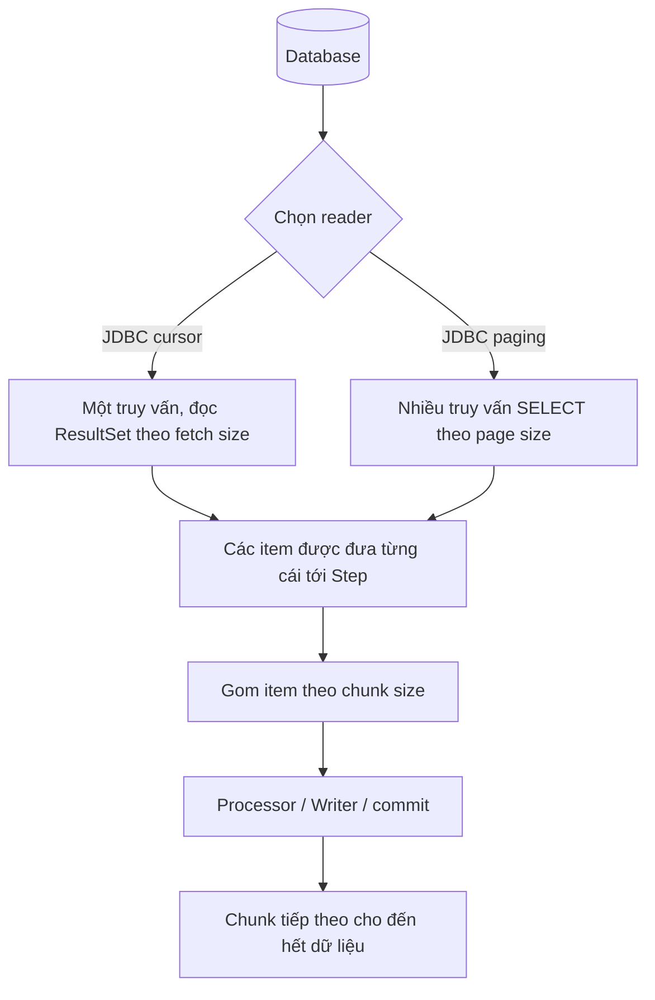

# Fetch size và page size trong Spring Batch

Khi Spring Batch phải đọc hàng trăm nghìn hoặc hàng triệu bản ghi, tốc độ xử lý không chỉ phụ thuộc vào code trong `ItemProcessor` và `ItemWriter`. Cách reader lấy dữ liệu từ database quyết định số lần giao tiếp qua mạng, lượng bộ nhớ tạm, thời gian chờ và khả năng khôi phục sau sự cố. Hai tham số thường xuất hiện khi tối ưu đọc dữ liệu là **fetch size** và **page size**.

Chúng dễ bị nhầm với **chunk size**, nhưng phục vụ ba mục đích khác nhau:

- **Fetch size:** gợi ý cho JDBC driver lấy bao nhiêu dòng mỗi đợt khi duyệt một `ResultSet`.
- **Page size:** số dòng reader dự định lấy trong mỗi lần truy vấn phân trang.
- **Chunk size:** số item đầu vào được gom theo chính sách chunk trước khi ghi và thực hiện ranh giới commit.

Một chương trình có thể dùng `fetchSize=500`, một chương trình khác dùng `pageSize=500` và cả hai cùng dùng `chunk(100)`, nhưng hành vi truy vấn, quản lý connection và lưu checkpoint sẽ khác nhau đáng kể.

Bài này thuộc **Spring Batch Core Processing → Performance**, trình bày bản chất hai tham số, cách cấu hình `JdbcCursorItemReader`, `JdbcPagingItemReader`, JPA/repository readers, những tác động lên transaction/restart và phương pháp benchmark an toàn. Ví dụ theo Spring Batch 5.x / Spring Boot 3.x; hành vi JDBC và câu SQL phân trang thực tế còn phụ thuộc database, driver và phiên bản framework.

## 1. Phân biệt ba “kích thước” qua một ví dụ

Giả sử cần nhập **100.000 giao dịch** từ bảng `transactions`. Processor chuẩn hóa từng dòng và writer ghi sang bảng kết quả. Ta đặt:

```text
Tổng số dòng N       = 100.000
Fetch size F         = 500     (nếu dùng cursor)
Page size P          = 500     (nếu dùng paging)
Chunk size C         = 100
```

Một phép tính gần đúng trong điều kiện không skip/filter/retry và chạy tuần tự:

| Đại lượng | Ước lượng | Điều được điều khiển |
|---|---:|---|
Số đợt lấy dữ liệu từ driver khi cursor thực sự fetch theo batch | `ceil(100000 / 500) ≈ 200` | `fetchSize` |
Số truy vấn lấy page khi paging | `ceil(100000 / 500) ≈ 200` | `pageSize` |
Số nhóm 100 item cần ghi/commit | `ceil(100000 / 100) = 1000` | `chunkSize` |

Đây là **mô hình để hiểu tác động**, không phải cam kết chính xác về số round trip: driver có thể bỏ qua fetch-size hint, cursor có thể cần thêm lần fetch để phát hiện hết dữ liệu, paging có thể truy vấn thêm trang rỗng và Spring Batch có thể thực hiện giao dịch metadata/recovery. Khi một số item bị filter/skip, write count còn khác read count.



**Điểm cốt lõi:** Fetch size và page size điều khiển *đường lấy dữ liệu*. Chunk size điều khiển *đơn vị xử lý và transaction*. Chúng có thể độc lập và không bắt buộc bằng nhau.

## 2. Fetch size là gì?

Trong JDBC, `Statement.setFetchSize(int)` là một **hint** gửi cho driver về số hàng nên lấy qua mỗi đợt giao tiếp khi đọc `ResultSet`. Spring Batch cho phép cấu hình hint này trên các reader kiểu cursor như `JdbcCursorItemReader`.

Đường đi khái niệm:

```text
JDBC executeQuery("SELECT ...")
            │
            ▼
       ResultSet / cursor
            │
            ├── fetch đợt 1: tối đa khoảng F rows
            ├── fetch đợt 2: tối đa khoảng F rows
            ├── ...
            └── đến khi hết ResultSet
            │
            ▼
    Spring Batch đọc từng item
```

Khi một driver hỗ trợ server-side cursor và stream kết quả đúng cách, fetch size hợp lý có thể giảm số round trip so với lấy từng dòng, đồng thời tránh giữ toàn bộ tập kết quả trong heap. Tuy nhiên:

- `setFetchSize(500)` **không** thêm `LIMIT 500` vào câu SQL.
- `fetchSize=500` **không** giới hạn toàn bộ truy vấn chỉ trả 500 dòng.
- Driver có quyền xử lý hint khác nhau hoặc bỏ qua hint.
- Fetch size nhỏ không tự động bảo đảm ít RAM nếu driver vẫn buffer toàn bộ result set.
- Fetch size lớn có thể giảm round trip nhưng tăng bộ nhớ đệm trên driver/client và thời gian mỗi đợt transfer.

### 2.1. Cấu hình `JdbcCursorItemReader`

Ví dụ đọc bảng giao dịch bằng cursor:

```java
import java.math.BigDecimal;

import javax.sql.DataSource;

import org.springframework.batch.item.database.JdbcCursorItemReader;
import org.springframework.batch.item.database.builder.JdbcCursorItemReaderBuilder;
import org.springframework.context.annotation.Bean;

record TransactionRow(long id, BigDecimal amount) {}

@Bean
JdbcCursorItemReader<TransactionRow> transactionCursorReader(
        DataSource dataSource) {

    return new JdbcCursorItemReaderBuilder<TransactionRow>()
            .name("transactionCursorReader")
            .dataSource(dataSource)
            .sql("""
                    SELECT id, amount
                    FROM transactions
                    WHERE status = 'READY'
                    ORDER BY id
                    """)
            .rowMapper((rs, rowNum) -> new TransactionRow(
                    rs.getLong("id"),
                    rs.getBigDecimal("amount")))
            .fetchSize(500)
            .saveState(true)
            .build();
}
```

`JdbcCursorItemReader` thực hiện truy vấn rồi di chuyển con trỏ qua các dòng, ánh xạ mỗi dòng thành một item. Khi reader được mở và đóng đúng lifecycle, Spring Batch quản lý việc đọc và có thể lưu trạng thái cần thiết trong `ExecutionContext`. `name(...)` quan trọng khi bật `saveState(true)` để các khóa checkpoint được định danh ổn định.

Chú ý: Lưu số item đã đọc **không đồng nghĩa database cursor vật lý được giữ qua lần restart**. Khi restart, reader có thể phải mở lại truy vấn và định vị tới vị trí đã lưu. Nếu dữ liệu nguồn thay đổi về thứ tự hoặc thành phần, vị trí cũ có thể không còn tương ứng với bản ghi cũ.

### 2.2. Đặc tính connection và transaction của cursor

Cursor thường giữ `ResultSet`/connection mở trong thời gian đọc, thay vì thực hiện một truy vấn ngắn cho từng trang. Điều này đem lại ưu điểm và rủi ro:

| Lợi ích | Chi phí/rủi ro |
|---|---|
Một truy vấn chính, không cần tạo câu SELECT phân trang liên tục | Cursor/connection được giữ lâu |
Phù hợp quét tuần tự khối lượng lớn | Có thể chịu ảnh hưởng timeout, transaction, kết nối mạng |
Lấy dữ liệu theo đợt nếu driver hỗ trợ | Driver có thể vẫn materialize toàn bộ kết quả |
Dễ đọc theo thứ tự query | Restart phải định vị lại và nguồn cần ổn định |

`JdbcCursorItemReader` thường dùng connection riêng cho cursor theo cấu hình mặc định; có tùy chọn chia sẻ connection với transaction qua `useSharedExtendedConnection` khi dùng proxy/driver phù hợp. Không nên suy luận rằng commit mỗi chunk sẽ tự đóng/mở lại toàn bộ cursor theo chunk. Nếu cần cursor sống qua commit và chia sẻ connection, phải kiểm tra hỗ trợ holdability của driver và cấu hình transaction.

### 2.3. Fetch size thực tế phụ thuộc driver

Một số trường hợp đáng nhớ:

- **PostgreSQL JDBC:** để fetch theo cursor thay vì tải trọn tập kết quả, thường cần fetch size dương cùng connection **không ở auto-commit**, và query/cursor đáp ứng điều kiện driver hỗ trợ. Nếu không, đặt `fetchSize` có thể không tạo streaming như mong đợi.
- **MySQL Connector/J:** hành vi cursor fetch tùy cấu hình driver, chẳng hạn `useCursorFetch` và prepared statement; không giả định `setFetchSize(500)` có tác dụng giống PostgreSQL nếu chưa kiểm chứng.
- **Oracle JDBC:** prefetch/row-prefetch và fetch size có tương tác theo driver/version. Tối ưu bằng phép đo thực trên Oracle thay vì sao chép một con số cố định.
- **H2 test database:** phù hợp để kiểm tra logic và mapping, nhưng không đủ đại diện cho hành vi network fetch, cursor, lock hoặc memory của database production.

Với từng database, cần kiểm tra **tài liệu driver đang dùng**, pool/transaction configuration và số dòng thực sự được transfer mỗi round trip. Không dùng một giá trị fetch size được “khuyến nghị chung” cho mọi hệ quản trị.

## 3. Page size là gì?

**Page size** quy định số item reader yêu cầu từ database trong **mỗi page query**. Trong Spring Batch, `JdbcPagingItemReader` sinh SQL phân trang qua một `PagingQueryProvider` phù hợp với database; `JpaPagingItemReader` lấy page qua JPA query API; `RepositoryItemReader` lấy page bằng phương thức repository trả `Page`.

Ví dụ `pageSize=500`:

```text
Query page 1 → lấy tối đa 500 rows
Query page 2 → lấy tối đa 500 rows
Query page 3 → lấy tối đa 500 rows
...
Spring Batch đọc từng row từ page hiện tại
Hết page → thực hiện query page tiếp theo
```

Khác với fetch size, mỗi page thông thường là **một lần truy vấn SQL/JPA riêng** và có ranh giới kết quả hữu hạn. Page size ảnh hưởng đến:

1. Số query truy xuất dữ liệu (page nhỏ thường nhiều query hơn).
2. Lượng dữ liệu cần giữ trong page buffer.
3. Độ trễ mỗi query và thời gian chờ page tiếp theo.
4. Cách checkpoint/restart, đặc biệt nếu dữ liệu thay đổi khi đang chạy.
5. Mức độ contention và khả năng phân chia việc đọc.

### 3.1. Cấu hình `JdbcPagingItemReader`

Ví dụ đọc cùng bảng `transactions` theo khóa `id`:

```java
import java.util.Map;
import javax.sql.DataSource;

import org.springframework.batch.item.database.JdbcPagingItemReader;
import org.springframework.batch.item.database.Order;
import org.springframework.batch.item.database.builder.JdbcPagingItemReaderBuilder;
import org.springframework.context.annotation.Bean;

@Bean
JdbcPagingItemReader<TransactionRow> transactionPagingReader(
        DataSource dataSource) {

    return new JdbcPagingItemReaderBuilder<TransactionRow>()
            .name("transactionPagingReader")
            .dataSource(dataSource)
            .selectClause("SELECT id, amount")
            .fromClause("FROM transactions")
            .whereClause("WHERE status = 'READY'")
            .sortKeys(Map.of("id", Order.ASCENDING))
            .rowMapper((rs, rowNum) -> new TransactionRow(
                    rs.getLong("id"),
                    rs.getBigDecimal("amount")))
            .pageSize(500)
            .saveState(true)
            .build();
}
```

Mã giả định `TransactionRow` đã được khai báo ở phần trên. Builder dùng thông tin `SELECT`/`FROM`/`WHERE` và sort keys để xây câu SQL thích hợp với database. Nếu sử dụng datasource hoặc SQL dialect không được suy ra đúng, có thể cung cấp một `PagingQueryProvider` cụ thể.

**Sort key phải tạo thứ tự ổn định và không trùng** giữa các dòng mà reader cần duyệt. `ORDER BY created_at` đơn thuần có thể không đủ nếu nhiều bản ghi có cùng timestamp; dùng `ORDER BY created_at, id` với `id` duy nhất sẽ rõ hơn. Trong Spring Batch, sort key không chỉ phục vụ hiển thị; nó còn liên quan tới cách tạo truy vấn cho các page tiếp theo và khả năng khôi phục.

### 3.2. Paging trong Spring Batch không luôn là OFFSET thuần túy

Nhiều ví dụ SQL giới thiệu paging bằng:

```sql
SELECT id, amount
FROM transactions
ORDER BY id
LIMIT 500 OFFSET 500;
```

Cách này giúp hình dung “trang số hai”, nhưng không nên mặc định mọi `JdbcPagingItemReader` đều phát đúng mẫu `LIMIT/OFFSET` đó. `PagingQueryProvider` của Spring Batch có thể sử dụng **sort keys và giá trị khóa cuối trang trước** để xây truy vấn tiếp theo, tùy database/provider.

Với keyset pagination, ý tưởng SQL tương đương:

```sql
-- Trang đầu:
SELECT id, amount
FROM transactions
WHERE status = 'READY'
ORDER BY id
FETCH FIRST 500 ROWS ONLY;

-- Trang sau, giả sử id cuối trang trước là 10500:
SELECT id, amount
FROM transactions
WHERE status = 'READY'
  AND id > 10500
ORDER BY id
FETCH FIRST 500 ROWS ONLY;
```

Đây là cú pháp minh họa và **không phải** SQL thực thi trên mọi database. Ý nghĩa của keyset là dịch chuyển theo **giá trị khóa** thay vì phải đếm bỏ một offset ngày càng lớn; hiệu quả thường tốt nếu sort key có index phù hợp. Dù dùng cách nào, **unique/stable sort key** vẫn rất quan trọng.

### 3.3. Index và câu SELECT quyết định hiệu năng

Một page size nhỏ không cứu được câu query phải full table scan hoặc sort hàng triệu dòng cho mỗi page. Kiểm tra các yếu tố:

- `WHERE` có giới hạn đúng partition/ngày/trạng thái hay chưa.
- `ORDER BY` có key duy nhất và ổn định không.
- Index có phục vụ bộ lọc và thứ tự sort không.
- Có lấy dư cột lớn (BLOB/CLOB/JSON) không cần thiết không.
- Có join khiến một khóa nghiệp vụ tạo nhiều dòng/trùng lặp không.
- Có thể dùng projection để giảm dữ liệu qua mạng không.

Ví dụ query có `WHERE status = 'READY' ORDER BY id` có thể cần index phù hợp với cardinality và phân bố dữ liệu, chẳng hạn index theo `(status, id)`; nhưng quyết định tạo index phải dựa trên query plan, chi phí ghi và đặc điểm database thực tế.

## 4. Page size trong JPA và Spring Data Repository

Page size không chỉ tồn tại ở JDBC. Những reader dựa trên ORM/repository cũng có khái niệm page, nhưng chi phí đọc có thêm lớp entity mapping và persistence context.

### 4.1. `JpaPagingItemReader`

Ví dụ:

```java
import jakarta.persistence.EntityManagerFactory;
import java.util.Map;

import org.springframework.batch.item.database.JpaPagingItemReader;
import org.springframework.batch.item.database.builder.JpaPagingItemReaderBuilder;

@Bean
JpaPagingItemReader<OrderEntity> orderJpaReader(
        EntityManagerFactory entityManagerFactory) {

    return new JpaPagingItemReaderBuilder<OrderEntity>()
            .name("orderJpaReader")
            .entityManagerFactory(entityManagerFactory)
            .queryString("""
                    SELECT o
                    FROM OrderEntity o
                    WHERE o.status = :status
                    ORDER BY o.id
                    """)
            .parameterValues(Map.of("status", OrderStatus.READY))
            .pageSize(300)
            .saveState(true)
            .build();
}
```

`OrderEntity` và `OrderStatus` là các kiểu thuộc ứng dụng giả định. Reader phân trang qua JPA query (cơ chế offset/limit do provider xử lý), đồng thời quản lý persistence context theo page để không giữ vô hạn mọi entity đã đọc. Tùy mapping, lazy loading hoặc entity graph có thể tạo thêm truy vấn N+1; vì vậy **pageSize=300 không có nghĩa cả trang chỉ cần đúng một SQL** nếu processor truy cập các quan hệ chưa được tải.

Với JPA, hãy đo riêng:

- Số SQL thực tế của reader và các lazy association.
- Thời gian tạo/hydrate entity.
- Bộ nhớ cho persistence context và entity graph.
- Thời gian flush/clear và tương tác transaction.
- Kích thước page phù hợp với số cột/entity và heap.

Nếu batch chỉ cần vài cột, projection hoặc JDBC reader có thể giảm overhead ORM, nhưng cần cân nhắc mức độ phức tạp và yêu cầu nghiệp vụ.

### 4.2. `RepositoryItemReader`

Ví dụ repository có phương thức:

```java
public interface OrderRepository extends JpaRepository<OrderEntity, Long> {
    Page<OrderEntity> findByStatus(OrderStatus status, Pageable pageable);
}
```

Reader tương ứng:

```java
import java.util.List;
import java.util.Map;
import org.springframework.batch.item.data.RepositoryItemReader;
import org.springframework.batch.item.data.builder.RepositoryItemReaderBuilder;
import org.springframework.data.domain.Sort;

@Bean
RepositoryItemReader<OrderEntity> orderRepositoryReader(
        OrderRepository repository) {

    return new RepositoryItemReaderBuilder<OrderEntity>()
            .name("orderRepositoryReader")
            .repository(repository)
            .methodName("findByStatus")
            .arguments(List.of(OrderStatus.READY))
            .pageSize(300)
            .sorts(Map.of("id", Sort.Direction.ASC))
            .saveState(true)
            .build();
}
```

Phương thức repository cần có chữ ký tương thích với `Pageable` mà reader truyền vào. Với Spring Data JPA, `Page<T>` có thể kích hoạt truy vấn count hoặc logic bổ sung tùy cách query/repository được triển khai; phải quan sát SQL thực tế thay vì chỉ đếm số lần reader đọc page.

Ngoài ra, một số loại `RepositoryItemReader` có khả năng phục hồi lỗi ở cấp page khác với đọc từng item: nếu phương thức repository ném exception khi fetch một trang, việc skip đúng *một item* có thể không khả thi nếu chưa xác định được item lỗi. Phân loại skip/retry ở đây phải được kiểm thử riêng.

## 5. Chunk size liên hệ thế nào với page size?

Xét `pageSize=500` và `chunkSize=200`:

```text
Page 1 chứa 500 items:
  Chunk 1: items   1–200 → commit
  Chunk 2: items 201–400 → commit
  Chunk 3: items 401–600 → phải đọc thêm 100 items từ Page 2

Page 2 chứa items 501–1000:
  Chunk 4: items 601–800 → commit
  Chunk 5: items 801–1000 → commit
```

**Ranh giới page và chunk có thể không trùng nhau.** Spring Batch có thể giữ một phần page trong buffer trong khi chunk đã commit và ngược lại. Điều này bình thường.

| Cấu hình | Lợi thế có thể có | Chi phí có thể có |
|---|---|---|
`pageSize=100, chunkSize=500` | Buffer page nhỏ | Một chunk phải chạy nhiều SELECT; query overhead tăng |
`pageSize=500, chunkSize=100` | Ít page query hơn; chunk commit thường xuyên | Page buffer lớn hơn; nhiều transaction |
`pageSize=500, chunkSize=500` | Ranh giới dễ suy luận khi không lỗi/filter | Không bảo đảm luôn trùng; rollback có thể xử lý lại |
`pageSize=2000, chunkSize=100` | Ít page query hơn | Buffer page lớn; query lâu và memory tăng |

Nhiều ví dụ khuyên `pageSize` xấp xỉ `chunkSize` để đơn giản hóa việc thử nghiệm. Đây là **điểm khởi đầu**, không phải điều kiện bắt buộc hoặc tối ưu phổ quát. Nếu độ trễ truy vấn cao và mỗi item nhỏ, pageSize lớn hơn chunkSize có thể tốt; nếu entity nặng và heap nhỏ, pageSize nhỏ hơn hoặc gần chunkSize có thể ổn định hơn.

**Fetch size cũng không cần bằng chunk size.** Một cursor fetch theo đợt 1000 dòng vẫn có thể ghi/commit mỗi 100 item. Trong trường hợp driver hỗ trợ cursor streaming, fetch là chuyện lấy dữ liệu từ server; commit là chuyện transaction của step.

## 6. Những yếu tố chi phối việc chọn giá trị

Không có một `fetchSize` hay `pageSize` chuẩn cho mọi hệ thống. Cần cân nhắc đồng thời:

| Yếu tố | Khi nào ảnh hưởng mạnh? | Hướng suy nghĩ |
|---|---|---|
Số dòng cần xử lý | Vài nghìn vs hàng triệu | Dataset lớn dễ thấy lợi ích giảm round trip |
Độ rộng một dòng | 200 byte vs 20 KB | Page lớn với row nặng dễ tăng heap |
Độ trễ giữa app và DB | Cùng mạng vs liên vùng | Lấy theo đợt quá nhỏ làm tăng chi phí round trip |
Phân phối dữ liệu | Bản ghi nhỏ đều vs một số rất lớn | Chọn kích thước theo p95/p99 row payload |
SQL query/index | Seek nhanh vs sort/full scan | Cần tối ưu query trước khi tăng page size |
Transaction và lock | Writer giữ lock lâu | Điều chỉnh chunk size riêng với page/fetch |
JPA mapping | Ít trường vs nhiều quan hệ lazy | Page lớn có thể kích hoạt N+1 hoặc heap/GC |
Số luồng/partition | 1 reader vs 16 reader song song | Tổng buffer/connection tăng theo concurrency |
Restart requirement | Batch có thể thất bại giữa chừng | Cần ổn định thứ tự, checkpoint và idempotency |
Driver behavior | Streaming thật vs materialize | Phải benchmark trên DB/driver đúng môi trường |

### 6.1. Mô hình bộ nhớ đơn giản

Giả sử dữ liệu sau khi ánh xạ tạm chiếm trung bình **2 KiB/item**. Với `pageSize=1000`:

```text
1 page × 1000 items × 2 KiB/item ≈ 2 MiB payload
```

Nếu có **8 partition** đồng thời giữ page cỡ đó, phần payload ước tính đã khoảng **16 MiB**; còn object header, collections, entity associations, driver buffer, byte array, chunk buffer và GC overhead. Đây là mô hình minh họa, không phải cách đo heap thực.

Vì thế không nên tăng page size từ 1000 lên 20000 chỉ để giảm số SELECT mà bỏ qua heap, concurrency và kích thước bản ghi. Với JPA entity graph, mức tăng bộ nhớ có thể lớn hơn rất nhiều so với kích thước dữ liệu SQL thô.

### 6.2. Mô hình round trip đơn giản

Nếu một cursor streaming thực sự fetch mỗi 100 dòng, đọc 100.000 dòng cần xấp xỉ 1000 đợt. Tăng lên 1000 dòng/đợt có thể giảm xuống khoảng 100 đợt. Lợi ích tùy network latency, kích thước packet và thời gian xử lý server.

Tương tự, paging 100.000 dòng với `pageSize=100` cần xấp xỉ 1000 truy vấn, còn `pageSize=1000` xấp xỉ 100 truy vấn. **Nhưng mỗi truy vấn page lớn có thể tốn nhiều thời gian hơn**, tăng thời gian giữ tài nguyên và làm tăng độ trễ ở những lần query cụ thể.

Giảm số query **không luôn** đồng nghĩa giảm tổng runtime. Nếu query lớn khiến database sort, scan hoặc hydrate entity quá mức, có thể làm throughput kém hơn.

## 7. Tác động đến restart và dữ liệu thay đổi đồng thời

Đây là điều đặc biệt quan trọng với batch dài hàng giờ. Một cấu hình đọc nhanh nhưng bỏ sót hoặc đọc trùng dữ liệu sau restart là không đạt yêu cầu.

### 7.1. Paging cần thứ tự ổn định

Giả sử reader duyệt theo `created_at` nhưng có nhiều dòng trùng timestamp:

```text
Page 1: ... created_at = 10:01:00
Page 2: ... created_at = 10:01:00
```

Nếu không có khóa phụ duy nhất, database có thể trả các dòng trùng timestamp theo thứ tự không ổn định. Sau crash/restart hoặc giữa hai query, item có nguy cơ bị lặp hoặc bỏ qua.

Giải pháp thường dùng là sắp xếp theo cặp:

```sql
ORDER BY created_at ASC, id ASC
```

với `id` duy nhất, immutable và có index phù hợp. Trong `JdbcPagingItemReader` cần cấu hình tập sort keys tương ứng. Khi chọn sort key, ưu tiên thuộc tính **không đổi trong suốt quá trình batch**.

### 7.2. Dữ liệu mới xuất hiện giữa các page

Giả sử page 1 đọc các giao dịch READY, sau đó một tiến trình khác thêm hoặc đổi trạng thái giao dịch cũ thành READY. Dù mỗi page có `ORDER BY id` duy nhất, hai page có thể phản ánh **hai thời điểm dữ liệu khác nhau**.

Các lựa chọn nhất quán:

1. **Snapshot/staging:** chốt danh sách ID hoặc tập dữ liệu vào staging cho một `businessDate`/batch ID, rồi paging trên snapshot cố định.
2. **Watermark:** chốt khóa tối đa hoặc thời điểm cutoff trước khi chạy; kết hợp với điều kiện lọc đủ chặt và ổn định.
3. **Version/manifest:** duyệt một phiên bản dữ liệu đã publish và không thay đổi trong vòng đời execution.
4. **Isolation:** cân nhắc transaction/snapshot isolation nếu database hỗ trợ và chi phí chấp nhận được.
5. **Idempotency:** writer dùng business key duy nhất, upsert hoặc cơ chế chống trùng để giảm hậu quả khi item được đọc lại.

Chỉ thêm `WHERE id <= maxId` **không thể** ngăn mọi trường hợp cập nhật dữ liệu cũ; nó chặn ID mới lớn hơn watermark nhưng chưa đảm bảo trạng thái/giá trị của các ID cũ không đổi. Cần thiết kế theo nguồn dữ liệu thực.

### 7.3. Cursor và restart

`JdbcCursorItemReader` có thể lưu vị trí đọc vào `ExecutionContext` khi `saveState(true)`. Khi restart, nó mở lại câu query rồi định vị theo trạng thái đã lưu. Điều này yêu cầu tập kết quả và thứ tự tương đối ổn định; nếu nhiều dòng đã bị xóa/chèn trước vị trí checkpoint, “đọc tiếp từ dòng thứ N” có thể không còn là cùng record.

Nếu job đọc từ nguồn biến động, reader kiểu cursor **không mặc nhiên** bảo đảm tính chính xác restart hơn paging. Hãy cân nhắc snapshot/ID list cố định, transaction isolation và chống ghi trùng.

### 7.4. Multi-threaded step và stateful reader

Các reader có trạng thái như cursor/paging **không nên tự động được chia sẻ giữa nhiều worker thread** rồi giả định an toàn. Một số reader hỗ trợ cơ chế đồng bộ riêng hoặc khuyến nghị tắt `saveState` trong tình huống đa luồng, nhưng điều đó làm thay đổi khả năng restart.

Với khối lượng lớn cần song song, lựa chọn thường dễ kiểm soát hơn là **partitioning theo dải ID/partition key**, mỗi partition có reader riêng, parameters riêng và `StepExecution`/checkpoint riêng. Mỗi reader vẫn cần sort key ổn định. Không đưa cùng một singleton reader đang duyệt sang nhiều thread khi chưa hiểu rõ thread safety.

## 8. Tác động đến skip, retry và transaction chunk

Fetch/page size không tự quyết định rollback. Transaction manager và chunk step mới quyết định ranh giới commit. Tuy nhiên cấu hình đọc có thể làm thay đổi chi phí phục hồi:

- **Writer retry:** một chunk có thể bị rollback và thực thi lại. Page buffer có thể vẫn giữ dữ liệu đã lấy, nhưng không nên mặc định mọi reader/transaction đều tránh query lại.
- **Reader failure:** lỗi đọc từng row từ cursor có thể xử lý khác lỗi truy vấn lấy nguyên một page; một page query fail có thể không xác định được một item cụ thể để skip.
- **Skip/filter:** số item reader cung cấp có thể khác số item writer nhận. Page size không đồng nhất với `writeCount`.
- **Chunk commit:** `chunkSize` quá lớn kéo dài transaction và tăng phạm vi rollback; pageSize lớn không nhất thiết làm transaction ghi lớn nếu chunkSize nhỏ.
- **ExecutionContext:** vị trí reader được lưu ở ranh giới cập nhật state/checkpoint theo lifecycle của step. Reader cần nhất quán với dữ liệu nguồn để restart đúng.

Ví dụ:

```text
pageSize = 1000
chunkSize = 100

Đã đọc và commit 700 items → crash
Reader có thể đã lấy sẵn cả page chứa 1000 items

Restart:
  - Khôi phục vị trí logic đã checkpoint
  - Không được coi 300 items còn trong buffer cũ là đã commit
  - Không được bỏ qua 300 items chưa commit
```

Để kiểm chứng, chạy integration test tạo lỗi sau vài chunk, dùng lại **identifying JobParameters** để restart cùng `JobInstance` và so sánh tập khóa nghiệp vụ cuối cùng trong database. Nếu chỉ đếm lời gọi `read()`, có thể nhầm những lần đọc lại phục vụ recovery với dữ liệu đã commit.

## 9. Phương pháp benchmark fetch size và page size

Tối ưu cần dựa trên phép đo có thể lặp lại, cùng dữ liệu và cùng database engine. Một cách làm thực tế:

### Bước 1 — Giữ điều kiện nền ổn định

Chuẩn bị dataset đại diện: số dòng, độ rộng mỗi dòng, tỉ lệ bản ghi lớn, phân phối `WHERE` và khóa sort, index, số partition và trạng thái cache. Chọn database/driver tương đương production nếu mục tiêu là hiệu năng. Đặt fixed chunk size và writer workload ban đầu để quan sát tác động của reader.

### Bước 2 — Chọn dải giá trị thử

Ví dụ khởi đầu:

| Lượt thử | Cursor `fetchSize` | Paging `pageSize` | Chunk size |
|---|---:|---:|---:|
| A1 | 100 | — | 200 |
| A2 | 500 | — | 200 |
| A3 | 1000 | — | 200 |
| B1 | — | 100 | 200 |
| B2 | — | 500 | 200 |
| B3 | — | 1000 | 200 |

Không đổi driver, isolation, connection pool, SQL, reader type và chunk size đồng thời trong cùng thí nghiệm nếu muốn biết tác động của một biến. Tập giá trị 100/500/1000 chỉ là **điểm xuất phát**; với row rất lớn hoặc hệ thống có giới hạn cụ thể, phải chọn lại.

### Bước 3 — Thu thập nhiều chỉ số

| Chỉ số | Mục đích |
|---|---|
Tổng thời gian Job/Step | Xem thay đổi có cải thiện SLA thật không |
Item throughput (items/s) | So sánh tốc độ xử lý thành công |
Reader latency và thời gian query | Xác định bottleneck đọc |
Số SELECT/round trip | Kiểm tra fetch/page hoạt động như kỳ vọng |
p50/p95/p99 latency | Phát hiện outlier và spike |
Heap live, peak heap, GC pause | Đo chi phí buffering/page/entity |
Connection pool active/wait | Phát hiện cursor giữ connection hoặc pool nghẽn |
CPU/IO và DB wait/lock | Phân biệt chi phí server/network |
`readCount`, `writeCount`, `skipCount`, `rollbackCount` | Chắc chắn các lượt thử thực hiện cùng công việc |

Với fetch size, **đếm số lần `read()` không phải số network fetch**: Spring Batch gọi reader cho từng item dù driver lấy theo đợt. Để xem round trip, dùng JDBC driver logging, network trace hoặc công cụ database phù hợp. Với paging, có thể quan sát số SELECT được sinh và thời gian từng query.

### Bước 4 — Lặp lại, chọn giá trị cân bằng

Chạy nhiều lượt, có warm-up phù hợp và cân nhắc cache effects. Ghi lại cả median và biến động của tổng thời gian job. Không kết luận chỉ từ một lần chạy. Chọn cấu hình đạt throughput tốt **mà vẫn giữ memory ổn định, database không quá tải và restart đúng**.

Sau khi chọn fetch/page size, mới thử thay đổi chunk size riêng để hiểu ảnh hưởng đến commit count, rollback cost, memory và lock duration.

## 10. Ví dụ tích hợp: kiểm tra paging đọc đủ dữ liệu

Để phân biệt kiểm thử tính đúng đắn với benchmark hiệu năng, trước tiên xây test đọc theo page có thứ tự xác định.

Giả sử H2 test database có bảng:

```sql
CREATE TABLE transactions (
    id BIGINT PRIMARY KEY,
    amount DECIMAL(18, 2) NOT NULL,
    status VARCHAR(20) NOT NULL
);

INSERT INTO transactions (id, amount, status) VALUES
(1, 10.00, 'READY'),
(2, 20.00, 'READY'),
(3, 30.00, 'READY'),
(4, 40.00, 'READY'),
(5, 50.00, 'READY'),
(6, 60.00, 'READY'),
(7, 70.00, 'IGNORED');
```

Test dùng `pageSize=2` để bắt reader đi qua nhiều page:

```java
import static org.junit.jupiter.api.Assertions.assertEquals;

import java.util.ArrayList;
import java.util.List;
import java.util.Map;
import javax.sql.DataSource;

import org.junit.jupiter.api.Test;
import org.springframework.batch.item.ExecutionContext;
import org.springframework.batch.item.database.JdbcPagingItemReader;
import org.springframework.batch.item.database.Order;
import org.springframework.batch.item.database.builder.JdbcPagingItemReaderBuilder;
import org.springframework.beans.factory.annotation.Autowired;
import org.springframework.boot.test.context.SpringBootTest;

@SpringBootTest
class PagingReaderIntegrationTest {

    @Autowired
    DataSource dataSource;

    @Test
    void readsEveryReadyRowAcrossPageBoundaries() throws Exception {
        // Giả định bảng fixture đã được tạo và nạp dữ liệu ở trên.
        JdbcPagingItemReader<TransactionRow> reader =
                new JdbcPagingItemReaderBuilder<TransactionRow>()
                        .name("testPagingReader")
                        .dataSource(dataSource)
                        .selectClause("SELECT id, amount")
                        .fromClause("FROM transactions")
                        .whereClause("WHERE status = 'READY'")
                        .sortKeys(Map.of("id", Order.ASCENDING))
                        .rowMapper((rs, rowNum) -> new TransactionRow(
                                rs.getLong("id"),
                                rs.getBigDecimal("amount")))
                        .pageSize(2)
                        .saveState(false)
                        .build();

        List<Long> ids = new ArrayList<>();
        reader.open(new ExecutionContext());
        try {
            TransactionRow row;
            while ((row = reader.read()) != null) {
                ids.add(row.id());
            }
        } finally {
            reader.close();
        }

        assertEquals(List.of(1L, 2L, 3L, 4L, 5L, 6L), ids);
    }
}
```

Ví dụ có chủ đích **không** bật checkpoint vì đang gọi reader trực tiếp, không có `StepExecution`/`JobRepository`. Trong integration test với job thật, phải chạy reader trong step và kiểm tra `ExecutionContext`/restart nếu production có yêu cầu recover.

Để test trên hoạt động, project cần cấu hình H2 datasource và nạp fixture SQL (ví dụ qua `@Sql` hoặc cơ chế test database của ứng dụng). Test chứng minh pageSize 2 không làm mất/nhân đôi các ID trong tập dữ liệu ổn định; **không chứng minh nó nhanh hơn pageSize 500**.

### 10.1. Test restart quan trọng hơn test chỉ đọc đủ

Một bài test restart đại diện:

1. Tạo 1000 dòng dữ liệu trong snapshot hoặc partition cố định, writer có unique key.
2. Chạy job với `pageSize=125`, `chunkSize=50`; tiêm lỗi writer ở sau vài chunk đã commit.
3. Xác nhận job đầu `FAILED`, query dữ liệu đã commit và lưu execution ID.
4. Sửa fake dependency rồi chạy lại **cùng identifying parameters** để restart instance đó.
5. Xác nhận `COMPLETED` và bảng đích có đúng 1000 khóa, không thiếu/trùng.
6. Lặp lại thử nghiệm khi pageSize khác chunkSize; kiểm tra hành vi khi dữ liệu nguồn bị thay đổi theo quy tắc thực tế.

Không gắn `@Transactional` lên toàn test chạy `JobLauncher` nếu mục tiêu là quan sát commit/rollback thật của chunk; transaction của Spring Test có thể làm thay đổi kết quả.

### 10.2. So sánh cursor và paging bằng cùng workload

Với cùng một dataset và writer, chạy hai job cấu hình khác reader:

```text
Job A: JdbcCursorItemReader(fetchSize=500) + chunk(200)
Job B: JdbcPagingItemReader(pageSize=500) + chunk(200)
```

Ghi lại tổng runtime, số query, heap, connection usage và checksum dữ liệu đích. Sự khác biệt chỉ được quy cho cách đọc nếu SQL/filter/sort, dữ liệu, writer, concurrency và cache được kiểm soát. Không so sánh A chạy lúc database rảnh với B chạy lúc production đang có tải rồi kết luận cấu hình B kém hơn.

## 11. Khi nào dùng cursor, khi nào dùng paging?

| Tiêu chí | `JdbcCursorItemReader` | `JdbcPagingItemReader` |
|---|---|---|
Cơ chế | Một result set/cursor được duyệt | Nhiều query phân trang |
Tham số chính | `fetchSize` | `pageSize` |
Chi phí truy vấn | Ít lần execute query chính | Nhiều lần query, phụ thuộc page size/index |
Connection | Có thể giữ connection/cursor lâu | Query page thường ngắn hơn, theo transaction/lifecycle reader |
Bộ nhớ | Phụ thuộc driver có streaming thật không | Có buffer page; thường tương quan page size |
Restart | Dựa checkpoint vị trí và truy vấn lại nguồn | Dựa checkpoint + thứ tự sort, trạng thái page |
Nguồn biến động | Cần snapshot/isolation để nhất quán | Cần unique sort và snapshot/watermark |
Index | SELECT/ORDER BY vẫn cần tối ưu | Sort key/index đặc biệt quan trọng |
Phân vùng | Có thể chạy mỗi partition một cursor | Có thể tạo reader theo dải khóa/partition |
Rủi ro nổi bật | Connection lâu, driver buffer, timeout | Nhiều query, sort không ổn định, page lớn gây heap |

**Gợi ý lựa chọn:**

- Dùng **cursor** khi quét tuần tự tập dữ liệu lớn, database/driver hỗ trợ streaming đáng tin cậy, kết nối có thể giữ đủ lâu và source ổn định.
- Dùng **paging** khi muốn các lần lấy dữ liệu hữu hạn, có sort key tốt và index phù hợp, cần kiểm soát kích thước buffer, hoặc source/query phù hợp cơ chế page.
- Dùng **JPA paging/repository reader** khi miền nghiệp vụ cần entity/repository abstractions, đồng thời theo dõi N+1, hydrate cost, count query và persistence context.

Khi dữ liệu cực lớn, không nên chỉ tăng size mãi. Hãy cân nhắc **partitioning theo khóa**, giảm cột SELECT, index đúng, chuẩn bị snapshot và scale writer/tài nguyên database theo nhu cầu.

## 12. Những sai lầm thường gặp

| Sai lầm | Vì sao sai | Cách làm đúng |
|---|---|---|
| Đặt `fetchSize=500` rồi nghĩ SQL chỉ lấy 500 dòng | Fetch size là JDBC hint, không phải LIMIT | Quan sát ResultSet và hành vi driver |
| Coi `pageSize=chunkSize` là bắt buộc | Page và chunk có ranh giới khác nhau | Chọn theo query/memory và transaction độc lập |
| Tăng fetch size nhưng driver không stream | Toàn bộ result set vẫn có thể vào RAM | Kiểm tra autocommit/cursor flags/driver |
| Paging `ORDER BY created_at` không unique | Thứ tự có thể bất định qua page/restart | Thêm unique tie-breaker như `id` |
| Không có index phục vụ sort/filter | Mỗi page query có thể sort/scan nhiều | Phân tích execution plan và index |
| Đọc nguồn đang thay đổi mà không có snapshot | Có thể thiếu/trùng item | Cố định business key, data version hoặc watermark |
| Tăng page size quá lớn với JPA entity | Heap và GC tăng; N+1 khó phát hiện | Đo SQL, entity graph, memory |
| Dùng fetchSize để điều khiển commit | Fetch size không phải transaction boundary | Cấu hình `chunk(...)` và manager riêng |
| Chỉ đo tổng job runtime | Không biết chậm ở reader, writer hay DB | Đo phase timing, query/round trip và heap |
| Đếm `read()` để kết luận network fetch | Mỗi item một lần read, driver có thể fetch theo đợt | Dùng JDBC/DB instrumentation |
| Bật reader stateful dùng chung nhiều thread | Race condition, checkpoint sai | Partition theo range với reader riêng |
| Đổi identifying params mỗi lần restart | Tạo JobInstance mới, không khôi phục checkpoint cũ | Giữ identifying params cho restart |
| Benchmark trên H2 rồi suy ra production | Driver, isolation, network và query planner khác nhau | Thử trên database/driver tương đương |

## 13. Bài tập tối ưu pipeline

Một batch đọc 2 triệu order từ PostgreSQL mỗi đêm. Dữ liệu trung bình khoảng 1 KiB/order, một số bản ghi lớn hơn nhiều; processor gọi thêm một service nội bộ, writer ghi theo batch. Cấu hình ban đầu:

```text
JdbcCursorItemReader(fetchSize = 10)
chunkSize = 1000
Job duration = 3 giờ
Heap thường ổn định, nhưng số lần đọc network rất cao
```

Một phương án thử nghiệm có kiểm soát:

1. Xác minh JDBC driver thực sự dùng cursor fetch và connection phù hợp. Nếu không, thay đổi fetch size có thể vô ích.
2. Giữ `chunkSize=1000` và workload nguyên vẹn; đo với `fetchSize=100`, `500`, `1000`.
3. Ghi runtime, network round trip, pool wait, CPU, heap và p95 read latency.
4. Nếu reader không còn là bottleneck, dừng tối ưu fetch size; kiểm tra service trong processor và writer.
5. Khi muốn thử `JdbcPagingItemReader`, tạo sort key unique, index thích hợp và snapshot/partition cố định; benchmark riêng với `pageSize=200`, `500`, `1000`.
6. Tiêm lỗi/restart một job thử nghiệm để xác nhận dữ liệu đích không thiếu hoặc trùng.

Giả sử fetchSize 500 giảm round trip nhưng job runtime chỉ cải thiện 3% vì processor dùng phần lớn thời gian gọi service. Khi đó tăng fetchSize lên 10000 có thể chỉ thêm memory mà không giải quyết nút thắt. Cần phân tích **nơi tốn thời gian nhất** trước khi tối ưu tiếp.

## 14. Ghi nhớ khi thiết kế production

Một cấu hình đọc dữ liệu tốt phải trả lời được năm câu hỏi:

1. **SQL/driver lấy dữ liệu thế nào?** Cursor fetch thực sự hay materialize; paging dùng provider và sort key gì?
2. **Mỗi đợt tốn bao nhiêu tài nguyên?** Kích thước hàng, bộ nhớ buffer/entity, network round trip và connection lifetime.
3. **Ranh giới transaction nào quyết định commit?** Chunk size và transaction manager, không phải fetch/page size.
4. **Khi dữ liệu đổi hoặc job restart thì sao?** Snapshot, unique ordering, checkpoint và writer idempotency đã được kiểm chứng chưa?
5. **Con số nào chứng minh tốt hơn?** Throughput, elapsed time, SQL/query count, p95, heap, rollback và dữ liệu đầu ra trên cùng workload.

**Fetch size** tối ưu cách JDBC driver chuyển dữ liệu từ `ResultSet`; **page size** tối ưu kích thước mỗi lần đọc truy vấn phân trang; **chunk size** tối ưu đơn vị xử lý và commit của Spring Batch. Chọn từng giá trị dựa trên tính đúng đắn trước, rồi benchmark với database và workload thực tế để đạt hiệu năng bền vững.
