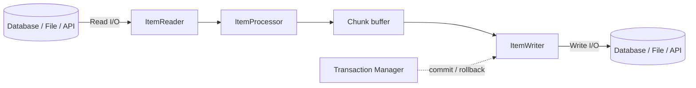

# I/O của reader và writer trong Spring Batch

Với một batch job xử lý hàng triệu bản ghi, thời gian CPU của `ItemProcessor` đôi khi chỉ chiếm phần nhỏ tổng thời gian. Phần lớn thời gian có thể nằm ở việc reader **đợi dữ liệu** từ database, file hoặc API và writer **đợi xác nhận ghi** từ database, object storage hoặc dịch vụ downstream. Đó là chi phí **I/O (Input/Output)**. Tối ưu I/O đúng cách giúp tăng throughput, giảm thời gian giữ kết nối và tránh làm quá tải tài nguyên bên ngoài.

Trong Spring Batch, `ItemReader<I>` chịu trách nhiệm lấy item đầu vào, `ItemProcessor<I, O>` biến đổi dữ liệu, còn `ItemWriter<O>` nhận một `Chunk<? extends O>` để ghi. Cách framework gọi chúng theo chunk ảnh hưởng trực tiếp đến transaction, số lần đọc/ghi, rollback, retry và restart.

Bài học này thuộc **Spring Batch Core Processing → Performance**, tập trung vào cách nhận diện, đo lường và tối ưu I/O của reader và writer. Các ví dụ sử dụng Spring Batch 5.x, Spring Boot 3.x, JDBC và Java; nguyên tắc áp dụng tương tự cho nguồn file, JPA, message queue, REST API và object storage, với chi tiết phụ thuộc driver và hạ tầng.

## 1. I/O nằm ở đâu trong một batch step?

Một luồng xử lý chunk thông thường:



Reader và writer có thể chờ những tài nguyên khác nhau:

| Vị trí | Ví dụ I/O | Độ trễ thường đến từ |
|---|---|---|
| JDBC reader | `SELECT`, lấy thêm hàng từ `ResultSet` | Query plan, disk/DB cache, network round trip, lock, driver fetch |
| Paging reader | Mỗi câu query lấy một trang | Scan/sort, index, count query, paging strategy |
| File reader | Đọc block, giải mã UTF-8, parse CSV | Disk, network filesystem, object storage, buffer, decompression |
| API reader | Gọi HTTP/GraphQL lấy trang dữ liệu | Network, DNS/TLS, latency server, rate limit, retries |
| JDBC writer | `INSERT`/`UPDATE` hoặc batch SQL | Index/constraint, transaction log, locks, DB round trip, commit |
| File writer | Serialize item, ghi buffer xuống file | Encoding, flush, disk throughput, filesystem metadata |
| API writer | Gửi lô dữ liệu và đợi phản hồi | Payload size, service latency, quota, backoff |
| Message writer | Gửi sự kiện vào broker | Acknowledgment, replication, batching, network, broker backpressure |

**Latency** trả lời "một thao tác tốn bao lâu"; **throughput** trả lời "mỗi giây hoàn tất bao nhiêu item/byte"; **utilization** cho biết tài nguyên đã gần quá tải chưa. Giảm latency một query không chắc làm job nhanh hơn nếu bottleneck nằm ở writer hoặc processor.

### Mô hình thời gian đơn giản

Với một step tuần tự, có thể hình dung:

```text
Job elapsed time
  ≈ startup / scheduling / metadata
    + tổng read wait
    + tổng process work
    + tổng write wait
    + tổng commit / rollback / retry overhead
```

Đây là mô hình phân tích, không phải đẳng thức chính xác cho mọi job. Đọc/ghi có thể chồng lấp với buffering, đa luồng, partitioning hoặc async I/O; số lần thao tác có thể tăng khi retry. Vì vậy cần đo từng pha và tổng thời gian thực tế, không cộng máy móc mọi duration rồi coi đó là wall-clock runtime.

## 2. Ba kích thước điều khiển ba loại chi phí khác nhau

Khi tối ưu I/O, thường gặp ba thông số:

| Thông số | Thuộc lớp | Nó điều khiển |
|---|---|---|
| `fetchSize` | JDBC driver/cursor reader | Gợi ý số row driver lấy trong một đợt từ `ResultSet` |
| `pageSize` | Paging reader | Số item lấy trong mỗi lần truy vấn phân trang |
| `chunkSize` | Step transaction/write | Số item theo chính sách chunk trước khi writer ghi và transaction commit |

Ví dụ 50.000 item, `fetchSize=500`, `chunkSize=100`:

- Cursor có thể lấy dữ liệu theo những đợt khoảng 500 row **nếu driver hỗ trợ**.
- Spring Batch vẫn cung cấp từng item tới processor.
- Writer được gọi với từng chunk khoảng 100 item, tức khoảng 500 lượt ghi chunk nếu không có lỗi, skip hoặc filter và không tính hành vi cuối input.
- Commit và rollback thuộc transaction của step, **không do fetch size quyết định**.

Với paging `pageSize=500`, reader sẽ thực hiện các truy vấn lấy từng page; đây là cơ chế khác với cursor prefetch. Không dùng `pageSize` như đồng nghĩa với `fetchSize`. Cũng không cần buộc `pageSize == chunkSize`.

## 3. Tối ưu I/O ở JDBC reader

Đối với `JdbcCursorItemReader`, việc giảm round trip chỉ có tác dụng khi driver thực sự lấy dữ liệu theo đợt. `setFetchSize(...)` là một **hint JDBC**, không phải giới hạn `LIMIT` của SQL và không đảm bảo driver stream đúng mong đợi.

### 3.1. Ví dụ cursor reader có fetch size

```java
import java.math.BigDecimal;
import javax.sql.DataSource;

import org.springframework.batch.item.database.JdbcCursorItemReader;
import org.springframework.batch.item.database.builder.JdbcCursorItemReaderBuilder;
import org.springframework.context.annotation.Bean;

record PaymentRow(long id, BigDecimal amount) {}

@Bean
JdbcCursorItemReader<PaymentRow> paymentReader(DataSource dataSource) {
    return new JdbcCursorItemReaderBuilder<PaymentRow>()
            .name("paymentReader")
            .dataSource(dataSource)
            .sql("""
                    SELECT id, amount
                    FROM payment_source
                    WHERE batch_key = '2026-11-15'
                    ORDER BY id
                    """)
            .rowMapper((rs, rowNumber) -> new PaymentRow(
                    rs.getLong("id"),
                    rs.getBigDecimal("amount")))
            .fetchSize(500)
            .saveState(true)
            .build();
}
```

Mã minh họa một batch key cố định để dễ đọc; trong ứng dụng thật, dùng **job parameter** và tham số SQL được bind, tránh tạo mã mới cho mỗi kỳ xử lý. Nếu reader có trạng thái cần restart, tên reader phải ổn định để Spring Batch định danh checkpoint.

Những yếu tố cần đo khi tuning:

1. **SQL và index:** truy vấn có bị full scan/sort tốn kém, có dùng index đúng cho `WHERE/ORDER BY` hay không?
2. **Column projection:** chỉ lấy các cột cần thiết; tránh tải BLOB/CLOB/JSON khổng lồ nếu processor không dùng.
3. **Fetch behavior:** kiểm tra driver có thực sự streaming thay vì nạp toàn bộ result set vào bộ nhớ.
4. **Connection lifetime:** cursor có thể giữ connection/result set mở lâu; cần xem pool size, statement timeout và network timeout.
5. **Snapshot và thứ tự:** tập dữ liệu/ordering có ổn định qua một job dài hoặc qua restart hay không?

### 3.2. Fetch size giảm round trip nhưng tăng buffer

Giả sử DB và app cách nhau một mạng có latency **8 ms mỗi round trip** và tập kết quả gồm 50.000 dòng. Nếu driver thực sự fetch đủ theo đợt:

```text
fetchSize = 100  → ~500 đợt × 8 ms ≈ 4.000 ms chờ round trip
fetchSize = 1000 →  ~50 đợt × 8 ms ≈   400 ms chờ round trip
```

Các số chỉ minh họa **phần chi phí round trip**. Chưa gồm thời gian thực thi SQL, truyền bytes, ánh xạ object, commit và hành vi driver. Nếu bottleneck thật là query scan hoặc writer, tăng fetch size có thể gần như không cải thiện tổng thời gian.

Fetch size quá lớn có thể tăng heap sử dụng bởi driver hoặc kéo dài một đợt transfer. Đo **peak heap, GC pause, bytes truyền qua mạng, round trip và throughput** trên database/driver thật trước khi chọn giá trị.

### 3.3. Các khác biệt driver đáng chú ý

- **PostgreSQL JDBC:** streaming qua cursor thường yêu cầu fetch size dương và các điều kiện như connection không ở auto-commit; phải xác nhận cấu hình transaction và driver hiện dùng.
- **MySQL Connector/J:** cursor fetching phụ thuộc cấu hình driver, prepared statement và cơ chế streaming; `setFetchSize(500)` không đảm bảo giống PostgreSQL.
- **Oracle JDBC:** row prefetch/fetch size có hành vi và giá trị mặc định riêng, ảnh hưởng đến cách gom dữ liệu.
- **H2:** hữu ích cho test logic, nhưng không đại diện cho network round trip hoặc memory behavior của production DB.

Với môi trường cụ thể, cần kiểm tra log driver, DB monitoring hoặc packet/trace để xem fetch hint có tác dụng hay không.

### 3.4. Paging reader: tối ưu page query và sort key

Với `JdbcPagingItemReader`, page size điều khiển số item yêu cầu cho **mỗi query**, khác với fetch size của cursor:

```java
import java.util.Map;
import javax.sql.DataSource;

import org.springframework.batch.item.database.JdbcPagingItemReader;
import org.springframework.batch.item.database.Order;
import org.springframework.batch.item.database.builder.JdbcPagingItemReaderBuilder;

@Bean
JdbcPagingItemReader<PaymentRow> pagingPaymentReader(
        DataSource dataSource) {
    return new JdbcPagingItemReaderBuilder<PaymentRow>()
            .name("pagingPaymentReader")
            .dataSource(dataSource)
            .selectClause("SELECT id, amount")
            .fromClause("FROM payment_source")
            .whereClause("WHERE status = 'READY'")
            .sortKeys(Map.of("id", Order.ASCENDING))
            .rowMapper((rs, rowNumber) -> new PaymentRow(
                    rs.getLong("id"),
                    rs.getBigDecimal("amount")))
            .pageSize(500)
            .saveState(true)
            .build();
}
```

`id` trong ví dụ là khóa duy nhất. Một sort key không duy nhất (như `created_at` khi nhiều row trùng timestamp) có thể khiến trang đọc không ổn định, gây thiếu/trùng item trong một số tình huống. Nếu cần sort nhiều cột, thêm khóa duy nhất làm thành phần cuối và tạo index hỗ trợ bộ lọc/thứ tự.

Spring Batch dùng `PagingQueryProvider` phù hợp database để dựng truy vấn, có thể tận dụng sort keys khi lấy trang tiếp theo; không mặc định mọi provider dùng `LIMIT ... OFFSET ...` nguyên văn. Số query thực tế cần đo bằng SQL instrumentation.

## 4. Tối ưu reader đọc file và object storage

File reader chịu I/O theo **block** và chi phí parse từng dòng. Nếu file nằm trên network filesystem hoặc object storage, latency mở/tải dữ liệu còn có thể đáng kể.

### 4.1. `FlatFileItemReader` và streaming từng record

Ví dụ CSV có header `id,amount`:

```java
import org.springframework.batch.item.file.FlatFileItemReader;
import org.springframework.batch.item.file.builder.FlatFileItemReaderBuilder;
import org.springframework.core.io.Resource;

@Bean
FlatFileItemReader<PaymentRow> csvPaymentReader(Resource sourceFile) {
    return new FlatFileItemReaderBuilder<PaymentRow>()
            .name("csvPaymentReader")
            .resource(sourceFile)
            .encoding("UTF-8")
            .linesToSkip(1)
            .delimited()
            .names("id", "amount")
            .fieldSetMapper(fields -> new PaymentRow(
                    fields.readLong("id"),
                    fields.readBigDecimal("amount")))
            .build();
}
```

Reader tạo item lần lượt và dựa vào hạ tầng stream/buffer phù hợp, tránh nạp toàn bộ file thành một `List` khổng lồ trước khi xử lý. Tuy nhiên, chi phí có thể nằm ở:

- Mỗi dòng quá dài hoặc nhiều cột cần parse.
- CSV nhiều dấu escape/quote, kiểm tra dữ liệu phức tạp.
- File gzip phải giải nén tuần tự; nhiều dạng nén không hỗ trợ seek ngẫu nhiên hiệu quả.
- File trên mount mạng có throughput thấp hoặc hay timeout.
- Reader mở lại file và cần bỏ qua nhiều dòng khi restart.

Nếu nguồn là object storage, thường nên đọc từ một **object version cố định** hoặc staging snapshot thay vì đường dẫn có thể bị thay đổi giữa chừng. Đối với file rất lớn, cân nhắc chia file theo partition/bucket **nếu định dạng cho phép chia an toàn**, tránh cắt giữa một record CSV có newline trong trường quoted.

### 4.2. Đọc buffer phù hợp và tránh per-item remote requests

Một thiết kế gây chậm là gọi HTTP hoặc truy vấn SQL bổ sung **cho từng item** bên trong processor:

```text
Reader trả 100.000 payments
Mỗi item gọi GET /customer/{id}
→ 100.000 HTTP round trip bổ sung
```

Nếu API hỗ trợ truy vấn hàng loạt hoặc cache dữ liệu tham chiếu, có thể giảm số lượt đi mạng. Chẳng hạn, tải trước bảng mapping có kích thước hợp lý, join ngay trong SQL, hoặc batch customer IDs theo nhóm với **giới hạn payload, quota và timeout**.

Không cache vô hạn mọi bản ghi: cache memory lớn có thể chuyển bottleneck từ network sang GC/OOM. Với dữ liệu tham chiếu thay đổi liên tục, cần quy tắc TTL/version để tránh dùng dữ liệu cũ.

## 5. Writer I/O: tại sao một lần gọi `write()` không có nghĩa một round trip?

Spring Batch 5 định nghĩa:

```java
public interface ItemWriter<T> {
    void write(Chunk<? extends T> chunk) throws Exception;
}
```

Writer nhận một **chunk**, nhưng implementation quyết định cách chuyển chunk đó thành thao tác I/O. Nếu code lặp và gọi một SQL INSERT qua network cho từng item thì vẫn có thể tốn hàng trăm round trip. Ngược lại, `JdbcBatchItemWriter` có thể chuyển một chunk thành JDBC batch operation để driver/database thực hiện hiệu quả hơn.

### 5.1. So sánh cách ghi từng item và batch

**Cách dễ gây overhead**:

```java
ItemWriter<PaymentRow> slowWriter = chunk -> {
    for (PaymentRow item : chunk.getItems()) {
        jdbcTemplate.update(
                "INSERT INTO payment_output(source_id, amount) VALUES (?, ?)",
                item.id(), item.amount());
    }
};
```

Từng lời gọi update có thể tạo overhead riêng ở framework/driver/database; mức round trip phụ thuộc driver, prepared statement và cấu hình kết nối. Với volume lớn, cần cân nhắc batch API.

**Cách dùng `JdbcBatchItemWriter`**:

```java
import javax.sql.DataSource;

import org.springframework.batch.item.database.JdbcBatchItemWriter;
import org.springframework.batch.item.database.builder.JdbcBatchItemWriterBuilder;
import org.springframework.jdbc.core.namedparam.MapSqlParameterSource;

@Bean
JdbcBatchItemWriter<PaymentRow> paymentWriter(DataSource dataSource) {
    return new JdbcBatchItemWriterBuilder<PaymentRow>()
            .dataSource(dataSource)
            .sql("""
                    INSERT INTO payment_output(source_id, amount)
                    VALUES (:id, :amount)
                    """)
            .itemSqlParameterSourceProvider(item ->
                    new MapSqlParameterSource()
                            .addValue("id", item.id())
                            .addValue("amount", item.amount()))
            .build();
}
```

Writer dùng JDBC batch theo chunk thông qua Spring JDBC. **JDBC batch không luôn tạo đúng một physical network round trip**: hiệu quả phụ thuộc driver, JDBC URL, database protocol, kích thước payload, update count, constraint và khả năng rewrite batch của driver. Hãy kiểm tra số statement/batch execute, DB latency và committed rows thay vì suy luận từ số lần Java gọi `write()`.

Nếu bảng đích có unique constraint trên `source_id`, writer có thể được thiết kế thêm cơ chế **upsert/idempotency** để restart/retry không tạo bản ghi trùng. Cú pháp upsert là đặc thù database và nên được triển khai, kiểm thử riêng.

### 5.2. Chunk size tác động đến số lần writer ghi

Ví dụ 100.000 item, không filter/skip:

| Chunk size | Số lượt `write()` xấp xỉ | Chi phí có thể tăng |
|---|---:|---|
| 20 | 5.000 | Overhead write/commit nhiều |
| 100 | 1.000 | Cân bằng hơn |
| 500 | 200 | Chunk lâu hơn, buffer và rollback lớn hơn |
| 2.000 | 50 | Transaction/lock/payload lớn, recovery tốn hơn |

Đây là phép chia để hiểu quan hệ, không phải số lượt gọi chính xác khi job lỗi, retry, skip, filter hoặc khi xử lý EOF. Một writer lỗi có thể khiến framework rollback rồi **gọi lại writer** hoặc chia nhỏ để cô lập item lỗi. Vì vậy số lần gọi `write()` không bằng số chunk commit trong mọi trường hợp.

Tối ưu chunk size cần cân bằng throughput với:

- Bộ nhớ dùng để giữ item đầu vào/đầu ra.
- Thời gian giữ transaction và database lock.
- Chi phí rollback/replay khi một item lỗi.
- Giới hạn request payload và timeout của sink.
- Số connection và tải đồng thời lên database.

Không tăng chunk size chỉ vì muốn giảm số lần gọi writer, nếu database bắt đầu lock lâu hoặc latency p99 tăng mạnh.

## 6. File writer: buffering, flush và công bố output an toàn

`FlatFileItemWriter` thường được dùng để xuất CSV/text. Ví dụ:

```java
import org.springframework.batch.item.file.FlatFileItemWriter;
import org.springframework.batch.item.file.builder.FlatFileItemWriterBuilder;
import org.springframework.core.io.FileSystemResource;

@Bean
FlatFileItemWriter<PaymentRow> csvPaymentWriter() {
    return new FlatFileItemWriterBuilder<PaymentRow>()
            .name("csvPaymentWriter")
            .resource(new FileSystemResource("output/payments-staging.csv"))
            .encoding("UTF-8")
            .lineAggregator(row -> row.id() + "," + row.amount())
            .saveState(true)
            .build();
}
```

Đây là ví dụ chỉ xuất số và ID đơn giản; với dữ liệu có ký tự phân cách, xuống dòng hoặc quote, cần dùng formatter/CSV serializer đúng chuẩn thay vì nối chuỗi thủ công.

Các điểm I/O cần quan tâm:

1. **Buffered writes:** Ghi từng item tới file vật lý ngay lập tức gây overhead lớn; writer/buffer gom dữ liệu giúp giảm số lệnh I/O.
2. **Encoding:** UTF-8, ký tự escape và format số/ngày có ảnh hưởng chi phí serialize và tính tương thích đầu ra.
3. **Flush và fsync:** Buffer được flush không có nghĩa dữ liệu đã được đồng bộ bền vững xuống ổ đĩa ở mọi filesystem. Không đồng nhất `flush()` với `fsync()`.
4. **File lifecycle:** Mở file, append, truncate, ghi header/footer, rename và cleanup đều là thao tác I/O.
5. **Transactional semantics:** Cơ chế buffering/khôi phục trạng thái của `FlatFileItemWriter` hỗ trợ phối hợp với chunk transaction trong phạm vi framework, nhưng filesystem thông thường **không phải tài nguyên XA cùng transaction JDBC**.

### Tránh cho consumer nhìn thấy file đang ghi

Một pipeline an toàn thường dùng:

```text
1. Writer ghi output/payments-2026-11-15.tmp
2. Job hoàn tất, đối chiếu row count / checksum
3. Publish bằng rename/move tới tên chính thức
4. Tạo manifest/READY marker cho downstream
5. Consumer chỉ đọc output đã publish
```

Thao tác rename có thể atomic **nếu filesystem và cách di chuyển hỗ trợ**, nhưng không đảm bảo atomic khi chuyển giữa filesystem/bucket khác nhau. Với object storage, phải xác định semantics của copy, versioning và marker publish. Không coi việc file xuất hiện là bằng chứng file đã ghi xong.

Khi restart writer file, cần giữ ổn định resource, tên writer, checkpoint và chính sách append/truncate. Nếu file gốc đã bị chỉnh sửa bên ngoài, vị trí ghi đã lưu có thể không còn hợp lệ.

## 7. Writer gọi API hoặc gửi message: batching và backpressure

Không phải mọi sink đều có transaction giống JDBC. Với REST API, message broker hoặc cloud object storage, throughput phụ thuộc mạnh vào request rate, payload size, acknowledgment và quota.

### 7.1. Gộp request nếu endpoint hỗ trợ

Giả sử HTTP service chấp nhận tối đa 500 item/request. Gửi 50.000 item từng cái tạo 50.000 request; gửi theo lô 250 item chỉ cần khoảng 200 request. Lợi ích có thể lớn nếu latency mỗi request đáng kể.

Nhưng batch quá lớn có thể gặp:

- HTTP 413 Payload Too Large.
- Timeout vì server xử lý một request quá lâu.
- Rate limit, throttling hoặc quota tính theo bytes/item.
- Cả lô thất bại vì một item invalid.
- Khó xác định item nào đã được server áp dụng khi response bị mất.

Phải làm rõ **contract của bulk API**: atomic cả lô, partial success từng item, hay trả kết quả bất đồng bộ qua task ID. Writer chỉ có thể xác nhận success chính xác khi hiểu contract đó.

### 7.2. Retry, timeout và tính idempotent

Ví dụ thực tế:

```text
Writer gửi payment ID P-200 cho API
Server xử lý và commit thành công
Response bị timeout trên đường về
Spring Batch nhìn thấy IOException và retry
→ Nếu API không chống trùng, payment có thể được ghi 2 lần
```

Các biện pháp:

- Dùng **idempotency key** hoặc business ID duy nhất tại downstream.
- Chỉ retry lỗi tạm thời đã được phân loại; có giới hạn, backoff và jitter phù hợp.
- Tách lỗi per-item khỏi lỗi toàn request khi API có partial success.
- Đặt connect timeout, read timeout và kích thước pool rõ ràng.
- Kiểm soát concurrency để tránh vượt rate limit.
- Với publish message đáng tin cậy, cân nhắc outbox pattern và cơ chế dedup phía consumer.

Một `@Transactional` JDBC không làm HTTP request hoặc message đã gửi trở nên rollback được. Khi thiết kế writer, cần đánh giá **hệ quả khi chunk rollback sau khi side effect bên ngoài đã thành công**.

### 7.3. Backpressure quan trọng hơn tăng thread vô hạn

Nếu sink chỉ xử lý được 2.000 item/s nhưng reader có thể cấp 20.000 item/s, tăng thread liên tục sẽ chỉ tạo backlog, pool wait, timeout hoặc OOM. Nên giới hạn số job/partition/worker đồng thời, cấu hình queue capacity và dùng retry có backoff để tốc độ gửi phù hợp với năng lực nhận.

Khi có nhiều partition, tổng connection và request rate gần bằng mức sử dụng **mỗi partition × số partition hoạt động**, vì vậy các giới hạn writer phải được tính ở cấp toàn ứng dụng/cluster, không chỉ một step.

## 8. Transaction, rollback và restart ảnh hưởng I/O ra sao?

Trong chunk-oriented step, writer thường chạy bên trong một transaction do `PlatformTransactionManager` của step quản lý. Với JDBC writer và datasource phù hợp, lỗi runtime trong writer có thể làm rollback SQL của chunk.

Ví dụ:

```text
Chunk 1: write 100 rows → COMMIT
Chunk 2: write 100 rows → exception → ROLLBACK
Chunk 3: chưa chạy

Sau lỗi:
  Dữ liệu của chunk 1 đã commit vẫn còn.
  SQL của chunk 2 được rollback nếu cùng transaction JDBC.
  Reader có thể phải đọc/replay một phần khi restart/retry.
```

Ba đại lượng cần phân biệt:

- **Rows read:** số item reader cung cấp; có thể tăng do đọc lại.
- **Rows sent to writer:** số item writer nhận qua những lần thử; có thể có duplicate attempts.
- **Rows committed:** dữ liệu thực tồn tại sau transaction; mới là kết quả cuối cùng của writer giao dịch.

### 8.1. Tối ưu I/O vẫn phải giữ tính đúng khi restart

Với `JdbcCursorItemReader` hoặc `JdbcPagingItemReader` dùng `saveState(true)`, Spring Batch lưu vị trí đọc qua `ExecutionContext`. Nếu job crash, restart cùng identifying `JobParameters` để tiếp tục JobInstance hợp lệ.

Tuy nhiên checkpoint chỉ hữu ích khi **nguồn đầu vào và thứ tự đọc ổn định**. Nếu job đang xử lý bảng `WHERE status = 'NEW'` rồi writer hoặc bước khác đổi ngay `status` của dòng đã đọc, tập kết quả cho truy vấn restart có thể thay đổi. Reader dựa trên vị trí/khóa có thể gặp thiếu hoặc lặp item.

Các biện pháp phổ biến:

1. Chốt một **snapshot** hoặc batch ID trước khi chạy.
2. Sắp xếp theo khóa duy nhất, ổn định; tránh sort theo thuộc tính thay đổi trong quá trình xử lý.
3. Với paging, bảo đảm `sortKeys` phù hợp index và không để thay đổi nguồn làm mất item chưa xử lý.
4. Writer dùng unique constraint/upsert hoặc idempotency key.
5. Kiểm thử failure sau nhiều chunk và restart thực sự trên database test.

Không gắn `@Transactional` lên toàn test chạy job nếu mục tiêu là đo commit/rollback của từng chunk: Spring Test có thể mở transaction riêng làm thay đổi kết quả quan sát.

### 8.2. Skip và retry có thể tăng I/O

Khi writer ném exception retryable, Spring Batch có thể rollback rồi gọi lại writer; điều đó tăng số SQL hoặc request thực hiện. Khi skip lỗi writer, framework có thể cần cô lập item lỗi và thử lại những item khác.

Do đó không so sánh hai cấu hình chỉ bằng số `ItemWriter.write()`; cần đo:

- `writeCount` sau commit, `skipCount`, `rollbackCount`.
- Số query/request/round trip thật.
- Tổng bytes gửi/nhận và latency theo phase.
- Dữ liệu cuối không thiếu/trùng sau failure/restart.

Với remote API, side effect có thể không rollback nên số lần request càng cần được đo cùng với số bản ghi accepted của server.

## 9. Đo I/O của reader và writer bằng Micrometer

Một biểu đồ tổng thời gian job không chỉ rõ phải tối ưu read hay write. Nên bổ sung các metric:

| Nhóm | Chỉ số | Cách sử dụng |
|---|---|---|
| Reader | `read()` elapsed, DB query latency, file bytes/s, API latency | Xem thời gian đợi nguồn |
| Writer | `write(chunk)` elapsed, DB batch latency, request size, error rate | Xem thời gian đợi sink |
| Chunk | Duration, success/error, chunk size thực tế | So sánh mỗi transaction |
| Step | `readCount`, `writeCount`, `skipCount`, `rollbackCount` | Kiểm chứng kết quả |
| Database | Connection pool active/wait, lock wait, slow queries | Phân biệt DB bottleneck |
| Runtime | CPU, heap, GC pause, thread pool | Phân biệt CPU/memory với I/O |

### 9.1. Wrapper đo mỗi lần đọc và bảo toàn ItemStream

Nếu reader hỗ trợ checkpoint qua `ItemStreamReader<T>`, wrapper phải chuyển tiếp `open/update/close`; nếu bỏ những callback này, restart có thể bị hỏng:

```java
import java.util.concurrent.TimeUnit;

import io.micrometer.core.instrument.Timer;
import org.springframework.batch.item.ExecutionContext;
import org.springframework.batch.item.ItemStreamReader;

public final class TimedItemStreamReader<T>
        implements ItemStreamReader<T> {

    private final ItemStreamReader<T> delegate;
    private final Timer timer;

    public TimedItemStreamReader(
            ItemStreamReader<T> delegate, Timer timer) {
        this.delegate = delegate;
        this.timer = timer;
    }

    @Override
    public T read() throws Exception {
        long started = System.nanoTime();
        try {
            return delegate.read();
        } finally {
            timer.record(
                    System.nanoTime() - started,
                    TimeUnit.NANOSECONDS);
        }
    }

    @Override
    public void open(ExecutionContext context) {
        delegate.open(context);
    }

    @Override
    public void update(ExecutionContext context) {
        delegate.update(context);
    }

    @Override
    public void close() {
        delegate.close();
    }
}
```

Wrapper đo **wall-clock elapsed** cho mỗi lời gọi `read()`, kể cả lần trả `null` để báo hết nguồn và các lần ném exception. Giá trị này bao gồm mapping/parsing nếu reader thực hiện trong `read()`; nó **không phải thời gian network thuần**. Kết hợp với JDBC/HTTP instrumentation để tách round trip và xử lý tại app.

Khi reader là bean có `@StepScope`, tạo wrapper trong cùng scope hoặc inject delegate đã được quản lý đúng vòng đời. Không nên bọc bằng đối tượng vô danh làm mất `ItemStream` hay những giao diện lifecycle bắt buộc.

### 9.2. Wrapper đo writer theo từng chunk

```java
import java.util.concurrent.TimeUnit;

import io.micrometer.core.instrument.Timer;
import org.springframework.batch.item.Chunk;
import org.springframework.batch.item.ItemWriter;

public final class TimedItemWriter<T> implements ItemWriter<T> {

    private final ItemWriter<T> delegate;
    private final Timer timer;

    public TimedItemWriter(ItemWriter<T> delegate, Timer timer) {
        this.delegate = delegate;
        this.timer = timer;
    }

    @Override
    public void write(Chunk<? extends T> chunk) throws Exception {
        long started = System.nanoTime();
        try {
            delegate.write(chunk);
        } finally {
            timer.record(
                    System.nanoTime() - started,
                    TimeUnit.NANOSECONDS);
        }
    }
}
```

`write()` duration đo tới khi writer trả về/ném lỗi, **thường chưa bao gồm toàn bộ chi phí commit transaction xảy ra sau đó**. Muốn thấy total chunk duration và commit overhead, dùng thêm `ChunkListener` đo từ `beforeChunk` tới `afterChunk`/`afterChunkError`. Nếu writer có `ItemStream`, một wrapper thực tế cần triển khai và chuyển tiếp các callback `open/update/close` tương ứng, giống reader.

### 9.3. Đăng ký Timer

```java
import io.micrometer.core.instrument.MeterRegistry;
import io.micrometer.core.instrument.Timer;

Timer readTimer = Timer.builder("batch.reader.io.duration")
        .description("Elapsed time of reader.read() calls")
        .tags("job", "dailyPaymentJob", "step", "importStep")
        .publishPercentileHistogram()
        .register(meterRegistry);

Timer writeTimer = Timer.builder("batch.writer.io.duration")
        .description("Elapsed time of writer.write(chunk) calls")
        .tags("job", "dailyPaymentJob", "step", "importStep")
        .publishPercentileHistogram()
        .register(meterRegistry);
```

Hai Timer là ví dụ tạo trong cấu hình/bean wiring, không đặt trong vòng lặp đọc item. Khi dùng `SimpleMeterRegistry` hoặc Prometheus, chúng ghi số mẫu, tổng thời gian và có thể xuất histogram/percentile theo cấu hình. Tag nên có cardinality thấp như tên job/step/loại sink; tránh `itemId`, `jobExecutionId`, toàn SQL hoặc exception message vì tạo quá nhiều time series.

**Có thể dùng metrics có sẵn của Spring Batch/Micrometer** nếu application đã bật observability. Kiểm tra định nghĩa, unit và tags của metric trước khi tạo metric riêng để tránh đếm trùng hoặc so sánh hai đại lượng không tương đương.

## 10. Phân biệt latency, throughput và backpressure

Giả sử một job đọc nhanh nhưng ghi chậm:

```text
Reader rate:  15.000 items/s
Writer rate:   1.500 items/s
CPU:              25%
DB pool:          100% active, nhiều wait
```

Tăng số partition đọc có thể không giúp cải thiện: writer/database đang là bottleneck. Thậm chí có thể khiến nhiều writer cùng tranh connection/lock, làm p95 tăng và throughput giảm.

Một mô hình đơn giản khi writer tuần tự:

```text
Effective item throughput
    ≤ min(reader capacity, processor capacity, writer capacity)
```

Nếu có nhiều partition và nguồn lực độc lập, tổng throughput có thể tăng. Nhưng mỗi thành phần có giới hạn dùng chung: database max connections, disk IOPS, API quota, network throughput, broker partitions và CPU. Vì vậy **tăng concurrency chỉ có ích đến khi chạm tài nguyên giới hạn đầu tiên**.

### Throughput theo bytes và item

Hai job đều đạt 5.000 item/s nhưng khác nhau nếu một item 200 byte, item kia 20 KB. Khi dữ liệu không đồng đều, nên ghi nhận thêm:

- Rows/items mỗi giây.
- Bytes đọc/ghi mỗi giây.
- Kích thước page/chunk thực tế.
- p50/p95 latency của query/request.
- Peak heap và GC pause.

Đừng lấy `readCount` hoặc `writeCount` rồi gọi đó là bytes I/O; các counter Spring Batch đếm **item**, không phải bytes chuyển qua mạng.

## 11. Benchmark có kiểm soát

Chọn cấu hình tối ưu dựa trên cùng dữ liệu và cùng môi trường, không dựa vào cảm giác hoặc một lần chạy. Một quy trình đo hữu ích:

### 11.1. Xác định baseline

Ví dụ production-like test với 1 triệu row, read từ PostgreSQL, write bằng JDBC:

```text
Rows input       = 1.000.000
Reader           = JdbcCursorItemReader(fetchSize=100)
Writer           = JdbcBatchItemWriter
Chunk size       = 100
Concurrency      = 1
Job duration     = 22 phút
JDBC pool active = 2–5 connections
```

Các số minh họa, không phải mức benchmark điển hình cho mọi môi trường. Ghi lại **version driver, database, SQL/query plan, index, network latency, row width, JVM heap, GC và cấu hình pool** để kết quả có thể so sánh.

### 11.2. Thay một nhóm tham số tại một thời điểm

| Lượt | Reader | Fetch/page size | Chunk size | Writer | Mục đích |
|---|---|---:|---:|---|---|
| A | Cursor | 100 | 100 | JDBC batch | Baseline |
| B | Cursor | 500 | 100 | JDBC batch | Đo hiệu quả driver fetch |
| C | Cursor | 1000 | 100 | JDBC batch | Kiểm tra điểm bão hòa |
| D | Cursor | 500 | 500 | JDBC batch | Đo chi phí commit/batch |
| E | Paging | 500 | 100 | JDBC batch | So cơ chế page query |

Không so sánh A và E rồi kết luận mọi khác biệt do một tham số: reader type, query pattern và connection behavior đều đổi. Tách các thí nghiệm theo câu hỏi muốn trả lời.

### 11.3. Đo đa chiều

| Chỉ số | Câu hỏi trả lời |
|---|---|
Tổng job/step duration | Tối ưu có giúp hoàn thành sớm hơn? |
Items/s và bytes/s | Có tăng throughput thực? |
Reader/query p95 | Source đang chờ lâu không? |
Writer/batch p95 | Sink đang chậm hoặc có spike không? |
Số SQL/HTTP request | Có giảm I/O calls hay chỉ tăng payload? |
DB pool wait, lock wait, disk IOPS | Tài nguyên nào bão hòa? |
Heap, allocation, GC | Buffer/page/chunk có làm thiếu memory không? |
Rollback/retry/skip | Tối ưu có khiến lỗi và công việc lặp lại tăng? |
Committed rows/checksum | Kết quả có đầy đủ, đúng và không trùng? |

Chạy đủ lượt để loại bớt ảnh hưởng cache warm-up, workload đột biến và network jitter. Có thể dùng JVM profiler, Micrometer, database query monitor, logs và tracing. Chỉ tối ưu tham số khi metric chứng minh thời gian bị tiêu tốn ở thành phần đó.

### 11.4. Chọn cấu hình cân bằng

Nếu `fetchSize=1000` giảm 20% reader latency nhưng tăng peak heap quá mức và gây GC pause, cấu hình tốt nhất có thể là `500`. Nếu chunk size tăng làm throughput chỉ cải thiện 2% nhưng rollback một chunk lỗi mất gấp năm lần, cần cân nhắc rủi ro vận hành.

Hiệu năng của batch gồm cả **khả năng phục hồi sau lỗi**. Một job chạy nhanh lúc thành công nhưng mất hàng giờ tái xử lý khi restart có thể kém hiệu quả hơn cấu hình hơi chậm nhưng có checkpoint và I/O ổn định.

## 12. Kiểm thử I/O và transaction

Kiểm thử đúng cần phân biệt **hành vi wrapper**, **kết quả đọc/ghi**, và **tính đúng sau transaction**.

### 12.1. Unit test đo số lần và duration reader

Với `TimedItemStreamReader` ở trên, có thể dùng một fake reader và `SimpleMeterRegistry`:

```java
import static org.junit.jupiter.api.Assertions.*;

import java.util.concurrent.TimeUnit;

import io.micrometer.core.instrument.Timer;
import io.micrometer.core.instrument.simple.SimpleMeterRegistry;
import org.junit.jupiter.api.Test;
import org.springframework.batch.item.ExecutionContext;
import org.springframework.batch.item.ItemStreamReader;

class TimedReaderTest {

    @Test
    void recordsEveryReadCallIncludingEof() throws Exception {
        SimpleMeterRegistry registry = new SimpleMeterRegistry();
        try {
            Timer timer = registry.timer("test.reader.duration");

            ItemStreamReader<Integer> fake = new ItemStreamReader<>() {
                private int next = 1;

                @Override
                public Integer read() {
                    return next++ <= 2 ? next - 1 : null;
                }

                @Override
                public void open(ExecutionContext context) {}

                @Override
                public void update(ExecutionContext context) {}

                @Override
                public void close() {}
            };

            TimedItemStreamReader<Integer> reader =
                    new TimedItemStreamReader<>(fake, timer);

            reader.open(new ExecutionContext());
            assertEquals(1, reader.read());
            assertEquals(2, reader.read());
            assertNull(reader.read());
            reader.close();

            assertEquals(3L, timer.count());
            assertTrue(timer.totalTime(TimeUnit.NANOSECONDS) >= 0);
        } finally {
            registry.close();
        }
    }
}
```

Đây là test kiểm tra wrapper **không bỏ mất lượt đọc EOF**; nó chưa cho biết database driver fetch thế nào. Với latency thực, dùng query monitor, network trace hoặc DB-specific metric.

### 12.2. Integration test: rollback chunk writer

Một kịch bản kiểm thử có giá trị cho writer JDBC:

1. Tạo bảng nguồn 6 item, bảng đích có unique constraint theo business ID.
2. Chạy step `chunk(2, transactionManager)`, reader/writer dùng đúng datasource/transaction manager.
3. Inject lỗi writer ở chunk thứ hai **sau khi thực hiện một số INSERT**, làm step `FAILED`.
4. Query bảng đích ngoài transaction của test: dữ liệu chunk đầu còn, dữ liệu chunk lỗi rollback.
5. Khôi phục dependency rồi restart cùng identifying parameters; xác nhận bảng đích có đúng 6 business ID, không thiếu/trùng.

Nếu writer chỉ gọi mock mà không có database thật, không thể chứng minh rollback. Nếu test class dùng `@Transactional` quanh `JobLauncher`, transaction của Spring Test có thể làm kết quả bị che hoặc làm `JobRepository` từ chối execution đang có transaction.

### 12.3. Integration test: tốc độ và số truy vấn

Với reader SQL, kiểm tra số câu SELECT/query và execution plan của test database phù hợp production. Với writer batch, có thể dùng SQL proxy/driver instrumentation để đếm JDBC batch operations và đo network round trip.

Không assert một giá trị millisecond cứng trong CI dùng chung: timing phụ thuộc máy, GC và contention. Thay vào đó, tách:

- Test chức năng: item count, checkpoint, dữ liệu sau commit.
- Test instrumentation: meter tồn tại, count/duration hợp lệ.
- Benchmark hiệu năng: so sánh nhiều lượt chạy trong môi trường kiểm soát, lưu baseline/variance.

## 13. Chẩn đoán các vấn đề I/O hay gặp

| Triệu chứng | Nguyên nhân khả dĩ | Hướng kiểm tra |
|---|---|---|
| Reader chậm, CPU thấp | Network/DB scan/fetch nhiều round trip | SQL plan, driver fetch, pool wait |
| Fetch size tăng nhưng memory vẫn rất cao | Driver materialize toàn bộ ResultSet | Streaming settings, autocommit, driver |
| Paging càng về sau càng chậm | Offset sâu, query sort/index kém | Paging provider, sort key, execution plan |
| Writer chậm khi chunk nhỏ | Nhiều write/commit overhead | JDBC batch, chunk size, commit count |
| Writer chậm khi chunk lớn | Transaction lock dài, payload lớn, GC | p95 write/commit, lock wait, memory |
| DB pool luôn hết connection | Cursor giữ connection, concurrency quá cao | Active/wait, cursor lifetime, pool sizing |
| Job tăng thread nhưng throughput giảm | Sink bão hòa, lock hoặc rate limit | Request quota, pool wait, DB IOPS |
| File được tạo nhưng downstream đọc thiếu | Consumer thấy file chưa hoàn tất | Staging + publish marker/rename |
| API writer retry tạo bản ghi trùng | Server đã xử lý nhưng client timeout | Idempotency key, dedup, API contract |
| Restart làm thiếu/trùng bản ghi | Nguồn biến động, ordering/checkpoint sai | Snapshot, immutable sort key, idempotent writer |
| Đọc nhiều dữ liệu nhưng writeCount thấp | Filter/skip hoặc lỗi writer | `filterCount`, `skipCount`, rollback, query output |
| Chunk duration tăng nhưng read/write riêng ổn | Commit/transaction lock hoặc overhead khác | Transaction timing, DB wait, GC, thread contention |

## 14. Bài tập tối ưu I/O từ triệu chứng thực tế

Một job đọc 2 triệu transaction từ PostgreSQL vào bảng tổng hợp. Cấu hình ban đầu:

```text
Reader          JdbcCursorItemReader(fetchSize=10)
Processor       Tính số tiền quy đổi (không gọi API)
Writer          jdbcTemplate.update(...) từng row
Chunk size      50
Concurrency     1
Duration        4 giờ
Reader p95      2,5 ms/read
Writer p95      110 ms/chunk
CPU             18%
```

Một cách xử lý:

1. Kiểm chứng query plan và việc PostgreSQL JDBC có dùng cursor fetching thật với cấu hình transaction. Nếu không, điều chỉnh driver/connection trước.
2. Đo fetch sizes `100`, `500`, `1000` với chunk size giữ nguyên; quan sát round trip và heap.
3. Thay writer thực hiện nhiều update rời bằng `JdbcBatchItemWriter`; đo số batch operation và latency writer.
4. Khi writer đã batch, thử chunk sizes `100`, `250` và `500`; theo dõi throughput cùng DB lock, heap, rollback time.
5. Giữ source snapshot cố định, writer idempotent; thử failure/restart để xác minh dữ liệu đầu ra.
6. Nếu đã tối ưu SQL/I/O mà DB vẫn là bottleneck, chỉ tăng partition/concurrency khi database đủ connection, IOPS và khả năng ghi.

Kết luận tối ưu phải dựa trên dữ liệu trước/sau, không khẳng định `fetchSize=1000` hay `chunkSize=500` sẽ nhanh nhất trong mọi hệ thống. Nếu bottleneck chính là write I/O, chỉ tăng fetch size thường mang lại lợi ích nhỏ.

## 15. Nguyên tắc thiết kế reader/writer I/O hiệu quả

Một step Spring Batch có hiệu năng bền vững thường đáp ứng các nguyên tắc:

1. **Đọc theo nhu cầu:** chọn projection cần thiết, lọc tại nguồn, stream hoặc paging với buffer phù hợp.
2. **Gom I/O có kiểm soát:** tận dụng JDBC batch, HTTP bulk, file buffer nhưng tôn trọng payload và lock limits.
3. **Phân biệt fetch/page và chunk:** tối ưu đường truyền dữ liệu độc lập với ranh giới transaction.
4. **Đo đúng bottleneck:** có metric read/write/commit, count/bytes, p95, error/retry và resource utilization.
5. **Bảo vệ dữ liệu sau sự cố:** reader có checkpoint hợp lệ, nguồn ổn định, writer idempotent và test restart/rollback.
6. **Tôn trọng năng lực downstream:** giới hạn concurrency, timeout và backpressure thay vì tăng thread vô hạn.
7. **Công bố output an toàn:** consumer chỉ đọc dữ liệu đã commit hoặc được publish hoàn chỉnh.

Tối ưu I/O của reader và writer là **giảm chi phí truyền/ghi dữ liệu mà vẫn giữ tính chính xác của transaction và khả năng khôi phục**. Khi kết hợp các phép đo với chiến lược batching, streaming, query tuning và kiểm thử restart, Spring Batch có thể xử lý dữ liệu lớn ổn định mà không cần đẩy mọi tham số lên giá trị tối đa.
