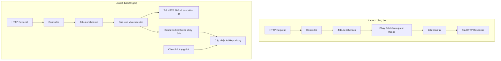
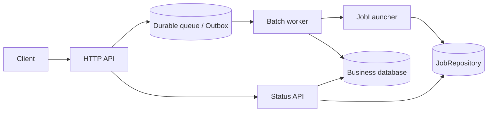

# Không giữ request thread cho job dài

Một batch job có thể mất vài giây, vài phút hoặc lâu hơn để hoàn thành. Nếu một HTTP controller gọi `JobLauncher.run()` theo cách đồng bộ, toàn bộ thời gian chạy job sẽ nằm trên request thread đang xử lý yêu cầu của người dùng. Request thread bị chiếm dụng cho đến khi job kết thúc, khiến ứng dụng khó phục vụ các request khác và dễ gặp timeout ở client, reverse proxy hoặc API gateway.

Với job dài, cách tổ chức phù hợp thường là: API tiếp nhận yêu cầu, xác thực tham số, khởi chạy job trên executor dành riêng cho batch, sau đó trả về mã thực thi để client tra cứu trạng thái. Request kết thúc nhanh; batch job tiếp tục chạy trong thread hoặc worker process được quản lý riêng.

Trong Spring Batch, `JobLauncher` có thể chạy job đồng bộ hoặc bất đồng bộ tùy `TaskExecutor` được cấu hình. Chỉ gọi `JobLauncher.run()` không có nghĩa job tự động chạy nền. Nếu launcher dùng `SyncTaskExecutor` (cấu hình mặc định thường gặp), job chạy ngay trên thread gọi. Muốn giải phóng request thread, cần cấu hình executor bất đồng bộ hoặc chuyển yêu cầu qua một hàng đợi/worker riêng.

## 1. Vì sao không nên chạy job dài trên request thread?

Trong ứng dụng web, máy chủ thường có một pool request thread hữu hạn. Mỗi request cần một thread để đọc request, chạy controller/service và tạo response. Nếu một request giữ thread trong nhiều phút để đợi batch job, thread đó không thể phục vụ request khác trong thời gian này.

Các hệ quả thường gặp:

- **Cạn request thread:** nhiều job dài được khởi chạy cùng lúc có thể chiếm hết thread của servlet container, khiến API bình thường bị chậm hoặc không nhận được request mới.
- **Timeout:** trình duyệt, client SDK, load balancer, reverse proxy hoặc API gateway có thể đóng kết nối trước khi job hoàn tất.
- **Retry ngoài ý muốn:** client không nhận được response có thể gửi lại request, trong khi job đầu tiên vẫn tiếp tục chạy. Điều này dễ tạo hai lần xử lý cùng một batch nếu không có khóa chống trùng.
- **Khó mở rộng:** số lượng request thread bị ràng buộc bởi thời gian chạy job thay vì chỉ thời gian tiếp nhận yêu cầu.
- **Khó phản hồi tiến độ:** người gọi phải giữ kết nối mở và chờ, thay vì nhận mã thực thi rồi truy vấn trạng thái khi cần.
- **Khó xử lý ngắt kết nối:** client đóng kết nối không đồng nghĩa job được dừng an toàn. Job có thể vẫn tiếp tục chạy dù người gọi đã bỏ cuộc.

Ví dụ, nếu một API có 100 request thread và 100 người dùng cùng gửi job mất 2 phút, toàn bộ request thread có thể bị chiếm dụng trong gần 2 phút. Các API khác như đăng nhập, tra cứu dữ liệu hoặc health-related endpoints cũng có thể bị ảnh hưởng nếu dùng chung tài nguyên.

Việc giải phóng request thread không làm cho batch job chạy nhanh hơn. Nó tách vòng đời HTTP khỏi vòng đời xử lý batch, giúp web tier tiếp tục phục vụ request trong khi job được thực thi và giám sát độc lập.

## 2. Phân biệt launch đồng bộ và bất đồng bộ

`JobLauncher` nhận tên job và `JobParameters`, tạo hoặc tìm `JobInstance`, đăng ký `JobExecution` trong `JobRepository`, rồi yêu cầu thực thi job.

Điểm quyết định job chạy trên thread nào là `TaskExecutor` mà launcher sử dụng:

| Cấu hình | Hành vi |
|---|---|
| `SyncTaskExecutor` | Chạy task ngay trên thread gọi `JobLauncher.run()`; controller phải chờ job kết thúc |
| `ThreadPoolTaskExecutor` | Gửi job sang thread của pool; controller có thể nhận `JobExecution` trước khi job hoàn thành |
| Executor bất đồng bộ khác | Hành vi phụ thuộc executor, giới hạn tài nguyên và chính sách từ chối task |

Sơ đồ so sánh:



Với launch đồng bộ, request chỉ kết thúc sau khi job chạy xong. Với launch bất đồng bộ, request kết thúc sau khi launcher tiếp nhận và gửi công việc cho executor. Job tiếp tục chạy ở thread khác.

Lưu ý: bất đồng bộ không đồng nghĩa với phân tán. Nếu executor nằm trong cùng JVM, job vẫn chạy trong cùng ứng dụng và dùng chung CPU, heap, database connection pool cùng các tài nguyên khác. Đây là cách tách thread; muốn tách tiến trình hoặc máy chủ cần kiến trúc worker riêng.

## 3. Cấu hình JobLauncher dùng executor bất đồng bộ

Trong Spring Batch 5+, có thể cấu hình `TaskExecutorJobLauncher` với một `TaskExecutor`. Ví dụ dưới đây dùng `ThreadPoolTaskExecutor` có giới hạn số thread và hàng đợi:

```java
@Configuration
public class BatchLauncherConfiguration {

    @Bean
    ThreadPoolTaskExecutor batchJobExecutor() {
        ThreadPoolTaskExecutor executor = new ThreadPoolTaskExecutor();
        executor.setCorePoolSize(2);
        executor.setMaxPoolSize(4);
        executor.setQueueCapacity(20);
        executor.setThreadNamePrefix("batch-job-");
        executor.setRejectedExecutionHandler(
                new ThreadPoolExecutor.AbortPolicy());
        executor.setWaitForTasksToCompleteOnShutdown(true);
        executor.setAwaitTerminationSeconds(60);
        return executor;
    }

    @Bean
    JobLauncher jobLauncher(
            JobRepository jobRepository,
            ThreadPoolTaskExecutor batchJobExecutor) throws Exception {

        TaskExecutorJobLauncher launcher = new TaskExecutorJobLauncher();
        launcher.setJobRepository(jobRepository);
        launcher.setTaskExecutor(batchJobExecutor);
        launcher.afterPropertiesSet();
        return launcher;
    }
}
```

Trong cấu hình này:

- `corePoolSize` là số thread nền được duy trì ở mức cơ bản.
- `maxPoolSize` giới hạn số job có thể được thực thi đồng thời bởi executor này.
- `queueCapacity` giới hạn số task chờ được thực thi.
- `threadNamePrefix` giúp nhận diện thread batch trong log và thread dump.
- `AbortPolicy` từ chối task khi executor đã đầy, để ứng dụng có thể phản hồi rằng hệ thống đang quá tải.
- `waitForTasksToCompleteOnShutdown` và `awaitTerminationSeconds` hỗ trợ chờ task trong quá trình shutdown có kiểm soát, trong giới hạn thời gian đã cấu hình.

Đây là ví dụ cho Spring Batch 5+. Các phiên bản cũ có thể dùng `SimpleJobLauncher` thay cho `TaskExecutorJobLauncher`; nguyên tắc cấu hình `TaskExecutor` vẫn tương tự. Khi dùng Spring Boot, cần kiểm tra launcher mà ứng dụng đang sử dụng và tránh khai báo bean trùng hoặc vô tình thay thế cấu hình tự động mà không chủ đích.

Không nên dùng executor tạo thread không giới hạn cho job dài. Một lượng request lớn có thể tạo ra quá nhiều thread, gây áp lực lên bộ nhớ, CPU, database và dịch vụ phụ thuộc. Hãy đặt giới hạn thread và queue dựa trên năng lực hệ thống.

## 4. Controller trả response sớm và cung cấp execution ID

Khi job được khởi chạy bất đồng bộ, API thường dùng HTTP `202 Accepted` để biểu thị yêu cầu đã được tiếp nhận và xử lý sẽ tiếp tục ở nền. Response nên trả về một định danh thực thi để client có thể tra cứu trạng thái.

Ví dụ controller:

```java
@RestController
@RequestMapping("/api/imports")
public class ImportController {

    private final JobLauncher jobLauncher;
    private final Job importJob;

    public ImportController(JobLauncher jobLauncher, Job importJob) {
        this.jobLauncher = jobLauncher;
        this.importJob = importJob;
    }

    @PostMapping
    public ResponseEntity<LaunchResponse> launch(
            @RequestBody ImportRequest request) throws JobExecutionException {

        JobParameters parameters = new JobParametersBuilder()
                .addString("businessDate", request.businessDate().toString())
                .addString("requestId", request.requestId())
                .toJobParameters();

        JobExecution execution = jobLauncher.run(importJob, parameters);
        URI statusUri = URI.create(
                "/api/batch-executions/" + execution.getId());

        LaunchResponse body = new LaunchResponse(
                execution.getId(), statusUri.toString());

        return ResponseEntity.accepted()
                .location(statusUri)
                .body(body);
    }
}

record ImportRequest(LocalDate businessDate, String requestId) {}

record LaunchResponse(Long executionId, String statusUrl) {}
```

Ví dụ giả định `requestId` là khóa idempotency ổn định do client hoặc hệ thống tiếp nhận cung cấp. `businessDate` và `requestId` ở đây được thêm làm identifying parameters theo overload mặc định của `JobParametersBuilder`. Với cùng một yêu cầu nghiệp vụ, client cần gửi lại cùng các giá trị định danh để tránh tạo một `JobInstance` khác ngoài ý muốn.

Khi dùng executor bất đồng bộ, `JobLauncher.run()` thường trả về `JobExecution` khi job mới được gửi đi hoặc đang bắt đầu, không phải khi job đã hoàn thành. Vì vậy response chỉ nên cho biết yêu cầu đã được tiếp nhận cùng execution ID. Không được giả định trạng thái lúc trả về là `COMPLETED`.

Trong ứng dụng thật, cần xử lý các trường hợp như `JobInstanceAlreadyCompleteException`, `JobExecutionAlreadyRunningException`, tham số không hợp lệ hoặc executor từ chối task. Nếu client gửi lại cùng `requestId`, API có thể tra cứu execution tương ứng và trả về trạng thái hiện tại thay vì tạo công việc trùng. Cần quy định rõ hành vi này theo hợp đồng API.

## 5. Cung cấp API tra cứu trạng thái

Sau khi nhận execution ID, client có thể truy vấn endpoint trạng thái thay vì giữ kết nối POST mở trong suốt thời gian job chạy.

Ví dụ dùng `JobExplorer`:

```java
@RestController
@RequestMapping("/api/batch-executions")
public class BatchExecutionController {

    private final JobExplorer jobExplorer;

    public BatchExecutionController(JobExplorer jobExplorer) {
        this.jobExplorer = jobExplorer;
    }

    @GetMapping("/{executionId}")
    public ResponseEntity<ExecutionStatusResponse> getStatus(
            @PathVariable Long executionId) {

        JobExecution execution = jobExplorer.getJobExecution(executionId);
        if (execution == null) {
            return ResponseEntity.notFound().build();
        }

        ExecutionStatusResponse response = new ExecutionStatusResponse(
                execution.getId(),
                execution.getStatus().name(),
                execution.getExitStatus().getExitCode(),
                execution.getStartTime(),
                execution.getEndTime());

        return ResponseEntity.ok(response);
    }
}

record ExecutionStatusResponse(
        Long executionId,
        String batchStatus,
        String exitCode,
        LocalDateTime startTime,
        LocalDateTime endTime) {}
```

Response có thể chứa trạng thái như `STARTING`, `STARTED`, `COMPLETED`, `FAILED` hoặc `STOPPED`, tùy trạng thái hiện tại của `JobExecution`. API nên trả về một DTO nhỏ, ổn định thay vì serialize toàn bộ object `JobExecution` và các quan hệ metadata.

Client có thể polling endpoint theo khoảng thời gian hợp lý, hoặc nhận thông báo qua WebSocket, Server-Sent Events hay webhook nếu sản phẩm cần cập nhật chủ động. Với polling, nên có backoff để không tạo thêm tải không cần thiết. Endpoint cũng cần kiểm tra người gọi có quyền xem execution đó hay không; biết execution ID không nên tự động đồng nghĩa với quyền truy cập.

Trạng thái job ở đây là trạng thái thực thi của Spring Batch. Nếu người dùng cần biết một lô dữ liệu đã được đối soát hay thanh toán thành công chưa, endpoint nên đọc thêm trạng thái nghiệp vụ từ kho dữ liệu nghiệp vụ tương ứng.

## 6. Chọn kích thước thread pool và queue phù hợp

Executor bất đồng bộ vẫn sử dụng tài nguyên của ứng dụng. Cấu hình quá nhỏ làm job phải chờ lâu; cấu hình quá lớn có thể làm quá tải database hoặc hệ thống phụ thuộc.

Khi chọn thông số, hãy xem xét:

- Số job cần chạy đồng thời và thời gian chạy trung bình.
- Số connection database mà mỗi job/step có thể sử dụng.
- Tải CPU và bộ nhớ của processor.
- Giới hạn request, connection và rate limit của API bên ngoài.
- Các step dùng multi-threading, partitioning hoặc remote chunking bên trong job.
- Mức độ ưu tiên giữa các loại job và thời gian chờ chấp nhận được.
- Khả năng tăng tải theo giờ cao điểm và cách từ chối yêu cầu khi đã đạt giới hạn.

Ví dụ, nếu database chỉ cấp 20 connection cho ứng dụng và các API khác cũng cần connection, không nên cho hàng chục job cùng chạy với mỗi job mở nhiều connection. Cần dành dung lượng cho traffic tương tác và các tác vụ nền khác.

`queueCapacity` cũng là một giới hạn nghiệp vụ. Queue quá lớn có thể khiến job được chấp nhận nhưng phải chờ rất lâu, đồng thời giữ nhiều task và tham số trong bộ nhớ. Queue quá nhỏ có thể từ chối yêu cầu sớm hơn nhưng phản hồi quá tải rõ ràng hơn. Hãy theo dõi queue depth, số active thread, số task bị từ chối và thời gian chờ trước khi bắt đầu job.

Tránh cấu hình `CallerRunsPolicy` cho executor nhận job từ request thread nếu mục tiêu là giải phóng request thread. Chính sách này có thể yêu cầu thread gọi thực hiện task khi pool đầy; trong trường hợp đó, controller lại phải chạy job dài ngay trên request thread. Dùng chính sách từ chối có kiểm soát và trả response phù hợp, hoặc chuyển sang hàng đợi bền vững.

## 7. Xử lý khi executor quá tải

Khi tất cả thread đang bận và queue đã đầy, executor cần từ chối task hoặc áp dụng một chính sách đã được thiết kế. Không nên âm thầm tạo thread không giới hạn hoặc để request chờ không xác định.

API có thể ánh xạ tình trạng quá tải thành `503 Service Unavailable` hoặc `429 Too Many Requests`, tùy hợp đồng và ý nghĩa giới hạn. Có thể gửi `Retry-After` nếu hệ thống có cơ sở để đề xuất thời điểm thử lại. Client cần giữ cùng idempotency key khi retry cùng một yêu cầu.

Ngoài ra, cần phân biệt hai tình huống:

- **Yêu cầu chưa được nhận:** executor từ chối task trước khi job được lên lịch thành công; API báo lỗi có thể thử lại theo chính sách.
- **Yêu cầu đã được nhận:** job đã có execution ID và đang chờ hoặc chạy; client nên tra cứu execution đó thay vì gửi yêu cầu mới.

Việc tạo `JobExecution` và gửi task cho executor cần được xử lý theo hành vi của launcher và phiên bản đang dùng. Hãy kiểm tra trạng thái metadata sau khi executor từ chối để API không trả lời sai rằng job đã được lên lịch. Không nên tự cập nhật bảng `BATCH_*` bằng SQL để sửa trạng thái.

## 8. Quản lý trùng lặp và tính idempotent

Một client có thể gửi lại POST vì timeout, mất kết nối hoặc không nhận được response. Trong khi đó, job ban đầu có thể vẫn chạy. Nếu mỗi request tạo `JobParameters` mới bằng timestamp ngẫu nhiên, Spring Batch có thể tạo nhiều `JobInstance` cho cùng một yêu cầu nghiệp vụ.

Hãy thiết kế định danh ổn định:

- Dùng `businessDate`, mã file, `batchId` hoặc `requestId` để nhận diện đúng phạm vi nghiệp vụ.
- Dùng idempotency key do client gửi hoặc do hệ thống tiếp nhận tạo và lưu bền vững.
- Cùng một yêu cầu retry phải dùng lại identifying parameters.
- Đặt unique constraint ở bảng nghiệp vụ để ngăn ghi nhận trùng.
- Phân biệt việc khởi chạy lại một `JobInstance` đã thất bại với việc tạo một batch nghiệp vụ mới.

`JobRepository` giúp Spring Batch kiểm soát định danh và trạng thái của job instance, nhưng không thay thế khóa duy nhất hoặc idempotency ở dữ liệu nghiệp vụ. Đặc biệt, nếu job gọi API bên ngoài, cần dùng idempotency key hoặc cơ chế outbox/inbox phù hợp.

## 9. Executor trong cùng JVM và worker process riêng

Sử dụng `ThreadPoolTaskExecutor` là cách đơn giản để không giữ request thread, nhưng công việc vẫn chạy trong cùng JVM với web application. Điều đó có một số giới hạn:

- Khi tiến trình bị kill hoặc máy chủ khởi động lại đột ngột, task đang nằm trong queue bộ nhớ có thể mất.
- Job đang chạy có thể bị gián đoạn và cần kiểm tra trạng thái/restart qua `JobRepository`.
- Batch job và HTTP request cạnh tranh CPU, heap, connection pool và các tài nguyên dùng chung.
- Mở rộng web application thành nhiều instance cũng làm mỗi instance có executor và queue riêng; cần kiểm soát nơi nhận và thực thi job để tránh khởi chạy trùng.

Với job quan trọng, dài hoặc có yêu cầu độ tin cậy cao, có thể dùng kiến trúc tách web tier và batch worker:



API ghi yêu cầu vào database hoặc outbox trong một transaction rồi trả `202 Accepted`. Worker đọc yêu cầu chưa xử lý, khởi chạy job và cập nhật trạng thái tiếp nhận. Vì yêu cầu được lưu bền vững, worker có thể tiếp tục lấy việc sau khi tiến trình khởi động lại. Cần có cơ chế claim/lease, retry, dead-letter hoặc trạng thái lỗi để nhiều worker không cùng xử lý một yêu cầu ngoài ý muốn.

Nếu dùng message broker, transactional outbox có thể giúp bảo đảm việc lưu yêu cầu nghiệp vụ và tạo thông điệp được đồng bộ. Consumer vẫn cần idempotent vì message broker thường có thể giao lại thông điệp. `JobRepository` tiếp tục lưu metadata thực thi của Spring Batch, còn queue/outbox chịu trách nhiệm lưu yêu cầu chờ được xử lý.

Không nên xem queue trong bộ nhớ của `ThreadPoolTaskExecutor` là hàng đợi bền vững. Nó phù hợp khi chấp nhận được việc task đang chờ có thể mất khi ứng dụng dừng, hoặc khi hệ thống có cơ chế khác để phát hiện và đưa yêu cầu chưa hoàn tất vào xử lý lại.

## 10. Request context và dữ liệu cần thiết cho job

Request thread có vòng đời ngắn; batch job có thể chạy lâu hơn nhiều. Vì vậy, không nên để logic batch phụ thuộc vào object chỉ tồn tại trong request như `HttpServletRequest`, request-scoped bean hoặc dữ liệu trong thread-local.

Thay vào đó:

- Xác thực và kiểm tra request trước khi khởi chạy.
- Chuyển các giá trị cần thiết thành `JobParameters` hoặc lưu vào bản ghi yêu cầu bền vững.
- Lưu user ID hoặc actor ID nếu cần audit, theo chính sách bảo vệ dữ liệu.
- Đọc dữ liệu nghiệp vụ từ repository/service trong job, không giữ một object request lớn trong bộ nhớ.
- Không giả định transaction, security context hoặc MDC của request thread tự động truyền sang thread executor.
- Nếu thực sự cần truyền security context cho thao tác nền, cấu hình cơ chế propagation rõ ràng; với batch dài, thường tốt hơn là lưu actor và quyền cần thiết theo cách có kiểm soát rồi xác thực lại ở worker.

Nếu controller tạo dữ liệu đầu vào trong một transaction rồi lập tức khởi chạy job bất đồng bộ, worker có thể bắt đầu trước khi transaction của request commit và không nhìn thấy dữ liệu đó. Với trường hợp này, hãy khởi chạy sau commit hoặc dùng transactional outbox để worker chỉ nhận yêu cầu đã được lưu bền vững.

## 11. Shutdown, restart và giám sát

Tách request thread không loại bỏ nhu cầu quản lý vòng đời job. Ứng dụng vẫn cần có chính sách khi deploy, shutdown, executor đầy hoặc worker mất kết nối.

**Graceful shutdown:** cấu hình executor chờ các task hiện tại trong một khoảng thời gian giới hạn. Đồng thời, thiết kế step có checkpoint và job có thể restart. Không nên giả định mọi job sẽ hoàn tất trong thời gian shutdown cho phép.

**Restart:** nếu job bị gián đoạn, dùng cùng identifying `JobParameters` và cơ chế restart phù hợp. Kiểm tra `JobExecution` cuối cùng, trạng thái step, checkpoint và side effect đã xảy ra trước khi restart.

**Giám sát:** theo dõi số job đang chạy, queue depth, thời gian chờ, thời gian thực thi, trạng thái thất bại, số lần retry, số item skip và mức sử dụng tài nguyên. `JobExplorer` có thể cung cấp metadata cho dashboard vận hành.

**Log:** ghi job name, execution ID, business batch ID và correlation ID để liên kết log giữa API, worker và dịch vụ phụ thuộc. Không ghi secret hoặc toàn bộ dữ liệu nhạy cảm vào log.

**Dừng job:** cung cấp quy trình dừng có kiểm soát qua API quản trị hoặc `JobOperator` khi phù hợp. Việc client hủy request POST hoặc đóng trình duyệt không nên tự động được hiểu là lệnh dừng batch job.

## 12. Các lỗi thiết kế thường gặp

**Cho rằng JobLauncher mặc định luôn chạy nền.** Nếu launcher dùng `SyncTaskExecutor`, job chạy trên thread gọi. Hãy kiểm tra cấu hình thực tế và dùng executor bất đồng bộ khi cần.

**Trả HTTP 202 nhưng vẫn chạy đồng bộ.** Nếu controller chỉ trả response sau khi `jobLauncher.run()` kết thúc, status code không làm request thread được giải phóng. Cần cấu hình launcher thực sự bất đồng bộ hoặc gửi công việc sang worker.

**Dùng `CallerRunsPolicy` khi pool đầy.** Chính sách này có thể làm request thread chạy job, khiến vấn đề ban đầu xuất hiện lại đúng lúc hệ thống quá tải.

**Dùng pool không giới hạn.** Quá nhiều job đồng thời có thể làm cạn database connection, heap, CPU hoặc quota API. Hãy giới hạn thread và queue.

**Không trả execution ID.** Client không có cách đáng tin cậy để biết job đã được nhận hay chưa và phải gửi lại request. Hãy trả ID cùng endpoint tra cứu.

**Tạo identifying parameter ngẫu nhiên mỗi lần retry.** Cùng một yêu cầu có thể trở thành nhiều job instance. Hãy dùng idempotency key ổn định.

**Coi queue trong bộ nhớ là durable.** Task đang chờ có thể mất khi tiến trình dừng. Nếu cần bảo đảm tiếp nhận, hãy lưu yêu cầu trong database/outbox hoặc broker bền vững.

**Truyền object request hoặc request-scoped bean sang job.** Những object này có vòng đời gắn với HTTP request và không phù hợp để job dài sử dụng. Hãy truyền dữ liệu cần thiết qua parameters hoặc kho lưu trữ.

**Coi client disconnect là job cancellation.** Job có thể tiếp tục sau khi kết nối HTTP đóng. Muốn dừng job, cần một hành động quản trị riêng và quy trình dừng an toàn.

## 13. Kiểm thử luồng khởi chạy bất đồng bộ

Kiểm thử cần xác nhận cả hành vi HTTP lẫn vòng đời batch:

1. Gọi API và xác nhận response trả nhanh với `202 Accepted` cùng execution ID.
2. Xác nhận job chạy trên thread executor, không phải request thread.
3. Xác nhận trạng thái ban đầu có thể là `STARTING` hoặc `STARTED`, sau đó chuyển sang trạng thái cuối.
4. Poll endpoint trạng thái và xác nhận API trả DTO đúng cho execution.
5. Gửi lại cùng idempotency key và xác nhận không tạo batch nghiệp vụ trùng.
6. Làm executor đầy để kiểm tra chính sách từ chối và response quá tải.
7. Dừng ứng dụng trong lúc có job chờ hoặc đang chạy để kiểm tra graceful shutdown, trạng thái metadata và khả năng restart.
8. Kiểm tra quyền truy cập endpoint trạng thái để người dùng không thể xem execution của người khác.
9. Với kiến trúc queue/outbox, kiểm tra worker khởi động lại và xử lý lại yêu cầu chưa hoàn tất mà không tạo side effect trùng.

Không nên chỉ kiểm tra rằng controller trả `202`. Cần chứng minh job thực sự chạy bất đồng bộ, được lưu metadata, có thể tra cứu và có hành vi rõ ràng khi lỗi hoặc quá tải.

## Kết luận

Với job dài, request thread nên chỉ tiếp nhận và xác thực yêu cầu, khởi chạy công việc theo cơ chế nền, rồi trả về execution ID để client tra cứu. Trong Spring Batch, cấu hình `JobLauncher` với một `TaskExecutor` bất đồng bộ có giới hạn là cách trực tiếp để tách thời gian xử lý job khỏi thời gian sống của HTTP request.

Hãy quản lý thread pool, queue, từ chối task, idempotency, status endpoint, shutdown và restart như các phần của thiết kế. Nếu yêu cầu cần bảo đảm công việc đã được tiếp nhận ngay cả khi ứng dụng khởi động lại, hãy lưu yêu cầu vào hàng đợi bền vững hoặc transactional outbox và để worker riêng khởi chạy job. `JobRepository` tiếp tục theo dõi thực thi batch; API chỉ cần phản hồi nhanh và cung cấp cách quan sát tiến độ rõ ràng.
