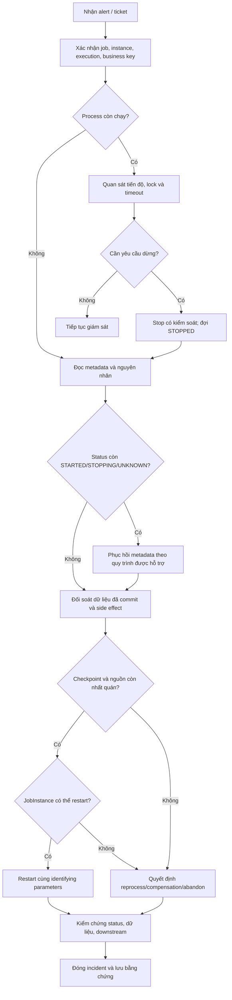

# Runbook xử lý failure trong Spring Batch

**Runbook xử lý failure** là quy trình vận hành có thể lặp lại khi một Spring Batch job thất bại, bị dừng, chạy quá thời gian dự kiến, hoặc không thể tiếp tục sau sự cố hạ tầng. Một runbook tốt trả lời được: **job nào đang gặp sự cố, phần dữ liệu nào đã commit, nguyên nhân là gì, có thể restart cùng JobInstance hay phải xử lý khác, và dựa trên bằng chứng nào để tuyên bố đã phục hồi**.

Đây là tài liệu thực hành cho nhóm **Spring Batch Core Processing → Failure recovery**. Các ví dụ theo Spring Batch 5.x / Spring Boot 3.x; khi dùng phiên bản khác cần đối chiếu API và cách cấu hình infrastructure tương ứng. Quy trình minh họa job đọc giao dịch theo ngày, xử lý theo chunk, ghi vào database và có thể gọi hệ thống ngoài.

> **Nguyên tắc điều hành:** Trạng thái `FAILED` không có nghĩa toàn bộ dữ liệu đã rollback, còn trạng thái `STARTED` trong metadata không chứng minh process vẫn sống. Mỗi quyết định restart, chạy mới hoặc abandon cần dựa trên **trạng thái process thực tế + JobRepository + dữ liệu đã phát sinh**.

## 1. Mục tiêu và phạm vi của runbook

Một pipeline ví dụ:

```text
dailySettlementJob
  ├─ loadStep       : đọc payment từ database/file, ghi staging
  ├─ validateStep   : kiểm tra dữ liệu và đối soát
  └─ publishStep    : ghi ledger và phát thông báo downstream

Business key: businessDate=2026-11-15
```

Runbook được kích hoạt khi có một trong các tín hiệu:

- Scheduler báo job `FAILED`, `STOPPED`, `UNKNOWN` hoặc kết thúc bằng exit code nghiệp vụ không được chấp nhận.
- Job chạy lâu hơn SLA, không cập nhật tiến độ hoặc có lỗi liên tục trong log.
- JVM/container/pod bị chết, nhưng metadata Batch vẫn ở `STARTED` hoặc `STOPPING`.
- Phát hiện dữ liệu đầu ra thiếu, trùng, sai số lượng hoặc downstream không nhận được kết quả dù job báo `COMPLETED`.
- Khi restart gặp lỗi như `JobExecutionAlreadyRunningException`, `JobInstanceAlreadyCompleteException` hoặc `JobRestartException`.
- Một step retry/skip nhiều bất thường, liên tục rollback, hoặc dùng hết khả năng hồi phục đã cấu hình.

Mục tiêu không chỉ là chuyển status thành `COMPLETED`. Một ca failure chỉ được coi là xử lý xong khi **kết quả dữ liệu đúng, phụ thuộc downstream nhất quán và dấu vết điều hành đã được lưu**.

### Thông tin tối thiểu cần có trước khi xử lý

| Trường | Ví dụ | Tại sao cần |
|---|---|---|
| `jobName` | `dailySettlementJob` | Xác định định nghĩa job |
| `jobInstanceId` | `427` | Xác định đơn vị nghiệp vụ Spring Batch |
| `jobExecutionId` | `1198` | Xác định lần thử thực thi đang điều tra |
| Identifying parameters | `businessDate=2026-11-15` | Tránh xử lý nhầm kỳ hoặc restart thành instance mới |
| Step lỗi | `publishStep` | Khoanh vùng reader, processor hoặc writer |
| `BatchStatus` / `ExitStatus` | `FAILED` / `FAILED` | Phân biệt vòng đời và kết quả ứng dụng |
| Thời điểm | Start, last update, end | Xác định cửa sổ log và SLA |
| Nơi chạy | Pod/host, deployment version | Xác minh process và phiên bản code |
| Tài nguyên đích | Database, file, API, queue | Tìm side effect đã hoàn tất |
| Incident ID / owner | `INC-2041` / batch on-call | Ghi nhận trách nhiệm và lịch sử quyết định |

Nếu thiếu các giá trị trên, cần truy tìm qua scheduler, log và `JobExplorer` trước khi chạy lại. Đặc biệt, **scheduler execution ID** và **Spring Batch JobExecution ID** là hai định danh có thể khác nhau.

## 2. Bản đồ trạng thái Spring Batch để quyết định hành động

Spring Batch phân biệt ba tầng:

1. **`Job`**: định nghĩa xử lý (tên job và các step).
2. **`JobInstance`**: một đơn vị nghiệp vụ, xác định bởi **job name + identifying `JobParameters`**.
3. **`JobExecution`**: một lần thử chạy JobInstance. Restart sẽ tạo **JobExecution mới cho cùng JobInstance**, không sửa lịch sử execution đã thất bại thành một lần chạy mới.

```text
Job: dailySettlementJob
└─ JobInstance #427 (businessDate=2026-11-15)
   ├─ JobExecution #1198 → FAILED
   └─ JobExecution #1210 → COMPLETED  (restart sau xử lý sự cố)
```

| `BatchStatus` | Diễn giải | Hành động runbook |
|---|---|---|
| `STARTING` | Execution đang khởi tạo theo metadata | Kiểm tra process và thời gian chờ trước khi can thiệp |
| `STARTED` | Metadata cho biết execution đã bắt đầu | Xác minh còn worker thật không; **không tự chạy trùng** |
| `STOPPING` | Đã yêu cầu dừng, chưa kết thúc | Đợi xác nhận hoặc điều tra vì sao không dừng |
| `STOPPED` | Execution dừng có kiểm soát | Xem xét restart nếu job và checkpoint phù hợp |
| `FAILED` | Execution thất bại | Phân loại nguyên nhân, kiểm tra dữ liệu đã commit rồi restart hoặc xử lý khác |
| `COMPLETED` | Framework ghi nhận hoàn tất | Xác minh outcome/quality gate; không restart cùng JobInstance như lỗi |
| `ABANDONED` | Execution bị từ bỏ có chủ đích | Không tự restart cùng JobInstance; theo quyết định điều hành |
| `UNKNOWN` | Trạng thái không đáng tin cậy | Chặn tự động retry, điều tra metadata/transaction |

`BatchStatus` là trạng thái vòng đời; `ExitStatus` là kết quả nghiệp vụ/flow của execution, có thể là mã tùy chỉnh. Ví dụ một job có thể đạt `BatchStatus.COMPLETED` nhưng mang exit code `COMPLETED WITH WARNINGS`. Nếu doanh nghiệp quy định cảnh báo đó không được publish dữ liệu, runbook cần coi quality gate chưa đạt.

**Không kết luận job “đã chạy xong” chỉ từ HTTP 200 khi yêu cầu start được tiếp nhận**: `JobLauncher` có thể sử dụng executor bất đồng bộ và trả về JobExecution ở trạng thái chưa kết thúc.

## 3. Quy trình ra quyết định khi có failure



Đây là cây quyết định tổng quát. Trong một hệ thống có bước thanh toán, gửi email hay ghi sang nhiều database, nhánh **đối soát side effect** có thể cần hoàn tất trước bất kỳ lần chạy lại nào.

## 4. Pha 1 — Tiếp nhận sự cố và khoanh vùng ảnh hưởng

Khi alert xuất hiện, bắt đầu bằng việc tạo bản ghi điều hành. Đừng để nhiều người tự restart cùng một instance trong khi chưa xác định ai sở hữu sự cố.

### 4.1. Xác thực tín hiệu

1. Xem **scheduler**: tên job, thời điểm trigger, execution/request ID, retry tự động đã thực hiện chưa.
2. Xem **JobRepository**: job/instance/execution ID, `STATUS`, `EXIT_CODE`, `START_TIME`, `END_TIME` và lần cập nhật cuối.
3. Xem **process thật**: container/pod/host còn chạy không, có worker trên node khác không.
4. Xem **log/tracing**: stack trace đầu tiên có ý nghĩa, exception gốc, mã lỗi DB/HTTP, thời điểm.
5. Xem **dữ liệu tác động**: kỳ dữ liệu nào bị ảnh hưởng, những consumer/downstream nào đang chờ.

Nếu job chưa tới SLA hoặc đang tiến triển bình thường, không nhất thiết can thiệp. Nếu job đứng yên, cần xem thread dump, pool wait, lock wait, queue depth, timeout hoặc GC trước khi quyết định dừng.

### 4.2. Đánh giá mức ảnh hưởng

| Câu hỏi | Dữ liệu cần kiểm tra |
|---|---|
| Có ảnh hưởng dữ liệu tài chính/khách hàng không? | Business key, nguồn/đích, bản ghi đã commit |
| Có downstream đang đọc dữ liệu dở dang không? | Readiness marker, manifest, lịch trigger |
| Có nhiều job cùng lỗi không? | Thời điểm, datasource, dependency chung |
| SLA còn bao lâu? | Deadline nghiệp vụ, backlog, throughput hiện tại |
| Có khả năng chạy trùng không? | Scheduler auto-retry, worker khác, lock owner |
| Có phải lỗi dữ liệu vĩnh viễn không? | Record ID, validation rule, constraint |

Với sự cố có tác động rộng, có thể cần tạm **chặn trigger downstream** và cô lập kỳ dữ liệu liên quan. Việc chặn nên dựa trên trạng thái pipeline/readiness để tránh thay đổi thủ công nhiều lịch độc lập.

## 5. Pha 2 — Thu thập bằng chứng từ JobRepository

Spring Batch lưu lịch sử trong các bảng như `BATCH_JOB_INSTANCE`, `BATCH_JOB_EXECUTION`, `BATCH_STEP_EXECUTION` và bảng lưu `ExecutionContext`. Tùy cấu hình, các bảng có thể có prefix/schema khác.

### 5.1. Truy vấn execution và business key

Truy vấn SQL chỉ đọc để kiểm tra một execution:

```sql
SELECT
    ji.JOB_NAME,
    ji.JOB_INSTANCE_ID,
    je.JOB_EXECUTION_ID,
    je.STATUS,
    je.EXIT_CODE,
    je.EXIT_MESSAGE,
    je.CREATE_TIME,
    je.START_TIME,
    je.END_TIME,
    je.LAST_UPDATED
FROM BATCH_JOB_EXECUTION je
JOIN BATCH_JOB_INSTANCE ji
  ON ji.JOB_INSTANCE_ID = je.JOB_INSTANCE_ID
WHERE je.JOB_EXECUTION_ID = :executionId;
```

Để đọc tham số execution:

```sql
SELECT
    JOB_EXECUTION_ID,
    PARAMETER_NAME,
    PARAMETER_TYPE,
    PARAMETER_VALUE,
    IDENTIFYING
FROM BATCH_JOB_EXECUTION_PARAMS
WHERE JOB_EXECUTION_ID = :executionId
ORDER BY PARAMETER_NAME;
```

Cột `PARAMETER_NAME`/`PARAMETER_TYPE`/`PARAMETER_VALUE` minh họa schema metadata của Spring Batch 5. Schema ở phiên bản trước có thể dùng cấu trúc khác; khi nâng cấp phải xem DDL phiên bản thực tế.

**Điều quan trọng:** Không chọn một execution chỉ vì nó là lần gần nhất có cùng tên job. Với job theo ngày, phải kiểm tra **identifying parameters** để không đối soát nhầm ngày D với D-1.

### 5.2. Truy vấn trạng thái từng step

```sql
SELECT
    STEP_EXECUTION_ID,
    STEP_NAME,
    STATUS,
    EXIT_CODE,
    EXIT_MESSAGE,
    READ_COUNT,
    WRITE_COUNT,
    FILTER_COUNT,
    READ_SKIP_COUNT,
    PROCESS_SKIP_COUNT,
    WRITE_SKIP_COUNT,
    COMMIT_COUNT,
    ROLLBACK_COUNT,
    START_TIME,
    END_TIME,
    LAST_UPDATED
FROM BATCH_STEP_EXECUTION
WHERE JOB_EXECUTION_ID = :executionId
ORDER BY STEP_EXECUTION_ID;
```

Diễn giải:

- `READ_COUNT`: item đã đọc được theo thống kê của StepExecution.
- `WRITE_COUNT`: item được framework ghi nhận là đã write thành công.
- `FILTER_COUNT`: item processor loại khỏi đầu ra bằng `null`; **không phải skip**.
- `READ_SKIP_COUNT`, `PROCESS_SKIP_COUNT`, `WRITE_SKIP_COUNT`: lỗi được bỏ qua theo skip policy.
- `COMMIT_COUNT`, `ROLLBACK_COUNT`: tín hiệu của transaction chunk và recovery.
- `EXIT_MESSAGE`: có thể chứa mô tả lỗi nhưng bị giới hạn kích thước; log/trace vẫn cần thiết để tìm nguyên nhân đầy đủ.

Các counter thuộc **một StepExecution**, không phải tổng số liệu của mọi lần restart. Writer được gọi lại trong retry/rollback có thể khiến số lần gọi thực tế khác `WRITE_COUNT`.

### 5.3. Quan sát qua Java API thay vì SQL

Trong ứng dụng, `JobExplorer` là API chỉ đọc thuận tiện để truy vấn metadata:

```java
import org.springframework.batch.core.JobExecution;
import org.springframework.batch.core.StepExecution;
import org.springframework.batch.core.explore.JobExplorer;

public void printExecution(
        JobExplorer jobExplorer, long executionId) {
    JobExecution execution = jobExplorer.getJobExecution(executionId);
    if (execution == null) {
        throw new IllegalArgumentException(
                "JobExecution not found: " + executionId);
    }

    System.out.printf(
            "job=%s instance=%s execution=%s status=%s exit=%s%n",
            execution.getJobInstance().getJobName(),
            execution.getJobInstance().getInstanceId(),
            execution.getId(),
            execution.getStatus(),
            execution.getExitStatus().getExitCode());

    System.out.println(
            "parameters=" + execution.getJobParameters());

    for (StepExecution step : execution.getStepExecutions()) {
        System.out.printf(
                "step=%s status=%s read=%d write=%d skip=%d "
                + "commit=%d rollback=%d%n",
                step.getStepName(),
                step.getStatus(),
                step.getReadCount(),
                step.getWriteCount(),
                step.getSkipCount(),
                step.getCommitCount(),
                step.getRollbackCount());

        for (Throwable failure : step.getFailureExceptions()) {
            System.out.println(
                    "failure=" + failure.getClass().getName()
                    + ": " + failure.getMessage());
        }
    }
}
```

Đoạn này là mã **chẩn đoán chỉ đọc**; trong production tránh in toàn bộ parameters nếu chúng chứa thông tin nhạy cảm. Nên log business key và execution ID ở định dạng có thể tìm kiếm, đồng thời giữ stack trace trong hệ thống log tập trung.

## 6. Pha 3 — Phân loại nguyên nhân gốc

Một lỗi tổng quát `JobExecution.FAILED` có thể bắt nguồn từ nhiều giai đoạn và cần cách phục hồi khác nhau:

| Lớp failure | Dấu hiệu thường gặp | Hành động điều tra |
|---|---|---|
| **Reader — dữ liệu** | Parse error, định dạng CSV sai, kiểu dữ liệu không hợp lệ | Xác định record/file/offset, chính sách skip, nguồn có thể sửa không |
| **Reader — kết nối** | SQL timeout, network reset, server từ chối | Kiểm tra datasource/connection pool/driver và khả năng retry |
| **Processor — nghiệp vụ** | Rule validation, null, mapping, exception | Xác định bản ghi và rule; sửa dữ liệu hoặc code |
| **Writer — constraint** | Duplicate key, foreign key, length | Kiểm tra dữ liệu đầu ra, idempotency, batch SQL, khóa đích |
| **Writer — transient** | Deadlock, lock timeout, throttling | Xem retry policy, DB locks, rate limit, backoff |
| **Transaction** | Rollback bất ngờ, optimistic lock, manager sai | Kiểm tra datasource, propagation, transaction manager, commit count |
| **Hạ tầng** | OOM, disk full, pod evicted, DB failover | Xem JVM/host, disk/CPU/heap, thời điểm crash |
| **Metadata/checkpoint** | ExecutionContext lỗi, JobRepository unavailable | Kiểm tra schema, quyền truy cập, state reader/writer |
| **Scheduler/concurrency** | Chạy trùng, already running, lock contention | Kiểm tra nhiều trigger, owner lock và job parameters |
| **Downstream** | API 429/5xx, message broker unavailable | Kiểm tra contract, delivery state, retry, idempotency |

Phải tìm **lỗi đầu tiên có tính nguyên nhân**, vì một lỗi writer ban đầu có thể kéo theo nhiều exception thứ cấp trong rollback, close hoặc ghi metadata. Nếu chỉ nhìn exception cuối, rất dễ sửa sai thành phần.

### 6.1. Phân biệt lỗi tạm thời và lỗi vĩnh viễn

- **Tạm thời:** mất kết nối ngắn, deadlock, 503, rate limit có hướng dẫn backoff; có thể khôi phục bằng retry/restart sau khi điều kiện hết lỗi.
- **Vĩnh viễn theo dữ liệu hiện tại:** CSV sai format, vi phạm constraint do nghiệp vụ, mapping không hỗ trợ; retry không sửa được đầu vào.
- **Không xác định:** kết nối đứt sau khi gửi write khiến không biết server đã commit chưa; phải **đối soát side effect trước khi retry**.
- **Lỗi code/configuration:** missing bean, schema mismatch, serialization bug; cần sửa và đánh giá compatibility của checkpoint trước khi restart.

Một số exception là transient ở hệ thống này nhưng lại permanent ở hệ thống khác. Runbook nên chứa **danh sách exception/mã lỗi thực tế đã được phân loại** theo ứng dụng và phiên bản dependency, thay vì retry mọi `Exception`.

## 7. Pha 4 — Đối soát dữ liệu trước khi chạy lại

Trong chunk-oriented step, mỗi chunk có thể commit riêng. Nếu chunk 1–5 đã commit còn chunk 6 lỗi, các chunk đầu **không tự rollback khi toàn job FAILED**.

```text
Job dailySettlementJob, businessDate=D

Chunk 1    100 rows → COMMIT
Chunk 2    100 rows → COMMIT
Chunk 3    100 rows → COMMIT
Chunk 4    100 rows → COMMIT
Chunk 5    100 rows → COMMIT
Chunk 6     40 rows → exception → ROLLBACK
Chunk 7     chưa chạy

JobExecution = FAILED
Rows đã commit trên DB = 500 (nếu không có filter/skip khác)
```

Số trong ví dụ là giả định để minh họa. Trong job thật, phải query dữ liệu thực để biết số bản ghi đã commit, vì skip/filter/retry và side effect có thể làm kết quả khác.

### Bảng câu hỏi đối soát

| Tài nguyên đích | Cần kiểm tra | Rủi ro khi retry/restart |
|---|---|---|
| Database cùng transaction chunk | Row theo business key, unique keys, checksum, trạng thái commit | Ghi lại phần đã commit nếu reader/checkpoint sai |
| Database khác transaction | Commit độc lập, upsert, ràng buộc khóa | Một phía đã commit, phía kia rollback |
| REST API | Request ID, idempotency key, trạng thái xử lý tại server | Timeout dù server đã xử lý, gửi lặp |
| Message broker | Message key, ack, delivery/consumer offset | At-least-once delivery dẫn tới nhận trùng |
| File/CSV | Object version, kích thước, checksum, footer, publish marker | Downstream đọc file dở dang hoặc bị overwrite |
| Object storage | Version/ETag, manifest, trạng thái publish | Copy/upload đã hoàn tất trước khi job báo lỗi |
| Downstream job | Kỳ dữ liệu và phiên bản đã tiêu thụ | Dùng dữ liệu nguồn chưa hoàn chỉnh |

Nếu output có khóa nghiệp vụ `(business_date, transaction_id)`, truy vấn đối soát có thể bắt đầu như sau:

```sql
-- Đếm kết quả đã lưu cho đúng kỳ dữ liệu.
SELECT COUNT(*) AS persisted_count
FROM ledger_entry
WHERE business_date = :businessDate;

-- Tìm transaction ID trùng trong một kỳ.
SELECT transaction_id, COUNT(*) AS duplicated
FROM ledger_entry
WHERE business_date = :businessDate
GROUP BY transaction_id
HAVING COUNT(*) > 1;

-- Đối chiếu số tiền nếu nghiệp vụ cho phép.
SELECT SUM(amount) AS total_amount
FROM ledger_entry
WHERE business_date = :businessDate;
```

Các bảng/cột này chỉ là ví dụ nghiệp vụ. Cần kiểm tra thêm **tập khóa**, checksum, điều kiện lọc và những bản ghi đã skip; `COUNT(*)` trùng nhau không chứng minh hai tập dữ liệu giống hệt nhau.

### Khi nào side effect thật sự an toàn để retry?

Chỉ có thể trả lời sau khi hiểu **idempotency** của writer:

- JDBC writer sử dụng unique constraint hoặc upsert theo business key: retry có thể được thiết kế để không tạo trùng.
- API hỗ trợ idempotency key và lưu kết quả theo key: retry cùng key có thể trả lại cùng kết quả nghiệp vụ.
- File writer ghi staging rồi publish sau khi hoàn chỉnh: downstream không nhìn thấy bản đang ghi.
- Message consumer deduplicate theo event ID: việc gửi lại không tạo tác dụng nghiệp vụ hai lần.

Nếu writer không idempotent và không xác định được phía nhận đã xử lý hay chưa, **không tự động restart chỉ vì lỗi trông có vẻ transient**. Trước tiên cần cơ chế xác minh/bù trừ thích hợp.

## 8. Pha 5 — Chọn restart, reprocess, stop hay abandon

| Quyết định | Khi phù hợp | Cần đảm bảo |
|---|---|---|
| **Đợi/quan sát** | Job vẫn chạy và tiến triển | Có deadline giám sát và tín hiệu tiến độ |
| **Stop có kiểm soát** | Cần chấm dứt execution đang chạy | Worker nhận yêu cầu stop và kết thúc trước bước tiếp |
| **Restart cùng JobInstance** | Execution `FAILED`/`STOPPED`, checkpoint và dữ liệu an toàn | Giữ identifying parameters; job cho phép restart |
| **Reprocess bằng JobInstance mới** | Cần tính lại toàn bộ hoặc nguồn/version đã thay đổi | Dùng version/business key mới và xử lý output cũ |
| **Compensation** | Đã có side effect không thể rollback | Quy tắc hoàn tác nghiệp vụ/đối soát có thể kiểm chứng |
| **Abandon** | Quyết định không tiếp tục instance cũ | Có căn cứ, audit và kế hoạch dữ liệu/downstream |
| **Escalate** | Trạng thái mâu thuẫn, `UNKNOWN`, checkpoint hỏng, commit không rõ | Chặn thao tác nguy hiểm đến khi hiểu trạng thái |

### 8.1. Restart: giữ nguyên identifying parameters

Một `JobInstance` được xác định bởi **job name + identifying `JobParameters`**. Để restart instance đã lỗi:

```text
Job name: dailySettlementJob
Parameters: businessDate=2026-11-15

JobExecution #1198 → FAILED
restart cùng parameters
JobExecution #1210 → STARTED → COMPLETED

JobInstance ID vẫn là #427
```

Nếu tự thêm một `run.id` **identifying** mới trong lần phục hồi, Spring Batch tạo **JobInstance mới** và có thể bắt đầu đọc lại từ đầu, thay vì dùng checkpoint của execution lỗi.

Không phải mọi job đều restartable. Cấu hình `preventRestart()`, trạng thái `COMPLETED/ABANDONED`, metadata hỏng hoặc các ràng buộc khác có thể khiến restart bị từ chối. Trước khi thử, xem cấu hình job và trạng thái execution cuối.

### 8.2. Điều khiển qua `JobOperator`

Với Spring Batch 5.x, API điều hành có thể dùng để stop/restart execution:

```java
import org.springframework.batch.core.JobExecution;
import org.springframework.batch.core.explore.JobExplorer;
import org.springframework.batch.core.launch.JobOperator;

public final class RecoveryOperations {
    private final JobExplorer explorer;
    private final JobOperator operator;

    public RecoveryOperations(JobExplorer explorer, JobOperator operator) {
        this.explorer = explorer;
        this.operator = operator;
    }

    public Long restartFailedExecution(long executionId)
            throws Exception {
        JobExecution before = explorer.getJobExecution(executionId);
        if (before == null) {
            throw new IllegalArgumentException(
                    "Unknown executionId: " + executionId);
        }
        if (before.getStatus() !=
                org.springframework.batch.core.BatchStatus.FAILED
                && before.getStatus() !=
                org.springframework.batch.core.BatchStatus.STOPPED) {
            throw new IllegalStateException(
                    "Execution not restartable from status "
                            + before.getStatus());
        }

        // Gọi sau bước đối soát và kiểm soát concurrent operator.
        // Spring Batch 5.x: restart(long) trả về ID execution mới.
        return operator.restart(executionId);
    }
}
```

Đoạn code minh họa **đường thao tác sau khi đã xác nhận an toàn**, không tự thực hiện đối soát. API vẫn có thể từ chối vì job không restartable, trạng thái cuối đã thay đổi hoặc một execution khác đang chạy. Với phiên bản Spring Batch 6, đối chiếu chữ ký `JobOperator` ở phiên bản dùng thực tế thay vì sao chép trực tiếp mã 5.x.

Sau khi gọi `restart(...)`, không được đánh dấu incident resolved ngay. Nếu launcher async, execution mới có thể chỉ đang `STARTING/STARTED`; phải chờ trạng thái cuối và đối soát lại dữ liệu.

### 8.3. Stop khác kill và khác abandon

- `JobOperator.stop(executionId)` là **yêu cầu dừng có kiểm soát**. Job có thể cần thời gian để hoàn tất chunk hoặc quay về điểm kiểm tra trạng thái.
- Kill process/JVM/container đột ngột có thể để metadata ở `STARTED` và để lại những side effect đã commit.
- `JobOperator.abandon(executionId)` là quyết định đánh dấu execution đã từ bỏ; **không phải lệnh kill** và không tự xóa dữ liệu.

Khi execution cuối của một instance bị `ABANDONED`, Spring Batch không cho restart cùng instance theo luồng bình thường. Abandon chỉ phù hợp khi đã quyết định đóng instance cũ và có kế hoạch đối soát/reprocess riêng.

## 9. Trường hợp đặc biệt: process chết nhưng metadata vẫn STARTED

Ví dụ timeline:

```text
02:00  JobExecution #1198 STARTED
02:03  Chunk 1–5 đã commit
02:04  Node mất nguồn; không còn JVM xử lý
02:05  BATCH_JOB_EXECUTION.STATUS vẫn STARTED
02:08  Scheduler muốn restart để kịp SLA
```

Nếu cứ gọi `JobOperator.restart(1198)`, Spring Batch có thể từ chối vì metadata cho rằng execution vẫn đang chạy. Mặt khác, không thể lấy việc pod không tồn tại ở một node làm chứng cứ rằng **không có worker khác tiếp tục chạy cùng instance**.

Quy trình an toàn:

1. Xác minh process/worker đã kết thúc trên **mọi node** có quyền chạy job; kiểm tra scheduler, lease/lock, heartbeat và deployment thay thế.
2. Xác định database/JobRepository đang được dùng, thời điểm cập nhật cuối, step nào đang mở và dữ liệu đã commit.
3. Đối soát checkpoint/readers và side effect; xác định restart an toàn hay phải reprocess/compensate.
4. Sử dụng **cơ chế phục hồi metadata chính thức hoặc quy trình quản trị đã được kiểm chứng cho phiên bản Spring Batch đang dùng**. Không sửa trực tiếp một cột `STATUS` rồi coi là đồng bộ toàn bộ metadata.
5. Sau khi metadata đã ở trạng thái phù hợp và không còn execution thực đang chạy, restart hoặc đóng instance theo quyết định đã ghi nhận.
6. Theo dõi execution mới và kiểm tra dữ liệu cuối.

**Không dùng lệnh UPDATE SQL đại trà để biến mọi `STARTED` thành `FAILED`.** Có thể còn job sống, execution context chưa nhất quán, hoặc có transaction đang dở dang.

Trong các phiên bản Spring Batch mới hơn có thể có API hỗ trợ recovery cho execution mắc kẹt sau shutdown; tên/chữ ký phụ thuộc phiên bản. Trước khi đưa vào runbook production, kiểm tra đúng tài liệu và thử trên môi trường phục hồi có metadata tương ứng.

## 10. Các playbook theo nhóm failure

### 10.1. Database timeout/deadlock ở writer

**Dấu hiệu:** SQL timeout, deadlock victim, `CannotAcquireLockException`, `DeadlockLoserDataAccessException` hoặc rollback count tăng.

**Thao tác:**

1. Xác định database và query bị lỗi; thu thập lock wait/deadlock graph, thời gian và transaction liên quan.
2. Xác nhận lỗi transient hay do query/index/transaction thiết kế sai; nếu database vẫn quá tải, restart ngay có thể lặp failure.
3. Kiểm tra chunk đã commit trước lỗi, duplicate keys và khả năng idempotent của writer.
4. Nếu chính sách retry nội bộ hết lượt và execution `FAILED`, xử lý nguyên nhân DB rồi restart **cùng instance** khi checkpoint an toàn.
5. Theo dõi `rollbackCount`, write throughput, commit count và số dòng thực sau khi chạy lại.

**Không nên:** tăng `retryLimit` vô hạn hoặc tăng concurrency khi database đang nghẽn lock; điều đó có thể làm deadlock nặng hơn.

### 10.2. Dữ liệu nguồn sai định dạng

**Dấu hiệu:** CSV parse error, `NumberFormatException`, invalid date, missing required column, exception từ processor.

**Thao tác:**

1. Xác định file version, record ID/line offset và validation rule vi phạm.
2. Kiểm tra chính sách `skip(...)`, `skipLimit(...)`: dữ liệu sai có được phép bỏ qua không? Có cần quarantine record không?
3. Nếu lỗi không được phép skip, sửa dữ liệu tại **nguồn version có kiểm soát** hoặc sửa mapping rồi xác định checkpoint có còn đúng không.
4. Khi input file đã bị thay đổi ở giữa job, đánh giá việc restart từ offset cũ; có thể cần tạo snapshot và reprocess có chủ đích.
5. Đối chiếu số record input, processed, filtered, skipped, output và bảng lỗi để bảo đảm không bỏ qua record không được phép.

**Không nên:** tăng skip limit chỉ để job chuyển thành `COMPLETED` mà không có quyết định chấp nhận chất lượng dữ liệu.

### 10.3. Gửi API rồi bị timeout, không rõ bên nhận đã xử lý

**Dấu hiệu:** HTTP read timeout hoặc connection reset sau khi gửi payload; writer báo `FAILED`, nhưng downstream có thể đã nhận request.

**Thao tác:**

1. Lấy business ID, idempotency key/request ID, timestamp và correlation ID.
2. Truy vấn trạng thái nghiệp vụ tại downstream, không kết luận chỉ từ HTTP timeout.
3. Nếu downstream có idempotency key, bảo đảm retry **cùng key** và kiểm tra contract của API.
4. Nếu downstream đã xử lý nhưng local chưa cập nhật, thực hiện reconciliation hoặc compensation theo nghiệp vụ.
5. Chỉ restart sau khi đã có chiến lược tránh ghi lặp và xử lý partial success trong lô.

**Không nên:** tự động gửi lại toàn bộ lô mà không biết server đã commit bản ghi nào.

### 10.4. Hết dung lượng disk hoặc lỗi ghi file

**Dấu hiệu:** `No space left on device`, permission denied, file corrupt, file writer thất bại khi flush/close.

**Thao tác:**

1. Xác định filesystem/pod volume/bucket và trạng thái dung lượng, quota, quyền ghi.
2. Xác định file output đang là staging hay đã publish; consumer đã nhận được marker READY chưa.
3. Khôi phục dung lượng/quyền ghi qua quy trình hạ tầng, xác minh file/object version và checkpoint writer.
4. Nếu file đã bị chỉnh sửa hoặc writer state không tương thích, chọn tạo output version mới hoặc tái xử lý có kiểm soát.
5. Khi job hoàn tất, kiểm chứng row count/checksum, footer và publish marker trước khi mở downstream.

**Không nên:** append tùy tiện vào file đã hoàn tất hoặc xóa file mà không đối chiếu trạng thái downstream.

### 10.5. Job bị kill/OOM giữa chừng

**Dấu hiệu:** pod `OOMKilled`, JVM exit code bất thường, mất heartbeat; metadata có thể vẫn `STARTED`.

**Thao tác:**

1. Xác nhận nguyên nhân hạ tầng: heap/GC, off-heap, container memory, page/chunk buffer và concurrency.
2. Kiểm tra worker thực đã dừng, scheduler có tạo job trùng chưa.
3. Đọc StepExecution, checkpoint và dữ liệu commit.
4. Khôi phục metadata qua cơ chế vận hành được hỗ trợ; sửa nguyên nhân OOM trước khi restart.
5. Khi restart, theo dõi heap, throughput, rollback và số lượng bản ghi cuối cùng.

**Không nên:** chỉ tăng memory rồi chạy lại với identifying parameters mới khi chưa kiểm tra những bản ghi đã được ghi ở lần trước.

### 10.6. Bị báo “JobInstanceAlreadyComplete”

**Dấu hiệu:** `JobInstanceAlreadyCompleteException` khi dùng cùng job name và identifying parameters.

**Diễn giải:** JobInstance đó đã kết thúc ở trạng thái không còn cho phép chạy lại theo hợp đồng Batch; không phải mọi trường hợp đều là một lỗi hệ thống.

**Thao tác:**

1. Kiểm tra history và execution cuối, bao gồm `COMPLETED`/`ABANDONED`.
2. Nếu dữ liệu đầu ra đã hợp lệ, đánh dấu scheduler request lặp là no-op/idempotent.
3. Nếu thực sự cần rebuild, thiết kế **JobInstance mới** với data version/business key phù hợp và cơ chế xử lý output cũ.
4. Không xóa metadata để ép chạy lại mà không có kế hoạch dữ liệu.

### 10.7. Metadata báo UNKNOWN hoặc mâu thuẫn với DB nghiệp vụ

**Dấu hiệu:** trạng thái `UNKNOWN`, metadata ghi `FAILED` nhưng dữ liệu đã publish toàn bộ, hoặc execution context không đọc được.

**Thao tác:**

1. Chặn auto-retry và downstream nếu khả năng ghi trùng/chất lượng chưa rõ.
2. Truy vấn metadata, business DB, transaction log, file/API/broker bên ngoài cùng business key.
3. Xác định transaction commit độc lập giữa JobRepository và writer, khả năng failover/rollback, có side effect ngoài transaction không.
4. Cùng owner ứng dụng và owner dữ liệu quyết định khôi phục metadata, reconciliation, compensation hoặc reprocess.
5. Chạy kiểm thử trên snapshot/môi trường phục hồi khi có rủi ro thay đổi checkpoint trước khi thao tác production.

**Không nên:** gán `COMPLETED` thủ công để xóa cảnh báo khi chưa chứng minh chất lượng dữ liệu.

## 11. Pha 6 — Tiến hành restart và giám sát execution mới

Sau khi điều kiện đầu vào đã được kiểm tra và nguyên nhân được xử lý:

1. Ghi vào incident: execution ID lỗi, business key, quyết định, người thực hiện và bằng chứng đối soát.
2. Bảo đảm chỉ một coordinator/operator sở hữu hành động restart theo key đó.
3. Gọi `JobOperator.restart(failedExecutionId)` hoặc cơ chế điều hành tương đương **cho cùng JobInstance**.
4. Lấy **JobExecution ID mới** từ kết quả; không dùng ID lỗi cũ để theo dõi trạng thái hiện tại.
5. Kiểm tra step nào được skip vì đã `COMPLETED` và step nào thực sự chạy lại, theo flow/restart policy của job.
6. Quan sát tiến độ, lỗi mới, skip/retry, DB pool, throughput, API quota và deadline.
7. Chỉ khi execution mới ở trạng thái kết thúc được chấp nhận mới chuyển sang bước xác minh dữ liệu.

Ví dụ timeline:

```text
03:20  JobExecution #1198 FAILED at publishStep
03:25  Reconcile: 20.000 staging records, 15.000 ledger records committed
03:35  Fix transient writer issue, confirm idempotency
03:37  Restart old JobInstance → JobExecution #1210 STARTED
03:45  JobExecution #1210 COMPLETED
03:47  Reconcile: 20.000 distinct ledger keys, 0 duplicate
03:50  Data READY marker published, downstream released
```

Timeline trên chỉ là ví dụ; số liệu thật phải lấy từ dữ liệu và metadata của incident cụ thể.

### Step đã COMPLETED có luôn được chạy lại không?

Thông thường, trong restart, Spring Batch có thể **bỏ qua các step đã hoàn tất** và chạy lại step thất bại, tùy cấu hình flow. Tuy nhiên step có `allowStartIfComplete(true)` có thể được chạy lại; step mang trạng thái `ABANDONED` và điều kiện flow cũng có semantics riêng. Vì vậy sau restart phải kiểm tra lịch sử `StepExecution` chứ không mặc định mọi step đều chạy lại hoặc mọi step đều được bỏ qua.

### Reader checkpoint có thể không tương thích sau deploy

Nếu code mới đổi tên bean/stream, tên key trong `ExecutionContext`, thứ tự sort, SQL, cách deserialize hoặc dữ liệu nguồn, checkpoint từ execution cũ có thể không còn dùng được. Runbook cần giữ thông tin **application version** và có chính sách tương thích checkpoint qua deploy. Không coi restart bằng code phiên bản mới là an toàn chỉ vì Java API cho phép gọi.

## 12. Pha 7 — Xác nhận hồi phục bằng số liệu dữ liệu

Một execution `COMPLETED` sau restart là điều kiện cần, nhưng với batch quan trọng còn phải xác nhận:

| Nhóm kiểm tra | Ví dụ bằng chứng |
|---|---|
| Trạng thái Batch | JobExecution mới `COMPLETED`; exit code được chấp nhận |
| Đúng kỳ dữ liệu | Identifying parameters và output businessDate/version khớp |
| Khối lượng | Expected input, read, filtered, skipped, persisted count |
| Tập khóa | Không thiếu/trùng business ID; unique constraint |
| Giá trị | Tổng tiền/checksum/đối soát với nguồn có thẩm quyền |
| File/object | Checksum, version, footer, manifest và trạng thái publish |
| API/broker | Delivery/ack, idempotency và số bản ghi downstream áp dụng |
| Downstream | Chỉ chạy khi data readiness đạt; dùng đúng version |
| Vận hành | Alert kết thúc, scheduler không có pending retry trùng |

Ví dụ quy tắc đối soát:

```text
expectedInput        = 20.000
validInput           = 19.998
acceptedSkips        = 2 (được phê duyệt)
persistedDistinctIds = 19.998
duplicateIds         = 0
totalAmountMatch     = true
downstreamReady      = true
```

Không tự coi `readCount - skipCount = writeCount` là đẳng thức luôn đúng: có filter, reader/writer skip, split flow, nhiều step và rollback/retry. Công thức phải phản ánh **hợp đồng xử lý của job cụ thể**.

Nếu đối soát thất bại sau `COMPLETED`, đó là **data quality incident** chứ không phải “sự cố đã xong”. Cần giữ data readiness ở trạng thái chưa đạt và áp dụng reprocess/compensation theo nghiệp vụ.

## 13. Vai trò của JobListener, StepListener và observability

Để runbook dễ thực hiện, ứng dụng nên tạo log/metric đủ ngữ cảnh ngay từ đầu:

| Cơ chế | Tín hiệu |
|---|---|
| `JobExecutionListener.beforeJob/afterJob` | Tên job, business key, execution ID, trạng thái cuối, duration |
| `StepExecutionListener.beforeStep/afterStep` | Step name, counts, lỗi và exit status |
| `SkipListener` | Loại lỗi và định danh item bị skip |
| Retry listener/metrics | Số attempt, exception class, thời gian backoff |
| Micrometer/Actuator | Duration, throughput, rollback, error rate, connection pool |
| Log/trace correlation | Execution ID, trace ID, request ID và downstream acknowledgment |

Ví dụ listener ghi kết quả sau job:

```java
import org.slf4j.Logger;
import org.slf4j.LoggerFactory;
import org.springframework.batch.core.JobExecution;
import org.springframework.batch.core.JobExecutionListener;

public class BatchAuditListener implements JobExecutionListener {
    private static final Logger log =
            LoggerFactory.getLogger(BatchAuditListener.class);

    @Override
    public void afterJob(JobExecution execution) {
        log.info(
                "Batch finished job={} instance={} execution={} "
                + "status={} exitCode={}",
                execution.getJobInstance().getJobName(),
                execution.getJobInstance().getInstanceId(),
                execution.getId(),
                execution.getStatus(),
                execution.getExitStatus().getExitCode());
    }
}
```

Đăng ký listener bằng `.listener(batchAuditListener)` trong `JobBuilder` hoặc cấu hình tương ứng. Đây là ví dụ ghi log ngắn; production nên có log cấu trúc và tránh log thông tin nhạy cảm trong parameters/exception. Listener không nên tự thực hiện thao tác mạng đồng bộ nặng hoặc thay đổi dữ liệu khi xử lý lỗi, vì chính listener cũng có thể thất bại.

### Gợi ý cảnh báo có ích

Ví dụ:

```text
ALERT: Spring Batch job failed
service: settlement-service
jobName: dailySettlementJob
businessDate: 2026-11-15
jobInstanceId: 427
jobExecutionId: 1198
failedStep: publishStep
batchStatus: FAILED
exceptionClass: DeadlockLoserDataAccessException
lastCommittedBusinessId: P-15999
nextAction: reconcile committed output and check DB locks
runbook: <internal-runbook-link>
```

`lastCommittedBusinessId` chỉ nên được điền khi có nguồn theo dõi thực sự đáng tin cậy; không suy diễn giá trị đó từ `readCount` nếu reader không duyệt ID liên tục hoặc có skip/filter.

## 14. Mẫu runbook có thể áp dụng cho từng job

Mẫu dưới đây có thể sao chép vào tài liệu vận hành của ứng dụng. Những trường trong ngoặc vuông phải được điền từ kiến trúc/job cụ thể trước khi dùng production:

```markdown
# Runbook: [jobName]

## Ownership
- Service/team: [team]
- On-call / escalation: [contact channel]
- Scheduler and time zone: [scheduler, cron, zone]
- SLA and maximum safe recovery time: [duration]

## Business contract
- Identifying parameters: [businessDate, tenant, dataVersion, ...]
- Input source and snapshot strategy: [source]
- Output destinations: [DB/file/API/queue]
- Data readiness gate: [rules]
- Idempotency keys: [columns, request IDs]
- Expected count/checksum reconciliation: [queries/logic]

## First response
- Confirm job, instance, execution ID and real process state.
- Pause downstream for affected business key if incomplete.
- Capture JobRepository status, StepExecution counters and stack trace.
- Classify reader/processor/writer/infrastructure/metadata failure.

## Recovery decision
- Restart allowed for statuses: [FAILED/STOPPED subject to checks]
- Checkpoint assumptions: [stable source, ordering, state format]
- Retry policy and limits: [exceptions, attempts, backoff]
- Conditions requiring reprocess/compensation: [conditions]
- Conditions requiring manual escalation: [conditions]

## Execute
- Record owner and approval: [incident]
- Restart same JobInstance or create new version as decided.
- Observe new execution ID and all downstream side effects.

## Verify and close
- Final BatchStatus/ExitStatus: [accepted values]
- Reconciliation: [expected, actual, distinct, checksum]
- Output manifest: [READY/version]
- Downstream release: [trigger/ack]
- Incident evidence and preventive action: [links]
```

Mẫu này không phải YAML metadata của Spring Batch. Đây là **tài liệu điều hành** có thể tích hợp vào hệ thống incident hoặc wiki nội bộ. Các bước kiểm tra thủ công nên dần được tự động hóa thành **read-only diagnostics**, còn những thao tác thay đổi trạng thái cần cơ chế ownership/audit.

## 15. Ví dụ điền runbook cho một ca thất bại thực tế giả định

Giả sử batch tính công nợ chạy theo ngày. Trình tự:

```text
02:00  dailySettlementJob bắt đầu cho ngày 2026-11-15
02:04  loadStep COMPLETED
02:07  validateStep COMPLETED
02:09  publishStep FAILED vì database deadlock
02:10  Scheduler báo alert, downstream bị chặn
```

Người vận hành:

1. Đọc metadata: instance #427, execution #1198, `publishStep FAILED`, rollback count tăng.
2. Xác minh JVM đã kết thúc execution nhưng app vẫn khỏe; xác định deadlock graph tại database.
3. Truy vấn bảng ledger cho ngày D: có 15.000 business ID đã commit, không trùng; chưa phát READY marker.
4. Xác minh writer dùng unique key `(business_date, payment_id)` và reader có checkpoint ổn định.
5. Giải quyết lock contention, bảo đảm không có coordinator khác đang restart.
6. Restart execution #1198 với identifying parameters cũ; nhận execution #1210.
7. Theo dõi #1210 tới `COMPLETED`. Xác minh 20.000 distinct business IDs, tổng tiền khớp, skipped rows đúng theo policy.
8. Publish READY marker và giải phóng downstream chỉ sau đối soát.
9. Đóng incident, ghi nguyên nhân deadlock, thay đổi query/index/transaction nếu cần, và theo dõi tuần sau.

Nếu tại bước 3 phát hiện API thanh toán bên ngoài đã áp dụng một số khoản mà database chưa ghi nhận, không thể đơn giản tiếp tục bước 5–6. Khi đó phải thêm **đối soát trạng thái API, idempotency key và kế hoạch bù trừ** trước khi chạy lại.

## 16. Kiểm thử runbook bằng failure injection

Một runbook chưa được diễn tập rất dễ bỏ sót vấn đề restart hoặc side effect. Nên có integration test/diễn tập cho những kịch bản có thể tái lập:

| Kịch bản test | Cách tiêm lỗi | Kết quả cần kiểm chứng |
|---|---|---|
| Reader lỗi dữ liệu | Record có format sai | Quy tắc skip/fail đúng; xác định được item |
| Writer transient | Fake dependency fail rồi hồi phục | Retry/restart hoàn tất; không ghi trùng |
| Writer lỗi sau một số chunk | Ném exception sau chunk đã commit | Phần commit trước còn; phần chunk lỗi rollback |
| API timeout sau commit server | Fake server xử lý nhưng trả timeout | Idempotency ngăn side effect nhân đôi |
| Process bị kill | Hủy JVM sau checkpoint | Biết cách xác minh metadata và khôi phục theo cơ chế hỗ trợ |
| File output dở dang | Dừng giữa lúc xuất file | Consumer không thấy output chưa READY |
| Restart với params cũ | JobInstance FAILED rồi restart | JobExecution ID mới, instance ID giữ nguyên |
| Trùng scheduler trigger | Hai coordinator cùng business key | Chỉ một quyền sở hữu pipeline; không tạo side effect trùng |
| Checkpoint không tương thích | Đổi nguồn/sort/schema | Runbook chặn restart không an toàn |
| Downstream lỗi | Job cuối chưa publish | Readiness gate vẫn chặn consumer |

Ví dụ test trong Spring Batch có thể dùng `@SpringBatchTest`, `JobLauncherTestUtils`, một database test, fake dependency và `JobExplorer` để quan sát history. Điều bắt buộc là test **tập dữ liệu đã commit** bên cạnh trạng thái framework.

### 16.1. Kịch bản integration test restart

Một test đầy đủ có thể thực hiện:

1. Nạp 12 bản ghi vào snapshot nguồn, định danh bằng khóa duy nhất.
2. Cấu hình chunk size 3, reader lưu state và writer JDBC chạy trong transaction.
3. Cho các chunk đầu thành công rồi tiêm lỗi ở chunk tiếp theo để tạo JobExecution `FAILED`.
4. Truy vấn bảng đích sau lần chạy đầu, ghi lại số bản ghi đã commit.
5. Tắt fault injection, chạy lại **cùng identifying JobParameters**.
6. Assert JobExecution mới `COMPLETED`, JobInstance ID giống trước, số bản ghi cuối đúng 12 và không trùng khóa.
7. Đối chiếu expected/actual checksum và các counter skip/rollback cần thiết.

Nếu reader là `ListItemReader` thuần hoặc input thay đổi giữa hai lần chạy, test không chứng minh checkpoint production; cần reader triển khai `ItemStream` và nguồn cố định nếu đây là yêu cầu. Khi test transaction commit, không bọc toàn phương thức gọi `JobLauncher` trong một `@Transactional` của Spring Test rồi suy luận commit của job.

### 16.2. Test chính sách không được tự restart

Không phải sự cố nào cũng nên tự phục hồi. Tạo các tình huống:

- Execution metadata là `STARTED` nhưng chưa xác minh worker chết.
- Status `UNKNOWN` hoặc execution context không tương thích.
- Writer API không có idempotency và phản hồi timeout không xác định kết quả.
- JobInstance `ABANDONED`.
- Data quality gate thất bại dù BatchStatus `COMPLETED`.

Trong các tình huống này, test coordinator phải **chặn downstream và yêu cầu xử lý điều hành**, thay vì tự tạo một instance mới bằng `run.id`.

## 17. Sơ đồ phân vai trong một sự cố

| Vai trò | Trách nhiệm |
|---|---|
| **Batch operator/on-call** | Tiếp nhận alert, xác thực process và metadata, điều phối khắc phục |
| **Application owner** | Phân loại lỗi code/config, đánh giá checkpoint và restart semantics |
| **Data owner** | Xác nhận dữ liệu nguồn/đích, chấp nhận skip, checksum, compensation |
| **DBA/infrastructure owner** | Điều tra lock, connection, disk, memory, failover và tài nguyên |
| **Downstream owner** | Xác minh consumer đã nhận gì, chặn/mở data readiness |
| **Incident coordinator** | Ghi nhận quyết định và SLA nếu sự cố có nhiều hệ thống |

Đối với job đơn giản, một người có thể đảm nhiệm nhiều vai trò. Điểm quan trọng là **quyết định tác động dữ liệu** phải có người chịu trách nhiệm rõ ràng, tránh tình huống đội hạ tầng restart vì thấy `FAILED` trong khi đội dữ liệu đang điều tra duplicate.

## 18. Những sai lầm thường gặp khi recovery

| Sai lầm | Hậu quả | Cách xử lý phù hợp |
|---|---|---|
| Restart ngay khi thấy `FAILED` | Ghi lại side effect hoặc lặp failure | Đối soát dữ liệu và phân loại lỗi trước |
| Coi job FAILED là rollback toàn bộ | Bỏ qua các chunk đã commit | Query persisted output theo business key |
| Tạo `run.id` identifying mới để “restart” | Tạo JobInstance khác, mất checkpoint | Giữ identifying parameters của instance lỗi |
| Coi metadata `STARTED` là process còn sống | Bỏ qua job đã crash hoặc xử lý sai | Kiểm tra worker thật trên mọi node |
| Coi process chết là metadata đã `FAILED` | Gặp exception already running khi restart | Phục hồi metadata có kiểm soát |
| Sửa SQL `STATUS` thủ công đại trà | Metadata và checkpoint mâu thuẫn | Dùng quy trình recovery được hỗ trợ |
| Xem `COMPLETED` là đủ | Có thể thiếu dữ liệu hoặc exit code không đạt | Kiểm tra quality gate và output |
| Bật skip mọi lỗi | Âm thầm mất dữ liệu hợp lệ | Chỉ skip loại lỗi được phép và có quota |
| Retry vô hạn API timeout | Gây duplicate hoặc quá tải downstream | Retry có giới hạn, backoff, idempotency |
| Xóa metadata để chạy lại | Mất lịch sử, nguy cơ double processing | Dùng version/instance mới có kế hoạch |
| Mở downstream theo cron cứng | Đọc output dở dang | Chỉ mở khi artifact READY và đối soát đạt |
| Không giữ log/correlation ID | Không lần ra side effect đã xảy ra | Gắn business key, execution ID, request ID |
| Chỉ thử happy path | Runbook thất bại lúc crash thật | Diễn tập fault injection, restart và đối soát |

## 19. Checklist đóng incident

Một sự cố Spring Batch chỉ nên được đóng khi đã có bằng chứng cho những câu hỏi sau:

- [ ] Đã xác định đúng job name, business key, JobInstance ID và tất cả JobExecution liên quan.
- [ ] Không còn worker/process hoặc scheduler attempt ngoài ý muốn cho cùng business key.
- [ ] Đã xác định hoặc khoanh vùng nguyên nhân gốc và hành động khắc phục.
- [ ] Đã đối soát dữ liệu commit và external side effect trước khi restart/reprocess.
- [ ] Quyết định restart, compensation, reprocess hoặc abandon được lưu cùng lý do.
- [ ] Execution mới (nếu có) đạt trạng thái/exit status được chấp nhận.
- [ ] Record count, distinct IDs, checksum/tổng tiền và skip policy đúng theo nghiệp vụ.
- [ ] File/API/message output và downstream readiness đã được kiểm tra.
- [ ] Không có pending retry hoặc duplicate schedule có thể chạy lại cùng dữ liệu.
- [ ] Log, SQL read-only, metric, execution IDs và hành động ngăn tái diễn đã được liên kết vào incident.

## 20. Tổng kết nguyên tắc recovery

Một runbook xử lý failure đáng tin cậy theo đúng thứ tự **xác định sự cố → đối chiếu metadata và process → phân loại nguyên nhân → đối soát dữ liệu → chọn cách phục hồi → quan sát lần chạy mới → xác nhận kết quả nghiệp vụ**.

Spring Batch cung cấp `JobRepository`, `JobExplorer`, `JobOperator`, `JobExecution`, `StepExecution` và `ExecutionContext` để quản lý vòng đời và checkpoint. Tuy nhiên framework không thể tự quyết định rằng một payment đã gửi ra ngoài có thể gửi lại hay một file bị thay đổi vẫn an toàn để resume. Những quyết định đó cần contract về dữ liệu, idempotency, ownership và phép đối soát được thiết kế từ trước.

**Điều cần bảo vệ cuối cùng là dữ liệu chính xác sau phục hồi**, chứ không đơn thuần là đổi một dòng metadata từ `FAILED` sang `COMPLETED`. Khi runbook gắn được từng lựa chọn recovery với bằng chứng kỹ thuật và kết quả nghiệp vụ, sự cố batch trở thành một quy trình có thể kiểm soát, kiểm thử và cải tiến qua mỗi lần vận hành.
