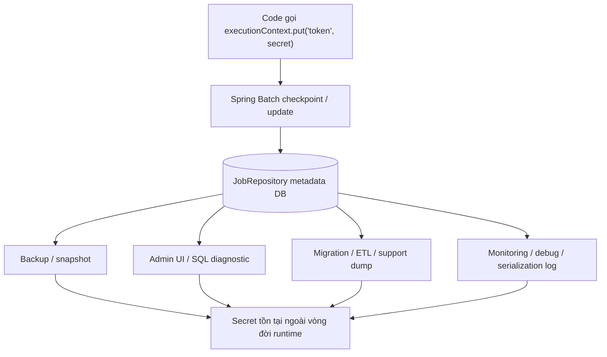
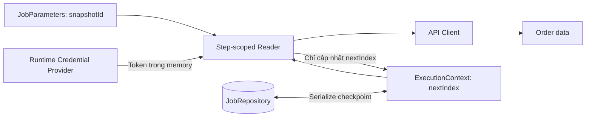

# Không ghi credential vào ExecutionContext trong Spring Batch

Trong một Spring Batch job, `ExecutionContext` thường được dùng để lưu trạng thái nhằm **restart** sau khi job thất bại: vị trí đọc file, offset, khóa cuối đã xử lý, số trang hiện tại hoặc một cờ đánh dấu giai đoạn. Vì nó trông giống một `Map<String, Object>` tiện dụng, lập trình viên đôi khi đưa cả access token, mật khẩu database hoặc API key vào đó để “lần chạy sau dùng tiếp”.

Đây là một lỗi thiết kế bảo mật. **`ExecutionContext` không phải kho lưu bí mật (secret store)**. Dữ liệu được Spring Batch ghi vào `JobRepository` để khôi phục execution, nên credential có thể tồn tại lâu hơn một lần chạy, bị sao chép vào backup, được đọc qua công cụ quản trị hoặc xuất hiện trong bản dump/diagnostics. Mã hóa ổ đĩa hay quyền truy cập database không biến nó thành nơi thích hợp để lưu token.

Nguyên tắc của bài học:

> **Lưu checkpoint và định danh nghiệp vụ tối thiểu trong `ExecutionContext`; lấy credential ở runtime qua provider/secret manager có kiểm soát. Không lưu secret thô trong `ExecutionContext`, `JobParameters` hoặc log.**

Bài viết thuộc **Spring Batch Core Processing → Security** và minh họa cách nhận diện, tránh, phát hiện và khắc phục rủi ro này trong Spring Batch 5.x / Spring Boot 3.x. Những ví dụ về secret provider mang tính giao diện tích hợp; triển khai cụ thể phụ thuộc Vault, cloud secret manager, workload identity hoặc hạ tầng tổ chức.

## 1. ExecutionContext thực sự dùng để làm gì?

Spring Batch quản lý ba cấp đối tượng:

- **`JobInstance`:** một lần chạy theo nghĩa nghiệp vụ, xác định bởi tên job và các identifying `JobParameters`.
- **`JobExecution`:** một lần thử chạy `JobInstance`; restart có thể tạo `JobExecution` mới cho cùng instance.
- **`StepExecution`:** lần thực thi của một step, có counter và trạng thái riêng.

`ExecutionContext` là tập dữ liệu có khóa/giá trị gắn với **JobExecution** hoặc **StepExecution**. Reader, writer và framework sử dụng context để lưu thông tin có thể phục hồi khi chạy lại.

Ví dụ một reader đọc dữ liệu theo thứ tự ổn định:

```text
Job: importExternalOrders
JobParameters: businessDate=2026-11-15, snapshotId=orders-v7

StepExecutionContext:
  externalOrders.nextIndex = 1200

Sau khi crash:
  JobInstance cũ được restart
  Reader mở lại nguồn orders-v7 và tiếp tục từ checkpoint 1200
```

Giá trị `1200` là **trạng thái xử lý**, không phải thông tin xác thực. Một access token để gọi API lấy order lại là **bí mật có thể cấp quyền truy cập**, không nên được xem là state cần checkpoint.

### Hai phạm vi context

| Phạm vi | Ví dụ dữ liệu phù hợp | Đặc điểm |
|---|---|---|
| `StepExecution.getExecutionContext()` | Offset, line number, paging cursor không nhạy cảm, watermark | Thường phục vụ restart của reader/writer trong step |
| `JobExecution.getExecutionContext()` | Tên artifact đã publish, số lượng đã xác nhận, version dữ liệu | Chia sẻ kết quả giữa các step theo cơ chế được cấu hình |

Cả **hai** đều được quản lý qua `JobRepository`. Chuyển token từ step context sang job context không làm nó an toàn hơn. Tương tự, dùng `ExecutionContextPromotionListener` để đưa credential lên cấp job chỉ làm tăng phạm vi lan truyền của secret.

## 2. Vì sao credential trong context có thể bị lộ?

Lưu đồ đơn giản:



Spring Batch lưu execution context trong các bảng metadata, thường gồm:

- `BATCH_JOB_EXECUTION_CONTEXT`;
- `BATCH_STEP_EXECUTION_CONTEXT`.

Trong các schema thông dụng có các trường biểu diễn dữ liệu như `SHORT_CONTEXT` và `SERIALIZED_CONTEXT`. Dữ liệu context được serialize theo cấu hình `ExecutionContextSerializer` và có thể tồn tại tới khi metadata được dọn theo chính sách retention.

**Không nên giả định dữ liệu đã được bảo vệ chỉ vì không nhìn thấy ở dạng text trực tiếp trong một cột.** Serializer không đồng nghĩa với encryption; ngay cả khi có encryption at rest, ứng dụng hoặc tài khoản đủ quyền đọc vẫn có thể giải mã hoặc truy cập context qua API. Backup, replica, export SQL và support bundle thường có vòng đời truy cập khác với process ban đầu.

### Threat model tối thiểu

| Bề mặt rủi ro | Tình huống | Hậu quả |
|---|---|---|
| Metadata database | Tài khoản vận hành có quyền SELECT bảng Batch | Có thể đọc secret được checkpoint |
| Backup/replica | Database được sao lưu, snapshot, chuyển vùng | Secret tồn tại nhiều bản ngoài môi trường runtime |
| Debug log | Log nguyên object `ExecutionContext` | Secret đi vào hệ thống log dài hạn |
| Error handling | Exception chứa Authorization header/token | Secret xuất hiện trong trace, cảnh báo, ticket |
| Support/diagnostics | Export execution context để điều tra | Secret bị chia sẻ ngoài nhóm được phép |
| Job restart | Token cũ được deserialize sau nhiều ngày | Token hết hạn hoặc đã bị thu hồi; job lại thất bại |
| Remote execution | Partition worker nhận context | Secret bị truyền rộng đến nhiều worker/node |

Vấn đề vừa là **bảo mật**, vừa là **độ tin cậy**: một token ngắn hạn được lưu để restart sẽ có thể hết hạn vào đúng lúc cần phục hồi.

## 3. Phân loại dữ liệu: cái gì được và không được lưu?

| Dữ liệu | Lưu trong `ExecutionContext`? | Lý do |
|---|---|---|
| Số dòng đã đọc, offset, số trang | **Có**, nếu cần để restart | Checkpoint có thể phục hồi |
| ID bản ghi cuối hoặc watermark | **Có điều kiện** | Không phải secret; vẫn cần phân loại dữ liệu và bảo đảm thứ tự |
| Version snapshot, tên artifact không nhạy cảm | **Có điều kiện** | Giúp cố định nguồn dữ liệu khi restart |
| Read/skip/write counters | **Khi thực sự cần** | Nhiều counter đã được `StepExecution` quản lý |
| Mật khẩu database | **Không** | Credential lâu dài, có thể cấp quyền DB |
| API key, bearer token, OAuth access/refresh token | **Không** | Có khả năng cấp quyền và có vòng đời rotation |
| Private key, client secret, certificate password | **Không** | Bí mật ký/xác thực, tác động nghiêm trọng khi lộ |
| Cookie phiên, session ID, signed URL nhạy cảm | **Không** | Có thể cấp quyền truy cập tạm thời |
| Chuỗi Authorization header hoặc connection URL có password | **Không** | Có thể chứa credential dù tên key không phải `password` |
| Thông tin cá nhân nhạy cảm, payload bí mật | **Tránh** | Context là metadata, không phải kho dữ liệu nghiệp vụ |
| Secret alias/ID không có khả năng xác thực | **Cân nhắc** | Chỉ khi không nhạy cảm theo chính sách, có allowlist và cần cho restart |

Một **secret reference** (ví dụ tên bí mật trong secret manager) về kỹ thuật có thể không cho phép đăng nhập nếu đứng một mình, nhưng nó vẫn tiết lộ cấu trúc hệ thống/tên môi trường. Chỉ lưu reference khi được phân loại là không nhạy cảm và thực sự cần thiết; tốt hơn là lấy cấu hình từ môi trường triển khai khi không cần cố định reference theo từng job.

**Không chỉ kiểm tra tên key.** Một key như `checkpoint` hoặc `extraState` có thể vô tình chứa một object gồm token. Mọi giá trị được đưa vào context đều phải được đánh giá trước khi serialize.

## 4. Anti-pattern: lưu token để “dùng lại sau khi restart”

Mẫu **không an toàn**:

```java
// KHÔNG LÀM: token sẽ có nguy cơ bị lưu cùng metadata Batch.
ExecutionContext context =
        stepExecution.getExecutionContext();

String token = authClient.requestAccessToken();
context.putString("api.accessToken", token);

// Sau này:
String previousToken = context.getString("api.accessToken");
apiClient.fetchOrders(previousToken);
```

Hậu quả có thể gồm:

1. Khi Spring Batch lưu checkpoint, token được serialize vào `JobRepository`.
2. Backup và công cụ truy vấn metadata có thể giữ lại bản token đó.
3. Token hết hạn giữa các execution, khiến restart không đáng tin cậy.
4. Khi token bị thu hồi, việc restart từ context cũ có thể dùng credential sai.
5. Nếu ứng dụng log context để debug, token có thể lan sang log và alert.

Một biến thể cũng không an toàn:

```java
executionContext.put("clientConfiguration", Map.of(
        "baseUrl", "https://api.example.invalid",
        "username", username,
        "password", password)); // KHÔNG LÀM
```

Đừng kỳ vọng rằng secret được giấu trong `Map`, DTO, object tự serialize hoặc một chuỗi JSON thì an toàn. **Secret không nên đi vào context ngay từ đầu**, kể cả định xóa key sau vài dòng: một lần checkpoint, exception hoặc diagnostic ngoài dự kiến có thể làm nó bị ghi lại.

### Không chuyển credential sang JobParameters

`JobParameters` cũng được lưu trong metadata Batch để xác định `JobInstance` và phục vụ restart. Ví dụ này **không an toàn**:

```java
// KHÔNG LÀM: mật khẩu/token trong JobParameters.
JobParameters params = new JobParametersBuilder()
        .addString("businessDate", "2026-11-15")
        .addString("apiToken", token)
        .toJobParameters();
```

Đặc biệt nguy hiểm nếu credential là **identifying parameter**, vì mỗi lần rotate có thể làm Spring Batch nhìn nhận đây là một JobInstance mới. Đánh dấu `identifying=false` cũng **không giải quyết rò rỉ**, bởi giá trị non-identifying vẫn được lưu với execution.

Chọn cách truyền:

```java
// ĐƯỢC: chỉ truyền tham số nghiệp vụ cần thiết và không nhạy cảm.
JobParameters params = new JobParametersBuilder()
        .addString("businessDate", "2026-11-15")
        .addString("snapshotId", "orders-v7")
        .toJobParameters();
```

Credential sẽ được cấp ở runtime từ cấu hình/identity/secret provider, không nằm trong danh sách parameters.

## 5. Mẫu thiết kế an toàn: checkpoint riêng, secret riêng

Thiết kế reader gọi một API có token:



Tách ba trách nhiệm:

- **Business input:** ngày nghiệp vụ và ID snapshot không nhạy cảm để chọn đúng dữ liệu.
- **Restart state:** offset hoặc khóa cuối đã đọc để có thể khôi phục.
- **Authentication:** provider lấy credential hiện tại dựa trên workload identity/secret manager, không serialize credential.

### 5.1. Hợp đồng tích hợp API

Ví dụ các interface trong ứng dụng:

```java
import java.math.BigDecimal;

record ApiOrder(String id, BigDecimal amount) {}

public interface AccessTokenProvider {
    // Lấy token còn hiệu lực; implementation có thể cache và refresh.
    String currentAccessToken();
}

public interface ApiOrderClient {
    // null nghĩa là hết dữ liệu; snapshotId và index phải ổn định.
    ApiOrder fetchByIndex(
            String snapshotId, int index, String accessToken);
}
```

Ở code production, API client cần thêm timeout, retry có giới hạn, mã lỗi rõ ràng và không đưa token vào exception message. Ví dụ sử dụng `fetchByIndex` để tập trung vào checkpoint; một API thực có thể dùng **cursor token** hoặc pagination key. Nếu cursor token đó có quyền xác thực/truy cập dữ liệu tương tự một bearer credential, **không lưu thẳng vào context**: cần cơ chế ánh xạ tới trạng thái không nhạy cảm hoặc snapshot/server-side handle phù hợp.

### 5.2. Reader lưu duy nhất offset

```java
import org.springframework.batch.item.ExecutionContext;
import org.springframework.batch.item.ItemStreamReader;

public final class SecureApiOrderReader
        implements ItemStreamReader<ApiOrder> {

    private static final String NEXT_INDEX_KEY =
            "externalOrders.nextIndex";

    private final String snapshotId;
    private final ApiOrderClient client;
    private final AccessTokenProvider tokenProvider;
    private int nextIndex;

    public SecureApiOrderReader(
            String snapshotId,
            ApiOrderClient client,
            AccessTokenProvider tokenProvider) {
        this.snapshotId = snapshotId;
        this.client = client;
        this.tokenProvider = tokenProvider;
    }

    @Override
    public void open(ExecutionContext context) {
        nextIndex = context.getInt(NEXT_INDEX_KEY, 0);
    }

    @Override
    public ApiOrder read() {
        // Credential chỉ được dùng trong lời gọi runtime.
        String token = tokenProvider.currentAccessToken();
        ApiOrder order = client.fetchByIndex(
                snapshotId, nextIndex, token);

        if (order != null) {
            nextIndex++;
        }
        return order;
    }

    @Override
    public void update(ExecutionContext context) {
        // Chỉ trạng thái có thể checkpoint được đưa vào context.
        context.putInt(NEXT_INDEX_KEY, nextIndex);
    }

    @Override
    public void close() {
        // Không cần giữ credential qua execution.
    }
}
```

Giải thích:

1. Khi step mở, reader khôi phục `nextIndex` từ `ExecutionContext`.
2. Mỗi lần `read()`, reader hỏi provider token hiện tại rồi gọi API.
3. Khi Spring Batch yêu cầu lưu state, `update(...)` chỉ đưa một **số nguyên** vào context.
4. Token ở biến cục bộ trong memory, không được gán vào field checkpoint hay `ExecutionContext`.
5. Khi job restart, bean/reader mới có thể nhận token mới từ provider nhưng vẫn dùng đúng offset đã lưu.

Đây là ví dụ **logic checkpoint tối giản**. Tính đúng khi restart còn phụ thuộc API trả dữ liệu theo **snapshot/ordering ổn định**, và writer phải xử lý idempotent khi đọc lại một phần chunk chưa commit. Nếu API có thể thêm/xóa/reorder item trong lúc batch chạy, offset đơn thuần có thể làm thiếu hoặc trùng dữ liệu; cần thiết kế snapshot hoặc keyset pagination ổn định.

**Giới hạn bảo mật cần hiểu:** Biến `String token` vẫn tồn tại trong bộ nhớ JVM trong lúc gọi API. Cách này tránh **lưu lâu dài vào metadata**, chứ không có nghĩa secret không thể bị lộ qua heap dump, crash dump, instrumentation hay code logging bất cẩn. Bảo vệ runtime và hạn chế thời gian sống/quyền của token vẫn cần thiết.

### 5.3. Tạo reader theo step scope

```java
import org.springframework.batch.core.configuration.annotation.StepScope;
import org.springframework.batch.item.ItemStreamReader;
import org.springframework.beans.factory.annotation.Value;
import org.springframework.context.annotation.Bean;

@Bean
@StepScope
ItemStreamReader<ApiOrder> apiOrdersReader(
        @Value("#{jobParameters['snapshotId']}") String snapshotId,
        ApiOrderClient apiClient,
        AccessTokenProvider tokenProvider) {
    return new SecureApiOrderReader(
            snapshotId, apiClient, tokenProvider);
}
```

`@StepScope` cho phép reader nhận `snapshotId` sau khi step bắt đầu. `tokenProvider` là dependency do Spring quản lý, được cấu hình để lấy credential từ nguồn an toàn của môi trường triển khai. **Không dùng `@Value("#{jobParameters['apiToken']}")`** vì điều đó yêu cầu đưa token vào JobParameters đã được lưu.

Ví dụ step tương ứng:

```java
@Bean
Step importOrdersStep(
        JobRepository jobRepository,
        PlatformTransactionManager transactionManager,
        ItemStreamReader<ApiOrder> apiOrdersReader,
        ItemWriter<ApiOrder> orderWriter) {
    return new StepBuilder("importOrdersStep", jobRepository)
            .<ApiOrder, ApiOrder>chunk(100, transactionManager)
            .reader(apiOrdersReader)
            .writer(orderWriter)
            .build();
}
```

Đoạn code dùng API builder của Spring Batch 5.x. Writer và hạ tầng transaction được định nghĩa theo ứng dụng; writer nên có khóa nghiệp vụ duy nhất để dữ liệu không trùng sau retry/restart.

## 6. Lấy credential an toàn ở runtime

`AccessTokenProvider` là **abstraction**, không nhất thiết ứng dụng nào cũng cần tự gọi secret manager trong mỗi lần đọc. Những lựa chọn có thể dùng:

| Nguồn credential | Khi phù hợp | Lưu ý |
|---|---|---|
| Workload identity / managed identity | Cloud/container hỗ trợ identity cho workload | Ưu tiên token ngắn hạn và quyền tối thiểu |
| Secret manager/Vault | Cần quản lý API key, client secret, rotation tập trung | Phân quyền đọc secret theo service, audit và TTL |
| Credential provider của cloud SDK | SDK tự refresh access credential | Không tự serialize object credential vào context |
| OAuth client credentials flow | API downstream xác thực bằng OAuth | Cache token còn hạn ở provider, refresh khi cần |
| Environment/secret mount | Môi trường đơn giản, secret được inject lúc deploy | Bảo vệ quyền truy cập process, dump, config và lịch sử triển khai |

Tránh hard-code secret trong source, Dockerfile, CI artifact hoặc file cấu hình được commit. Với secret manager, chỉ cấp quyền truy cập **đúng secret** cần thiết cho job đó và audit việc đọc.

### 6.1. Provider có thể cache/refresh nhưng không checkpoint

Một provider thực tế có thể giữ token trong memory tới gần thời điểm hết hạn, sau đó refresh theo TTL. Điều cần phân biệt:

```text
Runtime cache (trong process):
  accessToken + expiresAt     → Có thể cần, được bảo vệ

Spring Batch ExecutionContext (trong JobRepository):
  nextIndex=1200              → Được
  accessToken=...             → Không được
  refreshToken=...            → Không được
```

Nếu token bị thu hồi giữa lúc job đang chạy, provider/client cần xử lý theo chính sách xác thực của API: refresh một cách an toàn, giới hạn số lần thử và không log token cũ. Tránh nhiều thread cùng refresh đồng thời gây “thundering herd”; provider có thể dùng single-flight hoặc đồng bộ phù hợp, nhưng không lưu kết quả refresh vào context.

### 6.2. Rotation và restart

Một ưu điểm của việc tách secret khỏi checkpoint là:

```text
Execution #501:
  checkpoint = nextIndex 1200
  token A được cấp ở runtime
  job FAILED

Security team rotate credential:
  token A bị thu hồi, token B có hiệu lực

Execution #502 (restart cùng JobInstance):
  checkpoint = nextIndex 1200
  provider lấy token B
  tiếp tục đọc snapshot từ vị trí đúng
```

Nếu credential đã bị gắn vào `ExecutionContext`, lần restart có nguy cơ sử dụng lại token A đã hết hạn hoặc không còn được phép dùng. Rotation còn làm việc lưu token dài hạn trong metadata trở nên khó quản trị.

**Trường hợp đặc biệt:** Một đối tác yêu cầu xử lý dữ liệu bằng credential/identity của đúng tenant hoặc đúng kỳ. Hãy lưu **tenant ID/credential alias không nhạy cảm** nếu chính sách cho phép, sau đó provider resolve secret phù hợp ở runtime. Không lưu secret hoặc access token thực. Nếu tenant ID cũng được phân loại nhạy cảm, cần một business reference token hóa/đã kiểm soát quyền truy cập.

## 7. Chặn secret rò rỉ qua đường vòng

Không đưa token vào context là cần thiết nhưng chưa đủ. Một job có thể vô tình lộ secret qua chỗ khác.

### 7.1. Log `JobParameters` và `ExecutionContext`

Đoạn log không an toàn:

```java
// KHÔNG LÀM: có thể dump dữ liệu nhạy cảm.
log.info("parameters={}", execution.getJobParameters());
log.debug("context={}", stepExecution.getExecutionContext());
```

Thay bằng **allowlist những trường được phép**:

```java
log.info(
        "batch job={} executionId={} status={} businessDate={}",
        execution.getJobInstance().getJobName(),
        execution.getId(),
        execution.getStatus(),
        execution.getJobParameters().getString("businessDate"));
```

Giá trị `businessDate` ở ví dụ được phân loại không nhạy cảm; với hệ thống đa tenant hoặc dữ liệu đặc biệt, cũng cần chính sách ghi log phù hợp. Không tự động serialize toàn bộ `JobExecution`/`StepExecution` trong REST response hoặc debug console.

### 7.2. Exception từ HTTP client

Một HTTP interceptor hoặc logger bật wire-level debug có thể log request headers, trong đó có:

```text
Authorization: Bearer <secret>
Cookie: session=<secret>
X-API-Key: <secret>
```

Khi điều tra lỗi, chỉ log thông tin như URL đã loại query nhạy cảm, HTTP status, retry count, correlation ID, endpoint name và latency. Cấu hình **redaction ở tầng HTTP client, tracing, gateway và log exporter**; không dựa vào việc người đọc log sẽ tự bỏ qua token.

Không ném exception kiểu:

```java
// KHÔNG LÀM: exception có thể được lưu hoặc forward sang alert.
throw new IllegalStateException(
        "Remote API rejected token=" + accessToken);
```

Nên giữ mã lỗi/loại exception có ý nghĩa nhưng không bao gồm secret:

```java
throw new IllegalStateException(
        "Remote API authentication failed; status=401");
```

### 7.3. Job/step listener và monitoring

Các listener như `JobExecutionListener`, `StepExecutionListener`, `SkipListener` có thể ghi exception hoặc item gây lỗi. Nếu item chứa secret/token, listener cũng có thể làm lộ. Không đưa secret vào payload item chỉ để sử dụng lại ở writer; inject provider vào client/writer riêng.

Không đưa token, tên user nhạy cảm, raw request header hoặc item ID có cardinality cao vào **Micrometer tags**. Metrics thường được lưu lâu, sao chép và truy cập rộng hơn log nghiệp vụ.

### 7.4. Promotion và remote partitioning

Nếu dùng `ExecutionContextPromotionListener` để đưa một key từ step context lên job context, chỉ promote key đã qua allowlist. Với remote partitioning, execution context có thể được gửi qua cơ chế messaging/transport đến worker; việc đưa token vào context có thể mở rộng phạm vi secret tới nhiều node hoặc payload message được lưu.

**Nguyên tắc:** context chỉ truyền **công việc cần làm và checkpoint**, không truyền credential. Mỗi worker lấy identity/credential từ môi trường runtime được cấp quyền cho worker đó.

## 8. Giới hạn quyền truy cập metadata của JobRepository

Phòng ngừa ghi credential là kiểm soát quan trọng nhất, nhưng vẫn cần bảo vệ metadata:

1. **Tách quyền:** tài khoản Batch runtime được cấp quyền cần thiết trên metadata; tài khoản chỉ đọc/BI/admin không mặc nhiên cần thấy toàn bộ context.
2. **Không public endpoint quản trị:** giới hạn API hiển thị JobExecution/ExecutionContext, áp dụng RBAC và audit.
3. **Mã hóa vận chuyển và lưu trữ:** TLS tới database, encryption at rest/backup theo chính sách; không coi đây là lý do để lưu secret.
4. **Quản lý retention:** xóa/archive metadata cũ theo lịch và tính toàn vẹn khóa ngoại/khả năng restart; tránh giữ vĩnh viễn context của job không còn cần phục hồi.
5. **Backup/export:** phân loại metadata database như nguồn có khả năng chứa dữ liệu nhạy cảm, hạn chế quyền tải bản dump và thời gian giữ.
6. **Hệ thống log và crash dump:** bảo vệ heap dump, support archive, CI logs và alert channel tương ứng.
7. **Audit truy cập:** giám sát hoạt động truy vấn/xuất bất thường và các lần đọc secret từ secret manager.

Không xóa metadata production tùy tiện để “xóa dấu vết” khi phát hiện secret. Các bảng `BATCH_*` liên kết bằng khóa ngoại và giữ thông tin restart quan trọng; cleanup phải dựa trên runbook và chính sách bảo mật/dữ liệu.

## 9. Kiểm thử: xác nhận context chỉ chứa checkpoint

Một kiểm thử nên xác nhận credential giả được **sử dụng bởi client**, nhưng **không** được ghi vào context. Dùng chuỗi giả chỉ có ý nghĩa test, không dùng credential thật.

### 9.1. Unit test cho reader

```java
import static org.junit.jupiter.api.Assertions.*;

import java.math.BigDecimal;
import java.util.concurrent.atomic.AtomicInteger;

import org.junit.jupiter.api.Test;
import org.springframework.batch.item.ExecutionContext;

class SecureApiOrderReaderTest {

    @Test
    void checkpointsIndexButNeverPersistsAccessToken() {
        String fakeToken = "TEST_TOKEN_DO_NOT_PERSIST_123";
        AtomicInteger providerCalls = new AtomicInteger();

        AccessTokenProvider provider = () -> {
            providerCalls.incrementAndGet();
            return fakeToken;
        };

        ApiOrderClient client = (snapshot, index, token) -> {
            assertEquals("orders-v7", snapshot);
            assertEquals(fakeToken, token);
            return index == 0
                    ? new ApiOrder("order-1", BigDecimal.TEN)
                    : null;
        };

        ExecutionContext context = new ExecutionContext();
        SecureApiOrderReader reader =
                new SecureApiOrderReader("orders-v7", client, provider);

        reader.open(context);
        assertEquals("order-1", reader.read().id());
        assertNull(reader.read());
        reader.update(context);
        reader.close();

        assertEquals(1, context.getInt("externalOrders.nextIndex"));
        assertFalse(context.containsKey("api.accessToken"));
        assertFalse(context.containsKey("refreshToken"));
        assertEquals(2, providerCalls.get());

        // Kiểm tra thêm allowlist: chỉ key checkpoint được lưu.
        assertEquals(
                java.util.Set.of("externalOrders.nextIndex"),
                context.keySet());
    }
}
```

Test kiểm tra contract của `SecureApiOrderReader` với `ExecutionContext` in-memory. Nó **chưa** chứng minh metadata production hoàn toàn không có secret do các thành phần khác đưa vào; cần kiểm thử tích hợp và chính sách code review.

### 9.2. Integration test với JobRepository thật

Khi job đã chạy trong test database, dùng `JobExplorer` để đọc lại context từ metadata:

```java
@Autowired JobExplorer jobExplorer;

@Test
void persistedContextContainsOnlyAllowedKeys() throws Exception {
    // Giả định test đã khởi chạy job và có executionId.
    JobExecution execution = jobExplorer.getJobExecution(executionId);
    assertNotNull(execution);

    StepExecution step = execution.getStepExecutions()
            .iterator().next();

    ExecutionContext persisted = step.getExecutionContext();
    assertTrue(persisted.containsKey("externalOrders.nextIndex"));
    assertFalse(persisted.containsKey("api.accessToken"));
    assertFalse(persisted.containsKey("refreshToken"));
}
```

Đây là **mảnh code minh họa** đặt trong một integration test đã thiết lập context, `JobLauncher`/`JobLauncherTestUtils`, job và biến `executionId`. Phần còn lại của test cần lấy execution ID thật từ `JobExecution` sau khi job kết thúc. Nếu API `JobExplorer` trả `StepExecution` chưa nạp context trong cấu hình cụ thể, có thể dùng phương thức load context tương ứng của hạ tầng hoặc query metadata.

Đừng chỉ tìm tên key `password`/`token`. Một object tùy ý có thể chứa secret ở key khác. Nên thiết lập **allowlist keys** cho reader/writer thuộc job và kiểm tra toàn bộ giá trị được serialize theo serializer thực tế trong môi trường test.

### 9.3. Kiểm tra nội dung metadata đã serialize

Nếu ứng dụng dùng metadata schema có cột `SHORT_CONTEXT` và `SERIALIZED_CONTEXT`, có thể chạy test **chỉ đọc** trên database test:

```sql
SELECT SHORT_CONTEXT, SERIALIZED_CONTEXT
FROM BATCH_STEP_EXECUTION_CONTEXT
WHERE STEP_EXECUTION_ID = :stepExecutionId;
```

Với fake token độc nhất như `TEST_TOKEN_DO_NOT_PERSIST_123`, đọc/deserialize kết quả bằng chính `ExecutionContextSerializer` đang được cấu hình rồi kiểm tra token không xuất hiện. Chỉ tìm substring trong `SHORT_CONTEXT` **không đủ**, vì toàn bộ nội dung có thể nằm trong `SERIALIZED_CONTEXT` và serializer có thể nén/mã hóa ở dạng không đọc trực tiếp.

Test cũng nên kiểm tra `BATCH_JOB_EXECUTION_CONTEXT` và JobParameters nếu luồng code có thể ghi dữ liệu vào đó. Không chạy test với secret production để “xem có lộ hay không”.

### 9.4. Test restart sau token rotation

Một kịch bản bảo mật kiêm reliability:

1. Job xử lý thành công một vài chunk và lưu checkpoint, rồi gặp lỗi được chủ động tiêm.
2. Provider lần đầu trả token giả `TOKEN_A`; API test server chấp nhận nó.
3. Token giả `TOKEN_A` bị “thu hồi”; provider chuyển sang `TOKEN_B`.
4. Restart **cùng JobInstance** bằng identifying parameters cũ.
5. Reader khôi phục offset rồi yêu cầu token mới; server chỉ chấp nhận `TOKEN_B`.
6. Xác nhận job `COMPLETED`, output không thiếu/trùng và metadata không chứa `TOKEN_A`/`TOKEN_B`.

Kịch bản này chứng minh checkpoint độc lập với credential. Kết quả restart còn phụ thuộc nguồn dữ liệu ổn định và writer idempotent, nên cần kiểm tra cả hai.

## 10. Kiểm soát bằng code review và CI

Để phòng tránh vấn đề tái diễn, nên đưa các quy tắc vào quy trình phát triển:

| Quy tắc | Cách áp dụng |
|---|---|
| Allowlist key cho `ExecutionContext` | Chỉ cho lưu offset, index, version, checkpoint đã phân loại |
| Không đưa secret vào `JobParameters` | Kiểm tra builder và mọi entry point như CLI/REST/scheduler |
| Cấm dump object metadata trong log | Review `log.info/debug("{}", context)` và serializer |
| Không log header Authorization/cookie | Cấu hình redaction ở HTTP client/gateway/tracing |
| Không promote context tùy ý | Kiểm tra `ExecutionContextPromotionListener` và remote partition context |
| Secret từ provider tập trung | Dùng identity/secret manager và quyền tối thiểu |
| Unit/integration test | Fake sentinel, allowlist và kiểm tra metadata thật |
| Secret scanning | Quét source, config, logs test và artifact trước release |
| Rotation drill | Đảm bảo restart lấy credential mới, không phụ thuộc state cũ |

Một quy tắc tĩnh có thể tìm những mẫu đáng nghi:

```text
ExecutionContext.putString("password", ...)
ExecutionContext.put("accessToken", ...)
ExecutionContext.put("credentials", ...)
JobParametersBuilder.addString("apiKey", ...)
log.debug("executionContext={}", ...)
```

Tìm kiếm mẫu tên là bước đầu, **không thay thế code review theo data flow**: một giá trị có tên `state`/`metadata` cũng có thể chứa secret, còn một giá trị có tên `tokenizedId` có thể là định danh không nhạy cảm. Mục tiêu là truy vết dữ liệu từ credential source đến mọi storage/log sink.

## 11. Nếu đã lỡ ghi credential vào ExecutionContext

Đây là một sự cố bảo mật tiềm tàng, không chỉ là lỗi coding style. Kế hoạch xử lý nên theo chính sách incident của tổ chức:

1. **Ngăn ghi tiếp:** sửa code/triển khai để không đặt credential vào JobParameters, ExecutionContext, log hoặc remote message.
2. **Thu hồi và rotate:** xác định loại credential đã lộ; revoke token/rotate password/key theo hạ tầng và đánh giá tác động tới job khác.
3. **Xác định phạm vi:** tìm các JobExecution/StepExecution, environment, backup, replica, log, dump và export có thể chứa secret.
4. **Rà soát truy cập:** xem audit log của database, secret manager và hệ thống hỗ trợ; xác định quyền truy cập liên quan.
5. **Làm sạch có kiểm soát:** dùng quy trình bảo mật/retention để xử lý metadata và bản sao; không DELETE/UPDATE đại trà làm hỏng lịch sử restart hoặc vi phạm yêu cầu lưu giữ.
6. **Khôi phục job an toàn:** nếu execution cũ cần restart, đánh giá checkpoint/serializer và khả năng dùng credential mới qua provider; không deserialize rồi tiếp tục dùng token đã thu hồi.
7. **Ngăn tái diễn:** bổ sung allowlist, test, scanning, log redaction và quyền truy cập metadata.

Không thể kết luận “đã xóa secret hoàn toàn” chỉ vì một dòng context đã được UPDATE hoặc token đã biến mất khỏi UI. Backups, logs và support bundles có thể vẫn giữ dữ liệu; cần làm việc với các chủ hệ thống tương ứng.

### Có nên mã hóa secret rồi lưu trong ExecutionContext?

Ngay cả khi có serializer tự mã hóa, **khuyến nghị mặc định vẫn là không lưu credential vào context**. Lý do:

- Cần quản lý khóa mã hóa, quyền giải mã và rotation riêng.
- Bản mã vẫn được lưu lâu dài trong metadata và backup.
- Mất/rotate khóa có thể khiến checkpoint không đọc được.
- Secret hết hạn vẫn không phù hợp để tái sử dụng khi restart.
- Lỗi log dữ liệu trước mã hóa hoặc sau giải mã vẫn có thể làm lộ.

Nếu kiến trúc bắt buộc checkpoint một dữ liệu nhạy cảm không thể tái tạo, đó là bài toán thiết kế riêng cần phê duyệt threat model, encryption/key management, retention, access control và restart behavior — **không phải lý do để lưu token xác thực thông thường**.

## 12. Checklist trước khi đưa job vào production

| Câu hỏi | Dấu hiệu đạt |
|---|---|
| Context có chỉ chứa trạng thái restart tối thiểu không? | Các key được liệt kê trong allowlist |
| Có token, password, key, cookie hoặc header auth trong context không? | Không có, kể cả nested object |
| JobParameters có chứa secret không? | Không, cả identifying lẫn non-identifying |
| Credential được lấy từ đâu? | Workload identity/secret manager/provider được kiểm soát |
| Credential có tự refresh/rotate được không? | Có policy và test restart sau rotation |
| Metadata DB/backup có quyền truy cập phù hợp không? | RBAC, TLS, retention, audit |
| Log/trace có redaction không? | Không ghi Authorization header/exception chứa token |
| Có promotion/remote partitioning không? | Context chỉ chứa dữ liệu được phép chia sẻ |
| Checkpoint có đúng khi secret thay đổi không? | Restart dùng state cũ + credential mới |
| Test có quét giá trị đã serialize không? | Dùng fake sentinel và kiểm tra metadata test |
| Có runbook xử lý rò rỉ không? | Revoke, rotate, điều tra phạm vi, xử lý backups và recovery |

## 13. Những nhầm lẫn thường gặp

| Nhầm lẫn | Thực tế |
|---|---|
| “Context chỉ là Map trong RAM” | Nó được serialize/lưu qua `JobRepository` khi framework checkpoint |
| “Đặt token trong job context an toàn hơn step context” | Cả hai đều là persisted metadata |
| “Đặt token vào non-identifying JobParameter không sao” | Non-identifying cũng được lưu; chỉ khác vai trò xác định JobInstance |
| “Token chỉ sống 5 phút, lộ cũng không vấn đề” | Token vẫn có thể bị dùng khi còn hiệu lực; có thể lộ thêm refresh token hoặc thông tin hệ thống |
| “Serializer nén/encode là mã hóa” | Encoding/serialization không bảo đảm bảo mật |
| “DB đã mã hóa ổ đĩa nên được lưu secret” | Người/tài khoản có quyền đọc vẫn truy cập dữ liệu đã giải mã |
| “Restart cần dùng lại credential cũ” | Restart cần checkpoint nghiệp vụ; credential nên được cấp mới ở runtime |
| “Chỉ key có tên password mới cần quét” | Secret có thể nằm trong DTO, Map, header, URL hoặc nested state |
| “Xóa secret khỏi context là sự cố đã kết thúc” | Bản sao, backup, log, dump và quyền truy cập vẫn cần xử lý |
| “@StepScope tự làm secret an toàn” | Scope không ngăn developer đưa token vào context/log; cần data-flow discipline |

## 14. Tổng kết

**`ExecutionContext` là cơ chế checkpoint/restart, không phải credential vault.** Mọi giá trị được đưa vào đó phải được xem như dữ liệu có khả năng tồn tại lâu trong JobRepository và các bản sao hạ tầng. Thêm một token giúp code dễ viết trong ngắn hạn nhưng làm tăng diện tấn công, phá vỡ rotation và có thể khiến restart thất bại khi credential hết hạn.

Thiết kế bền vững giữ **offset, khóa cuối, snapshot/version không nhạy cảm** trong context; giữ **API key, password, access/refresh token** ở provider runtime có quyền tối thiểu, refresh phù hợp và không log. Kết hợp allowlist, kiểm thử metadata bằng token giả, giới hạn quyền JobRepository và quy trình xử lý rò rỉ sẽ giúp job vừa **restart được** vừa **không làm credential trở thành một phần của lịch sử Batch**.
