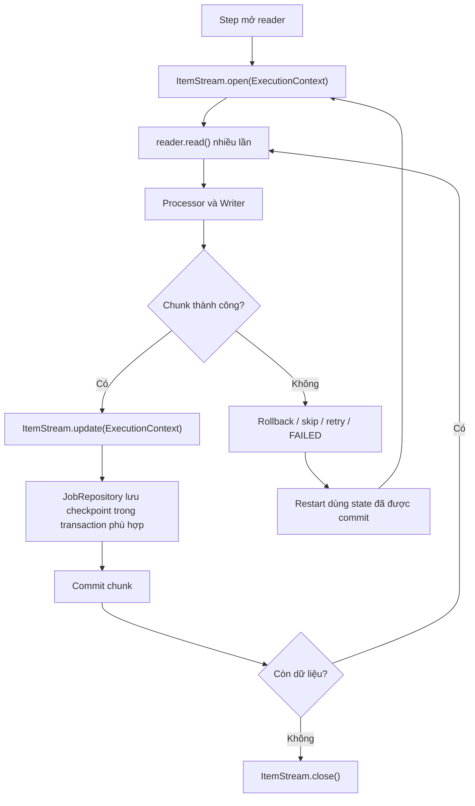

# Không lưu reader state trong Spring Batch

Một lỗi khó nhận ra khi phát triển Spring Batch là **job chạy lần đầu bình thường nhưng sau failure lại đọc từ đầu, đọc trùng hoặc bỏ sót dữ liệu**. Trong nhiều trường hợp, nguyên nhân không nằm ở `ItemWriter` mà ở chỗ **reader không lưu hoặc không khôi phục trạng thái đọc**. Ứng dụng có thể đã cấu hình chunk, transaction và `JobRepository` đúng nhưng một custom reader chỉ implements `ItemReader`, một `ItemStream` bị che phía sau delegate, hoặc một tham số `saveState(false)` vô tình làm mất checkpoint.

Bài học thuộc **Spring Batch Core Processing → Lỗi thường gặp**, tập trung vào lỗi **“Không lưu reader state”**: dấu hiệu, cơ chế, nguyên nhân, cách khắc phục và cách thử restart bằng dữ liệu thực. Ví dụ Java sử dụng mô hình Spring Batch 5.x, Spring Boot 3.x. Các nguyên tắc `ItemStream` và `ExecutionContext` vẫn có ích ở phiên bản khác; cần đối chiếu API builder và serializer theo phiên bản sử dụng.

> **Thông điệp cốt lõi:** Restart an toàn cần cả **reader lưu checkpoint đúng**, **JobInstance được restart đúng**, **nguồn dữ liệu có thứ tự/phiên bản ổn định** và **writer chịu được việc một phần chunk chưa commit bị đọc lại**. Bật `saveState(true)` chỉ giải quyết một phần bài toán.

## 1. Hiểu rõ tình huống lỗi

Giả sử job đọc 10.000 giao dịch từ file rồi ghi vào database với `chunkSize=100`:

```text
Lượt chạy đầu:
  Chunk 1–30  → 3.000 items đã commit
  Chunk 31    → lỗi writer, transaction rollback
  JobExecution #101 → FAILED

Restart cùng JobInstance:
  Kỳ vọng: reader khôi phục sau checkpoint 3.000 items
  Thực tế: reader bắt đầu lại từ item 1
```

Hệ quả có thể khác nhau tùy writer:

- Nếu writer có unique constraint, job có thể lại `FAILED` vì duplicate key ở những item đã commit.
- Nếu writer chèn bản ghi không có khóa chống trùng, cùng một giao dịch có thể được ghi hai lần.
- Nếu writer gửi email hoặc gọi API thanh toán, side effect có thể được phát lại.
- Nếu developer “bỏ qua 3.000 record” bằng logic thủ công không gắn với checkpoint, một thay đổi ở nguồn có thể dẫn tới thiếu dữ liệu.
- Nếu reader tiếp tục từ vị trí chưa commit thay vì vị trí checkpoint cuối, dữ liệu của chunk lỗi có thể bị **bỏ sót**.

Điểm quan trọng: Một job `FAILED` **không làm rollback tất cả các chunk đã commit trước đó**. Vì vậy state của reader phải tương thích với trạng thái đã commit của writer.

## 2. Reader state là gì?

**Reader state** là dữ liệu tối thiểu để một reader biết phải tiếp tục đọc ở đâu sau khi execution bị gián đoạn. Nó không phải toàn bộ tập dữ liệu, không phải credential và thường cũng không phải toàn bộ object reader.

| Loại reader | State có thể cần | Điều kiện để khôi phục đúng |
|---|---|---|
| File reader | Số dòng/record hoặc vị trí logic | Nội dung/phiên bản file không thay đổi |
| JDBC cursor reader | Vị trí row đã đọc | Truy vấn và thứ tự kết quả ổn định |
| JDBC paging reader | Page/index và sort-key state | Sort key duy nhất, nguồn nhất quán |
| JPA paging reader | Vị trí page/item | Entity/query snapshot và ordering phù hợp |
| API reader | Page token hoặc record key/checkpoint | API có snapshot/cursor hợp lệ và pagination ổn định |
| Queue reader | Offset/sequence/acknowledgment | Semantics của broker và cơ chế commit phù hợp |
| Custom list reader | Chỉ số phần tử kế tiếp | Danh sách không đổi giữa các lần chạy |

Không phải giá trị nào giống “cursor token” cũng được lưu tự do: nếu token đó có quyền truy cập như bearer credential, cần tách phần xác thực ra khỏi `ExecutionContext` và thiết kế checkpoint không nhạy cảm.

### Lưu state ở cấp nào?

Spring Batch có hai loại `ExecutionContext`:

- **`StepExecution.getExecutionContext()`:** nơi các reader/writer `ItemStream` thường lưu checkpoint của step.
- **`JobExecution.getExecutionContext()`:** nơi lưu state/giá trị ở cấp job, có thể phục vụ trao đổi giữa các step theo cơ chế phù hợp.

Thông thường reader lưu vị trí ở **step execution context**. Spring Batch quản lý persist thông tin này trong `JobRepository`, thường qua bảng `BATCH_STEP_EXECUTION_CONTEXT`. Việc tự đưa state vào một `Map` trong bean mà không dùng lifecycle `ItemStream` **không đồng nghĩa** đã checkpoint.

## 3. Cơ chế checkpoint của Spring Batch

Một chunk-oriented step đọc item rồi commit theo ranh giới chunk:



Lược đồ mô tả **đường xử lý cơ bản**; chi tiết callback, retry/skip và thứ tự transaction có thể phức tạp hơn. Điều cốt lõi là:

1. **`open(context)`**: reader khôi phục vị trí từ context đã lưu, hoặc khởi đầu từ vị trí mặc định khi chạy mới.
2. **`read()`**: lấy item tiếp theo và có thể cập nhật vị trí **trong bộ nhớ reader**.
3. **`update(context)`**: đưa checkpoint hiện tại của reader vào context khi framework chuẩn bị lưu state.
4. **Lưu vào JobRepository**: metadata được persist theo lifecycle của step/transaction.
5. **`close()`**: giải phóng file, cursor, connection hoặc tài nguyên khác.

Không nên hiểu rằng Spring Batch lưu xuống database **sau từng `read()`**. Với chunk-oriented step, checkpoint thông thường gắn với **ranh giới cập nhật/commit**, nên một chunk chưa commit có thể được đọc lại khi restart. Đó là hành vi mong muốn để tránh mất item.

### 3.1. Phân biệt vị trí in-memory và vị trí đã checkpoint

Ví dụ:

```text
chunkSize = 3

Sau chunk 1 commit:
  inMemoryIndex = 3
  persistedIndex = 3

Trong chunk 2:
  read item 4, 5, 6
  inMemoryIndex = 6
  writer lỗi → rollback

Execution FAILED:
  persistedIndex vẫn là 3 (trong cơ chế checkpoint đúng)

Restart:
  reader đọc lại item 4, 5, 6
```

Nếu code tự lưu index 6 vào một database riêng **ngoài transaction chunk**, lỗi writer có thể khiến state “đi trước” dữ liệu đã commit. Lúc restart reader nhảy qua item 4–6, gây **mất dữ liệu**. Ngược lại, nếu không lưu gì thì reader có thể bắt đầu lại từ item 1.

## 4. Các lỗi triển khai phổ biến

| Lỗi | Dấu hiệu | Hậu quả |
|---|---|---|
| Chỉ implements `ItemReader` | Reader không có `open/update/close` | Framework không có checkpoint để persist |
| Quên gọi `ExecutionContext.put...` trong `update` | Context rỗng sau chunk | Restart từ vị trí mặc định |
| `open` không đọc lại key cũ | DB có state nhưng reader vẫn bắt đầu từ 0 | State được lưu mà không được dùng |
| Gán `saveState(false)` | Built-in reader không persist state | Restart không khôi phục vị trí |
| Không đặt `name` ổn định cho reader | Lỗi state key hoặc không nhất quán | Khó/không khôi phục context phù hợp |
| Reader delegate `ItemStream` bị ẩn | `open/update/close` không được framework gọi | Reader nội bộ không lưu state |
| Dùng step scope sai | State bị chia sẻ hoặc tái sử dụng ngoài vòng đời | Vị trí reader sai khi execution mới |
| Mỗi lần retry thêm identifying `run.id` | Tạo JobInstance mới | Không có checkpoint của instance cũ |
| Đổi source hoặc thứ tự đọc | Checkpoint vẫn tồn tại nhưng không còn đúng | Trùng hoặc bỏ sót item |
| State lưu cùng secret/token | Metadata Batch chứa credential | Rủi ro bảo mật và token hết hạn |
| Dùng stateful reader chung nhiều thread | Race condition hoặc checkpoint không nhất quán | Đọc trùng/thiếu; khó restart |
| Writer không idempotent | Chunk bị replay tạo side effect trùng | Dữ liệu đích sai dù reader state đúng |

Trong thực tế, một job có thể mắc **nhiều lỗi cùng lúc**. Ví dụ reader đã triển khai `ItemStreamReader` chuẩn, nhưng step dùng một wrapper không chuyển tiếp `update(...)`; cùng lúc scheduler tạo identifying parameter mới nên restart lại thành instance khác. Chỉ sửa một lỗi có thể chưa đủ.

## 5. Anti-pattern 1: reader chỉ lưu index trong RAM

Đoạn code sau hoạt động tốt trong lần chạy đầu, nhưng không cung cấp checkpoint cho Spring Batch:

```java
import java.util.List;
import org.springframework.batch.item.ItemReader;

public final class UnsafeListReader implements ItemReader<Integer> {

    private final List<Integer> items;
    private int nextIndex;

    public UnsafeListReader(List<Integer> items) {
        this.items = items;
    }

    @Override
    public Integer read() {
        if (nextIndex >= items.size()) {
            return null;
        }
        return items.get(nextIndex++);
    }
}
```

`nextIndex` chỉ nằm trong object Java. Nếu JVM chết, object biến mất. Nếu restart tạo bean mới, `nextIndex=0`; nếu reuse singleton cũ ngoài ý muốn, vị trí có thể còn là giá trị của execution trước. **Cả hai đều không phải cơ chế restart bền vững**.

Tương tự, dùng `AtomicInteger`, `static int` hoặc `ThreadLocal` để nhớ offset **không thay thế** checkpoint trong `JobRepository`. Những cơ chế này chỉ quản lý state trong runtime và còn có rủi ro khi nhiều execution/thread cùng tham gia.

## 6. Cách đúng: custom `ItemStreamReader`

Một custom reader cần hỗ trợ lifecycle `open/update/close`. Ví dụ sau đọc một **snapshot bất biến** các ID, giữ chỉ số của item tiếp theo và persist nó ở `ExecutionContext`:

```java
import java.util.List;
import org.springframework.batch.item.ExecutionContext;
import org.springframework.batch.item.ItemStreamReader;

public final class CheckpointingListReader<T>
        implements ItemStreamReader<T> {

    private final List<T> snapshot;
    private final String stateKey;
    private int nextIndex;

    public CheckpointingListReader(String readerName, List<T> snapshot) {
        this.snapshot = List.copyOf(snapshot);
        this.stateKey = readerName + ".nextIndex";
    }

    @Override
    public void open(ExecutionContext context) {
        nextIndex = context.getInt(stateKey, 0);
        if (nextIndex < 0 || nextIndex > snapshot.size()) {
            throw new IllegalStateException(
                    "Invalid reader checkpoint: " + nextIndex);
        }
    }

    @Override
    public T read() {
        if (nextIndex >= snapshot.size()) {
            return null;
        }
        return snapshot.get(nextIndex++);
    }

    @Override
    public void update(ExecutionContext context) {
        context.putInt(stateKey, nextIndex);
    }

    @Override
    public void close() {
        // Không có tài nguyên file/DB để giải phóng.
    }
}
```

### 6.1. Ý nghĩa từng phần

- **`stateKey` ổn định:** cùng reader trong cùng step/restart dùng cùng tên khóa. Nếu đổi tên key giữa các phiên bản ứng dụng, code mới có thể không tìm thấy checkpoint cũ.
- **`open(...)` đọc checkpoint:** nếu context chưa có key, bắt đầu ở index 0; nếu đã có thì tiếp tục từ index lưu trước đó.
- **`read()` chỉ cập nhật in-memory state:** chưa tự ý gọi repository hoặc ghi checkpoint xuống DB mỗi item.
- **`update(...)` ghi state:** Spring Batch gọi trong lifecycle để checkpoint đúng thời điểm.
- **`close()` không giữ lại index global:** lần chạy sau khôi phục từ context, không dựa vào bean cũ.

**Điều kiện tiên quyết:** `snapshot` phải chứa **cùng danh sách, cùng thứ tự** ở cả lần chạy đầu lẫn lần restart. Nếu ở lần chạy đầu danh sách là `[A,B,C,D]` nhưng lúc restart thay thành `[X,A,B,C,D]`, checkpoint index 2 sẽ không còn đại diện cho cùng phần dữ liệu.

Để triển khai production, nên dùng một snapshot ID/business key cố định và truy vấn dữ liệu theo khóa ổn định. Với nguồn rất lớn, không copy toàn bộ dataset vào heap như ví dụ list này; thay bằng JDBC/file/API reader có checkpoint phù hợp.

### 6.2. Khóa context nên tránh va chạm

Một step có nhiều `ItemStream` có thể dùng chung `StepExecutionContext`. Nếu cả hai cùng đặt key chung như `position`, state của chúng có thể ghi đè nhau:

```java
// Dễ va chạm với stream khác:
context.putInt("position", index);

// Rõ phạm vi hơn:
context.putInt("ordersReader.nextIndex", index);
```

Đặt key theo tên reader ổn định và ý nghĩa state. Đừng thay tên theo random UUID hoặc timestamp của mỗi execution vì restart cần tìm lại chính key đó.

## 7. Reader built-in: dùng `saveState(true)` và `name(...)`

Spring Batch có các reader hỗ trợ `ItemStream` và checkpoint sẵn, ví dụ `FlatFileItemReader`, `JdbcCursorItemReader` và `JdbcPagingItemReader`. Nhiều reader builder hỗ trợ `name(...)`, `saveState(true/false)`.

### 7.1. FlatFileItemReader

```java
import org.springframework.batch.item.file.FlatFileItemReader;
import org.springframework.batch.item.file.builder.FlatFileItemReaderBuilder;
import org.springframework.core.io.Resource;

@Bean
FlatFileItemReader<PaymentRecord> paymentsReader(Resource sourceCsv) {
    return new FlatFileItemReaderBuilder<PaymentRecord>()
            .name("paymentsReader")
            .resource(sourceCsv)
            .encoding("UTF-8")
            .linesToSkip(1)
            .delimited()
            .names("id", "amount")
            .fieldSetMapper(fields -> new PaymentRecord(
                    fields.readLong("id"),
                    fields.readBigDecimal("amount")))
            .saveState(true)
            .build();
}
```

`PaymentRecord` là kiểu nghiệp vụ có trường `id` và `amount`; đoạn code cần khai báo record/class tương ứng trong ứng dụng. Đặt `name("paymentsReader")` ổn định để reader dùng khóa state nhất quán. Khi restart, phải đọc lại **đúng phiên bản file**. Nếu file bị ghi đè hoặc thay thứ tự record, số dòng đã lưu có thể không còn khớp.

Một số dự án tắt `saveState(false)` khi kiểm thử đọc một file một lần. Nếu cấu hình đó bị mang sang job production cần restart, reader có thể đọc lại từ đầu mà không lưu vị trí. Hãy xác định rõ mục đích trước khi tắt.

### 7.2. JdbcCursorItemReader

```java
import javax.sql.DataSource;
import org.springframework.batch.item.database.JdbcCursorItemReader;
import org.springframework.batch.item.database.builder.JdbcCursorItemReaderBuilder;

@Bean
JdbcCursorItemReader<PaymentRecord> jdbcCursorPayments(
        DataSource dataSource) {
    return new JdbcCursorItemReaderBuilder<PaymentRecord>()
            .name("jdbcCursorPayments")
            .dataSource(dataSource)
            .sql("""
                    SELECT id, amount
                    FROM payments_snapshot
                    WHERE batch_id = 42
                    ORDER BY id
                    """)
            .rowMapper((rs, rowNum) -> new PaymentRecord(
                    rs.getLong("id"),
                    rs.getBigDecimal("amount")))
            .fetchSize(500)
            .saveState(true)
            .build();
}
```

Reader cursor có thể khôi phục vị trí đã lưu nhưng **không giữ nguyên con trỏ vật lý qua JVM restart**. Nó mở lại truy vấn, định vị lại theo state. Nếu dữ liệu nguồn hoặc thứ tự truy vấn thay đổi, checkpoint dạng vị trí không bảo đảm khôi phục cùng record.

Đừng hiểu `fetchSize(500)` là đọc và commit 500 item: fetch size là hint của JDBC driver, còn chunk size của step quyết định ranh giới xử lý/transaction.

### 7.3. JdbcPagingItemReader

```java
import java.util.Map;
import javax.sql.DataSource;
import org.springframework.batch.item.database.JdbcPagingItemReader;
import org.springframework.batch.item.database.Order;
import org.springframework.batch.item.database.builder.JdbcPagingItemReaderBuilder;

@Bean
JdbcPagingItemReader<PaymentRecord> jdbcPagingPayments(
        DataSource dataSource) {
    return new JdbcPagingItemReaderBuilder<PaymentRecord>()
            .name("jdbcPagingPayments")
            .dataSource(dataSource)
            .selectClause("SELECT id, amount")
            .fromClause("FROM payments_snapshot")
            .whereClause("WHERE batch_id = 42")
            .sortKeys(Map.of("id", Order.ASCENDING))
            .rowMapper((rs, rowNum) -> new PaymentRecord(
                    rs.getLong("id"),
                    rs.getBigDecimal("amount")))
            .pageSize(200)
            .saveState(true)
            .build();
}
```

Paging cần **sort key duy nhất và ổn định**. Nếu chỉ `ORDER BY created_at` nhưng nhiều row có cùng timestamp, thứ tự trang có thể không xác định. Nên thêm khóa phụ duy nhất như `id` nếu nghiệp vụ yêu cầu sort theo nhiều cột.

Nếu điều kiện đọc là `WHERE status = 'NEW'` trong khi writer cập nhật ngay `status='DONE'` của các row đã đọc, tập dữ liệu có thể thay đổi giữa các page. Dù state được lưu thành công, restart vẫn có thể bỏ sót item. Cần snapshot/batch ID hoặc chiến lược phân vùng theo khóa.

### 7.4. State ở JPA và repository reader

`JpaPagingItemReader`, `RepositoryItemReader` và các reader khác cũng có thể hỗ trợ lưu state. Khi cấu hình chúng, chú ý:

- Tên reader và bật state nếu cần restart.
- Page size và sort order đúng logic.
- Không chia sẻ cùng một instance reader stateful cho nhiều worker khi chưa có cơ chế an toàn.
- Với JPA, persistence context và entity mapping có thể tác động tới việc truy vấn lại; dữ liệu nguồn phải nhất quán.
- Với repository paging, cần phương thức paging và sort ổn định, không nhầm count query hoặc index với checkpoint.

Không phải mọi class có tên `ItemReader` đều implements `ItemStream`. Hãy kiểm tra type thực của reader trong version đang dùng; reader chỉ implements `ItemReader` sẽ không tự có lifecycle checkpoint.

## 8. Lỗi delegate bị che: reader đã lưu state nhưng step không gọi nó

Một tình huống rất phổ biến xảy ra khi bọc một reader stateful trong wrapper:

```java
// Wrapper chỉ implements ItemReader → mất lifecycle ItemStream
public class MappingReader implements ItemReader<Order> {

    private final ItemStreamReader<Order> delegate;

    public MappingReader(ItemStreamReader<Order> delegate) {
        this.delegate = delegate;
    }

    @Override
    public Order read() throws Exception {
        return delegate.read();
    }
}
```

Step chỉ nhìn thấy `MappingReader` là một `ItemReader`. Nếu delegate không được đăng ký như `ItemStream`, framework có thể không gọi `open/update/close` cho nó. Hệ quả: file/cursor không mở được, checkpoint không cập nhật hoặc state bị mất.

### 8.1. Cách 1: wrapper tự implements ItemStreamReader

```java
import org.springframework.batch.item.ExecutionContext;
import org.springframework.batch.item.ItemStreamReader;

public final class DelegatingOrderReader
        implements ItemStreamReader<Order> {

    private final ItemStreamReader<Order> delegate;

    public DelegatingOrderReader(ItemStreamReader<Order> delegate) {
        this.delegate = delegate;
    }

    @Override
    public Order read() throws Exception {
        return delegate.read();
    }

    @Override
    public void open(ExecutionContext context) {
        delegate.open(context);
    }

    @Override
    public void update(ExecutionContext context) {
        delegate.update(context);
    }

    @Override
    public void close() {
        delegate.close();
    }
}
```

Khi wrapper là reader trực tiếp của step, Spring Batch nhận biết nó như `ItemStream` và gọi lifecycle. Wrapper chuyển tiếp đầy đủ đến delegate.

Nếu wrapper có **state riêng** ngoài delegate, nó cũng phải khôi phục/lưu state đó với các key không trùng. Nếu delegate đọc từ nhiều nguồn, cần quản lý identity và context cho từng nguồn.

### 8.2. Cách 2: đăng ký stream delegate với step

Nếu không thể thay wrapper để implements `ItemStream`, có thể đăng ký delegate riêng bằng `stream(...)`:

```java
@Bean
Step importStep(
        JobRepository jobRepository,
        PlatformTransactionManager transactionManager,
        ItemReader<Order> wrapperReader,
        ItemStreamReader<Order> delegateReader,
        ItemWriter<Order> writer) {

    return new StepBuilder("importStep", jobRepository)
            .<Order, Order>chunk(100, transactionManager)
            .reader(wrapperReader)
            .writer(writer)
            .stream(delegateReader)
            .build();
}
```

Ở đây phải chắc chắn `delegateReader` được truyền vào `stream(...)` **chính là instance mà `wrapperReader` đang sử dụng**. Nếu Spring tạo hai bean reader độc lập, step có thể checkpoint một object nhưng đọc bằng object khác. Tránh đăng ký cùng một stream hai lần qua nhiều đường và gây callback trùng.

Với `CompositeItemReader` hoặc một reader custom có nhiều delegate, hãy kiểm tra rõ **ai là chủ của vòng đời `open/update/close`** và reader con nào được đăng ký với step. Không giả định mọi nested component đều được framework tự phát hiện.

## 9. Bean scope và tên reader ảnh hưởng checkpoint

Reader có trạng thái thay đổi theo từng execution nên thường phù hợp với `@StepScope`, đặc biệt khi cần đọc tham số job:

```java
import org.springframework.batch.core.configuration.annotation.StepScope;
import org.springframework.beans.factory.annotation.Value;
import org.springframework.core.io.FileSystemResource;

@Bean
@StepScope
FlatFileItemReader<PaymentRecord> scopedPaymentsReader(
        @Value("#{jobParameters['inputFile']}") String path) {

    return new FlatFileItemReaderBuilder<PaymentRecord>()
            .name("scopedPaymentsReader")
            .resource(new FileSystemResource(path))
            .delimited()
            .names("id", "amount")
            .fieldSetMapper(fields -> new PaymentRecord(
                    fields.readLong("id"),
                    fields.readBigDecimal("amount")))
            .saveState(true)
            .build();
}
```

`@StepScope` tạo reader gắn với vòng đời step execution, giúp tránh state vô tình bị dùng chung giữa các lần chạy và hỗ trợ late binding job parameters. Nhưng scope **không thay thế `ItemStream`**: một scoped reader không implements stream vẫn không có checkpoint tự động.

### 9.1. Nên giữ những tên nào ổn định?

Thành phần cần chú ý:

| Thành phần | Vì sao quan trọng |
|---|---|
| Job name | Tham gia định danh JobInstance |
| Identifying JobParameters | Xác định instance restart |
| Step name | Gắn với lịch sử StepExecution và restart step |
| Reader/item-stream name | Làm tiền tố khóa checkpoint của nhiều built-in reader |
| Khóa context tự đặt | Quyết định `open` có tìm được state đã persist |
| Resource/snapshot/version | Bảo đảm cùng dữ liệu đầu vào qua restart |

Nếu đổi tên reader từ `paymentsReader` sang `paymentReaderV2` trong lúc job instance đang `FAILED`, code mới có thể tìm một key context mới không tồn tại và khởi tạo vị trí 0. Đó là vấn đề **tương thích checkpoint khi triển khai phiên bản mới**, cần kế hoạch migrate state hoặc lựa chọn reprocess có kiểm soát.

Không dùng ngày giờ/ngẫu nhiên làm tên stream mỗi lần khởi chạy. Tên key context không cần là duy nhất toàn hệ thống, nhưng phải có ý nghĩa ổn định **trong step execution** và không va chạm với stream khác.

## 10. Restart đúng JobInstance, không phải start một instance mới

Lưu reader state đúng vẫn không giúp được nếu scheduler mỗi lần retry lại tạo **identifying parameters khác**.

```java
// Ví dụ tham số ổn định dùng để restart cùng instance.
JobParameters parameters = new JobParametersBuilder()
        .addString("businessDate", "2026-11-15")
        .addString("snapshotId", "payments-v3")
        .toJobParameters();
```

Nếu lần đầu thất bại với các parameters này, lần tiếp theo phải dùng lại cùng **job name và identifying parameters** để Spring Batch xem đó là restart của instance cũ. Việc gọi `JobLauncher.run(job, parameters)` trong trường hợp phù hợp có thể tạo execution mới cho instance đó, với các kiểm tra restart của framework.

Ngược lại:

```java
// Nếu run.id là identifying parameter và thay đổi mỗi lần,
// đây là JobInstance MỚI chứ không phải restart state cũ.
JobParameters other = new JobParametersBuilder()
        .addString("businessDate", "2026-11-15")
        .addString("snapshotId", "payments-v3")
        .addLong("run.id", System.currentTimeMillis())
        .toJobParameters();
```

Tạo instance mới có thể là quyết định nghiệp vụ đúng khi muốn rebuild toàn bộ, nhưng phải xử lý dữ liệu đầu ra cũ và idempotency; không gọi đó là “restart checkpoint”.

### Khi job không restartable

Spring Batch có thể từ chối restart nếu job được cấu hình `preventRestart()`, execution cuối ở trạng thái không phù hợp (như `COMPLETED`/`ABANDONED`) hoặc metadata không đủ tin cậy. Đây là vấn đề khác với việc reader không lưu state. **Đừng xóa metadata chỉ để ép chạy lại**: sẽ làm mất lịch sử và có thể ghi trùng dữ liệu đã commit.

## 11. Multithreading, partitioning và `saveState(false)`

Một số ví dụ dùng `saveState(false)` khi chia sẻ reader cho nhiều thread để tránh cập nhật state không an toàn. Điều này là một **đánh đổi có chủ đích**, không phải cách khắc phục mọi lỗi:

- Khi nhiều thread đọc từ **cùng một instance reader stateful**, thứ tự `read()` và commit của các chunk có thể khác nhau.
- Checkpoint đơn lẻ dạng `nextIndex` không thể tự biểu diễn đầy đủ các chunk đang xử lý song song và đã commit không theo thứ tự.
- Một synchronized wrapper có thể bảo vệ lời gọi đọc khỏi race condition nhưng **không đảm bảo restart chính xác** nếu checkpoint không đồng bộ với commit của các thread.
- Tắt lưu state làm reader không cung cấp checkpoint; khi lỗi phải có chiến lược **idempotency, deduplication hoặc tái xử lý** khác.

Với nhu cầu song song và restart đáng tin cậy, **partitioning theo khoảng ID hoặc business key** thường dễ suy luận hơn:

```text
Partition P1: id 1–1000      → Reader P1 + StepExecutionContext riêng
Partition P2: id 1001–2000   → Reader P2 + StepExecutionContext riêng
Partition P3: id 2001–3000   → Reader P3 + StepExecutionContext riêng
```

Mỗi partition dùng reader độc lập và checkpoint riêng, nguồn dữ liệu phải ổn định và writer cần idempotent. Không tự mặc định `@StepScope` có thể thay thế thiết kế concurrency/partition. Nếu job thật sự không cần restart ở mức record, có thể tắt state theo thiết kế, nhưng phải ghi rõ hậu quả khi failure.

## 12. Checkpoint đúng nhưng vẫn trùng hoặc thiếu dữ liệu

Một trong những nhầm lẫn lớn là **có state trong database** đồng nghĩa **restart luôn đúng**. Thực tế checkpoint chỉ có ý nghĩa khi được đặt trong một hợp đồng dữ liệu ổn định.

### 12.1. File bị thay đổi sau failure

```text
Lần chạy 1 (file version A):
  lines: A, B, C, D, E
  checkpoint nextIndex = 3

Trước restart, file được cập nhật (version B):
  lines: X, A, B, C, D, E

Restart với index 3:
  đọc từ C → item C có thể bị xử lý lại, X có thể bị bỏ sót
```

Vì vậy job nên gắn với **đường dẫn và version/checksum file cố định**, hoặc copy đầu vào vào staging snapshot trước khi xử lý.

### 12.2. Paging trên bảng đang thay đổi

Ví dụ reader dùng `WHERE status='NEW' ORDER BY id`, writer cập nhật status thành `DONE`. Mỗi query page có thể thấy tập `NEW` khác nhau. Checkpoint theo vị trí/page không bảo vệ khỏi biến động nguồn.

Giải pháp có thể gồm:

1. Chốt danh sách ID hoặc snapshot tại thời điểm bắt đầu.
2. Dùng batch key, version hoặc watermark không thay đổi để giới hạn tập dữ liệu.
3. Chọn sort key duy nhất, bất biến và index phù hợp.
4. Chuyển trạng thái nguồn theo chiến lược transaction được thiết kế riêng.
5. Bảo đảm writer có unique key/upsert hoặc idempotency tương thích retry.

### 12.3. Lỗi commit và side effect ngoài transaction

Giả sử writer gọi API bên ngoài thành công nhưng transaction chunk bị rollback vì một lỗi local. Checkpoint reader có thể đúng khi đọc lại chunk; tuy vậy API có thể nhận lại cùng request. Chỉ lưu state **không làm hệ thống ngoài trở thành transactional**.

Hãy dùng idempotency key/correlation ID, kiểm tra downstream trước retry, hoặc outbox pattern phù hợp. Nguyên tắc kiểm chứng là **dữ liệu cuối không thiếu/trùng sau restart**, không chỉ “reader mở từ index đúng”.

## 13. Kiểm tra metadata khi nghi reader không lưu state

Khi job `FAILED` sau khi đã commit vài chunk, thu thập:

1. Job name, identifying parameters, JobInstance ID và JobExecution ID.
2. StepExecution ID, trạng thái step, `READ_COUNT`, `WRITE_COUNT`, `COMMIT_COUNT`, `ROLLBACK_COUNT`.
3. Nội dung **StepExecutionContext** sau lần chạy thất bại.
4. Reader class, có implements `ItemStream` không, tên reader, cấu hình `saveState`.
5. Step có đăng ký stream/delegate tương ứng không.
6. Log callback `open/update/close` (không in secret hoặc toàn bộ context).
7. Trạng thái nguồn/đích thực tế và lịch sử restart.

### 13.1. Query StepExecution

```sql
SELECT
    STEP_EXECUTION_ID,
    JOB_EXECUTION_ID,
    STEP_NAME,
    STATUS,
    READ_COUNT,
    WRITE_COUNT,
    COMMIT_COUNT,
    ROLLBACK_COUNT,
    LAST_UPDATED
FROM BATCH_STEP_EXECUTION
WHERE JOB_EXECUTION_ID = :executionId
ORDER BY STEP_EXECUTION_ID;
```

### 13.2. Query persisted context

```sql
SELECT
    STEP_EXECUTION_ID,
    SHORT_CONTEXT,
    SERIALIZED_CONTEXT
FROM BATCH_STEP_EXECUTION_CONTEXT
WHERE STEP_EXECUTION_ID = :stepExecutionId;
```

Tên bảng/cột có thể thay đổi theo prefix/schema hoặc phiên bản. `SHORT_CONTEXT` có thể chỉ chứa một phần thông tin; phần còn lại có thể nằm trong `SERIALIZED_CONTEXT` theo `ExecutionContextSerializer` đã cấu hình. **Không suy ra context rỗng chỉ vì một cột trông ngắn hoặc chứa text không đọc được**.

Không sửa trực tiếp các cột metadata trong quá trình điều tra. Nếu checkpoint bị lỗi, cần quyết định có khôi phục/migrate state hay reprocess, cùng đánh giá dữ liệu đã commit.

### 13.3. Đọc qua `JobExplorer`

```java
import org.springframework.batch.core.JobExecution;
import org.springframework.batch.core.StepExecution;
import org.springframework.batch.core.explore.JobExplorer;
import org.springframework.batch.item.ExecutionContext;

public void printReaderState(
        JobExplorer explorer, long executionId) {
    JobExecution execution = explorer.getJobExecution(executionId);
    if (execution == null) {
        throw new IllegalArgumentException("Unknown JobExecution");
    }

    for (StepExecution step : execution.getStepExecutions()) {
        ExecutionContext context = step.getExecutionContext();
        Integer index = context.containsKey("ordersReader.nextIndex")
                ? context.getInt("ordersReader.nextIndex")
                : null;

        System.out.printf(
                "step=%s stepExecution=%s status=%s "
                + "commits=%d checkpoint=%s%n",
                step.getStepName(),
                step.getId(),
                step.getStatus(),
                step.getCommitCount(),
                index);
    }
}
```

Đoạn code chỉ log **một khóa checkpoint được phép**. Tránh log toàn bộ `ExecutionContext` trong môi trường production: có thể có dữ liệu nhạy cảm từ component khác. Nếu reader dùng key khác, thay đúng tên key đã định nghĩa trong implementation.

Nếu `JobExplorer` không tự load đủ context ở hạ tầng cụ thể, dùng API load execution context của repository/explorer phù hợp phiên bản hoặc truy vấn read-only, không tự suy luận từ một object thiếu thông tin.

## 14. Unit test chứng minh reader lưu và khôi phục checkpoint

Reader tùy chỉnh ở phần 6 có thể được kiểm tra bằng test thuần Java, không cần database. Mục tiêu là chứng minh:

- `open` bắt đầu từ index 0 nếu context chưa có state.
- `update` ghi số phần tử đã đọc.
- Tạo reader mới và `open` cùng context sẽ đọc tiếp.
- State không nhảy tới item chưa được checkpoint.

```java
import static org.junit.jupiter.api.Assertions.assertEquals;
import static org.junit.jupiter.api.Assertions.assertNull;

import java.util.List;
import org.junit.jupiter.api.Test;
import org.springframework.batch.item.ExecutionContext;

class CheckpointingListReaderTest {

    @Test
    void restartsFromSavedIndex() {
        ExecutionContext context = new ExecutionContext();
        List<String> snapshot =
                List.of("A", "B", "C", "D", "E");

        CheckpointingListReader<String> first =
                new CheckpointingListReader<>(
                        "ordersReader", snapshot);

        first.open(context);
        assertEquals("A", first.read());
        assertEquals("B", first.read());
        first.update(context); // Mô phỏng checkpoint ở ranh giới chunk.
        first.close();

        assertEquals(2, context.getInt("ordersReader.nextIndex"));

        CheckpointingListReader<String> restarted =
                new CheckpointingListReader<>(
                        "ordersReader", snapshot);

        restarted.open(context);
        assertEquals("C", restarted.read());
        assertEquals("D", restarted.read());
        assertEquals("E", restarted.read());
        assertNull(restarted.read());
        restarted.close();
    }

    @Test
    void uncheckpointedReadsAreReplayed() {
        ExecutionContext context = new ExecutionContext();
        List<Integer> snapshot = List.of(1, 2, 3, 4, 5, 6);

        CheckpointingListReader<Integer> first =
                new CheckpointingListReader<>(
                        "numbersReader", snapshot);

        first.open(context);
        assertEquals(1, first.read());
        assertEquals(2, first.read());
        first.update(context); // Giả lập chunk 1 đã checkpoint.

        assertEquals(3, first.read());
        assertEquals(4, first.read());
        // Giả lập chunk 2 FAILED: KHÔNG gọi update/commit.
        first.close();

        CheckpointingListReader<Integer> restarted =
                new CheckpointingListReader<>(
                        "numbersReader", snapshot);

        restarted.open(context);
        assertEquals(3, restarted.read()); // Replay item chưa commit.
        restarted.close();
    }
}
```

Hai test này kiểm tra logic reader và nội dung context **trong bộ nhớ**; chúng **không chứng minh `JobRepository` đã persist state cùng transaction chunk**. Để xác minh hành vi đó, cần integration test chạy step/job thật.

## 15. Integration test: failure sau commit rồi restart

Một test mạnh phải tạo failure có thể kiểm soát, chạy job qua Spring Batch infrastructure và quan sát **dữ liệu đã commit**.

### 15.1. Cấu hình test đề xuất

Chuẩn bị:

- H2 hoặc database test có Spring Batch metadata schema.
- Một job gồm step chunk size 2.
- Reader stateful (reader custom hoặc FlatFile/JDBC reader) có tên cố định và `saveState(true)` khi thích hợp.
- Writer JDBC ghi vào bảng có unique key, ví dụ `processed_id`.
- Processor/writer có cơ chế fail-once tại item 5.
- Identifying parameter cố định cho JobInstance, ví dụ `caseId=reader-restart-001`.

Kịch bản:

```text
Input snapshot: [1, 2, 3, 4, 5, 6]
chunkSize: 2

Run #1:
  chunk [1,2] → commit
  chunk [3,4] → commit
  chunk [5,6] → failure, rollback
  BatchStatus = FAILED
  checkpoint tại vị trí đã commit: 4
  DB output: [1,2,3,4]

Run #2: restart CÙNG JobInstance
  reader.open(context) khôi phục sau item 4
  chunk [5,6] → commit
  BatchStatus = COMPLETED
  DB output: [1,2,3,4,5,6] không trùng
```

### 15.2. Cấu hình step minh họa

Ví dụ các bean cốt lõi:

```java
import java.util.List;

import org.springframework.batch.core.Job;
import org.springframework.batch.core.Step;
import org.springframework.batch.core.job.builder.JobBuilder;
import org.springframework.batch.core.repository.JobRepository;
import org.springframework.batch.core.step.builder.StepBuilder;
import org.springframework.batch.item.ItemStreamReader;
import org.springframework.batch.item.ItemWriter;
import org.springframework.context.annotation.Bean;
import org.springframework.transaction.PlatformTransactionManager;

@Bean
@StepScope
ItemStreamReader<Integer> restartableReader() {
    return new CheckpointingListReader<>(
            "numbersReader", List.of(1, 2, 3, 4, 5, 6));
}

@Bean
Step restartStep(
        JobRepository repository,
        PlatformTransactionManager transactionManager,
        ItemStreamReader<Integer> restartableReader,
        ItemWriter<Integer> databaseWriter) {

    return new StepBuilder("restartStep", repository)
            .<Integer, Integer>chunk(2, transactionManager)
            .reader(restartableReader)
            .writer(databaseWriter)
            .build();
}

@Bean
Job restartDemoJob(JobRepository repository, Step restartStep) {
    return new JobBuilder("restartDemoJob", repository)
            .start(restartStep)
            .build();
}
```

`databaseWriter` ở đây là writer test tự cấu hình để ghi vào bảng có unique key và gây lỗi theo kịch bản. Test cần đảm bảo writer và `transactionManager` dùng **cùng datasource nghiệp vụ**, không chỉ thay writer bằng mock. Với writer có state riêng, cần xem `ItemStream` tương ứng.

### 15.3. JUnit integration test kiểm tra kết quả và instance

Đoạn code dưới là **khung test tích hợp**, giả định application test đã khai báo `restartDemoJob`, `databaseWriter`, datasource, metadata schema, bảng đích và bean `failOnceControl` để tiêm lỗi ở lần chạy đầu.

```java
import static org.junit.jupiter.api.Assertions.*;

import org.junit.jupiter.api.Test;
import org.springframework.batch.core.BatchStatus;
import org.springframework.batch.core.Job;
import org.springframework.batch.core.JobExecution;
import org.springframework.batch.core.JobParameters;
import org.springframework.batch.core.JobParametersBuilder;
import org.springframework.batch.core.launch.JobLauncher;
import org.springframework.beans.factory.annotation.Autowired;
import org.springframework.beans.factory.annotation.Qualifier;
import org.springframework.boot.test.context.SpringBootTest;
import org.springframework.jdbc.core.JdbcTemplate;

@SpringBootTest(properties = {
        "spring.batch.job.enabled=false",
        "spring.batch.jdbc.initialize-schema=always"
})
class ReaderStateRestartIntegrationTest {

    @Autowired JobLauncher jobLauncher;
    @Autowired JdbcTemplate jdbcTemplate;
    @Autowired FailOnceControl failOnceControl;

    @Autowired
    @Qualifier("restartDemoJob")
    Job job;

    @Test
    void restartResumesAfterLastCommittedChunk() throws Exception {
        JobParameters parameters = new JobParametersBuilder()
                .addString("caseId", java.util.UUID.randomUUID().toString())
                .toJobParameters();

        failOnceControl.enableForItem(5);

        JobExecution first = jobLauncher.run(job, parameters);
        assertEquals(BatchStatus.FAILED, first.getStatus());
        assertEquals(4, countOutputRows());

        failOnceControl.disable();
        JobExecution second = jobLauncher.run(job, parameters);

        assertEquals(BatchStatus.COMPLETED, second.getStatus());
        assertEquals(
                first.getJobInstance().getInstanceId(),
                second.getJobInstance().getInstanceId());
        assertNotEquals(first.getId(), second.getId());
        assertEquals(6, countOutputRows());

        Integer distinct = jdbcTemplate.queryForObject(
                "SELECT COUNT(DISTINCT processed_id) FROM processed_item",
                Integer.class);
        assertEquals(6, distinct);
    }

    private int countOutputRows() {
        return jdbcTemplate.queryForObject(
                "SELECT COUNT(*) FROM processed_item",
                Integer.class);
    }
}
```

Các class/control chưa được khai báo trong khung test phải được cài đặt trong fixture; đây không phải một file Java độc lập để copy nguyên mà chạy ngay. Điều quan trọng ở test là **JobLauncher được gọi hai lần với cùng identifying parameters**, có hai `JobExecution` cho cùng `JobInstance` và dữ liệu cuối đúng sau khi một chunk lỗi được phát lại.

Nếu JobLauncher được cấu hình bất đồng bộ, cần đợi status terminal trước khi assert. Không bọc toàn test trong `@Transactional` của Spring Test khi muốn kiểm tra commit/rollback thật của job; transaction của test có thể che dữ liệu hoặc xung đột với JobRepository.

### 15.4. Kiểm tra persisted context giữa hai lần chạy

Sau lần đầu `FAILED`, có thể dùng `JobExplorer`:

```java
JobExecution persisted = jobExplorer.getJobExecution(first.getId());
StepExecution step = persisted.getStepExecutions()
        .iterator().next();
ExecutionContext state = step.getExecutionContext();

assertEquals(4, state.getInt("numbersReader.nextIndex"));
```

Kỳ vọng state như trên áp dụng cho **kịch bản fixture đã mô tả**, khi hai chunk đầu được commit và chunk lỗi không lưu checkpoint thành công. Với skip/retry/transaction model khác, kết quả cần được đặt theo hợp đồng thực tế. Để tránh phụ thuộc implementation, hãy kiểm tra cả **output cuối và ID các item đã xử lý**, không chỉ một con số context.

## 16. Khi nào có thể chủ động không lưu reader state?

`saveState(false)` không phải lúc nào cũng là lỗi. Có những bài toán được thiết kế **at-least-once** hoặc có cơ chế chống trùng khác:

- Một job luôn reprocess toàn bộ snapshot, writer upsert theo khóa nghiệp vụ.
- Một consumer queue quản lý offset/ack ở broker hoặc cơ chế khác, không dựa vào StepExecutionContext.
- Một step nhiều thread có reader không checkpoint an toàn và toàn bộ dữ liệu có thể phát lại theo policy rõ ràng.
- Một reader chỉ đọc dữ liệu tham chiếu nhỏ và được cố ý chạy lại từ đầu.
- Một tác vụ chỉ chạy một lần, không cho restart, với chiến lược xử lý thất bại bằng cách tạo JobInstance mới.

Ngay cả khi chủ động không lưu state, cần trả lời:

1. Nếu process chết sau 80% dữ liệu thì lần kế tiếp bắt đầu ở đâu?
2. Bản ghi đã ghi thành công có bị xử lý lại không?
3. Writer có idempotent và có unique business key không?
4. Có cách phát hiện thiếu/trùng bằng count/checksum không?
5. Tài nguyên ngoài transaction (API/file/message) có chịu được replay không?
6. Chi phí chạy lại toàn bộ có đáp ứng SLA không?

**Chủ động tắt checkpoint là một lựa chọn kiến trúc**, không nên trở thành giá trị mặc định chỉ để tránh lỗi configuration hoặc race condition chưa hiểu rõ.

## 17. Runbook xử lý sự cố reader state

Khi một job restart đọc từ đầu hoặc bỏ sót dữ liệu:

### Bước 1 — Chặn tác động trùng

Nếu writer không idempotent, tạm chặn auto-retry và downstream theo đúng kỳ dữ liệu. Không chạy lại liên tục để “thử xem có được không”.

### Bước 2 — Xác định đúng JobInstance

Thu thập job name, identifying parameters, instance ID, execution ID cũ/mới. Nếu instance ID thay đổi, trước hết kiểm tra scheduler có thêm identifying `run.id` hay thay đổi tham số không.

### Bước 3 — Đọc metadata và checkpoint

Kiểm tra StepExecutionContext của execution `FAILED`, counter commit/rollback, key của reader và state thực sự đã persist. Đừng chỉ đọc log “reader position=...” vì đó có thể là in-memory position chưa commit.

### Bước 4 — Kiểm tra code và wiring

Kiểm tra reader có implements `ItemStream`, `open/update/close` có được gọi, `saveState` có bật, `name` có ổn định, delegate có được register đúng và bean scope có chia sẻ state sai không.

### Bước 5 — Kiểm tra nguồn dữ liệu

So sánh file checksum/object version, SQL WHERE/ORDER BY, index, snapshot ID và lịch sử cập nhật của nguồn. Nếu đầu vào biến động, việc đọc lại từ vị trí context có thể không đúng.

### Bước 6 — Lựa chọn khôi phục

Nếu checkpoint hợp lệ và nguồn ổn định, sửa wiring/configuration rồi restart cùng JobInstance. Nếu context không có state hoặc nguồn không còn tương thích, cần quyết định **reprocess một instance/version mới** và đối soát dữ liệu đã commit, không tự chỉnh index metadata theo ước đoán.

### Bước 7 — Xác minh kết quả

Sau khi chạy, kiểm tra JobExecution terminal, số lượng/unique IDs, tổng tiền/checksum, skip/retry/rollback và tác động bên ngoài. Lưu lại nguyên nhân và test tái hiện để ngăn tái diễn.

## 18. Checklist trước production

| Câu hỏi | Hành động khi chưa đạt |
|---|---|
| Reader có cần restart từ checkpoint không? | Xác định contract trước khi chọn class/config |
| Reader có implements `ItemStream` không? | Dùng built-in restartable hoặc triển khai `open/update/close` |
| `open` có đọc state đã lưu không? | Khôi phục key và kiểm tra state hợp lệ |
| `update` có lưu state đúng không? | Ghi checkpoint bằng key ổn định |
| Reader có `saveState(true)` nếu cần không? | Bỏ `saveState(false)` vô tình |
| Tên stream/step có ổn định qua deploy không? | Có chiến lược tương thích/migrate state |
| Delegate `ItemStream` có được step quản lý không? | Forward lifecycle hoặc đăng ký `.stream(delegate)` |
| Identifying parameters có giữ nguyên khi restart không? | Không tự thêm run ID mới cho retry |
| Đầu vào có snapshot/ordering ổn định không? | Chốt version/batch key và sort duy nhất |
| Reader có bị dùng chung nhiều thread không? | Thiết kế partition/reader riêng hoặc replay policy |
| Writer có idempotent khi chunk bị replay không? | Unique key, upsert, dedup/API idempotency |
| Có test failure sau vài chunk commit không? | Integration test với JobRepository và DB thật |
| Có đo dữ liệu cuối không thiếu/trùng không? | Query business keys, count và checksum |
| Context có tránh chứa credentials không? | Chỉ lưu checkpoint không nhạy cảm |

## 19. Các nhầm lẫn cần tránh

**“JobRepository đã hoạt động nên reader state chắc chắn được lưu.”** Không đúng. Repository chỉ persist những gì framework/component đưa vào `ExecutionContext` đúng lifecycle.

**“Reader có field nextIndex là đủ.”** Không đúng. Field trong RAM biến mất sau crash và có thể bị reuse sai nếu bean scope không đúng.

**“State lưu sau mỗi lần read().”** Không đúng theo cách hiểu mặc định. Trong chunk step, checkpoint thường gắn với các ranh giới cập nhật/commit, để chunk lỗi có thể đọc lại.

**“saveState(false) khiến job không bao giờ đọc trùng.”** Không đúng. Tắt state thường tăng nguy cơ đọc lại từ đầu, trừ khi có cơ chế điều phối ngoài khác.

**“Đã có checkpoint thì nguồn thay đổi vẫn an toàn.”** Không đúng. Offset/index chỉ có ý nghĩa trong tập dữ liệu, thứ tự và phiên bản tương thích.

**“Restart là gọi run với run.id mới.”** Không đúng. Identifying parameters mới tạo JobInstance mới; checkpoint cũ không tự áp dụng.

**“Writer không phải xem xét khi sửa reader.”** Không đúng. Chunk cuối chưa commit sẽ được đọc lại theo thiết kế; writer hoặc sink ngoài cần idempotency để replay an toàn.

## 20. Kết luận

Lỗi **không lưu reader state** thường bắt đầu từ một chi tiết nhỏ: quên implements `ItemStreamReader`, không ghi vị trí trong `update(...)`, không đọc checkpoint trong `open(...)`, đặt `saveState(false)`, đổi tên key hoặc không đăng ký `ItemStream` của delegate. Nhưng hậu quả chỉ lộ ra sau failure, khi đã có dữ liệu commit và restart không thể tiếp tục đúng chỗ.

Giải pháp là thiết kế checkpoint như một phần **hợp đồng khôi phục của job**: lưu đúng vị trí ở `StepExecutionContext`, dùng nguồn bất biến/thứ tự ổn định, restart cùng `JobInstance`, bảo vệ writer trước replay và kiểm chứng bằng integration test có **failure sau vài chunk commit**. Khi các điều kiện này phối hợp, Spring Batch mới có thể tiếp tục công việc một cách dự đoán được thay vì âm thầm đọc lại hoặc bỏ qua bản ghi.
