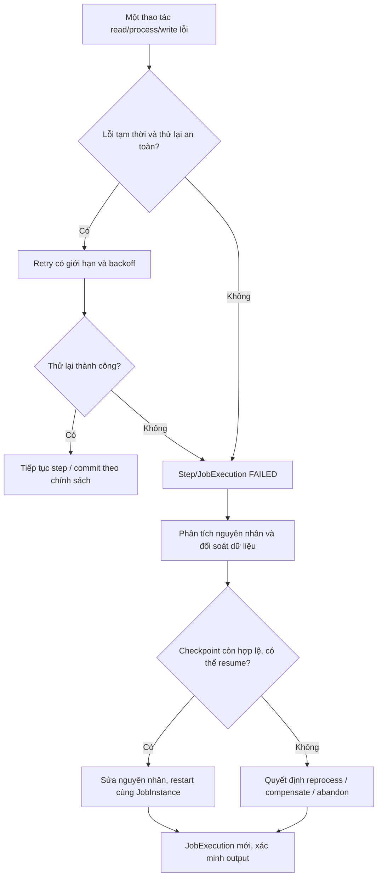

# Chọn retry hay restart trong Spring Batch

Khi một batch job thất bại, câu hỏi đầu tiên thường là: **“Có nên retry không, hay phải restart job?”** Hai thao tác nghe gần giống nhau vì đều cố thực hiện lại công việc, nhưng trong Spring Batch chúng có **phạm vi, thời điểm, transaction và điều kiện an toàn khác nhau**. Chọn sai có thể làm hệ thống retry vô hạn khi dữ liệu sai, restart một job vẫn đang chạy, bỏ mất checkpoint hoặc gửi lại thanh toán đã được xử lý.

**Retry** thường là cơ chế *thử lại một thao tác lỗi có khả năng hồi phục* ngay trong quá trình thực thi step. **Restart** là *tạo một `JobExecution` mới cho cùng `JobInstance`* sau khi execution trước đó kết thúc ở trạng thái cho phép khởi động lại. Cả hai đều cần quản lý state, ranh giới commit và tác dụng phụ khi dữ liệu được xử lý lặp.

Bài học thuộc **Spring Batch Core Processing → Quyết định thiết kế**. Nội dung đi từ mô hình trạng thái, ma trận ra quyết định đến ví dụ Spring Batch 5.x/Spring Boot 3.x, thiết kế idempotency, giám sát và kiểm thử. Phần code là ví dụ nền tảng; tên lớp nghiệp vụ như `PaymentRow` và `LedgerRow` cần được khai báo theo ứng dụng.

## 1. Bức tranh tổng thể: retry và restart tác động ở đâu?

Giả sử job `dailyPaymentJob` có một step xử lý theo chunk:

```text
JobInstance: dailyPaymentJob(businessDate=2026-11-15)

JobExecution #101  STARTED
  StepExecution importPaymentsStep
    Chunk 1: 100 rows → COMMIT
    Chunk 2: writer gặp deadlock
      Retry attempt kế tiếp trong chính StepExecution
      └─ Nếu thành công → COMMIT, job tiếp tục
      └─ Nếu hết retry → FAILED, execution #101 kết thúc

JobExecution #102  STARTED (restart instance cũ)
  importPaymentsStep phục hồi state từ checkpoint hợp lệ
  → xử lý phần còn lại
```

Đặc điểm then chốt:

- Retry ở mức chunk/item có thể xảy ra **trong cùng `JobExecution`**; không tự tạo thêm một execution chỉ vì một lần đọc/ghi thất bại và được thử lại.
- Khi retry vượt giới hạn hoặc xảy ra lỗi không thuộc chính sách retry, step/job có thể thành `FAILED`.
- Restart tạo **JobExecution mới** nhưng **giữ JobInstance** và identifying parameters để framework có thể khôi phục state của các step.
- Các chunk đã commit ở execution trước **vẫn còn trong cơ sở dữ liệu**; restart không phải “chạy lại một transaction toàn job”.



Trong thực tế còn có **skip** (bỏ qua item lỗi theo chính sách) và **stop** (yêu cầu dừng có kiểm soát). Chúng là các lựa chọn khác, không đồng nghĩa retry hoặc restart.

## 2. Các khái niệm không được nhầm lẫn

| Thuật ngữ | Ý nghĩa | Ranh giới thông thường |
|---|---|---|
| **Retry** | Thử lại read, process, write hoặc lời gọi có lỗi được phân loại | Trong một step đang thực thi |
| **Backoff** | Chờ giữa những lần retry để nguồn lỗi có cơ hội phục hồi | Trong chính sách retry |
| **Skip** | Chấp nhận bỏ qua item có lỗi phù hợp với nghiệp vụ | Trong fault-tolerant step |
| **Rollback** | Hủy các thay đổi trong transaction chưa commit | Transaction chunk |
| **Restart** | Chạy lại `JobInstance` bị `FAILED`/`STOPPED` bằng execution mới nếu hợp lệ | Vòng đời JobInstance |
| **Reprocess/new instance** | Chủ động xử lý lại với identifying parameters/version mới | JobInstance mới |
| **Stop** | Xin dừng execution đang chạy theo cơ chế hợp tác | Execution hiện tại |
| **Abandon** | Đánh dấu từ bỏ execution/instance theo quyết định vận hành | Ngăn restart cùng instance |

### 2.1. JobInstance khác JobExecution

Một `JobInstance` được định danh bởi **tên Job + identifying `JobParameters`**. Ví dụ:

```java
JobParameters parameters = new JobParametersBuilder()
        .addString("businessDate", "2026-11-15")
        .addString("snapshotId", "payments-v3")
        .toJobParameters();
```

Nếu JobExecution đầu tiên của instance này thất bại rồi được restart, execution ID mới khác execution ID cũ, còn instance ID giữ nguyên. JobRepository ghi lịch sử từng attempt, trạng thái từng StepExecution và `ExecutionContext` hỗ trợ checkpoint.

Nếu thay `snapshotId` hay thêm một identifying `run.id` mới trong lần chạy sau, Spring Batch sẽ coi đó là một **JobInstance khác**. Đó có thể là reprocess chủ động, nhưng **không phải restart checkpoint của instance cũ**.

### 2.2. Retry không đồng nghĩa rollback toàn job

Một step với chunk size 100 có thể commit 20 chunk trước khi gặp lỗi ở chunk 21. Retry lỗi writer trong chunk 21 không đảo ngược 2.000 item đã commit. Nếu cuối cùng job `FAILED` và được restart, dữ liệu của 20 chunk cũ vẫn tồn tại.

Trong fault-tolerant step, retry có thể kích hoạt rollback và **đọc/xử lý/ghi lại** một phần chunk tùy giai đoạn lỗi và chính sách của framework. Vì vậy phải phân biệt **số lần gọi** reader/processor/writer với **số item thực sự commit**.

## 3. Tiêu chí quyết định: lỗi nào nên retry?

Retry phù hợp nhất khi lỗi có khả năng biến mất **mà không cần thay đổi dữ liệu hay code**, và việc thử lại không tạo tác dụng phụ sai.

| Lỗi/hiện tượng | Khả năng retry ngay | Cách quyết định |
|---|---|---|
| Deadlock database, lock tạm thời | **Thường phù hợp** | Retry giới hạn, backoff, xem lock contention |
| Lỗi mạng ngắn, connection reset trước khi gửi request | **Có thể** | Xác định request có được xử lý hay chưa |
| HTTP 503 hoặc 429 | **Có điều kiện** | Tôn trọng retry-after, quota, backoff và idempotency |
| SQL timeout do nguồn đang quá tải | **Có điều kiện** | Tránh retry đồng loạt làm tải tăng |
| OAuth access token hết hạn | **Có thể làm mới rồi retry** | Token provider refresh, không lặp lại token cũ |
| Dữ liệu CSV sai format vĩnh viễn | **Không nên retry ngay** | Sửa nguồn hoặc skip theo chính sách |
| Vi phạm unique constraint do ghi trùng | **Không retry mù quáng** | Kiểm tra business key/idempotency và nguyên nhân |
| Lỗi mapping/code, `NullPointerException` | **Không nên** | Cần sửa code hoặc dữ liệu |
| Thiếu schema/cột hoặc migration chưa chạy | **Không nên** | Sửa môi trường rồi restart |
| API timeout sau khi server có thể đã commit | **Nguy hiểm nếu retry mù** | Đối soát hoặc dùng idempotency key trước |
| JVM/pod bị kill, OOM, mất điện | **Không còn process để retry tại chỗ** | Xác minh process, metadata và xem xét restart |
| `JobExecution` đã `FAILED` | **Không còn retry nội bộ đang diễn ra** | Đối soát và quyết định restart |

**Không retry mọi `Exception`.** Một rule rộng như `.retry(Exception.class)` dễ che lỗi cấu hình, lỗi dữ liệu vĩnh viễn hoặc lỗi lập trình. Chính sách nên dựa trên danh sách exception hoặc classifier đã hiểu rõ tính chất của dependency.

### 3.1. Phân loại transient, permanent và ambiguous

**Transient error** có thể tự biến mất sau thời gian ngắn: deadlock, tạm mất kết nối hoặc server 503 trong một sự cố ngắn. Retry có giới hạn hợp lý.

**Permanent error** không thể tự hết nếu lặp thao tác y nguyên: định dạng dữ liệu sai, rule validate không đạt, constraint do dữ liệu hợp lệ bị vi phạm hoặc bug. Lặp lại chỉ làm tăng tải và chậm báo lỗi.

**Ambiguous outcome** là tình huống không biết tác dụng phụ đã xảy ra chưa: chẳng hạn API thanh toán đã nhận request và commit nhưng client bị read timeout trước khi nhận phản hồi. Trường hợp này cần **idempotency/tra cứu trạng thái phía server**, không kết luận rằng retry là an toàn chỉ vì exception thuộc nhóm network.

Trong một hệ thống, cùng một HTTP 409 hoặc SQL duplicate key có thể biểu thị “đã xử lý rồi” hoặc “dữ liệu có vấn đề”. Việc phân loại phải dựa trên **contract nghiệp vụ**, không chỉ mã lỗi.

## 4. Cơ chế retry bên trong fault-tolerant step

Spring Batch cho phép chunk step khai báo retry với `faultTolerant()`, chỉ định exception và số lần thử được phép:

```java
import org.springframework.batch.core.Step;
import org.springframework.batch.core.repository.JobRepository;
import org.springframework.batch.core.step.builder.StepBuilder;
import org.springframework.batch.item.ItemProcessor;
import org.springframework.batch.item.ItemReader;
import org.springframework.batch.item.ItemWriter;
import org.springframework.dao.CannotAcquireLockException;
import org.springframework.retry.backoff.ExponentialBackOffPolicy;
import org.springframework.transaction.PlatformTransactionManager;

@Bean
ExponentialBackOffPolicy databaseBackOffPolicy() {
    ExponentialBackOffPolicy policy = new ExponentialBackOffPolicy();
    policy.setInitialInterval(200L);
    policy.setMultiplier(2.0);
    policy.setMaxInterval(2_000L);
    return policy;
}

@Bean
Step importPaymentsStep(
        JobRepository jobRepository,
        PlatformTransactionManager transactionManager,
        ItemReader<PaymentRow> paymentReader,
        ItemProcessor<PaymentRow, LedgerRow> paymentProcessor,
        ItemWriter<LedgerRow> ledgerWriter,
        ExponentialBackOffPolicy databaseBackOffPolicy) {

    return new StepBuilder("importPaymentsStep", jobRepository)
            .<PaymentRow, LedgerRow>chunk(100, transactionManager)
            .reader(paymentReader)
            .processor(paymentProcessor)
            .writer(ledgerWriter)
            .faultTolerant()
            .retry(CannotAcquireLockException.class)
            .retryLimit(3)
            .backOffPolicy(databaseBackOffPolicy)
            .build();
}
```

Đoạn code minh họa cấu hình trên Spring Batch 5.x, sử dụng `CannotAcquireLockException` như một loại lỗi liên quan tranh chấp lock. `PaymentRow` và `LedgerRow` là kiểu nghiệp vụ giả định; reader/writer và `@Bean` nằm trong class cấu hình Spring tương ứng.

**Cần hiểu cấu hình:**

1. `faultTolerant()` bật hỗ trợ retry/skip thích hợp trong chunk processing.
2. `retry(CannotAcquireLockException.class)` giới hạn retry cho exception đã khai báo; các exception khác không mặc nhiên được retry.
3. `retryLimit(3)` đặt giới hạn retry theo contract của builder/version; khi cần khẳng định số lần gọi chính xác, hãy kiểm thử attempt count trên phiên bản đang dùng.
4. `backOffPolicy(...)` đặt khoảng chờ tăng dần giữa các lần thử, tránh gọi lại dependency liên tục.
5. Nếu retry hết giới hạn mà vẫn lỗi, step có thể thất bại và JobExecution kết thúc `FAILED`; lúc đó chính sách **restart** mới được xét.

**Không hiểu backoff là timeout của cả job.** Một retry policy có thể tiêu tốn thời gian đáng kể khi nhiều item liên tiếp lỗi, và còn phải tính đến timeout của transaction, API, scheduler và SLA. Lựa chọn giới hạn retry nên dựa trên ngân sách thời gian của toàn pipeline.

### 4.1. Chọn backoff

Ví dụ với initial interval 200 ms, multiplier 2 và max 2 giây, các khoảng chờ có thể tăng kiểu 200 ms, 400 ms, 800 ms, ... tới giới hạn. Đây là mô hình minh họa; số lần chờ thực tế tùy retry policy và số lần lỗi.

Khi nhiều worker cùng gặp 503 rồi tất cả retry đúng một chu kỳ, chúng có thể dồn tải trở lại cùng lúc. Với dependency ngoài ứng dụng, **exponential backoff có jitter** thường hữu ích để tránh synchronized retry storm. Cần chọn policy hỗ trợ jitter ở phiên bản thư viện đang dùng hoặc triển khai theo cơ chế được hỗ trợ; không tự thêm `Thread.sleep(...)` trong processor để giả lập backoff.

### 4.2. Retry theo exception, không theo cảm giác

Một số ứng dụng muốn retry cả `TransientDataAccessException` thay vì chỉ một subclass:

```java
.faultTolerant()
.retry(org.springframework.dao.TransientDataAccessException.class)
.retryLimit(3)
```

Đây là ví dụ về cách mở rộng **nhóm lỗi được phép**, không phải khuyến nghị mặc định. Một số exception dưới nhóm này có thể kéo dài vì cấu hình, index hoặc deadlock lặp lại; cần có giới hạn, backoff và cơ chế cảnh báo.

Nếu cần luật phức tạp theo response code, loại operation hoặc kết quả upstream, có thể dùng `RetryPolicy`/classifier phù hợp với Spring Retry mà Spring Batch tích hợp. Phải kiểm tra chính sách retry của **từng giai đoạn read/process/write**, không giả định mọi exception đều có cùng hành vi rollback.

## 5. Retry ở read, process và write khác nhau như thế nào?

| Giai đoạn | Lỗi thường gặp | Điểm cần quan sát |
|---|---|---|
| `ItemReader.read()` | DB timeout, file/HTTP read error | Reader có state gì, nguồn có ổn định, item nào đã được đọc |
| `ItemProcessor.process()` | Call ngoài bị 503, phép tính tạm thất bại | Processor có side effect không, có thể được gọi lại không |
| `ItemWriter.write(chunk)` | JDBC deadlock, API timeout, broker throttle | Chunk có thể rollback/replay; sink đã commit hay chưa |

### 5.1. Retry khi reader lỗi

Nếu reader lỗi tạm do database hoặc network, retry có thể khắc phục mà không cần kết thúc job. Tuy vậy, cần bảo đảm reader **không di chuyển vị trí không thể khôi phục** trước khi ném exception. Một reader file/API tùy chỉnh phải xác định rõ khi nào nó tăng offset, khi nào cập nhật `ExecutionContext` và đọc lại có thể diễn ra thế nào.

Ví dụ một reader API tăng offset **trước khi** request thành công rồi request timeout: nếu giữ offset sai, nó có thể bỏ qua item. Cần thiết kế reader trả item và cập nhật vị trí logic một cách nhất quán; checkpoint chỉ được persist qua lifecycle phù hợp.

### 5.2. Retry khi processor lỗi

Một processor lý tưởng là **pure transformation**: nhận item, tính toán, trả về kết quả, không tự gửi email hay cập nhật hệ thống ngoài. Khi ấy gọi lại cùng item ít rủi ro hơn.

Nếu processor gọi một REST API có side effect, retry/rollback của chunk có thể làm request gửi lại. Khi đó cần idempotency key hoặc tách side effect sang writer/outbox thay vì giả định “processor chỉ chạy một lần”.

### 5.3. Retry khi writer lỗi

Writer JDBC có thể được transaction manager rollback nếu dùng cùng datasource và transaction. Nhưng lỗi xảy ra sau khi một request đã được gửi tới hệ thống ngoài thì **rollback database local không làm request biến mất**.

Ví dụ:

```text
Writer gửi batch gồm P1, P2, P3 đến API.
Server đã commit P1, P2, P3.
Response bị timeout.
Writer ném exception.

Nếu retry gửi cùng batch mà server không deduplicate:
  P1, P2, P3 có thể được xử lý lần thứ hai.
```

Vì vậy trước khi bật retry cho writer API, phải hỏi downstream có hỗ trợ **idempotency key theo từng item hoặc batch**, trả partial success ra sao, tra cứu trạng thái sau timeout được không, và giới hạn rate/payload là bao nhiêu.

## 6. Rollback và checkpoint: tại sao retry có thể xử lý lại?

Xét step chunk size 3:

```text
Chunk 1: items 1,2,3 → commit
  persisted reader checkpoint = vị trí sau item 3

Chunk 2: items 4,5,6
  writer lỗi → transaction rollback
  retry/recovery xử lý lại một phần hoặc toàn chunk

Nếu retry hết hạn:
  JobExecution → FAILED
  những chunk đã commit trước vẫn tồn tại

Restart:
  reader khôi phục từ checkpoint đã commit thích hợp
  item 4,5,6 có thể được đọc lại
```

**Không đồng nhất retry với “thử lại đúng một method call, không liên quan transaction”.** Spring Batch có cơ chế phối hợp retry với rollback/replay, buffer và checkpoint trong fault-tolerant chunk processing. Tùy lỗi/read/process/write, cách framework thử lại và giới hạn retry có thể khác trực giác. Khi quan sát, hãy phân biệt:

- **Attempt count:** số lần thử thao tác, gồm cả các lần cuối cùng rollback.
- **`readCount`/`writeCount` trong `StepExecution`:** counter theo semantics của Batch, không phải mọi lần method được gọi.
- **`commitCount`/`rollbackCount`:** tín hiệu giao dịch, không trực tiếp bằng số lần retry.
- **Dữ liệu đích đã commit:** kết quả cuối cùng cần đối soát.

Đừng cộng một cách máy móc `writeCount + rollbackCount` để suy ra số request thật tới API. Với retry, một chunk có thể bị gọi nhiều lần và mỗi lần có thể chứa nhiều item.

### 6.1. Transaction manager phải đúng tài nguyên

Nếu writer dùng `JdbcTemplate` trỏ tới datasource A, nhưng step chạy transaction manager của datasource B, rollback của chunk **không nhất thiết** bảo vệ các ghi lên A. Khi thiết kế retry cần biết rõ transaction boundaries và propagation.

Với nhiều datasource, JPA, queue hoặc API ngoài transaction, phải xác định thành phần nào có thể rollback và thành phần nào yêu cầu idempotency/compensation. Không gọi một chuỗi API + JDBC là “transaction atomic” chỉ vì method được gắn `@Transactional`.

## 7. Restart job: thao tác ở cấp JobInstance

Nếu JobExecution kết thúc `FAILED` hoặc `STOPPED` và job có khả năng restart, Spring Batch có thể tạo execution mới cho **cùng JobInstance**. Khi đó `JobRepository` và `ExecutionContext` hỗ trợ xác định step nào cần chạy lại và reader/writer có thể tiếp tục từ checkpoint.

```text
JobInstance #42 (businessDate=2026-11-15)

JobExecution #101: FAILED
  loadStep:      COMPLETED
  publishStep:   FAILED

Sau khắc phục:

JobExecution #107: COMPLETED (restart JobInstance #42)
  loadStep:      thường được bỏ qua nếu flow/config cho phép
  publishStep:   tiếp tục theo checkpoint và restart policy
```

Một step đã `COMPLETED` có thể được bỏ qua khi restart; cấu hình `allowStartIfComplete(true)` có thể làm nó chạy lại. Với job `preventRestart()`, trạng thái `COMPLETED`/`ABANDONED`, hoặc metadata không hợp lệ, restart có thể bị từ chối.

### 7.1. Dùng `JobOperator.restart(...)`

Ví dụ service vận hành cho Spring Batch 5.x:

```java
import org.springframework.batch.core.BatchStatus;
import org.springframework.batch.core.JobExecution;
import org.springframework.batch.core.explore.JobExplorer;
import org.springframework.batch.core.launch.JobOperator;
import org.springframework.batch.core.repository.JobRepository;
import org.springframework.stereotype.Service;

@Service
public class BatchRecoveryService {

    private final JobExplorer jobExplorer;
    private final JobRepository jobRepository;
    private final JobOperator jobOperator;

    public BatchRecoveryService(
            JobExplorer jobExplorer,
            JobRepository jobRepository,
            JobOperator jobOperator) {
        this.jobExplorer = jobExplorer;
        this.jobRepository = jobRepository;
        this.jobOperator = jobOperator;
    }

    public Long restartEligibleExecution(long failedExecutionId)
            throws Exception {

        JobExecution old = jobExplorer.getJobExecution(failedExecutionId);
        if (old == null) {
            throw new IllegalArgumentException(
                    "Unknown JobExecution: " + failedExecutionId);
        }

        // Không cho restart một execution cũ nếu instance đã có
        // execution mới hơn (có thể đang chạy hoặc đã kết thúc).
        JobExecution latest = jobRepository.getLastJobExecution(
                old.getJobInstance().getJobName(),
                old.getJobParameters());

        if (latest == null
                || !latest.getId().equals(old.getId())) {
            throw new IllegalStateException(
                    "Not the latest execution of this JobInstance");
        }

        BatchStatus status = old.getStatus();
        if (status != BatchStatus.FAILED
                && status != BatchStatus.STOPPED) {
            throw new IllegalStateException(
                    "Restart not allowed from status " + status);
        }

        // Bước này chỉ nên chạy SAU khi đã đối soát dữ liệu
        // và xác nhận checkpoint, source, side effects an toàn.
        return jobOperator.restart(failedExecutionId);
    }
}
```

Ở Spring Batch 5.x, `JobOperator.restart(long)` thường trả về ID của execution mới (`Long`). API có thể ném exception khi job không restartable, job definition không được đăng ký, instance đã hoàn thành hoặc có execution khác đang chạy.

**Kiểm tra status ở service không loại bỏ race condition.** Hai operator có thể đọc trạng thái gần như cùng lúc. Cần cơ chế ownership/lock theo job instance và vẫn phải để `JobRepository` quyết định điều kiện khởi chạy cuối cùng. Không expose endpoint restart không có xác thực/RBAC/audit.

### 7.2. Restart bằng `JobLauncher`

Với job đã xác định và cùng identifying parameters, `JobLauncher.run(job, parameters)` cũng có thể tạo execution mới cho một instance từng `FAILED`/`STOPPED` nếu được phép:

```java
JobParameters parameters = new JobParametersBuilder()
        .addString("businessDate", "2026-11-15")
        .addString("snapshotId", "payments-v3")
        .toJobParameters();

JobExecution next = jobLauncher.run(dailyPaymentJob, parameters);
```

Không thêm một identifying `run.id` ngẫu nhiên chỉ để tránh exception “already running” hay “already complete”. Cách đó tạo instance mới, **mất semantics checkpoint** và dễ gây xử lý trùng.

Nếu launcher chạy bất đồng bộ, một lệnh submit thành công có thể trả trạng thái `STARTING`/`STARTED`. Orchestrator phải theo dõi execution mới tới terminal status rồi mới đánh dấu phục hồi thành công.

## 8. Phân loại trạng thái trước khi quyết định restart

| `BatchStatus` của execution cuối | Có tự động restart ngay? | Hành động phù hợp |
|---|---|---|
| `FAILED` | **Có điều kiện** | Phân tích lỗi, đối soát output/checkpoint, sửa nguyên nhân rồi restart |
| `STOPPED` | **Có điều kiện** | Xác minh stop đã hoàn tất và nguồn còn hợp lệ |
| `STARTED` | **Không** | Xác minh process còn sống hay metadata bị kẹt |
| `STARTING` / `STOPPING` | **Không** | Chờ hoặc xử lý trạng thái đang chuyển tiếp |
| `UNKNOWN` | **Không** | Điều tra repository, transaction và dữ liệu |
| `COMPLETED` | **Không** | Nếu cần xử lý lại, thiết kế một instance/version mới |
| `ABANDONED` | **Không** | Đây là trạng thái đóng instance theo quyết định từ bỏ |

Đặc biệt, JVM chết đột ngột có thể để metadata ở `STARTED` dù process đã biến mất. Spring Batch không tự suy ra đúng trạng thái vật lý từ repository. **Không gọi restart liên tục và không tự UPDATE mọi dòng STARTED thành FAILED.** Cần kiểm tra scheduler, worker ở mọi node, những chunk đã commit và quy trình phục hồi metadata phù hợp với phiên bản đang dùng.

## 9. Khi nào retry, khi nào restart? Ma trận quyết định

| Tình huống | Chọn ban đầu | Khi nào chuyển hướng? |
|---|---|---|
| JDBC deadlock ở writer, một transaction lỗi | **Retry** giới hạn + backoff | Nếu deadlock lặp nhiều lần, fail job; sửa lock/query rồi **restart** |
| API 503 tạm, request idempotent | **Retry** với backoff/quota | Nếu outage kéo dài, dừng retry nóng, alert và **restart sau khi dịch vụ hồi phục** |
| API timeout nhưng không có idempotency | **Không retry mù** | Đối soát server, compensation rồi mới tiếp tục |
| CSV có một dòng sai nhưng policy cho phép bỏ qua | **Skip** theo limit | Nếu vượt ngưỡng chất lượng, fail job và sửa nguồn |
| CSV format toàn file sai | **Không retry** | Sửa input; đánh giá snapshot/checkpoint rồi restart hoặc reprocess |
| Code mapping bị lỗi | **Không retry** | Deploy bản sửa; kiểm tra compatibility của state rồi restart |
| Database offline 30 phút | **Không retry liên tục** | Tạm hoãn/alert; sau phục hồi restart instance nếu đủ điều kiện |
| Pod OOM giữa job | Retry trong process **không còn tồn tại** | Sửa memory/concurrency, phục hồi metadata và restart |
| Job đã FAILED, checkpoint hợp lệ | **Restart** sau điều tra | Nếu source/checkpoint đổi, phải reprocess theo version mới |
| Job COMPLETED nhưng dữ liệu sai | Không phải retry/restart thông thường | Data quality incident: đối soát, sửa và tạo instance/version mới |
| Job ABANDONED | Không tự restart | Quyết định điều hành cho reprocess/compensation |

### 9.1. Quy tắc chọn ở ba cấp độ

**Cấp operation:** Một query hoặc API call lỗi transient và an toàn khi lặp → retry bên trong step.

**Cấp JobExecution:** Step không thể tiếp tục ngay, hoặc retry không còn hữu ích → cho execution kết thúc với failure rõ ràng, sửa điều kiện và restart cùng JobInstance nếu có checkpoint đúng.

**Cấp nghiệp vụ/pipeline:** Dữ liệu nguồn đã đổi, output phải xây lại hoặc side effect không rõ → quyết định reprocess/compensate với version/batch key và gate downstream; không giả vờ đó chỉ là retry kỹ thuật.

## 10. Thiết kế ngân sách retry

Một retry policy hiệu quả có **hạn mức và tiêu chí dừng**.

Giả sử một HTTP request timeout sau 5 giây, thử tối đa 4 lần gọi cùng các khoảng backoff 1, 2, 4 giây. Thời gian tệ nhất gần đúng:

```text
4 attempts × 5s timeout + (1 + 2 + 4)s backoff
= ~27s cho một operation
```

Con số chỉ là ví dụ; tổng thực tế phụ thuộc connect/read timeout, thời gian thành công/thất bại, framework và jitter. Nếu mỗi chunk có 100 item và processor gọi API cho từng item, một chính sách quá rộng có thể khiến job mất nhiều giờ dù các thao tác riêng lẻ chỉ có vài attempt.

Chính sách nên xác định:

1. **Danh sách exception/status được retry:** chỉ những lỗi có khả năng phục hồi.
2. **Giới hạn số attempt:** hữu hạn, có thể khác nhau theo loại thao tác.
3. **Khoảng backoff:** tránh bắn request liên tục vào dependency đang lỗi.
4. **Timeout mỗi attempt:** rõ ràng với JDBC/HTTP/message client.
5. **Ngân sách tổng:** không vượt SLA và thời gian mà scheduler/lock giữ job.
6. **Điều kiện ngừng sớm:** lỗi không retryable, dữ liệu không hợp lệ, circuit breaker mở, quota hết.
7. **Khả năng quan sát:** log số lần thử, exception class, latency và nguyên nhân hết retry.

### 10.1. Retry lồng nhau có thể nhân số lần gọi

Ví dụ cùng một API được retry ở **HTTP client**, **processor** và **Spring Batch step**:

```text
HTTP client: tối đa 3 attempts
Processor service: tối đa 3 attempts
Spring Batch step: tối đa 3 attempts

Tổng số lời gọi HTTP xấu nhất có thể lên tới:
3 × 3 × 3 = 27 lần cho một đơn vị công việc
```

Đây là mô hình minh họa khi các tầng retry lồng nhau và đều sử dụng hết hạn mức, không phải hành vi mặc định của Spring Batch. Khi thiết kế, chọn **một chủ sở hữu retry chính** cho từng operation, hoặc phân rõ retry theo loại lỗi/tầng với tổng ngân sách. Tránh retry storm làm quá tải chính dependency đang gặp sự cố.

### 10.2. Retry quá nhiều có thể làm restart khó hơn

Một execution bị giữ `STARTED` lâu do retry liên tục không làm pipeline tiến triển, còn giữ connection, thread và có thể làm khó triển khai bản sửa. Nếu lỗi là outage kéo dài, đôi khi tốt hơn là **fail fast có kiểm soát**, để scheduler/operations đợi điều kiện phục hồi rồi restart.

Quyết định này phụ thuộc SLA, thời gian dự kiến phục hồi, khả năng lưu checkpoint, chi phí khởi động lại và mức ảnh hưởng tới downstream.

## 11. Idempotency là điều kiện nền cho cả retry và restart

“Có thể gọi lại” khác với “an toàn khi gọi lại”. Một thao tác an toàn khi replay nếu thực hiện nhiều lần không tạo ra tác dụng nghiệp vụ sai.

### 11.1. JDBC writer

Với bảng ledger, nên có business key duy nhất:

```sql
CREATE TABLE ledger_entry (
    business_date DATE NOT NULL,
    payment_id VARCHAR(64) NOT NULL,
    amount DECIMAL(18, 2) NOT NULL,
    PRIMARY KEY (business_date, payment_id)
);
```

Unique constraint giúp phát hiện duplicate, nhưng **không tự biến INSERT lặp thành thành công**. Tùy contract, writer có thể dùng upsert theo database hoặc phát hiện record đã tồn tại và xác minh giá trị giống nhau. Không nên bỏ qua mọi duplicate key vì có thể che dữ liệu mâu thuẫn.

### 11.2. API writer

Nếu API hỗ trợ idempotency key, dùng một key ổn định theo **business operation**, không đổi ngẫu nhiên theo lần retry:

```text
Idempotency-Key: payment:2026-11-15:P-001

Attempt 1 → server commit thành công, response timeout
Attempt 2 → cùng key; server trả lại kết quả đã lưu
```

Đây là hành vi chỉ bảo đảm nếu **API phía nhận thực sự triển khai idempotency** với semantics, TTL và phạm vi khóa rõ ràng. Không tự giả định mọi API hỗ trợ header hoặc giữ record idempotency vô thời hạn.

### 11.3. File và object storage

Ghi ra file trực tiếp rồi fail giữa chừng có thể để lại output không hoàn chỉnh. Khi retry/restart, tránh consumer đọc file này bằng chiến lược:

- Ghi vào staging path/version riêng.
- Sau khi job hoàn tất và đối soát, publish output/manifest.
- Dùng checksum, count và unique artifact version.
- Có kế hoạch xử lý staging file bị bỏ dở hoặc overwrite.

Chú ý filesystem, object storage và database có ranh giới commit khác nhau; transaction JDBC không tự rollback file đã xuất.

### 11.4. Reader cũng phải restart được

Nếu reader chỉ implements `ItemReader` với index trong RAM và không checkpoint, restart có thể đọc từ đầu. Nếu reader đọc `WHERE status='NEW'` trong khi writer cập nhật trạng thái làm tập nguồn thay đổi, checkpoint theo vị trí có thể bỏ sót record.

Reader cần:

- `ItemStream.open/update/close` hoặc reader built-in với `saveState(true)` khi phù hợp.
- Tên stream/state key ổn định.
- Snapshot/partition hoặc sort key duy nhất không thay đổi trong vòng đời job.
- Cơ chế đọc lại phần chưa commit khi restart.

Nếu job dùng nhiều thread, một stateful reader singleton chia sẻ bừa giữa worker có thể không có checkpoint nhất quán. Partition theo range/batch key với reader độc lập thường dễ kiểm soát hơn.

## 12. Retry và skip: hai quyết định không thể thay thế nhau

Retry trả lời: **“Có cơ sở để tin cùng thao tác sẽ thành công sau khi thử lại không?”**

Skip trả lời: **“Nghiệp vụ có cho phép bỏ hẳn item lỗi này khỏi kết quả không?”**

Ví dụ một hệ thống nhập đơn hàng:

| Lỗi | Retry? | Skip? | Vì sao |
|---|---|---|---|
| API xác minh địa chỉ 503 | Có thể | Thường không | Dữ liệu chưa được xác minh, dịch vụ tạm lỗi |
| Dòng CSV sai mã vùng, policy cho quarantine | Không | Có giới hạn | Lỗi dữ liệu vĩnh viễn, nghiệp vụ cho phép tách lỗi |
| Không tính được tiền thuế | Không tự động | Thường không | Không nên phát đơn hàng thiếu thông tin tài chính |
| DB deadlock ở writer | Có | Không nên | Đó là lỗi hạ tầng, item không sai |

Ví dụ cấu hình skip chỉ để minh họa:

```java
.faultTolerant()
.skip(InvalidSourceRecordException.class)
.skipLimit(10)
```

`InvalidSourceRecordException` là exception nghiệp vụ do ứng dụng tự định nghĩa. Nếu dùng chung retry và skip, cần hiểu **thứ tự và giới hạn** trong framework: một exception có thể được retry tới giới hạn rồi mới được đánh giá theo skip policy, tùy giai đoạn và cấu hình. Không bật skip rộng để biến job thành `COMPLETED` mà bỏ qua nhiều record quan trọng.

Theo dõi `readSkipCount`, `processSkipCount`, `writeSkipCount`, `filterCount` và chất lượng dữ liệu đầu ra; số lượng skip chấp nhận được phải được phê duyệt theo nghiệp vụ.

## 13. Ví dụ thực tế: deadlock rồi restart

Pipeline `dailySettlementJob` chạy một triệu giao dịch, chunk size 200.

**Tình huống A — lỗi có thể retry:**

```text
00:00 JobExecution #301 STARTED
00:03 chunk 540 writer deadlock
00:03 fault-tolerant step retry có backoff
00:03 lần thử tiếp theo thành công, chunk commit
00:15 JobExecution #301 COMPLETED
```

Tại đây không cần restart vì JobExecution vẫn hoàn thành. Dashboard nên ghi nhận **retry đã xảy ra**, nhưng không đánh đồng đó với job failure.

**Tình huống B — lỗi lặp lại, retry hết hạn:**

```text
00:00 JobExecution #401 STARTED
00:03 chunk 540 writer liên tục deadlock
00:04 hết retry policy → Step FAILED, JobExecution #401 FAILED
00:07 DBA xử lý lock contention / SQL
00:10 đối soát chunk đã commit và checkpoint
00:12 restart JobInstance cũ → JobExecution #408 STARTED
00:22 JobExecution #408 COMPLETED
```

Hành động đúng ở B là **không tự retry vô hạn khi lock vẫn nghẽn**. Sau khi lỗi được giải quyết, restart cùng JobInstance để tận dụng phần việc đã commit và checkpoint.

**Tình huống C — chưa biết server đã xử lý:**

```text
01:10 Writer gọi API thanh toán cho P-889
01:10 Server ghi nhận thanh toán
01:10 Client timeout → chunk rollback local
01:11 JobExecution FAILED
```

Ở C, cả retry ngay lẫn restart ngay đều có nguy cơ gửi thanh toán trùng. Phải **tra cứu P-889 tại server hoặc dùng contract idempotency**, bù trừ nếu cần, rồi mới tiếp tục.

## 14. Điều phối retry cấp job và scheduling

Spring Batch retry trong step không thay thế việc điều phối khi job đã `FAILED`. Scheduler có thể lập kế hoạch khởi động lại sau một outage, nhưng cần phân biệt:

- **Retry thao tác trong step:** fault-tolerant builder/Spring Retry xử lý khi JobExecution còn chạy.
- **Retry orchestration sau failure:** scheduler đợi rồi gọi **restart** để tạo JobExecution mới cho cùng JobInstance, không phải “resume lại thread cũ”.
- **Chạy lại toàn bộ theo lịch:** nếu dùng identifying parameters mới, đó là **JobInstance khác**; cần contract xử lý trùng dữ liệu.

Ví dụ lịch hằng ngày: Job A import và Job B publish. Nếu A `FAILED`, B phải bị chặn. Sau khi A được restart và thực sự `COMPLETED` với data readiness hợp lệ, orchestrator mới được cho B chạy. Không hẹn B theo cron “A chạy lúc 01:00, B chạy lúc 01:10” rồi xem đó là dependency được bảo đảm.

### 14.1. Quyền sở hữu retry/restart

Nên chọn một nơi quyết định restart:

1. Scheduler/operator trung tâm quản lý retry ở cấp JobInstance.
2. JobRepository quản lý điều kiện thực thi và metadata.
3. Application owner quyết định nhóm exception nào được retry trong step.
4. Data owner quyết định khi nào được reprocess/compensation.

Nếu application tự restart trong `afterJob` đồng thời scheduler cũng retry, có thể tạo nhiều lần khởi chạy cạnh tranh. JobRepository có cơ chế bảo vệ trạng thái, nhưng không nên dựa vào exception của nó như **cơ chế phối hợp chính** cho toàn pipeline.

## 15. Quan sát retry và restart qua metadata và metrics

Spring Batch có counter như `readCount`, `writeCount`, `readSkipCount`, `writeSkipCount`, `commitCount` và `rollbackCount` ở cấp `StepExecution`. Chúng hữu ích để điều tra nhưng **không phải counter retry tổng quát của mọi dependency**.

| Tín hiệu | Ý nghĩa | Lưu ý |
|---|---|---|
| Retry attempt count theo operation | Có bao nhiêu lần thử lại | Cần listener/instrumentation tương ứng |
| Backoff time | Thời gian chờ giữa retry | Phân biệt chờ với thực thi thật |
| Step rollbackCount | Số tín hiệu rollback được ghi | Không đồng nhất với số lần gọi API |
| JobExecution count của cùng instance | Lịch sử các lần start/restart | Xác định incident tái diễn |
| Job/Step status | Trạng thái vòng đời | `FAILED` khác `COMPLETED` có retry |
| Read/write/skip counts | Khối lượng được framework ghi nhận | Không phải số lần method call khi replay |
| DB/HTTP errors, lock wait, 429/503 | Sức khỏe dependency | Giúp biết lỗi còn tồn tại không |
| Output row count/checksum | Kết quả nghiệp vụ đã commit | Cần thiết để xác nhận recovery |

### 15.1. Truy vấn lịch sử các execution của JobInstance

Ví dụ SQL chỉ đọc:

```sql
SELECT
    ji.JOB_NAME,
    ji.JOB_INSTANCE_ID,
    je.JOB_EXECUTION_ID,
    je.STATUS,
    je.EXIT_CODE,
    je.START_TIME,
    je.END_TIME,
    je.LAST_UPDATED
FROM BATCH_JOB_INSTANCE ji
JOIN BATCH_JOB_EXECUTION je
  ON je.JOB_INSTANCE_ID = ji.JOB_INSTANCE_ID
WHERE ji.JOB_INSTANCE_ID = :jobInstanceId
ORDER BY je.JOB_EXECUTION_ID;
```

Từ đây có thể thấy instance có các execution `FAILED → FAILED → COMPLETED` sau hai lần restart. Tuy nhiên truy vấn này **không cho biết số lần retry nội bộ của mỗi chunk**; cần metric/log retry tương ứng.

### 15.2. Log theo business key và execution ID

Một log hữu ích:

```text
job=dailySettlementJob
businessDate=2026-11-15
jobInstanceId=42
jobExecutionId=107
step=publishStep
operation=jdbcBatchWrite
exceptionClass=CannotAcquireLockException
retryAttempt=2
backoffMs=400
```

Không log password, token, raw connection URL chứa credential hoặc toàn bộ item nhạy cảm. `jobExecutionId` nên dùng trong log/tracing để drill-down; tránh đưa mỗi execution ID vào tag Prometheus có cardinality cao.

## 16. Kiểm thử quyết định retry/restart

Điểm cốt lõi của test là phân biệt hai hợp đồng:

1. **Retry trong cùng JobExecution:** lỗi tạm thời xảy ra rồi được xử lý, job không cần execution mới và dữ liệu đầu ra đúng.
2. **Restart sau JobExecution FAILED:** execution mới cho cùng instance, checkpoint/step state được dùng, output không thiếu/trùng.

### 16.1. Test retry bằng fake writer

Ví dụ một writer giả lỗi lock tại lần gọi đầu, sau đó thành công:

```java
import java.util.concurrent.atomic.AtomicInteger;

import org.springframework.batch.item.Chunk;
import org.springframework.batch.item.ItemWriter;
import org.springframework.dao.CannotAcquireLockException;

public final class FailOnceWriter<T> implements ItemWriter<T> {
    private final AtomicInteger attempts = new AtomicInteger();
    private final ItemWriter<T> delegate;

    public FailOnceWriter(ItemWriter<T> delegate) {
        this.delegate = delegate;
    }

    @Override
    public void write(Chunk<? extends T> items) throws Exception {
        if (attempts.incrementAndGet() == 1) {
            throw new CannotAcquireLockException(
                    "Synthetic transient DB lock");
        }
        delegate.write(items);
    }

    public int attempts() {
        return attempts.get();
    }
}
```

Với step có retry policy cho `CannotAcquireLockException`, test có thể khởi chạy job với vài item và kiểm tra:

- `JobExecution.getStatus() == BatchStatus.COMPLETED`.
- Writer được thử nhiều hơn một lần (không cố suy ra chính xác qua `writeCount`).
- Chỉ một JobExecution được tạo cho lần chạy đó.
- Database đích có đúng số business IDs và không có duplicate.

Ví dụ writer giả ở trên nên được tạo **theo test/job execution** hoặc reset chủ động giữa các test để state `attempts` không gây ảnh hưởng chéo. Nếu delegate là JDBC writer, kiểm tra cùng datasource/transaction manager; nếu delegate là mock, test chỉ chứng minh retry control flow chứ không chứng minh rollback thật.

### 16.2. Test khi vượt retry limit

Tạo fake dependency luôn ném exception retryable, cấu hình retry limit nhỏ và xác nhận:

1. JobExecution kết thúc `FAILED` (hoặc exit policy tương ứng).
2. Không có vòng retry vô hạn.
3. Những chunk đã commit trước vẫn tồn tại.
4. Chunk lỗi không được coi là đã commit.
5. Orchestrator không cho downstream chạy khi upstream còn failed.

Nếu fake writer ném lỗi ngay trước khi gửi SQL thì test này chưa mô phỏng trường hợp **partial side effect** ở hệ thống ngoài. Cần test API timeout-after-commit riêng với mock server và idempotency key.

### 16.3. Test restart sau chunk đã commit

Một integration test với database test và job stateful có thể làm:

```text
Input snapshot: [1,2,3,4,5,6]
chunkSize: 2

Run #1:
  chunk [1,2] → commit
  chunk [3,4] → commit
  chunk [5,6] → failure không retry được / hết retry
  JobExecution #1 = FAILED
  DB output = [1,2,3,4]

Run #2 cùng identifying parameters:
  reader resume từ checkpoint đã commit
  chunk [5,6] → commit
  JobExecution #2 = COMPLETED
  DB output = [1,2,3,4,5,6], không trùng
```

Test nên dùng `@SpringBatchTest`, `JobLauncherTestUtils` hoặc `JobLauncher`, `JobExplorer` và database thật của test. Với đa Job bean, cần chỉ định đúng Job khi gọi test utility. `@Transactional` của Spring Test bọc toàn quá trình chạy có thể khiến việc xác minh commit/rollback sai hoặc xung đột với transaction của JobRepository, nên tránh dùng nó khi kiểm chứng commit chunk.

### 16.4. Test không cho retry/restart sai

| Tình huống | Kỳ vọng |
|---|---|
| Processor ném exception nghiệp vụ permanent | Không retry vô hạn; job fail hoặc skip theo policy |
| API 503 với request idempotent | Retry hữu hạn, giữ cùng idempotency key |
| API timeout nhưng server đã commit | Retry/restart không tạo side effect trùng |
| JobExecution `STARTED` | Không tạo execution restart cạnh tranh |
| JobInstance `COMPLETED` | Không restart cùng instance như job lỗi |
| JobInstance `ABANDONED` | Không tự restart |
| Identifying params bị đổi | Nhận ra đây là **instance mới**, không phải restart |
| Reader source thay đổi thứ tự | Runbook chặn restart không an toàn |
| Step đã hoàn thành có `allowStartIfComplete(true)` | Test đúng semantics chạy lại |
| Retry + scheduler retry lồng nhau | Có giới hạn tổng attempt và không vượt SLA |

## 17. Runbook thực tế cho người vận hành

Khi xuất hiện alert “batch failed”:

### Bước 1 — Xác định execution

Thu thập `jobName`, identifying parameters, `jobInstanceId`, `jobExecutionId`, status và step lỗi. Xác minh request của scheduler tương ứng với execution nào; không dùng nhầm scheduler run ID.

### Bước 2 — Xem job còn sống không

Nếu metadata `STARTED`, kiểm tra process/worker trên mọi node và scheduler. Không tự gọi restart khi job thực vẫn đang chạy. Nếu process đã chết nhưng metadata bị kẹt, dùng quy trình recovery phù hợp với phiên bản và hạ tầng, không sửa SQL status tùy tiện.

### Bước 3 — Tìm lỗi đầu tiên có nguyên nhân

Xem exception class, root cause, SQL/HTTP code, retry attempt, thời điểm lock/wait, deployment version. Phân loại transient/permanent/ambiguous; không coi exception cuối của rollback là nguyên nhân duy nhất.

### Bước 4 — Đối soát phần đã commit

Đếm tập business IDs, số tiền/checksum, file/object đã publish, API request đã được xử lý và message downstream đã nhận. Đừng dựa duy nhất vào `writeCount` để xác định external side effect.

### Bước 5 — Ra quyết định

- Nếu job còn chạy, lỗi transient, retry đang hoạt động có giới hạn: **quan sát retry**, không restart song song.
- Nếu job đã `FAILED`, lỗi đã được xử lý, checkpoint an toàn: **restart cùng JobInstance**.
- Nếu input thay đổi hoặc state không dùng lại được: **reprocess với version mới** và xử lý dữ liệu cũ.
- Nếu side effect chưa rõ: **tạm dừng và reconcile** trước khi thử lại.
- Nếu instance đã bị từ bỏ: không cố restart `ABANDONED`.

### Bước 6 — Theo dõi kết quả

Sau lệnh restart, lưu execution ID mới, đợi terminal status và quality gate. Xác minh dữ liệu đầu ra đúng kỳ, không thiếu/trùng; chỉ giải phóng downstream khi có readiness marker/đối soát hoàn tất.

### Bước 7 — Đóng incident có bằng chứng

Lưu exception gốc, quyết định retry/restart/reprocess, ID liên quan, số liệu trước/sau, trạng thái dependency và hành động chống tái diễn. Sự cố không được xem là xong chỉ vì lệnh restart được chấp nhận.

## 18. Những sai lầm thiết kế thường gặp

| Sai lầm | Hậu quả | Cách thiết kế tốt hơn |
|---|---|---|
| Retry mọi `Exception` | Che lỗi code/dữ liệu vĩnh viễn | Whitelist/classifier exception rõ ràng |
| Retry không backoff khi service 503 | Retry storm, tăng outage | Backoff hữu hạn, jitter, quota-aware |
| Retry ở ba tầng mà không quản attempt | Số request nhân lên nhiều lần | Một chủ sở hữu chính/tổng ngân sách |
| Gọi restart ngay khi thấy lỗi tạm trong job còn chạy | Chạy trùng, xung đột JobRepository | Đợi execution terminal |
| Thêm `run.id` mới cho mỗi “restart” | Tạo instance mới, mất checkpoint | Giữ identifying parameters khi restart |
| Bật `saveState(false)` mà không có replay policy | Restart từ đầu, ghi trùng | Stateful reader/partition hoặc idempotent reprocess |
| Coi retry writer là rollback được HTTP | Gửi side effect trùng | Idempotency key, outbox hoặc reconciliation |
| Dùng unique constraint rồi bỏ qua mọi duplicate | Che dữ liệu có giá trị sai | Kiểm tra value/version khi duplicate |
| Chỉ nhìn `COMPLETED` | Có thể có skip không chấp nhận được | Data quality gate, checksum, expected count |
| Thay input rồi restart offset cũ | Bỏ sót/trùng bản ghi | Snapshot/version bất biến hoặc reprocess |
| Tự sửa metadata `STARTED → FAILED` | Có thể đang còn worker, state mâu thuẫn | Quy trình recovery có kiểm soát |
| Không log attempt/backoff | Không hiểu job chậm vì sao | Instrument retry, rollback, latency và execution history |
| Tăng retryLimit khi DB đang deadlock nhiều | Giữ lock/thread lâu, làm nghẽn thêm | Sửa query/index/concurrency và cân nhắc fail fast |

## 19. Bài tập ra quyết định

Một job `publishInvoicesJob` chạy cho ngày D với 4 step:

1. `loadStep` đọc snapshot 50.000 invoices vào staging.
2. `validateStep` kiểm tra tổng tiền và dữ liệu.
3. `chargeStep` gửi yêu cầu thanh toán qua API.
4. `markReadyStep` publish manifest cho downstream.

Các tình huống:

**A.** `loadStep` đọc JDBC gặp deadlock một lần, sau 300 ms query chạy lại được. Nếu exception phù hợp và rollback an toàn, nên **retry có giới hạn** trong step.

**B.** `validateStep` phát hiện invoice thiếu mã thuế bắt buộc. Retry không làm dữ liệu tự sửa; cần fail/skip theo chính sách, sửa nguồn rồi quyết định **restart hoặc reprocess** dựa trên checkpoint/snapshot.

**C.** `chargeStep` timeout sau khi request đã tới API, không biết tiền đã được thu chưa. Cần **reconciliation/idempotency**, không retry hay restart mù quáng.

**D.** `markReadyStep` fail do storage tạm không khả dụng; job kết thúc `FAILED`. Sau khi storage phục hồi, nếu các step trước đã hoàn tất và output hợp lệ, có thể **restart cùng JobInstance**, chỉ để chạy lại phần cần thiết theo restart semantics.

**E.** File snapshot bị thay thế bằng phiên bản khác trước khi restart. Dùng lại offset reader có thể sai; cần **snapshot/version mới**, kế hoạch xử lý các output cũ và kiểm thử không thiếu/trùng.

Thử tự xây bảng chính sách cho từng step gồm: lỗi retryable, retry limit, backoff, idempotency key, checkpoint key, trường hợp phải escalate và câu truy vấn đối soát. Quyết định tốt không chỉ ghi “retry 3 lần” mà phải trả lời **sau lần thử không thành công cuối cùng thì dữ liệu và job chuyển sang trạng thái nào**.

## 20. Checklist thiết kế và triển khai

| Câu hỏi | Dấu hiệu đạt |
|---|---|
| Đã phân loại transient/permanent/ambiguous chưa? | Có exception/HTTP/SQL policy cụ thể |
| Retry có giới hạn và backoff không? | Có budget theo operation và SLA |
| Có nhiều tầng retry lồng nhau không? | Đã tính tổng attempt và ownership |
| Reader lưu state đúng không? | `ItemStream`/`ExecutionContext` và source ổn định |
| JobInstance có identifying parameters đúng không? | Restart giữ nguyên key/version |
| Writer có an toàn khi replay không? | JDBC unique/upsert hoặc API idempotency |
| Side effect ngoài transaction có được đối soát không? | Có request ID, manifest, outbox hoặc reconciliation |
| Rollback có thuộc đúng transaction manager không? | Datasource/manager nhất quán |
| Retry đã hết hạn thì ai restart? | Scheduler/operator có owner và audit |
| Có chặn STARTED/UNKNOWN/ABANDONED không? | Không restart mù metadata |
| Có kiểm thử fault injection không? | Đã test retry success, exhaustion, restart, timeout-after-commit |
| Có giám sát cả attempt lẫn execution không? | Metrics retry và JobRepository history |
| Có quality gate sau hoàn thành không? | Count/checksum/skip và downstream readiness |

## 21. Kết luận

**Chọn retry khi lỗi có khả năng tự hết trong thời gian ngắn, thao tác được phép lặp và còn nằm trong ngân sách attempt/backoff. Chọn restart khi một JobExecution đã kết thúc ở trạng thái cho phép, nguyên nhân đã được xử lý và checkpoint cùng dữ liệu đã commit đủ an toàn để tiếp tục `JobInstance` cũ.** Nếu kết quả external side effect chưa rõ, nguồn dữ liệu đã thay đổi hoặc metadata không đáng tin cậy, **đừng tự động chọn cả hai** trước khi đối soát và quyết định reprocess/compensation.

Spring Batch cung cấp cơ chế fault-tolerant retry trong step và restart ở cấp JobInstance, nhưng tính chính xác cuối cùng còn phụ thuộc **transaction boundaries, reader state, idempotency của writer, nguồn dữ liệu ổn định và orchestration có kiểm soát**. Một thiết kế tốt vừa phục hồi được lỗi tạm thời, vừa dừng đúng lúc khi không thể an toàn, không đánh đổi toàn vẹn dữ liệu để lấy một trạng thái `COMPLETED`.
