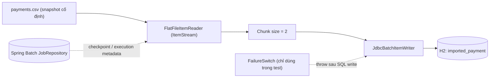
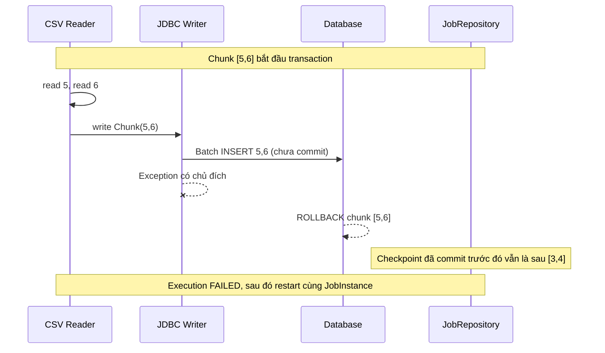
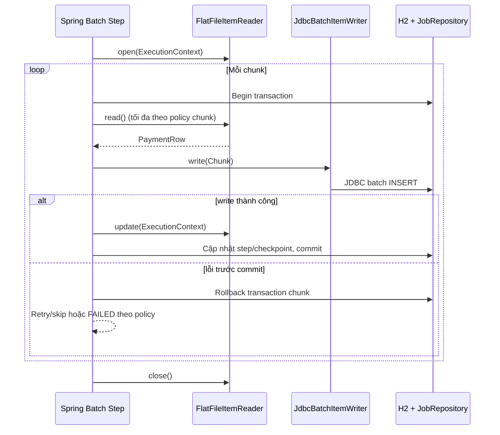

# Thêm chunk transaction và checkpoint — dự án thực hành Spring Batch

Trong một batch job xử lý hàng chục nghìn giao dịch, yêu cầu không chỉ là “đọc được và ghi được”. Job có thể thất bại sau khi đã xử lý 60% dữ liệu; khi chạy lại, hệ thống phải **giữ nguyên phần đã commit, không coi chunk lỗi là thành công và tiếp tục từ checkpoint phù hợp**. Đây là mục tiêu của bài thực hành **thêm chunk transaction và checkpoint**.

Chúng ta xây dựng một ứng dụng Spring Boot 3.x / Spring Batch 5.x nhỏ: đọc 6 giao dịch từ CSV, ghi vào H2 bằng `JdbcBatchItemWriter`, commit sau mỗi 2 item, chủ động tạo lỗi **sau khi SQL đã được gửi nhưng trước khi chunk commit**, rồi restart **cùng `JobInstance`**. Integration test phải chứng minh chỉ 4 dòng của hai chunk đầu tồn tại sau lần lỗi, và sau restart cả 6 dòng được ghi chính xác một lần.

Mô hình này áp dụng cho file, database, API hoặc queue, nhưng **mức độ bảo đảm transaction phụ thuộc tài nguyên**: JDBC ghi vào cùng datasource/transaction manager có thể rollback cùng chunk; một HTTP request hoặc file đã được công bố thường không tự rollback cùng transaction JDBC.

## 1. Mục tiêu đầu ra

Sau bài này, bạn có thể:

1. Tạo chunk-oriented step với `.chunk(2, transactionManager)`.
2. Gắn reader có lưu state bằng `ItemStream` / `ExecutionContext`.
3. Dùng JDBC writer thực sự ghi trong transaction chunk.
4. Tiêm lỗi có chủ đích ở chunk thứ ba, phân biệt write **đã được gọi** với dữ liệu **đã commit**.
5. Restart bằng **cùng job name + identifying JobParameters** và quan sát JobExecution mới của JobInstance cũ.
6. Kiểm tra kết quả trong database, metadata Spring Batch và các counter của StepExecution.
7. Phân biệt restart checkpoint với tạo JobInstance mới; giải thích rủi ro nếu tắt `saveState`, thay nguồn hoặc gửi side effect bên ngoài transaction.

Kịch bản kỳ vọng:

| Lần chạy | Chunk [1,2] | Chunk [3,4] | Chunk [5,6] | BatchStatus | Dòng đã commit |
|---|---|---|---|---|---:|
| Execution #1 | Commit | Commit | Ghi thử rồi **rollback** | `FAILED` | 4 |
| Execution #2, restart | Không ghi lại | Không ghi lại | Commit | `COMPLETED` | 6 |

ID execution trong bảng chỉ là minh họa; JobRepository sẽ sinh ID thực tế khi chạy. Test cũng xác minh **sáu ID đều khác nhau**, tránh trường hợp có 6 dòng nhưng thiếu một giao dịch và lặp một giao dịch khác.

## 2. Kiến trúc và ranh giới transaction



Tổng thể gồm hai nhóm dữ liệu trong cùng H2 datasource cho ví dụ:

- **Bảng nghiệp vụ** `imported_payment`: dữ liệu thật từ CSV, có khóa duy nhất `(business_date, source_id)`.
- **Bảng metadata Spring Batch** `BATCH_JOB_INSTANCE`, `BATCH_JOB_EXECUTION`, `BATCH_STEP_EXECUTION` và các bảng `*_EXECUTION_CONTEXT`: trạng thái, lịch sử và checkpoint.

Chúng ta dùng `JdbcTransactionManager` / transaction manager JDBC do Spring Boot cấu hình cho datasource. Khi writer cùng datasource tham gia transaction chunk, exception xảy ra trước commit làm **rollback các INSERT của chính chunk đó**.



**Lưu ý về checkpoint:** `ItemStream.update(ExecutionContext)` và cập nhật metadata được phối hợp với transaction chunk; reader chỉ lưu tiến độ đã được framework checkpoint thích hợp. In-memory read position có thể đi xa hơn vị trí đã commit khi writer lỗi. Khi restart, reader cần dùng **state bền vững**, không lấy offset cuối cùng chỉ in từ log sau khi failure.

## 3. Cấu trúc dự án mẫu

```text
chunk-checkpoint-lab/
├── build.gradle
├── settings.gradle
└── src/
    ├── main/
    │   ├── java/com/example/batchlab/
    │   │   ├── ChunkCheckpointLabApplication.java
    │   │   ├── PaymentRow.java
    │   │   ├── FailureSwitch.java
    │   │   └── PaymentImportConfig.java
    │   └── resources/
    │       ├── application.yml
    │       ├── schema.sql
    │       └── payments.csv
    └── test/
        └── java/com/example/batchlab/
            └── ChunkCheckpointIntegrationTest.java
```

Đây là cấu trúc **một dự án tự chứa để học**. Bài viết trình bày nội dung các file ở những phần tiếp theo. Không cần một dịch vụ bên ngoài hoặc cơ sở dữ liệu production để chạy integration test.

### 3.1. Gradle và Java

File `settings.gradle`:

```groovy
rootProject.name = 'chunk-checkpoint-lab'
```

File `build.gradle`:

```groovy
plugins {
    id 'java'
    id 'org.springframework.boot' version '3.3.5'
    id 'io.spring.dependency-management' version '1.1.6'
}

group = 'com.example'
version = '0.0.1-SNAPSHOT'

java {
    toolchain {
        languageVersion = JavaLanguageVersion.of(17)
    }
}

repositories {
    mavenCentral()
}

dependencies {
    implementation 'org.springframework.boot:spring-boot-starter-batch'
    runtimeOnly 'com.h2database:h2'

    testImplementation 'org.springframework.boot:spring-boot-starter-test'
    testImplementation 'org.springframework.batch:spring-batch-test'
}

tasks.named('test') {
    useJUnitPlatform()
}
```

Các version plugin là **mốc minh họa thuộc hệ Spring Boot 3.x**, không phải khẳng định mới nhất. Khi tạo dự án thật, nên chọn một bộ phiên bản Spring Boot, Spring Batch và Java được tổ chức hỗ trợ, để Spring Boot BOM quản lý các dependency tương thích. Có thể tạo dự án bằng Spring Initializr và bổ sung các file tương ứng.

### 3.2. Cấu hình datasource và metadata

File `src/main/resources/application.yml`:

```yaml
spring:
  datasource:
    url: "jdbc:h2:mem:chunkcheckpoint;DB_CLOSE_DELAY=-1"
    driver-class-name: org.h2.Driver
    username: sa
    password: ""

  batch:
    job:
      enabled: false
    jdbc:
      initialize-schema: always

  sql:
    init:
      mode: always

demo:
  run-on-startup: false
  business-date: "2026-11-15"
  input-file: "payments.csv"
```

Ở lab này:

- `spring.batch.job.enabled=false` tắt tự động khởi chạy job khi application context được tạo. Test hoặc `ApplicationRunner` của chúng ta sẽ gọi `JobLauncher` chủ động.
- `spring.batch.jdbc.initialize-schema=always` giúp khởi tạo schema metadata của Spring Batch trong database H2 phục vụ học tập.
- `spring.sql.init.mode=always` cho phép chạy `schema.sql` tạo bảng nghiệp vụ.
- `jdbc:h2:mem` chỉ sống trong vòng đời database/process. **Không dùng in-memory H2 để minh họa restart sau khi đã tắt hẳn JVM**: khi process kết thúc, cả metadata lẫn dữ liệu cũng mất. Integration test ở bài này thực hiện hai execution **trong cùng application context**, nên có thể chứng minh restart và transaction một cách ổn định.

Với production hoặc bài tập restart **sang process mới**, dùng datasource bền vững (PostgreSQL/MySQL/H2 file cho lab) và **tạo metadata schema một lần bằng migration**, thay vì chạy lại scripts tạo bảng mặc định mỗi lần khởi động.

### 3.3. Tạo bảng nghiệp vụ có khóa chống trùng

File `src/main/resources/schema.sql`:

```sql
CREATE TABLE IF NOT EXISTS imported_payment (
    business_date DATE NOT NULL,
    source_id BIGINT NOT NULL,
    amount DECIMAL(18, 2) NOT NULL,
    PRIMARY KEY (business_date, source_id)
);
```

Khóa chính `(business_date, source_id)` cho phép xử lý nhiều kỳ dữ liệu trong cùng bảng và phát hiện cùng giao dịch bị ghi lặp trong một kỳ. Với lab này ta dùng **INSERT thông thường**: nếu reader sai checkpoint và ghi lại bản đã commit, unique constraint giúp test phát hiện. Với production có yêu cầu at-least-once và replay, có thể chọn upsert nhưng cần kiểm tra giá trị/version, không bỏ qua mọi duplicate như một kết quả hợp lệ.

### 3.4. Dữ liệu CSV cố định

File `src/main/resources/payments.csv`:

```csv
id,amount
1,10.00
2,20.00
3,30.00
4,40.00
5,50.00
6,60.00
```

File có 6 bản ghi và một dòng header. Reader sẽ bỏ header, cung cấp từng `PaymentRow` theo thứ tự ID tăng. Không chỉnh sửa file giữa lần chạy lỗi và lần restart trong bài thực hành: **offset theo dòng chỉ an toàn khi nội dung và thứ tự nguồn giữ nguyên**.

## 4. Khai báo kiểu dữ liệu

File `PaymentRow.java`:

```java
package com.example.batchlab;

import java.math.BigDecimal;

public record PaymentRow(long id, BigDecimal amount) {
}
```

Với Java 17, `record` giảm boilerplate cho model đơn giản. `BigDecimal` phù hợp xử lý tiền tệ hơn `double`. Chúng ta giữ mã nguồn càng ít biến trạng thái càng tốt để quan sát rõ cơ chế transaction và checkpoint của Spring Batch.

## 5. FailureSwitch: tạo lỗi có chủ đích để thấy rollback

File `FailureSwitch.java`:

```java
package com.example.batchlab;

import java.util.concurrent.atomic.AtomicBoolean;

public final class FailureSwitch {

    private final AtomicBoolean armed = new AtomicBoolean(false);

    public void armOnce() {
        armed.set(true);
    }

    public boolean consumeFailure() {
        return armed.compareAndSet(true, false);
    }
}
```

`FailureSwitch` là một **test seam** cho phép bật lỗi một lần trong cùng JVM:

1. Test gọi `armOnce()` trước execution thứ nhất.
2. Writer sẽ ghi SQL cho chunk chứa `id=5` rồi gọi `consumeFailure()`.
3. Lần đầu, method trả `true` và writer ném exception trước commit.
4. Flag đã được tiêu thụ; lần restart sau có thể chạy thành công.

Điểm thiết kế: flag này **không phải checkpoint** và **không cần lưu vào JobRepository**. Nó chỉ tồn tại để thử failure có thể lặp lại trong một test process. Trong ứng dụng thật, lỗi phải đến từ hệ thống/logic thực, và không nên dùng một flag singleton trong memory để quản lý recovery phân tán.

## 6. Cấu hình reader, writer, step và job

File `PaymentImportConfig.java`:

```java
package com.example.batchlab;

import java.sql.Date;
import java.time.LocalDate;

import javax.sql.DataSource;

import org.springframework.batch.core.Job;
import org.springframework.batch.core.Step;
import org.springframework.batch.core.configuration.annotation.StepScope;
import org.springframework.batch.core.job.builder.JobBuilder;
import org.springframework.batch.core.repository.JobRepository;
import org.springframework.batch.core.step.builder.StepBuilder;
import org.springframework.batch.item.ItemWriter;
import org.springframework.batch.item.database.JdbcBatchItemWriter;
import org.springframework.batch.item.database.builder.JdbcBatchItemWriterBuilder;
import org.springframework.batch.item.file.FlatFileItemReader;
import org.springframework.batch.item.file.builder.FlatFileItemReaderBuilder;
import org.springframework.beans.factory.annotation.Qualifier;
import org.springframework.beans.factory.annotation.Value;
import org.springframework.context.annotation.Bean;
import org.springframework.context.annotation.Configuration;
import org.springframework.core.io.ClassPathResource;
import org.springframework.jdbc.core.namedparam.MapSqlParameterSource;
import org.springframework.transaction.PlatformTransactionManager;

@Configuration
public class PaymentImportConfig {

    @Bean
    public FailureSwitch failureSwitch() {
        return new FailureSwitch();
    }

    // Reader có state và tên ổn định.
    // @StepScope hỗ trợ nhận inputFile từ JobParameters lúc step chạy.
    @Bean
    @StepScope
    public FlatFileItemReader<PaymentRow> paymentCsvReader(
            @Value("#{jobParameters['inputFile']}")
            String inputFile) {

        return new FlatFileItemReaderBuilder<PaymentRow>()
                .name("paymentCsvReader")
                .resource(new ClassPathResource(inputFile))
                .encoding("UTF-8")
                .linesToSkip(1)
                .delimited()
                .names("id", "amount")
                .fieldSetMapper(fields -> new PaymentRow(
                        fields.readLong("id"),
                        fields.readBigDecimal("amount")))
                .saveState(true)
                .build();
    }

    // Writer sử dụng cùng DataSource với transaction manager.
    @Bean
    @StepScope
    public JdbcBatchItemWriter<PaymentRow> paymentJdbcWriter(
            DataSource dataSource,
            @Value("#{jobParameters['businessDate']}")
            String businessDate) {

        Date date = Date.valueOf(LocalDate.parse(businessDate));

        return new JdbcBatchItemWriterBuilder<PaymentRow>()
                .dataSource(dataSource)
                .sql("""
                        INSERT INTO imported_payment (
                            business_date, source_id, amount
                        ) VALUES (
                            :businessDate, :id, :amount
                        )
                        """)
                .itemSqlParameterSourceProvider(row ->
                        new MapSqlParameterSource()
                                .addValue("businessDate", date)
                                .addValue("id", row.id())
                                .addValue("amount", row.amount()))
                .build();
    }

    // Writer giả lập sự cố: SQL đã thực hiện trong transaction,
    // nhưng ném lỗi trước khi chunk commit.
    @Bean
    public ItemWriter<PaymentRow> faultInjectingWriter(
            @Qualifier("paymentJdbcWriter")
            ItemWriter<PaymentRow> delegate,
            FailureSwitch failureSwitch) {

        return chunk -> {
            delegate.write(chunk);

            boolean containsIdFive = chunk.getItems().stream()
                    .anyMatch(row -> row.id() == 5L);

            if (containsIdFive && failureSwitch.consumeFailure()) {
                throw new IllegalStateException(
                        "Simulated failure after JDBC write, before commit");
            }
        };
    }

    @Bean
    public Step importPaymentsStep(
            JobRepository jobRepository,
            PlatformTransactionManager transactionManager,
            FlatFileItemReader<PaymentRow> paymentCsvReader,
            @Qualifier("faultInjectingWriter")
            ItemWriter<PaymentRow> writer) {

        return new StepBuilder("importPaymentsStep", jobRepository)
                .<PaymentRow, PaymentRow>chunk(2, transactionManager)
                .reader(paymentCsvReader)
                .writer(writer)
                .build();
    }

    @Bean
    public Job importPaymentsJob(
            JobRepository jobRepository,
            Step importPaymentsStep) {

        return new JobBuilder("importPaymentsJob", jobRepository)
                .start(importPaymentsStep)
                .build();
    }
}
```

### 6.1. Vì sao dùng `FlatFileItemReader`?

`FlatFileItemReader` hỗ trợ `ItemStream`: đọc từng record và lưu thông tin cần thiết để tiếp tục sau restart. Builder đặt:

- `name("paymentCsvReader")`: tên ổn định dùng làm tiền tố các key trong context.
- `saveState(true)`: cho phép lưu trạng thái đọc.
- `linesToSkip(1)`: bỏ header CSV.
- `@StepScope`: bean được gắn với từng step execution, cho phép lấy `inputFile` từ JobParameters và tránh chia sẻ trạng thái reader sai vòng đời.

Thông thường khi dùng built-in reader có state, cần đặt **tên reader nhất quán qua các lần restart**. Nếu tên hoặc khóa `ExecutionContext` bị thay đổi giữa hai phiên bản deploy, trạng thái cũ có thể không còn được tìm thấy.

### 6.2. Tại sao writer không tự commit?

`JdbcBatchItemWriter` gửi batch SQL qua kết nối tham gia transaction mà step quản lý. Writer **không tự gọi commit riêng sau mỗi item**. Trong ví dụ:

```text
Chunk [1,2]:
  begin transaction → JDBC batch INSERT → checkpoint/update → COMMIT

Chunk [3,4]:
  begin transaction → JDBC batch INSERT → checkpoint/update → COMMIT

Chunk [5,6]:
  begin transaction → JDBC batch INSERT → throw exception → ROLLBACK
```

Exception trong `faultInjectingWriter` xảy ra sau khi delegate thực hiện `write(chunk)` nhưng vẫn **trước khi transaction commit**. Vì vậy các dòng 5 và 6 không được commit nếu JDBC writer và transaction manager dùng **cùng datasource và transaction boundary**.

Nếu writer gọi REST API hay ghi sang database **khác** không tham gia cùng transaction, exception tương tự có thể không hoàn tác side effect ở hệ thống đó. Đó là trường hợp phải thêm idempotency hoặc compensation.

### 6.3. Tại sao `chunk(2, transactionManager)` là trọng tâm?

`chunk(2, ...)` nghĩa là theo chính sách commit interval 2: reader lấy item và writer nhận từng nhóm hai item trong điều kiện đơn giản của bài lab. Transaction manager điều khiển commit/rollback của từng chunk.

Không phải mọi job luôn commit đúng một lần sau mỗi hai hàng đã ghi: skip, filter, retry, rollback hoặc EOF có thể làm số item đọc khác số item ghi và có transaction phụ trợ. Trong ví dụ dữ liệu sạch, không filter, không retry và không skip, kết quả dễ quan sát hơn.

Nếu đổi chunk size thành 3, hai chunk sẽ là [1,2,3] và [4,5,6]. Exception sau ghi chunk chứa ID 5 sẽ rollback cả [4,5,6], khiến chỉ **3** dòng đầu được commit sau lần lỗi. Đây là bài tập nhỏ để thấy **độ lớn vùng rollback phụ thuộc chunk size**.

## 7. ApplicationRunner để chạy chế độ bình thường

File `ChunkCheckpointLabApplication.java`:

```java
package com.example.batchlab;

import org.springframework.batch.core.BatchStatus;
import org.springframework.batch.core.Job;
import org.springframework.batch.core.JobExecution;
import org.springframework.batch.core.JobParameters;
import org.springframework.batch.core.JobParametersBuilder;
import org.springframework.batch.core.launch.JobLauncher;
import org.springframework.beans.factory.annotation.Qualifier;
import org.springframework.beans.factory.annotation.Value;
import org.springframework.boot.ApplicationRunner;
import org.springframework.boot.SpringApplication;
import org.springframework.boot.autoconfigure.SpringBootApplication;
import org.springframework.boot.autoconfigure.condition.ConditionalOnProperty;
import org.springframework.context.annotation.Bean;

@SpringBootApplication
public class ChunkCheckpointLabApplication {

    public static void main(String[] args) {
        SpringApplication.run(ChunkCheckpointLabApplication.class, args);
    }

    @Bean
    @ConditionalOnProperty(
            name = "demo.run-on-startup",
            havingValue = "true")
    ApplicationRunner launchDemoJob(
            JobLauncher jobLauncher,
            @Qualifier("importPaymentsJob") Job job,
            @Value("${demo.business-date:2026-11-15}")
            String businessDate,
            @Value("${demo.input-file:payments.csv}")
            String inputFile) {

        return args -> {
            JobParameters parameters = new JobParametersBuilder()
                    .addString("businessDate", businessDate)
                    .addString("inputFile", inputFile)
                    .toJobParameters();

            JobExecution execution = jobLauncher.run(job, parameters);

            System.out.printf(
                    "JobExecution=%s status=%s instance=%s%n",
                    execution.getId(),
                    execution.getStatus(),
                    execution.getJobInstance().getInstanceId());

            if (execution.getStatus() != BatchStatus.COMPLETED) {
                throw new IllegalStateException(
                        "Import job ended with " + execution.getStatus());
            }
        };
    }
}
```

Trong cấu hình mặc định `demo.run-on-startup=false`, bean này **không được tạo** nên test tự gọi `JobLauncher` theo đúng kịch bản. Muốn chạy demo không có fault injection, có thể gọi:

```bash
./gradlew bootRun --args='--demo.run-on-startup=true --demo.business-date=2026-11-15 --demo.input-file=payments.csv'
```

Trên Windows có thể dùng `gradlew.bat`; nếu tạo dự án qua Initializr, Gradle wrapper đã có sẵn. Với H2 in-memory, ứng dụng này xử lý file và in status trong **một process**. Để quan sát lỗi rồi restart qua hai process riêng, cần database bền vững và cơ chế fault injection/điều hành phù hợp ngoài phạm vi flag test trong RAM.

## 8. Integration test: chứng minh rollback và restart cùng JobInstance

Đây là phần quan trọng nhất của dự án. Test sẽ **không mock JDBC writer**; nó chạy job thật trên H2, tạo failure rồi truy vấn bảng để kiểm tra dữ liệu đã commit.

File `ChunkCheckpointIntegrationTest.java`:

```java
package com.example.batchlab;

import static org.junit.jupiter.api.Assertions.assertEquals;
import static org.junit.jupiter.api.Assertions.assertNotEquals;
import static org.junit.jupiter.api.Assertions.assertNotNull;
import static org.junit.jupiter.api.Assertions.assertTrue;

import java.math.BigDecimal;
import java.sql.Date;
import java.time.LocalDate;
import java.util.List;

import org.junit.jupiter.api.Test;
import org.springframework.batch.core.BatchStatus;
import org.springframework.batch.core.Job;
import org.springframework.batch.core.JobExecution;
import org.springframework.batch.core.JobParameters;
import org.springframework.batch.core.JobParametersBuilder;
import org.springframework.batch.core.StepExecution;
import org.springframework.batch.core.explore.JobExplorer;
import org.springframework.batch.core.launch.JobLauncher;
import org.springframework.batch.test.context.SpringBatchTest;
import org.springframework.beans.factory.annotation.Autowired;
import org.springframework.beans.factory.annotation.Qualifier;
import org.springframework.boot.test.context.SpringBootTest;
import org.springframework.jdbc.core.JdbcTemplate;

@SpringBatchTest
@SpringBootTest(properties = {
        "spring.batch.job.enabled=false",
        "demo.run-on-startup=false"
})
class ChunkCheckpointIntegrationTest {

    @Autowired
    JobLauncher jobLauncher;

    @Autowired
    @Qualifier("importPaymentsJob")
    Job importPaymentsJob;

    @Autowired
    FailureSwitch failureSwitch;

    @Autowired
    JdbcTemplate jdbcTemplate;

    @Autowired
    JobExplorer jobExplorer;

    @Test
    void rollsBackFailedChunkAndResumesFromSavedCheckpoint()
            throws Exception {

        LocalDate day = LocalDate.of(2026, 11, 15);

        // Hai lần gọi dùng CHÍNH XÁC cùng identifying parameters.
        JobParameters parameters = new JobParametersBuilder()
                .addString("businessDate", day.toString())
                .addString("inputFile", "payments.csv")
                .toJobParameters();

        // Lần 1: writer ném lỗi khi chunk chứa ID 5 đã ghi SQL
        // nhưng transaction chưa commit.
        failureSwitch.armOnce();
        JobExecution first = jobLauncher.run(
                importPaymentsJob, parameters);

        assertEquals(BatchStatus.FAILED, first.getStatus());
        assertEquals(4, countRows(day));
        assertEquals(List.of(1L, 2L, 3L, 4L), loadIds(day));

        JobExecution persistedFirst =
                jobExplorer.getJobExecution(first.getId());
        assertNotNull(persistedFirst);

        StepExecution step = persistedFirst.getStepExecutions()
                .iterator().next();

        // Built-in FlatFileItemReader lưu khóa state của riêng nó.
        assertTrue(step.getExecutionContext()
                .containsKey("paymentCsvReader.read.count"));

        // Lần 2: flag đã được tiêu thụ; restart CÙNG JobInstance.
        JobExecution second = jobLauncher.run(
                importPaymentsJob, parameters);

        assertEquals(BatchStatus.COMPLETED, second.getStatus());
        assertNotEquals(first.getId(), second.getId());
        assertEquals(
                first.getJobInstance().getInstanceId(),
                second.getJobInstance().getInstanceId());

        assertEquals(6, countRows(day));
        assertEquals(
                List.of(1L, 2L, 3L, 4L, 5L, 6L),
                loadIds(day));

        BigDecimal total = jdbcTemplate.queryForObject(
                """
                    SELECT SUM(amount)
                    FROM imported_payment
                    WHERE business_date = ?
                    """,
                BigDecimal.class,
                Date.valueOf(day));

        assertNotNull(total);
        assertEquals(0, total.compareTo(new BigDecimal("210.00")));
    }

    private int countRows(LocalDate day) {
        Integer result = jdbcTemplate.queryForObject(
                "SELECT COUNT(*) FROM imported_payment WHERE business_date = ?",
                Integer.class,
                Date.valueOf(day));
        return result == null ? 0 : result;
    }

    private List<Long> loadIds(LocalDate day) {
        return jdbcTemplate.queryForList(
                """
                    SELECT source_id
                    FROM imported_payment
                    WHERE business_date = ?
                    ORDER BY source_id
                    """,
                Long.class,
                Date.valueOf(day));
    }
}
```

### 8.1. Test kiểm chứng những điều gì?

| Assert | Ý nghĩa |
|---|---|
| `first.getStatus() == FAILED` | Exception thực sự làm execution thứ nhất thất bại |
| `countRows(day) == 4` | Hai chunk đầu đã commit; chunk [5,6] rollback |
| `loadIds(day) == [1,2,3,4]` | Không phải chỉ đếm đủ bốn hàng ngẫu nhiên |
| Context có khóa reader | Reader đã cung cấp checkpoint cho `ExecutionContext` |
| `second.getId() != first.getId()` | Restart tạo **JobExecution mới** |
| JobInstance ID không đổi | Đây là **restart**, không phải start instance mới |
| `second.getStatus() == COMPLETED` | Execution mới đã hoàn tất |
| 6 ID khác nhau + tổng tiền 210.00 | Không thiếu/trùng bản ghi; dữ liệu cuối đúng |

Không nên chỉ assert `COMPLETED` mà bỏ qua database. Một job có thể hoàn tất về mặt framework nhưng có writer sai hoặc không còn đọc dữ liệu phù hợp. Ngược lại, không nên chỉ đếm 6 dòng: một kết quả thiếu ID 5 nhưng trùng ID 4 ở mô hình không có unique key vẫn có thể cho ra cùng count.

### 8.2. Vì sao không bọc test bằng `@Transactional`?

Nếu toàn bộ method test được Spring Test bọc trong một transaction ngoài, có thể xuất hiện tương tác không mong muốn với transaction của Spring Batch và `JobRepository`. Dữ liệu test có thể bị rollback theo một transaction khác, làm việc kiểm tra commit/rollback chunk sai lệch.

Trong ví dụ, test **không dùng `@Transactional`**. Transaction của chunk do `StepBuilder.chunk(2, transactionManager)` và Spring Batch quản lý. Query `JdbcTemplate` sau khi execution kết thúc nhìn thấy những hàng **đã commit**.

### 8.3. Điều kiện chạy test ổn định

- Dùng một database test riêng, không chạy đồng thời hai test dùng cùng business date và cùng bảng nếu không cô lập context/dataset.
- Không đặt identifying `run.id` ngẫu nhiên **giữa hai lần gọi trong cùng test**; có thể tạo mã case ID để cô lập một test nếu **giữ nguyên mã đó** qua cả hai execution.
- Dùng JobLauncher đồng bộ cho thí nghiệm này; nếu cấu hình executor bất đồng bộ, cần chờ trạng thái terminal trước khi assert.
- Không dùng API writer hoặc hệ thống ngoài trong bài test transaction JDBC; API không được rollback bằng transaction local.
- Không bật tự động retry cho exception `IllegalStateException` của fault injection, nếu không bước lỗi có thể được retry và job hoàn thành ngay ở execution thứ nhất, làm mất mục tiêu thử restart.

## 9. Diễn giải chính xác vòng đời của chunk

Spring Batch có các callback và cơ chế state chính:

- Reader `open(ExecutionContext)`: mở tài nguyên, lấy lại vị trí nếu có checkpoint.
- `read()`: cung cấp item, thay đổi vị trí nội bộ của reader.
- Processor (nếu có): biến đổi hoặc filter item.
- Writer `write(Chunk<? extends T>)`: thực hiện ghi cho chunk.
- Reader/Writer `update(ExecutionContext)`: đưa state cần checkpoint vào context ở vòng đời do framework quản lý.
- `JobRepository` cập nhật metadata trong transaction phù hợp; chunk commit hoặc rollback.
- `close()`: đóng reader/stream sau khi step kết thúc.



Sơ đồ giản lược cho chunk-oriented processing; callback chính xác và xử lý cuối nguồn, skip/retry có thể khác. Điều quan trọng là **không tự persist reader offset sau mỗi `read()` bằng một transaction ngoài**: nếu cập nhật vị trí 6 rồi writer rollback chunk [5,6], restart từ 6 sẽ bỏ qua hai giao dịch chưa commit.

### 9.1. ExecutionContext không phải bộ nhớ tạm thuần túy

`ExecutionContext` là tập khóa/giá trị được Spring Batch quản lý để checkpoint/restart. Với built-in `FlatFileItemReader`, khi bật state, reader dùng một key gắn với tên (ví dụ `paymentCsvReader.read.count`) để theo dõi số record đã đọc. Framework persist context ở ranh giới thích hợp thông qua metadata.

**Không dùng context để lưu password, bearer token, API key hoặc dữ liệu nghiệp vụ nhạy cảm.** Nó được serialize vào JobRepository, có thể tồn tại trong backup/log/debug và không phải secret vault.

### 9.2. Các loại “đã xử lý” không giống nhau

| Đại lượng | Ý nghĩa | Có phải dữ liệu đích đã commit? |
|---|---|---|
| Reader đã trả item | Đọc từ nguồn thành công | **Chưa** |
| Processor đã chạy | Dữ liệu được tính/biến đổi | **Chưa** |
| Writer đã nhận chunk | Gọi `write(...)` | **Chưa chắc** |
| JDBC đã thực hiện INSERT | Statement được chạy trong transaction | **Chưa**, cho tới commit |
| Chunk commit thành công | Transaction được xác nhận | **Có**, đối với tài nguyên tham gia transaction |
| Checkpoint đã persist | Có vị trí restart bền vững | Phải phù hợp ranh giới commit |
| Job `COMPLETED` | Framework hoàn tất execution | Vẫn nên có quality gate khi cần |

Trong test, lỗi được đặt **sau JDBC batch INSERT và trước commit** chính để minh họa sự khác biệt giữa “đã thực hiện câu SQL” và “đã commit dữ liệu”.

## 10. Kiểm tra metadata Spring Batch bằng SQL

Nếu muốn quan sát ngoài integration test, có thể đọc các bảng metadata. Câu SQL dưới đây là **truy vấn chỉ đọc** dành cho schema Batch 5 theo prefix mặc định:

```sql
SELECT
    ji.JOB_INSTANCE_ID,
    ji.JOB_NAME,
    je.JOB_EXECUTION_ID,
    je.STATUS,
    je.EXIT_CODE,
    je.START_TIME,
    je.END_TIME
FROM BATCH_JOB_INSTANCE ji
JOIN BATCH_JOB_EXECUTION je
  ON je.JOB_INSTANCE_ID = ji.JOB_INSTANCE_ID
WHERE ji.JOB_NAME = 'importPaymentsJob'
ORDER BY je.JOB_EXECUTION_ID;
```

Một JobInstance có thể có nhiều JobExecution:

```text
JOB_INSTANCE_ID | JOB_EXECUTION_ID | STATUS
--------------- | ---------------- | ---------
              1 |                1 | FAILED
              1 |                2 | COMPLETED
```

Step detail:

```sql
SELECT
    STEP_EXECUTION_ID,
    JOB_EXECUTION_ID,
    STEP_NAME,
    STATUS,
    READ_COUNT,
    WRITE_COUNT,
    COMMIT_COUNT,
    ROLLBACK_COUNT,
    EXIT_CODE
FROM BATCH_STEP_EXECUTION
WHERE JOB_EXECUTION_ID = :executionId;
```

Reader checkpoint nằm ở context của step:

```sql
SELECT
    STEP_EXECUTION_ID,
    SHORT_CONTEXT,
    SERIALIZED_CONTEXT
FROM BATCH_STEP_EXECUTION_CONTEXT
WHERE STEP_EXECUTION_ID = :stepExecutionId;
```

Các giá trị trong context có thể được serialize/encode tùy `ExecutionContextSerializer`, nên không coi text ngắn trong `SHORT_CONTEXT` là toàn bộ state. Có thể dùng `JobExplorer` và API Spring Batch để truy vấn nếu muốn tránh phụ thuộc SQL schema.

### 10.1. Xem JobExecution và StepExecution bằng Java

```java
JobExecution current = jobExplorer.getJobExecution(executionId);
if (current != null) {
    System.out.printf("jobExecution=%s status=%s instance=%s%n",
            current.getId(),
            current.getStatus(),
            current.getJobInstance().getInstanceId());

    for (StepExecution step : current.getStepExecutions()) {
        System.out.printf(
                "step=%s read=%d write=%d commits=%d rollbacks=%d%n",
                step.getStepName(),
                step.getReadCount(),
                step.getWriteCount(),
                step.getCommitCount(),
                step.getRollbackCount());
    }
}
```

Đây là đoạn mã minh họa trong một service/test đã inject `JobExplorer` và biết `executionId`. Counter thuộc từng StepExecution, **không phải tổng mọi lần restart**. Không suy luận số request API thực tế từ `writeCount` vì retry/rollback có thể gọi writer nhiều lần cho cùng item.

## 11. Những phép thử mở rộng

### Bài thử A — Tăng chunk size từ 2 lên 3

Trong `PaymentImportConfig`, thay:

```java
.chunk(2, transactionManager)
```

bằng:

```java
.chunk(3, transactionManager)
```

Kỳ vọng lần đầu:

```text
Chunk [1,2,3] → COMMIT
Chunk [4,5,6] → INSERT rồi lỗi → ROLLBACK
Số hàng committed sau FAILED: 3
Restart: đọc lại phần chưa commit, hoàn thành 6 hàng
```

**Lưu ý:** Đây là một thí nghiệm mới nên cần database/test context sạch. Không thay chunk size giữa hai execution của **cùng JobInstance đang chờ restart** trong một hệ thống production mà không đánh giá compatibility của checkpoint và output.

### Bài thử B — Đặt lỗi trước và sau delegate

Thử đặt câu lệnh ném exception **trước** `delegate.write(chunk)`, rồi so sánh với cách đặt **sau** delegate. Nếu lỗi trước, không có câu INSERT của chunk lỗi được gửi; nếu lỗi sau, SQL đã thực hiện nhưng vẫn rollback theo transaction.

Hai kịch bản đều có thể để lại cùng số hàng committed, nhưng log/JDBC instrumentation sẽ cho thấy những thao tác I/O khác nhau. Điều đó nhấn mạnh rằng **dữ liệu cuối** mới là bằng chứng cho rollback, còn “writer đã được gọi” không chứng minh commit.

### Bài thử C — Cố ý tắt reader state

Thử `.saveState(false)` ở reader và chạy lại kịch bản. Nếu restart bắt đầu đọc từ đầu, writer INSERT có thể gặp unique constraint trên các hàng đã commit. **Không coi lỗi duplicate ở đây là cần bỏ constraint**; nó giúp phát hiện thiết kế checkpoint sai.

Khi thực hiện, dùng database/test context riêng để tránh ảnh hưởng kết quả bài chính. Nếu một job chủ động dùng reader không state, cần có chiến lược replay idempotent, reprocess và reconciliation từ đầu, thay vì dựa vào checkpoint của Spring Batch.

### Bài thử D — Thêm processor có filter

Thêm processor bỏ qua những hàng có amount dưới ngưỡng:

```java
ItemProcessor<PaymentRow, PaymentRow> processor =
        row -> row.amount().compareTo(new BigDecimal("25.00")) < 0
                ? null
                : row;
```

Khi processor trả `null`, item đó **được filter**, không phải lỗi và không được writer ghi. Khi ấy `readCount` và `writeCount` khác nhau, chunk cuối có thể chứa ít output hơn input. Chọn business rule và expected count mới trước khi sửa integration test.

### Bài thử E — Writer gửi ra API bên ngoài

Giả sử writer thực hiện HTTP POST trước khi ghi database. Nếu HTTP POST thành công nhưng transaction JDBC rollback, API sẽ **không tự rollback**. Cần:

- Idempotency key ổn định cho mỗi business operation.
- Khả năng tra cứu trạng thái request bị timeout.
- Outbox pattern hoặc cơ chế publish sau commit khi phù hợp.
- Compensation/reconciliation nếu đã phát side effect không thể rollback.

Không chuyển ví dụ “JDBC INSERT rollback được” thành “mọi writer rollback được”. Đây là giới hạn quan trọng của thiết kế chunk transaction.

## 12. Khi dùng custom reader, phải tự implement ItemStream

`FlatFileItemReader` đã hỗ trợ state. Nếu thay bằng reader tự viết, chỉ implements `ItemReader` với một biến `index` trong RAM **không đủ** cho restart.

Ví dụ custom reader đơn giản lưu index:

```java
import java.util.List;

import org.springframework.batch.item.ExecutionContext;
import org.springframework.batch.item.ItemStreamReader;

public final class CheckpointingListReader<T>
        implements ItemStreamReader<T> {

    private static final String KEY = "demoListReader.nextIndex";

    private final List<T> snapshot;
    private int nextIndex;

    public CheckpointingListReader(List<T> snapshot) {
        this.snapshot = List.copyOf(snapshot);
    }

    @Override
    public void open(ExecutionContext context) {
        nextIndex = context.getInt(KEY, 0);
    }

    @Override
    public T read() {
        if (nextIndex >= snapshot.size()) {
            return null;
        }
        return snapshot.get(nextIndex++);
    }

    @Override
    public void update(ExecutionContext context) {
        context.putInt(KEY, nextIndex);
    }

    @Override
    public void close() {
    }
}
```

Reader này lưu **index của item tiếp theo**. Khi Spring Batch gọi `update(...)` và transaction commit, state được lưu qua framework. Lần restart, `open(...)` đọc lại index và tiếp tục.

Đây là ví dụ cho một danh sách **bất biến và nhỏ**; không nên nạp hàng triệu item vào RAM. Nếu list ở lần restart khác thứ tự, index không còn tương ứng với cùng record. Với dữ liệu lớn, dùng reader file/cursor/paging phù hợp và snapshot ổn định.

### Wrapper và delegate cũng cần chuyển tiếp lifecycle

Giả sử thêm wrapper để log reader nhưng wrapper chỉ implements `ItemReader<T>`:

```java
public final class LoggingReader<T> implements ItemReader<T> {
    private final ItemStreamReader<T> delegate;

    public LoggingReader(ItemStreamReader<T> delegate) {
        this.delegate = delegate;
    }

    @Override
    public T read() throws Exception {
        return delegate.read();
    }
}
```

Nếu step chỉ nhận biết wrapper là `ItemReader` và delegate không được đăng ký như stream, framework có thể **không gọi `open/update/close` của delegate**, khiến checkpoint bị mất. Có hai cách:

1. Wrapper implements `ItemStreamReader` và chuyển tiếp `open/update/close`.
2. Đăng ký delegate như một stream riêng với `StepBuilder.stream(delegate)`, bảo đảm đây là **đúng instance** mà wrapper đang sử dụng.

Không đăng ký cùng một stream trùng lặp để tránh callback lifecycle hai lần.

## 13. Một số lỗi thường gặp khi transaction và checkpoint không khớp

| Triệu chứng | Nguyên nhân có thể | Hướng kiểm tra |
|---|---|---|
| Job FAILED nhưng database chứa đủ cả chunk lỗi | Writer không dùng cùng transaction manager/datasource; commit riêng | Xem connection, `PlatformTransactionManager`, propagation |
| Sau restart đọc lại từ item 1 | `saveState(false)`, `ItemStream` không được đăng ký, instance mới | Xem StepExecutionContext và identifying parameters |
| Restart bỏ qua item chưa commit | Checkpoint ghi ngoài transaction hoặc state đi trước commit | Xem `update(...)`, transaction và metadata persist |
| Restart gặp duplicate key ở item đã commit | Reader bị replay từ đầu, writer không idempotent | Khắc phục checkpoint, giữ unique key, đối soát |
| Metadata không có key `read.count` | Reader không lưu state hoặc tên đổi | Xem `name(...)`, `saveState(...)` và lifecycle |
| Job không restart do `already complete` | Instance đã `COMPLETED` | Không ép restart; dùng version/instance mới nếu rebuild |
| Job không restart vì `already running` | Execution còn chạy hoặc metadata kẹt `STARTED` | Xác minh process thật trước khi recovery |
| Input file thay đổi giữa các execution | Index hợp lệ nhưng dữ liệu ở vị trí khác | Cố định checksum/version/snapshot |
| Chunk size tăng làm lock lâu hơn | Transaction giữ nhiều row/lock hơn | Đo throughput, DB wait và rollback cost |
| Test pass nhưng restart sang JVM mới không được | H2 in-memory mất metadata/data khi process tắt | Dùng database bền vững và migration |
| Writer gọi API bị lặp sau rollback | External side effect không thuộc JDBC transaction | Idempotency/outbox/compensation |
| Test dùng `@Transactional` quanh JobLauncher | Transaction test che commit/rollback | Tách transaction test khỏi transaction chunk |

## 14. Lưu checkpoint an toàn khi nguồn dữ liệu thay đổi

Một reader có state **không tự bảo đảm kết quả cuối đúng** nếu nguồn thay đổi. Ví dụ reader file lưu vị trí sau dòng thứ 4:

```text
File lúc Execution #1:
  [1,2,3,4,5,6]
  checkpoint=4

File bị sửa trước Execution #2:
  [99,1,2,3,4,5,6]

Restart từ vị trí 4 của file mới:
  có thể đọc lại item 4, bỏ sót 99 hoặc sai thứ tự
```

Tương tự, JDBC paging với điều kiện `WHERE status='NEW'` có thể thấy tập dữ liệu thay đổi nếu step khác cập nhật trạng thái thành `DONE` trong khi đang đọc.

Đối với dữ liệu production, nên:

- Truyền **snapshotId**, **businessDate** hoặc **dataVersion** làm identifying parameter phù hợp.
- Dùng file/object **bất biến** trong suốt vòng đời một JobInstance.
- Với database paging, có sort key duy nhất/bất biến và index hỗ trợ, tránh biến đổi nguồn theo cách làm thay đổi tập kết quả.
- Nếu dữ liệu phải rebuild, tạo version/JobInstance mới theo quyết định nghiệp vụ và xử lý output cũ; không gọi việc đổi version là “restart checkpoint cũ”.
- Writer có business key/idempotency để chịu được replay của một chunk chưa commit.

**Không đưa password/token vào `ExecutionContext`** để giữ phiên làm việc: token có thể hết hạn, bị sao chép vào metadata và backup. Checkpoint chỉ nên giữ state không nhạy cảm, còn credential lấy từ runtime provider an toàn.

## 15. Chunk size lớn hay nhỏ?

Chunk size là điểm cân bằng giữa hiệu năng và mức công việc phải rollback khi xảy ra lỗi:

| Chunk size | Ưu điểm có thể | Chi phí có thể |
|---|---|---|
| 1 | Ranh giới commit nhỏ, dễ quan sát | Nhiều transaction, write overhead |
| 10–100 | Dễ cân bằng cho nhiều workload | Vẫn cần đo DB/API throughput |
| 500–2000 | Có thể giảm số commit/batch operations | Transaction dài, nhiều row bị replay khi lỗi |
| Rất lớn | Có thể tận dụng bulk writer | Memory/lock/timeouts/rollback cost tăng |

Không có chunk size tối ưu cho mọi hệ thống. Ví dụ này chọn **2 chỉ để minh họa**. Với production hãy benchmark trên dữ liệu thật, quan sát throughput, p95 chunk duration, DB lock wait, memory, retry/rollback và tính đúng sau restart.

Nhớ rằng `fetchSize` của JDBC reader, `pageSize` của paging reader và `chunkSize` là ba tham số khác nhau. Tăng fetch size không làm transaction commit chậm hơn hay nhanh hơn theo một quy luật cố định; cần đo từng phần.

## 16. Từ lab sang production

Bài thực hành dùng dữ liệu nhỏ và một process, nhưng khi triển khai dài hạn cần mở rộng thiết kế ở những điểm sau.

### 16.1. Database và metadata bền vững

Sử dụng database đáng tin cậy cho `JobRepository`, có backup, quyền truy cập và migration schema. Nếu business datasource khác metadata datasource, phải **chỉ rõ transaction manager** cho step và hiểu rằng commit metadata với business data có thể không atomic giữa hai database khác nhau. Không giả định mọi `@Transactional` bao phủ cả hai.

### 16.2. Scheduler và concurrent launch

Khi nhiều node hoặc scheduler có retry tự động, cùng identifying parameters phải được điều phối để tránh hai process cạnh tranh chạy một JobInstance. JobRepository hỗ trợ các kiểm tra trạng thái, nhưng cần cơ chế ownership/lock của toàn pipeline nếu có nhiều job hoặc downstream side effect.

### 16.3. Reader và writer production

Sử dụng `JdbcCursorItemReader`, `JdbcPagingItemReader`, `JpaPagingItemReader`, `FlatFileItemReader` hoặc reader API tùy nguồn. Đảm bảo `ItemStream` được quản lý đúng, không chia sẻ reader stateful giữa nhiều thread nếu chưa có chiến lược thread safety và restart. Writer cần unique key/upsert hoặc idempotency theo contract, đặc biệt với API và message.

### 16.4. Recovery và quan sát

Ghi log theo `jobName`, `jobInstanceId`, `jobExecutionId`, `stepName`, business key và lỗi. Kết hợp counters `readCount/writeCount/commitCount/rollbackCount`, duration từng chunk và dữ liệu đã commit để điều tra. Khi metadata còn `STARTED` sau JVM crash, phải xác minh không còn worker thực trước khi phục hồi status; không tự UPDATE trực tiếp các bảng metadata để ép restart.

### 16.5. Quality gate

Job `COMPLETED` chưa đủ trong các pipeline quan trọng. Trước khi downstream đọc output, so sánh expected IDs, distinct IDs, checksum/tổng tiền, số skip được chấp nhận và dataVersion. Dùng trạng thái `READY`/manifest sau khi dữ liệu đã publish hoàn chỉnh.

## 17. Bài tập tự đánh giá

1. Nếu chunk size là 3 và lỗi xảy ra sau khi writer xử lý item 5 nhưng trước commit, bao nhiêu dòng sẽ có trong bảng sau execution đầu? Vì sao?
2. Vì sao `JobExecution #2` có ID khác nhưng vẫn là **cùng JobInstance**? Identifying parameters đóng vai trò gì?
3. Nếu `paymentCsvReader.saveState(false)`, điều gì có thể xảy ra khi restart và writer dùng INSERT với primary key?
4. Vì sao việc thấy log “INSERT item 5 thành công” không chứng minh item 5 đã commit?
5. Nếu đổi `payments.csv` giữa lần chạy đầu và restart, checkpoint theo số dòng còn đáng tin cậy không?
6. Điều gì thay đổi khi `faultInjectingWriter` gọi REST API thay vì JDBC writer tham gia transaction?
7. Vì sao test phải so sánh **tập source_id** và tổng amount, không chỉ `BatchStatus.COMPLETED`?
8. Có thể dùng H2 in-memory để restart **sang JVM mới** không? Cần thay gì trong thiết kế?

Gợi ý: Kết quả đúng phải giải thích được cả **transaction boundary**, **persisted checkpoint**, **JobInstance identity** và **idempotency** của nơi ghi.

## 18. Checklist hoàn thành bài thực hành

| Hạng mục | Tiêu chí đạt |
|---|---|
| Có `JobRepository` | Metadata schema được tạo và JobExecution được ghi nhận |
| Có `FlatFileItemReader` stateful | `name` ổn định, `saveState(true)`, file không đổi |
| Có JDBC writer tham gia transaction | Writer và manager dùng cùng datasource |
| Chunk size được đặt rõ | `chunk(2, transactionManager)` |
| Lỗi được tiêm đúng vị trí | Sau delegate SQL write, trước chunk commit |
| Lần chạy đầu thất bại | `BatchStatus.FAILED` |
| Hai chunk đầu được commit | DB có đúng IDs 1–4 |
| Chunk lỗi rollback | DB không có IDs 5–6 sau execution đầu |
| Reader có checkpoint | State được lưu trong StepExecutionContext |
| Restart đúng instance | JobInstance ID giữ nguyên, JobExecution ID thay đổi |
| Kết quả sau restart đầy đủ | DB có đúng IDs 1–6, tổng 210.00 |
| Không giả định external I/O rollback | Có idempotency/compensation khi cần |
| Không dùng H2 in-memory cho restart qua process mới | Production dùng metadata và business DB bền vững |

## 19. Tổng kết

**Chunk transaction** giúp chia công việc thành các phần nhỏ có ranh giới commit/rollback rõ ràng. **Checkpoint** giúp reader/writer khôi phục trạng thái từ những phần đã được lưu thành công, để một `JobExecution` mới tiếp tục `JobInstance` cũ thay vì xử lý mọi thứ từ đầu.

Trong dự án này, lỗi được tạo **sau khi JDBC writer gửi INSERT cho chunk thứ ba nhưng trước commit**. Nhờ transaction manager và checkpoint của `FlatFileItemReader`, hai chunk đầu vẫn được giữ, chunk lỗi được rollback và lần restart tiếp tục xử lý phần còn lại. Bằng chứng thuyết phục là **metadata đúng + dữ liệu đã commit đúng + JobInstance giữ nguyên**, không chỉ một dòng log báo chạy thành công.

Khi chuyển từ lab sang production, luôn xem xét thứ tự/snapshot nguồn, quyền sở hữu JobInstance, tương thích checkpoint qua phiên bản code, khả năng retry, side effect ngoài transaction và idempotency. Đó là các điều kiện để chunk processing thực sự **khôi phục an toàn**, không chỉ **chạy lại được**.
