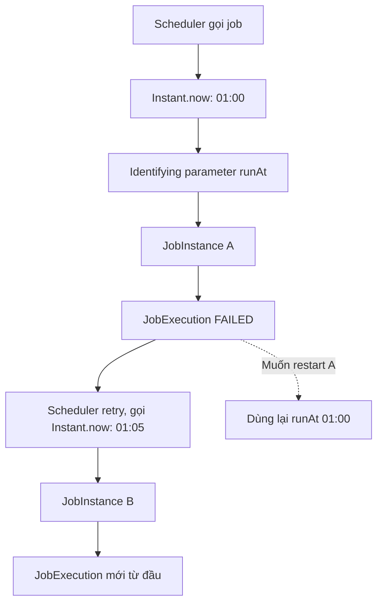

# Thời gian hiện tại làm parameter có ổn định không?

Trong Spring Batch, dùng thời gian hiện tại làm JobParameter là hợp lệ về mặt kỹ thuật, nhưng không phải lúc nào cũng ổn định về mặt danh tính job và khả năng restart. Kết quả phụ thuộc vào hai điều: **thời gian được tạo lúc nào** và **parameter đó có được đánh dấu là identifying hay không**.

Nếu mỗi lần launch đều gọi now() rồi đưa kết quả vào một identifying parameter, mỗi lần gọi thường tạo ra một JobInstance mới. Khi execution trước thất bại, lần thử tiếp theo có thể bị xem là một công việc logic khác và không tiếp tục từ metadata cũ. Ngược lại, nếu một mốc thời gian được tạo một lần, lưu lại và truyền nguyên giá trị đó cho lần restart, nó có thể là một parameter ổn định.

Điều quan trọng là phân biệt thời điểm chạy với khoảng dữ liệu cần xử lý. Một batch thường nên được định danh bằng ngày nghiệp vụ, mã lô hoặc cửa sổ thời gian cố định. Thời điểm yêu cầu launch chỉ nên là thông tin audit nếu nó không làm thay đổi dữ liệu mà job xử lý.

## 1. JobParameters có vai trò gì trong danh tính của job?

Spring Batch phân biệt JobInstance và JobExecution:

- **JobInstance** đại diện cho một lần chạy logic, được xác định bởi tên job và các identifying JobParameters.
- **JobExecution** đại diện cho một lần thực thi cụ thể của instance đó. Một instance có thể có nhiều execution, ví dụ execution đầu thất bại và execution tiếp theo restart thành công.

Vì vậy, cùng một job name và cùng bộ identifying parameters sẽ trỏ đến cùng một JobInstance. Tham số không identifying được lưu cùng execution để bổ sung thông tin, nhưng không tham gia tạo danh tính instance.

Ví dụ, hai lần gọi sau tạo cùng danh tính logic nếu businessDate là identifying và requestedAt là non-identifying:

| Parameter | Lần gọi thứ nhất | Lần gọi thứ hai | Identifying? |
|---|---|---|---|
| businessDate | 2026-11-15 | 2026-11-15 | Có |
| requestedAt | 2026-11-15T01:00:00Z | 2026-11-15T01:04:00Z | Không |

Trong trường hợp này, requestedAt thay đổi nhưng không tạo một JobInstance mới. Tuy nhiên, nếu code dùng requestedAt để chọn dữ liệu hoặc thay đổi kết quả nghiệp vụ, việc thay đổi nó khi restart có thể làm cho cùng một instance xử lý một tập dữ liệu khác. Vì vậy, mọi parameter có ảnh hưởng đến nội dung công việc cần được giữ cố định trong suốt vòng đời của instance.

## 2. Điều gì xảy ra nếu mỗi lần launch đều truyền thời gian hiện tại?

Xét đoạn code:

```java
JobParameters parameters = new JobParametersBuilder()
        .addString("runAt", Instant.now().toString(), true)
        .toJobParameters();

jobLauncher.run(invoiceImportJob, parameters);
```

Instant.now() tạo một giá trị mới ở mỗi lần gọi. Tham số runAt được đánh dấu true, tức identifying. Nếu ứng dụng chạy lại đoạn code sau khi job thất bại, giá trị timestamp gần như chắc chắn khác. Spring Batch xem đó là một JobInstance khác.

Ví dụ:

| Lần launch | Giá trị runAt | Kết quả |
|---|---|---|
| Lần đầu | 2026-11-15T01:00:00Z | Tạo instance A |
| Retry sau lỗi | 2026-11-15T01:05:00Z | Tạo instance B |
| Restart đúng instance A | Dùng lại 2026-11-15T01:00:00Z | Tiếp tục instance A nếu đủ điều kiện |

Instance A có thể vẫn ở trạng thái FAILED, trong khi instance B bắt đầu xử lý lại từ đầu. Điều này dễ tạo ra hai luồng xử lý cho cùng một lô dữ liệu.

### Sơ đồ danh tính khi timestamp thay đổi



Vấn đề không nằm ở kiểu dữ liệu thời gian. Vấn đề là mỗi lần retry lại tạo một identifying value mới, khiến danh tính logic thay đổi.

## 3. Khi nào thời gian hiện tại có thể là identifying parameter?

Timestamp có thể là identifying parameter nếu mỗi lần chạy đại diện cho một snapshot hoặc một yêu cầu độc lập, và timestamp được tạo một lần rồi lưu bền vững để mọi lần retry/restart của yêu cầu đó dùng lại đúng giá trị.

Ví dụ:

- Một người dùng yêu cầu tạo báo cáo snapshot tại thời điểm cụ thể.
- Một quy trình cần xử lý dữ liệu đến trước một cutoff cố định.
- Một lần export có mã phiên bản hoặc mốc chốt dữ liệu riêng.
- Một batch được định danh theo cửa sổ thời gian, chẳng hạn từ 10:00 đến 11:00 UTC.

Trong các trường hợp này, thời gian không còn là “giờ hiện tại mỗi lần chạy”. Nó là một phần của hợp đồng đầu vào đã được chốt. Nếu cutoff thay đổi, nội dung dữ liệu cần xử lý cũng thay đổi, vì vậy việc tạo một JobInstance mới có thể là hành vi đúng.

Ví dụ tạo một cửa sổ thời gian ở tầng điều phối:

```java
Instant windowStart = Instant.parse("2026-11-15T01:00:00Z");
Instant windowEnd = Instant.parse("2026-11-15T02:00:00Z");

JobParameters parameters = new JobParametersBuilder()
        .addString("windowStart", windowStart.toString(), true)
        .addString("windowEnd", windowEnd.toString(), true)
        .toJobParameters();

jobLauncher.run(invoiceImportJob, parameters);
```

Scheduler hoặc hệ thống điều phối cần lưu hai giá trị này cùng yêu cầu batch. Khi retry, nó gửi lại cùng windowStart và windowEnd, không tính lại cửa sổ từ đồng hồ hiện tại.

## 4. Chọn parameter theo ý nghĩa nghiệp vụ

Trước khi đưa timestamp vào JobParameters, hãy xác định job cần phân biệt điều gì.

| Mục tiêu của job | Parameter nên dùng | Cách định danh gợi ý |
|---|---|---|
| Xử lý một lần cho mỗi ngày nghiệp vụ | businessDate | Identifying |
| Xử lý một giờ hoặc một khoảng dữ liệu | windowStart, windowEnd | Identifying |
| Nhập một file cụ thể | fileId, checksum hoặc tên file bất biến | Identifying |
| Xử lý một yêu cầu export độc lập | requestId hoặc snapshotId | Identifying |
| Ghi nhận lúc yêu cầu được gửi | requestedAt | Thường non-identifying |
| Ghi nhận lúc ứng dụng bắt đầu xử lý | startedAt hoặc metadata execution | Thường không cần truyền vào |
| Ghi chú nguồn gọi hoặc người yêu cầu | requestedBy, source | Thường non-identifying |

Một nguyên tắc hữu ích: **nếu thay đổi giá trị parameter có nghĩa là job phải xử lý một tập dữ liệu hoặc kết quả nghiệp vụ khác, parameter đó thường nên tham gia danh tính instance**. Nếu giá trị chỉ phục vụ log, audit hoặc tương quan yêu cầu, nó thường không cần là identifying.

Không phải mọi timestamp đều nên là identifying. Cũng không phải mọi timestamp đều nên là non-identifying. Quyết định dựa trên ý nghĩa của timestamp trong hợp đồng dữ liệu.

## 5. Dùng business date thay cho thời gian launch

Với batch chạy theo ngày, businessDate thường ổn định và dễ hiểu hơn một timestamp chính xác đến mili giây.

Ví dụ, job tổng hợp giao dịch của ngày nghiệp vụ:

```java
LocalDate businessDate = LocalDate.of(2026, 11, 15);

JobParameters parameters = new JobParametersBuilder()
        .addString("businessDate", businessDate.toString(), true)
        .toJobParameters();
```

Khi job thất bại, restart bằng đúng ngày nghiệp vụ đó. Nếu lịch chạy bị trễ từ 00:05 sang 00:20, businessDate vẫn là ngày cần xử lý; danh tính job không bị thay đổi chỉ vì thời điểm scheduler thực sự kích hoạt.

### Múi giờ là một phần của quy tắc nghiệp vụ

Ngày nghiệp vụ không nhất thiết trùng với ngày UTC hoặc ngày của máy chủ. Một hệ thống có thể chốt ngày theo múi giờ của thị trường, chi nhánh hoặc hợp đồng nghiệp vụ.

Hãy chọn ZoneId rõ ràng. Không dựa vào múi giờ mặc định của máy chủ vì môi trường local, container và production có thể khác nhau.

Ví dụ tính khoảng thời gian của một ngày theo múi giờ nghiệp vụ:

```java
ZoneId businessZone = ZoneId.of("Asia/Ho_Chi_Minh");
LocalDate businessDate = LocalDate.of(2026, 11, 15);

Instant windowStart = businessDate
        .atStartOfDay(businessZone)
        .toInstant();

Instant windowEnd = businessDate.plusDays(1)
        .atStartOfDay(businessZone)
        .toInstant();
```

Khi cần xử lý ngày địa phương, hãy tính đầu ngày và đầu ngày kế tiếp trong cùng ZoneId, rồi chuyển thành Instant. Không giả định một ngày địa phương luôn dài đúng 24 giờ: các múi giờ có thay đổi daylight saving time có ngày dài hoặc ngắn hơn 24 giờ.

Trong ví dụ, Asia/Ho_Chi_Minh chỉ là múi giờ minh họa. Hãy thay bằng múi giờ được quy định cho nghiệp vụ của hệ thống.

## 6. Dùng cửa sổ thời gian cố định cho batch incremental

Batch incremental thường đọc các bản ghi phát sinh trong một khoảng. Nên định nghĩa khoảng theo dạng nửa mở:

```sql
WHERE created_at >= :windowStart
  AND created_at <  :windowEnd
```

Khoảng [windowStart, windowEnd) có nghĩa:

- Bản ghi đúng tại windowStart được bao gồm.
- Bản ghi đúng tại windowEnd thuộc cửa sổ tiếp theo.
- Hai cửa sổ liền nhau không chồng lấn ở ranh giới.

Ví dụ, cửa sổ 10:00–11:00 và 11:00–12:00 không xử lý trùng bản ghi đúng lúc 11:00.

### Đưa cửa sổ vào JobParameters

```java
JobParameters parameters = new JobParametersBuilder()
        .addString("windowStart", windowStart.toString(), true)
        .addString("windowEnd", windowEnd.toString(), true)
        .addString("requestedAt", Instant.now(clock).toString(), false)
        .toJobParameters();
```

Ở đây, windowStart và windowEnd xác định tập dữ liệu nên là identifying. requestedAt chỉ ghi nhận lúc yêu cầu được tạo nên không tham gia danh tính. Nếu phải restart, vẫn nên giữ nguyên toàn bộ đầu vào nghiệp vụ của cửa sổ.

Reader hoặc query service lấy hai giá trị này từ job parameters:

```java
@Bean
@StepScope
JdbcCursorItemReader<Invoice> invoiceReader(
        DataSource dataSource,
        @Value("#{jobParameters['windowStart']}") String startValue,
        @Value("#{jobParameters['windowEnd']}") String endValue) {

    Instant start = Instant.parse(startValue);
    Instant end = Instant.parse(endValue);

    return new JdbcCursorItemReaderBuilder<Invoice>()
            .name("invoiceReader")
            .dataSource(dataSource)
            .sql("""
                    SELECT invoice_id, customer_id, amount
                    FROM invoice
                    WHERE created_at >= ?
                      AND created_at < ?
                    ORDER BY created_at, invoice_id
                    """)
            .preparedStatementSetter(statement -> {
                statement.setTimestamp(1, Timestamp.from(start));
                statement.setTimestamp(2, Timestamp.from(end));
            })
            .rowMapper((resultSet, rowNum) -> new Invoice(
                    resultSet.getString("invoice_id"),
                    resultSet.getString("customer_id"),
                    resultSet.getBigDecimal("amount")))
            .saveState(true)
            .build();
}
```

Đây là ví dụ minh họa cách truyền khoảng cố định vào reader. Kiểu ánh xạ timestamp cần phù hợp với database, JDBC driver và kiểu cột thực tế. Với database lưu TIMESTAMP WITHOUT TIME ZONE, phải quy định rõ quy ước timezone ở tầng ứng dụng; với cột có timezone, kiểm tra cách driver chuyển đổi giá trị.

Thứ tự đọc cần ổn định. ORDER BY created_at, invoice_id dùng thêm khóa phụ để phân biệt các bản ghi có cùng thời điểm. Nếu dữ liệu nguồn có thể thay đổi trong lúc job chạy, cần xem xét snapshot isolation, staging hoặc một watermark được chốt tại đầu job. Chỉ cố định hai parameter chưa đủ bảo đảm một nguồn dữ liệu mutable sẽ trả về cùng kết quả khi restart.

## 7. Không gọi now() rải rác trong lúc xử lý

Một lỗi thiết kế khác là mỗi chunk hoặc mỗi item lại lấy thời gian hiện tại để quyết định dữ liệu:

```java
// Không nên: cutoff thay đổi theo thời điểm mỗi lần xử lý.
Instant cutoff = Instant.now();
return repository.findCreatedBefore(cutoff);
```

Nếu job kéo dài 30 phút, item đầu và item cuối có thể được xử lý với hai cutoff khác nhau. Khi restart, cutoff lại thay đổi. Điều này làm tập dữ liệu không còn được xác định bởi một hợp đồng đầu vào duy nhất.

Thay vào đó, chốt cutoff một lần ở đầu lần chạy và truyền nó vào job:

```java
Instant cutoff = Instant.now(clock);

JobParameters parameters = new JobParametersBuilder()
        .addString("cutoff", cutoff.toString(), true)
        .toJobParameters();
```

Các step sử dụng cùng cutoff từ JobParameters. Khi restart, hệ thống dùng lại giá trị đã lưu trong yêu cầu ban đầu.

Nếu cutoff chỉ phục vụ mục đích ghi nhận thời điểm thực thi và không ảnh hưởng dữ liệu, có thể để nó non-identifying hoặc dùng các trường thời gian metadata sẵn có như create/start/end time. Không cần đưa mọi mốc thời gian vào parameters.

## 8. Dùng Clock để tạo thời gian có thể kiểm soát

Gọi trực tiếp Instant.now() hoặc LocalDate.now() ở nhiều nơi khiến code phụ thuộc đồng hồ hệ thống, khó kiểm thử và dễ tạo ra giá trị khác nhau giữa các lần gọi.

Java cung cấp java.time.Clock để tách nguồn thời gian khỏi logic:

```java
@Configuration
public class TimeConfiguration {

    @Bean
    Clock batchClock() {
        return Clock.systemUTC();
    }
}
```

Khi tạo parameters, inject Clock:

```java
public JobParameters createParameters(
        Clock batchClock,
        Instant windowStart,
        Instant windowEnd) {

    Instant requestedAt = Instant.now(batchClock);

    return new JobParametersBuilder()
            .addString("windowStart", windowStart.toString(), true)
            .addString("windowEnd", windowEnd.toString(), true)
            .addString("requestedAt", requestedAt.toString(), false)
            .toJobParameters();
}
```

Clock.systemUTC() cung cấp đồng hồ hệ thống theo UTC. Nếu nghiệp vụ cần ngày địa phương, dùng batchClock.withZone(businessZone) khi tính LocalDate.

### Kiểm thử với thời gian cố định

Có thể thay clock hệ thống bằng clock cố định trong unit test:

```java
Clock fixedClock = Clock.fixed(
        Instant.parse("2026-11-15T01:00:00Z"),
        ZoneOffset.UTC);

Instant requestedAt = Instant.now(fixedClock);
assertEquals(
        Instant.parse("2026-11-15T01:00:00Z"),
        requestedAt);
```

Test không cần chờ đồng hồ thật và có thể kiểm tra chính xác business date, cutoff hoặc window được tạo ra. Đây cũng là cách kiểm tra rằng hai lần tạo parameters cho cùng một yêu cầu dùng cùng giá trị thời gian đã chốt.

## 9. Thời gian nào nên là identifying, thời gian nào nên là non-identifying?

Quy tắc thực hành:

| Thời gian | Ví dụ | Khuyến nghị |
|---|---|---|
| Ngày nghiệp vụ | 2026-11-15 | Identifying nếu một instance xử lý một ngày |
| Khoảng dữ liệu | windowStart, windowEnd | Identifying nếu khoảng xác định dữ liệu |
| Snapshot cutoff | asOf | Identifying nếu thay đổi cutoff làm thay đổi kết quả |
| Thời điểm nhận yêu cầu | requestedAt | Non-identifying nếu chỉ phục vụ audit |
| Thời điểm ứng dụng bắt đầu chạy | START_TIME trong metadata | Thường không cần parameter riêng |
| Thời điểm hoàn tất | END_TIME trong metadata | Thường không cần parameter riêng |
| Thời điểm xử lý từng bản ghi | processedAt | Xem xét semantics; không lấy now() tùy tiện trong mỗi lần retry |

Một parameter non-identifying vẫn được lưu trong metadata của execution. “Non-identifying” không có nghĩa là không được lưu; nó chỉ có nghĩa giá trị đó không tham gia xác định JobInstance.

Nếu parameter non-identifying được dùng để quyết định dữ liệu, thay đổi giá trị giữa các execution của cùng instance có thể khiến cùng một instance mang hai ý nghĩa nghiệp vụ. Vì vậy, không nên dùng cờ non-identifying như cách né tạo instance mới khi parameter thực tế làm thay đổi kết quả.

## 10. Timestamp có phải là mã chạy duy nhất tốt không?

Timestamp có thể phân biệt nhiều lần chạy, nhưng không phải lúc nào cũng là khóa duy nhất đáng tin cậy:

- Hai yêu cầu có thể đến trong cùng độ phân giải timestamp mà ứng dụng lưu.
- Nhiều máy có thể lệch đồng hồ.
- Timestamp có thể được làm tròn hoặc chuẩn hóa khác nhau giữa các hệ thống.
- Cùng một yêu cầu retry có thể nhận timestamp mới nếu tạo lại parameters.

Nếu cần định danh một yêu cầu độc lập, một requestId hoặc batchId duy nhất thường rõ nghĩa hơn. Tạo ID một lần ở nơi tiếp nhận yêu cầu, lưu nó bền vững và dùng lại khi retry.

Ví dụ:

```java
String batchId = request.batchId(); // ID đã được lưu ở tầng điều phối

JobParameters parameters = new JobParametersBuilder()
        .addString("batchId", batchId, true)
        .addString("requestedAt", request.requestedAt().toString(), false)
        .toJobParameters();
```

Nếu một request có thể được gửi lại, hệ thống điều phối cần giữ cùng batchId cho cùng một yêu cầu logic. Nếu sinh UUID mới mỗi lần nhận lại thông điệp, vấn đề tạo instance mới vẫn xuất hiện dù không dùng timestamp.

## 11. Retry, restart và reprocess khác nhau ra sao?

Ba hành vi này thường bị nhầm lẫn khi thiết kế timestamp parameter.

### Retry của tầng điều phối

Scheduler hoặc message consumer thử gửi lại cùng yêu cầu vì chưa nhận được xác nhận. Yêu cầu đó nên mang cùng business key, batchId hoặc cửa sổ dữ liệu. Không tạo timestamp identifying mới cho mỗi lần giao lại.

### Restart một JobExecution thất bại

Restart tiếp tục cùng JobInstance. Các identifying parameters phải khớp với instance ban đầu. Dùng chức năng restart được Spring Batch hỗ trợ hoặc tái sử dụng đúng bộ identifying parameters theo cách launch được cấu hình.

### Reprocess một lô đã hoàn tất

Reprocess là một yêu cầu nghiệp vụ mới để xử lý lại dữ liệu. Nó cần được phân biệt có chủ đích, ví dụ bằng reprocessVersion, reprocessRequestId hoặc một batch ID mới. Phải xác định writer sẽ bỏ qua, cập nhật hay tạo phiên bản dữ liệu mới.

Một bảng quyết định:

| Tình huống | Identifying parameters |
|---|---|
| Restart job thất bại | Giữ nguyên |
| Scheduler giao lại cùng yêu cầu | Giữ nguyên business key/window/batch ID |
| Xử lý ngày nghiệp vụ tiếp theo | Thay businessDate |
| Xử lý cửa sổ giờ tiếp theo | Thay windowStart và windowEnd |
| Reprocess có chủ đích | Tạo ID/version mới theo quy tắc nghiệp vụ |

Đừng dùng một timestamp mới để giả lập reprocess nếu không có chính sách dữ liệu tương ứng. Việc tạo instance mới không tự làm cho writer an toàn khi ghi trùng.

## 12. Kết hợp JobParameters với idempotency

Giữ identifying parameters ổn định giúp Spring Batch nhận diện đúng instance, nhưng không tự bảo đảm dữ liệu nghiệp vụ không bị ghi trùng.

Ví dụ, một writer gọi HTTP service. Service đã nhận yêu cầu và tạo giao dịch, nhưng ứng dụng mất kết nối trước khi nhận response. Khi restart, writer có thể gửi lại request. Metadata không thể biết chắc service ngoài đã thực hiện giao dịch hay chưa.

Các biện pháp thường dùng:

- Dùng batchId hoặc sourceRecordId làm idempotency key ở hệ thống đích.
- Đặt unique constraint trên khóa nghiệp vụ.
- Dùng upsert hoặc insert có điều kiện.
- Ghi dữ liệu vào staging rồi merge theo khóa ổn định.
- Dùng transactional outbox để phát sự kiện sau khi commit dữ liệu nghiệp vụ.

Danh tính job trả lời “đây là lô logic nào”; idempotency trả lời “nếu một thao tác được gửi lại thì hệ thống có tạo kết quả trùng hay không”. Hai cơ chế bổ sung cho nhau.

## 13. Các lỗi thường gặp khi dùng thời gian làm parameter

### Mỗi lần retry lại gọi Instant.now()

Nếu timestamp là identifying, lần retry tạo instance mới. Lưu business window hoặc batch ID ngay khi nhận yêu cầu và tái sử dụng.

### Dùng LocalDateTime mà không có múi giờ

LocalDateTime chỉ biểu diễn ngày và giờ trên lịch, không xác định một thời điểm duy nhất trên toàn cầu. Với dữ liệu xuyên hệ thống, ưu tiên Instant hoặc cặp local date-time cùng ZoneId rõ ràng.

### Dùng múi giờ mặc định của máy

Máy local và production có thể có timezone khác nhau. Cấu hình timezone nghiệp vụ tường minh và chuyển về Instant khi lưu ranh giới dữ liệu.

### Tính cutoff lại trong từng step

Các step có thể đọc những tập dữ liệu khác nhau nếu mỗi step gọi now() ở thời điểm khác. Chốt cutoff một lần và truyền qua JobParameters hoặc ExecutionContext theo đúng phạm vi sử dụng.

### Đưa thời điểm audit vào danh tính job

Một requestedAt chính xác đến mili giây thường khiến mỗi lần launch thành một instance mới dù dữ liệu nghiệp vụ giống nhau. Nếu chỉ cần audit, để nó non-identifying hoặc dựa vào thời gian trong metadata.

### Dùng timestamp làm khóa duy nhất nhưng không chuẩn hóa độ chính xác

Một hệ thống có thể lưu mili giây trong khi hệ thống khác lưu microsecond hoặc làm tròn xuống giây. Chuẩn hóa định dạng và độ chính xác ở ranh giới tích hợp; dùng ID riêng khi cần tính duy nhất.

### Coi cùng cửa sổ thời gian là cùng một snapshot dữ liệu

Parameters cố định không đóng băng dữ liệu nguồn. Nếu bản ghi có thể đến muộn hoặc bị sửa, restart có thể đọc kết quả khác. Cần snapshot, staging, watermark hoặc quy tắc xử lý late-arriving data.

## 14. Mẫu triển khai: job theo ngày có thể restart

Ví dụ dưới đây kết hợp business timezone, Clock, ngày nghiệp vụ và cửa sổ nửa mở. Ngày nghiệp vụ được chốt một lần, sau đó mọi lần restart sử dụng lại đúng businessDate, windowStart và windowEnd.

```java
@Configuration
public class BatchTimeConfiguration {

    @Bean
    Clock batchClock() {
        return Clock.systemUTC();
    }

    @Bean
    ZoneId businessZone() {
        return ZoneId.of("Asia/Ho_Chi_Minh");
    }
}
```

Service tạo parameters cho một lần xử lý:

```java
@Service
public class DailyBatchParametersFactory {

    private final Clock clock;
    private final ZoneId businessZone;

    public DailyBatchParametersFactory(
            Clock clock,
            ZoneId businessZone) {
        this.clock = clock;
        this.businessZone = businessZone;
    }

    public JobParameters forBusinessDate(LocalDate businessDate) {
        Instant start = businessDate
                .atStartOfDay(businessZone)
                .toInstant();
        Instant end = businessDate.plusDays(1)
                .atStartOfDay(businessZone)
                .toInstant();

        return new JobParametersBuilder()
                .addString("businessDate", businessDate.toString(), true)
                .addString("windowStart", start.toString(), true)
                .addString("windowEnd", end.toString(), true)
                .addString(
                        "requestedAt",
                        Instant.now(clock).toString(),
                        false)
                .toJobParameters();
    }
}
```

Scheduler nên xác định businessDate theo lịch nghiệp vụ và truyền ngày đó vào factory. Nếu scheduler retry cùng một lịch chạy, nó phải giữ lại ngày đã chọn thay vì gọi LocalDate.now() ở một thời điểm khác rồi tạo ngày mới.

Trong ứng dụng production, có thể lưu yêu cầu batch vào bảng điều phối trước khi launch:

| batch_id | business_date | window_start | window_end | status |
|---|---|---|---|---|
| daily-20261115 | 2026-11-15 | 2026-11-14T17:00:00Z | 2026-11-15T17:00:00Z | PENDING |

Bảng điều phối giữ đầu vào ổn định và trạng thái yêu cầu ở cấp ứng dụng. JobRepository tiếp tục giữ metadata execution của Spring Batch. Hai nơi có mục đích khác nhau và có thể liên kết bằng batchId.

## 15. Checklist quyết định trước khi dùng thời gian làm JobParameter

Trước khi thêm timestamp, hãy trả lời:

1. Timestamp đại diện cho thời điểm yêu cầu, thời điểm chạy hay ranh giới dữ liệu?
2. Nếu chạy lại sau lỗi, giá trị đó có được giữ nguyên không?
3. Nếu giá trị thay đổi, job có cần được xem là một JobInstance khác không?
4. Parameter có ảnh hưởng đến tập dữ liệu hoặc kết quả nghiệp vụ không?
5. Múi giờ và độ chính xác timestamp đã được quy định chưa?
6. Nếu scheduler gửi cùng yêu cầu hai lần, nó có tái sử dụng cùng business key hoặc batch ID không?
7. Writer có idempotent nếu item được xử lý lại không?
8. Dữ liệu nguồn có thể thay đổi trong lúc job chạy hoặc giữa hai lần restart không?

Nếu timestamp chỉ nhằm ghi nhận lúc launch, hãy cân nhắc metadata thời gian có sẵn hoặc parameter non-identifying. Nếu timestamp xác định snapshot/cutoff, hãy chốt giá trị một lần và dùng nó làm identifying input. Nếu cần ID duy nhất cho một yêu cầu, dùng request ID hoặc batch ID bền vững.

## 16. Kết luận thực hành

Thời gian hiện tại có thể được dùng làm JobParameter, nhưng lời gọi now() mới ở mỗi lần launch không ổn định cho restart khi parameter đó là identifying. Spring Batch dùng các identifying parameters để xác định JobInstance; chỉ cần một giá trị thay đổi, lần chạy có thể trở thành instance khác.

Với batch theo lịch, ưu tiên business date hoặc cửa sổ dữ liệu cố định. Với snapshot, chốt cutoff một lần. Với audit, dùng thời gian non-identifying hoặc metadata execution. Dùng Clock và timezone rõ ràng để tạo thời gian có thể kiểm soát, và giữ nguyên đầu vào nghiệp vụ khi restart.

Hãy nhớ rằng danh tính job và tính idempotent là hai vấn đề riêng. Parameter ổn định giúp framework tiếp tục đúng instance; writer idempotent và nguồn dữ liệu có thể tái lập mới giúp kết quả nghiệp vụ an toàn khi retry hoặc restart.
