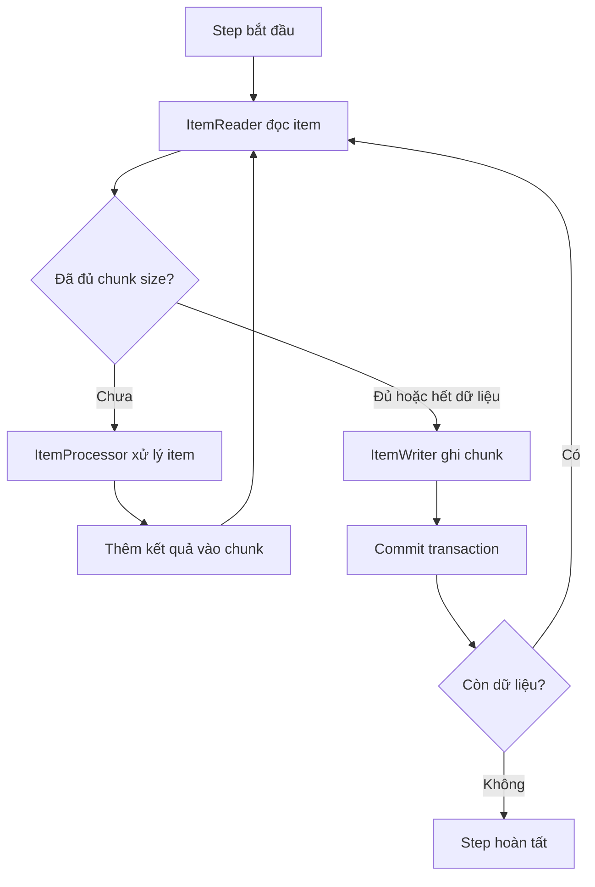
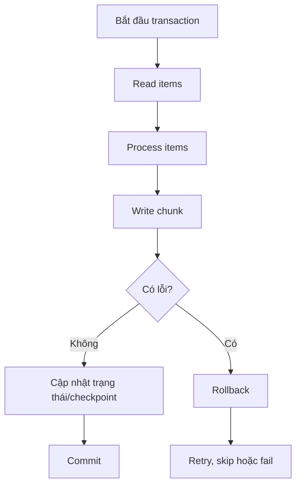

# Chunk-oriented processing là gì?

Chunk-oriented processing là mô hình xử lý dữ liệu theo từng nhóm nhỏ (chunk) trong Spring Batch. Thay vì đọc toàn bộ dữ liệu vào bộ nhớ rồi xử lý và ghi một lần, step đọc một số lượng item, xử lý từng item, ghi kết quả của nhóm đó và commit transaction. Sau khi một chunk hoàn tất, step tiếp tục với chunk kế tiếp cho đến khi hết dữ liệu.

Mô hình này phù hợp với các job nhập dữ liệu, chuyển đổi dữ liệu, đối soát, tính toán định kỳ và xuất báo cáo có nhiều bản ghi. Nó giúp kiểm soát bộ nhớ, xác định ranh giới giao dịch, theo dõi tiến độ và hỗ trợ phục hồi khi một phần công việc gặp lỗi.

## 1. Vì sao cần xử lý theo chunk?

Giả sử một ứng dụng cần nhập 2 triệu giao dịch từ tệp CSV vào cơ sở dữ liệu. Nếu đọc tất cả 2 triệu dòng vào một danh sách, ứng dụng có thể tiêu tốn nhiều bộ nhớ. Nếu ghi từng dòng với một transaction riêng, số lần commit rất lớn và chi phí giao dịch có thể làm giảm thông lượng. Nếu ghi toàn bộ 2 triệu dòng trong một transaction, transaction có thể kéo dài quá lâu, giữ khóa lâu và khó phục hồi khi xảy ra lỗi.

Chunk-oriented processing chia công việc thành các nhóm có kích thước cấu hình được. Ví dụ, với chunk size là 500, step xử lý 500 item trong một đơn vị giao dịch, sau đó commit rồi chuyển sang nhóm tiếp theo.

Những lợi ích chính:

- **Kiểm soát bộ nhớ:** chỉ cần giữ một nhóm item đang xử lý thay vì toàn bộ dữ liệu đầu vào.
- **Giảm chi phí commit:** ghi nhiều item trong một transaction thay vì commit sau từng item.
- **Giới hạn phạm vi rollback:** khi một chunk thất bại, transaction của chunk đó có thể rollback.
- **Theo dõi tiến độ:** Spring Batch ghi metadata về số item đã đọc, ghi, lọc, bỏ qua và trạng thái của step.
- **Hỗ trợ restart:** reader có khả năng lưu trạng thái có thể lưu checkpoint để step tiếp tục từ vị trí phù hợp sau khi job bị gián đoạn.

Chunk không có nghĩa là phải đọc một tệp hoàn chỉnh vào một mảng. Nó là một đơn vị xử lý được lặp lại trong suốt vòng đời của step.

## 2. Luồng read – process – write

Một chunk-oriented step thường gồm ba thành phần:

- **`ItemReader`:** đọc một item từ nguồn dữ liệu, chẳng hạn một dòng CSV, một bản ghi cơ sở dữ liệu hoặc một message.
- **`ItemProcessor`:** tùy chọn; kiểm tra, lọc, chuyển đổi hoặc làm giàu item.
- **`ItemWriter`:** nhận các item đầu ra của chunk và ghi chúng tới đích, chẳng hạn cơ sở dữ liệu, tệp hoặc hệ thống khác.

Luồng xử lý khái quát:



Sơ đồ đơn giản hóa cách framework điều phối. Trong thực tế, reader có thể kết thúc trước khi đủ chunk size; processor có thể lọc item; và lỗi có thể dẫn đến rollback, retry hoặc skip tùy cấu hình.

### ItemReader

`ItemReader<T>` đọc dữ liệu từng item. Mỗi lần gọi `read()` thường trả về một item hoặc `null` khi không còn dữ liệu.

Ví dụ, reader có thể đọc lần lượt các dòng trong tệp:

```java
public class OrderReader implements ItemReader<Order> {

    private final Iterator<Order> orders;

    public OrderReader(List<Order> orders) {
        this.orders = orders.iterator();
    }

    @Override
    public Order read() {
        return orders.hasNext() ? orders.next() : null;
    }
}
```

Đây là ví dụ minh họa reader đơn giản. Với dữ liệu lớn, thường nên dùng reader có khả năng đọc phân trang, cursor hoặc streaming để tránh tải toàn bộ dữ liệu vào danh sách trước khi job bắt đầu.

### ItemProcessor

`ItemProcessor<I, O>` nhận một item đầu vào và trả về item đầu ra. Nó thường dùng để xác thực, chuẩn hóa, tính toán hoặc chuyển đổi kiểu dữ liệu.

```java
public class OrderProcessor implements ItemProcessor<Order, ProcessedOrder> {

    @Override
    public ProcessedOrder process(Order order) {
        if (order.isCancelled()) {
            return null; // Lọc đơn hàng đã hủy
        }

        return new ProcessedOrder(
                order.getId(),
                order.getAmount().multiply(new BigDecimal("1.08"))
        );
    }
}
```

Processor có thể trả về `null` để lọc item. Item đã được đọc nhưng không được chuyển cho writer. Đây là một quyết định nghiệp vụ, không phải exception và không được tính như một item bị skip.

Processor cũng có thể ném exception. Nếu step được cấu hình fault-tolerant, một số exception có thể được retry hoặc skip; nếu không, lỗi có thể làm step thất bại.

### ItemWriter

`ItemWriter<O>` nhận một nhóm item đầu ra và ghi chúng. Một lần gọi writer có thể xử lý nhiều item cùng lúc, ví dụ batch insert vào cơ sở dữ liệu.

Trong Spring Batch 5, chữ ký `write` sử dụng `Chunk<? extends T>`. Các phiên bản cũ có API writer nhận `List<? extends T>`, vì vậy cần dùng đúng chữ ký theo phiên bản dự án.

Writer nên thực hiện thao tác ghi theo lô khi hệ thống đích hỗ trợ, đồng thời phải xác định rõ transaction nào quản lý thao tác ghi. Nếu writer gọi API hoặc ghi tới hệ thống không tham gia cùng transaction, rollback của database không tự động hoàn tác tác dụng phụ đó.

## 3. Chunk size và commit interval

Chunk size là số lượng item được đọc để tạo một chunk trước khi writer ghi kết quả và transaction commit. Trong cấu hình Spring Batch, giá trị này thường được gọi là *commit interval*.

Ví dụ với chunk size là 100:

1. Reader đọc tối đa 100 item cho chunk hiện tại.
2. Processor xử lý từng item, có thể chuyển đổi hoặc lọc item.
3. Writer ghi các item đầu ra của chunk.
4. Nếu xử lý thành công, transaction commit.
5. Step tiếp tục với chunk tiếp theo.

Giả sử có 1.050 item đầu vào và không có lỗi hoặc filter:

| Chunk | Item đầu vào | Kết quả |
|---|---:|---|
| Chunk 1 | 100 | Ghi và commit |
| Chunk 2 | 100 | Ghi và commit |
| Chunk 3 | 100 | Ghi và commit |
| ... | ... | ... |
| Chunk 10 | 100 | Ghi và commit |
| Chunk 11 | 50 | Ghi và commit phần cuối |

Chunk cuối có thể nhỏ hơn chunk size khi reader hết dữ liệu. Với ví dụ trên, step xử lý 10 chunk đầy đủ và một chunk cuối gồm 50 item.

Chunk size là số lượng item đầu vào của chunk, không nhất thiết bằng số item writer ghi. Nếu processor lọc 10 item trong một chunk 100 item, writer chỉ nhận tối đa 90 item còn lại, chưa tính các item bị skip do lỗi.

### Chunk size ảnh hưởng điều gì?

| Chunk size | Ưu điểm | Đánh đổi |
|---|---|---|
| Nhỏ, ví dụ 10 | Transaction ngắn, ít item phải xử lý lại trong một chunk lỗi, dễ kiểm soát bộ nhớ | Nhiều lần commit, overhead transaction và gọi writer tăng |
| Trung bình, ví dụ 100–500 | Cân bằng giữa chi phí commit, bộ nhớ và khả năng phục hồi trong nhiều workload | Cần đo thực tế để chọn giá trị phù hợp |
| Lớn, ví dụ 5.000 | Có thể giảm số lần commit và tận dụng batch write tốt | Transaction dài hơn, dùng nhiều bộ nhớ hơn, rollback có thể tốn kém |

Không có một chunk size tối ưu cho mọi job. Cần cân nhắc:

- Kích thước trung bình của mỗi item và dữ liệu tạm trong processor.
- Tốc độ đọc của nguồn và tốc độ ghi của đích.
- Chi phí commit và khả năng batch insert/update của database.
- Thời gian giữ khóa và mức độ tranh chấp dữ liệu.
- Khả năng chịu rollback, retry và restart.
- Thời gian tối đa mà một transaction được phép chạy.

Nên bắt đầu bằng một giá trị vừa phải, đo thời gian xử lý, mức dùng bộ nhớ, số lần commit/rollback và tải database, sau đó điều chỉnh dựa trên số liệu thực tế.

## 4. Transaction boundary của một chunk

Trong chunk-oriented step tiêu chuẩn, Spring Batch dùng transaction manager để quản lý một đơn vị xử lý. Transaction thường bắt đầu trước khi xử lý chunk và được commit sau khi writer hoàn tất thành công cùng các cập nhật trạng thái liên quan.



Khi transaction commit thành công, dữ liệu được ghi trong transaction đó trở nên bền vững theo cơ chế của resource tham gia transaction. Khi transaction rollback, các thay đổi thuộc transaction đó được hoàn tác.

Ranh giới transaction phụ thuộc vào `PlatformTransactionManager` và tài nguyên được enlist. Nếu reader hoặc writer thao tác trên nhiều hệ thống với transaction manager khác nhau, không nên giả định tất cả tài nguyên sẽ commit hoặc rollback nguyên tử cùng nhau. Muốn phối hợp nhiều hệ thống cần thiết kế riêng, chẳng hạn outbox, idempotency hoặc quy trình đối soát.

### Điều gì xảy ra khi một chunk thất bại?

Giả sử chunk có 100 item. Reader và processor đã xử lý xong, writer bắt đầu ghi nhưng gặp lỗi ở giữa quá trình. Nếu lỗi làm transaction thất bại và không được skip/retry thành công, transaction của chunk sẽ rollback đối với các thao tác tham gia transaction đó.

Các chunk trước đã commit vẫn được giữ. Khi job được restart, Spring Batch có thể tiếp tục từ checkpoint phù hợp nếu reader hỗ trợ lưu và khôi phục trạng thái. Chunk đang thất bại có thể phải được đọc và xử lý lại.

Điều này tạo ra một lợi ích quan trọng: lỗi ở chunk hiện tại không nhất thiết làm mất toàn bộ công việc đã hoàn thành. Tuy nhiên, tác dụng phụ bên ngoài transaction có thể đã xảy ra và phải được xử lý bằng thiết kế idempotent.

## 5. Ví dụ cấu hình chunk-oriented step

Trong Spring Batch 5, có thể xây dựng step theo chunk bằng `StepBuilder` và truyền `JobRepository`, `PlatformTransactionManager`:

```java
@Configuration
public class ImportJobConfiguration {

    @Bean
    public Step importOrdersStep(
            JobRepository jobRepository,
            PlatformTransactionManager transactionManager,
            ItemReader<Order> orderReader,
            ItemProcessor<Order, ProcessedOrder> orderProcessor,
            ItemWriter<ProcessedOrder> orderWriter) {

        return new StepBuilder("importOrdersStep", jobRepository)
                .<Order, ProcessedOrder>chunk(500, transactionManager)
                .reader(orderReader)
                .processor(orderProcessor)
                .writer(orderWriter)
                .build();
    }
}
```

Trong ví dụ:

- `Order` là kiểu item reader trả về.
- `ProcessedOrder` là kiểu item processor tạo ra và writer nhận vào.
- `chunk(500, transactionManager)` đặt commit interval là 500 item và chỉ định transaction manager cho chunk.
- `.reader(...)`, `.processor(...)` và `.writer(...)` gắn các thành phần xử lý vào step.
- `JobRepository` lưu metadata của step và job execution.

Nếu không cần biến đổi dữ liệu, có thể bỏ qua processor và cấu hình reader/writer phù hợp. Nếu step chỉ thực hiện một thao tác đơn lẻ như gọi stored procedure hoặc dọn thư mục, `Tasklet` có thể diễn đạt ý định rõ hơn.

Các phiên bản Spring Batch cũ có thể dùng API cấu hình khác, ví dụ `StepBuilderFactory` hoặc cách khai báo writer nhận `List`. Cần theo API của phiên bản đang sử dụng.

## 6. End-of-input và chunk cuối

`ItemReader` báo hết dữ liệu bằng cách trả về `null`. Nếu reader trả về `null` khi chunk hiện tại chưa đủ kích thước, Spring Batch vẫn xử lý phần item đã đọc được trong chunk cuối rồi kết thúc step.

Ví dụ, chunk size là 100 nhưng chỉ còn 35 item:

- Reader đọc 35 item.
- Lần đọc tiếp theo trả về `null`.
- Processor xử lý 35 item đã có.
- Writer ghi các item đầu ra còn lại.
- Transaction commit nếu xử lý thành công.
- Step kết thúc vì không còn dữ liệu.

Không cần đệm thêm item giả để đủ chunk size. Chunk cuối nhỏ hơn cấu hình là hành vi bình thường.

Nếu reader trả về `null` quá sớm do lỗi logic, step có thể kết thúc thành công nhưng dữ liệu chưa được xử lý hết. Vì vậy, cần xác định điều kiện kết thúc của reader rõ ràng, nhất là khi dùng cursor, phân trang hoặc đọc từ API.

## 7. Filter, skip và retry trong chunk processing

Chunk-oriented processing kết hợp được với các chính sách xử lý lỗi của Spring Batch.

### Filter

Processor trả về `null` để loại item khỏi đầu ra. Item đó đã được đọc nhưng writer không nhận. Ví dụ, job chỉ nhập đơn hàng đã thanh toán nên processor lọc các đơn hàng đang chờ.

### Skip

Nếu reader, processor hoặc writer ném exception, ứng dụng có thể cấu hình loại exception được phép bỏ qua và giới hạn số lần skip. Item bị skip không được ghi như item thành công. Các bộ đếm `readSkipCount`, `processSkipCount` và `writeSkipCount` cho biết lỗi xuất hiện ở giai đoạn nào.

### Retry

Retry phù hợp với lỗi tạm thời có thể biến mất sau một khoảng thời gian, ví dụ lỗi khóa database hoặc timeout dịch vụ. Spring Batch có thể thử lại thao tác theo chính sách được cấu hình. Nếu retry thành công, item có thể tiếp tục được xử lý; nếu hết số lần thử, lỗi có thể làm step thất bại hoặc được skip nếu chính sách cho phép.

Ví dụ cấu hình fault-tolerant ở mức khái quát:

```java
return new StepBuilder("importOrdersStep", jobRepository)
        .<Order, ProcessedOrder>chunk(500, transactionManager)
        .reader(orderReader)
        .processor(orderProcessor)
        .writer(orderWriter)
        .faultTolerant()
        .skip(InvalidOrderException.class)
        .skipLimit(100)
        .retry(DeadlockLoserDataAccessException.class)
        .retryLimit(3)
        .build();
```

Đây là ví dụ minh họa chính sách: bỏ qua lỗi dữ liệu nghiệp vụ có thể chấp nhận và thử lại lỗi deadlock có khả năng tạm thời. Trong ứng dụng thật, cần xác nhận exception class theo stack công nghệ và phiên bản Spring Batch, đồng thời tránh skip lỗi hạ tầng có thể làm sai dữ liệu.

## 8. Restart và checkpoint

Spring Batch lưu metadata thực thi trong `JobRepository`. Với reader hỗ trợ lưu trạng thái, framework có thể lưu thông tin cần thiết vào `ExecutionContext` tại các ranh giới commit. Khi job bị gián đoạn và được restart, reader có thể khôi phục vị trí đã xử lý và tiếp tục từ checkpoint.

Ví dụ, một tệp có 10.000 dòng và chunk size 500. Sau khi 8 chunk đã commit, máy chủ bị dừng. Nếu reader có thể lưu trạng thái và job được restart với cùng `JobInstance`, lần chạy tiếp theo có thể tiếp tục từ vị trí sau 4.000 item đã commit thay vì xử lý lại toàn bộ tệp.

Khả năng restart phụ thuộc vào:

- Reader có hỗ trợ lưu và khôi phục state hay không.
- `ExecutionContext` được lưu bền vững trong `JobRepository`.
- Job được cấu hình cho phép restart và dùng đúng identifying parameters.
- Nguồn dữ liệu có ổn định giữa các lần chạy hay không; ví dụ tệp đầu vào không bị thay nội dung sau khi checkpoint được tạo.
- Writer và các tác dụng phụ có thể chạy lại an toàn hay không.

Một reader tự viết có thể cần triển khai `ItemStream` để mở, cập nhật và đóng tài nguyên cũng như lưu checkpoint. Không phải mọi reader đều tự động khôi phục vị trí đọc.

Restart cũng không đồng nghĩa với exactly-once trên mọi hệ thống. Nếu writer gọi API đối tác, email đã gửi hoặc tệp đã xuất ra ngoài transaction có thể không được rollback. Nên dùng idempotency key, khóa duy nhất, outbox hoặc cơ chế đối soát để tránh tác dụng phụ trùng khi chunk được chạy lại.

## 9. Chunk-oriented processing và Tasklet khác nhau thế nào?

Trong Spring Batch, cả chunk-oriented step và tasklet step đều được thực thi như một step. Khác biệt nằm ở cách mô hình hóa công việc.

| Tiêu chí | Chunk-oriented | Tasklet |
|---|---|---|
| Mục đích | Xử lý nhiều item theo nhóm | Thực hiện một tác vụ cụ thể |
| Thành phần | Reader, processor tùy chọn, writer | Một `Tasklet` với phương thức thực thi |
| Ranh giới commit | Thường sau mỗi chunk | Theo transaction của lần gọi tasklet và cách tasklet được cấu hình |
| Ví dụ | Nhập một triệu khách hàng, chuyển đổi giao dịch | Xóa tệp tạm, gọi stored procedure, chuẩn bị thư mục |
| Bộ đếm item | Có ý nghĩa trực tiếp với pipeline item | Thường không có bộ đếm read/write tiêu chuẩn nếu tasklet không quản lý item |

Chọn chunk khi dữ liệu có thể biểu diễn thành các item độc lập hoặc xử lý theo nhóm. Chọn tasklet khi công việc là một thao tác hoặc quy trình ngắn không cần pipeline reader-processor-writer.

## 10. Theo dõi số liệu của chunk-oriented step

Spring Batch ghi các số liệu vào `StepExecution`. Các chỉ số thường dùng gồm:

| Chỉ số | Ý nghĩa |
|---|---|
| `readCount` | Số item reader trả về thành công |
| `writeCount` | Số item writer ghi thành công theo metadata step |
| `filterCount` | Số item processor lọc bằng cách trả về `null` |
| `readSkipCount` | Số lỗi đọc được skip |
| `processSkipCount` | Số lỗi xử lý được skip |
| `writeSkipCount` | Số lỗi ghi được skip |
| `commitCount` | Số lần commit được ghi nhận |
| `rollbackCount` | Số lần rollback được ghi nhận |

Các chỉ số này giúp phân biệt step chậm do đọc nguồn, xử lý CPU, ghi đích hay do rollback/retry. Ví dụ, `readCount` tăng nhanh nhưng `writeCount` thấp có thể do filter hoặc skip nhiều. `rollbackCount` cao có thể cho thấy transaction gặp deadlock, timeout hoặc lỗi writer.

Không nên suy ra mọi thứ từ một bộ đếm riêng lẻ. Hãy xem cùng trạng thái step, exit status, exception, thời gian xử lý và tải của nguồn/đích.

## 11. Tăng hiệu năng và những điểm cần chú ý

### Chọn reader phù hợp

Với dữ liệu lớn, tránh reader tải toàn bộ dữ liệu vào bộ nhớ. Dùng cursor hoặc paging reader cho database, flat-file reader cho tệp lớn và reader streaming phù hợp với nguồn dữ liệu khác. Với paging, cần sắp xếp ổn định và điều kiện phân trang nhất quán để tránh bỏ sót hoặc đọc trùng khi dữ liệu nguồn thay đổi.

### Dùng batch write

Nếu database hỗ trợ batch insert/update, writer nên tận dụng để giảm số round-trip. Tuy nhiên, batch write phải giữ đúng ranh giới transaction và xử lý rõ trường hợp một bản ghi trong batch gây lỗi.

### Tránh xử lý quá nặng trong transaction

Không nên giữ transaction mở trong thời gian dài để chờ API chậm hoặc thực hiện tác vụ ngoài database. Nếu cần gọi dịch vụ từ xa, cân nhắc timeout, outbox hoặc tách bước để giới hạn thời gian transaction.

### Đo lường trước khi tăng chunk size

Chunk lớn có thể tăng thông lượng nhờ ít commit hơn, nhưng cũng làm tăng bộ nhớ và thời gian rollback. Chunk nhỏ giảm phạm vi mỗi transaction nhưng tăng overhead. Hãy đo trên dữ liệu đại diện và môi trường gần production.

### Cân nhắc concurrency

Chunk-oriented processing có thể kết hợp partitioning hoặc các cơ chế song song. Tuy nhiên, nhiều worker cùng ghi một bảng có thể gây contention, deadlock hoặc làm giảm thông lượng. Cần chia dữ liệu theo khóa hoặc partition không giao nhau, kiểm soát số worker và bảo đảm reader/writer an toàn với cách thực thi đã chọn.

## 12. Ví dụ thực tế: nhập đơn hàng từ CSV

Một hệ thống nhận tệp `orders.csv` gồm 250.000 đơn hàng. Job cần kiểm tra trạng thái, chuẩn hóa tiền tệ, lọc đơn đã hủy và ghi dữ liệu hợp lệ vào database.

Thiết kế step:

1. `FlatFileItemReader` đọc từng dòng và ánh xạ thành `OrderInput`.
2. `OrderProcessor` xác thực dữ liệu, chuyển đổi thành `OrderRecord` và trả về `null` cho đơn bị hủy.
3. `JdbcBatchItemWriter` ghi các `OrderRecord` của chunk vào bảng đích.
4. Chunk size ban đầu đặt là 500 để đo hiệu năng.
5. Skip policy cho phép bỏ qua một số lỗi định dạng hoặc lỗi nghiệp vụ đã xác định; lỗi kết nối database được xử lý bằng retry hoặc làm step thất bại.
6. `JobRepository` lưu metadata và checkpoint để hỗ trợ theo dõi và restart.

Nếu không có filter hoặc skip, 250.000 item tạo ra 500 chunk với chunk size 500. Nếu có 12.000 đơn bị hủy, writer chỉ nhận tối đa 238.000 item, tương đương 476 chunk đầy đủ nếu các item phân bố đều và không có lỗi; số chunk thực tế phụ thuộc cách reader tạo nhóm và số item đầu ra mỗi chunk.

Giả sử job đã commit 300 chunk rồi máy chủ bị dừng. Các chunk đã commit được giữ trong database. Sau khi khắc phục nguyên nhân, job có thể restart với cùng identifying parameters. Reader hỗ trợ checkpoint sẽ tiếp tục từ vị trí phù hợp. Nếu một chunk đã gọi API đối tác trước khi rollback, ứng dụng cần cơ chế idempotency để tránh gửi yêu cầu trùng khi chunk chạy lại.

## 13. Khi nào nên dùng chunk-oriented processing?

Chunk-oriented processing phù hợp khi:

- Dữ liệu đầu vào có thể đọc tuần tự hoặc theo trang thành từng item.
- Mỗi item cần được xác thực, chuyển đổi hoặc làm giàu trước khi ghi.
- Cần xử lý hàng nghìn hoặc hàng triệu bản ghi mà vẫn kiểm soát bộ nhớ.
- Muốn ghi theo lô và commit theo nhóm để cân bằng thông lượng với độ an toàn transaction.
- Cần số liệu read/write/filter/skip và khả năng restart theo checkpoint.

Nó có thể không phải lựa chọn đơn giản nhất khi:

- Công việc chỉ là một thao tác ngắn, không có tập item; tasklet phù hợp hơn.
- Cần xử lý từng sự kiện liên tục với độ trễ rất thấp; hệ thống streaming hoặc message-driven có thể phù hợp hơn.
- Dữ liệu và phép tính cần phân tán trên quy mô lớn vượt khả năng của một batch application; có thể cần nền tảng xử lý phân tán chuyên dụng.

Việc chọn chunk size và mô hình xử lý cần dựa trên đặc điểm dữ liệu, hệ thống nguồn/đích và yêu cầu vận hành.

## 14. Những nguyên tắc cần nhớ

- Chunk-oriented processing chia step thành các nhóm item; mỗi nhóm được đọc, xử lý, ghi và commit theo một ranh giới giao dịch.
- `ItemReader` đọc item; `ItemProcessor` tùy chọn chuyển đổi hoặc lọc; `ItemWriter` ghi nhóm kết quả.
- Reader trả về `null` khi hết dữ liệu; chunk cuối có thể nhỏ hơn chunk size.
- Chunk size thường là commit interval, tức số item đầu vào trong một chunk trước khi commit.
- Số item writer ghi có thể ít hơn số item reader đọc vì processor filter hoặc lỗi được skip.
- Transaction rollback chỉ hoàn tác các thao tác tham gia transaction đó; API, email hoặc tệp ngoài có thể cần idempotency riêng.
- `JobRepository` và `ExecutionContext` hỗ trợ lưu metadata/checkpoint; khả năng restart phụ thuộc reader và cấu hình.
- Chunk size lớn giảm số lần commit nhưng có thể tăng bộ nhớ, thời gian transaction và phạm vi rollback.
- Dùng chunk cho pipeline item; dùng tasklet cho tác vụ cụ thể không cần reader-processor-writer.
- Đo lường read/write/filter/skip, commit/rollback và thời gian xử lý để điều chỉnh hiệu năng.

Chunk-oriented processing giúp Spring Batch xử lý dữ liệu lớn thành những đơn vị có thể quản lý được. Khi kết hợp reader phù hợp, processor có quy tắc rõ ràng, writer ghi theo lô và transaction/checkpoint được thiết kế đúng, job có thể đạt thông lượng tốt đồng thời theo dõi và phục hồi có kiểm soát.
