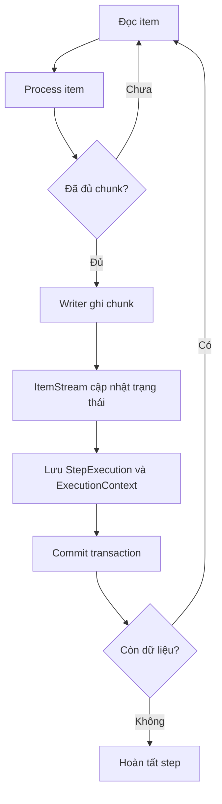
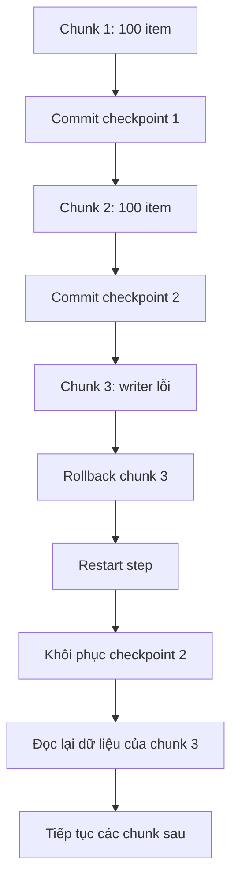

# Checkpoint sau mỗi chunk

Trong Spring Batch, chunk-oriented processing chia dữ liệu thành các nhóm item. Mỗi nhóm được đọc, xử lý và ghi trong một transaction. Khi chunk hoàn tất và transaction commit, Spring Batch lưu trạng thái thực thi để lần restart có thể tiếp tục từ checkpoint gần nhất.

Checkpoint là mốc tiến độ đã được xác nhận của step. Nó thường bao gồm vị trí reader đã xử lý đến đâu hoặc trạng thái nhỏ khác cần thiết để khôi phục việc đọc. Spring Batch lưu trạng thái này trong `ExecutionContext` của `StepExecution`, cùng metadata của step trong `JobRepository`.

Ví dụ, một step đọc 10.000 dòng từ file với chunk size 100 sẽ xử lý dữ liệu qua nhiều chunk. Sau mỗi chunk được commit, reader có thể lưu vị trí đã đọc. Nếu tiến trình dừng sau khi chunk thứ 37 commit, lần restart có thể bắt đầu từ dữ liệu tiếp theo checkpoint đó thay vì đọc lại từ đầu file.

Checkpoint giúp job có khả năng restart hiệu quả, nhưng không tự bảo đảm mọi tác động bên ngoài chỉ xảy ra đúng một lần. Nếu một writer gửi HTTP request hoặc phát message rồi transaction database rollback, lần chạy lại có thể lặp lại side effect đó. Vì vậy, checkpoint cần được kết hợp với transaction phù hợp, reader có thể khôi phục và writer có tính idempotent.

## 1. Chunk và checkpoint liên hệ với nhau như thế nào?

Trong chunk-oriented step, Spring Batch thực hiện một chu kỳ xử lý theo nhóm:

1. Reader đọc các item.
2. Processor chuyển đổi hoặc lọc từng item nếu được cấu hình.
3. Writer ghi các item trong chunk.
4. Các thành phần `ItemStream` cập nhật trạng thái của chúng vào `ExecutionContext`.
5. Spring Batch cập nhật metadata của `StepExecution` và lưu execution context.
6. Transaction của chunk commit.

Sơ đồ khái quát:



Với cấu hình:

```java
@Bean
Step importOrdersStep(
        JobRepository jobRepository,
        PlatformTransactionManager transactionManager,
        ItemReader<OrderInput> reader,
        ItemProcessor<OrderInput, Order> processor,
        ItemWriter<Order> writer) {

    return new StepBuilder("importOrdersStep", jobRepository)
            .<OrderInput, Order>chunk(100, transactionManager)
            .reader(reader)
            .processor(processor)
            .writer(writer)
            .build();
}
```

`chunk(100, transactionManager)` đặt commit interval là 100 item. Khi reader cung cấp đủ 100 item, Spring Batch xử lý và ghi nhóm đó trong transaction của chunk. Sau khi chunk commit, step có một checkpoint mới.

Một chunk không nhất thiết chứa đúng 100 item được writer ghi. Processor có thể trả về `null` để filter item; skip policy cũng có thể bỏ qua một số item lỗi. Commit interval điều khiển số item được đọc trong một chunk theo cơ chế xử lý của step, còn số item thực tế writer nhận có thể thấp hơn.

## 2. Checkpoint lưu ở đâu?

Trạng thái restart của một step được lưu trong `ExecutionContext` thuộc `StepExecution`:

```java
ExecutionContext context = stepExecution.getExecutionContext();
context.putLong("orders.lastProcessedId", 8450L);
```

Với cấu hình JDBC phổ biến, Spring Batch lưu step execution context trong bảng metadata `BATCH_STEP_EXECUTION_CONTEXT`. Metadata khác của step, chẳng hạn `readCount`, `writeCount`, `commitCount`, `rollbackCount`, `skipCount`, `BatchStatus` và `ExitStatus`, được quản lý trong `StepExecution` và lưu trong các bảng metadata tương ứng.

Checkpoint thường chứa các giá trị nhỏ như:

- Số item đã được reader xác nhận tại checkpoint.
- Offset hoặc số dòng của file đã đọc.
- Khóa cuối cùng trong một truy vấn phân trang có thứ tự ổn định.
- Trang tiếp theo cần xử lý.
- Trạng thái tùy chỉnh mà tasklet hoặc reader cần để tiếp tục.

Không nên lưu toàn bộ item đã đọc hoặc kết quả nghiệp vụ vào `ExecutionContext`. Context dành cho trạng thái cần khôi phục; dữ liệu nghiệp vụ vẫn nên nằm trong bảng hoặc kho dữ liệu do ứng dụng quản lý.

Step ExecutionContext khác Job ExecutionContext. Step context dành cho checkpoint của một step cụ thể. Job context dùng để chia sẻ một số giá trị nhỏ giữa các step trong cùng `JobExecution`; nó không thay thế checkpoint riêng của từng step.

## 3. ItemStream cập nhật checkpoint ra sao?

Spring Batch dùng giao diện `ItemStream` để reader và writer tham gia vào vòng đời checkpoint. Giao diện này định nghĩa ba phương thức:

| Phương thức | Vai trò |
|---|---|
| `open(ExecutionContext)` | Khởi tạo stream và đọc trạng thái đã lưu để khôi phục vị trí |
| `update(ExecutionContext)` | Ghi trạng thái nội bộ hiện tại vào context tại checkpoint |
| `close()` | Đóng stream và giải phóng tài nguyên |

`ItemStreamReader` và `ItemStreamWriter` kết hợp hợp đồng này với chức năng đọc hoặc ghi item. Trong chunk-oriented step, Spring Batch gọi `update()` tại thời điểm chuẩn bị lưu checkpoint của chunk. Các reader chuẩn như `FlatFileItemReader` tự quản lý trạng thái cần thiết, miễn là việc lưu trạng thái được bật và reader được đăng ký đúng với step.

Ví dụ cấu hình `FlatFileItemReader`:

```java
@Bean
@StepScope
FlatFileItemReader<OrderInput> orderReader(
        @Value("#{jobParameters['inputFile']}") Resource inputFile) {

    return new FlatFileItemReaderBuilder<OrderInput>()
            .name("orderReader")
            .resource(inputFile)
            .delimited()
            .names("orderId", "customerId", "amount")
            .targetType(OrderInput.class)
            .saveState(true)
            .build();
}
```

Tên reader phải ổn định để các khóa trạng thái của nó được nhận diện giữa các lần chạy. `.saveState(true)` cho phép reader lưu vị trí cần thiết để restart; đây cũng là hành vi mặc định phổ biến của reader này, nhưng khai báo rõ giúp thể hiện ý định.

Nếu reader hoặc writer tùy chỉnh không triển khai `ItemStream`, hoặc không lưu trạng thái, Spring Batch không thể tự suy ra vị trí cần khôi phục. Với delegate stream được bọc trong một thành phần khác, cần đăng ký delegate với step khi builder không tự nhận diện nó. Trong Spring Batch, builder cung cấp phương thức `.stream(...)` để đăng ký một `ItemStream` bổ sung.

## 4. Checkpoint được lưu vào thời điểm nào?

Checkpoint được tạo ở ranh giới commit của chunk, không phải sau từng lệnh `read()` và cũng không phải sau từng item được processor xử lý.

Trong một chunk thông thường, writer được gọi trước khi stream cập nhật trạng thái checkpoint. Sau đó Spring Batch cập nhật execution context và metadata của step trong quá trình hoàn tất chunk. Với cấu hình thông thường, các cập nhật metadata và ghi dữ liệu nghiệp vụ của chunk được phối hợp trong transaction của step. Khi transaction commit thành công, checkpoint đó trở thành trạng thái bền vững để restart.

Điều này có một ý nghĩa thực tế: giá trị được gọi là checkpoint phải đại diện cho tiến độ đã được xác nhận ở ranh giới transaction. Nếu chỉ cập nhật một biến trong bộ nhớ khi reader đọc item, biến đó chưa phải checkpoint bền vững. Nó chỉ trở thành trạng thái có thể dùng sau restart khi `ItemStream.update()` đưa nó vào context và Spring Batch lưu context thành công.

Thứ tự chi tiết của việc cập nhật metadata có thể phụ thuộc vào phiên bản và cấu hình repository/transaction manager. Điều cần bảo đảm trong môi trường chạy thật là business write và metadata checkpoint có ranh giới transaction nhất quán. Khi business data và metadata dùng cùng database cùng transaction manager, chúng thường có thể commit hoặc rollback cùng nhau. Nếu chúng nằm ở các resource hoặc transaction manager khác nhau, không được mặc định có tính nguyên tử xuyên suốt.

## 5. Điều gì xảy ra khi chunk thành công hoặc thất bại?

Giả sử một step đọc file đơn hàng với chunk size 100.

### Chunk commit thành công

Reader đã đọc 100 item, processor xử lý chúng và writer ghi thành công. Spring Batch cập nhật context, metadata step và commit transaction. Checkpoint mới tương ứng với phần dữ liệu vừa được xác nhận.

Nếu job thất bại ở một chunk sau đó, lần restart có thể dùng checkpoint mới nhất đã commit và tiếp tục từ nhóm dữ liệu kế tiếp.

### Lỗi trước khi chunk commit

Nếu writer ném exception hoặc transaction bị rollback trước khi chunk commit, các thay đổi thuộc transaction đó được hoàn tác. Metadata checkpoint của chunk hiện tại cũng không được commit nếu nó tham gia cùng transaction. Khi restart, reader khôi phục checkpoint trước đó và phần item của chunk chưa commit có thể được đọc, xử lý và ghi lại.

Vì vậy, một số item có thể được xử lý lại. Đây là hành vi bình thường của cơ chế restart theo checkpoint. Writer cần an toàn khi chạy lại, đặc biệt nếu thao tác ghi có thể tạo side effect ngoài transaction hiện tại.

### Lỗi sau khi chunk commit

Nếu chunk đã commit và một step hoặc chunk sau đó thất bại, dữ liệu cùng checkpoint của chunk đã commit vẫn được giữ lại. Khi restart, Spring Batch có thể tiếp tục từ checkpoint mới nhất thay vì ghi lại toàn bộ dữ liệu trước đó.

Sơ đồ ví dụ:



Ví dụ trên giả định reader hỗ trợ restart và business write cùng metadata checkpoint được phối hợp đúng. Nếu writer gọi hệ thống ngoài hoặc dùng resource khác transaction, side effect có thể đã xảy ra dù chunk database rollback; cần xử lý riêng bằng idempotency hoặc đối soát.

## 6. Commit interval ảnh hưởng đến checkpoint như thế nào?

Commit interval xác định số item được gom vào một chunk trước khi commit. Nó cũng quyết định tần suất checkpoint được tạo trong một chunk step.

| Commit interval | Ưu điểm | Đánh đổi |
|---|---|---|
| Nhỏ, ví dụ 10 | Checkpoint thường xuyên; phạm vi rollback nhỏ; ít item phải đọc lại sau sự cố | Nhiều transaction và lần cập nhật metadata hơn; overhead có thể cao |
| Vừa, ví dụ 100 | Cân bằng giữa tần suất commit và chi phí transaction trong nhiều trường hợp | Cần đo theo kích thước dữ liệu và thời gian xử lý thực tế |
| Lớn, ví dụ 1.000 | Ít lần commit hơn; có thể tăng throughput khi hệ thống phù hợp | Transaction dài hơn; dùng nhiều bộ nhớ hơn; rollback có thể ảnh hưởng nhiều item hơn |

Không có một commit interval tối ưu cho mọi job. Hãy cân nhắc:

- Kích thước và độ phức tạp của mỗi item.
- Thời gian reader, processor và writer xử lý một item.
- Giới hạn transaction timeout và lock của database.
- Bộ nhớ cần thiết để giữ item trong một chunk.
- Chi phí commit và lưu metadata.
- Mức độ thường xuyên xảy ra lỗi và lượng công việc có thể chấp nhận phải làm lại.
- Tác động của việc retry hoặc skip trong chunk.

Ví dụ, chunk size 1 tạo một transaction cho mỗi item, do đó checkpoint có thể được cập nhật rất thường xuyên nhưng overhead transaction lớn. Chunk size 10.000 giảm số lần commit nhưng có thể giữ nhiều item trong bộ nhớ và khiến transaction kéo dài. Cần đo throughput, thời gian commit, lock wait và khả năng restart bằng dữ liệu gần với thực tế.

## 7. Ví dụ reader tùy chỉnh lưu checkpoint theo khóa

Với dữ liệu database, có thể lưu khóa cuối cùng đã xử lý để lần sau truy vấn các bản ghi có khóa lớn hơn. Cách này thường dễ ổn định hơn lưu số thứ tự dòng nếu tập dữ liệu có thể thay đổi.

Ví dụ dưới đây minh họa ý tưởng cho reader theo thứ tự `order_id`:

```java
public class OrderCursorReader implements ItemStreamReader<OrderInput> {

    private static final String LAST_ID_KEY = "orderCursorReader.lastId";

    private final OrderDao orderDao;
    private long lastId;

    public OrderCursorReader(OrderDao orderDao) {
        this.orderDao = orderDao;
    }

    @Override
    public void open(ExecutionContext context) {
        lastId = context.getLong(LAST_ID_KEY, 0L);
    }

    @Override
    public OrderInput read() {
        OrderInput next = orderDao.findNextAfter(lastId);
        if (next != null) {
            lastId = next.orderId();
        }
        return next;
    }

    @Override
    public void update(ExecutionContext context) {
        context.putLong(LAST_ID_KEY, lastId);
    }

    @Override
    public void close() {
        // Đóng tài nguyên nếu reader đang giữ tài nguyên mở.
    }
}
```

DAO cần truy vấn theo thứ tự ổn định, ví dụ `WHERE order_id > :lastId ORDER BY order_id`. Reader phải bảo đảm `update()` chỉ lưu tiến độ đã được xác nhận ở checkpoint của chunk. Đây là ví dụ rút gọn về cách triển khai `ItemStreamReader`; một reader production còn phải xử lý rollback, retry, phân trang, dữ liệu thay đổi trong lúc chạy và tài nguyên được đóng/mở.

Nếu dùng reader chuẩn của Spring Batch, thường nên tận dụng cơ chế checkpoint đã được triển khai sẵn thay vì tự viết reader. Reader tùy chỉnh chỉ nên được tạo khi có yêu cầu truy vấn hoặc nguồn dữ liệu đặc thù.

## 8. Điều kiện để restart từ checkpoint đáng tin cậy

Checkpoint chỉ hữu ích nếu lần chạy sau có thể diễn giải trạng thái đã lưu theo cùng quy tắc. Các điều kiện quan trọng gồm:

### Reader có khả năng lưu và khôi phục trạng thái

Reader cần triển khai `ItemStream` hoặc có cơ chế checkpoint tương đương. Với reader chuẩn, kiểm tra cấu hình `saveState`. Nếu tắt lưu trạng thái, reader có thể không khôi phục được vị trí sau restart.

### Dữ liệu nguồn ổn định

Nếu reader lưu vị trí dòng 500 nhưng file nguồn bị thay đổi hoặc thay thế giữa hai lần chạy, dòng 500 có thể không còn đại diện cho cùng dữ liệu. Với file, nên dùng file bất biến theo batch, kiểm tra tên hoặc checksum và giữ file trong suốt thời gian cần restart. Với database, dùng thứ tự sắp xếp ổn định và phạm vi dữ liệu được xác định rõ.

### JobParameters nhất quán

Restart cần dùng cùng `JobInstance`, tức cùng tên job và cùng các identifying `JobParameters`. Nếu thêm timestamp ngẫu nhiên hoặc thay đổi tham số định danh, ứng dụng có thể tạo một instance mới thay vì tiếp tục instance cũ.

### Tên reader và khóa context ổn định

Reader chuẩn thường dùng tên bean hoặc tên cấu hình để tạo khóa trong `ExecutionContext`. Thay đổi tên reader hoặc tên khóa giữa các phiên bản có thể khiến trạng thái cũ không còn được tìm thấy. Khi triển khai phiên bản mới trong lúc có job cần restart, hãy giữ tương thích hoặc có kế hoạch xử lý các execution đang dang dở.

### JobRepository có lưu trữ bền vững

Nếu metadata chỉ tồn tại trong bộ nhớ, trạng thái checkpoint có thể mất khi JVM dừng. Với job cần restart qua lần khởi động lại ứng dụng, hãy dùng repository bền vững, thường là JDBC repository với schema metadata được khởi tạo đúng.

### Writer an toàn khi một chunk được chạy lại

Checkpoint cho biết phần nào đã commit. Chunk chưa commit có thể được thực hiện lại. Writer nên dùng transaction phù hợp, unique key, upsert có quy tắc hoặc idempotency key để tránh tạo dữ liệu trùng.

## 9. Checkpoint không đồng nghĩa với exactly-once

Checkpoint giúp Spring Batch tiếp tục từ trạng thái đã lưu, nhưng không tự tạo bảo đảm exactly-once cho mọi hệ thống tham gia.

Hãy xem tình huống writer thực hiện hai hành động:

1. Gửi yêu cầu thanh toán đến API đối tác.
2. Ghi trạng thái đã gửi vào database.

API đối tác có thể đã xử lý yêu cầu nhưng ứng dụng timeout trước khi nhận phản hồi. Transaction database rollback, checkpoint không tiến lên. Khi restart, cùng item được xử lý lại và yêu cầu thanh toán có thể được gửi lần nữa.

Các cách giảm rủi ro:

- Gửi idempotency key ổn định cho API đối tác để yêu cầu lặp không tạo giao dịch mới.
- Ghi outbox trong cùng transaction với dữ liệu nghiệp vụ rồi phát message từ outbox.
- Dùng unique constraint hoặc khóa nghiệp vụ để ngăn ghi trùng trong database.
- Lưu trạng thái tích hợp và mã giao dịch bên ngoài để đối soát sau timeout.
- Tách side effect không thể rollback thành giai đoạn riêng với quy trình retry và phục hồi rõ ràng.

Nếu business data và Spring Batch metadata nằm ở cùng database và cùng transaction manager, chunk write cùng checkpoint có thể được commit nguyên tử. Nếu dùng nhiều database hoặc hệ thống ngoài, cần một chiến lược nhất quán phân tán phù hợp; không nên cho rằng rollback một transaction sẽ hoàn tác mọi tác động.

## 10. Skip, retry và checkpoint

Retry và skip ảnh hưởng đến cách chunk được hoàn thành:

- **Retry:** khi lỗi được xem là tạm thời, Spring Batch có thể thử lại thao tác theo chính sách. Nếu chunk cuối cùng thành công và commit, checkpoint tiến lên sau chunk đó.
- **Skip:** khi lỗi thuộc loại được phép bỏ qua và nằm trong giới hạn, step có thể tiếp tục xử lý các item khác. Khi chunk commit, trạng thái reader có thể tiến qua item bị skip và bộ đếm skip được cập nhật.
- **Vượt giới hạn:** nếu lỗi vượt retry/skip limit hoặc là lỗi không được phép xử lý tiếp, chunk có thể thất bại và transaction rollback. Restart dùng checkpoint đã commit trước đó.

Không nên cấu hình skip quá rộng chỉ để job luôn hoàn thành. Nếu bỏ qua dữ liệu, cần lưu bản ghi lỗi ở nơi có thể truy vết và có quy trình xử lý lại. Các bộ đếm `readCount`, `writeCount`, `filterCount`, `readSkipCount` và `processSkipCount`/`writeSkipCount` là metadata hỗ trợ theo dõi; chúng không thay thế danh sách lỗi nghiệp vụ.

## 11. Checkpoint trong tasklet step

Tasklet step không dùng reader/processor/writer theo chunk, nhưng vẫn có thể lưu trạng thái trong Step ExecutionContext. Tasklet có thể trả về `RepeatStatus.CONTINUABLE` để được gọi tiếp, và cập nhật context cho từng lượt công việc.

Ví dụ, tasklet xử lý lần lượt từng partition nhỏ:

```java
Tasklet processPartitions = (contribution, chunkContext) -> {
    ExecutionContext context =
            contribution.getStepExecution().getExecutionContext();

    int nextPartition = context.getInt("nextPartition", 0);
    if (nextPartition >= partitionCount()) {
        return RepeatStatus.FINISHED;
    }

    processPartition(nextPartition);
    context.putInt("nextPartition", nextPartition + 1);

    return nextPartition + 1 >= partitionCount()
            ? RepeatStatus.FINISHED
            : RepeatStatus.CONTINUABLE;
};
```

Trong tasklet, mỗi lần lặp được quản lý trong transaction của tasklet step. Context cần được cập nhật để biểu thị phần công việc đã hoàn tất và được commit. Cũng như chunk step, nếu tác động của `processPartition()` nằm ngoài transaction hiện tại, phải thiết kế idempotency và phục hồi riêng.

## 12. Checkpoint trong step đa luồng và partitioning

Với step đa luồng, nhiều thread có thể đọc hoặc xử lý item đồng thời. Khi đó, việc lưu một biến vị trí duy nhất không nhất thiết phản ánh chính xác tiến độ của tất cả thread. Reader phải an toàn khi truy cập đồng thời hoặc được đồng bộ đúng cách; checkpoint cũng cần phù hợp với cách phân chia công việc.

Với partitioning, mỗi partition thường có một `StepExecution` riêng và một Step ExecutionContext riêng. Mỗi worker lưu checkpoint cho phạm vi dữ liệu của partition đó. Cách này giúp trạng thái restart của từng partition độc lập hơn, miễn là phân vùng dữ liệu ổn định và mỗi worker chỉ sở hữu đúng phạm vi của mình.

Không nên giả định checkpoint của một step đa luồng tương đương với checkpoint của reader tuần tự. Cần kiểm tra khả năng thread-safe và restart của reader, writer, task executor và cách phân vùng dữ liệu cụ thể. Với job cần restart tin cậy, hãy thử nghiệm sự cố trong lúc nhiều chunk/partition đang chạy.

## 13. Kiểm thử checkpoint và restart

Một bài kiểm thử restart cần xác nhận dữ liệu và metadata cùng phản ánh đúng checkpoint. Có thể tổ chức tình huống như sau:

1. Tạo input có số lượng item lớn hơn nhiều lần commit interval.
2. Cho job chạy qua một số chunk và xác nhận chúng đã commit.
3. Chủ động làm writer hoặc processor thất bại ở chunk kế tiếp.
4. Xác nhận chunk lỗi không để lại thay đổi thuộc transaction đã rollback.
5. Khởi chạy lại cùng job với cùng identifying `JobParameters`.
6. Xác nhận reader tiếp tục từ checkpoint đã lưu và các chunk đã commit trước đó không bị ghi lại ngoài ý muốn.
7. Xác nhận tổng số bản ghi nghiệp vụ, khóa duy nhất và kết quả đối soát chính xác.
8. Nếu có API hoặc message broker bên ngoài, xác nhận idempotency bảo vệ khỏi side effect lặp.

Spring Batch cung cấp các tiện ích kiểm thử như `JobLauncherTestUtils` và `JobRepositoryTestUtils` trong module test tương ứng. Nên dùng một `JobRepository` bền vững và transaction manager có hành vi gần môi trường thật khi kiểm tra restart. Một mock `JobRepository` hoặc reader không có trạng thái thường không đủ để chứng minh checkpoint hoạt động đúng.

Các trường cần quan sát trong test và vận hành gồm `commitCount`, `rollbackCount`, `readCount`, `writeCount`, số item skip, trạng thái `JobExecution`/`StepExecution` và các khóa trong execution context. Không nên chỉ kiểm tra trạng thái cuối là `COMPLETED`; hãy đối chiếu kết quả nghiệp vụ thực tế.

## Kết luận

Checkpoint sau mỗi chunk là mốc lưu tiến độ của chunk-oriented step. Spring Batch cập nhật trạng thái reader/writer qua `ItemStream`, lưu Step ExecutionContext và metadata thực thi trong `JobRepository`, rồi commit transaction của chunk. Khi restart, reader có thể khôi phục trạng thái đã lưu và tiếp tục từ chunk chưa được xác nhận.

Hãy chọn commit interval dựa trên hiệu năng và phạm vi rollback có thể chấp nhận, dùng reader có khả năng lưu trạng thái, giữ nguồn dữ liệu ổn định, restart với cùng identifying parameters và thiết kế writer idempotent. Khi metadata và business data dùng chung transaction phù hợp, checkpoint giúp giữ chúng nhất quán ở ranh giới chunk; với side effect bên ngoài hoặc nhiều resource, cần thêm outbox, idempotency key và đối soát. Như vậy, checkpoint trở thành cơ sở đáng tin cậy cho restart thay vì chỉ là một con số vị trí trong bộ nhớ.
