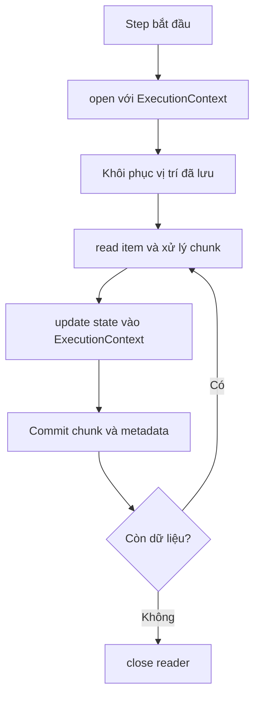

# Reader state và current item

Trong Spring Batch, `ItemReader` thường được gọi nhiều lần để lấy từng item từ nguồn dữ liệu. Với một job xử lý nhiều chunk, reader cần biết đã đọc đến đâu để tiếp tục đúng vị trí khi step được restart. Nó cũng cần quản lý item đang được đưa vào pipeline để xử lý, đặc biệt khi có lỗi, retry hoặc skip.

Khái niệm **reader state** mô tả trạng thái nội bộ cần thiết để reader tiếp tục đọc đúng dữ liệu. **Current item** là item mà reader vừa trả về hoặc item đang được xử lý trong pipeline. Hai khái niệm có liên quan nhưng không đồng nhất: vị trí hiện tại trong bộ nhớ có thể tiến lên khi đọc, trong khi checkpoint bền vững chỉ được lưu tại các điểm cập nhật trạng thái của step.

## 1. ItemReader đọc item theo thứ tự

`ItemReader<T>` là interface cơ bản để đọc dữ liệu. Phương thức `read()` trả về một item hoặc `null` khi không còn dữ liệu.

```java
public interface ItemReader<T> {
    T read() throws Exception;
}
```

Trong chunk-oriented processing, Spring Batch gọi `read()` nhiều lần để tạo một chunk. Mỗi item reader trả về sẽ được chuyển qua processor (nếu có), sau đó các item đầu ra được gom lại để writer ghi.

Ví dụ, một reader đọc các đơn hàng theo thứ tự:

```text
read() -> Order 101
read() -> Order 102
read() -> Order 103
read() -> Order 104
read() -> null (hết dữ liệu)
```

Giá trị `null` là tín hiệu kết thúc. Nó không phải một item và không được chuyển cho processor hoặc writer. Nếu reader trả về `null` quá sớm do lỗi logic, step có thể kết thúc dù nguồn vẫn còn dữ liệu; vì vậy điều kiện kết thúc phải được xác định rõ.

## 2. Current item có nghĩa là gì?

Trong một thời điểm của pipeline, có thể nói đến item hiện tại ở các giai đoạn khác nhau:

- **Item reader vừa trả về:** giá trị được trả từ lần gọi `read()` gần nhất.
- **Item đang được processor xử lý:** item đầu vào hiện tại của `ItemProcessor`.
- **Item đầu ra đang chờ writer:** kết quả processor đã tạo và đang nằm trong chunk.
- **Item writer đang ghi:** một phần tử trong chunk được chuyển tới hệ thống đích.

Các khái niệm này không nhất thiết cùng chỉ một đối tượng. Processor có thể chuyển `OrderInput` thành `ProcessedOrder`; item đầu vào và đầu ra có kiểu khác nhau. Processor cũng có thể trả về `null` để lọc item, nghĩa là item đã đọc nhưng không còn item đầu ra tương ứng.

Điểm quan trọng khi nói về reader state là **vị trí tiếp theo cần đọc**. Sau khi reader trả về một item, con trỏ nội bộ thường đã tiến tới vị trí kế tiếp. Ví dụ, nếu reader đã trả về 100 item đầu tiên, trạng thái đếm có thể biểu diễn rằng 100 item đã được đọc và lần đọc tiếp theo sẽ bắt đầu từ item thứ 101.

Vì thế, `currentItemCount` hoặc một checkpoint tương tự thường là số item đã tiêu thụ, chứ không phải số thứ tự của item đang nằm trong processor. Với reader đọc tệp có header, comment, dòng bị skip hoặc nguồn phân trang, chỉ số này cũng không nhất thiết trùng với số dòng vật lý hay khóa chính của bản ghi.

## 3. Vì sao reader cần lưu state?

Một job có thể chạy hàng giờ và đọc hàng triệu bản ghi. Nếu máy chủ dừng sau khi đã xử lý nhiều chunk, việc bắt đầu đọc lại từ đầu có thể tốn thời gian và gây tác dụng phụ không mong muốn.

Reader state giúp Spring Batch biết vị trí cần tiếp tục khi restart. State có thể chứa:

- Số item đã đọc hoặc vị trí hiện tại trong tệp.
- Số trang đã đọc và khóa sắp xếp cuối cùng của trang trước.
- Offset, cursor position hoặc checkpoint riêng của nguồn dữ liệu.
- Thông tin cần thiết để mở lại tài nguyên, ví dụ tên tệp và vị trí đọc.

Không phải reader nào cũng cần lưu state. Một reader đọc danh sách cố định rất nhỏ hoặc nguồn có thể đọc lại từ đầu mà không ảnh hưởng có thể không cần checkpoint. Nhưng với job lớn, reader state thường là điều kiện quan trọng để restart hiệu quả và đúng dữ liệu.

## 4. ItemStream và vòng đời của reader state

Để hỗ trợ lưu và khôi phục trạng thái, Spring Batch cung cấp interface `ItemStream`. Một reader có hỗ trợ lifecycle này thường triển khai `ItemStreamReader<T>`, kết hợp khả năng đọc item và quản lý stream.

Các phương thức quan trọng:

| Phương thức | Thời điểm và mục đích |
|---|---|
| `open(ExecutionContext)` | Mở tài nguyên và khôi phục state đã lưu trước đó khi step bắt đầu hoặc restart |
| `read()` | Đọc và trả về item tiếp theo |
| `update(ExecutionContext)` | Ghi state hiện tại vào `ExecutionContext` để checkpoint được lưu cùng metadata step |
| `close()` | Đóng tài nguyên khi step kết thúc hoặc khi cần giải phóng reader |

Vòng đời khái quát:



`ExecutionContext` là vùng lưu key/value mà Spring Batch gắn với execution. Với reader, checkpoint thường được lưu trong `StepExecution` context để trạng thái thuộc đúng lần chạy step. Khi step được restart, context đã lưu được đưa trở lại cho `open()`.

Trong chunk-oriented step, framework gọi `ItemStream.update()` tại ranh giới cập nhật trạng thái của chunk. Nhờ đó, checkpoint có thể được lưu cùng metadata của step. Việc checkpoint và dữ liệu nghiệp vụ có commit nguyên tử hay không còn phụ thuộc transaction manager và các tài nguyên tham gia transaction.

## 5. ExecutionContext là nơi lưu checkpoint

`ExecutionContext` cung cấp cách lưu những giá trị cần thiết để tiếp tục công việc. Reader có thể ghi một số nguyên, chuỗi hoặc kiểu dữ liệu được hỗ trợ vào context.

Ví dụ, reader có thể lưu số item đã đọc:

```java
private static final String CURRENT_INDEX = "orderReader.currentIndex";

public void update(ExecutionContext executionContext) {
    executionContext.putInt(CURRENT_INDEX, currentIndex);
}
```

Khi mở reader, giá trị đã lưu được khôi phục:

```java
public void open(ExecutionContext executionContext) {
    if (executionContext.containsKey(CURRENT_INDEX)) {
        currentIndex = executionContext.getInt(CURRENT_INDEX);
    } else {
        currentIndex = 0;
    }
}
```

Trong ví dụ này, `currentIndex` nên biểu diễn vị trí tiếp theo cần đọc. Nếu đã trả về 100 item và checkpoint được lưu là `100`, lần mở tiếp theo bắt đầu từ index 100 (item thứ 101 nếu danh sách đánh số từ 1).

Tên key nên có namespace riêng, chẳng hạn tên reader cộng với trường state, để tránh hai reader ghi đè cùng key trong một `ExecutionContext`. Với các reader dựng sẵn có thuộc tính `name`, hãy đặt tên ổn định và duy nhất trong step để framework tạo key state phù hợp.

Không nên lưu cả tập dữ liệu lớn vào `ExecutionContext`. Chỉ lưu thông tin nhỏ cần để khôi phục vị trí hoặc trạng thái đọc. Nội dung nghiệp vụ vẫn nên nằm trong nguồn dữ liệu hoặc hệ thống lưu trữ phù hợp.

## 6. Ví dụ custom ItemStreamReader

Ví dụ sau minh họa reader đọc một danh sách ổn định và lưu vị trí tiếp theo. Đây là ví dụ đơn giản để hiểu lifecycle; reader thực tế cần cân nhắc transaction rollback, retry, tính ổn định của nguồn và cách quản lý tài nguyên.

```java
import java.util.List;

import org.springframework.batch.item.ExecutionContext;
import org.springframework.batch.item.ItemStreamException;
import org.springframework.batch.item.ItemStreamReader;

public class OrderListReader implements ItemStreamReader<Order> {

    private static final String CURRENT_INDEX = "orderListReader.currentIndex";

    private final List<Order> orders;
    private int currentIndex;

    public OrderListReader(List<Order> orders) {
        this.orders = List.copyOf(orders);
    }

    @Override
    public void open(ExecutionContext executionContext) throws ItemStreamException {
        currentIndex = executionContext.containsKey(CURRENT_INDEX)
                ? executionContext.getInt(CURRENT_INDEX)
                : 0;

        if (currentIndex < 0 || currentIndex > orders.size()) {
            throw new ItemStreamException("Invalid saved reader position");
        }
    }

    @Override
    public Order read() {
        if (currentIndex >= orders.size()) {
            return null;
        }

        return orders.get(currentIndex++);
    }

    @Override
    public void update(ExecutionContext executionContext) throws ItemStreamException {
        executionContext.putInt(CURRENT_INDEX, currentIndex);
    }

    @Override
    public void close() throws ItemStreamException {
        // Không có tài nguyên ngoài cần đóng trong ví dụ này.
    }
}
```

Trong reader này:

1. `open()` khôi phục index đã lưu hoặc bắt đầu từ 0 nếu là lần chạy đầu.
2. `read()` trả về item tại index hiện tại rồi tăng index để trỏ tới item tiếp theo.
3. `update()` ghi index vào `ExecutionContext` tại checkpoint.
4. `close()` giải phóng tài nguyên; ví dụ này không giữ file handle hoặc connection nên không cần thao tác thêm.

Danh sách phải giữ nguyên thứ tự và nội dung giữa các lần chạy. Nếu danh sách được tạo lại với thứ tự khác, cùng một index có thể trỏ tới item khác và job có thể bỏ sót hoặc xử lý trùng dữ liệu.

Đây không phải một triển khai production hoàn chỉnh cho mọi trường hợp rollback. Con trỏ trong bộ nhớ có thể đã tiến lên khi chunk gặp lỗi; hành vi retry/rollback trong step cần được thiết kế cùng reader. Với nguồn dữ liệu thật, ưu tiên reader Spring Batch có sẵn hoặc triển khai state management phù hợp với semantics của transaction và retry.

## 7. Reader dựng sẵn và cách chúng lưu state

Nhiều reader của Spring Batch đã triển khai `ItemStream` và tự quản lý checkpoint. Cách lưu state tùy loại nguồn.

### AbstractItemCountingItemStreamItemReader

Một số reader kế thừa `AbstractItemCountingItemStreamItemReader`. Lớp nền này quản lý số item đã đọc và lưu `currentItemCount` vào `ExecutionContext` khi `saveState` được bật.

Các thuộc tính thường gặp:

- `name`: tên reader dùng để tạo key state; nên đặt tên ổn định và duy nhất.
- `saveState`: bật/tắt việc lưu trạng thái để restart.
- `currentItemCount`: số item reader đã trả về thành công và là cơ sở xác định vị trí tiếp theo.
- `maxItemCount`: giới hạn số item reader được phép đọc.

Khi restart, reader khôi phục count và di chuyển tới vị trí tương ứng theo cách triển khai của reader cụ thể. `currentItemCount` là số lượng item đã đọc, không nhất thiết là số dòng vật lý trong tệp hoặc ID của bản ghi.

### FlatFileItemReader

`FlatFileItemReader` đọc từng dòng từ tệp và thường lưu thông tin vị trí đọc để có thể mở lại tệp tại điểm phù hợp. Nó có thể xử lý header, comment, dòng bị bỏ qua và ánh xạ dòng thành object.

Khi restart, tệp đầu vào phải là đúng tệp đã dùng trước đó và nội dung cần ổn định. Nếu tệp bị thay, chèn thêm dòng hoặc sắp xếp lại trong lúc job bị gián đoạn, vị trí đã lưu có thể trỏ tới dữ liệu khác.

### JdbcCursorItemReader

`JdbcCursorItemReader` đọc dữ liệu qua database cursor. Reader cần mở lại query và khôi phục vị trí đọc theo cơ chế của implementation. Query phải có thứ tự ổn định; nếu không có `ORDER BY` phù hợp, thứ tự bản ghi có thể thay đổi giữa hai lần mở cursor.

Với tập dữ liệu lớn, cursor cũng giữ tài nguyên database trong thời gian đọc. Cần cân nhắc timeout, connection lifetime và giới hạn của driver.

### JdbcPagingItemReader

`JdbcPagingItemReader` đọc dữ liệu theo từng trang. Nó lưu thông tin khóa sắp xếp cuối cùng đã xử lý để lần restart có thể tiếp tục từ vị trí phù hợp.

Sort key phải ổn định và tốt nhất là duy nhất. Nếu sort key không duy nhất, bản ghi ở ranh giới hai trang có thể bị lặp hoặc bỏ sót. Điều kiện truy vấn và dữ liệu nguồn cũng cần ổn định trong suốt quá trình job chạy.

## 8. saveState và khả năng restart

Với nhiều reader dựng sẵn, `saveState` mặc định được bật. Khi tắt `saveState`, reader không lưu checkpoint của nó vào `ExecutionContext`; sau khi job bị gián đoạn, reader có thể không biết phải tiếp tục từ đâu.

Ví dụ cấu hình:

```java
FlatFileItemReader<Order> reader = new FlatFileItemReader<>();
reader.setName("ordersFileReader");
reader.setSaveState(true);
```

Chỉ tắt lưu state khi có lý do rõ ràng, ví dụ reader được dùng trong một cách thực thi không hỗ trợ restart hoặc ứng dụng chủ động chấp nhận đọc lại từ đầu. Nếu job yêu cầu restart chính xác, cần giữ `saveState` và xác nhận reader hỗ trợ khôi phục vị trí.

Ngoài `saveState`, restart còn phụ thuộc:

- `JobRepository` lưu metadata và `ExecutionContext` bền vững.
- Job được khởi chạy lại với cùng identifying `JobParameters` để tiếp tục cùng `JobInstance`.
- Step được phép restart và execution trước có trạng thái phù hợp.
- Reader mở lại cùng nguồn dữ liệu với cùng cách diễn giải vị trí.
- Writer và các tác dụng phụ có thể xử lý an toàn khi một chunk phải chạy lại.

## 9. Checkpoint được lưu ở thời điểm nào?

Trong chunk-oriented step, reader có thể đọc trước nhiều item và giữ chúng trong chunk trước khi writer ghi. Checkpoint được cập nhật ở ranh giới commit, không phải sau từng lần `read()`.

Luồng khái quát của một chunk:

1. Transaction của chunk bắt đầu.
2. Reader đọc item và con trỏ trong bộ nhớ tiến lên.
3. Processor xử lý item; các kết quả được gom vào chunk.
4. Writer ghi kết quả.
5. Các `ItemStream` cập nhật state vào `ExecutionContext`.
6. Spring Batch cập nhật metadata thực thi.
7. Transaction commit.

Nếu transaction commit thành công, checkpoint đã cập nhật có thể được dùng khi restart. Nếu tiến trình dừng trước khi commit, checkpoint bền vững thường vẫn là checkpoint của chunk trước đó, vì vậy chunk chưa commit có thể được đọc và xử lý lại.

Để checkpoint và dữ liệu ghi trong chunk có tính nhất quán mạnh, metadata repository và dữ liệu nghiệp vụ thường cần tham gia cùng transaction manager hoặc có cơ chế phối hợp phù hợp. Nếu chúng nằm trên các resource không cùng transaction, có thể xuất hiện tình huống dữ liệu đã commit nhưng checkpoint chưa được lưu, hoặc ngược lại. Khi đó cần thiết kế idempotency và phục hồi rõ ràng.

## 10. Current item khi có lỗi, retry và skip

Khi reader hoặc processor gặp lỗi, item hiện tại có thể được thử lại hoặc bỏ qua theo cấu hình fault-tolerant.

- **Lỗi đọc:** reader ném exception trước khi trả item. Nếu exception được skip, reader cần có khả năng tiến qua bản ghi lỗi để lần đọc sau không lặp vô hạn tại cùng vị trí.
- **Lỗi xử lý:** item đã được reader trả về nhưng processor ném exception. Nếu retry, processor có thể được gọi lại với item đó. Nếu skip, item không đi đến writer.
- **Lỗi ghi:** writer nhận một chunk nhưng không ghi được một hoặc nhiều item. Framework có thể rollback chunk và thực hiện chiến lược xác định item lỗi theo cấu hình.

Trong các tình huống retry và rollback, framework có thể giữ hoặc đọc lại item tùy cách step được cấu hình. Không nên giả định rằng mỗi item chỉ được gọi `read`, `process` hoặc `write` đúng một lần. Listener có thể nhận callback nhiều lần khi có retry.

Nếu cần ghi nhận item lỗi, nên dùng listener phù hợp như `ItemReadListener`, `ItemProcessListener`, `ItemWriteListener` hoặc `SkipListener`. Chỉ log mã định danh và thông tin cần thiết; tránh ghi toàn bộ payload nhạy cảm vào log.

Ví dụ listener đọc:

```java
public class OrderReadListener implements ItemReadListener<Order> {

    @Override
    public void beforeRead() {
        // Được gọi trước lần đọc.
    }

    @Override
    public void afterRead(Order item) {
        log.debug("Read order id={}", item.getId());
    }

    @Override
    public void onReadError(Exception ex) {
        log.warn("Reader failed", ex);
    }
}
```

`afterRead` nhận item vừa được reader trả về. Nó hữu ích để quan sát current item, nhưng callback này không phải checkpoint và không tự lưu vị trí reader. Việc lưu state vẫn thuộc trách nhiệm của `ItemStream` và `ExecutionContext`.

## 11. Nguồn dữ liệu phải ổn định giữa các lần restart

Checkpoint chỉ có ý nghĩa khi vị trí đã lưu tiếp tục trỏ tới cùng dữ liệu. Nếu nguồn thay đổi trong khi job đang dừng, việc khôi phục bằng offset hoặc item count có thể dẫn đến sai lệch.

Ví dụ, reader đã lưu vị trí sau 10.000 dòng của tệp. Trước khi restart, một tiến trình khác chèn thêm 20 dòng vào đầu tệp. Vị trí dòng 10.001 lúc này không còn trỏ tới bản ghi tiếp theo mà job chưa xử lý.

Để hạn chế vấn đề:

- Dùng tệp đầu vào bất biến hoặc tạo bản sao/snapshot cho từng lần chạy.
- Lưu tên, phiên bản hoặc checksum nguồn nếu cần xác nhận đúng input khi restart.
- Với database paging, dùng `ORDER BY` ổn định và sort key duy nhất.
- Xác định snapshot hoặc phạm vi dữ liệu tại thời điểm bắt đầu job nếu dữ liệu nguồn có thể tiếp tục thay đổi.
- Tránh xóa hoặc sửa bản ghi đang nằm trong phạm vi đọc khi job vẫn có thể restart.

Với nguồn database, keyset pagination dựa trên khóa tăng dần ổn định thường dễ restart hơn việc dựa vào offset khi dữ liệu bị thêm/xóa giữa các trang. Tuy nhiên, vẫn cần xác định rõ snapshot nghiệp vụ và cách xử lý bản ghi được cập nhật trong lúc job chạy.

## 12. Reader state trong step scope và nhiều luồng

Reader có state thường giữ con trỏ hoặc tài nguyên trong bộ nhớ. Nếu cùng một instance reader được chia sẻ giữa nhiều job execution, state của execution này có thể ảnh hưởng execution khác. Vì vậy, reader stateful thường nên được tạo theo phạm vi step execution, ví dụ dùng `@StepScope` khi cần late binding từ job parameters.

Ví dụ khái quát:

```java
@Bean
@StepScope
public FlatFileItemReader<Order> orderReader(
        @Value("#{jobParameters['inputFile']}") String inputFile) {

    FlatFileItemReader<Order> reader = new FlatFileItemReader<>();
    reader.setName("orderFileReader");
    reader.setResource(new FileSystemResource(inputFile));
    reader.setSaveState(true);
    // Cấu hình LineMapper và các quy tắc đọc khác.
    return reader;
}
```

Ví dụ dùng `@StepScope` để tạo reader theo step execution và lấy đường dẫn tệp từ job parameter. Cần cấu hình `LineMapper` trước khi dùng trong ứng dụng thực tế.

Với multi-threaded step, nhiều luồng có thể gọi `read()` trên cùng reader. Một reader stateful không mặc nhiên thread-safe. Việc tăng concurrency có thể làm thứ tự đọc và cập nhật checkpoint khó xác định. Có thể cân nhắc:

- Dùng reader được thiết kế thread-safe hoặc wrapper đồng bộ phù hợp.
- Dùng partitioning để mỗi partition có reader và `ExecutionContext` riêng.
- Chia nguồn dữ liệu thành phạm vi không giao nhau, ví dụ theo ID hoặc tenant.
- Đảm bảo sort key và checkpoint của từng partition ổn định.

Partitioning thường giúp quản lý state rõ ràng hơn vì mỗi partition xử lý một phần dữ liệu và có metadata riêng. Tuy vậy, cần tránh để các partition ghi trùng cùng một bản ghi nghiệp vụ.

## 13. Delegating reader và đăng ký ItemStream

Một reader có thể bọc hoặc ủy quyền việc đọc cho reader khác. Ví dụ, một reader tổng hợp có thể chọn một delegate reader theo điều kiện, hoặc một wrapper có thêm logic lọc trước khi trả item.

Nếu delegate cũng triển khai `ItemStream`, nó phải nhận được các callback `open`, `update` và `close` để lưu state. Spring Batch có thể tự đăng ký các stream được khai báo trực tiếp trong step, nhưng với thành phần được bọc hoặc delegate không được framework phát hiện, cần đăng ký stream tường minh qua cấu hình step phù hợp, chẳng hạn phương thức `.stream(delegate)`.

Nếu quên đăng ký delegate stream, reader bên ngoài có thể vẫn chạy bình thường trong lần đầu nhưng state của delegate không được lưu hoặc khôi phục. Khi restart, reader có thể bắt đầu từ đầu hoặc tiếp tục sai vị trí.

## 14. Theo dõi reader state khi vận hành

Khi một job bị restart hoặc đọc thiếu dữ liệu, nên kiểm tra các thông tin sau:

- Job name, identifying parameters và execution ID để xác định đúng lần chạy.
- Step execution và `ExecutionContext` đã lưu.
- Tên reader và các key state mà reader sử dụng.
- `readCount`, `writeCount`, skip count và trạng thái step.
- Tệp đầu vào hoặc query nguồn có giống lần chạy trước không.
- Reader có bật `saveState` và có được đăng ký như một `ItemStream` không.
- Có wrapper/delegate nào chưa được đăng ký stream không.
- Có nhiều luồng hoặc partition cùng truy cập nguồn dữ liệu hay không.

Không nên sửa thủ công `ExecutionContext` trong repository production chỉ để thay đổi vị trí đọc nếu chưa hiểu tác động tới dữ liệu đã commit. Một checkpoint không phù hợp có thể khiến job bỏ sót bản ghi hoặc ghi trùng.

## 15. Những nguyên tắc cần nhớ

- `ItemReader.read()` trả về item tiếp theo hoặc `null` khi hết dữ liệu.
- Current item là item vừa được đọc hoặc đang đi qua pipeline; reader state thường mô tả vị trí tiếp theo cần đọc.
- `ItemStream` cung cấp lifecycle `open`, `update` và `close` để khôi phục và lưu state.
- `ExecutionContext` của step lưu checkpoint bền vững; không nên dùng nó để lưu tập dữ liệu lớn.
- Checkpoint được cập nhật tại ranh giới chunk/commit, không phải sau mỗi lần gọi `read()`.
- Sau crash trước commit, chunk chưa commit có thể được đọc và xử lý lại từ checkpoint trước đó.
- `saveState` cần được bật và reader phải hỗ trợ khôi phục nếu muốn restart từ vị trí đã lưu.
- Nguồn dữ liệu, thứ tự sắp xếp và identifying parameters phải ổn định giữa các lần restart.
- Reader stateful cần có phạm vi instance phù hợp và phải được thiết kế cho concurrency nếu step chạy nhiều luồng.
- Listener giúp quan sát current item nhưng không thay thế cơ chế checkpoint của `ItemStream`.
- Delegate reader triển khai `ItemStream` cần được đăng ký để callback state được gọi.

Hiểu reader state và current item giúp giải thích vì sao Spring Batch có thể tiếp tục một step từ checkpoint, vì sao một item có thể được đọc hoặc xử lý lại sau rollback, và vì sao nguồn dữ liệu ổn định cùng reader có khả năng lưu state là điều kiện quan trọng để restart an toàn.
