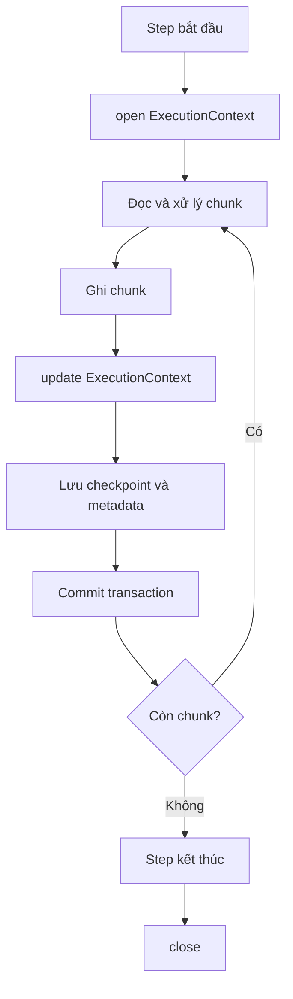

# open, update và close trong ItemStream

Trong Spring Batch, `ItemStream` là hợp đồng vòng đời dành cho những thành phần cần khởi tạo tài nguyên, lưu trạng thái và giải phóng tài nguyên trong quá trình chạy một step. Reader và writer thường triển khai hợp đồng này để hỗ trợ checkpoint và restart.

`ItemStream` định nghĩa ba phương thức:

- `open(ExecutionContext)`: khởi tạo stream và khôi phục trạng thái đã lưu khi step bắt đầu.
- `update(ExecutionContext)`: ghi trạng thái hiện tại của stream vào execution context tại checkpoint.
- `close()`: đóng stream và giải phóng tài nguyên khi step kết thúc.

Ba phương thức này được Spring Batch gọi theo vòng đời của step. Ứng dụng không cần tự gọi chúng trong controller hoặc trong từng lần đọc/ghi item. Khi hiểu đúng thời điểm và trách nhiệm của từng phương thức, ta có thể xây dựng reader/writer có khả năng restart và tránh rò rỉ file handle, cursor hoặc kết nối.

## 1. ItemStream là gì?

`ItemStream` là giao diện nền tảng để một thành phần tham gia vào lifecycle do Spring Batch quản lý. Trong Spring Batch, các giao diện thường gặp kế thừa từ nó gồm:

- `ItemStreamReader<T>`: kết hợp `ItemReader<T>` với `ItemStream`.
- `ItemStreamWriter<T>`: kết hợp `ItemWriter<T>` với `ItemStream`.

Khai báo rút gọn của hợp đồng:

```java
public interface ItemStream {
    void open(ExecutionContext executionContext) throws ItemStreamException;
    void update(ExecutionContext executionContext) throws ItemStreamException;
    void close() throws ItemStreamException;
}
```

`ExecutionContext` là vùng key-value do Spring Batch quản lý để lưu trạng thái cần khôi phục. Một reader có thể dùng context để lưu vị trí file, số dòng, trang hiện tại hoặc khóa cuối cùng đã xử lý tại checkpoint. Writer có thể dùng context để lưu trạng thái cần thiết cho việc tiếp tục ghi nếu thiết kế của writer yêu cầu.

`ItemStream` không phải một cơ chế chạy item độc lập. `ItemReader` chịu trách nhiệm cung cấp item, `ItemWriter` chịu trách nhiệm ghi item, còn `ItemStream` bổ sung vòng đời và khả năng lưu/khôi phục trạng thái cho những thành phần cần nó.

## 2. Vòng đời open, update và close

Trong một step có reader hoặc writer triển khai `ItemStream`, Spring Batch quản lý các callback theo vòng đời thực thi. Có thể hình dung như sau:



Sơ đồ mô tả lifecycle thông thường của chunk-oriented step. `open()` được gọi khi step bắt đầu; `update()` được gọi tại các điểm checkpoint trước khi transaction của chunk hoàn tất; `close()` được gọi khi vòng đời step kết thúc để giải phóng tài nguyên. Nếu step có nhiều stream, Spring Batch quản lý tất cả stream đã được đăng ký với step.

### 2.1. open(ExecutionContext)

`open()` được gọi khi step bắt đầu. Phương thức nhận `ExecutionContext` của step, trong đó có thể chứa trạng thái đã được lưu từ lần chạy trước.

Hai trường hợp thường gặp:

- **Lần chạy đầu:** context chưa có khóa trạng thái của stream. Thành phần khởi tạo trạng thái ban đầu, ví dụ vị trí file bằng 0 hoặc trang đầu tiên.
- **Restart:** context chứa checkpoint gần nhất đã commit. Thành phần đọc giá trị đó để khôi phục vị trí, tiếp tục đọc hoặc ghi từ trạng thái phù hợp.

Ví dụ, một reader đọc file cần mở file và khôi phục vị trí dòng. Một reader đọc database có thể khôi phục khóa cuối cùng đã lưu để truy vấn các bản ghi tiếp theo.

`open()` nên kiểm tra dữ liệu context và tài nguyên đầu vào. Nếu file không tồn tại, định dạng không đúng hoặc trạng thái không tương thích, phương thức nên ném `ItemStreamException` hoặc exception phù hợp để step thất bại rõ ràng. Không nên âm thầm bỏ qua checkpoint hỏng vì điều đó có thể khiến job đọc lại từ đầu hoặc bỏ sót dữ liệu.

### 2.2. update(ExecutionContext)

`update()` được gọi tại checkpoint để thành phần ghi trạng thái hiện tại vào `ExecutionContext`. Trong chunk-oriented step, callback này thường được gọi trước khi transaction của chunk commit. Spring Batch sau đó lưu execution context cùng metadata của step trong `JobRepository` theo cơ chế transaction được cấu hình.

Ví dụ, reader có thể ghi số dòng đã đọc đến checkpoint:

```java
@Override
public void update(ExecutionContext context) {
    context.putLong("orderReader.currentLine", currentLine);
}
```

Lệnh `putLong()` cập nhật context đang được quản lý trong bộ nhớ. Nó không tự mở một transaction mới hoặc tự ghi ngay xuống database. Spring Batch chịu trách nhiệm lưu context trong quá trình cập nhật metadata của step.

`update()` cần ghi đúng trạng thái cần khôi phục. Giá trị nên đại diện cho tiến độ được xác nhận tại checkpoint, không phải một biến tùy ý đã thay đổi sau lần commit gần nhất. Với reader tùy chỉnh, cần thiết kế cẩn thận hành vi khi rollback/retry trong cùng lần chạy, vì con trỏ trong bộ nhớ có thể đã tiến lên trong khi chunk chưa commit.

### 2.3. close()

`close()` được gọi khi step kết thúc để thành phần giải phóng tài nguyên. Ví dụ:

- Đóng `BufferedReader`, `InputStream` hoặc file handle.
- Đóng cursor hoặc result set do reader mở.
- Giải phóng tài nguyên tạm mà writer đang giữ.
- Xóa trạng thái runtime không còn cần sau khi step kết thúc.

`close()` không phải nơi chính để lưu checkpoint. Việc lưu trạng thái phục vụ restart thuộc trách nhiệm của `update()`. `close()` cũng không nên thực hiện một nghiệp vụ ghi dữ liệu quan trọng mà ứng dụng cần bảo đảm commit, vì phương thức này được gọi khi step đang kết thúc và không thay thế transaction của chunk.

Nên triển khai `close()` theo cách an toàn khi tài nguyên chưa được mở hoàn chỉnh hoặc đã được giải phóng. Nếu thành phần quản lý nhiều tài nguyên, cần đóng tất cả tài nguyên cần thiết ngay cả khi một thao tác đóng gặp lỗi.

## 3. Ví dụ reader chuẩn tự quản lý ItemStream

Các reader chuẩn của Spring Batch thường đã triển khai `ItemStream`, vì vậy ứng dụng không cần tự viết ba callback. Ví dụ `FlatFileItemReader`:

```java
@Bean
@StepScope
FlatFileItemReader<OrderInput> orderReader(
        @Value("#{jobParameters['inputFile']}") Resource inputFile) {

    return new FlatFileItemReaderBuilder<OrderInput>()
            .name("orderReader")
            .resource(inputFile)
            .delimited()
            .names("orderId", "customerId", "amount")
            .targetType(OrderInput.class)
            .saveState(true)
            .build();
}
```

Reader này quản lý file và trạng thái đọc thông qua lifecycle của `ItemStream`:

- Khi step bắt đầu, `open()` mở file và khôi phục vị trí đã lưu nếu đây là lần restart.
- Tại checkpoint, `update()` ghi trạng thái đọc vào `ExecutionContext`.
- Khi step kết thúc, `close()` đóng file và giải phóng tài nguyên.

Tên reader trong `.name("orderReader")` nên ổn định giữa các lần chạy để các khóa trạng thái của reader có thể được tìm thấy khi restart. `.saveState(true)` bật việc lưu trạng thái; đây là cấu hình mặc định của nhiều reader chuẩn nhưng khai báo rõ giúp thể hiện ý định.

Với reader chuẩn, nên dùng cơ chế lifecycle có sẵn thay vì tự mở file trong controller hoặc tự ghi vị trí reader vào bảng metadata.

## 4. Ví dụ tự triển khai ItemStream

Khi cần một thành phần có trạng thái riêng, có thể triển khai `ItemStream` trực tiếp. Ví dụ sau minh họa một đối tượng quản lý trang tiếp theo cần xử lý:

```java
public class PageCheckpoint implements ItemStream {

    private static final String NEXT_PAGE_KEY = "pageCheckpoint.nextPage";

    private int nextPage;

    @Override
    public void open(ExecutionContext context) {
        nextPage = context.getInt(NEXT_PAGE_KEY, 0);
    }

    public int getNextPage() {
        return nextPage;
    }

    public void markPageCompleted() {
        nextPage++;
    }

    @Override
    public void update(ExecutionContext context) {
        context.putInt(NEXT_PAGE_KEY, nextPage);
    }

    @Override
    public void close() {
        // Giải phóng tài nguyên nếu thành phần có giữ tài nguyên mở.
    }
}
```

`open()` lấy trang từ context; nếu chưa có khóa, trang bắt đầu là 0. Logic xử lý của step có thể lấy `getNextPage()` và gọi `markPageCompleted()` sau khi hoàn tất một trang. `update()` đưa trang tiếp theo vào context tại checkpoint.

Đây là ví dụ về lifecycle và trạng thái, không phải một reader hoàn chỉnh. Trong ứng dụng thực tế, phải bảo đảm `markPageCompleted()` chỉ phản ánh công việc được xác nhận ở ranh giới transaction. Nếu một trang được xử lý nhưng transaction rollback, trạng thái trong bộ nhớ cần được khôi phục hoặc thao tác xử lý phải idempotent để không bỏ sót dữ liệu khi retry.

Nếu đối tượng `PageCheckpoint` được dùng trong step, hãy đăng ký nó như một stream để Spring Batch gọi các callback. Chỉ tạo bean triển khai `ItemStream` thôi chưa đủ nếu step không biết đến bean đó.

## 5. Spring Batch gọi lifecycle như thế nào trong chunk step?

Trong chunk-oriented processing, reader và writer được gắn với step. Nếu chúng triển khai `ItemStream`, Spring Batch quản lý lifecycle của chúng. Một chu kỳ xử lý thường có trình tự:

1. Step bắt đầu và lấy execution context đã lưu.
2. Spring Batch gọi `open()` trên các stream đã đăng ký.
3. Reader cung cấp item; processor xử lý item; writer ghi chunk.
4. Trước khi commit chunk, Spring Batch gọi `update()` để stream cập nhật checkpoint vào context.
5. Spring Batch lưu metadata và execution context theo cơ chế transaction.
6. Transaction commit.
7. Lặp lại với chunk tiếp theo.
8. Khi step kết thúc, Spring Batch gọi `close()` để đóng stream.

Thứ tự chi tiết giữa các thao tác metadata và transaction có thể phụ thuộc cấu hình repository/transaction manager. Điều quan trọng là `update()` được dùng để chuẩn bị trạng thái checkpoint trước khi commit, còn việc lưu bền vững do Spring Batch thực hiện. Không nên tự gọi `update()` trong `ItemReader.read()` hoặc `ItemWriter.write()`.

## 6. Đăng ký ItemStream với step

Khi reader hoặc writer triển khai `ItemStream` và được gắn trực tiếp vào builder chuẩn của step, Spring Batch thường tự nhận diện và quản lý lifecycle.

Ví dụ:

```java
@Bean
Step importOrdersStep(
        JobRepository jobRepository,
        PlatformTransactionManager transactionManager,
        ItemStreamReader<OrderInput> reader,
        ItemProcessor<OrderInput, Order> processor,
        ItemWriter<Order> writer) {

    return new StepBuilder("importOrdersStep", jobRepository)
            .<OrderInput, Order>chunk(100, transactionManager)
            .reader(reader)
            .processor(processor)
            .writer(writer)
            .build();
}
```

Trong ví dụ, `reader` được khai báo là `ItemStreamReader`, nên lifecycle của nó được step quản lý. Nếu writer cũng triển khai `ItemStreamWriter`, writer cũng tham gia lifecycle tương ứng.

### 6.1. Khi stream được bọc trong delegate

Một trường hợp dễ bỏ sót là reader/writer bên ngoài chỉ triển khai `ItemReader` hoặc `ItemWriter`, còn delegate bên trong mới triển khai `ItemStream`. Nếu wrapper không chuyển tiếp lifecycle, Spring Batch không thể tự nhận diện delegate bên trong.

Khi đó, đăng ký delegate bằng `.stream(...)`:

```java
@Bean
Step importOrdersStep(
        JobRepository jobRepository,
        PlatformTransactionManager transactionManager,
        ItemReader<OrderInput> delegatingReader,
        ItemStream delegateReader,
        ItemWriter<Order> writer) {

    return new StepBuilder("importOrdersStep", jobRepository)
            .<OrderInput, Order>chunk(100, transactionManager)
            .reader(delegatingReader)
            .writer(writer)
            .stream(delegateReader)
            .build();
}
```

`.stream(delegateReader)` đăng ký stream để Spring Batch gọi `open()`, `update()` và `close()`. Nếu wrapper đã triển khai `ItemStream` và tự chuyển tiếp đầy đủ ba callback tới delegate, có thể không cần đăng ký delegate riêng; cần tránh đăng ký trùng dẫn đến callback bị gọi hai lần.

## 7. Quan hệ giữa ItemStream và ExecutionContext

`ItemStream` cung cấp callback, còn `ExecutionContext` là nơi chứa trạng thái key-value. Hai thành phần phối hợp với nhau:

| Thành phần | Trách nhiệm |
|---|---|
| `ItemStream.open()` | Đọc trạng thái đã lưu từ context và khởi tạo stream |
| `ItemStream.update()` | Ghi trạng thái runtime vào context tại checkpoint |
| `ExecutionContext` | Giữ các key-value cần khôi phục |
| `JobRepository` | Lưu metadata và execution context theo cấu hình repository |
| `ItemStream.close()` | Giải phóng tài nguyên của stream |

Step ExecutionContext thuộc một `StepExecution`, phù hợp để lưu checkpoint riêng của step. Job ExecutionContext thuộc `JobExecution`, phù hợp với dữ liệu nhỏ cần chia sẻ giữa các step. Reader/writer thường sử dụng Step ExecutionContext để lưu trạng thái nội bộ của mình.

Không nên lưu object lớn, connection, stream đang mở, bean Spring hoặc dữ liệu nhạy cảm không cần thiết vào context. Các giá trị cần lưu phải tương thích với `ExecutionContextSerializer` của ứng dụng và ổn định khi job restart sau khi deploy phiên bản mới.

## 8. Xử lý rollback và restart

Checkpoint được lưu tại ranh giới commit của chunk. Nếu chunk commit thành công, context đã lưu có thể giúp reader tiếp tục từ phần dữ liệu kế tiếp khi restart. Nếu chunk rollback, checkpoint mới không được xác nhận; lần restart sẽ dùng checkpoint đã commit trước đó.

Ví dụ step đọc file theo chunk 100 item:

- Chunk 1 commit: vị trí reader được lưu sau 100 item.
- Chunk 2 commit: vị trí reader được lưu sau 200 item.
- Chunk 3 gặp lỗi trước commit: transaction rollback; checkpoint gần nhất vẫn là sau chunk 2.
- Restart: `open()` nhận context từ checkpoint sau chunk 2 và reader tiếp tục từ phần dữ liệu phù hợp.

Điều này giả định reader hỗ trợ restart, dữ liệu nguồn không bị thay đổi làm lệch vị trí và metadata cùng business write được phối hợp transaction đúng cách. Nếu writer gửi HTTP request hoặc phát message bên ngoài transaction, side effect có thể đã xảy ra dù chunk rollback. Khi restart, item có thể được xử lý lại; cần idempotency key, unique constraint, outbox/inbox hoặc đối soát để ngăn tác động trùng.

Một reader tùy chỉnh cũng cần nghĩ đến rollback trong cùng một lần chạy, không chỉ restart sau khi JVM khởi động lại. Nếu reader đã tiến con trỏ trong bộ nhớ nhưng chunk rollback, reader phải có cách hỗ trợ việc phát lại item hoặc khôi phục con trỏ theo checkpoint. Đây là lý do nên ưu tiên reader chuẩn của Spring Batch khi chúng đáp ứng yêu cầu.

## 9. Các lưu ý khi triển khai từng callback

### Với open()

- Đọc giá trị checkpoint từ `ExecutionContext` với giá trị mặc định hợp lý cho lần chạy đầu.
- Mở file, cursor hoặc tài nguyên cần thiết sau khi kiểm tra tham số và trạng thái.
- Giữ tên stream và key context ổn định qua các lần restart.
- Báo lỗi rõ ràng nếu trạng thái đã lưu không tương thích hoặc tài nguyên đầu vào không thể mở.
- Không thực hiện toàn bộ công việc nghiệp vụ nặng trong `open()`; phương thức này dành cho khởi tạo và khôi phục stream.

### Với update()

- Chỉ ghi những giá trị nhỏ cần thiết để tiếp tục xử lý.
- Ghi trạng thái phản ánh tiến độ tại checkpoint, không phải trạng thái tùy tiện trong bộ nhớ.
- Dùng key có namespace để tránh va chạm với stream khác.
- Không tự mở transaction hoặc ghi trực tiếp vào bảng `BATCH_*`.
- Không giả định một lần `put()` có nghĩa dữ liệu đã được commit xuống repository.

### Với close()

- Đóng tài nguyên đã mở như file, cursor và stream.
- Giải phóng tài nguyên kể cả khi step thất bại.
- Làm cho thao tác đóng an toàn nếu tài nguyên chưa được khởi tạo đầy đủ.
- Không dùng `close()` làm cơ chế checkpoint cuối cùng hoặc nơi thực hiện side effect nghiệp vụ cần commit.

## 10. Những lỗi thường gặp

**Không triển khai ItemStream cho reader cần restart.** Reader có thể chạy trong một lần thực thi nhưng không khôi phục được vị trí khi job restart. Hãy dùng reader chuẩn hỗ trợ state hoặc triển khai lifecycle đúng cách.

**Quên đăng ký delegate stream.** Wrapper không triển khai `ItemStream` có thể che khuất delegate cần lưu trạng thái. Dùng `.stream(delegate)` hoặc chuyển tiếp lifecycle đầy đủ.

**Dùng close() để lưu trạng thái.** `close()` phục vụ giải phóng tài nguyên, không phải checkpoint theo từng chunk. Hãy lưu trạng thái trong `update()`.

**Gọi update() sau mỗi item.** Checkpoint của chunk step được quản lý ở ranh giới chunk. Tự gọi update trong `read()` hoặc `write()` dễ tạo trạng thái không nhất quán và làm sai lifecycle.

**Lưu vị trí đã đọc thay vì vị trí đã xác nhận.** Nếu chunk chưa commit, vị trí trong bộ nhớ có thể đã tiến xa hơn checkpoint bền vững. Reader tùy chỉnh cần xử lý rollback và replay đúng.

**Dùng key hoặc tên reader thay đổi giữa các phiên bản.** Reader có thể không tìm được trạng thái cũ khi restart. Giữ key và tên ổn định hoặc có kế hoạch chuyển đổi context.

**Không đóng tài nguyên.** File handle hoặc cursor bị rò rỉ có thể làm cạn tài nguyên hệ thống. Đặt việc giải phóng vào `close()` và bảo đảm phương thức an toàn.

**Cho rằng ItemStream bảo đảm exactly-once.** Lifecycle hỗ trợ checkpoint và restart; nó không tự ngăn side effect ngoài transaction bị lặp. Writer vẫn cần idempotent và có chiến lược phục hồi.

## 11. Kiểm thử lifecycle của ItemStream

Nên kiểm thử cả ba callback trong các tình huống lần đầu, chạy thành công, lỗi và restart:

1. **Lần chạy đầu:** `open()` nhận context chưa có key và khởi tạo trạng thái mặc định.
2. **Sau một chunk commit:** `update()` đưa vị trí hoặc trạng thái hiện tại vào context và repository lưu checkpoint.
3. **Restart:** `open()` nhận lại giá trị đã lưu và tiếp tục đúng vị trí.
4. **Chunk rollback:** trạng thái bền vững vẫn là checkpoint commit gần nhất; item chưa commit có thể được xử lý lại.
5. **Step thất bại:** `close()` vẫn giải phóng tài nguyên đã mở.
6. **Delegate:** xác nhận stream được đăng ký và callback không bị bỏ sót hoặc gọi trùng.
7. **Nguồn dữ liệu thay đổi:** kiểm tra job phản ứng đúng nếu file hoặc tập dữ liệu không còn tương thích với checkpoint.

Có thể viết unit test trực tiếp cho class triển khai `ItemStream` bằng một `ExecutionContext` mới, sau đó gọi `update()` để lưu trạng thái và tạo context mới từ các giá trị đã lưu để kiểm tra `open()`. Tuy nhiên, unit test này chỉ kiểm tra logic callback. Để chứng minh Spring Batch thật sự gọi lifecycle và lưu checkpoint đúng, cần integration test với step, `JobRepository` và transaction manager thực tế hoặc cấu hình test gần với production.

## Kết luận

`open()`, `update()` và `close()` là ba callback xác định vòng đời của một `ItemStream`. `open()` khởi tạo và khôi phục trạng thái; `update()` đưa trạng thái cần restart vào `ExecutionContext` tại checkpoint; `close()` giải phóng tài nguyên khi step kết thúc. Spring Batch điều phối các callback này khi stream được đăng ký với step và lưu context qua `JobRepository`.

Khi dùng reader/writer chuẩn, hãy để framework quản lý lifecycle. Với delegate hoặc stream tùy chỉnh, bảo đảm chúng được đăng ký đúng, lưu trạng thái tại checkpoint và xử lý rollback/restart an toàn. Phân biệt rõ trách nhiệm của từng callback giúp job khôi phục đúng tiến độ, đóng tài nguyên đúng lúc và duy trì tính nhất quán của dữ liệu qua các lần chạy.
