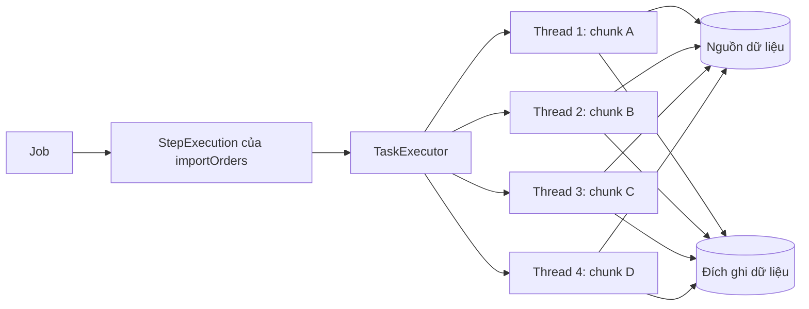
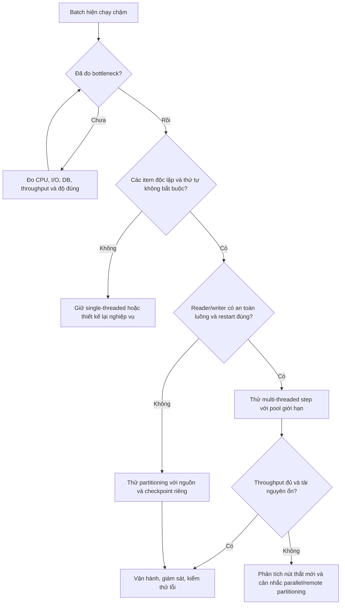

# Single-threaded so với multi-threaded

## 1. Bối cảnh: vì sao Spring Batch cần nhiều luồng?

Trong Spring Batch, **single-threaded step** là cách chạy mặc định: một luồng lần lượt đọc dữ liệu, xử lý rồi ghi kết quả. Cách này dễ hiểu, dễ theo dõi thứ tự, thường là điểm xuất phát đúng cho một job mới. Khi dữ liệu tăng lên hàng triệu bản ghi, thời gian chạy có thể vượt cửa sổ xử lý cho phép. **Multi-threaded step** cho phép nhiều luồng xử lý các **chunk** của cùng một step đồng thời, nhưng đổi lại đòi hỏi đánh giá an toàn luồng, transaction, retry/restart và giới hạn tài nguyên.

Đây là hai cách **thực thi một step**; chúng không tự quyết định toàn bộ kiến trúc phân tán của ứng dụng. Chẳng hạn, một step chạy nhiều luồng trong cùng JVM vẫn khác với partitioning chia dữ liệu thành nhiều `StepExecution`, hoặc remote partitioning chạy worker trên máy khác.

**Mục tiêu bài học:** hiểu đường đi của dữ liệu trong hai mô hình; biết thêm `TaskExecutor` vào step; nhận diện thành phần dùng chung có rủi ro; đo throughput và bottleneck; chọn số luồng, chunk size và cách retry/restart phù hợp với tài nguyên thực tế.

## 2. Single-threaded step hoạt động thế nào?

Với chunk-oriented processing, mỗi vòng lặp của một step thường thực hiện:

1. `ItemReader.read()` đọc lần lượt cho tới khi đạt `chunkSize` hoặc hết dữ liệu.
2. `ItemProcessor.process()` biến đổi từng item nếu có processor.
3. `ItemWriter.write(Chunk)` ghi một nhóm item.
4. Transaction của chunk được commit; sau đó step tiếp tục chunk kế tiếp.

Ví dụ `chunkSize = 3`, đầu vào `[A, B, C, D, E, F, G]`:

```text
Một thread (T1)            Thời gian →

T1:  [read/process/write A,B,C] -> COMMIT #1
     [read/process/write D,E,F] -> COMMIT #2
     [read/process/write G]     -> COMMIT #3

JobRepository: một StepExecution với readCount/writeCount/commitCount
```

Các chunk được xử lý nối tiếp; tại một thời điểm chỉ có **một** chunk của step đang thực thi. `StepExecution` chứa số lượng item đọc/ghi, trạng thái, lỗi và các thông tin để Spring Batch quản lý vòng đời step.

**Điểm mạnh:** ít cạnh tranh tài nguyên, trạng thái reader thường dễ quản lý, log dễ lần theo và thứ tự thực thi chunk dễ dự đoán. **Giới hạn:** khi một luồng phải chờ database hoặc HTTP, các chunk còn lại cũng phải chờ; khi CPU xử lý từng item nặng, step chỉ sử dụng một luồng thực thi nghiệp vụ.

## 3. Multi-threaded step hoạt động thế nào?

Đối với chunk-oriented step có `TaskExecutor`, Spring Batch có thể lập lịch **nhiều chunk của cùng một step** trên các thread khác nhau. Mỗi chunk vẫn cần ranh giới transaction riêng, nhưng các chunk có thể bắt đầu, hoàn thành và commit **khác thứ tự nhận dữ liệu**.

```text
                                  Thời gian →

T1: [chunk #1: read/process/write] ------- COMMIT
T2:    [chunk #2: read/process/write] -- COMMIT
T3:       [chunk #3: read/process/write] --------- COMMIT
T4:           [chunk #4: read/process/write] - COMMIT

             CÙNG một StepExecution, reader/processor/writer có thể được chia sẻ
```



**Khác biệt cốt lõi:** nhiều thread tham gia **cùng một `StepExecution`**, không phải Spring Batch tự sinh ra bốn step độc lập. `ItemReader`, `ItemProcessor`, `ItemWriter` thường là các component được cấu hình một lần cho step, nên phải xét việc nhiều thread gọi đến chúng đồng thời. `@StepScope` giúp tạo bean theo `StepExecution`, **không** có nghĩa tự động tạo một bean riêng cho mỗi thread.

Vì các chunk chạy đồng thời, **không được giả định thứ tự ghi giống thứ tự đọc**. Chẳng hạn bản ghi có ID 104 có thể được commit trước ID 101. Nếu nghiệp vụ bắt buộc xử lý đúng thứ tự (số dư tài khoản, sự kiện phụ thuộc, đánh số tuần tự), multi-threaded step thường không phù hợp nếu chưa thiết kế cơ chế sắp xếp hoặc cô lập dữ liệu.

## 4. So sánh theo tiêu chí kỹ thuật

| Tiêu chí | Single-threaded step | Multi-threaded step |
| --- | --- | --- |
| Số thread làm nghiệp vụ | Thường một | Nhiều thread qua `TaskExecutor` |
| Chunk | Chạy nối tiếp | Các chunk có thể chạy đồng thời |
| `StepExecution` | Một | **Vẫn một** cho step đó |
| Thứ tự xử lý/commit | Dễ dự đoán theo luồng đọc | Không bảo đảm thứ tự giữa các chunk |
| Reader/processor/writer | Ít vấn đề truy cập đồng thời | Phải kiểm tra thread safety và trạng thái dùng chung |
| Rủi ro cạnh tranh DB | Thường thấp hơn | Có thể tăng lock, transaction đồng thời và áp lực connection pool |
| Restart sau lỗi | Thường đơn giản hơn với reader có trạng thái đúng | Cần kiểm thử kỹ do read-ahead, commit không theo thứ tự và trạng thái dùng chung |
| Quan sát lỗi | Dễ lần theo một luồng | Nên ghi thread, chunk, item/correlation ID vào log |
| Khả năng mở rộng | Tăng tốc nhờ tối ưu I/O, chunk và thuật toán | Tăng thông lượng đến khi chạm giới hạn CPU, I/O hoặc thành phần tuần tự |
| Khi phù hợp | Dữ liệu vừa, thứ tự quan trọng, reader stateful | Các item độc lập, xử lý tốn thời gian, component an toàn luồng |

Điểm dễ nhầm: **`parallel steps` khác `multi-threaded step`**. Parallel steps dùng flow/split để chạy nhiều step khác nhau (mỗi step có `StepExecution` của nó). Partitioning chia một tập dữ liệu thành nhiều phần với `StepExecution` riêng. Multi-threaded step tăng đồng thời *bên trong một step*, nhưng vẫn giữ một `StepExecution` chung.

## 5. Ví dụ cấu hình Java: từ một luồng sang nhiều luồng

Giả sử cần import hóa đơn với `ItemReader<InvoiceRow>`, `ItemProcessor<InvoiceRow, InvoiceRecord>` và `ItemWriter<InvoiceRecord>`. Dưới đây là kiểu cấu hình Java DSL quen thuộc của **Spring Batch 5.x**. Với phiên bản khác, cần đối chiếu chữ ký builder trong API tương ứng; phần quan trọng cần nắm là vị trí cấu hình `taskExecutor(...)` và tính an toàn của các component được truyền vào.

### 5.1. Phiên bản tuần tự

```java
@Bean
Step importInvoicesSingle(
        JobRepository jobRepository,
        PlatformTransactionManager transactionManager,
        ItemReader<InvoiceRow> invoiceReader,
        ItemProcessor<InvoiceRow, InvoiceRecord> invoiceProcessor,
        ItemWriter<InvoiceRecord> invoiceWriter) {

    return new StepBuilder("importInvoicesSingle", jobRepository)
            .<InvoiceRow, InvoiceRecord>chunk(100, transactionManager)
            .reader(invoiceReader)
            .processor(invoiceProcessor)
            .writer(invoiceWriter)
            .build();
}
```

Với cấu hình này, step commit một chunk tối đa 100 item rồi mới xử lý chunk tiếp theo. Nếu processor mất 10 ms/item thì riêng 100 lần gọi processor đã mất khoảng 1 giây/chunk, chưa tính đọc, ghi và commit. Đây là mức tham chiếu cần đo trước khi tăng số luồng.

### 5.2. Phiên bản nhiều luồng

```java
@Bean
ThreadPoolTaskExecutor invoiceTaskExecutor() {
    ThreadPoolTaskExecutor executor = new ThreadPoolTaskExecutor();
    executor.setThreadNamePrefix("invoice-batch-");
    executor.setCorePoolSize(4);
    executor.setMaxPoolSize(4);
    executor.setQueueCapacity(32);
    executor.setRejectedExecutionHandler(
            new ThreadPoolExecutor.CallerRunsPolicy());
    executor.initialize();
    return executor;
}

@Bean
Step importInvoicesMulti(
        JobRepository jobRepository,
        PlatformTransactionManager transactionManager,
        ItemReader<InvoiceRow> invoiceReader,
        ItemProcessor<InvoiceRow, InvoiceRecord> invoiceProcessor,
        ItemWriter<InvoiceRecord> invoiceWriter,
        @Qualifier("invoiceTaskExecutor") TaskExecutor taskExecutor) {

    return new StepBuilder("importInvoicesMulti", jobRepository)
            .<InvoiceRow, InvoiceRecord>chunk(100, transactionManager)
            .reader(invoiceReader)
            .processor(invoiceProcessor)
            .writer(invoiceWriter)
            .taskExecutor(taskExecutor) // Cho phép nhiều chunk xử lý đồng thời
            .build();
}
```

Các khai báo trên minh họa **hai lựa chọn cấu hình để so sánh**, không phải hai step cần chạy đồng thời trên cùng reader. Khi benchmark, cung cấp reader và dữ liệu đầu vào ở trạng thái khởi tạo tương đương cho mỗi lượt; nếu dùng chung bean reader stateful cho cả hai lượt, kết quả so sánh dễ sai.

`ThreadPoolTaskExecutor` dùng pool có giới hạn; `CallerRunsPolicy` là một dạng gây áp lực ngược khi queue đầy, giúp công việc không bị bỏ ngay khi bão hòa, nhưng cũng có thể khiến thread gửi task phải trực tiếp thực thi. Vì vậy số thread *trong pool* bằng 4 không đồng nghĩa lúc nào cũng chỉ có chính xác bốn thread làm nghiệp vụ. Cần quan sát behavior và điều chỉnh pool/queue theo phiên bản Spring Batch cùng tải thực tế.

> **Không nên bật multi-thread chỉ bằng cách thêm `.taskExecutor(...)` rồi đưa thẳng vào production.** Cả reader, processor, writer, transaction handling và phụ thuộc ở phía dưới phải được rà soát. Nếu các component không hỗ trợ đồng thời, code có thể chạy nhanh trong test nhỏ nhưng tạo lỗi mất dữ liệu hoặc ghi trùng dưới tải.

### 5.3. Dụng ý của `chunk(100, ...)`

`chunkSize` là **số item tối đa mỗi transaction/chunk**, không phải số thread và cũng không phải giới hạn toàn bộ số item đang được xử lý. Với 4 chunk đồng thời và `chunkSize = 100`, các thread có thể giữ nhiều nhóm item trong bộ nhớ cùng lúc. Nếu mỗi item rất lớn, lượng dữ liệu trong heap và hoạt động GC có thể tăng rõ rệt.

Đừng mặc định `chunkSize` càng lớn càng nhanh: chunk nhỏ tạo nhiều lần commit; chunk lớn có thể giữ lock lâu, tăng chi phí rollback khi một item lỗi và tiêu tốn bộ nhớ. Thử nhiều cấu hình và đo thời gian đọc/ghi, commit, GC và lock của DB.

## 6. Thread safety: rủi ro lớn nhất khi bật nhiều luồng

### 6.1. `ItemReader`: dữ liệu có bị đọc trùng hoặc bỏ sót không?

Nhiều reader của Spring Batch có con trỏ, trang hiện tại, bộ đếm hoặc bộ đệm **mutable**. Ví dụ, các reader kiểu cursor thường quản lý vị trí trong `ResultSet`; không nên mặc định dùng đồng thời mà không có kiểm chứng rõ ràng. Hai thread cùng sửa vị trí con trỏ có thể khiến item bị đọc trùng hoặc bỏ sót.

Các lựa chọn khi reader không thread-safe:

- **Chạy tuần tự:** nếu đọc vẫn là nút thắt và thứ tự rất quan trọng.
- **Đồng bộ truy cập `read()`:** dùng wrapper thích hợp như `SynchronizedItemStreamReader` trong phiên bản hỗ trợ, hoặc giải pháp đồng bộ có kiểm soát. Điều này chỉ bảo vệ đoạn đọc; nếu phần lớn thời gian nằm trong `read()`, throughput vẫn bị giới hạn. Cần kiểm thử rollback và restart: đồng bộ thao tác đọc **không tự làm reader an toàn để restart**.
- **Tách vùng dữ liệu:** nếu khối lượng lớn và reader cần trạng thái riêng, cân nhắc partitioning với dải ID/điều kiện lọc riêng cho mỗi partition; đây là mô hình khác với nhiều thread dùng chung một reader.

Một reader minh họa có thể phát ID mới bằng `AtomicLong`:

```java
final class DemoIdReader implements ItemReader<Long> {
    private final AtomicLong next = new AtomicLong(1);
    private final long lastId;

    DemoIdReader(long lastId) {
        this.lastId = lastId;
    }

    @Override
    public Long read() {
        long id = next.getAndIncrement();
        return id <= lastId ? id : null;
    }
}
```

`AtomicLong` giúp việc cấp ID trong cùng JVM không bị trùng do race condition, **nhưng đây chỉ là ví dụ về atomicity**: reader không lưu tiến độ vào `ExecutionContext`, nên restart có thể đọc lại các ID đã xử lý. Không dùng nguyên bản cho import production nếu cần semantics xử lý lại chính xác; hãy thiết kế phân vùng, lưu tiến độ và ghi đích idempotent.

### 6.2. `ItemProcessor`: stateless thường dễ an toàn hơn

Một processor chỉ đọc dữ liệu đầu vào rồi tạo đối tượng kết quả mới, không ghi vào các field dùng chung, thường dễ dùng trong nhiều thread hơn. Ngược lại, `ArrayList` hoặc `HashMap` được lưu trong field của processor rồi cập nhật từ nhiều lần `process()` có thể gây race condition. Dùng cấu trúc đồng thời nếu thực sự cần, nhưng ưu tiên xử lý độc lập từng item.

```java
// Dễ kiểm soát hơn: chỉ dùng biến cục bộ, không có mutable field dùng chung.
public InvoiceRecord process(InvoiceRow row) {
    BigDecimal net = row.amount().subtract(row.discount());
    return new InvoiceRecord(row.id(), net);
}
```

### 6.3. `ItemWriter`, `ExecutionContext` và tài nguyên dưới tầng

Ngay cả khi reader đúng, writer vẫn có thể không an toàn nếu nhiều thread cùng cập nhật một file, `StringBuilder`, collection hoặc connection mutable được chia sẻ. Tính thread-safe của writer phải kiểm tra theo **implementation và cách cấu hình cụ thể**. Nếu dùng database, chú ý unique key, lock, deadlock, isolation level, batch write và pool connection; việc ghi một item hai lần vẫn có thể xảy ra khi retry nếu sink không idempotent.

`ExecutionContext` là nơi lưu trạng thái phục vụ restart, **không phải một bộ đếm tùy ý để nhiều thread cùng ghi**. Những cách như `executionContext.putInt("index", index + 1)` dễ làm mất cập nhật và ghi trạng thái sai. Nếu cần đếm cho mục đích quan sát, dùng metric thread-safe riêng; nếu cần checkpoint dữ liệu chính xác, thiết kế lại reader/partition thay vì chỉ thêm khóa quanh map.

### 6.4. Checklist an toàn luồng

| Thành phần | Câu hỏi bắt buộc | Rủi ro khi bỏ qua |
| --- | --- | --- |
| Reader | Có cursor, page index, file offset, internal buffer không? | Đọc trùng, thiếu item |
| Processor | Có mutable field/cache/counter dùng chung không? | Tính sai, ghi đè trạng thái |
| Writer | Có giữ state, dùng chung resource không? Sink có idempotent không? | Ghi sai thứ tự, trùng dữ liệu |
| `ExecutionContext` | Ai cập nhật và khi nào được persist? | Restart từ checkpoint không đúng |
| DB/HTTP client | Có hỗ trợ truy cập đồng thời và giới hạn connection/rate không? | Pool exhaustion, 429, deadlock |
| Transaction | Mỗi chunk có transaction độc lập; rollback ảnh hưởng tới đâu? | Retry thiếu an toàn, side effect còn tồn tại |

## 7. Throughput: nhiều thread có thật sự nhanh hơn?

Thông lượng thường được đo như sau:

\[
\text{Throughput} = \frac{\text{Số item xử lý thành công}}{\text{Thời gian chạy thực tế (giây)}}
\]

**Speedup** khi chuyển sang nhiều thread bằng thời gian chạy single-threaded chia cho thời gian chạy multi-threaded. **Efficiency** tương đối bằng speedup chia số luồng (ước lượng để nhận biết chi phí điều phối và bão hòa; với caller-runs phải chú ý số thread thực tế).

Ví dụ giả định cùng import 120.000 item, cùng cấu hình hạ tầng và dữ liệu tương đương:

| Số thread trong pool | Thời gian | Throughput (item/s) | Speedup so với 1 thread |
| ---: | ---: | ---: | ---: |
| 1 | 240 giây | 500 | 1,00x |
| 2 | 136 giây | 882 | 1,76x |
| 4 | 82 giây | 1.463 | 2,93x |
| 8 | 79 giây | 1.519 | 3,04x |

Các số trên **chỉ là dữ liệu minh họa**, không phải benchmark của Spring Batch. Khi từ 4 lên 8 thread chỉ giảm thêm 3 giây, có thể DB, kết nối, tốc độ ghi đĩa, đọc tuần tự hoặc CPU đã gần bão hòa. Thêm thread có thể tăng contention mà không cải thiện đáng kể throughput; vì vậy lựa chọn 4 thread có thể tiết kiệm tài nguyên hơn trong ví dụ.

### 7.1. Nút thắt ở đâu quyết định hướng tối ưu

| Quan sát khi đo | Nguyên nhân có thể | Việc nên làm trước khi tăng thread |
| --- | --- | --- |
| Một core CPU gần 100%, các core khác rảnh | Processor CPU-bound | Thử tăng thread tới khi CPU/GC bão hòa; giảm thuật toán dư thừa |
| Thread thường chờ DB, CPU thấp | I/O-bound, query chậm, pool nhỏ | Tối ưu SQL/index và batch write; so pool size với concurrency |
| Tăng thread nhưng đọc dữ liệu không nhanh hơn | Reader có khóa hoặc một cursor tuần tự | Tối ưu reader, cân nhắc partitioning theo key range |
| DB lock wait/deadlock tăng theo thread | Các chunk tranh cùng row/index | Chia khóa/partition theo domain, giảm xung đột ghi |
| Heap/GC tăng vọt | Chunk size lớn, queue nhiều, object giữ lâu | Giảm batch size/queue, hạn chế object lớn |
| API phía sau trả HTTP 429 | Gửi vượt rate limit | Giới hạn concurrency, backoff và retry có kiểm soát |

Thực tế throughput phụ thuộc vào **phần công việc có thể chạy song song**. Ví dụ, nếu 60% thời gian nằm ở một reader bị khóa toàn cục thì bốn thread không thể mang lại speedup lý tưởng 4x, ngay cả khi processor và writer hoàn toàn thread-safe.

### 7.2. Thiết kế phép đo có ý nghĩa

1. **Lấy baseline:** chạy single-threaded đủ dữ liệu đại diện, ghi thời gian tổng, `readCount`, `writeCount`, `filterCount`, `skipCount`, `commitCount`, tốc độ item/giây, CPU, heap/GC, DB queries và connection usage.
2. **Thay đổi một biến mỗi lượt:** thử 2, 4, 8 thread; giữ nguyên input, chunk size, logic và giới hạn hạ tầng. Nếu muốn thử chunk size, làm thành vòng đo riêng.
3. **Theo dõi correctness:** so số ID đầu vào/đầu ra, số bản ghi duy nhất, kết quả nghiệp vụ và skip/error. Throughput cao nhưng thiếu dữ liệu không được tính là cải thiện.
4. **Thử tình huống lỗi:** kill worker thread/process ở thời điểm giữa chunk, thử retry, restart, mất kết nối DB và message/API lặp nếu có.
5. **Chọn điểm hợp lý:** chọn cấu hình đạt cửa sổ xử lý với dư địa tài nguyên, không nhất thiết là số thread có kết quả nhanh nhất trong một lần chạy.

## 8. Tính đúng khi retry, rollback và restart

### 8.1. Một chunk lỗi không đồng nghĩa các chunk khác dừng ngay

Trong multi-threaded step, nhiều chunk có thể ở trạng thái đang xử lý. Khi chunk A rollback hoặc ném lỗi, chunk B có thể đã commit thành công trước đó. Sau khi step thất bại và job được restart, những item đã commit cần được nhận biết đúng để tránh xử lý lại sai hoặc bỏ sót.

**Đừng dựa vào thứ tự commit làm checkpoint tuần tự.** Ví dụ chunk chứa ID 201–300 có thể commit trước chunk chứa ID 101–200; ghi một biến `lastProcessedId = 300` rồi bỏ qua tất cả ID nhỏ hơn 300 khi restart sẽ làm mất các item chưa commit của chunk trước.

### 8.2. Retry và skip cần có giới hạn

Các chính sách fault tolerance như retry/skip vẫn gắn với xử lý chunk, nhưng tăng concurrency nghĩa là số request hoặc transaction retry đồng thời có thể lớn hơn. Với DB hoặc API có giới hạn, hãy thiết kế retry có `backoff` hợp lý, phân loại lỗi có thể retry và lỗi dữ liệu không thể retry. Cần đo cả số retry và tác động lên hệ thống đích.

**Ví dụ:** một `ItemWriter` gọi API thanh toán không thể chỉ retry mù sau timeout. API có thể đã nhận request nhưng response bị mất. Dùng idempotency key theo giao dịch, kiểm tra trạng thái đơn trước retry và chỉ đánh dấu hoàn tất khi kết quả xác định.

### 8.3. Restart phải được thử ở dữ liệu thực

Không nên giả định `@StepScope`, `SynchronizedItemStreamReader` hoặc `saveState(false)` tự giải quyết restart. Với reader stateful và nhiều thread, muốn restart đúng cần bảo đảm tập item chưa hoàn tất được truy xuất lại một cách đáng tin cậy. Các cách thường dùng là:

- Chia nguồn theo ID range hoặc trạng thái nghiệp vụ có thể kiểm tra lại; dùng partitioning nếu mỗi luồng cần checkpoint riêng.
- Thiết kế ghi đích idempotent: unique key, upsert, kiểm tra trạng thái xử lý hoặc transaction phù hợp.
- Chạy test restart sau khi một số chunk commit và một số chunk rollback; kiểm tra số item **duy nhất** và tính đúng của kết quả sau restart.

Nếu một cơ chế lưu tiến độ không thể biểu diễn chính xác tình trạng commit không theo thứ tự, hãy đổi chiến lược checkpoint, đừng chỉ tăng tần suất ghi `ExecutionContext`.

## 9. Chọn kiến trúc scaling theo nhu cầu thực tế



| Nhu cầu | Hướng phù hợp ban đầu |
| --- | --- |
| Batch nhỏ, phụ thuộc thứ tự, restart đơn giản | Single-threaded step |
| Hàng triệu item độc lập; processor tốn CPU; component thread-safe | Multi-threaded step trong một JVM |
| Một bước đọc stateful khó chia sẻ, nhưng dữ liệu tách được theo ID/ngày/tenant | Local partitioning, mỗi partition có `StepExecution` và input riêng |
| Các step nghiệp vụ độc lập có thể chạy cùng lúc | Parallel steps qua flow/split |
| Dữ liệu rất lớn, cần khai thác nhiều máy/worker | Remote partitioning hoặc remote chunking theo semantics phù hợp |

Multi-threaded step không tự phân phối tải sang nhiều máy và không tự biến input thành các partition có checkpoint độc lập. Đây là giải pháp khá gần với cấu hình single-threaded, nhưng chỉ mang lại hiệu quả khi tính đúng và phần việc song song được bảo đảm.

## 10. Tình huống thực tế: import 5 triệu hóa đơn

Giả sử job đêm đọc 5 triệu hóa đơn, kiểm tra mã số thuế qua một dịch vụ nội bộ rồi ghi kết quả xuống PostgreSQL. Mức xử lý tuần tự là 250 item/giây, nghĩa là riêng 5 triệu item cần khoảng **20.000 giây (~5 giờ 33 phút)**. Cửa sổ vận hành cho phép chỉ 2 giờ.

**Cách phân tích:**

1. Đo chi phí mỗi công đoạn: reader (truy vấn DB), processor (HTTP), writer (batch insert). Nếu 80% thời gian là đợi HTTP và mỗi item độc lập, tăng concurrency có thể hữu ích.
2. Kiểm tra dịch vụ mã số thuế có giới hạn request/giây; ví dụ nếu dịch vụ chỉ cho 600 req/s thì throughput mong muốn 700 item/s không thể đạt chỉ bằng tăng thread.
3. Kiểm tra `ItemReader` có cursor mutable không. Nếu có, cân nhắc thay chiến lược reader hoặc partitioning thay vì dùng chung cursor dưới nhiều thread.
4. Đặt unique key theo `invoiceId` cho bảng đích, xử lý upsert để retry không ghi trùng; nếu gọi dịch vụ có side effect, dùng idempotency key.
5. Benchmark các mức concurrency, đối chiếu số hóa đơn duy nhất đã ghi và kiểm thử restart khi đang xử lý; lựa chọn giải pháp đạt mục tiêu 2 giờ với dư địa tài nguyên.

Nếu công việc phụ thuộc nghiêm ngặt vào thứ tự giao dịch theo tài khoản, cách tiếp cận khác là chia theo **tài khoản** (mỗi tài khoản xử lý tuần tự, các tài khoản khác nhau có thể song song), thay vì cho các thread lấy item ngẫu nhiên từ một cursor chung.

## 11. Những nhầm lẫn cần tránh

| Nhận định | Đánh giá đúng |
| --- | --- |
| “Thêm 8 thread thì job nhanh gấp 8.” | Sai. Tốc độ bị giới hạn bởi phần tuần tự, CPU, DB, network, lock, queue và chi phí điều phối. |
| “`@StepScope` tạo một reader cho mỗi thread.” | Sai. Scope gắn với step execution, không phải thread. |
| “`chunk(100)` nghĩa là có 100 thread.” | Sai. Nó biểu thị số item tối đa trong một chunk/transaction. |
| “Nhiều thread đồng nghĩa có nhiều `StepExecution`.” | Sai đối với multi-threaded step. Partitioning mới tạo các step execution cho từng partition. |
| “Có synchronized reader thì restart chắc chắn đúng.” | Sai. Đồng bộ thao tác đọc không giải quyết đầy đủ checkpoint khi commit khác thứ tự. |
| “Chỉ cần đếm `readCount` là đủ xác nhận dữ liệu đúng.” | Sai. Cần kiểm tra dữ liệu đầu ra duy nhất, lỗi nghiệp vụ, filter/skip/retry và tính idempotent. |

## 12. Tự kiểm tra kiến thức

**Câu 1.** Một step dùng `chunk(50, ...)` và pool 4 thread. Có bao nhiêu `StepExecution` được tạo chỉ vì cấu hình này?

*Gợi ý trả lời:* Vẫn một `StepExecution` cho chính step đó; các thread có thể xử lý nhiều chunk đồng thời. `50` là kích thước chunk, không phải số thread.

**Câu 2.** Step chạy chậm ở khâu gọi API và đọc từ `JdbcCursorItemReader`. Có nên thêm ngay `.taskExecutor(...)`?

*Gợi ý trả lời:* Chưa. Cần kiểm tra reader có hỗ trợ concurrent read không, các item có độc lập không, API rate limit thế nào, và chiến lược restart/idempotency. Một reader cursor dùng chung có thể tạo race condition.

**Câu 3.** Tăng pool từ 4 lên 8 thread làm throughput tăng từ 1.463 lên 1.519 item/s, trong khi CPU/DB đã gần bão hòa. Nên xử lý gì?

*Gợi ý trả lời:* Xem nút thắt và chi phí thêm thread; cải thiện query, pool, lock hoặc cách chia dữ liệu trước khi tiếp tục tăng concurrency. Có thể chọn 4 thread vì hiệu quả tài nguyên tốt hơn.

**Câu 4.** Vì sao dùng `lastProcessedId` trong một `ExecutionContext` chung có thể làm mất dữ liệu khi restart?

*Gợi ý trả lời:* Các chunk commit không theo thứ tự; một ID lớn hơn có thể đã commit trong khi ID nhỏ hơn chưa commit. Dùng ID lớn nhất làm mốc bỏ qua sẽ khiến nhóm chưa commit không được đọc lại.

## 13. Tài liệu để đọc sâu

- [Spring Batch Reference — Scaling and Parallel Processing](https://docs.spring.io/spring-batch/reference/scalability.html): giới thiệu multi-threaded steps, parallel steps, partitioning và các giới hạn thiết kế.
- [Spring Batch Reference — ItemReader and ItemWriter Implementations](https://docs.spring.io/spring-batch/reference/readers-and-writers/): đặc điểm reader/writer, trạng thái và lưu ý về concurrency.
- [Spring Batch Reference — Configuring a Step](https://docs.spring.io/spring-batch/reference/step/chunk-oriented-processing/configuring.html): chunk size, transaction và cấu hình step.
- [Spring Framework Reference — Task Execution and Scheduling](https://docs.spring.io/spring-framework/reference/integration/scheduling.html): `TaskExecutor`, thread pool và giới hạn tài nguyên.

**Ghi nhớ khi vận hành:** bắt đầu bằng single-threaded để có số đo và baseline đúng; thử multi-threaded khi từng item có thể xử lý độc lập, các component hỗ trợ đồng thời và đã kiểm thử restart. Thành công của scaling được đo bằng **throughput đạt yêu cầu cùng với tính đúng dữ liệu**, không chỉ bằng số luồng đang chạy.
